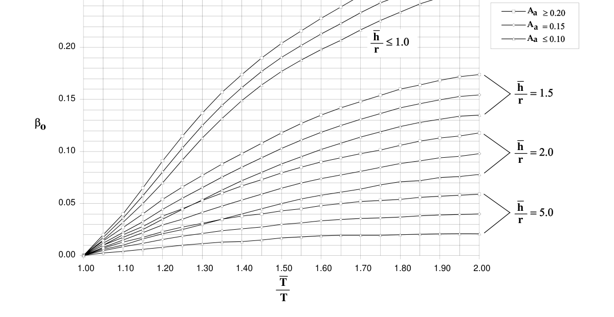

# A-2 — Recomendaciones para el cálculo de los efectos de interacción dinámica suelo-estructura

## A-2.0 — NOMENCLATURA

$A_{a}$ = coeficiente que representa la aceleración pico efectiva, para diseño, dado en A.2.2.

$A_{o}$ = área de la cimentación.

$D_{s}$= profundidad del estrato blando. Véase A-2.2.1.2.

$G_{o}$ = $γv_{s0}^{2}$ = módulo de cortante promedio para los suelos localizados bajo la cimentación para deformaciones unitarias pequeñas.

$g$ = aceleración de la gravedad ($9.8$ m/s²)

$h_{x}$ = altura medida desde la base del nivel en estudio.

$h$ = altura efectiva de la edificación, la cual debe tomarse igual a 0.7 veces la altura total, $h_{n}$ . En edificios en los cuales toda la masa $M$ de la edificación está concentrada en un solo piso, debe tomarse igual a la altura del piso, medida desde la base.

$I_{o}$ = momento de inercia de la cimentación con respecto a un eje horizontal, perpendicular a la dirección en estudio.

$k$ = rigidez de la estructura considerándola como empotrada en la base. Se calcula por medio de la ecuación A-2-4.

$K_{y}$ = rigidez lateral de la cimentación de la edificación, la cual se define como la fuerza estática horizontal aplicada en la cimentación, que produce una deflexión horizontal unitaria. Tanto la fuerza estática como la deflexión horizontal se toman en la dirección en estudio.

$Kθ$ = rigidez rotacional, o de balanceo, de la cimentación de la edificación, definida como el momento estático necesario para producir una rotación unitaria, en promedio, de la cimentación con respecto a un eje horizontal perpendicular a la dirección en estudio.

$L_{o}$ = longitud total de la cimentación en la dirección en estudio.

$M_{o}$ = momento de vuelco en la base de la edificación calculado utilizando las fuerzas horizontales de diseño sin incluir la reducción por efectos de interacción suelo-estructura.

$M_{lo}$= momento de vuelco en la base de la edificación calculado utilizando las fuerzas horizontales correspondientes al primer modo sin incluir la reducción por efectos de interacción suelo-estructura.

$M$ = masa participante de la edificación, el cual puede tomarse igual a $0.7M$ , excepto en aquellos casos en los cuales toda la masa $M$ de la edificación está concentrado en un solo piso, caso en el cual debe tomarse igual a $M$ .

$M_{lj}$ = masa participante de la edificación, para el modo fundamental de la edificación en la dirección $j$, calculado utilizando la ecuación A.5.4-2.

$r$ = longitud característica de la cimentación. Se determina por medio de las ecuaciones A-2-7 o A-2-8.

$r_{a}$ = longitud característica de la cimentación. Definida por medio de la ecuación A-2-7.

$r_{m}$= longitud característica de la cimentación. Definida por medio de la ecuación A-2-8.

$S_{a}$ = valor del espectro de aceleraciones de diseño, determinado de acuerdo con los requisitos del Capítulo A.2, correspondiente al período fundamental de la estructura, $T$ o $T_{a}$ , considerada empotrada en su base, calculado de acuerdo con lo prescrito en A.4.2.

$S_{al}$= valor del espectro de aceleraciones de diseño, determinado de acuerdo con los requisitos del Capítulo A.2, correspondiente al período del modo fundamental de la estructura, $T_{l}$ , considerada empotrada en su base.

$S_{a}$ = valor del espectro de aceleraciones de diseño, determinado de acuerdo con los requisitos del Capítulo A.2, correspondiente al período fundamental de la estructura, $T$ , cuando éste se calcula considerando los efectos de la interacción suelo-estructura, tal como se define en A-2.2.1.1.

$S_{al}$= valor del espectro de aceleraciones de diseño, determinado de acuerdo con los requisitos del Capítulo A.2, de interacción dinámica suelo-estructura correspondiente al período fundamental de la estructura, $T_{l}$ , cuando éste se calcula considerando los efectos de la interacción suelo-estructura.

$T$ = valor del período fundamental del edificio, calculado de acuerdo con lo prescrito en A.4.2.

$T_{l}$ = valor del período fundamental del edificio, correspondiente al primer modo de vibración.

$T$ = valor del período fundamental del edificio tomando en cuenta la interacción suelo-estructura. Se determina de acuerdo con los requisitos de A-2.2.1.1.

$T_{l}$ = valor del período fundamental del edificio, correspondiente al primer modo de vibración, tomando en cuenta la interacción suelo-estructura.

$V_{s}$ = cortante sísmico de diseño en la base de la estructura, calculado por el método de la fuerza horizontal equivalente del Capítulo A.4.

$V_{s}'$ = cortante sísmico en la base de la estructura, calculado por el método de la fuerza horizontal equivalente del Capítulo A.4, utilizando un período de vibración igual a $C_{u} T_{a}$ .

$V_{lj}$ = cortante sísmico de diseño en la base de la estructura en la dirección $j$, contribuido por el modo fundamental en esa dirección, calculado de acuerdo con la ecuación A.5.4-3 y sin ser afectado por efectos de interacción suelo-estructura.

$V_{s}$ = cortante sísmico de diseño en la base de la estructura, calculado tomando en cuenta la interacción suelo- estructura.

$V_{lj}$ = cortante sísmico de diseño en la base de la estructura en la dirección $j$, contribuido por el modo fundamental en esa dirección, y afectado por la interacción suelo-estructura.

$ΔV_{s}$= reducción en el cortante sísmico de diseño en la base de la estructura, debido a los efectos de la interacción suelo-estructura. Ecuación A-2-2.

$ΔV_{lj}$= reducción en el cortante sísmico de diseño en la base de la estructura en la dirección $j$, contribuido por el modo fundamental en esa dirección, debida a los efectos de la interacción suelo-estructura.

$v_{so}$= velocidad promedio de la onda de cortante, de los suelos localizados debajo de la cimentación, para niveles bajos de deformación unitaria, menores de 0.00001 (0.001%).

$α$ = parámetro que describe la densidad relativa de la estructura y el suelo bajo ella. Definida en la ecuación A-2-6.

$α_{θ}$ = modificador de la rigidez dinámica de la cimentación para tener en cuenta el balanceo.

$β$ = coeficiente de amortiguamiento crítico del sistema estructural, considerando la interacción suelo- estructura, calculado de acuerdo con lo prescrito en A-2.2-1.

$β_{o}$ = coeficiente de amortiguamiento crítico de la cimentación. Se determina por medio de la figura A-2.2-1.

$δ_{x}$ = deflexión horizontal en el nivel $x$ de la estructura, calculada siguiendo el método de la fuerza horizontal equivalente y utilizando las fuerzas sísmicas de diseño sin ser modificadas por los efectos de la interacción suelo-estructura.

$δ_{lx}$= deflexión horizontal en el nivel $x$ de la estructura, calculada para el primer modo de vibración sin incluir los efectos de la interacción suelo-estructura.

$δ_{x}$ = deflexión horizontal en el nivel $x$ de la estructura, modificada por los efectos de la interacción suelo- estructura. Ecuación A-2-11.

$δ_{lx}$= deflexión horizontal en el nivel $x$ de la estructura, para el primer modo de vibración, modificada por los efectos de la interacción suelo-estructura.

$γ$ = masa unitaria promedio del suelo.

<!-- mod:1-decreto-092-2011-33 -->
> **Modificación — Decreto 092 de 2011** · anexo, p. 6
>
> La definición de $G_0$ queda así: $G_0 = \dfrac{\gamma\, v_{s0}^2}{g}$ = módulo de cortante promedio para los suelos localizados bajo la cimentación para deformaciones unitarias pequeñas.

## A-2.1 — GENERAL

**A-2.1.1** — Los requisitos presentados en este Apéndice pueden utilizarse para tener en cuenta los efectos de interacción suelo-estructura en la determinación de las fuerzas sísmicas de diseño y las deformaciones que éstas imponen a la estructura. Su uso se permite dentro de las limitaciones que da el Capítulo A.7 cuando el modelo matemático utilizado para determinar la respuesta de la estructura no incorpora directamente la flexibilidad de la cimentación (uso de modelos empotrados en la base). En general el uso de estos requisitos disminuye los valores de diseño del cortante sísmico en la base, las fuerzas horizontales y los momentos de vuelco, pero aumenta las deflexiones horizontales de la estructura, y por ende las derivas, en sitios particulares de la estructura, además de los de interacción dinámica suelo-estructura desplazamientos y fuerzas secundarias asociadas con los efectos P-Delta. Los requisitos para ser utilizados con el método de la fuerza horizontal equivalente se presentan en A-2.2 y para el método del análisis dinámico modal elástico en A-2.3. Estos requisitos no deben ser usados si se empleó un modelo de base flexible donde la cimentación se modela directamente en el análisis de la estructura, y no un modelo de base empotrada.

## A-2.2 — MÉTODO DE LA FUERZA HORIZONTAL EQUIVALENTE

Los requisitos que se presentan a continuación, complementan en lo concerniente a interacción suelo-estructura los dados en el Capítulo A.7.

### A-2.2.1 — CORTANTE EN LA BASE

Para tener en cuenta los efectos de interacción suelo-estructura, el cortante sísmico de diseño en la base, $V_{s}$ , determinado por medio de la ecuación A.4-5, puede modificarse a:

$$ \bar{V}_s = V_s - \Delta V_s \tag{A-2-1} $$

y el valor de la reducción en el cortante sísmico en la base, para diseño, debe calcularse por medio de:

$$ \Delta V_s = \left[S_a - \bar{S}_a\left(\dfrac{0.05}{\bar{\beta}}\right)^{0.4}\right] g\,\bar{M} \tag{A-2-2} $$

El valor del cortante sísmico en la base modificado, $V_{s}$ , no puede ser menor que $0.7V_{s}'$ .

#### A-2.2.1.1 — Período efectivo de la edificación

El período efectivo, $T$ , debe determinarse por medio de la siguiente ecuación:

$$ \bar{T} = T\sqrt{1 + \dfrac{\bar{k}}{K_y}\left(1 + \dfrac{K_y\,\bar{h}^2}{K_\theta}\right)} \tag{A-2-3} $$

y

$$ \bar{k} = 4\pi^2\left(\dfrac{\bar{M}}{T^2}\right) \tag{A-2-4} $$

Las rigideces de la cimentación, $K_{y}$ y $Kθ$ , deben determinarse por medio de principios establecidos de mecánica de suelos, utilizando propiedades del suelo que sean representativas de su comportamiento a niveles de deformación unitaria, conmensurables con los que producen los movimientos sísmicos de diseño.

En aquellos casos en los cuales el estudio geotécnico no lo indique, el módulo promedio de cortante, $G$, para los suelos localizados debajo de la cimentación, en condiciones de deformaciones unitarias apreciables, y la velocidad de la onda de cortante, $v_{s}$, asociada con estas deformaciones unitarias, pueden determinarse utilizando la tabla A.-2.1-1.

**Tabla A-2.1-1**

Valores de $G /G_{o}$ y $v_{s}/v_{so}$

|  | Valor de $A_{a}$ |  |  |  |
|---|---|---|---|---|
|  | $≤$ 0.10 | $≤$ 0.15 | $≤$ 0.20 | $≥$ 0.30 |
| Valor de $G /G_{o}$ | 0.81 | 0.64 | 0.49 | 0.42 |
| Valor de $v_{s}/v_{so}$ | 0.90 | 0.80 | 0.70 | 0.65 |

Alternativamente, para edificaciones cuya cimentación sea una losa de fundación superficial o aproximadamente superficial, que se construye de una manera tal que se pueda considerar que el contacto entre los muros de contención y el suelo no restringe el libre movimiento de la estructura, el período de de interacción dinámica suelo-estructura vibración efectivo, tomando en cuenta los efectos de la interacción suelo-estructura, se puede determinar por medio de la siguiente ecuación:

$$ \bar{T} = T\sqrt{1 + \dfrac{25\,\alpha\,r_a\,\bar{h}}{v_s^2\,T^2}\left(1 + \dfrac{1.12\,r_a\,\bar{h}^2}{\alpha_\theta\,r_m^3}\right)} \tag{A-2-5} $$

en donde:

$$ \alpha = \dfrac{\bar{M}}{\gamma\,A_o\,\bar{h}} \tag{A-2-6} $$

$$ r_a = \sqrt{\dfrac{A_o}{\pi}} \tag{A-2-7} $$

y

$$ r_m = \sqrt[4]{\dfrac{4 I_o}{\pi}} \tag{A-2-8} $$

#### A-2.2.1.2 — Amortiguamiento efectivo

El coeficiente de amortiguamiento efectivo del sistema estructura- cimentación, debe calcularse por medio de:

$$ \bar{\beta} = \beta_o + \dfrac{0.05}{\left(\dfrac{\bar{T}}{T}\right)^3} \tag{A-2-9} $$

Los valores de $β_{o}$ se obtienen de la figura A-2.2-1. El parámetro $r$ en la figura A-2.2-1 es una longitud característica de la cimentación, la cual se puede determinar así:

Para $L_{o}h≤0.5$, $r$ es igual a $r_{a}$ , de la ecuación A-2-7 y para $L_{o}h≥1.0$, $r$ es igual a $r_{m}$, de la ecuación A-2-8.

Para valores intermedios se puede interpolar. $L_{o}$ es la longitud de la cimentación en la dirección en estudio, y en la aplicación de las ecuaciones A-2-7 y A-2-8, $A_{o}$ e $I_{o}$ se determinan para el área de la cimentación que efectivamente está en contacto con el suelo, pues le transmite el peso de la edificación.

Para edificios cimentados sobre pilotes que trabajan en punta, y para todos los otros casos en los cuales el suelo de fundación consiste en un estrato de suelos blandos relativamente uniforme, colocado sobre un depósito de suelos más duros, o roca, presentándose un cambio abrupto de rigidez, el coeficiente de amortiguamiento efectivo, $β_{o}$, que se utiliza en la ecuación A-2-9 puede ser substituido por el valor dado en la siguiente ecuación:

$$ \beta'_o = \beta_o\left(\dfrac{4 D_s}{v_s\,\bar{T}}\right)^2 \tag{A-2-10} $$

la cual es aplicable sólo en aquellos casos en los cuales la expresión entre paréntesis es menor que la unidad. En esta ecuación $D_{s}$ es la profundidad total del estrato blando.

El valor de $β$ , calculado de acuerdo con la ecuación A-2-9, con o sin el ajuste representado en la ecuación A-2-10, en ningún caso puede ser menor de 0.05, ni mayor que 0.20.

de interacción dinámica suelo-estructura 0.25

Figura A-2.2-1 — Coeficiente de amortiguamiento crítico de la cimentación, $β_{o}$

### A-2.2.2 — DISTRIBUCIÓN EN LA ALTURA DE LAS FUERZAS SÍSMICAS

La distribución en la altura del cortante en la base corregido por efectos de interacción suelo-estructura se debe tomar igual a la de la estructura sin interacción.

### A-2.2.3 — OTROS EFECTOS

Los cortantes de piso, los momentos de vuelco y los efectos torsionales deben determinarse de la misma manera que para edificaciones en las cuales no se ha tomado en cuenta la interacción suelo-estructura, pero utilizando las fuerzas horizontales reducidas por efectos de interacción. Las deflexiones modificadas deben determinarse por medio de la siguiente ecuación:

$$ \bar{\delta}_x = \dfrac{\bar{V}_s}{V_s}\left(\delta_x + \dfrac{M_o\,h_x}{K_\theta}\right) \tag{A-2-11} $$

## A-2.3 — MÉTODO DEL ANÁLISIS MODAL

Los siguientes requisitos complementan, en lo concerniente a interacción suelo-estructura, lo presentado en el Capítulo A.5.

### A-2.3.1 — CORTANTES MODALES EN LA BASE

Para tener en cuenta los efectos de interacción suelo- estructura, el cortante sísmico de diseño en la base, correspondiente al modo fundamental, $V_{lj}$ , en la dirección $j$, determinado por medio de la ecuación A.5.4-3, puede modificarse a:

$$ \bar{V}_{1j} = V_{1j} - \Delta V_{1j} \tag{A-2-12} $$

y el valor de la reducción en el cortante sísmico en la base correspondiente al modo fundamental, debe calcularse utilizando la ecuación A-2-13:

$$ \Delta V_{1j} = \left[S_{a1} - \bar{S}_{a1}\left(\dfrac{0.05}{\bar{\beta}}\right)^{0.4}\right] g\,\bar{M}_{1j} \tag{A-2-13} $$

de interacción dinámica suelo-estructura El período $T_{1}$ se calcula utilizando la ecuación A-2-3 o A-2-5, según corresponda, utilizando $T_{1}$ en vez de $T$ , determinando $k$ por medio de la ecuación A-2-4, utilizando $M_{1j}$ en vez de $M$ , y calculando $h$ por medio de la siguiente ecuación:

$$ \bar{h} = \dfrac{\displaystyle\sum_{i=1}^{n} m_i\,\phi_i^1\,h_i}{\displaystyle\sum_{i=1}^{n} m_i\,\phi_i^1} \tag{A-2-14} $$

Los valores mencionados de $T_{1}$ , $T_{1}$, $M_{1j}$, y $h$ se utilizan para calcular $α$ en la ecuación A-2-6 y el coeficiente $β_{o}$ de la figura A-2.2-1. No debe realizarse ninguna reducción en las contribuciones de los modos de vibración diferentes al fundamental por efectos de interacción suelo-estructura. El cortante en la base de diseño, en ningún caso puede ser menor que $0.7V_{s}'$ .

### A-2.3.2 — OTROS EFECTOS MODALES

Los cortantes de piso, y los momentos de vuelco deben determinarse de la misma manera que para edificaciones en las cuales no se ha tomado en cuenta la interacción suelo-estructura, tal como lo prescribe el Capítulo A.5, pero utilizando el valor de $V_{1j}$ en vez de $V_{1j}$ . Las deflexiones modificadas del primer modo deben determinarse por medio de la siguiente ecuación:

$$ \bar{\delta}_{1x} = \dfrac{\bar{V}_1}{V_1}\left(\delta_{1x} + \dfrac{M_{1o}\,h_x}{K_\theta}\right) \tag{A-2-15} $$

### A-2.3.3 — VALORES DE DISEÑO

Se determinan utilizando los procedimientos indicados en el Capítulo A.5, pero utilizando los valores modificados del los efectos del primer modo en cada una de las direcciones principales, en planta, de la edificación.

█
