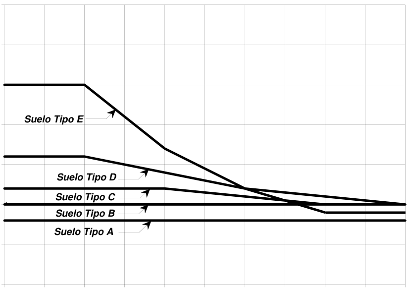
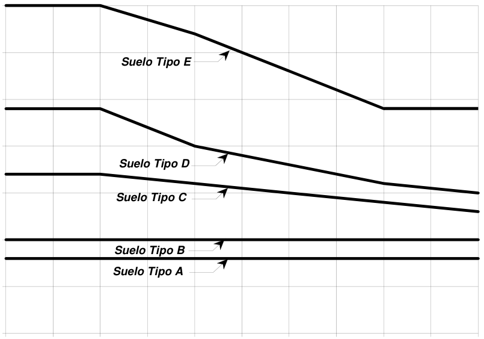
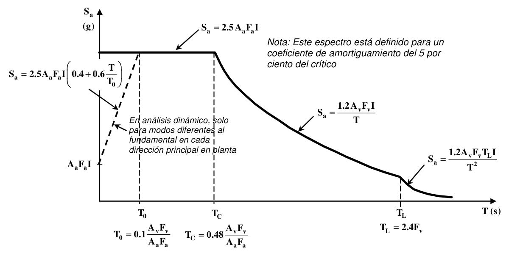
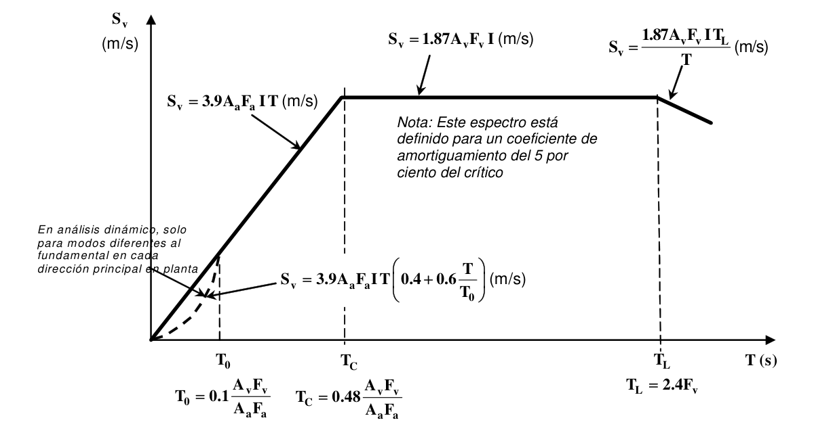
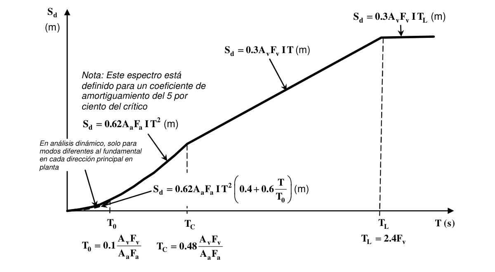
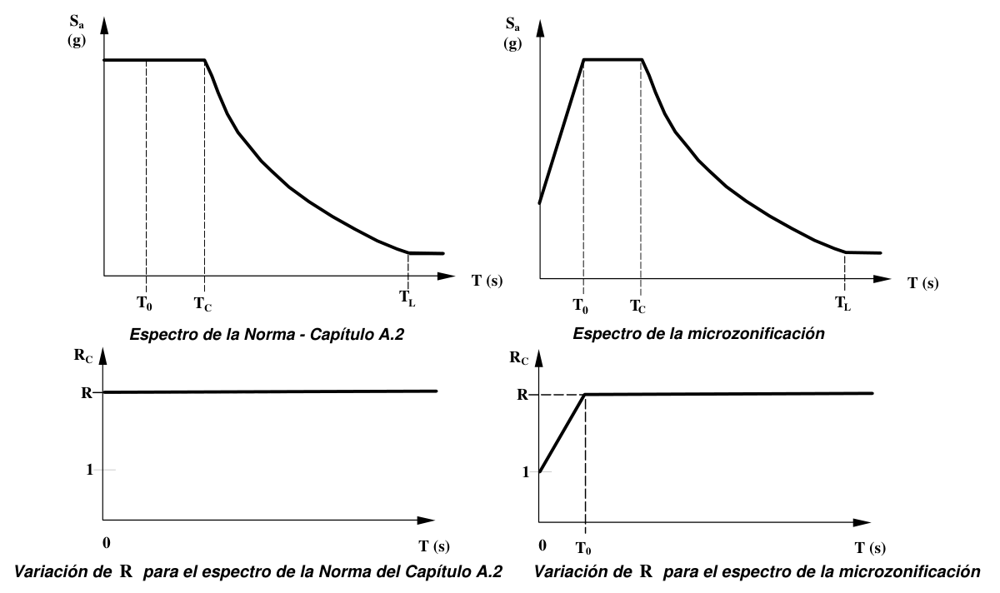

# A.2 — Zonas de amenaza sísmica y movimientos sísmicos de diseño

### A.2.0 — NOMENCLATURA

$A_{a}$ = coeficiente que representa la aceleración horizontal pico efectiva, para diseño, dado en A.2.2.

$A_{v}$ = coeficiente que representa la velocidad horizontal pico efectiva, para diseño, dado en A.2.2.

$d_{c}$ = es la suma de los espesores de los $k$ estratos de suelos cohesivos localizados dentro de los 30 m superiores del perfil.

$d_{i}$ = espesor del estrato $i$, localizado dentro de los 30 m superiores del perfil.

$d_{s}$ = es la suma de los espesores de los $m$ estratos de suelos no cohesivos localizados dentro de los 30 m superiores del perfil en ecuación A.2.4-3.

$F_{a}$ = coeficiente de amplificación que afecta la aceleración en la zona de períodos cortos, debida a los efectos de sitio, adimensional.

$F_{v}$ = coeficiente de amplificación que afecta la aceleración en la zona de períodos intermedios, debida a los efectos de sitio, adimensional.

$g$ = aceleración debida a la gravedad ($9.8$ m/s2).

$H$ = espesor total en m de los estratos de suelos cohesivos.

$I$ = coeficiente de importancia definido en A.2.5.2

$IP$ = índice de plasticidad, el cual se obtiene cumpliendo la norma ASTM D 4318.

$N_{i}$ = número de golpes por píe obtenido en el ensayo de penetración estándar, realizado in situ de acuerdo con la norma ASTM D 1586, haciendo corrección por energía N60. El valor de $N_{i}$ usado para obtener el valor medio, no debe exceder 100.

$R_{0}$ = coeficiente de capacidad de disipación de energía básico definido para cada sistema estructural y cada grado de capacidad de disipación de energía del material estructural. Véase el Capítulo A.3.

$R$ = coeficiente de capacidad de disipación de energía para ser empleado en el diseño, corresponde al coeficiente de disipación de energía básico, $R_{0}$ , multiplicado por los coeficientes de reducción de capacidad de disipación de energía por irregularidades en altura, en planta, y por ausencia de redundancia en el sistema estructural de resistencia sísmica $(R= φ_{a} φ_{p} φ_{r}R_{0})$. Véase el Capítulo A.3.

$R_{C}$= coeficiente de capacidad de disipación de energía definido para la zona de períodos cortos menores de $T_{C}$ en función del valor de $R$ , cuando se exige así en los estudios de microzonificación. Definido en la ecuación A.2.9-1.

$S_{a}$= valor del espectro de aceleraciones de diseño para un período de vibración dado. Máxima aceleración horizontal de diseño, expresada como una fracción de la aceleración de la gravedad, para un sistema de un grado de libertad con un período de vibración $T$ . Está definido en A.2.6.1.

$S_{d}$= valor del espectro de desplazamientos de diseño para un período de vibración dado. Máximo desplazamiento horizontal de diseño, expresado en m, para un sistema de un grado de libertad con un período de vibración $T$ . Está definido en A.2.6.3.

$S_{v}$= valor del espectro de velocidades de diseño para un período de vibración dado. Máxima velocidad horizontal de diseño, expresada en m/s, para un sistema de un grado de libertad con un período de vibración $T$ . Está definido en A.2.6.2.

$s_{ui}$= es la resistencia al corte no drenado en kPa (kgf/cm²) del estrato $i$ , la cual no debe exceder 250 kPa (2.5 kgf/cm²) para realizar el promedio ponderado. Esta resistencia se mide cumpliendo la norma NTC 1527 (ASTM D 2166) o la norma NTC 2041 (ASTM D 2850).

$T$ = período de vibración del sistema elástico, en segundos.

$T_{C}$= período de vibración, en segundos, correspondiente a la transición entre la zona de aceleración constante del espectro de diseño, para períodos cortos, y la parte descendiente del mismo. (Véase A.2.6).

$T_{L}$= período de vibración, en segundos, correspondiente al inicio de la zona de desplazamiento aproximadamente constante del espectro de diseño, para períodos largos. (Véase A.2.6).

$T_{0}$ = período de vibración al cual inicia la zona de aceleraciones constantes del espectro de aceleraciones, en $s$ .

$v_{si}$= velocidad media de la onda de cortante del suelo del estrato $i$ , medida en campo, en m/s

$w$ = contenido de agua en porcentaje, el cual se determina por medio de la norma NTC 1495 (ASTM D 2166).

### A.2.1 — GENERAL

#### A.2.1.1 — MOVIMIENTOS SÍSMICOS PRESCRITOS

Para efectos del diseño sísmico de la estructura, ésta debe localizarse dentro de una de las zonas de amenaza sísmica, baja, intermedia o alta, y además deben utilizarse los movimientos sísmicos de diseño definidos en el presente Capítulo, los cuales se pueden expresar por medio del espectro elástico de diseño definido en A.2.6, o por medio de familias de acelerogramas que cumplan los requisitos de A.2.7.

#### A.2.1.2 — EFECTOS LOCALES DIFERENTES

En A.2.4 el Reglamento prescribe un procedimiento para determinar los efectos en los movimientos sísmicos de diseño de la transmisión de las ondas sísmicas en el suelo existente debajo de la edificación. Pueden utilizarse movimientos sísmicos de diseño diferentes a los definidos en A.2.4, si se demuestra que fueron obtenidos utilizando mejor información proveniente de un estudio detallado de propagación de la onda sísmica a través del suelo existente debajo del sitio, o de la incidencia de la topografía del lugar, en los siguientes casos:

**A.2.1.2.1** — Estudios de microzonificación sísmica — Cuando las autoridades municipales o distritales han aprobado un estudio de microzonificación sísmica, realizado de acuerdo con el alcance que fija la sección A.2.9, el cual contenga recomendaciones para el lugar donde se adelantará la edificación, ya sea por medio de unos efectos de sitio o formas espectrales especiales, se deben utilizar los resultados de ésta, así como los valores del coeficiente de sitio, dados en ella, en vez de los presentados en A.2.4 y A.2.6.

**A.2.1.2.2** — Estudios sísmicos particulares de sitio — Cuando el ingeniero geotecnista responsable del estudio geotécnico de la edificación defina unos efectos locales particulares para el lugar donde se encuentra localizada la edificación, utilizando estudios de amplificación de las ondas sísmicas o estudios especiales referentes a efectos topográficos, o ambos, éstos deben realizarse de acuerdo con lo prescrito en A.2.10.

#### A.2.1.3 — MOVIMIENTOS SÍSMICOS DIFERENTES

Cuando se utilicen movimientos sísmicos de diseño obtenidos a partir de valores de $A_{a}$ o $A_{v}$ o $A_{e}$ diferentes de los dados en este Reglamento, estos valores de $A_{a}$ , o $A_{v}$ , o ambos, o de $A_{e}$ , deben ser aprobados por la oficina o dependencia distrital o municipal encargada de expedir las licencias de construcción, previo concepto de la Comisión Asesora Permanente para el Régimen de Construcciones Sismo Resistentes.

### A.2.2 — MOVIMIENTOS SÍSMICOS DE DISEÑO

**A.2.2.1** — Los movimientos sísmicos de diseño se definen en función de la aceleración pico efectiva, representada por el parámetro $A_{a}$ , y de la velocidad pico efectiva, representada por el parámetro $A_{v}$ , para una probabilidad del diez por ciento de ser excedidos en un lapso de cincuenta años. Los valores de estos coeficientes, para efectos de este Reglamento, deben determinarse de acuerdo con A.2.2.2 y A.2.2.3.

**A.2.2.2** — Se determina el número de la región en donde está localizada la edificación usando para $A_{a}$ el mapa de la figura A.2.3-2 y el número de la región donde está localizada la edificación para $A_{v}$ , en el mapa de la figura A.2.3-3.

**A.2.2.3** — Los valores de $A_{a}$ y $A_{v}$ se obtienen de la tabla A.2.2-1, en función del número de la región determinado en A.2.2.2. Para las ciudades capitales de departamento del país los valores se presentan en la tabla A.2.3-2 y para todos los municipios del país en el Apéndice A-4 incluido al final del presente Título.

**Tabla A.2.2-1**

Valores de $A_{a}$ y de $A_{v}$ , según las regiones De los mapas de las figuras A.2.3-2 Y A.2.3-3

| Región Nº | Valor de $A_{a}$ o de $A_{v}$ |
|---|---|
| 10 | 0.50 |
| 9 | 0.45 |
| 8 | 0.40 |
| 7 | 0.35 |
| 6 | 0.30 |
| 5 | 0.25 |
| 4 | 0.20 |
| 3 | 0.15 |
| 2 | 0.10 |
| 1 | 0.05 |

### A.2.3 — ZONAS DE AMENAZA SÍSMICA

La edificación debe localizarse dentro de una de las zonas de amenaza sísmica que se definen en esta sección y que están presentadas en el Mapa de la figura A.2.3-1.

#### A.2.3.1 — ZONA DE AMENAZA SÍSMICA BAJA

Es el conjunto de lugares en donde tanto $A_{a}$ como $A_{v}$ son menores o iguales a 0.10. Véase la tabla A.2.3-1.

#### A.2.3.2 — ZONA DE AMENAZA SÍSMICA INTERMEDIA

Es el conjunto de lugares en donde $A_{a}$ o $A_{v}$ , o ambos, son mayores de 0.10 y ninguno de los dos excede 0.20. Véase la tabla A.2.3-1.

#### A.2.3.3 — ZONA DE AMENAZA SÍSMICA ALTA

Es el conjunto de lugares en donde $A_{a}$ o $A_{v}$ , o ambos, son mayores que 0.20. Véase la tabla A.2.3-1.

**Tabla A.2.3-1**

Nivel de amenaza sísmica según valores de $A_{a}$ y de $A_{v}$

| Mayor valor entre $A_{a}$ y $A_{v}$ | Asociado en mapas de las figuras A.2.3-2 y A.2.3-3 a Región Nº | Amenaza Sísmica |
|---|---|---|
| 0.50 | 10 | Alta |
| 0.45 | 9 | Alta |
| 0.40 | 8 | Alta |
| 0.35 | 7 | Alta |
| 0.30 | 6 | Alta |
| 0.25 | 5 | Alta |
| 0.20 | 4 | Intermedia |
| 0.15 | 3 | Intermedia |
| 0.10 | 2 | Baja |
| 0.05 | 1 | Baja |

**Tabla A.2.3-2**

Valor de $A_{a}$ y de $A_{v}$ para las ciudades capitales de departamento

| Ciudad | $A_{a}$ | $A_{v}$ | Zona de Amenaza Sísmica |
|---|---|---|---|
| Arauca | 0.15 | 0.15 | Intermedia |
| Armenia | 0.25 | 0.25 | Alta |
| Barranquilla | 0.10 | 0.10 | Baja |
| Bogotá D. C. | 0.15 | 0.20 | Intermedia |
| Bucaramanga | 0.25 | 0.25 | Alta |
| Cali | 0.25 | 0.25 | Alta |
| Cartagena | 0.10 | 0.10 | Baja |
| Cúcuta | 0.35 | 0.30 | Alta |
| Florencia | 0.20 | 0.15 | Intermedia |
| Ibagué | 0.20 | 0.20 | Intermedia |
| Leticia | 0.05 | 0.05 | Baja |
| Manizales | 0.25 | 0.25 | Alta |
| Medellín | 0.15 | 0.20 | Intermedia |
| Mitú | 0.05 | 0.05 | Baja |
| Mocoa | 0.30 | 0.25 | Alta |
| Montería | 0.10 | 0.15 | Intermedia |
| Neiva | 0.25 | 0.25 | Alta |
| Pasto | 0.25 | 0.25 | Alta |
| Pereira | 0.25 | 0.25 | Alta |
| Popayán | 0.25 | 0.20 | Alta |
| Puerto Carreño | 0.05 | 0.05 | Baja |
| Puerto Inírida | 0.05 | 0.05 | Baja |
| Quibdó | 0.35 | 0.35 | Alta |
| Riohacha | 0.10 | 0.15 | Intermedia |
| San Andrés, Isla | 0.10 | 0.10 | Baja |
| Santa Marta | 0.15 | 0.10 | Intermedia |
| San José del Guaviare | 0.05 | 0.05 | Baja |
| Sincelejo | 0.10 | 0.15 | Intermedia |
| Tunja | 0.20 | 0.20 | Intermedia |
| Valledupar | 0.10 | 0.10 | Baja |
| Villavicencio | 0.35 | 0.30 | Alta |
| Yopal | 0.30 | 0.20 | Alta |

Figura A.2.3-1 — Zonas de Amenaza Sísmica aplicable a edificaciones para la NSR-10 en función de $A_{a}$ y $A_{v}$ Figura A.2.3-2 — Mapa de valores de $A_{a}$ Figura A.2.3-3 - Mapa de valores de $Av$

<!-- mod:1-decreto-092-2011-5 -->
> **Modificación — Decreto 092 de 2011** · anexo, p. 1
>
> En las Figuras A.2.3-2 y A.2.3-3, el número de la región para San Andrés y Providencia en ambos mapas debe ser 2 (encerrado en un círculo), en vez de 3.

### A.2.4 — EFECTOS LOCALES

En esta sección se dan los tipos de perfil de suelo y los valores de los coeficientes de sitio. El perfil de suelo debe ser determinado por el ingeniero geotecnista a partir de unos datos geotécnicos debidamente sustentados.

#### A.2.4.1 — GENERAL

Se prescriben dos factores de amplificación del espectro por efectos de sitio, $F_{a}$ y $F_{v}$ , los cuales afectan la zona del espectro de períodos cortos y períodos intermedios, respectivamente. Los efectos locales de la respuesta sísmica de la edificación deben evaluarse con base en los perfiles de suelo dados a continuación, independientemente del tipo de cimentación empleado. La identificación del perfil de suelo se realiza a partir de la superficie del terreno. Cuando existan sótanos, o en edificio en ladera, el ingeniero geotecnista, de acuerdo con el tipo de cimentación propuesta, puede variar el punto a partir del cual se inicia la definición del perfil, por medio de un estudio acerca de la interacción que pueda existir entre la estructura de contención y el suelo circundante; pero en ningún caso este punto puede estar por debajo de la losa sobre el terreno del sótano inferior.

**A.2.4.1.1** — Estabilidad del depósito de suelo — Los perfiles de suelo presentados en esta sección A.2.4 hacen referencia a depósitos estables de suelo. Cuando exista la posibilidad de que el depósito no sea estable, especialmente ante la ocurrencia de un sismo, como puede ser en sitios en ladera o en sitios con suelos potencialmente licuables, no deben utilizarse las definiciones dadas y hay necesidad de realizar una investigación geotécnica que identifique la estabilidad del depósito, además de las medidas correctivas, si son posibles, que se deben tomar para poder adelantar una construcción en el lugar. El estudio geotécnico debe indicar claramente las medidas correctivas y los coeficientes de sitio que se debe utilizar en el diseño, dado que se lleven a cabo las medidas correctivas planteadas. La construcción de edificaciones en el sitio no puede adelantarse sin tomar medidas correctivas, cuando éstas sean necesarias.

**A.2.4.1.2** — Procedimientos alternos — Cuando según A.2.1.2 se permitan procedimientos alternos para definir los efectos locales, se debe cumplir con lo requerido allí en vez de lo presentado en esta sección.

#### A.2.4.2 — TIPOS DE PERFIL DE SUELO

Se definen seis tipos de perfil de suelo los cuales se presentan en la tabla A.2.4-1. Los parámetros utilizados en la clasificación son los correspondientes a los 30 m superiores del perfil para los perfiles tipo A a E. Aquellos perfiles que tengan estratos claramente diferenciables deben subdividirse, asignándoles un subíndice $i$ que va desde $1$ en la superficie, hasta $n$ en la parte inferior de los 30 m superiores del perfil. Para el perfil tipo $F$ se aplican otros criterios y la respuesta no debe limitarse a los 30 m superiores del perfil en los casos de perfiles con espesor de suelo significativo.

#### A.2.4.3 — PARÁMETROS EMPLEADOS EN LA DEFINICIÓN DEL TIPO DE PERFIL DE SUELO

A continuación se definen los parámetros que se utilizan para definir el tipo de perfil de suelo con base en los 30 m superiores del mismo y considerando ensayos realizados en muestras tomadas al menos cada 1.50 m de espesor del suelo. Estos parámetros son (a) la velocidad media de la onda de cortante, $v_{s} ,$ en m/s, (b) el número medio de golpes del ensayo de penetración estándar, $N$ , en golpes/píe a lo largo de todo el perfil, o, (c) cuando se trate de considerar por separado los estratos no cohesivos y los cohesivos del perfil, para los estratos de suelos no cohesivos se determinará el número medio de golpes del ensayo de penetración estándar, $N_{ch}$, en golpes/píe, y para los cohesivos la resistencia media al corte obtenida del ensayo para determinar su resistencia no drenada, $s_{u}$ , en kPa. Además se emplean el Índice de Plasticidad $(IP )$, y el contenido de agua en porcentaje, $w$ .

**A.2.4.3.1** — Velocidad media de la onda de cortante — La velocidad media de la onda de cortante se obtiene por medio de:

$$ \bar{v}_s = \dfrac{\sum_{i=1}^{n} d_i}{\sum_{i=1}^{n} \dfrac{d_i}{v_{si}}} \tag{A.2.4-1} $$

donde:

$v_{si}$= velocidad media de la onda de cortante del suelo del estrato $i$ , medida en campo, en m/s

$d_{i}$ = espesor del estrato $i$ , localizado dentro de los 30 m superiores del perfil $n$

$∑d_{i}$ = 30 m siempre

$i =1$

**A.2.4.3.2** — Número medio de golpes del ensayo de penetración estándar — El número medio de golpes del ensayo de penetración estándar se obtiene por medio de los dos procedimientos dados a continuación:

(a) Número medio de golpes del ensayo de penetración estándar en cualquier perfil de suelo — El número medio de golpes del ensayo de penetración estándar en cualquier perfil de suelo, indistintamente que esté integrado por suelos no cohesivos o cohesivos, se obtiene por medio de:

$$ \bar{N} = \dfrac{\sum_{i=1}^{n} d_i}{\sum_{i=1}^{n} \dfrac{d_i}{N_i}} \tag{A.2.4-2} $$

donde:

$N_{i}$ = número de golpes por píe obtenidos en el ensayo de penetración estándar, realizado in situ de acuerdo con la norma ASTM D 1586, haciendo corrección por energía N60, correspondiente al estrato $i$ . El valor de $N_{i}$ a emplear para obtener el valor medio, no debe exceder 100.

(b) Número medio de golpes del ensayo de penetración estándar en perfiles que contengan suelos no cohesivos — En los estratos de suelos no cohesivos localizados en los 30 m superiores del perfil debe emplearse, la siguiente relación, la cual se aplica únicamente a los $m$ estratos de suelos no cohesivos:

$$ \bar{N}_{ch} = \dfrac{d_s}{\sum_{i=1}^{m} \dfrac{d_i}{N_i}} \tag{A.2.4-3} $$

donde:

$d_{s}$ = es la suma de los espesores de los $m$ estratos de suelos no cohesivos localizados dentro de los 30 m superiores del perfil.

**A.2.4.3.3** — Resistencia media al corte — Para la resistencia al corte no drenada, $s_{u}$ , obtenida de ensayos en los estratos de suelos cohesivos localizados en los 30 m superiores del perfil debe emplearse la siguiente relación, la cual se aplica únicamente a los $k$ estratos de suelos cohesivos:

$$ \bar{s}_u = \dfrac{d_c}{\sum_{i=1}^{k} \dfrac{d_i}{s_{ui}}} \tag{A.2.4-4} $$

donde:

$d_{c}$ = es la suma de los espesores de los $k$ estratos de suelos cohesivos localizados dentro de los 30 m superiores del perfil.

$s_{ui}$ = es la resistencia al corte no drenado en kPa (kgf/cm²) del estrato $i$ , la cual no debe exceder 250 kPa (2.5 kgf/cm²) para realizar el promedio ponderado. Esta resistencia se mide cumpliendo la norma NTC 1527 (ASTM D 2166) o la norma NTC 2041 (ASTM D 2850).

**A.2.4.3.4** — Índice de plasticidad — En la clasificación de la los estratos de arcilla se emplea el Índice de Plasticidad $(IP )$, el cual se obtiene cumpliendo la norma ASTM D 4318.

**A.2.4.3.5** — Contenido de agua — En la clasificación de los estratos de arcilla se emplea el contenido de agua en porcentaje, $w$ , el cual se determina por medio de la norma NTC 1495 (ASTM D 2166).

#### A.2.4.4 — DEFINICIÓN DEL TIPO DE PERFIL DE SUELO

El procedimiento que se emplea para definir el tipo de perfil de suelo se basa en los valores de los parámetros del suelo de los 30 metros superiores del perfil, medidos en el sitio que se describieron en A.2.4.3. La clasificación se da en la tabla A.2.4-1.

**Tabla A.2.4-1**

Clasificación de los perfiles de suelo

| Tipo de perfil | Descripción | Definición |
|---|---|---|
| $A$ | Perfil de roca competente | $v_{s}$ ≥ 1500 m/s |
| $B$ | Perfil de roca de rigidez media | 1500 m/s > $v_{s}$ ≥ 760 m/s |
| $C$ | Perfiles de suelos muy densos o roca blanda, que cumplan con el criterio de velocidad de la onda de cortante, o | 760 m/s> $v_{s}$ ≥ 360 m/s |
|  | perfiles de suelos muy densos o roca blanda, que cumplan con cualquiera de los dos criterios | $N$ ≥ 50, o $s_{u}$≥ 100 kPa ($≈$1 kgf/cm²) |
| $D$ | Perfiles de suelos rígidos que cumplan con el criterio de velocidad de la onda de cortante, o | 360 m/s > $v_{s}$ ≥ 180 m/s |
|  | perfiles de suelos rígidos que cumplan cualquiera de las dos condiciones | 50 > $N$ ≥ 15, o 100 kPa ($≈$1 kgf/cm²) > $s_{u}$≥ 50 kPa ($≈$0.5 kgf/cm²) |
| $E$ | Perfil que cumpla el criterio de velocidad de la onda de cortante, o | 180 m/s > $v_{s}$ |
|  | perfil que contiene un espesor total $H$ mayor de 3 m de arcillas blandas | $IP$ > 20 $w ≥$ 40% 50 kPa ($≈$0.50 kgf/cm²) > $s_{u}$ |
| $F$ | Los perfiles de suelo tipo $F$ requieren una evaluación realizada explícitamente en el sitio por un ingeniero geotecnista de acuerdo con el procedimiento de A.2.10. Se contemplan las siguientes subclases: $F_{1}$ — Suelos susceptibles a la falla o colapso causado por la excitación sísmica, tales como: suelos licuables, arcillas sensitivas, suelos dispersivos o débilmente cementados, etc. $F_{2}$ — Turba y arcillas orgánicas y muy orgánicas ($H$ > 3 m para turba o arcillas orgánicas y muy orgánicas). $F_{3}$ — Arcillas de muy alta plasticidad ($H$ > 7.5 m con Índice de Plasticidad $IP$ > 75) $F_{4}$ — Perfiles de gran espesor de arcillas de rigidez mediana a blanda ($H$ > 36 m) |  |

#### A.2.4.5 — PROCEDIMIENTO DE CLASIFICACIÓN

El procedimiento para definir el perfil es el siguiente:

**A.2.4.5.1** — Paso 1 — Debe primero verificarse si el suelo cae dentro de la clasificación de alguna de las categorías de perfil de suelo tipo $F$ , en cuyo caso debe realizarse un estudio sísmico particular de clasificación en el sitio, por parte de un ingeniero geotecnista siguiendo los lineamientos de A.2.10.

**A.2.4.5.2** — Paso 2 — Debe establecerse la existencia de estratos de arcilla blanda. La arcilla blanda se define como aquella que tiene una resistencia al corte no drenado menor de 50 kPa (0.50 kgf/cm²), un contenido de agua, $w$ , mayor del 40%, y un índice de plasticidad, $IP$ , mayor de 20. Si hay un espesor total, $H$ , de 3 m o más de estratos de arcilla que cumplan estas condiciones el perfil se clasifica como tipo $E$ .

**A.2.4.5.3** — Paso 3 — El perfil se clasifica utilizando uno de los tres criterios: $v_{s}$ , $N$ , o la consideración conjunta de $N_{ch}$ y $s_{u}$ , seleccionando el aplicable como se indica a continuación. En caso que se cuente $v_{s}$ prevalecerá la clasificación basada en este criterio. En caso que no se cuente con $v_{s}$ se podrá utilizar el criterio basado en $N$ que involucra todos los estratos del perfil. Alternativamente se podrá utilizar el criterio basado conjuntamente en $s_{u}$ , para la fracción de suelos cohesivos y el criterio $N_{ch}$, que toma en cuenta la fracción de los suelos no cohesivos del perfil. Para esta tercera consideración, en caso que las dos evaluaciones respectivas indiquen perfiles diferentes, se debe utilizar el perfil de suelos más blandos de los dos casos, por ejemplo asignando un perfil tipo $E$ en vez de tipo $D$ . En la tabla A.2.4-2 se resumen los tres criterios para clasificar perfil de suelos tipo C, D o E. Los tres criterios se aplican así:

(a) $v_{s}$ en los 30 m superiores del perfil,

(b) $N$ en los 30 m superiores del perfil, o

(c) $N_{ch}$para los estratos de suelos existentes en los 30 m superiores que se clasifican como no cohesivos cuando $IP_{<}20$, o el promedio ponderado $s_{u}$ en los estratos de suelos cohesivos existentes en los 30 m superiores del perfil, que tienen $IP_{>}20$, lo que indique un perfil más blando.

**Tabla A.2.4-2**

Criterios para clasificar suelos dentro de los perfiles de suelo tipos C, D o E

| Tipo de perfil | $v_{s}$ | $N$ o $N_{ch}$ | $s_{u}$ |
|---|---|---|---|
| $C$ | entre 360 y 760 m/s | mayor que 50 | mayor que 100 kPa ($≈$ 1 kgf/cm²) |
| $D$ | entre 180 y 360 m/s | entre 15 y 50 | entre 100 y 50 kPa (0.5 a 1 kgf/cm²) |
| $E$ | menor de 180 m/s | menor de 15 | menor de 50 kPa ($≈$0.5 kgf/cm²) |

**A.2.4.5.4** — Velocidad de la onda de cortante en roca — La roca competente del perfil tipo $A$, debe definirse por medio de mediciones de velocidad de la onda de cortante en el sitio, o en perfiles de la misma formación donde haya meteorización y fracturación similares. En aquellos casos en que sabe que las condiciones de la roca son continuas hasta una profundidad de al menos 30 m, la velocidad de onda de cortante superficial puede emplearse para definir $v_{s}$ .La velocidad de la onda de cortante en roca, para el perfil Tipo $B$, debe medirse en el sitio o estimarse, por parte del ingeniero geotecnista para roca competente con meteorización y fracturación moderada. Para las rocas más blandas, o muy meteorizadas o fracturadas, deben medirse en el sitio la velocidad de la onda de cortante, o bien clasificarse como perfil tipo $C$. Los perfiles donde existan más de 3 m de suelo entre la superficie de la roca y la parte inferior de la fundación, no pueden clasificarse como perfiles tipo $A$ o $B$.

**A.2.4.5.5** — En la tabla A.2.4-3 se dan los valores del coeficiente $F_{a}$ que amplifica las ordenadas del espectro en roca para tener en cuenta los efectos de sitio en el rango de períodos cortos del orden de $T_{0}$ , como muestra la figura A.2.4-1. Para valores intermedios de $A_{a}$ se permite interpolar linealmente entre valores del mismo tipo de perfil.

**Tabla A.2.4-3**

Valores del coeficiente $F_{a}$, para la zona de periodos cortos del espectro

| Tipo de Perfil | Intensidad de los movimientos sísmicos |  |  |  |  |
|---|---|---|---|---|---|
|  | $A_{a}≤0.1$ | $A_{a}=0.2$ | $A_{a}=0.3$ | $A_{a}=0.4$ | $A_{a}≥0.5$ |
| $A$ | 0.8 | 0.8 | 0.8 | 0.8 | 0.8 |
| $B$ | 1.0 | 1.0 | 1.0 | 1.0 | 1.0 |
| $C$ | 1.2 | 1.2 | 1.1 | 1.0 | 1.0 |
| $D$ | 1.6 | 1.4 | 1.2 | 1.1 | 1.0 |
| $E$ | 2.5 | 1.7 | 1.2 | 0.9 | 0.9 |
| $F$ | véase nota | véase nota | véase nota | Véase nota | véase nota |

Nota: Para el perfil tipo $F$ debe realizarse una investigación geotécnica particular para el lugar específico y debe llevarse a cabo un análisis de amplificación de onda de acuerdo con A.2.10.

**A.2.4.5.6** — En la tabla A.2.4-4 se dan los valores del coeficiente $F_{v}$ que amplifica las ordenadas del espectro en roca para tener en cuenta los efectos de sitio en el rango de períodos intermedios del orden de 1 $s$ . Estos coeficientes se presentan también en la figura A.2.4-2. Para valores intermedios de $A_{a}$ se permite interpolar linealmente entre valores del mismo tipo de perfil.

**Tabla A.2.4-4**

Valores del coeficiente $F_{v}$ , para la zona de períodos intermedios del espectro

| Tipo de Perfil | Intensidad de los movimientos sísmicos |  |  |  |  |
|---|---|---|---|---|---|
|  | $A_{v}≤0.1$ | $A_{v}=0.2$ | $A_{v}=0.3$ | $A_{v}=0.4$ | $A_{v}≥0.5$ |
| $A$ | 0.8 | 0.8 | 0.8 | 0.8 | 0.8 |
| $B$ | 1.0 | 1.0 | 1.0 | 1.0 | 1.0 |
| $C$ | 1.7 | 1.6 | 1.5 | 1.4 | 1.3 |
| $D$ | 2.4 | 2.0 | 1.8 | 1.6 | 1.5 |
| $E$ | 3.5 | 3.2 | 2.8 | 2.4 | 2.4 |
| $F$ | véase nota | véase nota | véase nota | Véase nota | véase nota |

Nota: Para el perfil tipo $F$ debe realizarse una investigación geotécnica particular para el lugar específico y debe llevarse a cabo un análisis de amplificación de onda de acuerdo con A.2.10.

3.5

3.0 2.5 2.0 $F_{a}$ 1.5 1.0 0.5 0.0 0.000.050.100.150.200.250.300.350.400.450.50 $A_{a}$ Figura A.2.4-1 - Coeficiente de amplificación $F_{a}$ del suelo para la zona de períodos cortos del espectro 3.5

3.0 2.5 2.0 $F_{v}$ 1.5 1.0 0.5 0.0 0.000.050.100.150.200.250.300.350.400.450.50 $A_{v}$ Figura A.2.4-2 — Coeficiente de amplificación $F_{v}$ del suelo para la zona de períodos intermedios del espectro

<!-- mod:1-decreto-092-2011-6 -->
> **Modificación — Decreto 092 de 2011** · anexo, p. 2
>
> En la última frase, la referencia a $A_a$ debe ser a $A_v$: «… Para valores intermedios de $A_v$ se permite interpolar linealmente entre valores del mismo tipo de perfil.»

**A.2.4.5.7** — Los valores de los coeficientes $F_{a}$ y $F_{v}$ no tienen en cuenta efectos de ladera. De haberlos, deberán considerarse complementariamente con base en una reglamentación expedida por la municipalidad o, en ausencia de dicha reglamentación, con base en estudios particulares, realizados por el ingeniero geotecnista de la edificación, debidamente sustentados.

### A.2.5 — COEFICIENTE DE IMPORTANCIA

En esta sección se definen los grupos de tipo de uso y los valores del coeficiente de importancia.

#### A.2.5.1 — GRUPOS DE USO

Todas las edificaciones deben clasificarse dentro de uno de los siguientes Grupos de Uso:

**A.2.5.1.1** — Grupo $IV$ — Edificaciones indispensables — Son aquellas edificaciones de atención a la comunidad que deben funcionar durante y después de un sismo, y cuya operación no puede ser trasladada rápidamente a un lugar alterno. Este grupo debe incluir:

(a) Todas las edificaciones que componen hospitales clínicas y centros de salud que dispongan de servicios de cirugía, salas de cuidados intensivos, salas de neonatos y/o atención de urgencias,

(b) Todas las edificaciones que componen aeropuertos, estaciones ferroviarias y de sistemas masivos de transporte, centrales telefónicas, de telecomunicación y de radiodifusión,

(c) Edificaciones designadas como refugios para emergencias, centrales de aeronavegación, hangares de aeronaves de servicios de emergencia,

(d) Edificaciones de centrales de operación y control de líneas vitales de energía eléctrica, agua, combustibles, información y transporte de personas y productos,

(e) Edificaciones que contengan agentes explosivos, tóxicos y dañinos para el público, y

(f) En el grupo $IV$ deben incluirse las estructuras que alberguen plantas de generación eléctrica de emergencia, los tanques y estructuras que formen parte de sus sistemas contra incendio, y los accesos, peatonales y vehiculares de las edificaciones tipificadas en los literales a, b, c, d y e del presente numeral.

**A.2.5.1.2** — Grupo $III$ — Edificaciones de atención a la comunidad — Este grupo comprende aquellas edificaciones, y sus accesos, que son indispensables después de un temblor para atender la emergencia y preservar la salud y la seguridad de las personas, exceptuando las incluidas en el grupo $IV$. Este grupo debe incluir:

(a) Estaciones de bomberos, defensa civil, policía, cuarteles de las fuerzas armadas, y sedes de las oficinas de prevención y atención de desastres,

(b) Garajes de vehículos de emergencia,

(c) Estructuras y equipos de centros de atención de emergencias,

(d) Guarderías, escuelas, colegios, universidades y otros centros de enseñanza,

(e) Aquellas del grupo $II$ para las que el propietario desee contar con seguridad adicional, y

(f) Aquellas otras que la administración municipal, distrital, departamental o nacional designe como tales.

**A.2.5.1.3** — Grupo $II$ — Estructuras de ocupación especial — Cubre las siguientes estructuras:

(a) Edificaciones en donde se puedan reunir más de 200 personas en un mismo salón,

(b) Graderías al aire libre donde pueda haber más de 2000 personas a la vez,

(c) Almacenes y centros comerciales con más de 500 m² por piso,

(d) Edificaciones de hospitales, clínicas y centros de salud, no cubiertas en A.2.5.1.1.

(e) Edificaciones donde trabajen o residan más de 3000 personas, y

(f) Edificios gubernamentales.

**A.2.5.1.4** — Grupo $I$ — Estructuras de ocupación normal — Todas la edificaciones cubiertas por el alcance de este Reglamento, pero que no se han incluido en los Grupos $II$, $III$ y $IV$.

#### A.2.5.2 — COEFICIENTE DE IMPORTANCIA

El Coeficiente de Importancia, $I$ , modifica el espectro, y con ello las fuerzas de diseño, de acuerdo con el grupo de uso a que esté asignada la edificación para tomar en cuenta que para edificaciones de los grupos $II$, $III$ y $IV$ deben considerarse valores de aceleración con una probabilidad menor de ser excedidos que aquella del diez por ciento en un lapso de cincuenta años considerada en el numeral A.2.2.1. Los valores de $I$ se dan en la tabla A.2.5-1.

**Tabla A.2.5-1**

Valores del coeficiente de importancia, $I$

| Grupo de Uso | Coeficiente de Importancia, $I$ |
|---|---|
| $IV$ | 1.50 |
| $III$ | 1.25 |
| $II$ | 1.10 |
| $I$ | 1.00 |

### A.2.6 — ESPECTRO DE DISEÑO

#### A.2.6.1 — Espectro de aceleraciones

La forma del espectro elástico de aceleraciones, $S_{a}$ expresada como fracción de la gravedad, para un coeficiente de cinco por ciento (5%) del amortiguamiento crítico, que se debe utilizar en el diseño, se da en la figura A.2.6-1 y se define por medio de la ecuación A.2.6-1, con las limitaciones dadas en A.2.6.1.1 a A.2.6.1.3.

$$ S_a = \dfrac{1.2\,A_v F_v I}{T} \tag{A.2.6-1} $$

**A.2.6.1.1** — Para períodos de vibración menores de $T_{C}$ , calculado de acuerdo con la ecuación A.2.6-2, el valor de $S_{a}$ puede limitarse al obtenido de la ecuación A.2.6-3.

$$ T_C = 0.48\,\dfrac{A_v F_v}{A_a F_a} \tag{A.2.6-2} $$

y

$$ S_a = 2.5\,A_a F_a I \tag{A.2.6-3} $$

**A.2.6.1.2** — Para períodos de vibración mayores que $T_{L}$ , calculado de acuerdo con la ecuación A.2.6-4, el valor de $S_{a}$ no puede ser menor que el dado por la ecuación A.2.6-5.

$$ T_L = 2.4\,F_v \tag{A.2.6-4} $$

y

$$ S_a = \dfrac{1.2\,A_v F_v T_L I}{T^2} \tag{A.2.6-5} $$

Figura A.2.6-1 — Espectro Elástico de Aceleraciones de Diseño como fracción de $g$

**A.2.6.1.3** — Cuando se utilice el análisis dinámico, tal como se define en el Capítulo A.5, para períodos de vibración diferentes del fundamental, en la dirección en estudio, menores de $T_{0}$ calculado de acuerdo con la ecuación A.2.6-6, el espectro de diseño puede obtenerse de la ecuación A.2.6-7.

$$ T_0 = 0.1\,\dfrac{A_v F_v}{A_a F_a} \tag{A.2.6-6} $$

y

$$ S_a = 2.5\,A_a F_a I \left(0.4 + 0.6\,\dfrac{T}{T_0}\right) \tag{A.2.6-7} $$

#### A.2.6.2 — Espectro de velocidades

La forma del espectro elástico de velocidades en m/s, para un coeficiente de cinco por ciento (5%) del amortiguamiento crítico, que se debe utilizar en el diseño, se da en la figura A.2.6-2 y se define por medio de la ecuación A.2.6-8, con las limitaciones dadas en A.2.6.2.1 a A.2.6.2.3.

$$ S_v = 1.87\,A_v F_v I \quad (\mathrm{m/s}) \tag{A.2.6-8} $$

**A.2.6.2.1** — Para períodos de vibración menores de $T_{C}$ , calculado de acuerdo con la ecuación A.2.6-2, el valor de $S_{v}$ , en m/s, puede limitarse al obtenido de la ecuación A.2.6-9.

$$ S_v = 3.9\,A_a F_a T I \quad (\mathrm{m/s}) \tag{A.2.6-9} $$

**A.2.6.2.2** — Para períodos de vibración mayores que $T_{L}$ , calculados de acuerdo con la ecuación A.2.6-4, el valor de $S_{v}$ , en m/s, no puede ser menor que el dado por la ecuación A.2.6-10.

$$ S_v = \dfrac{1.87\,A_v F_v I T_L}{T} \quad (\mathrm{m/s}) \tag{A.2.6-10} $$

**A.2.6.2.3** — Cuando se utilice el análisis dinámico, tal como se define en el Capítulo A.5, para períodos de vibración diferentes del fundamental, en la dirección en estudio, menores de $T_{0}$ calculado de acuerdo con la ecuación A.2.6-6, el espectro de velocidades de diseño, en m/s, puede obtenerse de la ecuación A.2.6-11.

$$ S_v = 3.9\,A_a F_a I T \left(0.4 + 0.6\,\dfrac{T}{T_0}\right) \quad (\mathrm{m/s}) \tag{A.2.6-11} $$

Figura A.2.6-2 — Espectro Elástico de Velocidades (m/s) de Diseño

#### A.2.6.3 — Espectro de desplazamientos

La forma del espectro elástico de desplazamientos en m, para un coeficiente de cinco por ciento (5%) del amortiguamiento crítico, que se debe utilizar en el diseño, se da en la figura A.2.6-3 y se define por medio de la ecuación A.2.6-12, con las limitaciones dadas en A.2.6.3.1 a A.2.6.3.3.

$$ S_d = 0.3\,A_v F_v I T \quad (\mathrm{m}) \tag{A.2.6-12} $$

**A.2.6.3.1** — Para períodos de vibración menores de $T_{C}$ , calculado de acuerdo con la ecuación A.2.6-2, el valor de $S_{d}$, en m, puede limitarse al obtenido de la ecuación A.2.6-13.

$$ S_d = 0.62\,A_a F_a I T^2 \quad (\mathrm{m}) \tag{A.2.6-13} $$

**A.2.6.3.2** — Para períodos de vibración mayores que $T_{L}$ , calculado de acuerdo con la ecuación A.2.6-4, el valor de $S_{d}$, en m, no puede ser menor que el dado por la ecuación A.2.6-14.

$$ S_d = 0.3\,A_v F_v I T_L \quad (\mathrm{m}) \tag{A.2.6-14} $$

**A.2.6.3.3** — Cuando se utilice el análisis dinámico, tal como se define en el Capítulo A.5, para períodos de vibración diferentes del fundamental, en la dirección en estudio, menores de $T_{0}$ calculado de acuerdo con la ecuación A.2.6-6, el espectro de desplazamientos de diseño, en m, puede obtenerse de la ecuación A.2.6-15.

$$ S_d = 0.62\,A_a F_a I T^2 \left(0.4 + 0.6\,\dfrac{T}{T_0}\right) \quad (\mathrm{m}) \tag{A.2.6-15} $$

Figura A.2.6-3 - Espectro Elástico de Desplazamientos (m) de Diseño

### A.2.7 — FAMILIAS DE ACELEROGRAMAS

**A.2.7.1** — Cuando se empleen procedimientos de análisis dinámico consistentes en evaluaciones contra el tiempo, obtenidas integrando paso a paso la ecuación de movimiento, los acelerogramas que se utilicen deben cumplir los siguientes requisitos:

(a) Debe utilizarse, para efectos de diseño, la respuesta ante la componente horizontal de un mínimo de tres (3) acelerogramas diferentes, (véase A.5.5), todos ellos representativos de los movimientos esperados del terreno teniendo en cuenta que deben provenir de registros tomados en eventos con magnitudes, distancias hipocentrales o a la falla causante, y mecanismos de ruptura similares a los de los movimientos sísmicos de diseño prescritos para el lugar, pero que cumplan la mayor gama de frecuencias y amplificaciones posible. Si se utilizan siete o más acelerogramas, en vez del mínimo de tres prescritos anteriormente, se puede utilizar el valor promedio de los valores obtenidos de todos los acelerogramas empleados en vez de considerar los valores máximos de los análisis individuales.

(b) Cuando se considere que no es posible contar con el número requerido de registros reales con las condiciones descritas en (a), se permite suplir la diferencia por medio de registros sintéticos simulados adecuados para representar los movimientos sísmicos de diseño prescritos para el lugar.

(c) Los espectros de respuesta de los acelerogramas empleados, apropiadamente escalados en consistencia con la amenaza, no pueden tener individualmente ordenadas espectrales, para cualquier período de vibración en el rango comprendido entre $0.8T$ y $1.2T$ , donde $T$ es el período de vibración fundamental inelástico esperado de la estructura en la dirección bajo estudio, menores que el 80% de las ordenadas espectrales del movimiento esperado del terreno definidas en A.2.6, y el promedio de las ordenadas espectrales de todos los registros utilizados, en el rango comprendido entre $0.2T$ y $1.5T$ , no debe ser menor que las ordenadas espectrales en el mismo rango de períodos para el movimiento esperado del terreno definido en A.2.6.

(d) Cuando en el Capítulo A.5 estos registros se utilizan en análisis tridimensionales, deben utilizarse las dos componentes horizontales del mismo registro las cuales se deben escalar con el mismo factor de escala.

En este caso, en vez del promedio mencionado en (c) se debe utilizar la raíz cuadrada de la suma de los cuadrados de los valores.

### A.2.8 — COMPONENTE VERTICAL DE LOS MOVIMIENTOS SÍSMICOS

**A.2.8.1** — Cuando se utilice la componente vertical de los movimientos sísmicos de diseño, como mínimo debe tomarse como las dos terceras partes de los valores correspondientes a los efectos horizontales, ya sea en el espectro de diseño, o en las familias de acelerogramas, de contar en este caso con solo registros horizontales (Véase A.5.4.6). En caso de usar acelerogramas reales podrá emplearse la aceleración vertical registrada con el ajuste equivalente que se haya realizado a las componentes horizontales.

### A.2.9 — ESTUDIOS DE MICROZONIFICACIÓN SÍSMICA

**A.2.9.1** — Cuando se adelanten estudios de microzonificación sísmica que cumplan con el alcance dado en la sección A.2.9.3, las autoridades municipales o distritales, están facultadas para expedir una reglamentación substitutiva de carácter obligatorio, que reemplace lo indicado en las secciones A.2.4 y A.2.6 del presente Reglamento. Los estudios de microzonificación sísmica cubiertos por el alcance del presente Reglamento, tienen como fin último dar parámetros de diseño para edificaciones respecto a la amplificación de las ondas sísmicas por efecto de los suelos subyacentes bajo la ciudad objeto de la microzonificación sísmica y por lo tanto se deben restringir a este fin. Estudios análogos para el diseño de construcciones diferentes a edificaciones y que cubran aspectos de diseño de líneas vitales o de otras construcciones no cubiertas por el alcance de la Ley 400 de 1997, deben ser objeto de un alcance, que aunque análogo, podría no ser el indicado en la presente sección del Reglamento y su trámite debe ser independiente de lo cubierto en el presente Reglamento.

**A.2.9.2** — Las capitales de departamento y las ciudades de más de 100 000 habitantes, localizadas en las zonas de amenaza sísmica intermedia y alta, con el fin de tener en cuenta el efecto que sobre las construcciones tenga la propagación de la onda sísmica a través de los estratos de suelo subyacentes, deberán armonizar los instrumentos de planificación para el ordenamiento territorial, con un estudio o estudios de microzonificación sísmica, que cumpla con el alcance dado en la sección A.2.9.3.

#### A.2.9.3 — ALCANCE

El alcance del estudio de microzonificación sísmica debe cubrir, como mínimo, los siguientes temas, los cuales deben consignarse en un informe detallado en el cual se describan las labores realizadas, los resultados de estas labores y las fuentes de información provenientes de terceros consideradas, si las hubo:

**A.2.9.3.1** — Geología y neotectónica — Los estudios que deben realizarse corresponden a:

(a) Un estudio geológico y geomorfológico regional con énfasis especial en la identificación de la deformación tectónica sismogénica ocurrida durante el Cuaternario (Neotectónica) y en la determinación de la edad de tales deformaciones sismogénicas, orientado a la definición de tasas de recurrencia sísmica. El estudio neotectónico debe registrar todos los indicadores morfotectónicos y estratigráficos conducentes a identificar claramente la geometría y cinemática de las fallas sismogénicas que hallan tenido actividad sismogénica recurrente durante el Cuaternario, con lo cual, para efectos del presente Reglamento, dicha falla se considera activa.

Además, dicho estudio geológico regional debe contener mapas de geología estructural regional que incluyan los tipos de roca, las estructuras geológicas de superficie y las fallas geológicas, incluyendo estimativos acerca de su longitud, continuidad y tipo de desplazamiento que han sufrido.

(b) Opcionalmente, cuando una falla geológica, que el estudio de neotectónica haya definido como activa, esté localizada a menos de veinte kilómetros alrededor del área que se está microzonificando, ésta puede investigarse por medio de estudios particulares de neotectónica y paleosismología, que entre otras técnicas pueden utilizar trincheras de exploración sismológica, con el objetivo de establecer de la mejor manera posible la magnitud, la edad de los episodios sísmicos pre-históricos y los períodos de recurrencia de tales episodios. Estos datos deben incorporarse en la determinación del valor de la máxima aceleración horizontal efectiva.

(c) En el caso de fallas que estén localizadas inmediatamente debajo de la ciudad, deben llevarse a cabo exploraciones por estudios particulares de geotectónica, paleosismicidad y geofísica con el fin de determinar rupturas recientes de las fallas y otros lineamientos. Deben describirse los desplazamientos, asentamientos, doblamientos de estratos, licuación, inundaciones por crecientes o tsunamis (en zonas costeras), expansión lateral, deslizamientos y flujos de lodo en el lugar. Debe incluirse la verificación de niveles de agua freática con el fin de determinar si existen barreras dentro de la tabla de agua que puedan ser asociadas con fallas o afectar la respuesta del suelo durante un sismo.

<!-- mod:1-decreto-092-2011-7 -->
> **Modificación — Decreto 092 de 2011** · anexo, p. 2
>
> El literal (c) queda así:
>
> (c) En el caso de fallas que estén localizadas inmediatamente debajo de la ciudad, deben llevarse a cabo exploraciones por estudios particulares de neotectónica, paleosismicidad y geofísica con el fin de determinar rupturas recientes de las fallas y otros lineamientos. Deben describirse los desplazamientos, asentamientos, doblamientos de estratos, licuación, inundaciones por crecientes o tsunamis (en zonas costeras), expansión lateral, deslizamientos y flujos de lodo en el lugar. Debe incluirse la verificación de niveles de agua freática con el fin de determinar si existen barreras dentro de la tabla de agua que puedan ser asociadas con fallas o afectar la respuesta del suelo durante un sismo.

**A.2.9.3.2** — Sismología regional — Debe recopilarse la información histórica e instrumental sobre la sismicidad regional. Esta información debe incluir:

(a) Documentación detallada de la historia sísmica de la región. Se deben preparar catálogos sísmicos de los eventos que se han sentido en el sitio. Estos catálogos deben contener la fecha, la localización, la profundidad y la magnitud, entre otros datos, para cada sismo. Esta información debe ilustrarse por medio de mapas regionales.

(b) Elaboración, donde la información lo permita, de curvas de recurrencia de la frecuencia de sismos regionales, incluyendo magnitudes pequeñas. El estimativo de la frecuencia de ocurrencia de sismos dañinos se puede estimar de estas estadísticas.

(c) Estudio de los registros acelerográficos disponibles, de los reportes de daños y toda la información de intensidades locales existente sobre la región.

(d) Elaboración de estimativos de la máxima intensidad en terreno firme, cercano al sitio, que debe haberse sentido con los sismos importantes que han afectado el sitio.

(e) Se debe recopilar toda la información sismológica instrumental de la región. Ésta debe incluir la definición de la magnitud empleada, las ecuaciones de conversión cuando ésta haya sido convertida de otro tipo de magnitud, y la fuente (tipo de instrumento y su localización) de los sismogramas utilizados para determinar la magnitud original y localización original del evento.

**A.2.9.3.3** — Definición de fuentes sismogénicas — Con base en la geología, neotectónica y sismicidad regionales determinadas en A.2.9.3.1 y A.2.9.3.2, debe determinarse lo siguiente:

(a) Deben identificarse las fallas y zonas sismogénicas activas conocidas para la región que puedan producir sismos fuertes que afecten la ciudad.

(b) En caso de considerarse conveniente, se conformarán fuentes sismogénicas con agrupaciones de fallas, en particular cuando no se puedan asignar razonablemente eventos a una sola de ellas.

(c) Deberá darse un tratamiento especial a aquellos eventos que no es posible asignarse a fallas.

(d) Deben determinarse estadísticamente las tasas esperadas de recurrencia para diferentes magnitudes y las magnitudes máximas esperadas para todas las fuentes sismogénicas.

**A.2.9.3.4** — Determinación de la aceleración y velocidad esperada para las ondas sísmicas de diseño en roca — Deben realizarse y documentarse los siguientes estudios con base en la información obtenida en A.2.9.3.1, A.2.9.3.2, y A.2.9.3.3:

(a) Evaluación por procedimientos deterministas — Se debe determinar la máxima aceleración horizontal y la máxima velocidad horizontal en roca que pueda producir el sismo característico de cada una de las fuentes sismogénicas identificadas en A.2.9.3.3 en la ciudad, para la magnitud máxima esperada y la disposición geográfica de la fuente con respecto a la ciudad. Para esta evaluación deben utilizarse relaciones de atenuación apropiadas para el entorno tectónico en sus valores medios. Deben usarse, como mínimo, relaciones de atenuación apropiadas para ondas de período corto (en el rango aproximado de períodos de 0.1 a 0.5 segundos) para obtener valores de aceleración horizontal máxima en roca y de período moderado de aproximadamente 1 segundo para obtener valores de velocidad máxima horizontal en roca.

(b) Evaluación de los valores de $A_{a}$ y $A_{v}$ por procedimientos probabilistas — Deben evaluarse la máxima aceleración horizontal efectiva y la velocidad horizontal efectiva con una probabilidad de excedencia de 10 por ciento en un lapso de 50 años, teniendo en cuenta la incertidumbre en la determinación tanto de la máxima aceleración horizontal efectiva como de la máxima velocidad efectiva, de manera que se incluya al menos el 90 por ciento de su dispersión total. Esta parte del estudio debe incorporar interpretaciones científicas apropiadas, incluyendo las incertidumbres en los modelos y los valores de los parámetros para las fuentes sismogénicas y los movimientos sísmicos. El estudio debe documentarse en el reporte final. En caso que en desarrollo de la evaluaciones (a) o (b) anteriores, se pueda contar tan solo con los valores de velocidad horizontal en roca sin contar con los de aceleración horizontal en roca, las velocidades horizontales pueden convertirse en aceleraciones horizontales efectivas equivalentes dividiéndolas por 0.75 m/s para expresarlas en fracción de $g$ , o en el caso de contar solo con la aceleración efectiva se podrá usar la relación contraria para obtener las velocidades efectivas en roca.

(c) Evaluación de aceleraciones espectrales para diseño en roca — Alternativamente al procedimiento señalado en (b), pueden evaluarse las tasas de excedencia de aceleraciones espectrales en roca para un número suficiente de períodos estructurales de tal manera que, haciendo uso de tasa de excedencia de aceleraciones espectrales estimadas, se puedan estimar espectros de amenaza uniforme a nivel de roca para varias probabilidades de excedencia, dentro de las que debe incluirse una probabilidad de excedencia de 10 por ciento en un lapso de 50 años. Para este espectro deben evaluarse los parámetros $A_{a}A_{v}T_{0}T_{C}$ y $T_{L}$ que mejor se ajusten a las formas espectrales propuestas por este reglamento en la sección A.2.6. Al igual que lo señalado en (b), para la metodología considerada en (c), esta parte del estudio debe incorporar interpretaciones científicas apropiadas, incluyendo las incertidumbres en los modelos y los valores de los parámetros para las fuentes sismogénicas y los movimientos sísmicos. El estudio debe documentarse en el reporte final.

(d) Comparación con los valores de $A_{a}$ y $A_{v}$ del Reglamento — Los valores de aceleración horizontal efectiva y velocidad horizontal efectiva convertida en aceleración, obtenidos en (a), (b) o (c) deben compararse con los valores de $A_{a}$ y $A_{v}$ dados en el presente Reglamento en A.2.2.

Para efectos del estudio de microzonificación sísmica y la reglamentación de la ciudad deben utilizarse los mayores valores de $A_{a}$ y $A_{v}$ entre los obtenidos en (a), en (b) o en (c), y los dados en A.2.2 para la ciudad. Si se desea utilizar un menor valor que el dado en A.2.2 debe obtenerse una autorización especial de la Comisión Asesora Permanente del Régimen de Construcciones Sismo Resistentes, creada por medio de la Ley 400 de 1997 y adscrita al Ministerio de Ambiente, Vivienda y Desarrollo Territorial, por medio de una solicitud al respecto debidamente sustentada.

Igual autorización debe obtenerse de la Comisión Asesora si se desea utilizar un valor de $T_{0}$ mayor o valores de $T_{C}$ y $T_{L}$ menores que los dados en A.2.6.1.3, A.2.6.1.1 y A.2.6.1.2 respectivamente.

(e) Definición de familias de acelerogramas — En consistencia con lo indicado en A.2.7, debe determinarse un número plural de acelerogramas que sean representativos de movimientos sísmicos, en roca, descriptivos de lo que se pueda presentar en terreno firme (roca) en la ciudad o en la roca subyacente bajo ella. El número de acelerogramas no debe ser menor de tres por cada tipo de fuente sísmica representativa de la amenaza y deben ser compatibles con las condiciones que afecten su contenido frecuencial, entorno tectónico, distancia epicentral, tipo de fuente sismogénica que los genera y niveles de aceleración y velocidad máxima horizontal que representan según lo estudiado para el caso en particular. Estos acelerogramas pueden ser escalados ya sea en aceleración o en velocidad con base en estudios de atenuación o amplificación cuando correspondan a registros tomados a distancias epicentrales sensiblemente diferentes.

**A.2.9.3.5** — Estudios geotécnicos — Con base en información de estudios geotécnicos existentes y sondeos realizados especialmente para el estudio de microzonificación sísmica, debe determinarse lo siguiente:

(a) Identificación y estudio de aspectos geotécnicos y geológicos locales en diferentes lugares de la ciudad, referentes a la posición y espesores de la estratificación dominante, la profundidad de la roca de base, y la localización del nivel freático.

(b) Definición de las propiedades del suelo en la profundidad de los perfiles desde el punto de vista de ingeniería, tales como: peso específico, peso unitario, contenido de agua, límites de consistencia, resistencia al corte, comportamiento bajo cargas cíclicas a través del módulo dinámico de cortante, valores de la capacidad de amortiguamiento histerético. Estas propiedades deben establecerse utilizando mediciones en el sitio, o ensayos de laboratorio sobre muestras inalteradas obtenidas de los sondeos, según sea el caso. El estudio de clasificación y características de los suelos debe identificar la presencia de suelos granulares saturados y poco compactos, con el fin de establecer la susceptibilidad a la licuación.

(c) Determinación de las velocidades de las ondas P y S, utilizando procedimientos de medición en el sitio (métodos geofísicos de propagación de ondas tales como técnicas de cross-hole o down- hole, entre otros) o utilizando correlaciones con otros parámetros representativos para complementar el perfil de velocidades.

(d) En zonas con contenido apreciable de cantos rodados deben obtenerse columnas estratigráficas completas que incluyan las porciones representadas por el suelo y las rocas. No es aceptable en estos casos limitarse a reportar únicamente la porción de suelo ni basar los estudios de amplificación de onda solo sobre esta porción de la columna estratigráfica desconociendo la existencia de los cantos rodados.

(e) Los sondeos de los estudios de microzonificación deben alcanzar, como mínimo, la profundidad de 30 m, o llegar a roca.

(f) Con base en lo anterior se debe establecer una primera aproximación a una zonificación geotécnica para evaluación de la respuesta sísmica, la cual incluya sectores de perfiles homogéneos por estratigrafía y espesores, los cuales son la base del mapa de zonificación de respuesta o microzonificación sísmica.

**A.2.9.3.6** — Estudios de amplificación de onda, zonificación, y obtención de movimientos sísmicos de diseño en superficie — Con base en información obtenida y definida en los pasos anteriores, debe determinarse lo siguiente:

(a) Análisis de la respuesta dinámica del subsuelo, empleando en principio la propagación ondulatoria unidimensional, bidimensional o tridimensional, pero soportada por los estudios geotécnicos anotados, en un numero plural de lugares dentro de la ciudad donde haya perfiles de suelo y propiedades mecánicas del mismo que se consideren representativas de la zona circundante.

(b) Definición de unas curvas promedio de transferencia de la señal sísmica por los estratos de suelo localizados entre roca y la superficie, las cuales permitan definir las variaciones, de amplificación o deamplificación, de las ondas sísmicas para los diferentes períodos de vibración de interés. El resultado de estas curvas promedio de transferencia debe corresponder a las amplificaciones obtenidas para los diferentes acelerogramas y aunque se utilice una gama de propiedades de los suelos, en este caso la amplificación también se evaluará en el promedio de la respuesta para los diferentes acelerogramas y las diferentes propiedades de los suelos.

(c) Estudio de los efectos de amplificación generados por accidentes topográficos como pueden ser las laderas y colinas aisladas.

(d) En zonas de ladera, debe establecerse la amenaza potencial de movimientos de masa iniciados por el sismo (debe consultarse A.2.4.1.1).

(e) De estos estudios de amplificación de onda se deben deducir los correspondientes espectros que incluyan la amplificación local para que, mediante un análisis cualitativo apropiado, se puedan establecer factores de amplificación dominantes del subsuelo para las estratigrafías identificadas.

(f) Cuando en una zona del espectro en superficie dominen las particularidades de los movimientos sísmicos provenientes de una fuente sismogénica y en otra zona del espectro los de otra fuente sismogénica, de considerarse conveniente para el análisis del comportamiento estructural multimodal y de ser posible su separación, los resultados pueden presentarse independientemente sin tratar de generar una envolvente que los cubra.

(g) Síntesis de los resultados mediante la agrupación en zonas cuyas características sean similares, a las cuales se les pueda aplicar los valores de amplificación promedio deducidos, estableciendo coeficientes de sitio $F_{a}$ y $F_{v}$ , tal como se definen en A.2.4. En esta síntesis de los resultados, se presentará mediante el establecimiento de zonas menores, las cuales conforman la microzonificación sísmica, cuya respuesta dinámica sea sensiblemente similar. Debe ejercerse el mayor criterio en la selección de las dimensiones de las microzonas, incluyendo el estudio de los efectos de amplificación generados por accidentes topográficos como pueden ser las laderas y colinas aisladas. Alternativamente a definir microzonas sísmicas, se pueden definir los espectros de respuesta en una malla de puntos lo suficientemente densa que para efectos prácticos pueda considerarse como una definición continua del espectro de respuesta, dentro de la cual se interpolará el espectro correspondiente al sitio particular de una edificación bajo estudio.

Alternativamente a la determinación explícita de coeficientes de sitio $F_{a}$ y $F_{v}$ los efectos de amplificación o deamplificación del sitio pueden quedar representados en espectros de amenaza uniforme en superficie. Este último caso puede utilizarse en sitios donde las condiciones locales generen espectros de amenaza en superficie que no puedan ajustarse a las formas de amplificación espectral según A.2.6 y asociadas a los factores $F_{a}$ y $F_{v}$ .

(h) El estudio de microzonificación debe definir las formas espectrales del espectro de seguridad limitada a ser utilizado en el Capítulo A.10 de la NSR-10 y del espectro de umbral de daño del Capítulo A.12 de la NSR-10, los cuales se deben ajustar a los niveles de probabilidad de excedencia y período de retorno promedio indicados en estos capítulos respectivamente y su amplificación en superficie debe ser consistente con los demás parámetros del espectro de diseño propuesto y tener en cuenta para el espectro de umbral de daño que éste último está definido para un coeficiente de amortiguamiento crítico de 2%.

(i) En lo posible, comprobación experimental local de los resultados mediante estudios de respuesta de vibración ambiental, con el fin de establecer la concordancia entre los resultados experimentales y los factores de amplificación obtenidos en (g) para en caso de intensidades muy bajas.

(j) En caso que sea aplicable, definición de los criterios a emplear en las zonas de transición entre un tipo de comportamiento del suelo y otro.

(k) Definición de los criterios a emplear cuando se realicen estudios sísmicos de sitio particulares, según A.2.10, para una edificación en particular, cuyos valores mínimos exigidos en el diseño de la edificación deben ser los que se obtendrían para un perfil tipo B según el numeral A.2.4 de la presente versión del Reglamento sin la existencia de la microzonificación sísmica.

<!-- mod:1-decreto-092-2011-8 -->
> **Modificación — Decreto 092 de 2011** · anexo, p. 2
>
> El literal (i) queda así:
>
> (i) En lo posible, comprobación experimental local de los resultados mediante estudios de respuesta de vibración ambiental, con el fin de establecer la concordancia entre los resultados experimentales y los factores de amplificación obtenidos en (g) para el caso de intensidades muy bajas.

**A.2.9.3.7** — Aprobación del estudio de microzonificación — Para que el estudio de microzonificación sísmica pueda ser exigido en la obtención de licencias de construcción de edificaciones, tal como las definen las Leyes 388 y 400 de 1997, los resultados de los estudios cuyo alcance se define aquí deben cumplir las siguientes condiciones:

(a) Que se cumplan todos los requisitos exigidos por las Leyes 388 y 400 de 1997 al respecto.

(b) Que haya un concepto de la Comisión Asesora Permanente del Régimen de Construcciones Sismo Resistentes, creada por medio de la Ley 400 de 1997 y adscrita al Ministerio de Ambiente, Vivienda y Desarrollo Territorial por medio del cual la Comisión indique que el estudio se ajusta a los requisitos de la presente versión del Reglamento.

(c) Que se haya consultado a los ingenieros estructurales de la ciudad o distrito objeto del estudio facultados para presentar diseños estructurales, según la Ley 400 de 1997 y sus decretos reglamentarios, canalizando sus observaciones a través de las organizaciones gremiales que los representan en la Comisión Asesora Permanente del Régimen de Construcciones Sismo Resistentes, a saber: la Sociedad Colombiana de Ingenieros (SCI), la Asociación Colombiana de Ingeniería Sísmica (AIS), la Asociación Colombiana de Ingeniería Estructural (ACIES) y la Cámara Colombiana de la Construcción (CAMACOL).

(d) Que la ciudad objeto de la microzonificación sísmica desarrolle un plan de instalación, operación y mantenimiento de una red de acelerógrafos de movimientos fuertes que cubra las zonas definidas en la microzonificación sísmica y manifieste su intención de mantener los equipos, hacer de dominio público los registros obtenidos, interpretar a la luz de la microzonificación sísmica los registros obtenidos y actualizar dentro de un plazo prudencial, los requisitos de la microzonificación sísmica con base en los registros obtenidos.

(e) Cuando para la elaboración del estudio de microzonificación se empleen fondos de entidades de la Nación, los resultados de estos estudios y su armonización con la reglamentación sismo resistente vigente, deben ser revisados por la Comisión Asesora Permanente del Régimen de Construcciones Sismo Resistentes creada por la Ley 400 de 1997, antes de que las autoridades distritales o municipales puedan expedir la reglamentación sustitutiva de que habla el ordinal A.2.9.1 de este Reglamento.

#### A.2.9.4 — EMPLEO DEL COEFICIENTE DE DISIPACIÓN DE ENERGÍA, $R$

Cuando en el estudio de microzonificación sísmica se propongan espectros que tiendan a la aceleración del terreno cuando el período de vibración tiende a cero, el coeficiente de disipación de energía, $R_{C}$, a emplear en el diseño de la estructura cuando se utiliza este tipo de espectros, tiene un valor variable en la zona de períodos cortos, iniciando en el valor prescrito en el Capítulo A.3, $R(R= φ_{a} φ_{p} φ_{r}R_{0})$, para un período igual a $T_{0}$ y tendiendo a la unidad cuando el período tiende a cero, como muestra la Figura A.2.9-1. El valor de $R_{C}$ está descrito por la ecuación A.2.9-1:

$$ R_C = (R - 1)\,\dfrac{T}{T_0} + 1 \le R \tag{A.2.9-1} $$

Figura A.2.9-1 — Variación del coeficiente de disipación de energía $R$

#### A.2.9.5 — ARMONIZACIÓN DE LOS ESTUDIOS DE MICROZONIFICACIÓN SÍSMICA CON LA PRESENTE

VERSIÓN DEL REGLAMENTO — Los estudios de microzonificación sísmica aprobados por la autoridad competente antes de la expedición de la presente versión del Reglamento, deben armonizarse con respecto a los requisitos contenidos en la presente versión del Reglamento. Para el efecto, estas autoridades deben solicitar un concepto de la Comisión Asesora Permanente del Régimen de Construcciones Sismo Resistentes, creada por medio de la Ley 400 de 1997 y adscrita al Ministerio de Ambiente, Vivienda y Desarrollo Territorial, presentando una evaluación asociada con esta armonización indicando en que medida el estudio de microzonificación realizado en su oportunidad cubre el alcance descrito en A.2.9.3, e indicando, además, en que medida antes del estudio de amplificación de onda se tienen asociados espectros que cubran suficientemente lo requerido en el literal (d) del numeral A.2.9.3.4. En caso de no cumplirse con lo indicado en A.4.9.3.4(d) se deberá señalar cual es el efecto de las falencias que se tengan en el estudio disponible, así como un planteamiento de cómo superarlas en una segunda parte del proceso de armonización que en tal caso deberá realizarse.

Una vez validada la armonización, la Comisión expedirá un concepto indicando que los resultados de esta modificación están en todo de acuerdo con lo contenido en la presente versión del Reglamento. En tanto se obtiene este concepto por parte de la Comisión es deseable que las autoridades municipales o distritales expidan una reglamentación de transición que permita solicitar y tramitar licencias de construcción.

<!-- mod:1-decreto-092-2011-9 -->
> **Modificación — Decreto 092 de 2011** · anexo, p. 2
>
> En la última frase del primer párrafo, la referencia a A.4.9.3.4(d) debe ser a A.2.9.3.4(d): «… En caso de no cumplirse con lo indicado en A.2.9.3.4(d) se deberá señalar cual es el efecto de las falencias que se tengan en el estudio disponible, así como un planteamiento de cómo superarlas en una segunda parte del proceso de armonización que en tal caso deberá realizarse.»

### A.2.10 — ESTUDIOS SÍSMICOS PARTICULARES DE SITIO

#### A.2.10.1 — PROPÓSITO

Se prevén los siguientes casos de utilización de estudios sísmicos particulares de sitio cuyo alcance se define en A.2.10.2:

**A.2.10.1.1** — En todos los casos de perfil de suelo tipo $F$, según A.2.4, el ingeniero geotecnista responsable del estudio geotécnico de la edificación debe definir los efectos locales particulares para el lugar donde se encuentra localizada la edificación (véase la tabla A.2.10-1).

<!-- mod:1-decreto-092-2011-10 -->
> **Modificación — Decreto 092 de 2011** · anexo, p. 2
>
> Se agrega al final: «… con excepción de lo dispuesto en A.2.10.1.4.»

**A.2.10.1.2** — En edificaciones cuya altura, grupo de uso, tamaño, o características especiales lo ameriten a juicio del ingeniero geotecnista responsable, del diseñador estructural, o del propietario.

**A.2.10.1.3** — Cuando se considere que lo efectos de sitio descritos a través de los requisitos de A.2.4 o de un estudio de microzonificación sísmica vigente no son representativos de la situación en el lugar.

**Tabla A.2.10-1**

Casos en los cuales se requiere estudio sísmico particular de sitio

| Perfil de suelo tipo | Subtipo de perfil | Descripción del perfil |
|---|---|---|
| $F$ | $F_{1}$ | Suelos susceptibles a la falla o colapso causado por la excitación sísmica, tales como: suelos licuables, arcillas sensitivas, suelos dispersivos o débilmente cementados, entre otros. |
|  | $F_{2}$ | Turba y arcillas orgánicas y muy orgánicas ($H$ > 3 m para turba o arcillas orgánicas y muy orgánicas) |
|  | $F_{3}$ | Arcillas de muy alta plasticidad ($H$ > 7.5 m con Índice de Plasticidad $IP$ > 75) |
|  | $F_{4}$ | Perfiles de gran espesor de arcillas de rigidez mediana a blanda ($H$ > 36 m) |

<!-- mod:1-decreto-092-2011-11 -->
> **Modificación — Decreto 092 de 2011** · anexo, p. 2
>
> Se agrega el literal A.2.10.1.4:
>
> **A.2.10.1.4** — Se exceptúan de realizar estudios sísmicos particulares de sitio en perfil de suelo tipo F los proyectos que presenten las siguientes características, caso en el cual el ingeniero geotecnista debe establecer los valores de los parámetros $F_a$ y $F_v$ a utilizar para definir el espectro de diseño por medio de otras metodologías debidamente sustentadas:
>
> (a) Proyectos diseñados de acuerdo con lo dispuesto en el Título E del presente Reglamento.
>
> (b) Proyectos que no superen la altura de cinco pisos por encima de la base y que no tengan un área construida por piso mayor a 600 m², ni un área construida total mayor de 3000 m².

#### A.2.10.2 — ALCANCE Y METODOLOGÍA

El alcance del estudio sísmico particular de sitio debe cubrir, como mínimo, los siguientes temas, los cuales deben consignarse en un informe detallado en el cual se describan las labores realizadas, los resultados de estas labores y las fuentes de información provenientes de terceros:

**A.2.10.2.1** — Entorno geológico y tectónico, sismología regional, y fuentes sismogénicas — Cuando no se realice un estudio con alcance equivalente al que se exige en A.2.9.3.1, A.2.9.3.2 y A.2.9.3.3, se permite la utilización de estudios realizados por terceros, que hayan sido publicados y que sean de aceptación general dentro de los especialistas que conozcan sobre estos aspectos en la región. Cuando exista una microzonificación sísmica vigente deben utilizarse los resultados de las fases del estudio de microzonificación sísmica descritas en A.2.9.3.1, A.2.9.3.2 y A.2.9.3.3.

**A.2.10.2.2** — Espectro de Aceleración de diseño en roca y familias de acelerogramas a utilizar — Para efectos de definir el espectro de aceleración a utilizar en roca puede utilizarse el indicado en A.2.6 con los valores indicados en A.2.2 para la ciudad, o puede realizarse un estudio con el alcance indicado en A.2.9.3.4 y teniendo en cuenta que la utilización de aceleraciones espectrales menores de las dadas en A.2.6 requiere una autorización especial de la Comisión Asesora Permanente del Régimen de Construcciones Sismo Resistentes, creada por medio de la Ley 400 de 1997 y adscrita al Ministerio de Ambiente, Vivienda y Desarrollo Territorial por medio de una solicitud al respecto debidamente sustentada. Cuando exista una microzonificación sísmica vigente deben utilizarse los resultados de la fase del estudio de microzonificación sísmica descrita en A.2.9.3.4.

**A.2.10.2.3** — Exploración geotécnica adicional a la requerida para el diseño de la cimentación — Adicionalmente a la exploración geotécnica requerida por el Título H del Reglamento para la edificación en particular con el fin de determinar el tipo de cimentación y los parámetros de diseño de la misma, el alcance de la exploración geotécnica debe incluir los siguientes aspectos para efectos del estudio sísmico particular de sitio:

(a) Realización de al menos un sondeo hasta roca o hasta un material que presente una velocidad de la onda de cortante sensiblemente mayor que la de los materiales localizados sobre él y se presente un contraste de velocidad de onda de cortante que permita inferir que por encima de este estrato del perfil se presenta la amplificación de las ondas sísmicas. En caso que dicha profundidad hasta la roca o hasta un material que presente una velocidad de la onda de cortante sensiblemente mayor que la de los materiales localizados sobre él supere los 50 m, se podrá limitar la exploración hasta dicha profundidad en la medida que se pueda complementar la información del sondeo por métodos geofísicos y/o por estudios regionales que provean la información asociada a los estratos bajo dicho nivel.

(b) Definición de las propiedades del suelo en la profundidad del perfil desde el punto de vista de ingeniería, tales como: peso específico, peso unitario, contenido de agua, resistencia al corte, comportamiento bajo cargas cíclicas a través del módulo dinámico de cortante y valores de la capacidad de amortiguamiento histerético. Estas propiedades deben establecerse utilizando, según sea el caso aplicable, mediciones en el sitio, o ensayos de laboratorio sobre muestras inalteradas obtenidas del sondeo o los sondeos si se realizó más de uno. El estudio de clasificación y características de los suelos debe identificar la presencia de suelos granulares saturados y poco compactos, con el fin de establecer la susceptibilidad a la licuación. Para el caso de las curvas de degradación de la rigidez o variación del amortiguamiento con la deformación, de no ser posible obtenerlas de manera confiable en laboratorio, se podrá acudir a relaciones reconocidas en la literatura técnica nacional y/o internacional en las que se tenga en cuenta, entre otros parámetros, el tipo de suelos y su estado de esfuerzos y deformaciones.

(c) Determinación de las velocidades de las ondas P y S, utilizando procedimientos de medición en el sitio (métodos geofísicos de propagación de ondas tales como técnicas de cross-hole o down- hole, entre otros) o utilizando correlaciones con otros parámetros representativos.

(d) Identificación del nivel freático y la posibilidad de existencia de acuíferos enmarcados dentro de suelos de menor permeabilidad. La medición del nivel freático debe realizarse de forma tal que se garantice que no corresponde a niveles falsos de la tabla de agua causados por las mismas operaciones de exploración. Debe estudiarse la posibilidad de colocar al menos un piezómetro en el lugar y establecer un programa de lecturas con una periodicidad adecuada.

(e) En zonas con contenido apreciable de cantos rodados debe obtenerse una columna estratigráfica completa que incluya las porciones representadas por el suelo y las rocas. No es aceptable en estos casos limitarse a reportar únicamente la porción de suelo ni basar los estudios de amplificación de onda solo sobre esta porción de la columna estratigráfica desconociendo la existencia de cantos rodados.

**A.2.10.2.4** — Estudio de amplificación de onda y obtención de los movimientos sísmicos de diseño en superficie — Con base en información obtenida y definida en los pasos anteriores, debe determinarse lo siguiente:

(a) Análisis de la respuesta dinámica del subsuelo, empleando en principio la propagación ondulatoria unidimensional, bidimensional o tridimensional, pero soportada por los estudios geotécnicos anotados.

(b) Definición de una curva promedio de transferencia de la señal sísmica por los estratos de suelo localizados entre roca y la superficie, la cual permita definir las variaciones, de amplificación o deamplificación, de las ondas sísmicas para los diferentes períodos de vibración de interés. El resultado de esta curva promedio de transferencia debe corresponder a las amplificaciones obtenidas para los diferentes acelerogramas, considerando, de ser el caso, las incertidumbres en las propiedades mecánicas de los depósitos de los suelos subyacentes a la edificación. Se utilizará la media de las respuestas calculadas para los diferentes acelerogramas y valores que representan la variación en las propiedades de los suelos. Dentro del estudio no se deben incluir aquellos estratos de suelo que se retiren debido a la construcción de sótanos en la edificación y debe incluir los estratos de suelo que realmente existan una vez construida la edificación.

(c) Determinación, con base en los valores de amplificación promedio deducidos del espectro en superficie para el lugar de interés según A.2.10.2.2, el cual se empleará en el diseño considerando el conjunto de sus ordenadas espectrales.

(d) La zona del espectro propuesto en superficie correspondiente a los valores del período fundamental de la edificación en las dos direcciones de análisis en planta tomada desde el menor valor del período fundamental de la edificación y 1.4 veces el mayor valor del período fundamental de la edificación debe estudiarse en mayor detalle.

(e) La superficie, para efectos de la definición de los movimientos sísmicos de diseño propuestos en el estudio sísmico particular de sitio debe corresponder a la base de la edificación tal como se define en el presente Título A del Reglamento.

(f) Los valores mínimos exigidos en el diseño de la edificación deben ser los que se obtendrían para un perfil tipo B según el numeral A.2.4 de la presente versión del Reglamento.

**A.2.10.2.5** — Si estos efectos locales particulares se definen utilizando un espectro de diseño, éste debe calcularse para un coeficiente de amortiguamiento estructural igual a 5 por ciento del crítico. Si se definen por medio de familias de acelerogramas, deben cumplirse, además, los requisitos dados en A.2.7.

**A.2.10.2.6** — Cuando se trate de edificaciones que serán objeto del procedimiento de seguridad limitada a ser utilizado en el Capítulo A.10 o de edificaciones cubiertas por los requisitos del Capítulo A.12, el estudio particular de sitio debe definir las formas espectrales del espectro de seguridad limitada para el Capítulo A.10 de la NSR-10 y del espectro de umbral de daño del Capítulo A.12 de la NSR-10, los cuales se deben ajustar a los niveles de probabilidad de excedencia y período de retorno promedio indicados en estos capítulos respectivamente y su amplificación en superficie debe ser consistente con los demás parámetros del espectro de diseño propuesto y tener en cuenta para el espectro de umbral de daño que éste último está definido para un coeficiente de amortiguamiento crítico de 2%.

#### A.2.10.3 — UTILIZACIÓN DE LOS RESULTADOS

Los estudios sísmicos particulares de sitio hacen parte de los estudios geotécnicos que deben presentarse para la obtención de la licencia de construcción de la edificación como se indica en A.1.3.2 y deben ser aprobados por los curadores urbanos o, en su defecto, las autoridades municipales encargadas de expedir las licencias de construcción, de acuerdo con lo establecido en la Ley 388 de 1997 y sus decretos reglamentarios para la presentación, revisión y aprobación de estudios geotécnicos cuando estos hacen parte de la documentación que se debe allegar para obtener la licencia de construcción.

### A.2.11 — NORMAS TÉCNICAS MENCIONADAS EN ESTE CAPÍTULO

En este Capítulo se utilizan las siguientes normas técnicas NTC expedidas por Icontec y en su defecto las expedidas por la Sociedad Americana de Ensayos y Materiales – ASTM, las cuales hacen parte del presente Reglamento:

NTC 1495 – Suelos. Ensayo para determinar el contenido de agua de suelos y rocas, con base en la masa (ASTM D 2166 – Standard Test Method for Laboratory Determination of Water (Moisture) Content of Soil and Rock by Mass) NTC 1527 – Suelos. Método de ensayo para determinar la resistencia a la compresión incofinada de suelos cohesivos (ASTM D 2166 – Standard Test Method for Unconfined Compressive Strength of Cohesive Soil) NTC 2041 – Suelos. Determinación de la resistencia a la compresión triaxial no consolidada no drenada en suelos cohesivos. (ASTM D 2850 Standard Test Method for Unconsolidated-Undrained Triaxial Compression Test on Cohesive Soils) ASTM D 1586 – Standard Test Method for Penetration Test and Split-barrel Sampling of Soils ASTM D 4318 Standard Test Methods for Liquid Limit, Plastic Limit, and Plasticity Index of Soils █
