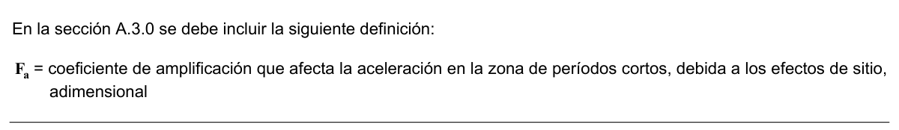
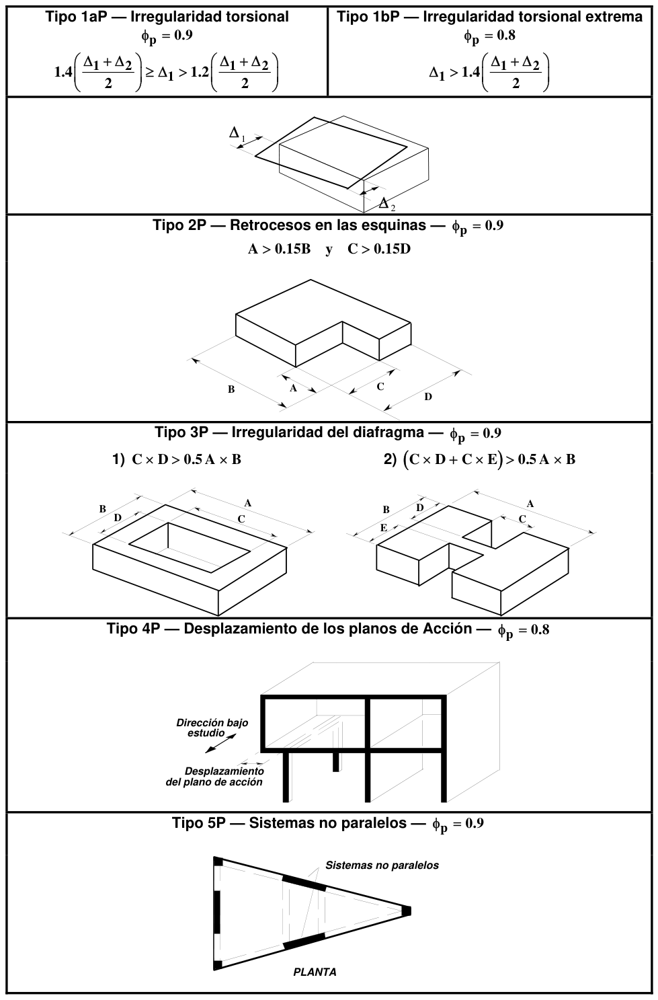
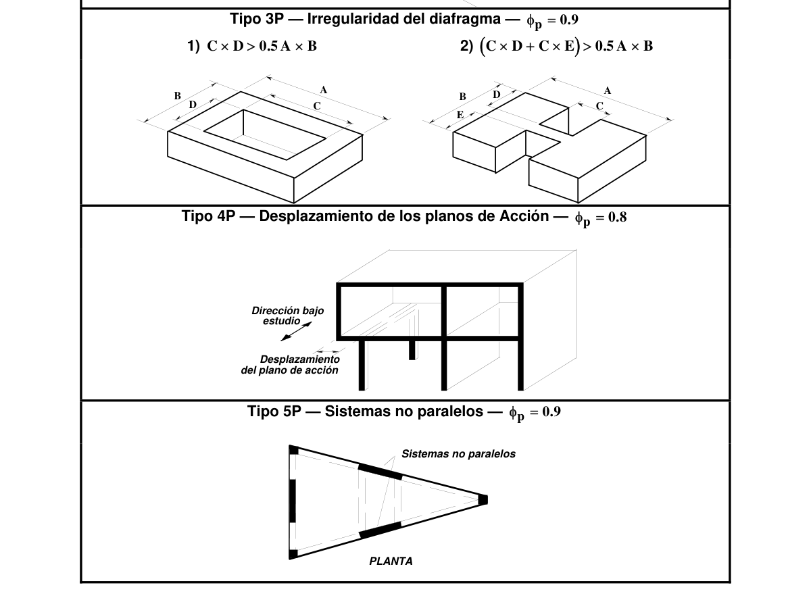
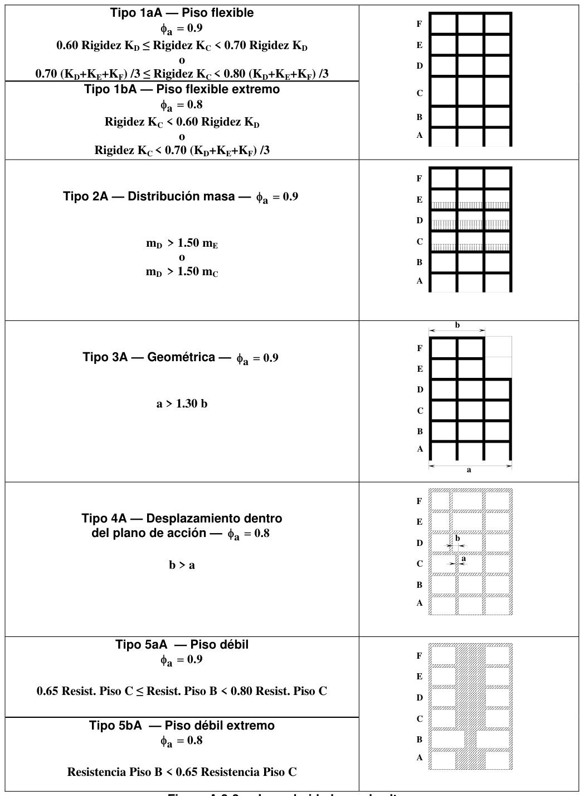
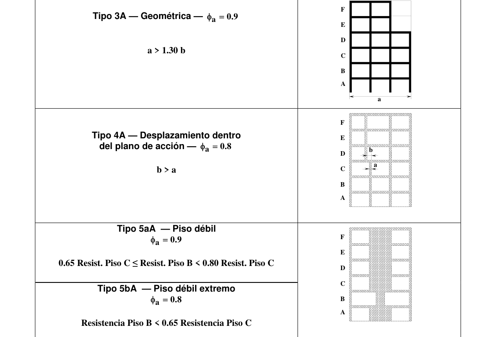

# A.3 — Requisitos generales de diseño sismo resistente

### A.3.0 — NOMENCLATURA

$A_{a}$= coeficiente que representa la aceleración horizontal pico efectiva, para diseño, dado en A.2.2.

$A_{v}$= coeficiente de aceleración que representa la velocidad horizontal pico efectiva, para diseño, dado en A.2.2.

$A_{s}$ = aceleración máxima en la superficie del suelo estimada como la aceleración espectral correspondiente a un período de vibración igual a cero, Véase ecuación A.3.6-3.

$A_{x}$ = coeficiente de amplificación de la torsión accidental en el nivel $x$ , definido en A.3.6.7.

$a_{i}$ = aceleración en el nivel $i$ , Véase ecuación A.3.6-3.

$E$ = fuerzas sísmicas reducidas de diseño $(E=F_{s}/R)$

$F_{i}$ = parte del cortante sísmico en la base que se genera en el nivel $i$ , véase A.3.6.6.

$F_{s}$ = fuerzas sísmicas, véase A.3.1.1.

$g$ = aceleración debida a la gravedad ($g=9.8$ m/s2).

$h_{i}$ = altura en metros, medida desde la base, del nivel $i$ , véase ecuación A.3.6-3.

$h_{n}$= altura en metros, medida desde la base, del piso más alto de la edificación, véase ecuación A.3.6-3.

$h_{eq}$= altura equivalente del sistema de un grado de libertad que simula la edificación, véase ecuación A.3.6-3.

$I$ = coeficiente de importancia dado en A.2.5.2.

$M$ = masa total de la edificación — $M$ se expresa en kg. Debe ser igual a la masa total de la estructura más la masa de aquellos elementos tales como muros divisorios y particiones, equipos permanentes, tanques y sus contenidos, etc. En depósitos o bodegas debe incluirse además un 25 por ciento de la masa correspondiente a los elementos que causan la carga viva del piso. Capítulos A.4 y A.5.

$M_{p}$ = masa de un elemento o componente, en kg.

$m_{i}$ = parte de $M$ que está colocada en el nivel $i$ , en kg. Véase ecuación A.4.3-3.

$R_{0}$ = coeficiente de capacidad de disipación de energía básico definido para cada sistema estructural y cada grado de capacidad de disipación de energía del material estructural. Véase el Capítulo A.3.

$R$ = coeficiente de capacidad de disipación de energía para ser empleado en el diseño, corresponde al coeficiente de disipación de energía básico,$R_{0}$ , multiplicado por los coeficientes de reducción de capacidad de disipación de energía por irregularidades en altura, en planta y por ausencia de redundancia en el sistema estructural de resistencia sísmica $(R= φ_{a} φ_{p} φ_{r}R_{0})$. Véase el Capítulo A.3.

$S_{a}$ = valor de la aceleración espectral de diseño para un período de vibración dado. Véase ecuación A.3.6-3

$V_{x}$ = fuerza cortante sísmica en el nivel $x$ . Véase A.3.6.6.

$δ_{max}$ = desplazamiento horizontal máximo en el nivel $x$ . Véase ecuación A.3.6-2.

$δ_{prom}$ = promedio de los desplazamientos horizontales en puntos extremos de la estructura en el nivel $x$ . Véase ecuación A.3.6-2.

$φ_{a}$ = coeficiente de reducción de la capacidad de disipación de energía causado por irregularidades en altura de la edificación. Véase A.3.3.3.

$φ_{p}$ = coeficiente de reducción de la capacidad de disipación de energía causado por irregularidades en planta de la edificación. Véase A.3.3.3.

$φ_{r}$ = coeficiente de reducción de la capacidad de disipación de energía causado por ausencia de redundancia en el sistema de resistencia sísmica. Véase A.3.3.8.

$Ω_{0}$ = coeficiente de sobrerresistencia. Véase A.3.3.9.

<!-- mod:2-decreto-340-2012-1 -->
> **Modificación — Decreto 340 de 2012** · anexo, p. 4
>
> En la sección A.3.0 se debe incluir la siguiente definición:
>
> 

### A.3.1 — BASES GENERALES DE DISEÑO SISMO RESISTENTE

#### A.3.1.1 — PROCEDIMIENTO DE DISEÑO

En A.1.3 se establecen los pasos que se deben seguir en el diseño sismo resistente de una edificación. En el Capítulo A.2 se establecen los movimientos sísmicos de diseño. En el presente Capítulo se establecen:

(a) Los tipos de sistemas estructurales de resistencia sísmica, y los diferentes métodos de análisis, los cuales dependen del grado de irregularidad del sistema estructural y, además, permiten determinar el cortante sísmico en la base y su distribución en la altura de la edificación.

(b) Determinadas las fuerzas sísmicas correspondientes a cada nivel, se aplican al sistema estructural de resistencia sísmica escogido.

(c) Por medio de un modelo matemático apropiado se determinan las deflexiones de la estructura y las fuerzas internas en cada elemento del sistema estructural producidas por las fuerzas sísmicas.

(d) La verificación de derivas se realiza para las deflexiones horizontales de la estructura obtenidas del análisis.

(e) Se efectúa el diseño de los elementos y sus conexiones utilizando todas las solicitaciones requeridas por el Título B del Reglamento, debidamente combinadas según se exige allí. Las fuerzas sísmicas obtenidas del análisis $F_{s}$ , se reducen, dividiéndolas por el coeficiente de capacidad de disipación de energía, $R$ , correspondiente al sistema estructural de resistencia sísmica, para obtener las fuerzas sísmicas reducidas de diseño $(E=F_{s}/R)$ que se emplean en las combinaciones de carga prescritas en el Título B.

(f) El valor del coeficiente de capacidad de disipación de energía para ser empleado en el diseño, corresponde al coeficiente de disipación de energía básico, $R_{0}$ , multiplicado por los coeficientes de reducción de capacidad de disipación de energía por irregularidades en altura, en planta, y por ausencia de redundancia en el sistema estructural de resistencia sísmica $(R= φ_{a} φ_{p} φ_{r}R_{0})$.

(g) Los elementos frágiles de conexión entre elementos y otros que de acuerdo con los requisitos de los materiales estructurales que los constituyen requieran el uso del coeficiente de sobrerresistencia $Ω_{0}$ , se diseñan utilizando las fuerzas sísmicas de diseño $E$ obtenidas de la ecuación A.3.3-2.

(h) El diseño de los elementos estructurales y sus conexiones se realiza cumpliendo los requisitos exigidos para el grado de capacidad de disipación de energía requerido del material.

(i) Estas fuerzas de diseño de los elementos estructurales obtenidas siguiendo el procedimiento anotado, son fuerzas al nivel de resistencia, o sea que corresponden a fuerzas mayoradas que ya han sido multiplicadas por sus coeficientes de carga. Para elementos que se diseñan utilizando el método de esfuerzos de trabajo, debe consultarse A.3.1.8.

#### A.3.1.2 — CARACTERÍSTICAS DE LA ESTRUCTURACIÓN

El sistema de resistencia sísmica de la edificación debe clasificarse dentro de uno de los sistema estructurales dados en A.3.2 y debe cumplir los requisitos indicados en el presente Título A del Reglamento y los propios del material estructural que se indiquen en el Título correspondiente y para el grado de disipación de energía en el rango inelástico apropiado. Los efectos sísmicos sobre los elementos estructurales que no hacen parte del sistema de resistencia sísmica deben evaluarse siguiendo los requisitos del Capítulo A.8. Los efectos sísmicos sobre los elementos no estructurales deben evaluarse siguiendo los requisitos del Capítulo A.9.

#### A.3.1.3 — CAPACIDAD DE DISIPACIÓN DE ENERGÍA MÍNIMA REQUERIDA

Dependiendo del tipo de material estructural y de las características del sistema de resistencia sísmica se establecen los grados de capacidad de disipación de energía mínimos (DES, DMO, o DMI) que debe cumplir el material estructural en las diferentes zonas de amenaza sísmica definidas en el Capítulo A.2. Véanse las tablas A.3-1 a A.3-4.

#### A.3.1.4 — RESISTENCIA SÍSMICA EN LAS DIFERENTES DIRECCIONES HORIZONTALES

Dado que los efectos sísmicos pueden ser preponderantes en cualquier dirección horizontal, la estructura debe tener resistencia sísmica en todas las direcciones y por lo tanto el sistema estructural de resistencia sísmica debe existir en dos direcciones ortogonales o aproximadamente ortogonales, de tal manera que se garantice la estabilidad, tanto de la estructura considerada como un todo, como de cada uno de sus elementos, ante movimientos sísmicos que puedan ocurrir en cualquier dirección horizontal.

#### A.3.1.5 — TRAYECTORIA DE LAS FUERZAS

Las fuerzas deben transferirse desde su punto de aplicación hasta su punto final de resistencia. Por lo tanto debe proveerse una trayectoria o trayectorias continuas, con suficiente resistencia y rigidez para garantizar el adecuado traspaso de las fuerzas. La cimentación debe diseñarse para los efectos de las fuerzas y movimientos sísmicos.

#### A.3.1.6 — SISTEMAS DE RESISTENCIA SÍSMICA ISOSTÁTICOS

En lo posible el sistema estructural de resistencia sísmica debe ser hiperestático. En el diseño de edificaciones donde el sistema de resistencia sísmica no sea hiperestático, debe tenerse en cuenta el efecto adverso que implicaría la falla de uno de los miembros o conexiones en la estabilidad de la edificación.

#### A.3.1.7 — SISTEMAS ESTRUCTURALES DE RESISTENCIA SÍSMICA PREFABRICADOS

Pueden construirse edificaciones cuyo sistema de resistencia sísmica esté compuesto por elementos prefabricados. El sistema prefabricado debe diseñarse para las fuerzas sísmicas obtenidas de acuerdo con este Reglamento usando un coeficiente de capacidad de disipación de energía básico, tal como lo define el Capítulo A.13 igual a uno y medio

$(R_{0}=1.5)$. Cuando se demuestre con evidencia experimental y de análisis, que el sistema propuesto tiene una resistencia, capacidad de disipación de energía y capacidad de trabajo en el rango inelástico igual o mayor a las obtenidas con la estructura construida utilizando uno de los materiales prescritos por este Reglamento, deben cumplirse los requisitos de los Artículos 10 y 12 de la Ley 400 de 1997, pero en ningún caso el valor de $R_{0}$ podrá ser mayor que el fijado por el presente Reglamento para sistemas de resistencia sísmica construidos monolíticamente con el mismo material estructural. Al respecto debe consultarse A.1.4.2.

#### A.3.1.8 — MATERIALES ESTRUCTURALES DISEÑADOS USANDO EL MÉTODO DE ESFUERZOS DE TRABAJO

— Cuando el material estructural se diseña utilizando el método de esfuerzos de trabajo, tal como lo define B.2.3 de este Reglamento, para obtener los efectos de las fuerzas sísmicas reducidas de diseño al nivel de esfuerzos de trabajo que se emplean en el diseño de los elementos estructurales debe utilizarse un coeficiente de carga de $0.7$ como lo presenta B.2.3.

### A.3.2 — SISTEMAS ESTRUCTURALES

#### A.3.2.1 — TIPOS DE SISTEMAS ESTRUCTURALES

Se reconocen cuatro tipos generales de sistemas estructurales de resistencia sísmica, los cuales se definen en esta sección. Cada uno de ellos se subdivide según los tipos de elementos verticales utilizados para resistir las fuerzas sísmicas y el grado de capacidad de disipación de energía del material estructural empleado. Los sistemas estructurales de resistencia sísmica que reconoce este Reglamento son los siguientes:

**A.3.2.1.1** — Sistema de muros de carga — Es un sistema estructural que no dispone de un pórtico esencialmente completo y en el cual las cargas verticales son resistidas por los muros de carga y las fuerzas horizontales son resistidas por muros estructurales o pórticos con diagonales. Véase la tabla A.3-1.

**A.3.2.1.2** — Sistema combinado — Es un sistema estructural, (véase la tabla A.3-2), en el cual:

(a) Las cargas verticales son resistidas por un pórtico no resistente a momentos, esencialmente completo, y las fuerzas horizontales son resistidas por muros estructurales o pórticos con diagonales, o

(b) Las cargas verticales y horizontales son resistidas por un pórtico resistente a momentos, esencialmente completo, combinado con muros estructurales o pórticos con diagonales, y que no cumple los requisitos de un sistema dual.

**A.3.2.1.3** — Sistema de pórtico — Es un sistema estructural compuesto por un pórtico espacial, resistente a momentos, esencialmente completo, sin diagonales, que resiste todas las cargas verticales y fuerzas horizontales. Véase la tabla A.3-3.

**A.3.2.1.4** — Sistema dual — Es un sistema estructural que tiene un pórtico espacial resistente a momentos y sin diagonales, combinado con muros estructurales o pórticos con diagonales. Véase la tabla A.3-4. Para que el sistema estructural se pueda clasificar como sistema dual se deben cumplir los siguientes requisitos:

(a) El pórtico espacial resistente a momentos, sin diagonales, esencialmente completo, debe ser capaz de soportar las cargas verticales.

(b) Las fuerzas horizontales son resistidas por la combinación de muros estructurales o pórticos con diagonales, con el pórtico resistente a momentos, el cual puede ser un pórtico de capacidad especial de disipación de energía (DES), cuando se trata de concreto reforzado o acero estructural, un pórtico con capacidad moderada de disipación de energía (DMO) de concreto reforzado, o un pórtico con capacidad mínima de disipación de energía (DMI) de acero estructural. El pórtico resistente a momentos, actuando independientemente, debe diseñarse para que sea capaz de resistir como mínimo el 25 por ciento del cortante sísmico en la base.

(c) Los dos sistemas deben diseñarse de tal manera que en conjunto sean capaces de resistir la totalidad del cortante sísmico en la base, en proporción a sus rigideces relativas, considerando la interacción del sistema dual en todos los niveles de la edificación, pero en ningún caso la responsabilidad de los muros estructurales, o de los pórticos con diagonales, puede ser menor del 75 por ciento del cortante sísmico en la base.

#### A.3.2.2 — CLASIFICACIÓN EN UNO DE LOS SISTEMAS ESTRUCTURALES

Toda edificación o cualquier parte de ella, debe quedar clasificada dentro de uno de los cuatro sistemas estructurales de resistencia sísmica descritos en las tablas A.3-1 a A.3-4.

#### A.3.2.3 — LÍMITES DE ALTURA PARA LOS SISTEMAS ESTRUCTURALES

En las tablas A.3-1 a A.3-4 se dan las alturas máximas, medidas en metros a partir de la base o en número de pisos por encima de la misma, que puede tener cada uno de los sistemas estructurales de resistencia sísmica prescritos, para cada una de las zonas de amenaza sísmica.

#### A.3.2.4 — COMBINACIÓN DE SISTEMAS ESTRUCTURALES EN LA ALTURA

Cuando se combinen en la altura diferentes sistemas estructurales dentro de una misma edificación, deben cumplirse los siguientes requisitos:

<!-- mod:3-decreto-945-2017-23 -->
> *Texto vigente según el Decreto 945 de 2017 (anexo, p. 9).*

**A.3.2.4.1** — Máximo valor de R permitido — Con excepción de lo dispuesto en A.3.2.4.2 a A.3.2.4.4, la estructura que combine en la altura diferentes sistemas estructurales se clasifica como irregular del tipo 5aA o 5bA (Tabla A.3-7), y el valor del coeficiente de capacidad de disipación de energía, R, en cualquier dirección y en cualquier nivel, como máximo debe ser el menor valor de R de los sistemas estructurales que se estén combinando por encima de ese nivel y en la dirección considerada. Deben cumplirse los requisitos de diseño exigidos para cada sistema estructural y para cada grado de capacidad de disipación de energía del material estructural. Cuando se combinen sistemas estructurales con diferente grado de disipación de energía o con diferente valor de R, el sistema de resistencia sísmico debe ser diseñado con el menor valor de R de los sistemas que lo componen.

**A.3.2.4.2** — Pisos livianos — No hay necesidad de aplicar los requisitos de A.3.2.4.1 cuando la masa de los pisos localizados por encima del nivel donde se inicia un sistema estructural sea menor del 10 por ciento de la masa total, $M$ , de la edificación.

**A.3.2.4.3** — Estructura flexible apoyada sobre una estructura con mayor rigidez — En estructuras que tengan una parte superior flexible apoyada en una con mayor rigidez y que cumplan los requisitos de la tabla A.3-5, puede utilizarse el procedimiento de diseño indicado allí.

**A.3.2.4.4** — Estructura rígida apoyada sobre una estructura con menor rigidez — Este tipo de combinación de sistemas estructurales en la altura presenta inconvenientes en su comportamiento sísmico, por lo que para este Reglamento no es un sistema estructural aceptable.

#### A.3.2.5 — COMBINACIÓN DE SISTEMAS ESTRUCTURALES EN PLANTA

Pueden combinarse sistemas estructurales en planta, sin que ésto de pié a que la estructura se clasifique como irregular, con las siguientes limitaciones:

(a) Los dos sistemas deben coexistir en toda la altura de la edificación, a menos que se cumplan los requisitos de A.3.2.4,

(b) Cuando la estructura tiene un sistema de muros de carga únicamente en una dirección, el valor de $R$ para diseñar la dirección ortogonal, no puede ser mayor que 1.25 veces el valor de $R$ del sistema estructural de muros de carga,

(c) Cuando la estructura tiene dos sistemas de muros de carga diferentes en la misma dirección, para el sistema que tiene el mayor valor de $R$ el valor a emplear no puede ser mayor que 1.25 veces el valor de $R$ del sistema con el menor valor de $R$ , y

(d) Cuando la estructura tiene sistemas diferentes al de muros de carga en ambas direcciones, para el sistema que tiene un mayor valor de $R$ , el valor a emplear no puede ser mayor que 1.25 veces el valor de $R$ del sistema con el menor valor de $R$ .

#### A.3.2.6 — ELEMENTOS COMUNES A VARIOS SISTEMAS ESTRUCTURALES

Los elementos estructurales comunes a diferentes sistemas estructurales deben diseñarse y detallarse siguiendo los requisitos más restrictivos dentro de los sistemas para los cuales son comunes.

### A.3.3 — CONFIGURACIÓN ESTRUCTURAL DE LA EDIFICACIÓN

#### A.3.3.1 — GENERAL

Para efectos de diseño sísmico la edificación debe clasificarse como regular o como irregular en planta y en altura o como redundante o con ausencia de redundancia de acuerdo con los requisitos de esta sección.

#### A.3.3.2 — DEFINICIÓN DE LA CONFIGURACIÓN ESTRUCTURAL

Se entiende por configuración estructural de la edificación, no solamente la forma exterior de ella y su tamaño, sino la naturaleza, las dimensiones y la localización de los elementos estructurales, y no estructurales, que afecten el comportamiento de la edificación ante las solicitaciones sísmicas.

#### A.3.3.3 — REDUCCIÓN DEL VALOR DE $R$ PARA ESTRUCTURAS IRREGULARES Y CON AUSENCIA DE

REDUNDANCIA — Cuando una estructura se clasifique como irregular, el valor del coeficiente de capacidad de disipación de energía $R$ que se utilice en el diseño sísmico de la edificación, debe reducirse multiplicándolo por $φ_{p}$ , debido a irregularidades en planta, por $φ_{a}$ debido a irregularidades en altura, y por $φ_{r}$ debido a ausencia de redundancia, como indica la ecuación A.3.3-1.

$$ R = \phi_a\,\phi_p\,\phi_r\,R_0 \tag{A.3.3-1} $$

Cuando una edificación tiene varios tipos de irregularidad en planta simultáneamente, se aplicará el menor valor de $φ_{p}$ . Análogamente, cuando una edificación tiene varios tipos de irregularidad en altura simultáneamente, se aplicará el menor valor de $φ_{a}$ .

#### A.3.3.4 — CONFIGURACIÓN EN PLANTA

La edificación se considera irregular cuando ocurra, véase la figura A.3-1, uno, o varios, de los casos descritos en la tabla A.3-6, donde se definen los valores de $φ_{p}$.

#### A.3.3.5 — CONFIGURACIÓN EN LA ALTURA

Una edificación se clasifica como irregular en altura, véase la figura A.3-2, cuando ocurre uno, o varios, de los casos descritos en la tabla A.3-7, donde se definen los valores de $φ_{a}$ .

**A.3.3.5.1** — Excepciones a las irregularidades en altura — Cuando para todos los pisos, la deriva de cualquier piso es menor de 1.3 veces la deriva del piso siguiente hacia arriba, puede considerarse que no existen irregularidades en altura de los tipos 1aA, 1bA, 2A, ó 3A, tal como se definen en la tabla A.3-7, y en este caso se aplica $φ_{a}=1$. No hay necesidad de considerar en esta evaluación las derivas de los dos pisos superiores de la edificación ni los sótanos que tengan muros de contención integrados a la estructura en toda su periferia. Las derivas utilizadas en la evaluación pueden calcularse sin incluir los efectos torsionales. Así mismo, no se considera irregular la estructura flexible apoyada sobre una estructura con mayor rigidez que cumpla los requisitos de A.3.2.4.3 y los correspondientes de la tabla A.3-5.

#### A.3.3.6 — EDIFICACIONES EN ZONAS DE AMENAZA SÍSMICA BAJA DE LOS GRUPOS DE USO $I$ Y $II$

Para las edificaciones pertenecientes a los grupos de uso $I$ y $II$, localizadas en zonas de amenaza sísmica baja, la evaluación para determinar si la edificación es irregular o no, puede limitarse a irregularidades en planta del tipo 1aP, 1bP (tabla A.3-6) y en altura del tipo 5aA y 5bA (tabla A.3-7).

#### A.3.3.7 — EDIFICACIONES EN ZONAS DE AMENAZA SÍSMICA INTERMEDIA DEL GRUPO DE USO $I$

Para las edificaciones pertenecientes al grupo de uso $I$, localizadas en zonas de amenaza sísmica intermedia, la evaluación para determinar si la edificación es irregular o no, puede limitarse a irregularidades en planta de los tipos 1aP, 1bP, 3P y 4P (tabla A.3-6) y en altura de los tipos 4A, 5aA y 5bA (tabla A.3-7).

#### A.3.3.8 — AUSENCIA DE REDUNDANCIA EN EL SISTEMA ESTRUCTURAL DE RESISTENCIA SÍSMICA

Debe asignarse un factor de reducción de resistencia por ausencia de redundancia en el sistema estructural de resistencia sísmica, $φ_{r}$, en las dos direcciones principales en planta de la siguiente manera:

**A.3.3.8.1** — En edificaciones con un sistema estructural con capacidad de disipación de energía mínima (DMI) — Para edificaciones cuyo sistema estructural de resistencia sísmica es de un material que cumple los requisitos de capacidad de disipación de energía mínima (DMI) el valor del factor de reducción de resistencia por ausencia de redundancia en el sistema estructural de resistencia sísmica, $φ_{r}$, se le asigna un valor de la unidad $(φ_{r} =1.0)$.

**A.3.3.8.2** — En edificaciones con un sistema estructural con capacidad de disipación de energía moderada (DMO) y especial (DES) — Para edificaciones cuyo sistema estructural es de un material que cumple los requisitos de capacidad de disipación de energía moderada (DMO) o especial (DES) el valor del factor de reducción de resistencia por ausencia de redundancia en el sistema estructural de resistencia sísmica, $φ_{r}$, se le puede asignar un valor de la unidad $(φ_{r} =1.0)$ cuando en todos los pisos que resistan más del 35 por ciento del corte basal en la dirección bajo estudio el sistema estructural de resistencia sísmica cumpla las siguientes condiciones de redundancia:

(a) En sistemas compuestos por pórticos con arriostramientos concéntricos — La falla de cualquiera de las diagonales o sus conexiones al pórtico no resulta en una reducción de más del 33 por ciento de la resistencia ante fuerzas horizontales del piso ni produce una irregularidad torsional en planta extrema (Tipo 1bP).

(b) En sistemas compuestos por pórticos con arriostramientos excéntricos — La pérdida de resistencia a momento (si se trata de vínculos a momento), o a cortante (para el caso de vínculos a corte), de los dos extremos de un vínculo no resulta en una reducción de más del 33 por ciento de la resistencia ante fuerzas horizontales del piso ni produce una irregularidad torsional en planta extrema (Tipo 1bP).

(c) En sistemas de pórtico resistente a momentos — La pérdida de la resistencia a momento en la conexión viga-columna de los dos extremos de una viga no resulta en una reducción de más del 33 por ciento de la resistencia ante fuerzas horizontales del piso ni produce una irregularidad torsional en planta extrema (Tipo 1bP).

(d) En sistemas con muros estructurales de concreto estructural — La falla de un muro estructural o de una porción de él que tengan una relación de la altura del piso a su longitud horizontal mayor de la unidad, o de los elementos colectores que lo conectan al diafragma, no resulta en una reducción de más del 33 por ciento de la resistencia ante fuerzas horizontales del piso ni produce una irregularidad torsional en planta extrema (Tipo 1bP).

(e) Para otros sistemas — No hay requisitos especiales.

En los sistemas estructurales que no cumplan las condiciones enunciadas en (a) a (d) el factor de reducción de resistencia por ausencia de redundancia en el sistema estructural de resistencia sísmica, $φ_{r}$ , se le debe asignar un valor de $φ_{r} =0.75$. Aunque no se cumplan las condiciones enunciadas en (a) a (d) el factor de reducción de resistencia por ausencia de redundancia en el sistema estructural de resistencia sísmica, $φ_{r}$, se le debe asignar un valor igual a la unidad $(φ_{r} =1.0)$ si todos los pisos que resistan más del 35 por ciento del corte basal en la dirección bajo estudio el sistema estructural de resistencia sísmica sean regulares en planta y tengan al menos dos vanos compuestos por elementos que sean parte del sistema de resistencia sísmica localizados en la periferia a ambos lados de la planta en las dos direcciones principales. Cuando se trate de muros estructurales para efectos de contar el número de vanos equivalentes se calcula como la longitud horizontal del muro dividida por la altura del piso.

#### A.3.3.9 — USO DEL COEFICIENTE DE SOBRERRESISTENCIA $Ω_{0}$

Cuando los requisitos para el material estructural y el grado de disipación de energía requieren que los elementos frágiles o las conexiones entre elementos se diseñen para fuerzas sísmicas, $E$ , amplificadas por el coeficiente de sobrerresistencia, $Ω_{0}$ , éste debe emplearse de la siguiente manera para obtener las fuerzas de diseño que incluyen los efectos sísmicos:

$$ E = \dfrac{\Omega_0 F_s}{R} \pm 0.5\,A_a F_a D \tag{A.3.3-2} $$

Donde $F_{s}$ corresponde a las fuerzas sísmicas obtenidas del análisis, $R$ es el coeficiente de capacidad de disipación de energía correspondiente al sistema estructural de resistencia sísmica $R= φ_{a} φ_{p} φ_{r}R_{0}$, y $D$ corresponde a la carga muerta que actúa sobre el elemento tal como se define en el Título B del Reglamento y el signo de la parte derecha de la ecuación es el que conduce al mayor valor de $E$, dependiendo del signo de $F_{s}$ .

### A.3.4 — MÉTODOS DE ANÁLISIS

#### A.3.4.1 — MÉTODOS RECONOCIDOS

Se reconocen los siguientes métodos de análisis del sistema de resistencia sísmica para efectos de su diseño:

(a) Método de la fuerza horizontal equivalente, el cual está descrito en el Capítulo A.4,

(b) Métodos de análisis dinámico elástico, de acuerdo con los requisitos del Capítulo A.5,

(c) Métodos de análisis dinámico inelástico, de acuerdo con los requisitos del Capítulo A.5, y

(d) Métodos de análisis alternos, los cuales deben tener en cuenta las características dinámicas de la edificación, el comportamiento inelástico de los materiales, y deben ser de aceptación general en la ingeniería. En la aplicación de cualquier método de análisis alterno no se pueden utilizar períodos fundamentales mayores de los permitidos en los Capítulos A.4 y A.5.

#### A.3.4.2 — MÉTODO DE ANÁLISIS A UTILIZAR

Como mínimo deben emplearse los siguientes métodos de análisis:

**A.3.4.2.1** — Método de la fuerza horizontal equivalente — Puede utilizarse el método de la fuerza horizontal equivalente en las siguientes edificaciones:

(a) Todas las edificaciones, regulares e irregulares, en las zonas de amenaza sísmica baja,

(b) Todas las edificaciones, regulares e irregulares, pertenecientes al grupo de uso $I$ , localizadas en zonas de amenaza sísmica intermedia,

(c) Edificaciones regulares, de 20 niveles o menos y 60 m de altura o menos medidos desde la base, en cualquier zona de amenaza sísmica, exceptuando edificaciones localizadas en lugares que tengan un perfil de suelo tipo D, E o F, con periodos de vibración mayores de $2T_{C}$ ,

(d) Edificaciones irregulares que no tengan más de 6 niveles ni más de 18 m de altura medidos a partir de la base,

(e) Estructuras flexibles apoyadas sobre estructuras más rígidas que cumplan los requisitos de A.3.2.4.3.

**A.3.4.2.2** — Método del análisis dinámico elástico — Debe utilizarse el método del análisis dinámico elástico en todas las edificaciones que no estén cubiertas por A.3.4.2.1, incluyendo las siguientes:

(a) Edificaciones de más de 20 niveles o de más de 60 m de altura, exceptuando las edificaciones mencionadas en A.3.4.2.1 (a) y (b),

(b) Edificaciones que tengan irregularidades verticales de los tipos 1aA, 1bA, 2A y 3A, tal como se definen en A.3.3.5,

(c) Edificaciones que tengan irregularidades que no estén descritas en A.3.3.4 y A.3.3.5, exceptuando el caso descrito en A.3.2.4.3,

(d) Edificaciones de más de 5 niveles o de más de 20 m de altura, localizadas en zonas de amenaza sísmica alta, que no tengan el mismo sistema estructural en toda su altura, con la excepción de los prescrito en A.3.2.4.3,

(e) Estructuras, regulares o irregulares, localizadas en sitios que tengan un perfil de suelo D, E o F y que tengan un período mayor de $2T_{C}$ . En este caso el análisis debe incluir los efectos de interacción suelo-estructura, tal como los prescribe el Capítulo A.7, cuando se realice un análisis de la estructura suponiéndola empotrada en su base.

<!-- mod:3-decreto-945-2017-24 -->
> *Texto vigente según el Decreto 945 de 2017 (anexo, p. 9).*

**A.3.4.2.3** — Método del análisis dinámico inelástico — Puede utilizarse el método del análisis dinámico inelástico en aquellos casos que a juicio del ingeniero diseñador estructural, se presenten variaciones en la capacidad de disipación de energía en el rango inelástico que solo sea posible identificar por este procedimiento. Cuando se utilice este método de análisis deben cumplirse los requisitos dados en el Capítulo A.5. Los diseños realizados por esta metodología deben ser objeto de una revisión externa  de expertos en análisis dinámico inelástico conforme a la metodología que establezca la Comisión Asesora Permanente para el Régimen de Construcciones Sismo-Resistentes, y no exime la revisión de oficio que debe realizar el curador urbano o la autoridad municipal o distrital encargada de la expedición de las licencias urbanísticas.

<!-- mod:3-decreto-945-2017-25 -->
> *Texto vigente según el Decreto 945 de 2017 (anexo, p. 9).*

**A.3.4.2.4** — Método de análisis no lineal estático de plastificación progresiva — Puede utilizarse el método del análisis no lineal estático, conocido como procedimiento “push-over” o de plastificación progresiva, en aquellos casos que a juicio del ingeniero diseñador se desee evaluar la capacidad de disipación de energía en el rango inelástico por este procedimiento. Cuando se utilice este método de análisis deben cumplirse los requisitos dados en el Apéndice A-3 y además se deben confrontar con otro de los métodos de análisis permitidos por el Reglamento, utilizando en el diseño lo más exigente. Los diseños realizados por esta metodología deben ser objeto de una revisión externa de expertos en análisis no lineal estático de plastificación conforme a la metodología que establezca la Comisión Asesora Permanente para el Régimen de Construcciones Sismo-Resistente, y no exime de la revisión de oficio que debe realizar el curador urbano o la autoridad municipal o distrital encargada de la expedición de las licencias urbanísticas.

#### A.3.4.3 — RIGIDEZ DE LA ESTRUCTURA Y SUS ELEMENTOS

Las rigideces que se empleen en el análisis estructural para el diseño sísmico deben ser definidas por el ingeniero diseñador de acuerdo con su criterio, teniendo en cuenta los preceptos dados para cada material estructural en el Título correspondiente de este Reglamento.

### A.3.5 — REQUISITOS PARA LOS MATERIALES ESTRUCTURALES

**A.3.5.1** — Los requisitos especiales para el diseño y los detalles propios de cada material estructural se dan para el grado de capacidad de disipación de energía; mínima (DMI), moderada (DMO) o especial (DES), que se requiera del material y para cada uno de los sistemas estructurales de resistencia sísmica en las tablas A.3-1 a A.3-4.

### A.3.6 — EFECTOS SÍSMICOS EN LOS ELEMENTOS ESTRUCTURALES

#### A.3.6.1 — GENERALIDADES

Todos los elementos estructurales deben diseñarse para los efectos de los movimientos sísmicos de diseño que actúen sobre ellos, adicionalmente a todas las cargas que los puedan afectar, tal como lo prescribe el Título B de este Reglamento.

**A.3.6.1.1** — Elementos del sistema de resistencia sísmica — Solamente los elementos que pertenezcan al sistema estructural de resistencia sísmica pueden contribuir a la resistencia sísmica de la edificación y deben diseñarse de acuerdo con los requisitos propios de su material estructural y para el grado de capacidad de disipación de energía requerido, además de los requisitos adicionales dados en la presente sección.

**A.3.6.1.2** — Elementos estructurales que no hacen parte del sistema de resistencia sísmica — Los elementos estructurales que no formen parte del sistema estructural de resistencia sísmica, deben investigarse con el fin de determinar si pueden mantener su capacidad de resistir cargas verticales cuando se ven sometidos a los desplazamientos horizontales y a las derivas, causados por los movimientos sísmicos de diseño, pero sólo hay necesidad de que cumplan los requisitos del grado de capacidad de disipación de energía mínimo para su material estructural. Sus anclajes y amarres al sistema de resistencia sísmica deben cumplir los requisitos dados en la presente sección y en el Capítulo A.8.

#### A.3.6.2 — COMBINACIÓN DE LOS EFECTOS DE CARGA

Los coeficientes de carga que deben emplearse en la combinación de cargas de gravedad y de fuerzas sísmicas se establecen en el Título B de este Reglamento. Debe tenerse en cuenta que las fuerzas sísmicas obtenidas siguiendo éste Reglamento, están definidas al nivel de resistencia, por lo tanto ya están mayoradas.

#### A.3.6.3 — DIRECCIÓN DE APLICACIÓN DE LAS FUERZAS SÍSMICAS

<!-- mod:2-decreto-340-2012-2 -->
> *Texto vigente según el Decreto 340 de 2012 (anexo, p. 4).*

Con excepción de lo dispuesto en A.3.6.3.1, puede suponerse que el efecto crítico sobre una edificación, causado por la dirección de aplicación de las fuerzas sísmicas se ha tomado en cuenta si todos los elementos se diseñan para el 100% de las fuerzas sísmicas actuando no simultáneamente en las dos direcciones principales. La fuerza sísmica debe combinarse con las cargas verticales de acuerdo con los requisitos del Título B de este Reglamento.

**A.3.6.3.1** — Casos en los cuales hay que tener en cuenta los efectos ortogonales – No hay necesidad de tener en cuenta los efectos ortogonales si la estructura tiene diafragmas flexibles o si se trata de edificios de un piso (naves industriales o similares) en los cuales no haya irregularidades en planta del tipo 5P. Debe tenerse en cuenta el efecto ortogonal en zonas de amenaza sísmica intermedia o alta, de acuerdo con A.3.6.3.2, en los siguientes casos:

(a) en estructuras que tienen irregularidades en planta del tipo 1aP, 1bP o 5P.

(b) en las columnas que hagan parte del sistema de resistencia sísmica de la estructura.

**A.3.6.3.2** — Efectos ortogonales – Los efectos ortogonales pueden tenerse en cuenta suponiendo la concurrencia simultánea del 100% de las fuerzas sísmicas en una dirección y el 30% de las fuerzas sísmicas en la dirección perpendicular. Debe utilizarse la combinación que requiera la mayor resistencia del elemento. Alternativamente, los efectos ortogonales pueden calcularse como la raíz cuadrada de la suma de los cuadrados de los efectos producidos por el 100% de las fuerzas sísmicas actuando independientemente en las dos direcciones ortogonales, asignándole el signo que conduzca al resultado más conservador.

#### A.3.6.4 — AMARRES Y CONTINUIDAD

Todos los elementos estructurales deben interconectarse. La conexión y los elementos conectores deben ser capaces de transmitir las fuerzas sísmicas inducidas por las partes que conectan; además de los requisitos del Capítulo A.8, deben cumplirse los siguientes requisitos:

**A.3.6.4.1** — Partes de la edificación — Cualquier parte o porción de la edificación que forme un conjunto indistintamente diferenciado del resto de la estructura, pero que esté estructuralmente vinculado a ésta, debe estar vinculada y amarrada al resto de la edificación por medio de elementos de conexión cuya resistencia se diseñe teniendo en cuenta las fuerzas axiales, de corte y de flexión transmitidas por la interacción entre las partes bajo las combinaciones de carga especificadas en el Título B. La fuerza sísmica involucrada, como mínimo, debe ser $(0.40A_{a} g)$ veces la masa de la parte o porción. Es particularmente importante que, en el caso de esta conexión, en el análisis no se utilice nudo maestro u otro método de igualación de grados de libertad para el análisis bajo cargas laterales.

**A.3.6.4.2** — Vigas de amarre en la cimentación — Los elementos de cimentación, tales como zapatas, dados de pilotes, pilas o "caissons", etc., deben amarrarse por medio de elementos capaces de resistir en tensión o compresión una fuerza no menor de $(0.25A_{a})$ veces la carga vertical total del elemento que tenga la mayor carga entre los que interconecta, además de las fuerzas que le transmita la superestructura. Para efectos del diseño de la cimentación debe cumplirse lo prescrito en A.3.7.

#### A.3.6.5 — ELEMENTOS COLECTORES

Deben proveerse elementos colectores capaces de transferir las fuerzas sísmicas que se originan en otras partes de la edificación hasta el elemento vertical del sistema de resistencia sísmica que resiste esas fuerzas.

#### A.3.6.6 — DISTRIBUCIÓN DE LA FUERZA CORTANTE EN EL PISO

Cuando se utilice el método de la fuerza horizontal equivalente definido en el Capítulo A.4, la fuerza cortante, $V_{x}$ , en el nivel $x$ , debe determinarse de acuerdo con la siguiente fórmula:

$$ V_x = \sum_{i=x}^{n} F_i \tag{A.3.6-1} $$

La fuerza cortante, $V_{x}$ , y las torsiones asociadas deben distribuirse entre los diferentes pórticos y muros estructurales del sistema de resistencia sísmica de acuerdo con sus respectivas rigideces de desplazamiento y teniendo en cuenta la rigidez del diafragma, de acuerdo con la definición de la rigidez de los diafragmas dada en A.3.6.7.2.

#### A.3.6.7 — TORSIÓN EN EL PISO

En el diseño deben tenerse en cuenta los efectos de torsión en el piso, considerando que estos provienen de la incertidumbre en la localización de las masas dentro del piso, lo cual conduce a una torsión accidental, o debido a la excentricidad entre el centro de masas y el centro de rigidez cuando los diafragmas se consideran rígidos en su propio plano, o de la asimetría en la distribución de la masa y la rigidez de elementos verticales, cuando los diafragmas no pueden considerarse como rígidos en su propio plano. En caso de realizarse análisis dinámico, el análisis mismo reflejará los efectos de las torsiones que se tengan en la estructura, quedando a opción diseñador si en él involucra o no condiciones de torsión accidental. En el caso que se utilice el método de la fuerza horizontal equivalente, para la consideración de la torsión en el piso deben cumplirse los requisitos de A.3.6.7.1 a A.3.6.7.3, descritos a continuación.

**A.3.6.7.1** — Torsión accidental — Debe suponerse que la masa de todos los pisos está desplazada transversalmente, hacia cualquiera de los dos lados, del centro de masa calculado de cada piso, una distancia igual al 5 por ciento (0.05) de la dimensión de la edificación en ese piso, medida en la dirección perpendicular a la dirección en estudio. El efecto de la torsión que se genera debe tenerse en cuenta en la distribución del cortante del piso a los elementos verticales del sistema de resistencia sísmica. Cuando existan irregularidades en planta del tipo 1aP o 1bP, tal como las define A.3.3.4.1 (tabla A.3-6), debe aumentarse la torsión accidental en cada nivel $x$, multiplicándola por un coeficiente de amplificación, $A_{x}$ , determinado de acuerdo con la siguiente ecuación:

$$ A_x = \left[\dfrac{\delta_{max}}{1.2\,\delta_{prom}}\right]^2 \le 3.0 \tag{A.3.6-2} $$

**A.3.6.7.2** — Torsión debida a la no coincidencia del centro de masa y de rigidez — Cuando el diafragma puede considerarse rígido en su propio plano, debe tenerse en cuenta el aumento en los cortantes sobre los elementos verticales del sistema de resistencia sísmica debida a la distribución, en planta, de la rigidez de los elementos del sistema de resistencia sísmica.

(a) Diafragma flexible — El diafragma puede suponerse flexible, para los efectos de las prescripciones de esta sección, cuando la máxima deflexión horizontal dentro del diafragma, al verse sometido a las fuerzas sísmicas, $F_{s}$ , es más de 2 veces el promedio de sus deflexiones horizontales.

Esta determinación de la flexibilidad del diafragma puede realizarse comparando la deflexión horizontal debida a las fuerzas sísmicas, obtenida en el punto medio del diafragma, con la de cada uno de los elementos verticales del sistema de resistencia sísmica, al verse sometidos a una fuerza horizontal equivalente a la producida por la masa aferente al elemento.

(b) Diafragma rígido en su propio plano — El diafragma puede suponerse rígido en su propio plano cuando se dispone su rigidez y su resistencia de tal manera que éste actúe como una unidad y sus propiedades de masa y de rigidez se puedan concentrar en el centro de masa y en el centro de rigidez respectivamente. En las edificaciones que tengan irregularidades de los tipos 2P y 3P la consideración de diafragma rígido debe evaluarse cuidadosamente, pues en la mayoría de los casos estas irregularidades inhiben el comportamiento como diafragma rígido de los entrepisos de la edificación.

**A.3.6.7.3** — Torsión de diseño — El momento torsional de diseño en cualquier nivel de la estructura se obtiene como la suma de las torsiones de diseño de todos los niveles localizados por encima del nivel en estudio. La porción de la torsión aportada por cada nivel se obtiene como la torsión accidental del nivel, más el producto de la fuerza sísmica horizontal, correspondiente a ese nivel por una dimensión igual a la proyección, en la dirección perpendicular a la dirección de las fuerzas, de la distancia entre el centro de masa y el centro de rigidez del nivel.

#### A.3.6.8 — DIAFRAGMAS

En las zonas de amenaza sísmica intermedia y alta, en el diseño de los pisos y cubiertas que actúan como diafragmas debe tenerse en cuenta lo siguiente:

**A.3.6.8.1** — La deflexión en el plano del diafragma no debe exceder la deflexión permisible de los elementos que estén adheridos a él. La deflexión permisible debe ser aquella que permita a los elementos adheridos mantener su integridad estructural bajo las fuerzas impuestas.

**A.3.6.8.2** — Los diafragmas de piso o de cubierta deben diseñarse para que sean capaces de resistir las fuerzas causadas por la aceleración en cada nivel, expresada como una fracción de la gravedad, determinada por medio de la siguiente ecuación:

$$ \begin{cases} a_i = A_s + \dfrac{(S_a - A_s)\,h_i}{h_{eq}} & h_i \le h_{eq} \\[4pt] a_i = S_a\,\dfrac{h_i}{h_{eq}} & h_i \ge h_{eq} \end{cases} \tag{A.3.6-3} $$

$h_{eq}$ puede estimarse simplificadamente como $0.75h_{n}$ Alternativamente a la ecuación A.3.6-3 para calcular las fuerzas que deben resistir los diafragmas de piso o de cubierta, pueden usarse estimaciones más precisas de las aceleraciones absolutas máximas a que estarían sometidos estos diafragmas, resultado por ejemplo, de análisis dinámicos.

Cuando el diafragma debe transmitir fuerzas provenientes de los elementos verticales del sistema de resistencia sísmica que se encuentren por encima del diafragma, a elementos verticales del sistema de resistencia sísmica que se encuentren por debajo del diafragma, debido a desplazamientos en la localización de los elementos, o por cambios en la rigidez de los elementos verticales, las fuerzas correspondientes se deben adicionar a las obtenidas por medio de la ecuación A.3.6-3.

<!-- mod:3-decreto-945-2017-26 -->
> *Texto vigente según el Decreto 945 de 2017 (anexo, p. 10).*

**A.3.6.8.3** — Los diafragmas que den apoyo a muros de concreto reforzado o de mampostería, deben tener amarres continuos entre los diferentes elementos del diafragma con el fin de distribuir las fuerzas de anclaje especificadas en A.3.6.10. En los modelos de análisis los diafragmas no pueden aportar rigidez ni resistencia a los sistemas de muros debido a que son elementos que no hacen parte del sistema de resistencia sísmica. Véase A.3.1.2 y A.3.6.1.1.

**A.3.6.8.4** — Las conexiones del diafragma a los elementos verticales o a los elementos colectores, o entre elementos colectores, en estructuras localizadas en zonas de amenaza sísmica alta que tengan irregularidades en planta de los tipos 1aP, 1bP, 2P, 3P ó 4P (tabla A.3-6), deben diseñarse para las fuerzas sísmicas correspondientes, multiplicadas por 1.25.

**A.3.6.8.5** — En las edificaciones localizadas en zonas de amenaza sísmica alta que tengan irregularidades en planta del tipo 2P (tabla A.3-6), los elementos del diafragma deben diseñarse considerando movimientos independientes de las alas que se proyectan hacia afuera de la estructura. Cada uno de los elementos del diafragma debe diseñarse para la condición más severa producida por el movimiento de las alas del diafragma en la misma dirección, o en direcciones opuestas.

#### A.3.6.9 — ELEMENTOS LOCALIZADOS DEBAJO DE LA BASE

La resistencia y rigidez de los elementos que formen parte del sistema de resistencia sísmica que se encuentren localizados entre la base y la cimentación no deben ser menores que las de la superestructura. Los elementos localizados entre la base y la cimentación deben tener el mismo grado de capacidad de disipación de energía de los elementos del sistema de resistencia sísmica.

#### A.3.6.10 — MUROS ESTRUCTURALES

Los muros estructurales de concreto o mampostería, exteriores e interiores, deben amarrarse a los diafragmas o cubiertas que les provean apoyo lateral, por medio de anclajes diseñados para resistir una fuerza horizontal que actúa perpendicularmente al plano del muro. Dicha fuerza se puede calcular a partir de la fuerza causada por la aceleración en cada piso, calculada con la ecuación A.3.6-3, pero no menor que $0.10M_{p} g$ , donde $M_{p}$ es la masa del tramo de muro considerado. Alternativamente a la ecuación A.3.6-3 para calcular las fuerzas horizontales perpendiculares al plano del muro pueden usarse estimaciones más precisas de las aceleraciones absolutas máximas a las que estarían sometidos estos muros.

#### A.3.6.11 — ESTRUCTURAS DE TIPO PÉNDULO INVERTIDO

Estas son estructuras donde el sistema de resistencia sísmica actúa como uno o varios voladizos aislados y un porcentaje muy alto de la masa se encuentra concentrada en la parte superior de la estructura. Las columnas o pilares de apoyo de las estructuras de tipo péndulo invertido deben diseñarse para un diagrama de momentos flectores que inicia en la base con un valor determinado de acuerdo con los procedimientos establecidos en el Capítulo A.4 y varía uniformemente hasta llegar a la mitad de este valor en la parte superior. Véase la tabla A.3-3 para efectos de los sistemas estructurales permitidos.

#### A.3.6.12 — ELEMENTOS VERTICALES DISCONTINUOS

En las zonas de amenaza sísmica intermedia y alta, cuando se presenten discontinuidades en el alineamiento de los elementos verticales del sistema de resistencia sísmica, tales como las descritas en las irregularidades en planta tipo 4P (tabla A.3-6) y en altura tipo 4A (tabla A.3-7), deben cumplirse los siguientes requisitos:

(a) Las fuerzas axiales mayoradas de los elementos verticales que sostengan los elementos que se suspenden se deben obtener utilizando las combinaciones de carga apropiadas de las dadas en B.2.4, utilizando un coeficiente de carga igual a $0.4R$ , pero no menor de $1.0$, en las combinaciones que incluyan fuerzas sísmicas reducidas de diseño $E$ , en vez del coeficiente $1.0$ prescrito allí,

(b) Debe garantizarse que los elementos, tales como vigas, que llevan estas fuerzas axiales hasta los elementos verticales las que las soportan sean capaces de resistirlas,

(c) Los elementos verticales deben diseñarse para las fuerzas axiales mayoradas como se indica en el literal (a), acompañadas de los momentos obtenidos del análisis, los cuales se mayoran utilizando las combinaciones de carga normales prescritas en B.2.4,

(d) Los elementos verticales deben diseñarse y detallarse siguiendo los requisitos del grado especial de capacidad de disipación de energía (DES) del material correspondiente.

Cuando el diseño de los elementos verticales soportan el elemento que se suspende se realiza utilizando el método de esfuerzos de trabajo prescrito en B.2.3, las fuerzas axiales de diseño al nivel de esfuerzos de trabajo se deben multiplicar por $0.3R$ , pero no menos de $0.7$, en vez del coeficiente $0.7$ prescrito allí.

<!-- mod:1-decreto-092-2011-12 -->
> **Modificación — Decreto 092 de 2011** · anexo, p. 2
>
> El literal (a) queda así:
>
> (a) Las fuerzas axiales mayoradas de los elementos verticales que sostengan los elementos que se suspenden se deben obtener utilizando las combinaciones de carga apropiadas dadas en B.2.4 considerando para las fuerzas sísmicas $E$ lo indicado en la ecuación A.3.3-2 dada en A.3.3.9 con el coeficiente de sobrerresistencia $\Omega_0$ propio del sistema estructural contenido en las Tablas A.3-1 a A.3-4.
>
> El último párrafo queda así: Cuando el diseño de los elementos verticales que soportan el elemento que se suspende se realiza utilizando el método de esfuerzos de trabajo prescrito en B.2.3, las fuerzas axiales de diseño al nivel de esfuerzos de trabajo se deben multiplicar por $0.7\Omega_0$, pero no menos de $0.7$, en vez del coeficiente $0.7$ para $E$ prescrito en B.2.3.

#### A.3.6.13 — EFECTO DE LAS ACELERACIONES VERTICALES

En las zonas de amenaza sísmica alta e intermedia, deben tenerse en cuenta los efectos de los movimientos sísmicos verticales en los siguientes elementos estructurales:

(a) En los voladizos, considerando una fuerza vertical, ascendente o descendente, en la punta del elemento con un valor igual al 30 por ciento de la carga muerta del voladizo en las zonas de amenaza sísmica alta, y del 15 por ciento en las zonas de amenaza sísmica intermedia, y

(b) En los elementos construidos con concreto preesforzado, deben utilizarse combinaciones de carga adicionales a todas aquellas que incluyan carga muerta, utilizando el 50 por ciento de la carga muerta.

### A.3.7 — FUERZAS SÍSMICAS DE DISEÑO DE LOS ELEMENTOS ESTRUCTURALES

#### A.3.7.1 — SISTEMA DE RESISTENCIA SÍSMICA

Los elementos del sistema estructural de resistencia sísmica, y sus conexiones, deben diseñarse utilizando todas las solicitaciones requerida por el Título B del Reglamento, debidamente combinadas según se exige allí. Las fuerzas sísmicas obtenidas del análisis $F_{s}$ , se reducen, dividiéndolas por el coeficiente de capacidad de disipación de energía, $R$ , correspondiente al sistema estructural de resistencia sísmica, para obtener las fuerzas sísmicas reducidas de diseño $(E=F_{s}/R)$ que se emplean en las combinaciones de carga prescritas en el Título B. El valor del coeficiente de capacidad de disipación de energía para ser empleado en el diseño, corresponde al coeficiente de disipación de energía básico, $R_{0}$ , multiplicado por los coeficientes de reducción de capacidad de disipación de energía por irregularidades en altura, en planta, y por ausencia de redundancia del sistema estructural de resistencia sísmica $(R= φ_{a} φ_{p} φ_{r}R_{0})$. El diseño de los elementos estructurales y sus conexiones se realiza cumpliendo los requisitos exigidos para el grado de capacidad de disipación de energía requerido del material. Estas fuerzas de diseño de los elementos estructurales obtenidas siguiendo el procedimiento anotado, son fuerzas al nivel de resistencia, o sea que corresponden a fuerzas mayoradas que ya han sido multiplicadas por sus coeficientes de carga. Para elementos que se diseñan utilizando el método de esfuerzos de trabajo, debe consultarse A.3.1.8.

Los elementos frágiles de conexión entre elementos y otros que de acuerdo con los requisitos de los materiales estructurales que los constituyen requieran el uso del coeficiente de sobrerresistencia $Ω_{0}$ , se diseñan utilizando las fuerzas sísmicas de diseño $E$ obtenidas de la ecuación A.3.3-2.

#### A.3.7.2 — CIMENTACIÓN

Las fuerzas sísmicas que actúan sobre la cimentación y el suelo de soporte se obtienen así:

(a) Para efectos del diseño estructural de los elementos que componen la cimentación (incluidas las pantallas y los demás elementos a los que se conecte la estructura), se emplea el procedimiento indicado en A.3.7.1, empleando las cargas apropiadas y las fuerzas sísmicas reducidas de diseño, $E$ , a partir de las reacciones de la estructura sobre estos elementos, calificando el valor de $R$ usado en la estructura para establecer las cargas a la cimentación. En caso que se requiera una evaluación particular, las acciones de la estructura sobre la cimentación deberán determinarse con uno de los siguientes métodos:

(1) mediante procedimientos de análisis inelástico de la estructura. (2) Evaluando el desempeño de la estructura (curvas de demanda y capacidad) (3) calculando las acciones que la estructura aplicará a los elementos que componen la cimentación, cuando a la estructura se aplique la carga cortante necesaria para producir el mecanismo de plastificación.

En el diseño de los elementos de cimentación deben seguirse los requisitos propios del material estructural y del Título H de este Reglamento.

(b) Para efectos de obtener los esfuerzos sobre el suelo de cimentación, a partir de las reacciones de la estructura y su cimentación sobre el suelo, se emplean las combinaciones de carga para el método de esfuerzos de trabajo de la sección B.2.3, empleando las cargas apropiadas y las fuerzas sísmicas reducidas de diseño, $E$ . Los efectos sobre el suelo así obtenidos están definidos al nivel de esfuerzos de trabajo y deben evaluarse de acuerdo con los requisitos del Título H de este Reglamento.

### A.3.8 — ESTRUCTURAS AISLADAS SÍSMICAMENTE EN SU BASE

**A.3.8.1** — Se permite el empleo de estructuras aisladas sísmicamente en su base, siempre y cuando se cumplan en su totalidad los requisitos al respecto de uno de los dos documentos siguientes:

(a) “NEHRP Recommended Provisions for Seismic Regulations for New Buildings — Provisions and Commentary”, 2003 Edition, Federal Emergency Management Agency, FEMA 450, Building Seismic Safety Council, National Institute of Buildings Sciences, Washington, D.C., USA, 2004,

(b) “Minimum Design Loads for Building and Other Structures”, ASCE/SEI 7-05, Structural Engineering Institute of the American Society of Civil Engineers, Reston, Virginia, USA, 2006

<!-- mod:3-decreto-945-2017-27 -->
> **Modificación — Decreto 945 de 2017** · anexo, p. 10
>
> (b) “Minimum Design Loads for Building and Other Structures”, ASCE/SEI 7-10, Structural Engineering Institute of the American Society of Civil Engineers, Reston, Virginia, USA, 2010.

**A.3.8.2** — En el diseño y construcción de estructuras aisladas sísmicamente en su base, se deben cumplir los requisitos de los Artículos 10 y 11 de la Ley 400 de 1997, asumiendo el diseñador estructural y el constructor las responsabilidades que allí se indican.

**A.3.8.3** — La construcción de una edificación que utilice sistemas de aislamiento sísmico en su base debe someterse a una supervisión técnica permanente, como la describe el Título $I$.

### A.3.9 — USO DE ELEMENTOS DISIPADORES DE ENERGÍA

**A.3.9.1** — Se permite el empleo de elementos disipadores de energía, siempre y cuando se cumplan en su totalidad los requisitos al respecto de uno de los dos documentos siguientes:

(a) “NEHRP Recommended Provisions for Seismic Regulations for New Buildings — Provisions and Commentary”, 2003 Edition, Federal Emergency Management Agency, FEMA 450, Building Seismic Safety Council, National Institute of Buildings Sciences, Washington, D.C., USA, 2004

(b) “Minimum Design Loads for Building and Other Structures”, ASCE/SEI 7-05, Structural Engineering Institute of the American Society of Civil Engineers, Reston, Virginia, USA, 2006

<!-- mod:3-decreto-945-2017-28 -->
> **Modificación — Decreto 945 de 2017** · anexo, p. 10
>
> (b) “Minimum Design Loads for Building and Other Structures”, ASCE/SEI 7-10, Structural Engineering Institute of the American Society of Civil Engineers, Reston, Virginia, USA, 2010.

**A.3.9.2** — En el diseño y construcción de estructuras que tengan elementos disipadores de energía, se deben cumplir los requisitos de los Artículos 10 y 11 de la Ley 400 de 1997, asumiendo el diseñador estructural y el constructor las responsabilidades que allí se indican.

**A.3.9.3** — La construcción de una edificación que utilice elementos disipadores de energía debe someterse a una supervisión técnica permanente, como la describe el Título $I$.

**Tabla A.3-1**

Sistema estructural de muros de carga (Nota 1)

| A. SISTEMA DE MUROS DE CARGA |  | Valor $R_{0}$ (Nota 2) | Valor $Ω_{0}$ (Nota 4) | zonas de amenaza sísmica |  |  |  |  |  |
|---|---|---|---|---|---|---|---|---|---|
|  |  |  |  | alta |  | intermedia |  | Baja |  |
| Sistema resistencia sísmica (fuerzas horizontales) | Sistema resistencia para cargas verticales |  |  | uso permit | altura máx. | uso permit | altura máx. | uso permit | Altura máx. |
| 1. Paneles de cortante de madera | muros ligeros de madera laminada | 3.0 | 2.5 | si | 6 m | si | 9 m | si | 12 m |
| 2. Muros estructurales |  |  |  |  |  |  |  |  |  |
| a. Muros de concreto con capacidad especial de disipación de energía (DES) | el mismo | 5.0 | 2.5 | si | 50 m | si | sin límite | si | Sin límite |
| b. Muros de concreto con capacidad moderada de disipación de energía (DMO) | el mismo | 4.0 | 2.5 | no se permite |  | si | 50 m | si | Sin límite |
| c. Muros de concreto con capacidad mínima de disipación de energía (DMI) | el mismo | 2.5 | 2.5 | no se permite |  | no se permite |  | si | 50 m |
| d. Muros de mampostería reforzada de bloque de perforación vertical (DES) con todas las celdas rellenas | el mismo | 3.5 | 2.5 | si | 50 m | si | sin límite | si | Sin límite |
| e. Muros de mampostería reforzada de bloque de perforación vertical (DMO) | el mismo | 2.5 | 2.5 | si | 30 m | si | 50 m | si | Sin límite |
| f. Muros de mampostería parcialmente reforzada de bloque de perforación vertical | el mismo | 2.0 | 2.5 | Grupo $I$ | 2 pisos | si | 12 m | si | 18 m |
| g. Muros de mampostería confinada | el mismo | 2.0 | 2.5 | Grupo $I$ | 2 pisos | Grupo $I$ | 12 m | Grupo $I$ | 18 m |
| h. Muros de mampostería de cavidad reforzada | el mismo | 4.0 | 2.5 | si | 45 m | si | 60 m | si | Sin límite |
| i. Muros de mampostería no reforzada (no tiene capacidad de disipación de energía) | el mismo | 1.0 | 2.5 | no se permite |  | no se permite |  | Grupo $I$ (Nota 3) | 2 pisos |
| j. Muros de mampostería reforzada externamente | el mismo | 1.5 | 2.0 | Grupo $I$ | 2 pisos | Grupo $I$ | 12 m | Grupo $I$ | 18 m |
| 3. Pórticos con diagonales (las diagonales llevan fuerza vertical) |  |  |  |  |  |  |  |  |  |
| a. Pórticos de acero estructural con diagonales concéntricas (DES) | el mismo | 5.0 | 2.5 | si | 24 m | si | 30 m | si | Sin límite |
| b. Pórticos con diagonales de concreto con capacidad moderada de disipación de energía (DMO) | el mismo | 3.5 | 2.5 | no se permite |  | si | 30 m | si | 30 m |
| c. Pórticos de madera con diagonales | el mismo | 2.0 | 2.5 | si | 12 m | si | 15 m | si | 18 m |

Notas:

<!-- mod:1-decreto-092-2011-13 -->
> Fila «j. Muros de mampostería reforzada externamente» agregada por el Decreto 092 de 2011 (anexo, p. 3).

1. El sistema de muros de carga es un sistema estructural que no dispone de un pórtico esencialmente completo, en el cual las cargas verticales son resistidas por los muros de carga y las fuerzas horizontales son resistidas por muros estructurales o pórticos con diagonales.

2. Para edificaciones clasificadas como irregulares el valor de $R_{0}$ debe multiplicarse por $φ_{a}$, $φ_{p}$ y $φ_{r}$ para obtener $R= φ_{a} φ_{p} φ_{r}R_{0}$ (Véase A.3.3.3).

3. La mampostería no reforzada sólo se permite en las regiones de las zonas de amenaza sísmica baja donde $A_{a}$ sea menor o igual a 0.05 cuando se trata de edificaciones del grupo de uso $I$ , de uno y dos pisos.

4. El valor de $Ω_{0}$ puede reducirse restándole 0.5 en estructuras con diafragma flexible, pero no debe ser menos de 2.0 para cualquier estructura.

**Tabla A.3-2**

Sistema estructural combinado (Nota 1)

| B. SISTEMA COMBINADO |  | Valor $R_{0}$ (Nota 2) | Valor $Ω_{0}$ (Nota 4) | zonas de amenaza sísmica |  |  |  |  |  |
|---|---|---|---|---|---|---|---|---|---|
|  |  |  |  | alta |  | intermedia |  | baja |  |
| Sistema resistencia sísmica (fuerzas horizontales) | Sistema resistencia para cargas verticales |  |  | uso permit | altura máx. | uso permit | altura máx. | uso permit | altura máx. |
| 1. Pórticos de acero con diagonales excéntricas |  |  |  |  |  |  |  |  |  |
| a. Pórticos de acero con diagonales excéntricas si las conexiones con las columnas por fuera del vínculo son resistentes a momento | pórticos de acero resistentes a momentos con capacidad mínima de disipación de energía (DMI) | 7.0 | 2.0 | si | 45 m | si | 60 m | si | Sin Límite |
| b. Pórticos de acero con diagonales excéntricas si las conexiones con las columnas por fuera del vínculo no son resistentes a momento | pórticos de acero resistentes a momentos con capacidad mínima de disipación de energía (DMI) | 6.0 | 2.0 | si | 45 m | si | 60 m | si | sin Límite |
| c. Pórticos de acero con diagonales excéntricas si el vínculo no se conecta a la columna | pórticos de acero no resistentes a momentos | 6.0 | 2.0 | si | 30 m | si | 45 m | si | Sin Límite |
| d. Pórticos de acero con diagonales excéntricas si el vínculo tiene conexión resistente a momento con la columna | pórticos de acero resistentes a momentos con capacidad mínima de disipación de energía (DMI) | 5.0 | 2.0 | si | 30 m | si | 45 m | si | Sin Límite |
| 2. Muros estructurales |  |  |  |  |  |  |  |  |  |
| a. Muros de concreto con capacidad especial de disipación de energía (DES) | pórticos de concreto con capacidad especial de disipación de energía (DES) | 7.0 | 2.5 | si | 72 m | si | sin límite | si | Sin límite |
| b. Muros de concreto con capacidad moderada de disipación de energía (DMO) | pórticos de concreto con capacidad moderada de disipación de energía (DMO) | 5.0 | 2.5 | no se permite |  | si | 72 m | si | Sin límite |
| c. Muros de concreto con capacidad moderada de disipación de energía (DMO) | pórticos losa-columna (Nota 3) con capacidad moderada de disipación de energía (DMO) | 3.5 | 2.5 | no se permite |  | si | 18 m | si | 27 m |
| d. Muros de concreto con capacidad mínima de disipación de energía (DMI) | pórticos de concreto con capacidad mínima de disipación de energía (DMI) | 2.5 | 2.5 | no se permite |  | no se permite |  | si | 72 m |
| e. Muros de concreto con capacidad mínima de disipación de energía (DMI) | pórticos losa-columna (Nota 3) con capacidad mínima de disipación de energía (DMI) | 2.0 | 2.5 | no se permite |  | no se permite |  | si | 18 m |
| f. Muros de mampostería reforzada de bloque de perforación vertical (DES) con todas las celdas rellenas | pórticos de concreto con capacidad especial de disipación de energía (DES) | 4.5 | 2.5 | si | 30 m | si | 45 m | si | 45 m |
| g. Muros de mampostería reforzada de bloque de perforación vertical (DMO) | pórticos de concreto con capacidad especial de disipación de energía (DES) | 3.5 | 2.5 | si | 30 m | si | 45 m | si | 45 m |
| h. Muros de mampostería reforzada de bloque de perforación vertical (DMO) | pórticos de concreto con capacidad moderada de disipación de energía (DMO) | 2.5 | 2.5 | no se permite |  | si | 30 m | si | 45 m |
| i. Muros de mampostería confinada (DMO — capacidad moderada de disipación de energía) | pórticos de concreto con capacidad moderada de disipación de energía (DMO) | 2.0 | 2.5 | no se permite |  | Grupo $I$ | 18 m | Grupo $I$ | 21 m |
| j. Muros de mampostería confinada (DMO — capacidad moderada de disipación de energía) | pórticos de concreto con capacidad mínima de disipación de energía (DMI) | 2.0 | 2.5 | no se permite |  | no se permite |  | Grupo $I$ | 18 m |
| k. Muros de mampostería de cavidad reforzada (DES — capacidad especial de disipación de energía) | pórticos de concreto con capacidad moderada de disipación de energía (DMO) | 4.0 | 2.5 | no se permite |  | si | 30 m | si | 45 m |
| l. Muros de mampostería de cavidad reforzada (DES — capacidad especial de disipación de energía) | pórticos de concreto con capacidad mínima de disipación de energía (DMI) | 2.0 | 2.5 | no se permite |  | no se permite |  | si | 45 m |
| m. Muros de cortante con placa de acero (DES) | pórticos de acero resistente o no a momentos | 7.0 | 2.0 | si | 50 m | si | Sin límite | si | Sin límite |

**Tabla A.3-2** — (continuación)

Sistema estructural combinado (Nota 1)

| B. SISTEMA COMBINADO |  | Valor $R_{0}$ (Nota 2) | Valor $Ω_{0}$ (Nota 4) | zonas de amenaza sísmica |  |  |  |  |  |
|---|---|---|---|---|---|---|---|---|---|
|  |  |  |  | alta |  | intermedia |  | baja |  |
| Sistema resistencia sísmica (fuerzas horizontales) | Sistema resistencia para cargas verticales |  |  | uso permit | altura máx. | uso permit | altura máx. | uso permit | altura máx. |
| n. Muros de cortante compuestos con placa de acero y concreto | pórticos de acero resistente o no a momentos | 6.5 | 2.5 | si | 50 m | si | Sin límite | si | Sin límite |
| o. Muros de concreto reforzado (DES) mixtos con elementos de acero | pórticos de acero resistente o no a momentos | 6.0 | 2.5 | si | 50 m | si | Sin límite | si | Sin límite |
| p. Muros de concreto reforzado (DMO) mixtos con elementos de acero | pórticos de acero resistente o no a momentos | 5.5 | 2.5 | No se permite |  | No se permite |  | si | Sin límite |
| q. Muros de concreto reforzado (DMI ) mixtos con elementos de acero | pórticos de acero resistentes o no a momentos | 5.0 | 2.5 | no se permite |  | no se permite |  | si | 45 m |
| 3. Pórticos con diagonales concéntricas |  |  |  |  |  |  |  |  |  |
| a. Pórticos de acero con diagonales concéntricas (DES) | pórticos de acero no resistentes a momentos | 5.0 | 2.5 | si | 30 m | si | 45 m | si | 60 m |
| b. Pórticos de acero con diagonales concéntricas (DMI) | pórticos de acero no resistentes a momentos | 4.0 | 2.5 | no se permite (nota 5) |  | si (nota 5) | 10 m | si | 60 m |
| c. Pórticos mixtos con diagonales concéntricas (DES) | pórticos de acero resistentes o no a momentos | 5.0 | 2.0 | si | 50 m | si | sin límite | si | sin límite |
| d. Pórticos mixtos con diagonales concéntricas (DMI) | pórticos de acero resistentes o no a momentos | 3.0 | 2.0 | no se permite (nota 5) |  | no se permite (nota 5) |  | si | Sin límite |
| e. Pórticos de acero con diagonales concéntricas restringidas a pandeo, con conexiones viga-columna resistentes a momento | pórticos de acero no resistentes a momentos | 7.0 | 2.5 | si | 30 m | si | 45 m | si | Sin límite |
| f. Pórticos de acero con diagonales concéntricas restringidas a pandeo, con conexiones viga-columna no resistentes a momento | pórticos de acero no resistentes a momentos | 6.0 | 2.5 | si | 30 m | si | 45 m | si | Sin límite |
| g. Pórticos de concreto con diagonales concéntricas con capacidad moderada de disipación de energía (DMO) | pórticos de concreto con capacidad moderada de disipación de energía (DMO) | 3.5 | 2.5 | no se permite |  | si | 24 m | si | 30 m |

Notas:

<!-- mod:3-decreto-945-2017-43 -->
> Fila «b. Pórticos de acero con diagonales concéntricas (DMI)» modificada por el Decreto 945 de 2017 (anexo, p. 10).

<!-- mod:3-decreto-945-2017-46 -->
> **Modificación — Decreto 945 de 2017** · anexo, p. 10
>
> La Nota 5 de las Tablas A.3-2 y A.3-3 queda así: «5. Se permite hasta una altura de 20 m en edificios de un piso (naves industriales o similares) que no sean del grupo de Uso IV, los cuales podrán ser diseñados con los requisitos establecidos en el Capítulo F.2 del Título F, pero con $R_0 = 1.5$ y $\Omega_0 = 1.0$.»

1. El sistema combinado es un sistema estructural en el cual: (a) las cargas verticales son resistidas por un pórtico no resistente a momentos, esencialmente completo, y las fuerzas horizontales son resistidas por muros estructurales o pórticos con diagonales, o (b) las cargas verticales y horizontales son resistidas por un pórtico resistente a momentos, esencialmente completo, combinado con muros estructurales o pórticos con diagonales, y que no cumple los requisitos de un sistema dual.

2. Para edificaciones clasificadas como irregulares el valor de $R_{0}$ debe multiplicarse por $φ_{a}$, $φ_{p}$ y $φ_{r}$, para obtener $R= φ_{a} φ_{p} φ_{r}R_{0}$ (Véase A.3.3.3).

3. Los pórticos losa-columna incluyen el reticular celulado.

4. El valor de $Ω_{0}$ puede reducirse restándole 0.5 en estructuras con diafragma flexible, pero no debe ser menos de 2.0 para cualquier estructura.

5. Se permite una altura de 20 m en edificios de un piso (naves industriales o similares) que no sean del grupo de uso IV.

**Tabla A.3-3**

Sistema estructural de pórtico resistente a momentos (Nota 1)

| C. SISTEMA DE PÓRTICO RESISTENTE A MOMENTOS |  | Valor $R_{0}$ (Nota 2) | Valor $Ω_{0}$ (Nota 4) | zonas de amenaza sísmica |  |  |  |  |  |
|---|---|---|---|---|---|---|---|---|---|
|  |  |  |  | Alta |  | Intermedia |  | baja |  |
| Sistema resistencia sísmica (fuerzas horizontales) | Sistema resistencia para cargas verticales |  |  | uso permit | altura máx. | uso permit | altura máx. | uso permit | altura máx. |
| 1. Pórticos resistentes a momentos con capacidad especial de disipación de energía (DES) |  |  |  |  |  |  |  |  |  |
| a. De concreto (DES) | el mismo | 7.0 | 3.0 | si | sin límite | si | sin límite | si | sin límite |
| b. De acero (DES) | el mismo | 7.0 (Nota- 3) | 3.0 | si | sin límite | si | sin límite | si | sin límite |
| c. Mixtos | Pórticos de acero o mixtos resistentes o no a momentos | 7.0 | 3.0 | si | sin límite | si | sin límite | si | sin límite |
| d. De acero con cerchas dúctiles (DES) | Pórticos de acero resistentes o no a momentos | 6.0 | 3.0 | si | 30 m | si | 45 m | si | sin límite |
| 2. Pórticos resistentes a momentos con capacidad moderada de disipación de energía (DMO) |  |  |  |  |  |  |  |  |  |
| a. De concreto (DMO) | el mismo | 5.0 | 3.0 | no se permite |  | si | sin límite | si | sin límite |
| b. De acero (DMO) | el mismo | 5.0 (Nota- 3) | 3.0 | no se permite |  | si | sin límite | si | sin límite |
| c. Mixtos con conexiones rígidas (DMO) | Pórticos de acero o mixtos resistentes o no a momentos | 5.0 | 3.0 | no se permite |  | si | sin límite | si | sin límite |
| 3. Pórticos resistentes a momentos con capacidad mínima de disipación de energía (DMI) |  |  |  |  |  |  |  |  |  |
| a. De concreto (DMI) | el mismo | 2.5 | 3.0 | no se permite |  | no se permite |  | si | Sin límite |
| b. De acero (DMI) | el mismo | 3.0 | 2.5 | no se permite (nota 5) |  | no se permite (nota 5) |  | si | Sin límite |
| c. Mixtos con conexiones totalmente restringidas a momento (DMI) | Pórticos de acero o mixtos resistentes o no a momentos | 3.0 | 3.0 | no se permite (nota 5) |  | no se permite (nota 5) |  | si | Sin límite |
| d. Mixtos con conexiones parcialmente restringidas a momento | Pórticos de acero o mixtos resistentes o no a momentos | 6.0 | 3.0 | no se permite |  | si | 30 m | si | 50 m |
| e. De acero con cerchas no dúctiles | el mismo | 1.5 | 1.5 | no se permite (nota 5) |  | no se permite (nota 5) |  | si | 12 m |
| f. De acero con perfiles de lámina doblada en frío y perfiles tubulares estructurales PTE que no cumplen los requisitos de F.2.2.4 para perfiles no esbeltos (nota 6) | el mismo | 1.5 | 1.5 | no se permite (nota 5) |  | no se permite (nota 5) |  | si | Sin límite |
| g. Otras estructuras de celosía tales como vigas y cerchas |  | No se pueden usar como parte del sistema de resistencia sísmica, a no ser que tengan conexiones rígidas a columnas, en cuyo caso serán tratadas como pórticos de celosía |  |  |  |  |  |  |  |
| 4. Pórticos losa-columna (incluye reticular celulado) |  |  |  |  |  |  |  |  |  |
| a. De concreto con capacidad moderada de disipación de energía (DMO) | el mismo | 2.5 | 3.0 | no se permite |  | si | 15 m | si | 21 m |
| b. De concreto con capacidad mínima de disipación de energía (DMI) | el mismo | 1.5 | 3.0 | no se permite |  | no se permite |  | si | 15 m |
| 5. Estructuras de péndulo invertido |  |  |  |  |  |  |  |  |  |
| a. Pórticos de acero resistentes a momento con capacidad especial de disipación de energía (DES) | el mismo | 2.5 (Nota- 3) | 2.0 | si | Sin límite | si | sin límite | si | Sin límite |
| b. Pórticos de concreto con capacidad especial de disipación de energía (DES) | el mismo | 2.5 | 2.0 | si | Sin límite | si | sin límite | si | Sin límite |
| c. Pórticos de acero resistentes a momento con capacidad moderada de disipación de energía (DMO) | el mismo | 1.5 (Nota- 3) | 2.0 | no se permite |  | si | sin límite | Si | sin límite |

Notas:

<!-- mod:3-decreto-945-2017-45 -->
> Fila «c. Mixtos con conexiones totalmente restringidas a momento (DMI)» modificada por el Decreto 945 de 2017 (anexo, p. 10).

<!-- mod:3-decreto-945-2017-44 -->
> Fila «b. De acero (DMI)» modificada por el Decreto 945 de 2017 (anexo, p. 10).

<!-- mod:3-decreto-945-2017-47 -->
> **Modificación — Decreto 945 de 2017** · anexo, p. 10
>
> La Nota 5 queda así: «5. Se permite hasta una altura de 20 m en edificios de un piso (naves industriales o similares) que no sean del grupo de Uso IV, los cuales podrán ser diseñados con los requisitos establecidos en el Capítulo F.2 del Título F, pero con $R_0 = 1.5$ y $\Omega_0 = 1.0$.»

1. El sistema de pórtico es un sistema estructural compuesto por un pórtico espacial, resistente a momentos, esencialmente completo, sin diagonales, que resiste todas las cargas verticales y las fuerzas horizontales.

2. Para edificaciones clasificadas como irregulares el valor de $R_{0}$ debe multiplicarse por $φ_{a}$ , $φ_{p}$ y $φ_{r}$ , para obtener $R= φ_{a} φ_{p} φ_{r}R_{0}$ (Véase A.3.3.3).

3. Cuando se trate de estructuras de acero donde las uniones del sistema de resistencia sísmica son soldadas en obra, el valor de $R_{0}$ debe multiplicarse por 0.90.

4. El valor de $Ω_{0}$ puede reducirse restándole 0.5 en estructuras con diafragma flexible, pero no debe ser menos de 2.0 para cualquier estructura.

5. Se permite hasta una altura de 12m en edificios de un piso (naves industriales o similares) que no sean del grupo de Uso IV.

6. Los perfiles de lámina doblada y los perfiles tubulares estructurales que cumplen con los requisitos de F.2.2.4 para miembros no esbeltos que se diseñen con conexiones dúctiles calificadas de acuerdo a F.3.1.8 se podrán diseñar como pórticos resistentes a momentos convencionales.

**Tabla A.3-4**

Sistema estructural dual (Nota 1)

| D. SISTEMA DUAL |  | Valor $R_{0}$ (Nota 2) | Valor $Ω_{0}$ (Nota 3) | zonas de amenaza sísmica |  |  |  |  |  |
|---|---|---|---|---|---|---|---|---|---|
|  |  |  |  | Alta |  | intermedia |  | baja |  |
| Sistema resistencia sísmica (fuerzas horizontales) | Sistema resistencia para cargas verticales |  |  | uso permit | altura máx. | uso permit | altura máx. | uso permit | altura máx. |
| 1. Muros estructurales |  |  |  |  |  |  |  |  |  |
| a. Muros de concreto con capacidad especial de disipación de energía (DES) | pórticos de concreto con capacidad especial de disipación de energía (DES) | 8.0 | 2.5 | si | sin límite | si | sin límite | si | sin límite |
| b. Muros de concreto con capacidad especial de disipación de energía (DES) | pórticos de acero resistentes a momentos con capacidad especial de disipación de energía (DES) | 8.0 | 2.5 | si | sin límite | si | sin límite | si | sin límite |
| c. Muros de concreto con capacidad moderada de disipación de energía (DMO) | pórticos de concreto con capacidad moderada de disipación de energía (DMO) | 6.0 | 2.5 | no se permite |  | si | sin límite | si | sin límite |
| d. Muros de concreto con capacidad moderada de disipación de energía (DMO) | pórticos de acero resistentes a momentos con capacidad moderada de disipación de energía (DMO) | 6.0 | 2.5 | no se permite |  | si | sin límite | si | sin límite |
| e. Muros de mampostería reforzada de bloque de perforación vertical (DES) con todas las celdas rellenas | pórticos de concreto con capacidad especial de disipación de energía (DES) | 5.5 | 3.0 | si | 45 m | si | 45 m | si | 45 m |
| f. Muros de mampostería reforzada de bloque de perforación vertical (DES) con todas las celdas rellenas | pórticos de acero resistentes a momentos con capacidad especial de disipación de energía (DES) | 5.5 | 3.0 | si | 45 m | si | 45 m | si | 45 m |
| g. Muros de mampostería reforzada de bloque de perforación vertical (DMO) | pórticos de concreto con capacidad especial de disipación de energía (DES) | 4.5 | 2.5 | si | 35 m | si | 35 m | si | 35 m |
| h. Muros de mampostería reforzada de bloque de perforación vertical (DMO) | pórticos de acero resistentes a momentos con capacidad especial de disipación de energía (DES) | 4.5 | 2.5 | si | 35 m | si | 35 m | si | 35 m |
| i. Muros de mampostería reforzada de bloque de perforación vertical (DMO) | pórticos de acero resistentes a momentos con capacidad moderada de disipación de energía (DMO) | 3.5 | 2.5 | no se permite |  | si | 30 m | si | 30 m |
| j. Muros de mampostería reforzada de bloque de perforación vertical (DMO) | pórticos de concreto con capacidad moderada de disipación de energía (DMO) | 3.5 | 2.5 | no se permite |  | si | 30 m | si | 30 m |
| k. Muros de cortante con placa de acero (DES) | pórticos de acero con alma llena, con conexiones rígidas (DES) | 7.0 | 2.5 | Si | Sin límite | si | Sin límite | si | Sin límite |
| m. Muros de cortante mixtos con placa de acero | pórticos de acero con alma llena, con conexiones rígidas (DES) | 6.5 | 2.5 | Si | Sin límite | si | Sin límite | si | Sin límite |
| n. Muros de concreto reforzado (DES) mixtos con elementos de acero | pórticos de acero con alma llena, con conexiones rígidas (DES) | 6.0 | 2.5 | si | Sin límite | si | Sin límite | si | Sin límite |
| o. Muros de concreto reforzado (DMI) mixtos con elementos de acero | pórticos de acero con alma llena, con conexiones rígidas (DES) | 5.0 | 2.5 | no se permite |  | no se permite |  | si | Sin límite |
| p. Muros de concreto reforzado (DMI ) mixtos con elementos de acero | pórticos de acero con alma llena, con conexiones rígidas (DMO) | 4.0 | 3.0 | no se permite |  | no se permite |  | si | Sin límite |
| 2. Pórticos de acero con diagonales excéntricas |  |  |  |  |  |  |  |  |  |
| a. Pórticos de acero con diagonales excéntricas si las conexiones con las columnas por fuera del vínculo son resistentes a momento | pórticos de acero resistentes a momentos con capacidad especial de disipación de energía (DES) | 8.0 | 2.5 | si | sin límite | si | sin límite | si | Sin límite |
| b. Pórticos de acero con diagonales excéntricas si las conexiones con las columnas por fuera del vínculo no son resistentes a momento | pórticos de acero resistentes a momentos con capacidad especial de disipación de energía (DES) | 7.0 | 2.5 | si | sin límite | si | sin límite | si | sin límite |

**Tabla A.3-4** — (Continuación)

Sistema estructural dual

| D. SISTEMA DUAL |  | Valor $R_{0}$ (Nota 2) | Valor $Ω_{0}$ (Nota 3) | zonas de amenaza sísmica |  |  |  |  |  |
|---|---|---|---|---|---|---|---|---|---|
|  |  |  |  | Alta |  | intermedia |  | baja |  |
| Sistema resistencia sísmica (fuerzas horizontales) | Sistema resistencia para cargas verticales |  |  | uso permit | altura máx. | uso permit | altura máx. | uso permit | altura máx. |
| c. Pórticos de acero con diagonales excéntricas si las conexiones con las columnas por fuera del vínculo son resistentes a momento | pórticos de acero resistentes a momentos con capacidad moderada de disipación de energía (DMO) | 6.0 | 2.5 | si | sin límite | si | sin límite | si | sin límite |
| d. Pórticos de acero con diagonales excéntricas si las conexiones con las columnas por fuera del vínculo no son resistentes a momento | pórticos de acero resistentes a momentos con capacidad moderada de disipación de energía (DMO) | 5.0 | 2.5 | si | sin límite | si | sin límite | si | sin límite |
| 3. Pórticos con diagonales concéntricas |  |  |  |  |  |  |  |  |  |
| a. De acero con capacidad especial de disipación de energía (DES) | pórticos de acero resistentes a momentos con capacidad especial de disipación de energía (DES) | 6.0 | 2.5 | si | sin límite | si | sin límite | si | sin límite |
| b. De acero con capacidad mínima de disipación de energía (DMI) | pórticos de acero resistentes a momentos con capacidad moderada de disipación de energía (DMO) | 3.0 | 2.5 | no se permite |  | si | 60 m | si | sin límite |
| c. De concreto con capacidad moderada de disipación de energía (DMO) | pórticos de concreto con capacidad moderada de disipación de energía (DMO) | 4.0 | 2.5 | no se permite |  | si | 24 m | si | 30 m |
| d. Pórticos mixtos con diagonales concéntricas (DES) | pórticos de acero con alma llena con conexiones rígidas (DES) | 6.0 | 2.5 | si | Sin límite | si | Sin límite | si | Sin límite |
| e. Pórticos de acero con diagonales concéntricas restringidas al pandeo | pórticos de acero con alma llena con conexiones rígidas (DES) | 7.0 | 2.5 | si | Sin límite | si | Sin límite | si | Sin límite |
| f. Pórticos de acero con diagonales concéntricas (DES) | pórticos de acero con alma llena con conexiones rígidas (DMO) | 6.0 | 2.5 | no se permite |  | si | 10 m | si | Sin límite |
| g. Pórticos mixtos con diagonales concéntricas (DES) | pórticos de acero con alma llena con conexiones rígidas (DMO) | 5.5 | 2.5 | si | 50 m | si | 30 m | si | Sin límite |
| h. Pórticos con diagonales concéntricas que resistan solo a tensión | El mismo | 3.0 | 2.5 | no se permite (nota 4) |  |  |  |  |  |

Notas:

1. El sistema dual es un sistema estructural que tiene un pórtico espacial resistente a momentos y sin diagonales, combinado con muros estructurales o pórticos con diagonales. Para que el sistema estructural se pueda clasificar como sistema dual se deben cumplir los siguientes requisitos: (a) El pórtico espacial resistente a momentos, sin diagonales, esencialmente completo, debe ser capaz de soportar las cargas verticales. (b) Las fuerzas horizontales son resistidas por la combinación de muros estructurales o pórticos con diagonales, con el pórtico resistente a momentos, el cual puede ser un pórtico de capacidad especial de disipación de energía (DES), cuando se trata de concreto reforzado o acero estructural, un pórtico con capacidad moderada de disipación de energía de concreto reforzado, o un pórtico con capacidad mínima de disipación de energía de acero estructural. El pórtico resistente a momentos, actuando independientemente, debe diseñarse para que sea capaz de resistir como mínimo el 25 por ciento del cortante sísmico en la base. (c) Los dos sistemas deben diseñarse de tal manera que en conjunto sean capaces de resistir la totalidad del cortante sísmico en la base, en proporción a sus rigideces relativas, considerando la interacción del sistema dual en todos los niveles de la edificación, pero en ningún caso la responsabilidad de los muros estructurales o los pórticos con diagonales puede ser menor del 75 por ciento del cortante sísmico en la base.

2. Para edificaciones clasificadas como irregulares el valor de $R_{0}$ debe multiplicarse por $φ_{a}$ , $φ_{p}$ y $φ_{r}$ , para obtener $R= φ_{a} φ_{p} φ_{r}R_{0}$ (Véase A.3.3.3).

3. El valor de $Ω_{0}$ puede reducirse restándole 0.5 en estructuras con diafragma flexible, pero no debe ser menos de 2.0 para cualquier estructura.

4. Se permite hasta una altura de 12m en edificios de un piso (naves industriales o similares) que no sean del grupo de uso IV.

**Tabla A.3-5**

Mezcla de sistemas estructurales en la altura

| Descripción de la combinación | Requisitos |
|---|---|
| Estructura flexible apoyada sobre una estructura con mayor rigidez |  |
| Puede utilizarse los requisitos dados aquí si la estructura cumple las siguientes condiciones: (a) Ambas partes de la estructura, consideradas separadamente, puedan ser clasificadas como regulares de acuerdo con los requisitos de A.3.3, (b) El promedio de las rigideces de piso de la parte baja sea por lo menos 10 veces el promedio de las rigideces de piso de la parte alta y (c) El período de la estructura, considerada como un todo, no sea mayor de 1.1 veces el período de la parte superior, al ser considerada como una estructura independiente empotrada en la base. Si no se cumplen las condiciones anteriores la estructura se considera irregular y deben seguirse los requisitos de A.3.3. | Se permite que esta combinación de sistemas estructurales no se considere irregular $(φ_{p}= φ_{a} =1.0)$, y el sistema puede diseñarse sísmicamente utilizando el método de la fuerza horizontal equivalente, tal como lo prescribe el Capítulo A.4, de la siguiente manera: (1) La parte superior flexible puede ser analizada y diseñada como una estructura separada, apoyada para efecto de las fuerzas horizontales por la parte más rígida inferior, usando el valor apropiado de $R_{0}$ para su sistema estructural (2) La parte rígida inferior debe ser analizada y diseñada como una estructura separada, usando el valor apropiado de $R_{0}$ para su sistema estructural, y las reacciones de la parte superior, obtenidas de su análisis, deben ser amplificadas por la relación entre el valor de $R_{0}$ para la parte superior y el valor de $R_{0}$ de la parte inferior. |
| Estructura rígida apoyada sobre una estructura con menor rigidez |  |
| Corresponde a edificaciones en las cuales se suspende antes de llegar a la base de la estructura, parcial o totalmente, un sistema estructural más rígido que el que llega a la base de la estructura. Este tipo de combinación de sistemas estructurales en la altura presenta inconvenientes en su comportamiento sísmico. No es aceptable como una solución estructural para el presente Reglamento. | (1) No es aceptable como solución estructural para el presente Reglamento. |

<!-- mod:3-decreto-945-2017-48 -->
> **Modificación — Decreto 945 de 2017** · anexo, p. 10
>
> La segunda línea de la tabla queda así: «Estructura flexible apoyada sobre una estructura con mayor rigidez (Véase Nota 1)». Se incluye la siguiente nota, que hace parte integral de la tabla:
>
> Nota 1: El diseñador estructural debe incluir en sus memorias de diseño, el diseño de todos los elementos de transferencia de las fuerzas entre la parte superior e inferior de los sistemas combinados y debe incluir en los planos estructurales los elementos de transferencia entre las dos partes de la estructura. El análisis, diseño y detalles deben incluir como mínimo lo siguiente:
>
> 1) En la evaluación del promedio de las rigideces a que se hace mención en la tercera fila de la primera columna de la tabla, literal b), debe probarse que los elementos que se diseñen donde ocurre la transferencia dispongan de conexiones que sean capaces de resistir las fuerzas que se desarrollen, debidamente amplificadas como se indica más adelante en esta nota, y que ésta transferencia sea realmente efectiva para que la rigidez evaluada exista.
>
> 2) En los casos en que se utilicen los muros de contención de los sótanos como parte de los supuestos elementos que contribuyen a la rigidez de la parte inferior, debe probarse que la diferencia en cortante que se lleva a ellos es resistida en toda su trayectoria por todos los elementos que hagan parte de la trayectoria. Esto debe probarse igualmente para la transferencia del momento de vuelco. Los detalles constructivos de la transferencia de estas fuerzas a los muros de contención y los refuerzos dentro de los muros deben estar estudiados, resueltos e incluidos con detalles apropiados en los planos estructurales.
>
> 3) La transferencia de los cortantes sísmicos horizontales y los momentos sísmicos de vuelco de los elementos que se suspenden a través de los diafragmas de piso localizados encima, debajo y en la transferencia debe estar evaluada en las memorias de cálculo y con detalles apropiados en los planos estructurales. En caso de requerirse en el análisis, se emplearán modelos con diafragmas flexibles o que permitan analizar esta trayectoria de cargas según A.3.1.5. La trayectoria de los cortantes a través de los diafragmas y de los momentos de vuelco debe estar claramente definida y todos los elementos localizados en la transferencia deben estar detallados para poder resistir las fuerzas que se les impone, las cuales deben ser amplificadas utilizando el valor de $\Omega_0$ apropiado para el sistema estructural de acuerdo con las Tablas A.3-1 a A.3-4.
>
> 4) En todos estos casos debe cumplirse, sin excepción, lo indicado en la sección A.3.6.12 del Reglamento NSR-10 y debe aplicarse el coeficiente de sobrerresistencia de A.3.3.9.
>
> 5) Si la transferencia del cortante y los momentos de vuelco no ocurre y la garantía de que las fuerzas de transferencia están apropiadamente resistidas no se presenta en la memoria de cálculos, la rigidez equivocadamente asignada no existe y se presentaría, entonces, el caso de «Estructura rígida apoyada sobre una estructura con menor rigidez», el cual está prohibido como solución estructural en el Reglamento NSR-10.
>
> 6) El revisor independiente de los diseños estructurales se abstendrá de aprobar el proyecto estructural en los casos en los cuales no se cumpla lo indicado en 1) a 5) de la presente nota.

**Tabla A.3-6**

Irregularidades en planta

| Tipo | Descripción de la irregularidad en planta | $φ_{p}$ | Referencias |
|---|---|---|---|
| 1aP | Irregularidad torsional — La irregularidad torsional existe cuando en una edificación con diafragma rígido, la máxima deriva de piso de un extremo de la estructura, calculada incluyendo la torsión accidental y medida perpendicularmente a un eje determinado, es más de 1.2 y menor o igual a 1.4 veces la deriva promedio de los dos extremos de la estructura, con respecto al mismo eje de referencia. | 0.9 | A.3.3.6, A.3.4.2, A.3.6.3.1, A.3.6.7.1, A.3.6.8.4, A.5.2.1. |
| 1bP | Irregularidad torsional extrema — La irregularidad torsional extrema existe cuando en una edificación con diafragma rígido, la máxima deriva de piso de un extremo de la estructura, calculada incluyendo la torsión accidental y medida perpendicularmente a un eje determinado, es más de 1.4 veces la deriva promedio de los dos extremos de la estructura, con respecto al mismo eje de referencia. | 0.8 | A.3.3.6, A.3.4.2, A.3.6.3.1, A.3.6.7.1, A.3.6.8.4, A.5.2.1. |
| 2P | Retrocesos excesivos en las esquinas — La configuración de una estructura se considera irregular cuando ésta tiene retrocesos excesivos en sus esquinas. Un retroceso en una esquina se considera excesivo cuando las proyecciones de la estructura, a ambos lados del retroceso, son mayores que el 15 por ciento de la dimensión de la planta de la estructura en la dirección del retroceso. | 0.9 | A.3.4.2, A.3.6.8.4, A.3.6.8.5, A.5.2.1, |
| 3P | Discontinuidades en el diafragma — Cuando el diafragma tiene discontinuidades apreciables o variaciones en su rigidez, incluyendo las causadas por aberturas, entradas, retrocesos o huecos con áreas mayores al 50 por ciento del área bruta del diafragma o existen cambios en la rigidez efectiva del diafragma de más del 50 por ciento, entre niveles consecutivos, la estructura se considera irregular. | 0.9 | A.3.3.7, A.3.4.2, A.3.6.8.4, A.5.2.1. |
| 4P | Desplazamientos del plano de acción de elementos verticales — La estructura se considera irregular cuando existen discontinuidades en las trayectorias de las fuerzas inducidas por los efectos sísmicos, tales como cuando se traslada el plano que contiene a un grupo de elementos verticales del sistema de resistencia sísmica, en una dirección perpendicular a él, generando un nuevo plano. Los altillos o manzardas de un solo piso se eximen de este requisito en la consideración de irregularidad. | 0.8 | A.3.3.7, A.3.4.2, A.3.6.8.4, A.3.6.12, A.5.2.1. |
| 5P | Sistemas no paralelos — Cuando las direcciones de acción horizontal de los elementos verticales del sistema de resistencia sísmica no son paralelas o simétricas con respecto a los ejes ortogonales horizontales principales del sistema de resistencia sísmica, la estructura se considera irregular. | 0.9 | A.3.4.2, A.3.6.3.1, A.5.2.1. |

Notas:

<!-- mod:1-decreto-092-2011-14 -->
> **Modificación — Decreto 092 de 2011** · anexo, p. 3
>
> En las celdas de 1aP y 1bP, después de «… incluyendo la torsión accidental…» se incluye «evaluada con $A_x = 1.0$». Las celdas quedan así:
>
> - **1aP — Irregularidad torsional** — La irregularidad torsional existe cuando en una edificación con diafragma rígido, la máxima deriva de piso de un extremo de la estructura, calculada incluyendo la torsión accidental evaluada con $A_x = 1.0$ y medida perpendicularmente a un eje determinado, es más de 1.2 y menor o igual a 1.4 veces la deriva promedio de los dos extremos de la estructura, con respecto al mismo eje de referencia. ($\phi_p = 0.9$)
> - **1bP — Irregularidad torsional extrema** — La irregularidad torsional extrema existe cuando en una edificación con diafragma rígido, la máxima deriva de piso de un extremo de la estructura, calculada incluyendo la torsión accidental evaluada con $A_x = 1.0$ y medida perpendicularmente a un eje determinado, es más de 1.4 veces la deriva promedio de los dos extremos de la estructura, con respecto al mismo eje de referencia. ($\phi_p = 0.8$)

1. En zonas de amenaza sísmica intermedia para edificaciones pertenecientes al grupo de uso $I$, la evaluación de irregularidad se puede limitar a las irregularidades de los tipos 1aP, 1bP, 3P y 4P (Véase A.3.3.7).

2. En zonas de amenaza sísmica baja para edificaciones pertenecientes a los grupos de uso $I$ y $II$, la evaluación de irregularidad se puede limitar a las irregularidades tipo 1aP e 1bP (Véase A.3.3.6).

**Tabla A.3-7**

Irregularidades en la altura

| Tipo | Descripción de la irregularidad en altura | $φ_{a}$ | Referencias |
|---|---|---|---|
| 1aA | Piso flexible (Irregularidad en rigidez) — Cuando la rigidez ante fuerzas horizontales de un piso es menor del 70 por ciento pero superior o igual al 60 por ciento de la rigidez del piso superior o menor del 80 por ciento pero superior o igual al 70 por ciento del promedio de la rigidez de los tres pisos superiores, la estructura se considera irregular. | 0.9 | A.3.3.5.1, A.3.4.2, |
| 1bA | Piso flexible (Irregularidad extrema en rigidez) — Cuando la rigidez ante fuerzas horizontales de un piso es menor del 60 por ciento de la rigidez del piso superior o menor del 70 por ciento del promedio de la rigidez de los tres pisos superiores, la estructura se considera irregular. | 0.8 | A.3.3.5.1, A.3.4.2, |
| 2A | Irregularidad en la distribución de las masas — Cuando la masa, $m_{i}$, de cualquier piso es mayor que 1.5 veces la masa de uno de los pisos contiguos, la estructura se considera irregular. Se exceptúa el caso de cubiertas que sean más livianas que el piso de abajo. | 0.9 | A.3.3.5.1, A.3.4.2. |
| 3A | Irregularidad geométrica — Cuando la dimensión horizontal del sistema de resistencia sísmica en cualquier piso es mayor que 1.3 veces la misma dimensión en un piso adyacente, la estructura se considera irregular. Se exceptúa el caso de los altillos de un solo piso. | 0.9 | A.3.4.2. |
| 4A | Desplazamientos dentro del plano de acción — La estructura se considera irregular cuando existen desplazamientos en el alineamiento de elementos verticales del sistema de resistencia sísmica, dentro del mismo plano que los contiene, y estos desplazamientos son mayores que la dimensión horizontal del elemento. Cuando los elementos desplazados solo sostienen la cubierta de la edificación sin otras cargas adicionales de tanques o equipos, se eximen de esta consideración de irregularidad. | 0.8 | A.3.3.7, A.3.4.2, A.3.6.12. |
| 5aA | Piso débil — Discontinuidad en la resistencia — Cuando la resistencia del piso es menor del 80 por ciento de la del piso inmediatamente superior pero superior o igual al 65 por ciento, entendiendo la resistencia del piso como la suma de las resistencias de todos los elementos que comparten el cortante del piso para la dirección considerada, la estructura se considera irregular. | 0.9 | A.3.2.4.1, A.3.3.6, A.3.3.7, A.3.4.2. |
| 5bA | Piso débil — Discontinuidad extrema en la resistencia — Cuando la resistencia del piso es menor del 65 por ciento de la del piso inmediatamente superior, entendiendo la resistencia del piso como la suma de las resistencias de todos los elementos que comparten el cortante del piso para la dirección considerada, la estructura se considera irregular. | 0.8 | A.3.2.4.1, A.3.3.6, A.3.3.7, A.3.4.2. |

Notas:

1. Cuando la deriva de cualquier piso es menor de 1.3 veces la deriva del piso siguiente hacia arriba, puede considerarse que no existen irregularidades de los tipos 1aA, 1bA, 2A, ó 3A (Véase A.3.3.5.1).

2. En zonas de amenaza sísmica intermedia para edificaciones pertenecientes al grupo de uso $I$, la evaluación de irregularidad se puede limitar a las irregularidades de los tipos 4A, 5aA y 5bA (Véase A.3.3.7).

3. En zonas de amenaza sísmica baja para edificaciones pertenecientes a los grupos de usos $I$ y $II$, la evaluación de irregularidad se puede limitar a la irregularidad tipo 5aA y 5bA (Véase A.3.3.6).

$$ \text{1aP: } 1.4\left(\dfrac{\Delta_1 + \Delta_2}{2}\right) \ge \Delta_1 > 1.2\left(\dfrac{\Delta_1 + \Delta_2}{2}\right) \qquad \text{1bP: } \Delta_1 > 1.4\left(\dfrac{\Delta_1 + \Delta_2}{2}\right) $$

Figura A.3-1 — Irregularidades en planta

Figura A.3-2 — Irregularidades en la altura █
