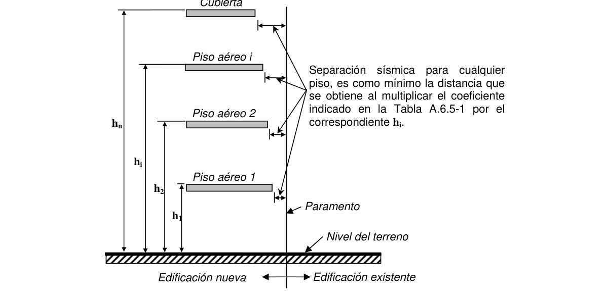
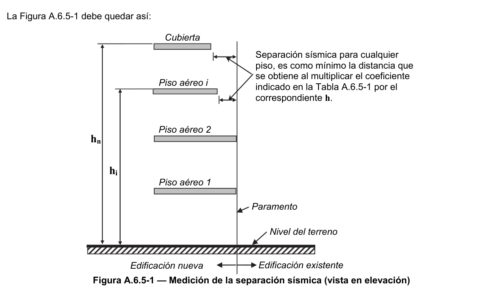

# A.6 — Requisitos de la deriva

### A.6.0 — NOMENCLATURA

$h_{i}$ = altura en metros, medida desde la base, del nivel $i$ .

$h_{n}$= altura en metros, medida desde la base, del piso más alto del edificio.

$h_{p}^{i}$= altura del piso $i$ , medida desde la superficie del diafragma del piso $i$ hasta la superficie del diafragma del piso inmediatamente inferior, $i−1$.

$j$ = índice de una de las direcciones ortogonales principales en planta, puede ser $x$ o $y$ .

$P_{i}$ = suma de la carga vertical total, incluyendo muerta y viva, que existe en el piso $i$ , y todos los pisos localizados por encima. Para el cálculo de los efectos P-Delta, no hay necesidad que los coeficientes de carga de sean mayores que la unidad.

$Q_{i}$ = índice de estabilidad, del piso $i$ , utilizado en la evaluación de los efectos P-Delta. Véase A.6.2.3.

$r_{j}$ = proyección, sobre la dirección perpendicular en planta a la dirección bajo estudio, $j$, de la distancia entre el centro de masa del piso y el punto de interés

$T$ = período fundamental del edificio como se determina en A.4.2.

$T_{a}$ = período de vibración fundamental aproximado. Véase A.4.2.

$V_{i}$ = fuerza cortante del piso $i$ , en la dirección bajo estudio, sin dividir por $R$ . Se determina por medio de las ecuaciones del numeral A.4.3. Corresponde a la suma de las fuerzas horizontales sísmicas que se aplican al nivel $i$ , y todos los niveles localizados por encima de él.

$Δ_{cm,j}^{i}$= deriva del piso $i$ , en la dirección bajo estudio, $j$, medida en el centro de masa del piso, como la diferencia entre el desplazamiento horizontal del piso $i$ menos el del piso $i-1$ en la misma dirección $j$.

$Δ^{i}_{j}$ = deriva del piso $i$ en la dirección principal en planta $j$.

$Δ^{i}_{max}$= deriva máxima para cualquier punto del piso $i$ .

$δ_{cm,j}^{i}$= desplazamiento horizontal, del centro de masa del piso $i$ , en la dirección $j$.

$δ_{pd,j}^{i}$= desplazamiento horizontal adicional, del centro de masa del piso $i$ , causado por efectos P-Delta, en la dirección $j$.

$δ^{i}_{t,j}$= desplazamiento horizontal adicional causado por efectos de torsión de cualquier punto del diafragma del piso $i$ en la dirección $j$.

$δ^{i}tot,j$= desplazamiento total horizontal, de cualquier punto del diafragma del piso $i$ en la dirección $j$

$θ_{i}$ = rotación alrededor de un eje vertical que pasa por el centro de masa del piso $i$ , causada por los efectos torsionales, en radianes.

### A.6.1 — GENERAL

#### A.6.1.1 — ALCANCE

En el presente Capítulo se dan los procedimientos para calcular la deriva así como sus límites permisibles.

#### A.6.1.2 — DEFINICIÓN DE DERIVA

Se entiende por deriva el desplazamiento horizontal relativo entre dos puntos colocados en la misma línea vertical, en dos pisos o niveles consecutivos de la edificación.

#### A.6.1.3 — NECESIDAD DE CONTROLAR LA DERIVA

La deriva está asociada con los siguientes efectos durante un temblor:

(a) Deformación inelástica de los elementos estructurales y no estructurales.

(b) Estabilidad global de la estructura.

(c) Daño a los elementos estructurales que no hacen parte del sistema de resistencia sísmica y a los elementos no estructurales, tales como muros divisorios, particiones, enchapes, acabados, instalaciones eléctricas, mecánicas, etc.

(d) Alarma y pánico entre las personas que ocupen la edificación.

Por las razones anteriores es fundamental llevar a cabo durante el diseño un estricto cumplimiento de los requisitos de deriva dados en el presente Capítulo, con el fin de garantizar el cumplimiento del propósito del Reglamento y un adecuado comportamiento de la estructura y su contenido.

### A.6.2 — CÁLCULO DEL DESPLAZAMIENTO HORIZONTAL

#### A.6.2.1 — DESPLAZAMIENTOS HORIZONTALES EN EL CENTRO DE MASA DEL PISO, $δ_{cm,j}$

Corresponden a los desplazamientos horizontales, en las dos direcciones principales en planta, que tiene el centro de masa del piso.

En caso de cálculo de desplazamientos haciendo uso del método de análisis dinámico deberá tomarse en cuenta lo indicado en A.5.4.4 para la combinación de los modos.

**A.6.2.1.1** — Cuando se utilice el método de la fuerza horizontal equivalente, las fuerzas horizontales que se empleen para determinar los desplazamientos horizontales y torsionales en el centro de masa pueden calcularse utilizando el período, $T$ , que se obtiene por medio de la ecuación A.4.2-1, aplicando el límite de $C_{u} T_{a}$ indicado allí, o alternativamente el período $T$ obtenido por alguna de las ecuaciones A.4.2-3 o A.4.2-5.

**A.6.2.1.2** — En las edificaciones pertenecientes a los grupos de uso $II$, $III$ y $IV$, para la determinación de las fuerzas horizontales que se empleen para calcular los desplazamientos horizontales en el centro de masa, se permite que el coeficiente de importancia $I$ , tenga un valor igual a la unidad $(I=1.0)$, y las fuerzas de diseño a emplear para obtener la resistencia de la estructura deben utilizar el valor del coeficiente de importancia $I$ correspondiente al grupo de uso de la edificación, tal como se define en A.2.5.2.

**A.6.2.2** — DESPLAZAMIENTOS HORIZONTALES CAUSADOS POR EFECTOS TORSIONALES. $δ_{t,j}$ — Corresponden a los desplazamientos horizontales adicionales, en las dos direcciones principales ortogonales en planta, causados por la rotación de toda la estructura con respecto a un eje vertical y debida a los efectos torsionales definidos en A.3.6.7. Este efecto solo debe evaluarse cuando los diafragmas son rígidos. Cuando los diafragmas son rígidos el incremento en desplazamiento horizontal causado por los efectos torsionales en cualquiera de las dos direcciones principales en planta, se obtiene de:

$$ \delta_{t,j} = r_j\,\theta_i \tag{A.6.2-1} $$

donde $δ_{t,j}$ es el incremento en desplazamiento horizontal causado por los efectos torsionales en un punto dentro del nivel $i$ , en una de las direcciones principales en planta, $r_{j}$ es la proyección sobre la dirección perpendicular en planta a la dirección bajo estudio, $j$, de la distancia entre el centro de masa del piso y el punto de interés, y $θ_{i}$ es la rotación alrededor de una eje vertical que pasa por el centro de masa del nivel $i$ , causada por los efectos torsionales.

#### A.6.2.3 — DESPLAZAMIENTOS HORIZONTALES CAUSADOS POR EFECTOS P-DELTA, $δ_{pd,j}$

Corresponden a los efectos adicionales, en las dos direcciones principales en planta, causados por los efectos de segundo orden (efectos P-Delta) de la estructura. Los efectos P-Delta producen un aumento en las deflexiones horizontales y en las fuerzas internas de la estructura. Estos efectos deben tenerse en cuenta cuando el índice de estabilidad, $Q_{i}$ , es mayor de 0.10. El índice de estabilidad, para el piso $i$ y en la dirección bajo estudio, se calcula por medio de la siguiente ecuación:

$$ Q_i = \dfrac{P_i\,\Delta_{cm}}{V_i\,h_{pi}} \tag{A.6.2-2} $$

El índice de estabilidad de cualquier piso, $Q_{i}$ , no debe exceder el valor de 0.30. Cuando el valor de $Q_{i}$ es mayor que 0.30, la estructura es potencialmente inestable y debe rigidizarse, a menos que se cumplan, en estructuras de concreto reforzado, la totalidad de los requisitos enumerados en C.10.11.6.2(b).

La deflexión adicional causada por el efecto P-Delta en la dirección bajo estudio y para el piso $i$ , se calcula por medio de la siguiente ecuación:

$$ \delta_{pd} = \delta_{cm} \left(\dfrac{Q_i}{1 - Q_i}\right) \tag{A.6.2-3} $$

**A.6.2.3.1** — Alternativamente, los efectos P-Delta pueden evaluarse siguiendo los requisitos de C.10.11 en estructuras de concreto reforzado.

<!-- mod:1-decreto-092-2011-20 -->
> **Modificación — Decreto 092 de 2011** · anexo, p. 4
>
> La referencia a C.10.11 debe ser a C.10.10: «Alternativamente, los efectos P-Delta pueden evaluarse siguiendo los requisitos de C.10.10 en estructuras de concreto reforzado.»

**A.6.2.3.2** — Cuando el índice de estabilidad es mayor de 0.10, los efectos P-Delta en las fuerzas internas de la estructura causadas por las cargas laterales deben aumentarse, multiplicándolas en cada piso por el factor $1 /(1−Q_{i})$.

<!-- mod:1-decreto-092-2011-19 -->
> **Modificación — Decreto 092 de 2011** · anexo, p. 4
>
> En el segundo párrafo, la referencia a C.10.11.6.2(b) es incorrecta; el final queda así: «… concreto reforzado, una verificación con un análisis elástico de segundo orden considerando la totalidad de los requisitos enumerados en C.10.10.4 o alternativamente con la consideración en C.10.10.7.4.»

#### A.6.2.4 — DESPLAZAMIENTOS HORIZONTALES TOTALES

Los desplazamientos horizontales, en las dos direcciones principales ortogonales en planta, que tienen todos los grados de libertad de la estructura al verse afectada por los movimientos sísmicos de diseño definidos en A.2.2, se determinan por medio del análisis estructural realizado utilizando el método de análisis definido en A.3.4 y con las rigideces indicadas en A.3.4.3. Los desplazamientos totales horizontales, $δt0t,j$ ,en cualquiera de las direcciones principales en planta, $j$, y para cualquier grado de libertad de la estructura, se obtienen de la siguiente suma de valores absolutos:

$$ \delta_{tot,j} = \left|\delta_{cm,j}\right| + \left|\delta_{t,j}\right| + \left|\delta_{pd,j}\right| \tag{A.6.2-4} $$

donde $δ_{cm,j}$ corresponde al desplazamiento horizontal del centro de masa en la dirección bajo estudio, $j$; $δ_{t,j}$ el desplazamiento adicional causado por los efectos torsionales en la dirección bajo estudio cuando el diafragma sea rígido, $j$, y $δ_{pd,j}$ al desplazamiento adicional causado por el efecto P-Delta en la dirección bajo estudio, $j$. Cuando se utilicen los procedimientos de interacción suelo-estructura, o cuando A.3.4.2 así lo requiera porque se realizó el análisis de la estructura suponiéndola empotrada en su base, deben incluirse dentro de los desplazamientos totales, los desplazamientos adicionales obtenidos de acuerdo con el procedimiento del Capítulo A.7.

### A.6.3 — EVALUACIÓN DE LA DERIVA MÁXIMA

#### A.6.3.1 — DERIVA MÁXIMA

La deriva máxima para cualquier piso debe obtenerse así:

**A.6.3.1.1** — En edificaciones regulares e irregulares que no tengan irregularidades en planta de los tipos 1aP ó 1bP (véase la tabla A.3-6), o edificaciones con diafragma flexible, la deriva máxima para el piso $i$ , $Δ_{max}^{i}$, corresponde a la mayor deriva de las dos direcciones principales en planta, $j$, calculada como el valor absoluto de la diferencia algebraica de los desplazamientos horizontales del centro de masa del diafragma del piso $i$ , $δ_{cm,j}$, en la dirección principal en planta bajo estudio con respecto a los del diafragma del piso inmediatamente inferior $(i−1)$ en la misma dirección, incluyendo los efectos P-Delta.

**A.6.3.1.2** — En edificaciones que tengan irregularidades en planta de los tipos 1aP ó 1bP (véase la tabla A.3- 6) la deriva máxima en cualquier punto del piso $i$ , se puede obtener como la diferencia entre los desplazamientos horizontales totales máximos, de acuerdo con A.6.2.4, del punto en el piso $i$ y los desplazamientos horizontales totales máximos de un punto localizado en el mismo eje vertical en el piso inmediatamente inferior $(i−1)$, por medio de la siguiente ecuación:

$$ \Delta_{max}^{i} = \sqrt{\sum_{j=1}^{2} \left(\delta_{tot,j}^{i} - \delta_{tot,j}^{i-1}\right)^2} \tag{A.6.3-1} $$

Alternativamente se pueden usar procedimientos para estimar respuestas máximas de cantidades vectoriales.

El cumplimiento del cálculo de la deriva para cualquier punto del piso se puede realizar verificándola solamente en todos los ejes verticales de columna y en los puntos localizados en los bordes de los muros estructurales. La máxima deriva del piso $i$ , $Δ_{max}^{i}$, corresponde a la máxima deriva que se obtenga de todos los puntos así estudiados dentro del mismo piso $i$ .

**A.6.3.1.3** — En los pisos superiores de edificaciones que cumplen las condiciones (a) a (e) presentadas a continuación, se permite calcular la deriva máxima del piso de la forma alternativa que se obtiene con la expresión A.6.3-2 indicada en esta sección.

(a) La edificación tiene diez o más pisos de altura sobre su base.

(b) El procedimiento alternativo solo es aplicable en los pisos superiores localizados por encima de dos tercios de la altura de la edificación medida desde su base.

(c) El sistema estructural de resistencia sísmica es diferente a pórtico resistente a momento.

(d) La edificación se clasifica como regular tanto en planta como en altura de acuerdo con los requisitos del Capítulo A.3.

(e) El índice de estabilidad, $Q_{i}$, es menor de 0.10 en todos los pisos donde sería aplicable este procedimiento alternativo.

La máxima deriva del piso $i$ , $Δ_{max}^{i}$, en el procedimiento alternativo corresponde a la máxima deriva de las dos direcciones principales en planta, $j$, calculada por medio de la siguiente ecuación:

$$ \Delta_j^{i} = \delta_{cm,j}^{i} - 0.5 \left(\dfrac{\left(\delta_{cm,j}^{i-1} - \delta_{cm,j}^{i-2}\right)\left(h_p^{i} + h_p^{i-1}\right)}{h_p^{i-1}} + \delta_{cm,j}^{i-2}\right) - 0.5\,\delta_{cm,j}^{i-1} \tag{A.6.3-2} $$

### A.6.4 — LÍMITES DE LA DERIVA

**A.6.4.1** — La deriva máxima para cualquier piso determinada de acuerdo con el procedimiento de A.6.3.1, no puede exceder los límites establecidos en la tabla A.6.4-1, en la cual la deriva máxima se expresa como un porcentaje de la altura de piso $h_{pi}$:

**Tabla A.6.4-1**

Derivas máximas como porcentaje de $h_{pi}$

| Estructuras de: | Deriva máxima |
|---|---|
| concreto reforzado, metálicas, de madera, y de mampostería que cumplen los requisitos de A.6.4.2.2 | $1.0\% (Δ_{max}^{i}≤0.010 h_{pi})$ |
| de mampostería que cumplen los requisitos de A.6.4.2.3 | $0.5\% (Δ_{max}^{i}≤0.005 h_{pi})$ |

<!-- mod:1-decreto-092-2011-21 -->
> **Modificación — Decreto 092 de 2011** · anexo, p. 4
>
> En la columna izquierda, la referencia de la segunda línea a A.6.4.2.2 debe ser a A.6.4.1.3, y la de la tercera línea a A.6.4.2.3 debe ser a A.6.4.1.4.

**A.6.4.1.1** — Cuando se utilicen secciones fisuradas, tanto en concreto reforzado, como en mampostería y en el caso de estructuras mixtas con acero, las derivas pueden multiplicarse por $0.7$ antes de hacer la comparación con los límites dados en la tabla A.6.4-1.

**A.6.4.1.2** — Cuando se haya efectuado un análisis inelástico verificando el desempeño de la totalidad de los elementos estructurales en un rango de desempeño no mayor a “Protección de la Vida” (LS según los requerimientos del ASCE 31 y ASCE 41), las derivas pueden multiplicarse por $0.7$ antes de hacer la comparación con los límites dados en la tabla A.6.4-1.

**A.6.4.1.3** — Se permite emplear el límite de deriva máxima permisible de $0.010h_{pi}$ en edificaciones construidas con mampostería estructural cuando éstas estén compuestas por muros cuyo modo prevaleciente de falla sea la flexión ante fuerzas paralelas al plano del muro, diseñados esencialmente como elementos verticales esbeltos que actúan como voladizos apoyados en su base o cimentación, y que se construyen de tal manera que la transferencia de momento entre muros a través de los elementos horizontales de acople en los diafragmas de entrepiso, ya sean losas, vigas de enlace, antepechos o dinteles, sea despreciable.

**A.6.4.1.4** — Cuando se trate de muros de mampostería estructural poco esbeltos o cuyo modo prevaleciente de falla sea causado por esfuerzos cortantes, debe emplearse el límite de deriva máxima permisible de $0.005h_{pi}$.

**A.6.4.1.5** — No hay límites de deriva en edificaciones de un piso, siempre que los muros y las particiones interiores y exteriores así como los cielorrasos se diseñen para acomodar las derivas del piso.

### A.6.5 — SEPARACIÓN ENTRE ESTRUCTURAS ADYACENTES POR CONSIDERACIONES

SÍSMICAS

#### A.6.5.1 — DENTRO DE LA MISMA CONSTRUCCIÓN

Todas las partes de la estructura deben diseñarse y construirse para que actúen como una unidad integral para efectos de resistir las fuerzas sísmicas, a menos que se separen una distancia suficiente para evitar la colisión nociva entre las partes. Para determinar la distancia mínima de separación debe sumarse el valor absoluto de los desplazamientos horizontales totales obtenidos en A.6.2.1 para cada una de las porciones de la edificación en la dirección perpendicular a la junta que las separe, a menos que se tomen medidas para que no se presente daño a la estructura al utilizar una distancia menor.

#### A.6.5.2 — ENTRE EDIFICACIONES VECINAS QUE NO HAGAN PARTE DE LA MISMA CONSTRUCCIÓN

La separación entre edificaciones vecinas, para evitar efectos nocivos ante la ocurrencia de un sismo, debe cumplir los siguientes requisitos:

**A.6.5.2.1** — Alcance — La presente reglamentación es aplicable en los siguientes casos:

(a) En municipios localizados en Zonas de Amenaza Sísmica Baja según lo dispone el presente Reglamento en su Capítulo A.2 no se requieren consideraciones de separación sísmica entre edificaciones vecinas.

(b) Solo aplica para la obtención de licencias de construcción de edificaciones nuevas que se soliciten por primera vez con posterioridad a la adopción del presente Reglamento.

(c) No aplica para el caso de edificaciones que sean objeto del trámite de Reconocimiento.

(d) Para el caso de rehabilitaciones sísmicas de edificaciones existentes aplican los requisitos especiales que se indican en A.10.7.

(e) Los requisitos de esta sección del Reglamento pueden ser modificados por la administración municipal o distrital, siempre y cuando los requisitos de la separación sísmica que resulten de la aplicación de la reglamentación municipal o distrital no sean menores que los dados aquí.

**A.6.5.2.2** — Definiciones — En el Capítulo A.13 deben consultarse las siguientes definiciones: altura del piso, altura de la edificación en la colindancia, cerramiento, coincidencia de las losas de entrepiso en la colindancia, nivel (medido desde la base) de un piso en la colindancia, número de pisos aéreos de la edificación, número de pisos aéreos en la colindancia, y separación sísmica en la colindancia. Además debe tenerse en cuenta cuando el terreno es inclinado en la colindancia, o haya diferentes alturas de piso en la colindancia, o exista un número diferente de pisos aéreos en la colindancia, que debe utilizarse la altura de piso, o el número de pisos aéreos que conduzca a la mayor separación sísmica.

**A.6.5.2.3** — Requisitos de separación sísmica con respecto al paramento del lote para edificaciones nuevas — Deben cumplirse los siguientes requisitos para efectos de determinar la separación sísmica con respecto al paramento del lote en edificaciones nuevas cubiertas por el alcance dado en A.6.5.2.1:

(a) Cuando el paramento del lote sea colindante con vía pública o zona verde pública no requiere separación sísmica con respecto al paramento en ese costado o costados. Ello no exime cumplir los requisitos urbanísticos de las normas municipales para la edificación en lo referente a retrocesos.

(b) Cuando en la colindancia haya un cerramiento, y la edificación nueva esté separada de este cerramiento en una distancia que supera la señalada para el piso crítico en la Tabla A.6.5-1 no se requiere separación sísmica del cerramiento de la edificación nueva con respecto al paramento del lote.

(c) Las edificaciones con uno o dos pisos aéreos en la colindancia no requieren separación sísmica (véase también la Tabla A.6.5-1).

(d) Las edificaciones de más de dos pisos aéreos en la colindancia deben separarse del paramento en la colindancia así (véase también la Tabla A.6.5-1 y la Figura A.6.5-1):

(i) Edificaciones hasta de tres pisos aéreos en la colindancia — No se requiere separación sísmica de la edificación nueva con respecto al paramento cuando no haya edificación vecina existente, o cuando las losas de la edificación nueva coinciden en la colindancia (véanse las definiciones) con las de la edificación vecina existente en la misma colindancia. Si las losas de entrepiso de la edificación nueva no coinciden con las de la edificación existente se requiere una separación sísmica de la edificación nueva con respecto al paramento igual al 1% (uno por ciento) de la altura de la edificación nueva en la colindancia.

(ii) Edificaciones de más de tres pisos aéreos en la colindancia — Cuando las losas de la edificación nueva coinciden en la colindancia (véanse las definiciones) con las de la edificación vecina existente en la misma colindancia la edificación nueva debe retirarse del paramento en la colindancia una distancia de separación sísmica igual al 2% (dos por ciento) de la altura de la edificación nueva en la colindancia. Cuando las losas de entrepiso de la edificación nueva no coincidan con las de la edificación existente en la colindancia, esta separación sísmica debe ser del 3% (tres por ciento) de la altura de la edificación nueva en la colindancia. Si no existe edificación vecina en la colindancia (cubre además el caso de que sea solo un cerramiento), esta separación sísmica debe ser del 1% (uno por ciento) de la altura de la edificación nueva en la colindancia.

(e) Cuando se requiera separación sísmica, la separación en cualquier piso en particular corresponde a la distancia horizontal en dirección perpendicular al plano vertical levantado sobre el lindero entre los dos lotes de terreno, medida desde la losa de entrepiso de la edificación hasta este plano, calculada utilizando la altura sobre el nivel del terreno del piso en particular multiplicada por el coeficiente que indique la Tabla A.6.5-1 para ese caso. Véase también la Figura A.6.5-1.

(f) Deben tomarse precauciones para que no se depositen materiales extraños dentro de la separación sísmica entre edificaciones. Así mismo debe colocarse un protección de humedad apropiada para que el agua lluvia no entre dentro de la abertura de la separación sísmica.

(g) Para el caso de edificaciones objeto de reforzamiento y rehabilitación sísmica el ingeniero diseñador de la rehabilitación debe dejar constancia de que estudió el potencial efecto nocivo de la interacción con las edificaciones vecinas colindantes y que tomó las medidas apropiadas según su mejor criterio dentro de lo requerido en A.10.1.7.

(h) El paramento del lote y la separación sísmica requerida deben quedar claramente indicados en los planos arquitectónicos que se presentan a la autoridad competente o curaduría para la obtención de la licencia de construcción.

**Tabla A.6.5-1**

Separación sísmica mínima en la cubierta entre edificaciones colindantes que no hagan parte de la misma construcción

| Altura de la edificación nueva | Tipo de Colindancia |  |  |
|---|---|---|---|
|  | Existe edificación vecina que no ha dejado la separación sísmica requerida |  | No existe edificación vecina o la que existe ha dejado la separación sísmica requerida |
|  | Coinciden las losas de entrepiso | No coinciden las losas de entrepiso |  |
| 1 y 2 pisos | no requiere separación | no requiere separación | no requiere separación |
| 3 pisos | no requiere separación | 0.01 veces la altura de la edificación nueva (1% de $h_{n}$) | no requiere separación |
| Más de 3 pisos | 0.02 veces la altura de la edificación nueva (2% de $h_{n}$) | 0.03 veces la altura de la edificación nueva (3% de $h_{n}$) | 0.01 veces la altura de la edificación nueva (1% de $h_{n}$) |

Notas:

1. Para obtener la separación sísmica en pisos diferentes a la cubierta se aplicará el coeficiente indicado en la Tabla multiplicado por la altura sobre el terreno del piso en particular.

2. Cuando el terreno en la colindancia sea inclinado en el sentido del paramento, o haya diferentes alturas de piso o diferentes números de pisos aéreos en la colindancia, se tomará en la edificación nueva la altura de piso, o el número de pisos aéreos que conduzca a la mayor separación sísmica.

Cubierta

Figura A.6.5-1 — Medición de la separación sísmica (vista en elevación) █ Notas:

<!-- mod:2-decreto-340-2012-3 -->
> **Modificación — Decreto 340 de 2012** · anexo, p. 4
>
> El literal c) de la sección A.6.5.2.3  debe quedar así:
>
> (c) Las edificaciones con uno o dos pisos aéreos en la colindancia no requieren separación sísmica (véase también la Tabla A.6.5-1). Esto aplica para el caso de edificaciones de plataforma y torre, donde la plataforma en la colindancia no tiene más de dos o tres pisos y la fachada de la torre a partir del tercer piso, o el cuarto piso cuando lo permita la Tabla A.6.5-1, está separada de la colindancia en una distancia mayor o igual a la exigida por esta sección A.6.5.2.3. Véase la Figura A.6.5-1.

<!-- mod:2-decreto-340-2012-4 -->
> **Modificación — Decreto 340 de 2012** · anexo, p. 4
>
> La Figura A.6.5-1 debe quedar así:
>
> 
