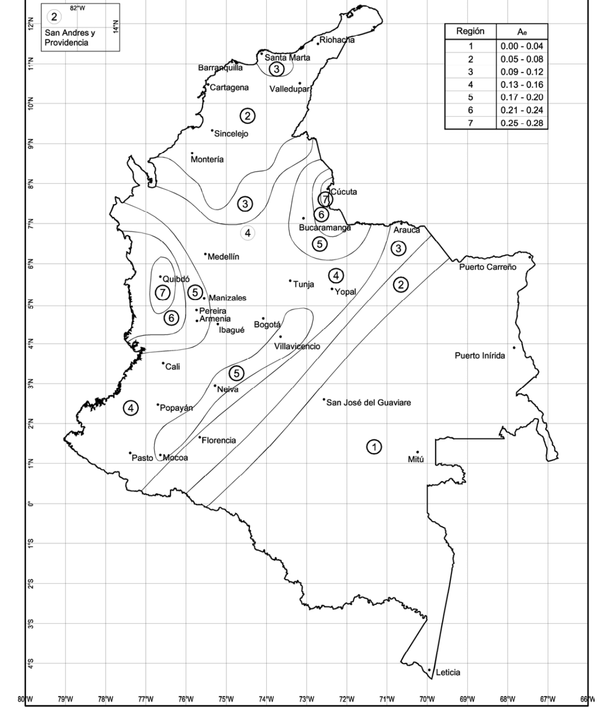

# A.10 — Evaluación e intervención de edificaciones construidas antes de la vigencia de la presente versión del reglamento

### A.10.0 — NOMENCLATURA

$A_{a}$ = coeficiente que representa la aceleración horizontal pico efectiva para diseño, de acuerdo con A.2.2.

$A_{e}$ = coeficiente que representa la aceleración pico efectiva reducida para diseño con seguridad limitada, dado en A.10.3.

$A_{v}$ = coeficiente de aceleración que representa la velocidad horizontal pico efectiva para diseño, de acuerdo con A.2.2.

$E$ = fuerzas sísmicas reducidas para revisión de la estructura existente y diseño de la ampliación $(E=F_{s}/R')$.

$F_{s}$ = fuerzas sísmicas equivalentes, véase A.10.4.2.5.

$N_{ef}$= resistencia efectiva.

$N_{ex}$= resistencia existente.

$R$ = coeficiente de capacidad de disipación de energía para ser empleado en el diseño, corresponde al coeficiente de disipación de energía básico,$R_{0} ,$ multiplicado por los coeficientes de reducción de capacidad de disipación de energía por irregularidades en altura, en planta y por ausencia de redundancia en el sistema estructural de resistencia sísmica $(R= φ_{a} φ_{p} φ_{r}R_{0})$. Véase el Capítulo A.3.

$R'$ = coeficiente de capacidad de disipación de energía que se le asigna a la edificación existente de acuerdo con lo prescrito en el Capítulo A.10.

$φ_{a}$ = coeficiente de reducción de la capacidad de disipación de energía causado por irregularidades en altura de la edificación. Véase A.3.3.3.

$φ_{c}$ = coeficiente de reducción de resistencia por calidad del diseño y construcción de la estructura. Véase A.10.4.3.4.

$φ_{e}$ = coeficiente de reducción de resistencia por estado de la estructura. Véase A.10.4.3.4.

$φ_{p}$ = coeficiente de reducción de la capacidad de disipación de energía causado por irregularidades en planta de la edificación. Véase A.3.3.3.

$φ_{r}$ = coeficiente de reducción de la capacidad de disipación de energía causado por ausencia de redundancia en el sistema estructural de resistencia sísmica. Véase A.3.3.8.

### A.10.1 — PROPÓSITO Y ALCANCE

#### A.10.1.1 — GENERAL

El presente Capítulo establece los criterios y procedimientos que se deben seguir para evaluar la vulnerabilidad sísmica y adicionar, modificar o remodelar el sistema estructural de edificaciones existentes diseñadas y construidas con anterioridad a la vigencia de la presente versión del Reglamento Colombiano de Construcciones Sismo Resistentes.

#### A.10.1.2 — PROPÓSITO

Una edificación que se intervenga siguiendo los requisitos aquí presentados debe ser capaz de resistir temblores pequeños sin daño, temblores moderados sin daño estructural, pero con algún daño en elementos no estructurales, y temblores fuertes sin colapso.

#### A.10.1.3 — ALCANCE

Los requisitos dados en este Capítulo deben ser utilizados para llevar a cabo la evaluación del comportamiento sísmico y el diseño de la intervención, reparación o refuerzo de la estructura de edificaciones existentes antes de la vigencia de la presente versión del Reglamento Colombiano de Construcciones Sismo Resistentes que se modifiquen o rehabiliten en el territorio nacional.

antes de la vigencia de la presente versión del Reglamento

**A.10.1.3.1** — Reparaciones y cambios menores — Se considera que el sistema estructural de la edificación no sufre modificación cuando se hacen reparaciones y cambios menores que no afecten el sistema de resistencia sísmica ni la integridad estructural de la edificación. En este caso no hay necesidad de llevar a cabo los estudios a que hace referencia el presente Capítulo, con la excepción anotada en A.10.1.3.2.

**A.10.1.3.2** — Cambio de uso — Cuando se modifique el uso de una edificación, aun en los casos que menciona A.10.1.3.1, entendido el cambio de uso como una modificación de acuerdo a normas urbanísticas (de residencial a multifamiliar, de alguno de ellos a comercial, entre otros), así como cambio de uno de los Grupos de Uso descritos en A.2.5.1 a otro superior dentro de ese numeral, deben evaluarse las implicaciones causadas por este cambio de uso, ante cargas verticales, fuerzas horizontales y especialmente ante efectos sísmicos.

**A.10.1.3.3** — Vulnerabilidad sísmica — Los criterios presentados en este Capítulo se pueden utilizar en el diagnóstico o evaluación de la vulnerabilidad sísmica de edificaciones existentes antes de la vigencia de la presente versión del Reglamento.

**A.10.1.3.4** — Modificaciones — Los criterios presentados en este Capítulo deben ser empleados para el diseño y construcción de ampliaciones adosadas o ampliaciones en altura, actualizaciones al reglamento y/o alteraciones, entendidas como cualquier construcción o renovación de una construcción distinta de una ampliación.

**A.10.1.3.5** — Reforzamiento estructural — Los requisitos del Capítulo A.10 y en especial los de A.10.9 deben ser empleados en actualización y rehabilitación sísmica de edificaciones existentes.

**A.10.1.3.6** — Reparación de edificaciones dañadas por sismos — Los requisitos del Capítulo A.10 y en especial los de A.10.10 deben ser empleados en la reparación de edificaciones que hayan sufrido daños moderados a severos en su estructura, o daños moderados a severos en sus elementos no estructurales, o ambos, y que no hayan sido designadas como de obligatoria demolición total por la autoridad competente o por el censo que se realice para ese efecto con posterioridad a la ocurrencia del sismo, según sea el caso.

<!-- mod:2-decreto-340-2012-5 -->
> **Modificación — Decreto 340 de 2012** · anexo, p. 5
>
> Se introduce la nueva sección A.10.1.3.7:
>
> **A.10.1.3.7** — Cumplimiento de los Títulos J y K del Reglamento — En la intervención estructural de edificaciones construidas antes de la vigencia del presente Reglamento el cumplimiento de los requisitos contenidos en los Títulos J y K se deja a voluntad del propietario de la edificación con excepción de los casos contemplados en A.10.1.3.2 y A.10.1.3.4 donde la intervención debe cumplir lo requerido por los Títulos J y K del Reglamento vigente.

#### A.10.1.4 — PROCEDIMIENTO DE EVALUACIÓN DE LA INTERVENCIÓN

En la aplicación del presente Capítulo deben seguirse las siguientes etapas:

INFORMACIÓN PRELIMINAR Etapa 1 — Debe verificarse que la intervención esté cubierta por el alcance dado en A.10.1.3.

Etapa 2 — Debe recopilarse y estudiarse la información existente acerca del diseño geotécnico y estructural así como del proceso de construcción de la edificación original y sus posteriores modificaciones y deben hacerse exploraciones en la edificación, todo esto de acuerdo con A.10.2.

Etapa 3 — El estado del sistema estructural debe calificarse con respecto a: (a) la calidad del diseño de la estructura original y su sistema de cimentación y de la construcción de la misma y (b) el estado de mantenimiento y conservación. Esta calificación debe hacerse de acuerdo con los requisitos de A.10.2.

EVALUACIÓN DE LA ESTRUCTURA EXISTENTE Etapa 4 — Deben determinarse unas solicitaciones equivalentes de acuerdo con los requisitos de A.10.4.2.

Etapa 5 — Debe llevarse a cabo un análisis elástico de la estructura y de su sistema de cimentación para las solicitaciones equivalentes definidas en la Etapa 4.

Etapa 6 — La resistencia existente de la estructura debe determinarse utilizando los requisitos de A.10.4.3.3.

Etapa 7 — Se debe obtener una resistencia efectiva de la estructura, a partir de la resistencia existente, afectándola por dos coeficientes de reducción de resistencia obtenidos de los resultados de la calificación llevada a cabo en la Etapa 3.

Etapa 8 — Debe determinarse un índice de sobreesfuerzo como el máximo cociente obtenido para cualquier elemento o sección de éste, entre las fuerzas internas solicitadas obtenidas del análisis estructural realizado antes de la vigencia de la presente versión del Reglamento en la Etapa 5 para las solicitaciones equivalentes definidas en la Etapa 4 y la resistencia efectiva obtenida en la Etapa 7.

Etapa 9 — Utilizando los desplazamientos horizontales obtenidos en el análisis de la Etapa 5 deben obtenerse las derivas de la estructura.

Etapa 10 — Debe determinarse un índice de flexibilidad por efectos horizontales como el máximo cociente entre las derivas obtenidas en la Etapa 9 y las derivas permitidas por el Reglamento en el Capítulo A.6.

Igualmente debe determinarse un índice de flexibilidad por efectos verticales como el máximo cociente entre las deflexiones verticales medidas en la edificación y las deflexiones permitidas por el presente Reglamento.

INTERVENCIÓN DEL SISTEMA ESTRUCTURAL Etapa 11 — La intervención estructural debe definirse de acuerdo con el tipo de modificación establecida en A.10.6 dentro de una de tres categorías: (a) Ampliaciones adosadas, (b) Ampliaciones en altura y (c) Actualización al Reglamento.

Etapa 12 — El conjunto debe analizarse nuevamente incluyendo la intervención propuesta, la cual debe diseñarse para las fuerzas y esfuerzos obtenidos de este nuevo análisis. El diseño geotécnico y estructural y la construcción deben llevarse a cabo de acuerdo con los requisitos que para cada tipo de modificación establece el presente Capítulo.

#### A.10.1.5 — CÁLCULOS, MEMORIAS Y PLANOS

Debe elaborarse una memoria justificativa de cálculos en la cual deben quedar claramente consignados los siguientes aspectos:

(a) Una relación de los documentos de diseño y construcción de la edificación original que fueron utilizados en la evaluación y diseño de las modificaciones, tales como: planos arquitectónicos y estructurales, memorias de cálculo, estudios de suelos y diseño de las cimentaciones, registros de la interventoría, libros de obra, consultas personales a profesionales que participaron en el diseño o construcción, etc.

(b) Una descripción de la evaluación del estado actual de la edificación y de su sistema de cimentación llevada a cabo como lo exige A.10.2.

(c) Una descripción muy clara justificando la definición de los parámetros de evaluación y diseño que provienen del estudio de la situación actual de la edificación.

(d) Memoria de cálculos del diseño de la modificación a la estructura con la correspondiente justificación de que la estructura final tendrá la resistencia y comportamiento esperados, cuando actúa en conjunto con la estructura original.

(e) Los otros documentos apropiados, a juicio del diseñador, de aquellos que exige el presente Reglamento para edificaciones nuevas.

**A.10.1.5.1** — Esta memoria debe ir firmada por un Ingeniero Civil debidamente matriculado, que cumpla las condiciones establecidas en los Artículos 26 y 27 de la Ley 400 de 1997.

#### A.10.1.6 — SUPERVISIÓN TÉCNICA

La construcción de la intervención del sistema estructural existente debe someterse, en todos los casos, a una supervisión técnica dentro del alcance que se da en el Título $I$ del presente Reglamento.

**A.10.1.6.1** — El Supervisor Técnico debe dejar constancia en los registros de la supervisión de que las hipótesis en que se basó el diseñador fueron confirmadas en la obra. En caso de presentarse discrepancias debe quedar constancia escrita de que el diseñador fue informado de ellas y de las acciones correctivas que él fijó.

#### A.10.1.7 — CRITERIO Y RESPONSABILIDAD DEL INGENIERO

El tipo de diseño a que hace referencia en su alcance este documento exige el mejor criterio y experiencia por parte del ingeniero que lo lleva a cabo, dado que el diseñador se hace responsable, dentro del mismo alcance que tiene esa responsabilidad en el presente Reglamento, de la correcta aplicación de los requisitos del Reglamento y del comportamiento de la edificación en el futuro.

antes de la vigencia de la presente versión del Reglamento

### A.10.2 — ESTUDIOS E INVESTIGACIONES REQUERIDAS

#### A.10.2.1 — INFORMACIÓN PREVIA

Deben realizarse investigaciones sobre la construcción existente, tendientes a determinar los siguientes aspectos acerca de ella:

(a) Cuando se disponga de documentos descriptivos del diseño de la estructura y su sistema de cimentación original, debe constatarse en el sitio su concordancia con la construcción tal como se encuentra en el momento. Deben hacerse exploraciones en lugares representativos y dejar constancia del alcance de estas exploraciones.

(b) La calidad de la construcción de la estructura original debe determinarse de una manera cualitativa.

(c) El estado de conservación de la estructura debe evaluarse de una manera cualitativa.

(d) Debe investigarse la estructura con el fin de determinar su estado a través de evidencia de fallas locales, deflexiones excesivas, corrosión de las armaduras y otros indicios de su comportamiento.

(e) Debe investigarse la ocurrencia de asentamientos de la cimentación y su efecto en la estructura.

(f) Debe determinarse la posible ocurrencia en el pasado de eventos extraordinarios que hayan podido afectar la integridad de la estructura, debidos a explosión, incendio, sismo, remodelaciones previas, colocación de acabados que hayan aumentado las cargas, y otras modificaciones.

#### A.10.2.2 — ESTADO DEL SISTEMA ESTRUCTURAL

Debe calificarse el estado del sistema estructural de la edificación de una manera totalmente cualitativa con base en la calidad del diseño y construcción de la estructura original y en su estado actual. Esta calificación se debe realizar de la manera prescrita a continuación:

**A.10.2.2.1** — Calidad del diseño y la construcción de la estructura original — Esta calificación se define en términos de la mejor tecnología existente en la época en que se construyó la edificación. Al respecto se puede utilizar información tal como: registros de interventoría la construcción y ensayos realizados especialmente para ello. Dentro de la calificación debe tenerse en cuenta el potencial de mal comportamiento de la edificación debido a distribución irregular de la masa o la rigidez, ausencia de diafragmas, anclajes, amarres y otros elementos necesarios para garantizar su buen comportamiento de ella ante las distintas solicitaciones. La calidad del diseño y la construcción de la estructura original deben calificarse como buena, regular o mala.

**A.10.2.2.2** — Estado de la estructura — Debe hacerse una calificación del estado actual de la estructura de la edificación, basada en aspectos tales como: sismos que la puedan haber afectado, fisuración por cambios de temperatura, corrosión de las armaduras, asentamientos diferenciales, reformas, deflexiones excesivas, estado de elementos de unión y otros aspectos que permitan determinar su estado actual. El estado de la estructura existente debe calificarse como bueno, regular o malo.

### A.10.3 — MOVIMIENTOS SÍSMICOS DE DISEÑO CON SEGURIDAD LIMITADA

**A.10.3.1** — Para las situaciones cuando según A.10.9 este Reglamento lo permite para efectos de evaluación e intervención de edificaciones existentes, los movimientos sísmicos de diseño con seguridad limitada se definen para una probabilidad del veinte por ciento de ser excedidos en un lapso de cincuenta años, en función de la aceleración pico efectiva reducida, representada por el parámetro $A_{e}$ El valor de este coeficiente, para efectos del presente Reglamento, debe determinarse de acuerdo con A.10.3.2 y A.10.3.3. Los movimientos sísmicos de diseño de seguridad limitada no son aplicables a edificaciones nuevas y no se pueden utilizar en el diseño de edificaciones nuevas baja ninguna circunstancia.

<!-- mod:1-decreto-092-2011-24 -->
> **Modificación — Decreto 092 de 2011** · anexo, p. 4
>
> La última frase queda así: «… Los movimientos sísmicos de diseño de seguridad limitada no son aplicables a edificaciones nuevas y no se pueden utilizar en el diseño de edificaciones nuevas bajo ninguna circunstancia.»

**A.10.3.2** — Se determina el número de la región en donde está localizada la edificación usando el mapa de la figura A.10.3-1. El valor de $A_{e}$ se obtiene de la tabla A.10.3-1, en función del número de la región, o para las ciudades capitales de departamento utilizando la tabla A.10.3-2 y para los municipios del país en el Apéndice A-4, incluido al final del presente Título.

antes de la vigencia de la presente versión del Reglamento

**Tabla A.10.3-1**

Valor de $A_{e}$ según las regiones de los mapas de la figura A.10-3-1

| Región Nº | $A_{e}$ |
|---|---|
| 7 | 0.25 – 0.28 |
| 6 | 0.21 – 0.24 |
| 5 | 0.17 – 0.20 |
| 4 | 0.13 – 0.16 |
| 3 | 0.09 – 0.12 |
| 2 | 0.05 – 0.08 |
| 1 | 0.00 – 0.04 |

Nota: Las regiones representan rangos de valores. Debe consultarse el Apéndice A-4 para determinar el valor de $A_{e}$ en cada municipio.

**Tabla A.10.3-2**

Valor de $A_{e}$ para las ciudades capitales de departamento

| Ciudad | $A_{e}$ | Ciudad | $A_{e}$ |
|---|---|---|---|
| Arauca | 0.10 | Neiva | 0.20 |
| Armenia | 0.15 | Pasto | 0.15 |
| Barranquilla | 0.05 | Pereira | 0.20 |
| Bogotá | 0.13 | Popayán | 0.15 |
| Bucaramanga | 0.15 | Puerto Carreño | 0.04 |
| Cali | 0.15 | Puerto Inírida | 0.04 |
| Cartagena | 0.05 | Quibdó | 0.25 |
| Cúcuta | 0.25 | Riohacha | 0.07 |
| Florencia | 0.10 | San Andrés, Isla | 0.05 |
| Ibagué | 0.15 | San José del Guaviare | 0.04 |
| Leticia | 0.04 | Santa Marta | 0.10 |
| Manizales | 0.20 | Sincelejo | 0.07 |
| Medellín | 0.13 | Tunja | 0.15 |
| Mitú | 0.04 | Valledupar | 0.05 |
| Mocoa | 0.20 | Villavicencio | 0.20 |
| Montería | 0.07 | Yopal | 0.15 |

antes de la vigencia de la presente versión del Reglamento

Figura A.10.3-1 — Mapa de valores de $A_{e}$ Nota: Las regiones representan rangos de valores. Debe consultarse el Apéndice A-4 para determinar el valor de $A_{e}$ en cada municipio.

antes de la vigencia de la presente versión del Reglamento

**A.10.3.3** — Alternativamente cuando el municipio o distrito, realice un estudio de microzonificación sísmica, o disponga de una red acelerográfica local, con base en el estudio de microzonificación o en los registros obtenidos, es posible modificar, por medio de un acuerdo municipal, el valor de $A_{e}$ , con respecto a los valores dados aquí, pero en ningún caso este valor podrá ser menor al dado en el presente Reglamento. Véase A.2.9.3.6.

**A.10.3.4** — La forma de los espectros de diseño para la evaluación y la intervención de edificaciones existentes con seguridad limitada se obtiene de la sección A.2.6, sustituyendo allí los valores de $A_{a}$ y $A_{v}$ por el valor de $A_{e}$ dado en A.10.3.2 y A.10.3.3.

**A.10.3.5** — Cuando se realice un estudio particular de sitio y se utilice el procedimiento de diseño con seguridad limitada, se deben cumplir los requisitos de A.2.10.2.6.

### A.10.4 — CRITERIOS DE EVALUACIÓN DE LA ESTRUCTURA EXISTENTE

#### A.10.4.1 — GENERAL

Debe determinarse si la edificación en su estado actual está en capacidad de resistir adecuadamente las cargas prescritas por el presente Reglamento.

#### A.10.4.2 — SOLICITACIONES EQUIVALENTES

Debe establecerse una equivalencia entre las solicitaciones que prescribe este Reglamento y las que la estructura está en capacidad de resistir en su estado actual. Al respecto se deben utilizar los siguientes criterios:

**A.10.4.2.1** — Movimientos sísmicos para un nivel de seguridad equivalente al de una edificación nueva — Se deben utilizar los movimientos sísmicos de diseño que prescribe el Capítulo A.2 para el lugar en que se encuentre la edificación, para el Grupo de Uso que va a tener una vez se lleve a cabo la modificación, con el fin de analizar la estructura como si fuera una edificación nueva.

**A.10.4.2.2** — Movimientos sísmicos para un nivel de seguridad limitada — Se deben utilizar los movimientos sísmicos de diseño que prescribe A.10.3 para el lugar en que se encuentre la edificación, para el Grupo de Uso que va a tener una vez se lleve a cabo la modificación, cuando de acuerdo al A.10.9 este Reglamento explícitamente permita que el análisis de la estructura se realice para un nivel de seguridad limitada.

**A.10.4.2.3** — Clasificación del sistema estructural — El sistema estructural debe clasificarse dentro de uno de los sistemas estructurales que define el Capítulo A.3.

**A.10.4.2.4** — Coeficiente de capacidad de disipación de energía, $R'$ — De acuerdo con el sistema estructural a que corresponda la edificación y a los requisitos constructivos y de diseño que se hayan seguido en la ejecución de la estructura original debe asignarse un valor del coeficiente de capacidad de disipación de energía, $R(R= φ_{a} φ_{p} φ_{r}R_{0})$, el cual se denominará $R'$ dentro del presente Capítulo. La asignación debe hacerse de acuerdo con la información disponible sobre la estructura.

(a) Cuando se disponga de buena información sobre el diseño original, tal como planos y memorias, se permite, de acuerdo con el mejor criterio del ingeniero que lleva a cabo la evaluación, determinar un valor de coeficiente de capacidad de disipación de energía, $R'$ , por comparación con los requisitos que para el material y el sistema estructural fija el Reglamento. La selección del coeficiente de capacidad de disipación de energía, $R'$ , cuando haya cumplimiento parcial de los requisitos puede aproximarse interpolando entre los valores de $R$ que da el Capítulo A.3.

(b) Cuando no se disponga de buena información sobre el diseño original, o ésta sea incompleta o fragmentaria, el ingeniero que lleve a cabo la evaluación debe definir un valor de $R'$ de acuerdo con su mejor criterio. Este valor no puede ser mayor que el valor que el Capítulo A.3 establezca para mismo sistema estructural y el mismo material.

(c) Cuando no exista ningún tipo de información, se permite utilizar un valor de $R'$ correspondiente a tres cuartos del valor que fija el Capítulo A.3 para el mismo sistema estructural y el mismo material. El valor así obtenido no hay necesidad de que sea menor que la unidad.

antes de la vigencia de la presente versión del Reglamento

(d) Cuando se trate de edificaciones de mampostería no reforzada, el valor del coeficiente de capacidad de disipación de energía, $R'$ , debe ser igual a la unidad.

**A.10.4.2.5** — Fuerzas sísmicas — Las fuerzas sísmicas, $F_{s}$, que el sismo de diseño impone a la edificación se deben determinar por medio del método de la fuerza horizontal equivalente, tal como lo prescribe el Capítulo A.4. Estas fuerzas sísmicas deben distribuirse en la altura de acuerdo con el mismo método de la fuerza horizontal equivalente. Se permite utilizar el método del análisis dinámico dado en el Capítulo A.5, si a juicio del diseñador hay suficiente información para permitir su uso.

**A.10.4.2.6** — Cargas diferentes a las solicitaciones sísmicas — Las otras solicitaciones diferentes a las solicitaciones sísmicas deben determinase siguiendo los requisitos del Título B, con excepción de las cargas muertas, las cuales deben evaluarse con base en observaciones y mediciones de campo. Las cargas muertas en ningún caso, para efectos de determinar las solicitaciones equivalentes, pueden ser menores a las prescritas en el Título B.

**A.10.4.2.7** — Análisis estructural — Con el fin de determinar las fuerzas y esfuerzos internos de la estructura debe llevarse a cabo un análisis estructural por medio de uno de los modelos matemáticos permitidos por este Reglamento.

**A.10.4.2.8** — Obtención de las solicitaciones equivalentes — Las diferentes solicitaciones que se deben tener en cuenta, se combinan para obtener las fuerzas internas equivalentes que se emplean en la evaluación de la estructura existente. Esta combinación debe realizarse de acuerdo con los requisitos del Capítulo B.2 del Reglamento, por el método de diseño propio de cada material estructural. En cada una de las combinaciones de carga requeridas, las solicitaciones se multiplican por el coeficiente de carga prescrito para esa combinación en el Capítulo B.2 del Reglamento. En los efectos causados por el sismo de diseño se tiene en cuenta la capacidad de disipación de energía del sistema estructural, lo cual se logra empleando unos efectos sísmicos reducidos de revisión, $E$ , obtenidos dividiendo las fuerzas sísmicas $F_{S}$ , por el coeficiente de capacidad de disipación de energía $R'(E=F_{S}/R')$.

#### A.10.4.3 — RELACIÓN ENTRE DEMANDA Y CAPACIDAD

Deben determinarse unos índices de sobreesfuerzo y de flexibilidad, que permitan definir la capacidad de la estructura existente de soportar y responder adecuadamente ante las solicitaciones equivalentes definidas en A.10.4.2.

**A.10.4.3.1** — Definición del índice de sobreesfuerzo — El índice de sobreesfuerzo se expresa como el cociente entre las solicitaciones equivalentes, calculadas de acuerdo con A.10.4.2 y la resistencia efectiva.

Tiene dos acepciones:

(a) Índice de sobreesfuerzo de los elementos — el cual se refiere al índice de sobreesfuerzo de cada uno de los elementos estructurales individuales, y

(b) Índice de sobreesfuerzo de la estructura — cuando se determina para toda la estructura, evaluando los elementos con un mayor índice de sobreesfuerzo individual y tomando en consideración su importancia dentro de la resistencia general de la estructura como un conjunto.

**A.10.4.3.2** — Determinación del índice de sobreesfuerzo — Para todos los elementos de la estructura y para todos los efectos tales como cortante, flexión, torsión, etc., debe dividirse la fuerza o esfuerzo que se le exige al aplicarle las solicitaciones equivalentes, mayoradas de acuerdo con el procedimiento dado en el Título B del Reglamento y para las combinaciones de carga dadas allí, por la resistencia efectiva del elemento. El índice de sobreesfuerzo para toda la estructura corresponderá al mayor valor obtenido de estos cocientes, entre los elementos que puedan poner en peligro la estabilidad general de la edificación.

**A.10.4.3.3** — Resistencia existente de los elementos — La resistencia existente de los elementos de la estructura, $N_{ex}$, debe ser determinada por el ingeniero que hace la evaluación con base en la información disponible y utilizando su mejor criterio y experiencia. Por resistencia se define el nivel de fuerza o esfuerzo al cual el elemento deja de responder en el rango elástico o el nivel al cual los materiales frágiles llegan a su resistencia máxima o el nivel al cual los materiales dúctiles inician su fluencia. En general la resistencia existente corresponde a los valores que se obtienen para cada material estructural al aplicar los modelos de resistencia que prescribe el Reglamento en los títulos correspondientes.

antes de la vigencia de la presente versión del Reglamento

**A.10.4.3.4** — Resistencia efectiva — La resistencia efectiva $N_{ef}$ de los elementos, o de la estructura en general, debe evaluarse como el producto de la resistencia existente $N_{ex}$, multiplicada por los coeficientes de reducción de resistencia $φ_{c}$ y $φ_{e}$, así:

$$ N_{ef} = \phi_c\,\phi_e\,N_{ex} \tag{A.10-1} $$

donde a $φ_{c}$ y $φ_{e}$ se les asigna el valor dado en la Tabla A.10.4-1, dependiendo de la calificación de la calidad y estado de la estructura definidas en A.10.2.2.1 y A.10.2.2.2.

**Tabla A.10.4-1**

Valores de $φ_{c}$ y $φ_{e}$

|  | Calidad del diseño y la construcción, o del estado de la edificación |  |  |
|---|---|---|---|
|  | Buena | Regular | Mala |
| $φ_{c}$ o $φ_{e}$ | 1.0 | 0.8 | 0.6 |

**A.10.4.3.5** — Definición del índice de flexibilidad — Debe determinarse un índice de flexibilidad, el cual indica la susceptibilidad de la estructura a tener deflexiones o derivas excesivas, con respecto a las permitidas por el Reglamento. Tiene dos acepciones:

(a) Índice de flexibilidad del piso — el cual se define como el cociente entre la deflexión o deriva obtenida del análisis de la estructura, y la permitida por el Reglamento, para cada uno de los pisos de la edificación, y

(b) Índice de flexibilidad de la estructura — definido como el mayor valor de los índices de flexibilidad de piso de toda la estructura. Se debe evaluar para las deflexiones verticales y para las derivas.

#### A.10.4.4 — METODOLOGÍAS ALTERNAS

Para la evaluación de edificaciones existentes, en reemplazo en lo prescrito en A.10.4, siempre y cuando se garanticen los criterios de resistencia y capacidad de funcionamiento establecidos en A.10.9, se permite alternativamente el uso de las recomendaciones que se presentan en los siguientes documentos:

(a) “Seismic Evaluation of Existing Buildings”, ASCE/SEI 31-03, American Society of Civil Engineers, Reston, Virginia, USA, 2003.

(b) “Seismic Evaluation and Retrofit of Concrete Buildings”, ATC-40, Vol 1, Appendices, Vol 2, Applied Technology Council, Redwood City, CA, USA, 1996.

(c) "NEHRP Handbook for Seismic Evaluation of Existing Buildings”, FEMA 178, Federal Emergency Management Agency / Building Seismic Safety Council, Washington, D.C., USA, 1992

### A.10.5 — ANÁLISIS DE VULNERABILIDAD

#### A.10.5.1 — GENERAL

El análisis de vulnerabilidad sísmica de una edificación existente consiste en los siguientes aspectos:

(a) Determinación de los índices de sobreesfuerzo individual de todos los elementos estructurales de la edificación, considerando las relaciones entre la demanda sísmica de esfuerzos y la capacidad de resistirlos,

(b) Formulación de una hipótesis de secuencia de falla de la edificación con base en la línea de menor resistencia, identificando la incidencia de la falla progresiva de los elementos, iniciando con aquellos con un mayor índice de sobreesfuerzo,

(c) Definición de un índice de sobreesfuerzo general de la edificación, definido con base en los resultados de (b). El inverso del índice de sobreesfuerzo general expresa la vulnerabilidad de la edificación como una fracción de la resistencia que tendría una edificación nueva construida de acuerdo con los requisitos de la presente versión del Reglamento, y antes de la vigencia de la presente versión del Reglamento

(d) Obtención de un índice de flexibilidad general de la edificación, definido con base en el procedimiento definido en A.10.4.3.5. El inverso del índice de flexibilidad general expresa la vulnerabilidad sísmica de la edificación como una fracción de la rigidez que tendría una edificación nueva construida de acuerdo con los requisitos de la presente versión del Reglamento.

#### A.10.5.2 — EDIFICACIONES INDISPENSABLES

En la verificación de la vulnerabilidad sísmica de edificaciones indispensables existentes se debe incluir, además de lo indicado en A.10.5.1, al menos los siguientes aspectos:

(a) Identificar la influencia de los movimientos sísmicos de diseño de Capítulo A.2, y de los movimientos sísmicos correspondientes al umbral de daño del Capítulo A.12,

(b) Determinar el cortante basal resistente de la edificación en su totalidad, ya sea por flexión o por esfuerzos cortantes, teniendo en cuenta los diferentes mecanismos de colapso posibles. Esta evaluación puede realizarse utilizando el procedimiento definido en el Apéndice A-3. Esta verificación puede realizarse para la distribución, en la altura de la edificación, de las fuerzas sísmicas horizontales que prescribe el método de la fuerza horizontal equivalente, Capítulo A.4, o el método del análisis dinámico, Capítulo A.5, y

(c) Debe, por medio de metodologías inelásticas adecuadamente sustentadas como la presentada en el Apéndice A-3, llevar a cabo la identificación del modo de falla prevaleciente, ya sea por flexión o por cortante. El valor del coeficiente de capacidad de disipación de energía $R'$ a emplear, debe ser concordante con la sustentación indicada, con la secuencia de degradación de rigidez y resistencia esperadas, y con su influencia en la vulnerabilidad sísmica de la edificación.

### A.10.6 — TIPOS DE MODIFICACIÓN

Se consideran los siguientes tipos de modificación a la estructura existente:

#### A.10.6.1 — AMPLIACIONES

Cubre aquellas edificaciones donde se amplía su área con o sin modificación en su altura. Se dividen en:

(a) Ampliación adosada — Es aquella en que se amplía el área sin modificar su altura. La ampliación debe diseñarse y construirse siguiendo los requisitos de A.10.7.

(b) Ampliación en altura — Es aquella en que se modifica la altura de la edificación con o sin aumento en planta del área construida. El diseño y la construcción de este tipo de ampliación debe llevarse a cabo siguiendo los requisitos de A.10.8.

#### A.10.6.2 — ACTUALIZACIÓN AL REGLAMENTO

Cubre aquellas edificaciones donde no hay ampliación ni en el área ni en su altura y donde voluntariamente el propietario desea modificar la capacidad del sistema estructural para que sea capaz de resistir las solicitaciones que exige la presente versión del Reglamento y así obtener un mejor comportamiento sísmico de la edificación. La actualización debe hacerse siguiendo los requisitos que se dan en A.10.9.

#### A.10.6.3 — MODIFICACIONES

Cubre aquellas construcciones o renovaciones en una edificación distintas de una ampliación adosada o en su altura. Las modificaciones se permiten en una construcción sin requerir validar la capacidad resultante de la estructura, en la medida que la modificación en sí cumpla con el presente reglamento y la modificación no incremente la solicitación sísmica en cualquier elemento de la estructura existente en más de un 10% ni reduzca la capacidad estructural de cualquier elemento en más de un 10%. En caso que alguna de estas condiciones sea superada, deberá revisarse la capacidad estructural ante cargas sísmicas de la totalidad de la construcción incluyendo la modificación propuesta según los requerimientos del presente Reglamento.

### A.10.7 — AMPLIACIÓN ADOSADA

A continuación se dan los requisitos que se deben cumplir en el diseño y construcción de una ampliación adosada:

#### A.10.7.1 — NECESIDAD DE INTERVENCIÓN DE LA ESTRUCTURA EXISTENTE

Cuando los índices de sobreesfuerzo y flexibilidad de la estructura existente son menores que la unidad no hay necesidad de intervenir el sistema estructural existente, siempre y cuando la porción nueva de la edificación se separe de la antigua con una junta apropiada de acuerdo con los requisitos del Capítulo A.6 del Reglamento. En este caso la porción nueva debe antes de la vigencia de la presente versión del Reglamento diseñarse y construirse de acuerdo con los requisitos del Reglamento para edificaciones nuevas.

**A.10.7.1.1** — En aquellos casos en que para la edificación existente el índice de sobreesfuerzo o el índice de flexibilidad sea mayor que la unidad, hay necesidad de intervenir el sistema estructural de la porción existente hasta el punto en que el índice de sobreesfuerzo y el de flexibilidad sean menores que la unidad, aún en aquellos casos en que se separe la porción antigua de la nueva por medio de una junta.

#### A.10.7.2 — RESISTENCIA Y CAPACIDAD DE FUNCIONAMIENTO REQUERIDAS

La edificación resultante de la modificación, incluyendo la parte nueva y la antigua, debe ser analizada nuevamente y los elementos estructurales nuevos deben diseñarse de tal manera que la edificación quede con un índice de sobreesfuerzo y un índice de flexibilidad menores que la unidad.

**A.10.7.2.1** — Cuando la porción nueva se separe de la porción existente por medio de una junta apropiada, la porción nueva debe diseñarse en su totalidad siguiendo los requisitos del Reglamento. La porción existente debe modificarse de tal manera que su índice de sobreesfuerzo y su índice de flexibilidad sean menores o iguales a la unidad. Sólo en aquellos casos en que la licencia de construcción de la ampliación no cubra la porción antigua puede dejarse esta porción sin intervención y se debe marcar claramente en los planos y documentos el hecho de que esta porción no fue intervenida, y que por lo tanto su comportamiento esperado puede ser diferente al de la porción nueva.

**A.10.7.2.2** — Cuando las dos edificaciones, antigua y nueva, trabajen en conjunto ante las solicitaciones requeridas, la fuerzas horizontales deben distribuirse en proporción a las rigideces relativas de las dos porciones teniendo especial cuidado en evitar efectos torsionales nocivos al unir las porciones antigua y nueva de la edificación. El diseñador debe demostrar que el efecto torsional fue tomado en cuenta. Cuando la porción antigua se intervenga adecuadamente, se permite modificar el valor de $R'$ así como la clasificación del estado de la edificación y utilizar el nuevo valor del coeficiente de reducción de resistencia por estado de la edificación, $φ_{e}$ en el cálculo del índice de sobreesfuerzo.

#### A.10.7.3 — REQUISITOS CONSTRUCTIVOS

La porción nueva debe diseñarse y construirse siguiendo los requisitos propios para el material y el sistema estructural que el Reglamento fije para la zona de amenaza sísmica donde se encuentre localizada la edificación.

#### A.10.7.4 — EFECTOS EN LA CIMENTACIÓN

Debe demostrarse que la cimentación de la porción nueva no afecta la cimentación de la parte antigua y que el conjunto se comportará adecuadamente desde el punto de vista de asentamientos y capacidad portante del suelo. En aquellos casos en que la cimentación antigua deba soportar cargas de la porción nueva, debe hacerse una exploración de la cimentación antigua, supervisada por un ingeniero geotecnista, que demuestre que existe la capacidad adecuada para resistir las nuevas cargas que se le imponen sin efectos nocivos.

### A.10.8 — AMPLIACIÓN EN ALTURA

A continuación se dan los requisitos que deben cumplirse en el diseño y construcción de ampliaciones en la altura:

#### A.10.8.1 — TRABAJO EN CONJUNTO

En este tipo de modificaciones las dos porciones de la edificación trabajan en conjunto tanto para fuerzas horizontales como para cargas verticales, por lo tanto todo análisis y diseño debe tener en cuenta de una manera integrada la porción antigua y la porción nueva; y se deben tomar todas las precauciones necesarias para que la acción en conjunto ocurra, disponiendo elementos de amarre adecuados.

#### A.10.8.2 — RESISTENCIA Y CAPACIDAD DE FUNCIONAMIENTO REQUERIDAS

La edificación en conjunto debe analizarse nuevamente y utilizando las fuerzas y esfuerzos obtenidos de este nuevo análisis debe demostrarse que es capaz de resistir las solicitaciones que exige el Reglamento tanto para cargas verticales como para fuerzas horizontales. Además debe demostrarse que la cimentación, incluyendo las modificaciones que se le hagan, es capaz de resistir las cargas que fija el Reglamento. La resistencia se debe evaluar de acuerdo con lo siguiente:

**A.10.8.2.1** — Cargas verticales — La estructura en su totalidad debe ser capaz de resistir las cargas verticales que fija el Reglamento. La resistencia que se utilice en la evaluación de los elementos de la porción antigua no puede tenerse en un valor mayor que la resistencia efectiva calculada de acuerdo con A.10.4.3.4.

Para efectos de esta evaluación el coeficiente de reducción de resistencia por estado de la estructura, $φ_{e}$ , antes de la vigencia de la presente versión del Reglamento puede actualizarse al nivel del estado que se obtiene después de la intervención.

**A.10.8.2.2** — Fuerzas horizontales — Las solicitaciones sísmicas deben determinarse utilizando el mismo coeficiente de capacidad de disipación de energía, $R'$ , utilizado en la determinación del índice de sobreesfuerzo, calculado de acuerdo con A.10.4.3.4. Estas solicitaciones deben calcularse para toda la edificación, incluyendo la parte nueva y la antigua. La resistencia de los elementos de la porción antigua no puede sobrepasar la resistencia efectiva evaluada de acuerdo con las prescripciones de A.10.4.3.3. Para efectos de esta evaluación el coeficiente de reducción de resistencia por el estado de la estructura, $φ_{e}$, puede actualizarse al nivel del estado que se obtiene después de la intervención.

#### A.10.8.3 — ELEMENTOS ESTRUCTURALES ADICIONALES EN LA PORCIÓN ANTIGUA

En caso de que al calcular, para el conjunto, el índice de sobreesfuerzo o de flexibilidad, se encuentre que la porción antigua no tiene suficiente resistencia o rigidez para garantizar un buen comportamiento, deben proveerse elementos adicionales que den suficiente resistencia y rigidez para obtener un índice de sobreesfuerzo y un índice de flexibilidad menor que la unidad.

#### A.10.8.4 — EMPALME DE ELEMENTOS NUEVOS CON ELEMENTOS ANTIGUOS

Debe demostrase por análisis o ensayo que los empalmes entre elementos nuevos y antiguos son capaces de transferir las fuerzas resultado de las solicitaciones.

#### A.10.8.5 — REQUISITOS CONSTRUCTIVOS

Todos los elementos estructurales nuevos, colocados en la porción nueva o antigua, deben cumplir los requisitos que para el material estructural exija el Reglamento, para el grado de capacidad de disipación de energía apropiado.

#### A.10.8.6 — EFECTOS EN LA CIMENTACIÓN

El efecto de las fuerzas horizontales y verticales en la cimentación de la estructura, tomada en conjunto, debe ser investigado bajo la supervisión de un ingeniero geotecnista. Debe demostrarse que la cimentación es capaz de comportarse adecuadamente desde el punto de vista de capacidad portante, asentamientos y especialmente para el efecto de vuelco producido por la fuerzas horizontales trabajando con una nueva altura mayor de la edificación.

### A.10.9 — REHABILITACIÓN SÍSMICA

A continuación se establecen los requisitos que se deben cumplir en la intervención de estructuras de edificaciones que deben ser reforzadas o actualizadas a la presente versión del Reglamento.

#### A.10.9.1 — ALCANCE

Los requisitos de la presente sección aplican para las siguientes edificaciones:

(a) Las designadas por la Ley 400 de 1997 y sus decretos reglamentarios, como de obligatoria actualización.

(b) Las que deben ser reforzadas por cambio de uso o modificaciones que exigen intervención estructural.

(c) Las que hayan sido dañadas por sismos, y

(d) Las que su propietario desee actualizar voluntariamente, conforme al presente reglamento.

<!-- mod:1-decreto-092-2011-25 -->
> **Modificación — Decreto 092 de 2011** · anexo, p. 4
>
> Queda así: ALCANCE — Los requisitos de la presente sección aplican para las siguientes edificaciones:
>
> (a) Las designadas por el Artículo 54 de la Ley 400 de 1997, por el Parágrafo 2° del Artículo 54 de la Ley 715 de 2001, y por el Artículo 35 de la Ley 1151 de 2007, y sus correspondientes decretos reglamentarios, como de obligatoria actualización.
>
> (b) Las que deben ser reforzadas por cambio de uso o modificaciones que exigen intervención estructural.
>
> (c) Las que hayan sido dañadas por sismos.
>
> (d) Las que su propietario desee actualizar voluntariamente, conforme al presente Reglamento, y
>
> (e) Las que en la sección A.2.5 del presente Reglamento NSR-10 pertenezcan a los grupos de uso III o IV y en el anterior Reglamento NSR-98 no pertenecían a alguno de ellos, como es el caso de las edificaciones escolares y educativas, y otras. Para realizar la actualización de estas edificaciones se contará con los mismos plazos que la Ley 400 de 1997 concedió en su Artículo 54 de tres (3) años para realizar los estudios de vulnerabilidad y de seis (6) para realizar la actualización o reforzamiento. Por lo tanto, para las edificaciones cubiertas por el presente literal, estos plazos vencerán el día 15 de diciembre de 2013 y el día 15 de diciembre de 2016, respectivamente. Para las edificaciones a que hace referencia el presente literal, diseñadas y construidas con posterioridad al 19 de febrero de 1998, durante la vigencia del Reglamento NSR-98, o que fueron intervenidas durante la vigencia del Reglamento NSR-98, no hay necesidad que su vulnerabilidad sea evaluada ni que sean intervenidas.

#### A.10.9.2 — RESISTENCIA Y CAPACIDAD DE FUNCIONAMIENTO REQUERIDAS SEGÚN EL USO Y LA EDAD DE

LA EDIFICACIÓN — A continuación se definen los requisitos mínimos que se deben cumplir para el refuerzo y rehabilitación sísmica, según el uso y la edad de las edificaciones:

**A.10.9.2.1** — Intervención de edificaciones indispensables y de atención a la comunidad— El diseño de las edificaciones pertenecientes a los grupos de uso $III$ y $IV$, tal como los define A.2.5, independientemente de la época de construcción de la edificación, debe cumplir los requisitos establecidos en A.10.4.2.1, con el fin de lograr un nivel de seguridad equivalente al de una edificación nueva, y de acuerdo con los criterios y requisitos del presente Reglamento, de tal manera que la edificación una vez intervenida quede con un índice de sobreesfuerzo y un índice de flexibilidad menores que la unidad. La intervención de los elementos no estructurales puede limitarse a elementos de fachada y columnas cortas o cautivas y a aquellos que se encuentren en mal estado y representen un peligro para la vida ante la ocurrencia de un sismo en el futuro. Al respecto debe consultarse A.9.5.2. Si la edificación perteneciente a los grupos de uso $III$ o $IV$ ya fue intervenida durante la vigencia del Reglamento NSR-98 para cumplir con él y si se mantiene el mismo grupo de uso, no requiere obligatoriamente ser intervenida de nuevo para los requerimientos del presente Reglamento.

antes de la vigencia de la presente versión del Reglamento

<!-- mod:1-decreto-092-2011-26 -->
> **Modificación — Decreto 092 de 2011** · anexo, p. 5
>
> Queda así: Intervención de edificaciones indispensables y de atención a la comunidad – Grupos de Uso III y IV del Reglamento NSR-10 — El diseño del refuerzo y la rehabilitación sísmica de las edificaciones pertenecientes a los grupos de uso III y IV, tal como los define A.2.5, independientemente de la época de construcción de la edificación, debe cumplir los requisitos establecidos en A.10.4.2.1, con el fin de lograr un nivel de seguridad equivalente al de una edificación nueva, y de acuerdo con los criterios y requisitos del presente Reglamento, de tal manera que la edificación una vez intervenida quede con un índice de sobreesfuerzo y un índice de flexibilidad menores que la unidad. La intervención de los elementos no estructurales puede limitarse a elementos de fachada y columnas cortas o cautivas y a aquellos que se encuentren en mal estado y representen un peligro para la vida ante la ocurrencia de un sismo en el futuro. Al respecto debe consultarse A.9.5.2. Como excepción a lo anterior, si la edificación perteneciente a los grupos de uso III o IV del Reglamento NSR-10 fue diseñada y construida con posterioridad al 19 de febrero de 1998 durante la vigencia del Reglamento NSR-98 o ya fue intervenida durante la vigencia del Reglamento NSR-98 para cumplir con él y si en un caso o en el otro se mantiene el mismo grupo de uso, no requieren obligatoriamente ser intervenidas de nuevo para cumplir los requerimientos del presente Reglamento NSR-10. Para edificaciones incorporadas en los grupos III y IV por el Reglamento NSR-10, no perteneciendo a ellos en el anterior Reglamento NSR-98, y diseñadas y construidas con posterioridad al 19 de febrero de 1998, véase el literal (e) de A.10.9.1.

**A.10.9.2.2** — Intervención de edificaciones diseñadas y construidas dentro de la vigencia del Reglamento NSR-98 de la Ley 400 de 1997 — Las estructuras según A.10.9.1, diseñadas y construidas con posterioridad al 19 de febrero de 1998, dentro de la vigencia de la Ley 400 de 1997, deben intervenirse cumpliendo los requisitos establecidos en A.10.4.2.1 con el fin de lograr un nivel de seguridad equivalente al de una edificación nueva y tratarse de acuerdo con los criterios y requisitos del presente Reglamento, de tal manera que la edificación una vez intervenida quede con un índice de sobreesfuerzo y un índice de flexibilidad menores que la unidad.

<!-- mod:1-decreto-092-2011-27 -->
> **Modificación — Decreto 092 de 2011** · anexo, p. 5
>
> Queda así: Intervención de edificaciones diseñadas y construidas dentro de la vigencia del Reglamento NSR-98 de la Ley 400 de 1997 – Grupos de Uso I y II del Reglamento NSR-10 — Las estructuras requeridas según A.10.9.1, literales (b), (c), o (d), como de obligatoria evaluación de vulnerabilidad y rehabilitación, diseñadas y construidas con posterioridad al 19 de febrero de 1998, dentro de la vigencia de la Ley 400 de 1997, deben intervenirse cumpliendo los requisitos establecidos en A.10.4.2.1 con el fin de lograr un nivel de seguridad equivalente al de una edificación nueva y tratarse de acuerdo con los criterios y requisitos del presente Reglamento, de tal manera que la edificación una vez intervenida quede con un índice de sobreesfuerzo y un índice de flexibilidad menores que la unidad.

**A.10.9.2.3** — Intervención de edificaciones diseñadas y construidas dentro de la vigencia del Decreto 1400 de 1984 — En la intervención de edificaciones según A.10.9.1 diseñadas y construidas después del 1° de diciembre de 1984 y antes del 19 de febrero de 1998, dentro de la vigencia del Decreto 1400 de 1984, se permite cumplir con los siguientes requisitos, sustitutivos de los requisitos correspondientes contenidos en el presente Reglamento:

(a) En el caso de diseñarse la intervención cumpliendo los requisitos establecidos en A.10.4.2.1, con el fin de lograr un nivel de seguridad equivalente al de una edificación nueva, se permite que el índice de flexibilidad evaluado para la edificación reparada alcance, sin exceder, valores hasta de 1.5. El índice de sobreesfuerzos no puede exceder la unidad.

(b) Alternativamente, el diseño de la intervención se podrá hacer cumpliendo los requisitos para el nivel de seguridad limitada, establecidos en A.10.4.2.2, y tratarse de acuerdo con los criterios y requisitos del presente Reglamento, de tal manera que la edificación una vez intervenida quede con un índice de sobreesfuerzo y un índice de flexibilidad menores que la unidad. Se permitirá este nivel de seguridad limitada siempre y cuando se acepte por parte del propietario y se incluya, dentro de los documentos que se presentan para obtener las licencias y permisos correspondientes, un memorial firmado por el diseñador estructural y el propietario en el cual se declare que se utilizó el nivel de seguridad limitada. Este memorial se debe protocolizar mediante escritura pública en Notaría.

(c) La intervención de los elementos no estructurales puede limitarse a elementos de fachada y columnas cortas o cautivas y a aquellos que se encuentren en mal estado y representen un peligro para la vida ante la ocurrencia de un sismo en el futuro. Al respecto debe consultarse A.9.5.2.

<!-- mod:1-decreto-092-2011-28 -->
> **Modificación — Decreto 092 de 2011** · anexo, p. 5
>
> El título queda así: «Intervención de edificaciones diseñadas y construidas dentro de la vigencia del Decreto 1400 de 1984 — Grupos de Uso I y II del Reglamento NSR-10 — …»

**A.10.9.2.4** — Intervención de edificaciones diseñadas y construidas antes de la vigencia del Decreto 1400 de 1984 — Las estructuras según A.10.9.1, diseñadas y construidas antes del 1° de diciembre de 1984, fecha en que entró en vigencia el Decreto 1400 de 1984, deben obtener, como mínimo, al ser intervenidas, el nivel de seguridad limitada prescrito en A.10.4.2.2 y tratarse de acuerdo con los criterios y requisitos del presente Reglamento, de tal manera que la edificación una vez intervenida quede con un índice de sobreesfuerzo y un índice de flexibilidad menores que la unidad. Se permitirá este nivel de seguridad limitada siempre y cuando se acepte por parte del propietario y se incluya, dentro de los documentos que se presentan para obtener las licencias y permisos correspondientes, un memorial firmado por el diseñador estructural y el propietario en el cual se declare que se utilizó el nivel de seguridad limitada. Este memorial se debe protocolizar mediante escritura pública en Notaría.

<!-- mod:1-decreto-092-2011-29 -->
> **Modificación — Decreto 092 de 2011** · anexo, p. 5
>
> El título queda así: «Intervención de edificaciones diseñadas y construidas antes de la vigencia del Decreto 1400 de 1984 — Grupos de Uso I y II del Reglamento NSR-10 — …»

**A.10.9.2.5** — Edificaciones declaradas como patrimonio histórico — Cuando se trate de intervenciones estructurales de edificaciones declaradas como patrimonio histórico, donde existan restricciones severas para lograr un nivel de seguridad equivalente al que el Reglamento exigiría a una edificación nueva o al prescrito en A.10.4.2.2, excepto que se trate de edificaciones pertenecientes a los grupos de uso $III$ y $IV$, tal como lo define A.2.5, se permitirá un nivel menor de seguridad sísmica siempre y cuando este menor nivel se justifique por parte del ingeniero diseñador y se acepte por parte del propietario, incluyendo dentro de los documentos que se presentan para solicitar la respectiva licencia de construcción, un memorial firmado en conjunto en el cual se incluyan las razones que motivan la reducción, el nivel de seguridad sísmica propuesto, y las medidas que se adoptarán para restringir el acceso al público en general o los procedimientos colaterales que se adoptarán para proveer seguridad apropiada a los ocupantes. Este memorial se debe protocolizar mediante escritura pública en Notaría.

<!-- mod:1-decreto-092-2011-30 -->
> **Modificación — Decreto 092 de 2011** · anexo, p. 6
>
> Queda así: Edificaciones declaradas como patrimonio histórico, de conservación arquitectónica o de interés cultural — Cuando se trate de intervenciones estructurales de edificaciones declaradas por la autoridad competente como patrimonio histórico, de conservación arquitectónica o de interés cultural, donde existan restricciones severas para lograr un nivel de seguridad equivalente al que el Reglamento exigiría a una edificación nueva o al que se obtendría al utilizar lo prescrito en A.10.4.2.2 para movimientos sísmicos de seguridad limitada, excepto que se trate de edificaciones pertenecientes al grupo de uso IV o cubiertas por los literales (a), (b), o (c) del grupo de uso III, tal como los define A.2.5, se permitirá un nivel menor de seguridad sísmica siempre y cuando este menor nivel se justifique por parte del ingeniero diseñador y se acepte por parte del propietario, incluyendo dentro de los documentos que se presentan para solicitar la respectiva licencia de construcción, un memorial firmado en conjunto en el cual se incluyan las razones que motivan la reducción, el nivel de seguridad sísmica propuesto, y las medidas que se adoptarán para restringir el acceso al público en general o los procedimientos colaterales que se adoptarán para proveer seguridad apropiada a los ocupantes. Este memorial se debe protocolizar mediante escritura pública en Notaría.

<!-- mod:4-decreto-2113-2019-2 -->
> **Modificación — Decreto 2113 de 2019** · anexo, p. 4
>
> Se introduce la sección A.10.9.2.6:
>
> **A.10.9.2.6** — Edificaciones patrimoniales de uno y dos pisos de adobe y tapia pisada — Cuando se trate de edificaciones declaradas como patrimonio histórico, de conservación arquitectónica o sectores y bienes de interés cultural de carácter nacional, departamental, municipal o distrital, de uno y dos pisos construidas con adobe y tapia pisada, el diseño de su reforzamiento deberá realizarse siguiendo los requisitos de la Norma AIS-610-EP-2017 «Evaluación e intervención de edificaciones patrimoniales de uno y dos pisos de adobe y tapia pisada» con el fin de garantizar un nivel de seguridad sísmica equivalente al que el Reglamento exige a una edificación nueva. Para el procedimiento de evaluación de la intervención se seguirá lo establecido en la Sección A.10.1.4 y una vez efectuado el reforzamiento bajo los requisitos de la Norma AIS-610-EP-2017, el supervisor técnico independiente, de conformidad con lo previsto en la sección A.10.1.6, al finalizar la intervención deberá indicar mediante concepto técnico si la vulnerabilidad ha sido resuelta y definir si se puede autorizar el acceso al público en general a la edificación.

<!-- mod:6-decreto-1580-2023-1 -->
> **Modificación — Decreto 1580 de 2023** · anexo, p. 1
>
> Se introduce la sección A.10.9.2.7:
>
> **A.10.9.2.7** — Edificaciones de viviendas de mampostería — Cuando se trate de edificaciones de viviendas de uno, dos y tres pisos construidas en mampostería, la evaluación, intervención y reducción de vulnerabilidad podrá realizarse siguiendo los requisitos de la Norma AIS 410-23: «Evaluación y Reducción de la Vulnerabilidad Sísmica en viviendas de mampostería».

#### A.10.9.3 — REQUISITOS CONSTRUCTIVOS

La modificación debe llevarse a cabo cumpliendo los requisitos, para el material y sistema estructural de la edificación, exigidos para el grado de capacidad de disipación de energía utilizado en la determinación de índice de sobreesfuerzo de la edificación existente.

#### A.10.9.4 — METODOLOGÍAS ALTERNAS

Exclusivamente en la evaluación de vulnerabilidad de edificaciones antes de la vigencia de la presente versión del Reglamento existentes, en reemplazo de lo prescrito en A.10.4, siempre y cuando se garanticen los criterios de resistencia y capacidad de funcionamiento establecidos en A.10.9, alternativamente se permite el empleo de las secciones correspondientes a rehabilitación de edificios existentes de los siguientes documentos:

(a) "Seismic Rehabilitation of Existing Buildings”, ASCE/SEI 41-06, American Society of Civil Engineers, Reston, Virginia, USA, 2006.

(b) “Prestandard and Commentary for the Seismic Rehabilitation of Buildings”, American Society of Civil Engineers for Federal Emergency Management Agency, FEMA 356, Washington, D.C., USA, 2000

(c) 'Seismic Evaluation and Retrofit of Concrete Buildings”, ATC-40, Vol 1, Appendices, Vol 2, Applied Technology Council, Redwood City, CA, USA, 1996.

<!-- mod:3-decreto-945-2017-34 -->
> **Modificación — Decreto 945 de 2017** · anexo, p. 12
>
> (a) "Seismic Evaluation and Retrofit of Existing Buildings”, ASCE/SEI 41-13, American Society of Civil Engineers, Reston, Virginia, USA, 2013.
>
> (b) “Prestandard and Commentary for the Seismic Rehabilitation of Buildings”, American Society of Civil Engineers for Federal Emergency Management Agency, FEMA 356, Washington, D.C., USA, 2000.
>
> (c) “Seismic Evaluation of Existing Buildings”, ASCE/SEI 31-03, American Society of Civil Engineers, Reston, Virginia, USA, 2003.
>
> (d) “Handbook for Seismic Evaluation of Buildings - A Prestandard”, Federal Emergency Management Agency, FEMA 310, Washington, D.C., USA, 1998.
>
> (e) 'Seismic Evaluation and Retrofit of Concrete Buildings”, ATC-40, Vol 1, Appendices, Vol 2, Applied Technology Council, Redwood City, CA, USA, 1996.

### A.10.10 — REPARACIÓN DE EDIFICACIONES DAÑADAS POR SISMOS

#### A.10.10.1 — GENERAL

Con posterioridad a la ocurrencia de un sismo, las edificaciones que hayan sufrido daños moderados a severos en su estructura, o daños moderados a severos en sus elementos no estructurales, o ambos, deberán ser evaluadas con base en los estudios e investigaciones como las estipuladas en la sección A.10.10.2, lo que permitirá establecer si es técnicamente factible adelantar su reparación. Ello proveerá criterios básicos para orientar la decisión del dueño o de la autoridad competente para, de ser el caso, designar la estructura para demolición total, o para apelar la decisión de demolición si ella ha sido tomada por la autoridad competente o el censo que se hay realizado para el efecto, antes de contar con el estudio referido. La reparación de aquellas edificaciones que finalmente no hayan sido designadas como de obligatoria demolición total, debe ser adelantada de acuerdo con las exigencias y criterios que a continuación se establecen:

**A.10.10.1.1** — Objeto — Una edificación reparada de acuerdo con los requisitos establecidos aquí, debe cumplir el propósito mismo de las normas sismo resistentes como se indica en el artículo 1° de la Ley 400 de 1997 y en A.1.2.2 del presente Reglamento.

**A.10.10.1.2** — Alcance de la reparación — De acuerdo con el tipo de daños presentados, con excepción de las edificaciones de los grupos de uso $III$ y $IV$ las cuales deben cumplir con lo establecido en A.10.9.2.1, el alcance de la reparación se podrá enfocar de una de las siguientes maneras:

1. Daños en los elementos no estructurales, sin daño en los elementos estructurales — La reparación se limitará a intervenir los elementos no estructurales afectados, de acuerdo con los requisitos del Capítulo A.9 del Reglamento.

2. Daños estructurales imputables a interacción adversa con elementos no estructurales — El alcance de la reparación se puede limitar a reparar los elementos estructurales afectados, eliminando la interacción adversa de los elementos no estructurales, siguiendo los requisitos del Capítulo A.9.

3. Otro tipo de daños — El alcance de la reparación estará dictado por la capacidad de cumplir los objetivos estructurales primordiales del diseño sismo resistente de proveer resistencia adecuada ante las solicitaciones impuestas por el sismo sin que la estructura tenga deflexiones horizontales (derivas) excesivas al verse afectada por ellas. Para garantizar el cumplimiento de estos objetivos debe realizarse una evaluación de la estructura en general y de acuerdo con los resultados de esta evaluación determinar los elementos de la edificación que deben intervenirse, los cuales en muchos casos comprenden más de los que simplemente hay que reparar. El alcance de la intervención debe cubrir como mínimo:

(a) Los elementos estructurales que sufrieron daño,

(b) Los elementos estructurales del sistema de resistencia sísmica necesarios para dar la resistencia sísmica mínima requerida,

(c) Los elementos estructurales del sistema de resistencia sísmica necesarios para cumplir los requisitos de deriva, y

(d) Los elementos no estructurales que sufrieron daño.

**A.10.10.1.3** — Ocupación de la edificación durante su reparación — La edificación puede ser .ocupada durante la ejecución de la reparación, si los profesionales encargados de su diseño y dirección emiten un concepto positivo al respecto, con base en que no haya peligro para la vida de los ocupantes.

antes de la vigencia de la presente versión del Reglamento

#### A.10.10.2 — ESTUDIOS E INVESTIGACIONES REQUERIDAS

Para efectos de establecer si la reparación es viable o no, deben realizarse, como mínimo, los estudios e investigaciones que se describen a continuación:

**A.10.10.2.1** — Procedimiento de evaluación de los daños y del diseño de la reparación — Debe seguirse el procedimiento indicado en A.10.1.4, y en las etapas 11 y 12 se deben seguir los requisitos de la presente sección A.10.10.

**A.10.10.2.2** — Información sobre la estructura y su estado — Deben seguirse los requisitos de A.10.2.

<!-- mod:2-decreto-340-2012-6 -->
> **Modificación — Decreto 340 de 2012** · anexo, p. 5
>
> Las secciones A.10.10.2.2 y A.10.10.2.3 se encuentran repetidas. La segunda aparición debe quedar así:
>
> **A.10.10.2.4** — Cálculos memorias y planos de la reparación — Los cálculos, memorias y planos de la reparación deben ajustarse a lo requerido en A.10.1.5.
>
> **A.10.10.2.5** — Supervisión técnica — La reparación debe someterse a una supervisión técnica cuando la Ley 400 de 1997 y sus reglamentos la requieran.

**A.10.10.2.3** — Criterios para diseñar la reparación — Los criterios que se deben emplear para identificar la causa de los daños y su reparación, son los establecidos en A.10.4, modificados de acuerdo con lo indicado en A.10.9.2 según la edad de la edificación. Para edificaciones de concreto estructural y mampostería, en la parte metodológica para la evaluación y el diseño de la reparación se permite el empleo de las recomendaciones contenidas en los documentos:

(a) "Evaluation of Earthquake Damaged Concrete and Masonry Wall Buildings — Basic Procedures Manual”, FEMA 306, Federal Emergency Management Agency, Building Seismic Safety Council, Washington, D.C., USA, 1999.

(b) "Evaluation of Earthquake Damaged Concrete and Masonry Wall Buildings — Technical Resources", FEMA 307, Federal Emergency Management Agency, Building Seismic Safety Council, Washington, D.C., USA, 1999.

(c) "Repair of Earthquake Damaged Concrete and Masonry Wall Buildings. FEMA 308, Federal Emergency Management Agency, Building Seismic Safety Council, Washington, D.C., USA, 1999

(d) "Seismic Rehabilitation of Existing Buildings”, ASCE/SEI 41-06, American Society of Civil Engineers, Reston Virginia, USA, 2006.

<!-- mod:3-decreto-945-2017-35 -->
> **Modificación — Decreto 945 de 2017** · anexo, p. 13
>
> (a) "Seismic Rehabilitation of Existing Buildings”, ASCE/SEI 41-13, American Society of Civil Engineers, Reston, Virginia, USA, 2013.
>
> (b) “Prestandard and Commentary for the Seismic Rehabilitation of Buildings”, American Society of Civil Engineers for Federal Emergency Management Agency, FEMA 356, Washington, D.C., USA, 2000
>
> (c) "Evaluation of Earthquake Damaged Concrete and Masonry Wall Buildings — Basic Procedures Manual”, FEMA 306, Federal Emergency Management Agency, Building Seismic Safety Council, Washington, D.C., USA, 1999.
>
> (d) "Evaluation of Earthquake Damaged Concrete and Masonry Wall Buildings — Technical Resources", FEMA 307, Federal Emergency Management Agency, Building Seismic Safety Council, Washington, D.C., USA, 1999.
>
> (e) "Repair of Earthquake Damaged Concrete and Masonry Wall Buildings”, FEMA 308, Federal Emergency Management Agency, Building Seismic Safety Council, Washington, D.C., USA, 1999

**A.10.10.2.2** — Cálculos memorias y planos de la reparación — Los cálculos, memorias y planos de la reparación deben ajustarse a lo requerido en A.10.1.5.

**A.10.10.2.3** — Supervisión técnica — La reparación debe someterse a una supervisión técnica cuando la Ley 400 de 1997 y sus reglamentos la requieran.

█ antes de la vigencia de la presente versión del Reglamento Notas:
