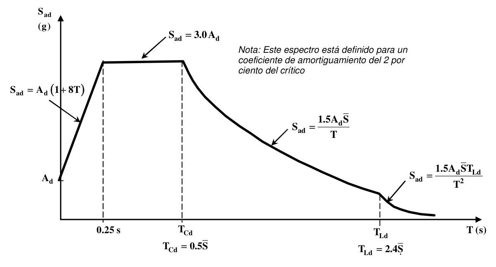

# A.12 — Requisitos especiales para edificaciones indispensables de los grupos de uso $iii$ y $iv$

### A.12.0 — NOMENCLATURA

$A_{d}$= coeficiente que representa la aceleración pico efectiva, para el umbral de daño, dado en A.12.2.

$E_{d}$= fuerzas sísmicas del umbral de daño.

$F_{v}$ = coeficiente de amplificación que afecta la aceleración en la zona de períodos intermedios, debida a los efectos de sitio, adimensional, dado en A.2.4.5.

$g$ = aceleración debida a la gravedad ($g=9.8$ m/s2).

$h_{pi}$= altura del piso $i$ , medida desde la superficie del diafragma del piso $i$ hasta la superficie del diafragma del piso inmediatamente inferior, $i−1$.

$I$ = coeficiente de importancia definido en A.2.5.2

$M$ = masa total de la edificación - $M$ se expresa en kg. Debe ser igual a la masa total de la estructura más la masa de aquellos elementos tales como muros divisorios y particiones, equipos permanentes, tanques y sus contenidos, etc. En depósitos o bodegas debe incluirse además un 25 por ciento de la masa correspondiente a los elementos que causan la carga viva del piso. Capítulos A.4 y A.5.

$S$ = coeficiente de sitio dado en A.12.3.

$S$ = coeficiente de sitio para ser empleado en el espectro sísmico del umbral de daño $(S=1.25S)$.

$S_{ad}$= valor del espectro sísmico del umbral de daño, para un período de vibración dado. Máxima aceleración horizontal para el umbral de daño, expresada como una fracción de la aceleración de la gravedad, para un sistema de un grado de libertad con un período de vibración $T$ . Está definido en A.12.3.

$T$ = período de vibración del sistema elástico, en segundos.

$T_{Cd}$= período de vibración, en segundos, correspondiente a la transición entre la zona de aceleración constante del espectro sísmico del umbral de daño, para períodos cortos y la parte descendiente del mismo. Véase A.12.

$T_{Ld}$= período de vibración, en segundos, correspondiente a la transición entre la zona de desplazamiento constante del espectro sísmico del umbral de daño, para períodos largos. Véase A.12.3

$V_{s}$ = cortante sísmico en la base de la estructura, calculado por el método de la fuerza horizontal equivalente del Capítulo A.4.

$V_{sd}$= cortante sísmico en la base, para las fuerzas sísmicas del umbral de daño. Véase A.12.4.

<!-- mod:1-decreto-092-2011-31 -->
> **Modificación — Decreto 092 de 2011** · anexo, p. 6
>
> En A.12.0 y en A.13.2 se elimina la definición «$S$ = coeficiente de sitio dado en A.12.3», que no se utiliza, y la definición de $\bar{S}$ queda así: $\bar{S}$ = coeficiente de sitio para ser empleado en el espectro sísmico del umbral de daño ($\bar{S} = 1.25 F_v$).

### A.12.1 — GENERAL

#### A.12.1.1 — PROPÓSITO

El presente Capítulo contiene los requisitos adicionales, a los contenidos en los capítulos restantes del presente Título, que se deben cumplir en el diseño y construcción sismo resistente de las edificaciones pertenecientes al grupo de uso $IV$, definido en A.2.5.1.1, y las incluidas en los literales (a), (b), (c) y (d) del grupo de uso $III$, tal como lo define A.2.5.1.2, esenciales para la recuperación de la comunidad con posterioridad a la ocurrencia de una emergencia, incluyendo un sismo, con el fin de garantizar que puedan operar durante y después de la ocurrencia de un temblor, con el fin de garantizar que puedan operar durante y después de la ocurrencia de un temblor. En relación con las edificaciones incluidas en los literales (e) y (f) del Grupo $III$, como lo define A.2.5.1.2, queda a decisión del propietario en el primer caso o de la autoridad competente en el segundo definir si se requiere adelantar el diseño de ellas según los requisitos especiales del Capítulo A.12.

<!-- mod:1-decreto-092-2011-32 -->
> **Modificación — Decreto 092 de 2011** · anexo, p. 6
>
> Se suprime el texto repetido al final de la primera frase: «… con el fin de garantizar que puedan operar durante y después de la ocurrencia de un temblor».

#### A.12.1.2 — ALCANCE

Los requisitos del presente Capítulo deben emplearse en el diseño de las edificaciones indispensables enumeradas en A.2.5.1.1, las incluidas en los literales (a), (b), (c) y (d) del grupo de Uso $III$, tal como lo define A.2.5.1.2 y de las demás que la comunidad designe como tales.

indispensables de los grupos de uso $III$ y $IV$

#### A.12.1.3 — METODOLOGÍA

La determinación de la operatividad de la edificación con posterioridad a la ocurrencia de un sismo se realiza verificando que la edificación se mantiene dentro del rango elástico de respuesta al verse sometida a unas solicitaciones sísmicas correspondientes al inicio del daño, o umbral de daño.

#### A.12.1.4 — PROCEDIMIENTO DE VERIFICACIÓN

Además de los pasos que deben cumplirse en el diseño de la edificación presentados en A.1.3.4, deben realizarse los siguientes pasos adicionales, con el fin de verificar que la estructura y los elementos no estructurales se mantienen dentro del rango elástico de respuesta cuando se presenten los movimientos sísmicos correspondientes al umbral de daño:

Paso A — Movimientos sísmicos correspondientes al umbral de daño — Determinación de los movimientos sísmicos del umbral de daño para el lugar, de acuerdo con lo establecido en A.12.2.

Paso B — Fuerzas sísmicas correspondientes al umbral de daño — Obtención de las fuerzas sísmicas del umbral de daño bajo las cuales debe verificarse el comportamiento de la estructura de la edificación como de los elementos no estructurales.

Paso C — Análisis de la estructura para las fuerzas sísmicas correspondientes al umbral de daño — El análisis de la estructura por medio de un modelo matemático apropiado. El análisis se lleva a cabo aplicando los movimientos sísmicos correspondientes al umbral de daño, tal como se define en A.12.4. Deben determinarse los desplazamientos máximos que imponen los movimientos sísmicos correspondientes al umbral de daño a la estructura y las fuerzas internas que se derivan de ellos.

Paso D — Verificación para el umbral de daño — Comprobación de que las deflexiones para el umbral de daño no exceden los límites establecidos por este Reglamento. Si se exceden los límites de las derivas máximas para el umbral de daño, establecidas en A.12.5, la estructura debe ser rigidizada hasta cuando cumpla la comprobación.

### A.12.2 — MOVIMIENTOS SÍSMICOS DEL UMBRAL DE DAÑO

**A.12.2.1** — Los movimientos sísmicos del umbral de daño, se definen para una probabilidad del ochenta por ciento de ser excedidos en un lapso de cincuenta años, en función de la aceleración pico efectiva al nivel del umbral de daño, representada por el parámetro $A_{d}$ . El valor de este coeficiente, para efectos del presente Reglamento, debe determinarse de acuerdo con A.12.2.2 y A.12.2.3.

**A.12.2.2** — Se determina el número de la región en donde está localizada la edificación usando el Mapa de la figura A.12.2-1. El valor de $A_{d}$ se obtiene de la tabla A.12.2-1, en función del número de la región, o para las ciudades capitales de departamento utilizando la tabla A.12.2-2 y para los municipios del país en el Apéndice A-4, incluido al final del presente Título.

**A.12.2.3** — Alternativamente cuando el municipio o distrito, realice un estudio de microzonificación sísmica, o disponga de una red acelerográfica local; con base en el estudio de microzonificación o en los registros obtenidos, es posible variar, por medio de una ordenanza municipal, el valor de $A_{d}$ , con respecto a los valores dados aquí, pero en ningún caso este valor podrá se menor al dado en el presente Reglamento.

**Tabla A.12.2-1**

Valores de $A_{d}$ según la región del mapa de la figura A.12.2-1

| Región Nº | $A_{d}$ |
|---|---|
| 7 | 0.13 – 0.14 |
| 6 | 0.11 – 0.12 |
| 5 | 0.09 – 0.10 |
| 4 | 0.07 – 0.08 |
| 3 | 0.05 – 0.06 |
| 2 | 0.03 – 0.04 |
| 1 | 0.00 – 0.02 |

Nota: Las regiones representan rangos de valores. Debe consultarse el Apéndice A-4 para determinar el valor de $A_{d}$ en cada municipio.

indispensables de los grupos de uso $III$ y $IV$ Nota: Las regiones representan rangos de valores. Debe consultarse el Apéndice A-4 para determinar el valor de $A_{d}$ en cada municipio.

Figura A.12.2-1 — Mapa de valores de $A_{d}$ indispensables de los grupos de uso $III$ y $IV$

**Tabla A.12.2-2**

Valores de $A_{d}$ para las ciudades capitales de departamento

| Ciudad | $A_{d}$ | Ciudad | $A_{d}$ |
|---|---|---|---|
| Arauca | 0.04 | Neiva | 0.08 |
| Armenia | 0.10 | Pasto | 0.08 |
| Barranquilla | 0.03 | Pereira | 0.10 |
| Bogotá | 0.06 | Popayán | 0.08 |
| Bucaramanga | 0.09 | Puerto Carreño | 0.02 |
| Cali | 0.09 | Puerto Inírida | 0.02 |
| Cartagena | 0.03 | Quibdó | 0.13 |
| Cúcuta | 0.10 | Riohacha | 0.04 |
| Florencia | 0.05 | San Andrés, Isla | 0.03 |
| Ibagué | 0.06 | San José del Guaviare | 0.02 |
| Leticia | 0.02 | Santa Marta | 0.04 |
| Manizales | 0.10 | Sincelejo | 0.04 |
| Medellín | 0.07 | Tunja | 0.07 |
| Mitú | 0.02 | Valledupar | 0.03 |
| Mocoa | 0.10 | Villavicencio | 0.07 |
| Montería | 0.04 | Yopal | 0.06 |

### A.12.3 — ESPECTRO SÍSMICO PARA EL UMBRAL DE DAÑO

**A.12.3.1** — Los parámetros para determinar el espectro de aceleraciones horizontales para el umbral de daño en el campo elástico, para un amortiguamiento crítico de dos por ciento (2%), que se debe utilizar en las verificaciones del umbral de daño, se dan en la figura A.12.3-1. El espectro del umbral de daño se define por medio de la ecuación A.12.3-1, en la cual el valor $T$ es el mismo que se utilizó para obtener el espectro sísmico de diseño de la edificación en el Capítulo A.2 y el valor de $S$ es igual a $1.25F_{v}$ , siendo $F_{v}$ el valor del coeficiente de amplificación que afecta la aceleración en la zona de períodos intermedios debida a los efectos de sitio que se obtiene de acuerdo con la sección A.2.4, empleando allí para $A_{v}$ el valor de $A_{d}$ según A.12.2. Además deben cumplirse las limitaciones dadas en A.12.3.2 a A.12.3.4.

$$ S_{ad} = \dfrac{1.5\,A_d\,\bar{S}}{T} \tag{A.12.3-1} $$

**A.12.3.2** — Para períodos de vibración menores de 0.25 segundos, el espectro sísmico del umbral de daño puede obtenerse de la ecuación A.12.3-2.

$$ S_{ad} = A_d\,(1.0 + 8T) \tag{A.12.3-2} $$

**A.12.3.3** — Para períodos de vibración mayores de 0.25 segundos y menores de $T_{Cd}$, calculado de acuerdo con la ecuación A.12.3-3, el valor de $S_{ad}$ puede limitarse al obtenido de la ecuación A.12.3-4.

$$ T_{Cd} = 0.5\,\bar{S} \tag{A.12.3-3} $$

y

$$ S_{ad} = 3.0\,A_d \tag{A.12.3-4} $$

**A.12.3.4** — Para períodos de vibración mayores de $T_{Ld}$, calculado de acuerdo con la ecuación A.12.3-5, el valor de $S_{ad}$puede limitarse al obtenido de la ecuación A.12.3-6.

indispensables de los grupos de uso $III$ y $IV$

$$ T_{Ld} = 2.4\,\bar{S} \tag{A.12.3-5} $$

y

$$ S_{ad} = \dfrac{1.5\,A_d\,\bar{S}\,T_{Ld}}{T^2} \tag{A.12.3-6} $$

Figura A.12.3-1 — Espectro de aceleraciones horizontales elástico del umbral de daño

**A.12.3.5** — Cuando la ciudad donde se encuentre localizada la edificación disponga de una reglamentación de microzonificación sísmica, debe utilizarse el espectro de umbral de daño definido allí. En su defecto, deben seguirse las prescripciones contenidas en la presente sección A.12.3.

### A.12.4 — METODOLOGÍA DE ANÁLISIS

#### A.12.4.1 — MÉTODO DE ANÁLISIS A UTILIZAR

En la verificación de la respuesta de la estructura a los movimientos sísmicos correspondientes al umbral de daño, como mínimo debe emplearse el método de la fuerza horizontal equivalente dado en el Capítulo A.4, aunque se permite el uso del método del análisis dinámico, prescrito en el Capítulo A.5.

#### A.12.4.2 — RIGIDEZ DE LA ESTRUCTURA Y SUS ELEMENTOS

Las rigideces que se empleen en el análisis estructural para verificación del umbral de daño deben ser compatibles con las fuerzas y deformaciones que le imponen los movimientos sísmicos correspondientes a la estructura. Al nivel de deformaciones del umbral de daño se considera que la estructura responde en el rango lineal y elástico de comportamiento y que los elementos no estructurales pueden contribuir a la rigidez de la estructura, si no están aislados de ella. Cuando los elementos no estructurales interactúan con la estructura al nivel de deformaciones del umbral de daño, debe tenerse en cuenta esta interacción, tanto en la estructura como en los elementos no estructurales.

#### A.12.4.3 — USO DEL MÉTODO DE LA FUERZA HORIZONTAL EQUIVALENTE EN LA EVALUACIÓN DEL

UMBRAL DE DAÑO — Cuando se utilice el método de la fuerza horizontal equivalente en el análisis de la estructura para los movimientos sísmicos del umbral de daño deben tener en cuenta los siguientes aspectos:

indispensables de los grupos de uso $III$ y $IV$

**A.12.4.3.1** — Período fundamental de la edificación — Puede utilizarse el período de vibración fundamental determinado de acuerdo con los requisitos de A.4.2.

**A.12.4.3.2** — Fuerzas sísmicas horizontales del umbral de daño — Las fuerzas sísmicas correspondientes a los movimientos sísmicos del umbral de daño corresponden a la distribución en la altura de la edificación del cortante sísmico en la base, $V_{sd}$. Este cortante sísmico en la base es equivalente a la totalidad de los efectos inerciales horizontales producidos por los movimientos sísmicos del umbral de daño, en la dirección en estudio, y se obtiene por medio de la siguiente ecuación:

$$ V_{sd} = S_{ad}\,g\,M \tag{A.12.4-1} $$

El valor de $S_{ad}$ en la ecuación anterior corresponde al valor de la aceleración leída del espectro sísmico definido en A.12.3 para el período $T$ de la edificación. La fuerza sísmica horizontal del umbral de daño en cualquier nivel puede obtenerse de las ecuaciones A.4.3-1 y A.4.3-2, utilizando $V_{sd}$ en vez de $V_{s}$ .

**A.12.4.3.3** — Análisis de la estructura para las fuerzas sísmicas horizontales del umbral de daño — Por medio de un análisis estructural realizado empleando las fuerzas sísmicas correspondientes al umbral de daño obtenidas como se indica en A.12.4.3.2, se obtienen las fuerzas internas del umbral de daño, $E_{d}$ . Deben utilizarse los requisitos de A.4.4.1 con la excepción del literal (f). En las estructuras de concreto reforzado y mampostería estructural, el grado de fisuración debe ser compatible con las fuerzas sísmicas del umbral de daño, tomando en cuenta que la estructura actúa dentro del rango lineal de respuesta. Como resultados del análisis se deben obtener los desplazamientos horizontales de la estructura, incluyendo los efectos torsionales, los cuales se emplean para evaluar el cumplimiento de los requisitos de deriva para el umbral de daño. Si los elementos no estructurales fueron incluidos en el análisis deben determinarse sus deformaciones y esfuerzos.

#### A.12.4.4 — USO DEL MÉTODO DE ANÁLISIS DINÁMICO EN LA EVALUACIÓN DEL UMBRAL DE DAÑO

Cuando se utilice el método del análisis dinámico deben emplearse los requisitos del Capítulo A.5, empleando los movimientos sísmicos correspondientes al umbral de daño en vez de los movimientos sísmicos de diseño. El ajuste de los resultados indicado en A.5.4.5 debe hacerse con respecto al valor de $V_{sd}$, obtenido por medio de la ecuación A.12.4-1, en vez de $V_{s}$ .

### A.12.5 — REQUISITOS DE LA DERIVA PARA EL UMBRAL DE DAÑO

#### A.12.5.1 — DESPLAZAMIENTOS TOTALES HORIZONTALES PARA EL UMBRAL DE DAÑO

Los desplazamientos horizontales, en las dos direcciones principales en planta, que tienen todos los grados de libertad de la estructura al verse afectada por los movimientos sísmicos para el umbral de daño, definidos en A.12.2, se determinan por medio del análisis estructural realizado utilizando el método de análisis definido en A.12.4 y con las rigideces indicadas en A.12.4.2. Los desplazamientos horizontales para el umbral de daño, en cualquiera de las direcciones principales en planta y para cualquier grado de libertad de la estructura, se obtienen por medio de la ecuación A.6.2-1, con la excepción de que no hay necesidad de incluir los desplazamientos causados por los efectos P-Delta.

#### A.12.5.2 — DERIVA MÁXIMA PARA EL UMBRAL DE DAÑO

La deriva máxima, para el umbral de daño, en cualquier punto del piso bajo estudio se obtiene por medio de la ecuación A.6.3-1.

#### A.12.5.3 — LÍMITES DE LA DERIVA PARA EL UMBRAL DE DAÑO

La deriva máxima, para el umbral de daño, evaluada en cualquier punto de la estructura, determinada de acuerdo con el procedimiento de A.12.5.2, no puede exceder los límites establecidos en la tabla A.12.5-1, en la cual la deriva máxima se expresa como un porcentaje de la altura de piso $h_{pi}$:

indispensables de los grupos de uso $III$ y $IV$

**Tabla A.12.5-1**

Derivas máximas para el umbral de daño como porcentaje de $h_{pi}$

| Estructuras de: | Deriva máxima |
|---|---|
| concreto reforzado, metálicas, de madera, y de mampostería que cumplen los requisitos de A.12.5.3.1 | $0.40\% (Δ_{max}^{i}≤0.0040 h_{pi})$ |
| de mampostería que cumplen los requisitos de A.12.5.3.2 | $0.20\% (Δ_{max}^{i}≤0.0020 h_{pi})$ |

**A.12.5.3.1** — Se permite emplear el límite de deriva máxima permisible de $0.0040h_{pi}$ en edificaciones construidas con mampostería estructural cuando éstas estén compuestas por muros cuyo modo prevaleciente de falla sea la flexión ante fuerzas paralelas al plano del muro, diseñados esencialmente como elementos verticales esbeltos que actúan como voladizos apoyados en su base o cimentación y que se construyen de tal manera que la transferencia de momento entre muros a través de los elementos horizontales de acople en los diafragmas de entrepiso, ya sean losas, vigas de enlace, antepechos o dinteles, sea despreciable.

**A.12.5.3.2** — Cuando se trate de muros de mampostería poco esbeltos o cuyo modo prevaleciente de falla sea causado por esfuerzos cortantes, debe emplearse el límite de deriva máxima permisible de $0.0020h_{pi}$.

### A.12.6 — VERIFICACIÓN DE ESFUERZOS

#### A.12.6.1 — ELEMENTOS ESTRUCTURALES

No hay necesidad de verificar los elementos estructurales para los esfuerzos generados por el sismo del umbral de daño.

#### A.12.6.2 — MUROS NO ESTRUCTURALES

No hay necesidad de verificar los elementos no estructurales para los esfuerzos generados por el sismo del umbral de daño.

█ indispensables de los grupos de uso $III$ y $IV$ Notas:
