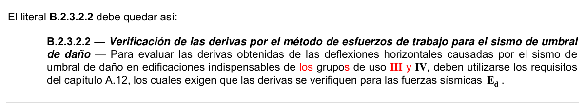

# B.2 — Combinaciones de carga

### B.2.1 — DEFINICIONES Y LIMITACIONES

#### B.2.1.1 — DEFINICIONES

Las definiciones que se dan a continuación hacen referencia al presente Título B (Se incluye la traducción al inglés de cada uno de los términos definidos para efectos de concordancia con los requisitos de las normas que han servido de base a la actualización de estos requisitos dentro de la NSR-10):

Cargas (Loads) — Son fuerzas u otras solicitaciones que actúan sobre el sistema estructural y provienen del peso de todos los elementos permanentes en la construcción, los ocupantes y sus pertenencias, efectos ambientales, asentamientos diferenciales y restricción de cambios dimensionales. Las cargas permanentes son cargas que varían muy poco en el tiempo y cuyas variaciones son pequeñas en magnitud. Todas las otras cargas son cargas variables.

Cargas de servicio (Service loads) — Véase cargas nominales.

Carga mayorada (Factored load) — Es una carga que se obtiene como el producto de una carga nominal por un coeficiente de carga. Las fuerzas sísmicas dadas en el Título A de este Reglamento corresponden a fuerzas mayoradas, pues ya han sido afectadas por el coeficiente de carga, el cual va incluido en la probabilidad de ocurrencia del sismo de diseño.

Cargas nominales (Nominal loads) — Son las magnitudes de las cargas especificadas en B.3 a B.6 de este Reglamento. Las cargas muertas, vivas y de viento que se dan en este Título son cargas nominales o reales, las cuales NO han sido multiplicadas por el coeficiente de carga.

Coeficiente de carga (Load factor) — Es un coeficiente que tiene en cuenta las desviaciones inevitables de las cargas reales con respecto a las cargas nominales y las incertidumbres que se tienen en el análisis estructural. Es sinónimo de “factor de carga” para efectos del Reglamento NSR-10.

Coeficiente de reducción de resistencia (Strength reduction factor) — Es un coeficiente que tiene en cuenta las desviaciones inevitables entre la resistencia real y la resistencia nominal del elemento y la forma y consecuencia de su tipo de falla. Es sinónimo de “factor de reducción de resistencia” para efectos del Reglamento NSR-10.

Curadurías — Son, de acuerdo con la Ley 388 de 1997, las entidades encargadas de estudiar, tramitar y expedir las licencias de construcción en los casos que contempla la Ley. En aquellos casos en los cuales dentro del presente Reglamento NSR-10 se menciona la Curaduría, implica además de ellas la entidad que expide las licencias de construcción o urbanismo que cumplen sus funciones.

Durabilidad (Durability) — Capacidad de una estructura o elementos estructural para garantizar que no se presente deterioro perjudicial para el desempeño requerido en el ambiente para el cual se diseñó.

Edificación (Building) — Es una construcción cuyo uso principal es la habitación o ocupación por seres humanos.

Efectos de las cargas (Load effects) — Son las deformaciones y fuerzas internas que producen las cargas en los elementos estructurales.

Estado límite (Limit state) — Es una condición mas allá de la cual una estructura o uno de sus componentes deja de cumplir su función (estado límite de servicio) o se vuelve insegura (estado limite de resistencia).

Funcionamiento (Serviceability) — Capacidad de la estructura, o de un elemento estructural, de tener un comportamiento adecuado en condiciones de servicio.

Integridad estructural (Structural integrity) — Capacidad de la estructura para evitar colapso generalizado cuando ocurre daño localizado.

Mantenimiento (Maintenance) — Conjunto total de actividades que se realizan durante la vida de servicio de diseño de la estructura para que sea capaz de cumplir con los requisitos de desempeño.

Método de la resistencia (Strength design method) — Es un método de diseño para los elementos estructurales tal que las fuerzas internas calculadas producidas por las cargas mayoradas no excedan las resistencias de diseño de los mismos.

Método de los esfuerzos de trabajo (Allowable stress design method) — Es un método para diseñar los elementos estructurales en el cual los esfuerzos calculados elásticamente, utilizando cargas reales, no deben exceder un valor límite especificado para cada material.

Método de los estados límites (Limit state design method) — Es un método para diseñar estructuras de tal manera que la probabilidad de falla para ciertos estados límites considerados importantes esté dentro de valores aceptables. Por lo general se estudian los estados límites de servicio y de resistencia. Este último caso se conoce como método de la resistencia.

Reparabilidad (Restorability) — Capacidad de la estructura, o de un elemento estructural, de poder ser reparada física y económicamente cuando sea dañada por los efectos de las solicitaciones consideradas.

Resistencia (Resistance) — Capacidad de un elemento estructural para soportar las cargas o fuerzas que se le apliquen Resistencia de diseño (Design strength) — Es el producto de la resistencia nominal por un coeficiente de reducción de resistencia.

Resistencia nominal (Nominal strength) — Es la capacidad de la estructura, o componente de ella, de resistir los efectos de las cargas, determinada por medio de cálculo en el cual se utilizan los valores nominales de las resistencias de los materiales, las dimensiones nominales del elemento y ecuaciones derivadas de principios aceptables de mecánica estructural. Estas ecuaciones provienen de ensayos de campo y ensayos de laboratorio con modelos a escala, teniendo en cuenta los efectos del modelaje y las diferencias entre las condiciones en el terreno y en laboratorio.

Sistema estructural (Structural system) — Elementos estructurales interconectados que en conjunto cumplen una función específica.

Trayectoria de cargas (Load path) — Sucesión de elementos estructurales a lo largo de los cuales se transmiten las cargas desde su punto de aplicación hasta la cimentación.

Vida de servicio de diseño (Design service life) — Período durante el cual la estructura o el elemento estructural sean utilizables para el propósito para el cual se diseñaron con los mantenimientos que se requieran pero sin que haya necesidad de realizarles reparaciones importantes.

#### B.2.1.2 — LIMITACIÓN

La seguridad de la estructura puede verificarse utilizando los requisitos de B.2.3 o B.2.4 dependiendo del método de diseño escogido y del material estructural. Una vez se ha determinado si se usan unos requisitos u otros, el diseño debe hacerse en su totalidad siguiendo los requisitos de ese numeral para todos los elementos de la estructura.

### B.2.2 — NOMENCLATURA

$D$ = carga Muerta consistente en:

(a) peso propio del elemento.

(b) peso de todos los materiales de construcción incorporados a la edificación y que son permanentemente soportados por el elemento, incluyendo muros y particiones divisorias de espacios.

(c) peso del equipo permanente.

$E$ = fuerzas sísmicas reducidas de diseño $(E=F_{s}/R)$ que se emplean para diseñar los miembros estructurales.

$E_{d}$ = fuerza sísmica del umbral de daño.

$F$ = cargas debidas al peso y presión de fluidos con densidades bien definidas y alturas máximas controlables.

$F_{a}$ = carga debida a inundación.

$F_{s}$ = fuerzas sísmicas calculadas de acuerdo con los requisitos del Título A del Reglamento.

$G$ = carga debida al granizo, sin tener en cuenta la contribución del empozamiento.

$L$ = cargas vivas debidas al uso y ocupación de la edificación, incluyendo cargas debidas a objetos móviles, particiones que se pueden cambiar de sitio. $L$ incluye cualquier reducción que se permita. Si se toma en cuenta la resistencia a cargas de impacto este efecto debe tenerse en cuenta en la carga viva $L$ .

$L_{e}$ = carga de empozamiento de agua.

$L_{r}$ = carga viva sobre la cubierta.

$L_{0}$ = carga viva sin reducir, en kN/m2. Véase B.4.5.1.

$H$ = cargas debidas al empuje lateral del suelo, de agua freática o de materiales almacenados con restricción horizontal.

$R_{0}$ = coeficiente de capacidad de disipación de energía básico definido para cada sistema estructural y cada grado de capacidad de disipación de energía del material estructural. Véase el Capítulo A.3.

$R$ = coeficiente de capacidad de disipación de energía para ser empleado en el diseño, corresponde al coeficiente de disipación de energía básico multiplicado por los coeficientes de reducción de capacidad de disipación de energía por irregularidades en altura y en planta, y por ausencia de redundancia en el sistema estructural de resistencia sísmica $(R= φ_{a} φ_{p} φ_{r}R_{0})$. Véase el Capítulo A.3.

$T$ = fuerzas y efectos causados por efectos acumulados de variación de temperatura, retracción de fraguado, flujo plástico, cambios de humedad, asentamiento diferencial o combinación de varios de estos efectos.

$W$ = carga de Viento.

### B.2.3 — COMBINACIONES DE CARGA PARA SER UTILIZADAS CON EL MÉTODO DE

ESFUERZOS DE TRABAJO O EN LAS VERIFICACIONES DEL ESTADO LIMITE DE SERVICIO

#### B.2.3.1 — COMBINACIONES BÁSICAS

Excepto cuando así se indique en la parte correspondiente a cada uno de los materiales que se regulan en este Reglamento, deben tenerse en cuenta todas las cargas indicadas a continuación actuando en las combinaciones que se dan. El diseño debe hacerse para la combinación que produzca el efecto más desfavorable en la edificación, en su cimentación, o en el elemento estructural bajo consideración. El efecto más desfavorable puede ocurrir cuando una o varias de las cargas no actúen.

En el presente Reglamento NSR-10, todos los materiales estructurales, con la excepción de la madera y guadua en el Título G, se diseñan por el método de la resistencia y por lo tanto las combinaciones básicas de carga de la presente sección B.2.3.1 no son aplicables a los materiales estructurales prescritos en el Reglamento y no deben utilizarse. Se incluyen para aquellos casos especiales en los cuales el diseño se realiza por el método de los esfuerzos admisibles y solo deben emplearse cuando así lo indique explícitamente el Título o Capítulo o Sección correspondiente del Reglamento.

$$ D + F \tag{B.2.3-1} $$

$$ D + H + F + L + T \tag{B.2.3-2} $$

$$ D + H + F + (L_r \text{ ó } G \text{ ó } L_e) \tag{B.2.3-3} $$

$$ D + H + F + 0.75\,(L + T) + 0.75\,(L_r \text{ ó } G \text{ ó } L_e) \tag{B.2.3-4} $$

$$ D + H + F + W \tag{B.2.3-5} $$

$$ D + H + F + 0.7\,E \tag{B.2.3-6} $$

$$ D + H + F + 0.75\,W + 0.75\,L + 0.75\,(L_r \text{ ó } G \text{ ó } L_e) \tag{B.2.3-7} $$

$$ D + H + F + 0.75\,(0.7\,E) + 0.75\,L + 0.75\,(L_r \text{ ó } G \text{ ó } L_e) \tag{B.2.3-8} $$

$$ 0.6\,D + W + H \tag{B.2.3-9} $$

$$ 0.6\,D + 0.7\,E + H \tag{B.2.3-10} $$

Deben considerarse los efectos más desfavorables de viento y de sismo tomándolos independientemente.

#### B.2.3.2 — FUERZAS SÍSMICAS

Las fuerzas sísmicas reducidas, $E$ , utilizadas en las combinaciones B.2.3-6, B.2.3-8 y B.2.3-10 corresponden al efecto, expresado en términos de fuerza, $F_{s}$ , de los movimientos sísmicos de diseño prescritos en el Título A, divididos por $R (E=F_{s}/R)$. Cuando se trata de diseñar los miembros por el método de los esfuerzos de trabajo del material, el valor del coeficiente de carga que afecta las fuerzas sísmicas $E$ , es $0.7$ .

**B.2.3.2.1** — Verificación de las derivas por el método de esfuerzos de trabajo para el sismo de diseño — Para evaluar las derivas obtenidas de las deflexiones horizontales causadas por el sismo de diseño, deben utilizarse los requisitos del capítulo A.6, los cuales exigen que las derivas se verifiquen para las fuerzas sísmicas $F_{s}$ , sin haber sido divididas por $R$ , empleando $1.0E$ en vez de $0.7E$ en las ecuaciones que incluyan $E$ en B.2.3.

**B.2.3.2.2** — Verificación de las derivas por el método de esfuerzos de trabajo para el sismo de umbral de daño — Para evaluar las derivas obtenidas de las deflexiones horizontales causadas por el sismo de umbral de daño en edificaciones indispensables del grupo de uso $IV$, deben utilizarse los requisitos del capítulo A.12, los cuales exigen que las derivas se verifiquen para las fuerzas sísmicas $E_{d}$ .

<!-- mod:1-decreto-092-2011-35 -->
> **Modificación — Decreto 092 de 2011** · anexo, p. 8
>
> El literal B.2.3.2.2 debe quedar así:
>
> 

### B.2.4 — COMBINACIONES DE CARGAS MAYORADAS USANDO EL MÉTODO DE

RESISTENCIA

#### B.2.4.1 — APLICABILIDAD

Las combinaciones de carga y factores de carga dados en la sección B.2.4.2 deben ser usados en todos los materiales estructurales permitidos por el Reglamento de diseño del material, con la excepción de aquellos casos en que el Reglamento indique explícitamente que deba realizarse el diseño utilizando el método de los esfuerzos de trabajo. caso en el cual se deben utilizar las combinaciones de la sección B.2.3.1.

Nota Importante: Las combinaciones de carga dadas en B.2.4.2 contienen factores de carga menores que los que prescribía el Reglamento NSR-98, pero al mismo tiempo para cada uno de los materiales estructurales en esta nueva versión del Reglamento (NSR-10) se han prescrito valores de los coeficientes de reducción de resistencia, $φ$ , menores que los que contenía el Reglamento NSR-98, siendo los nuevos valores concordantes con la probabilidad de falla estructural que limita el Reglamento. Por lo tanto es incorrecto, e inseguro, utilizar las nuevas ecuaciones de combinación de carga de B.2.4.2 con los valores de los coeficientes de reducción de resistencia, $φ$ , que contenía la NSR-98.

#### B.2.4.2 — COMBINACIONES BÁSICAS

<!-- mod:1-decreto-092-2011-36 -->
> *Texto vigente según el Decreto 092 de 2011 (anexo, p. 8).*

El diseño de las estructuras, sus componentes y cimentaciones debe hacerse de tal forma que sus resistencias de diseño igualen o excedan los efectos producidos por las cargas mayoradas en las siguientes combinaciones:

$$ 1.4D \tag{B.2.4-1} $$

$$ 1.2D + 1.6L + 0.5\,(L_r \text{ ó } G \text{ ó } L_e) \tag{B.2.4-2} $$

$$ 1.2D + 1.6\,(L_r \text{ ó } G \text{ ó } L_e) + (1.0L \text{ ó } 0.5W) \tag{B.2.4-3} $$

$$ 1.2D + 1.0W + 1.0L + 0.5\,(L_r \text{ ó } G \text{ ó } L_e) \tag{B.2.4-4} $$

$$ 1.2D + 1.0E + 1.0L \tag{B.2.4-5} $$

$$ 0.9D + 1.0W \tag{B.2.4-6} $$

$$ 0.9D + 1.0E \tag{B.2.4-7} $$

**B.2.4.2.1** — Carga viva — Se permite reducir a 0.5 el factor de carga de carga viva $L$ en las ecuaciones (B.2.4-3) a (B.2.4-5), excepto para estacionamientos, áreas ocupadas como lugares de reunión pública y en todas las áreas donde $L_0$ sea superior a 4.8 kN/m².

**B.2.4.2.2** — Efectos sísmicos — Las fuerzas sísmicas reducidas de diseño, $E$, utilizadas en las combinaciones B.2.4-5 y B.2.4-7 corresponden al efecto, expresado en términos de fuerza, $F_s$, de los movimientos sísmicos de diseño prescritos en el Título A, divididos por $R$ ($E = F_s/R$). Cuando se trata de diseñar los miembros, el valor del coeficiente de carga que afecta las fuerzas sísmicas $E$, es 1.0, dado que estas están prescritas al nivel de resistencia. Para la verificación de las derivas obtenidas de las deflexiones horizontales causadas por el sismo de diseño, deben utilizarse los requisitos del Capítulo A.6, los cuales exigen que las derivas se verifiquen para las fuerzas sísmicas $F_s$, sin haber sido divididas por $R$.

**B.2.4.2.3** — Efectos de impacto — Si en el diseño se toma en cuenta la resistencia a los efectos de impacto, éstos deben incluirse en $L$.

**B.2.4.2.4** — Efectos auto deformantes — Cuando sea aplicable, los efectos estructurales de $T$ deben considerarse en combinación con otras cargas. El factor de carga para $T$ debe establecerse considerando la incertidumbre asociada con la magnitud esperada de $T$, la probabilidad de que el máximo efecto ocurra simultáneamente con otras cargas aplicadas, y las consecuencias potencialmente adversas en caso de que el efecto $T$ sea mayor que el supuesto. El factor de carga de $T$ no puede ser menor que la unidad (1.0).

**B.2.4.2.5** — Cargas de fluidos — Cuando $F$ esté presente, debe incluirse con el mismo factor de carga de $D$ en las ecuaciones (B.2.4-1) a (B.2.4-5) y en la ecuación (B.2.4-7).

**B.2.4.2.6** — Empuje lateral del suelo — Cuando $H$ esté presente, se debe incluir en las combinaciones de carga los factores de carga que se ajusten a lo indicado en (a), (b), o (c):

(a) cuando $H$ actúe solo o incremente el efecto de otras cargas, debe incluirse con un factor de carga de 1.6,

(b) cuando el efecto de $H$ es permanente y contrarresta el efecto de otras cargas, debe incluirse con un factor de carga de 0.9,

(c) cuando el efecto de $H$ no es permanente, pero cuando está presente contrarresta el efecto de otras cargas, no se debe incluir $H$.
