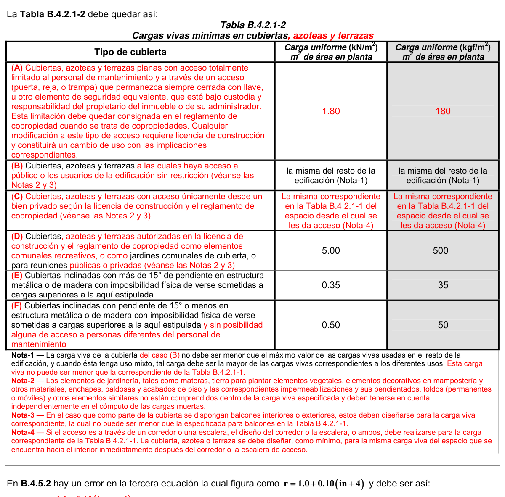
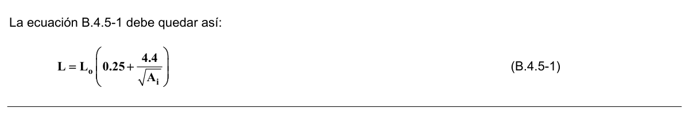

# B.4 — Cargas vivas

### B.4.1 — DEFINICIÓN

**B.4.1.1** — Las cargas vivas son aquellas cargas producidas por el uso y ocupación de la edificación y no deben incluir cargas ambientales tales como viento y sismo.

#### B.4.1.2 — Las cargas vivas en las cubiertas son aquellas causadas por:

(a) Los materiales, equipos y trabajadores utilizados en el mantenimiento de la cubierta y

(b) Las causadas por objetos móviles, tales como materas u otros objetos decorativos, y por las personas que tengan acceso a ellas.

### B.4.2 — CARGAS VIVAS UNIFORMEMENTE REPARTIDAS

#### B.4.2.1 — CARGAS VIVAS REQUERIDAS

Las cargas vivas que se utilicen en el diseño de la estructura deben ser las máximas cargas que se espera ocurran en la edificación debido al uso que ésta va a tener. En ningún caso estas cargas vivas pueden ser menores que las cargas vivas mínimas que se dan en las tablas B.4.2.1-1 y B.4.2.1-2.

**Tabla B.4.2.1-1**

Cargas vivas mínimas uniformemente distribuidas

| Ocupación o uso |  | Carga uniforme (kN/m2) m2 de área en planta |  | Carga uniforme (kgf/m2) |
|---|---|---|---|---|
|  |  |  |  | m2 de área en planta |
| Reunión | Balcones | 5.0 |  | 500 |
|  | Corredores y escaleras | 5.0 |  | 500 |
|  | Silletería fija (fijada al piso) | 3.0 |  | 300 |
|  | Gimnasios | 5.0 |  | 500 |
|  | Vestíbulos | 5.0 |  | 500 |
|  | Silletería móvil | 5.0 |  | 500 |
|  | Áreas recreativas | 5.0 |  | 500 |
|  | Plataformas | 5.0 |  | 500 |
|  | Escenarios | 7.5 |  | 750 |
| Oficinas | Corredores y escaleras | 3.0 |  | 300 |
|  | Oficinas | 2.0 |  | 200 |
|  | Restaurantes | 5.0 |  | 500 |
| Educativos | Salones de clase | 2.0 |  | 200 |
|  | Corredores y escaleras | 5.0 |  | 500 |
|  | Bibliotecas |  |  |  |
|  | Salones de lectura | 2.0 |  | 200 |
|  | Estanterías | 7.0 |  | 700 |
| Fábricas | Industrias livianas | 5.0 |  | 500 |
|  | Industrias pesadas | 10.0 |  | 1000 |
| Institucional | Cuartos de cirugía, laboratorios | 4.0 |  | 400 |
|  | Cuartos privados | 2.0 |  | 200 |
|  | Corredores y escaleras | 5.0 |  | 500 |
| Comercio | Minorista | 5.0 |  | 500 |
|  | Mayorista | 6.0 |  | 600 |
| Residencial | Balcones | 5.0 |  | 500 |
|  | Cuartos privados y sus corredores | 1.8 |  | 180 |
|  | Escaleras | 3.0 |  | 300 |
| Almacenamiento | Liviano | 6.0 |  | 600 |
|  | Pesado | 12.0 |  | 1200 |
| Garajes | Garajes para automóviles de pasajeros | 2.5 | 250 |  |
|  | Garajes para vehículos de carga de hasta 2.000 kg de capacidad. | 5.0 | 500 |  |
| Coliseos y Estadios | Graderías | 5.0 |  | 500 |
|  | Escaleras | 5.0 |  | 500 |

**Tabla B.4.2.1-2**

Cargas vivas mínimas en cubiertas

| Tipo de cubierta | Carga uniforme (kN/m2) m2 de área en planta |  | Carga uniforme (kgf/m2) |
|---|---|---|---|
|  |  |  | m2 de área en planta |
| Cubiertas, Azoteas y Terrazas | la misma del resto de la edificación (Nota-1) |  | la misma del resto de la |
|  |  |  | edificación (Nota-1) |
| Cubiertas usadas para jardines de cubierta o para reuniones | 5.00 | 500 |  |
| Cubiertas inclinadas con más de 15° de pendiente en estructura metálica o de madera con imposibilidad física de verse sometidas a cargas superiores a la aquí estipulada | 0.35 | 35 |  |
| Cubiertas inclinadas con pendiente de 15° o menos en estructura metálica o de madera con imposibilidad física de verse sometidas a cargas superiores a la aquí estipulada | 0.50 | 50 |  |
| Nota-1 — La carga viva de la cubierta no debe ser menor que el máximo valor de las cargas vivas usadas en el resto de la edificación, y cuando esta tenga uso mixto, tal carga debe ser la mayor de las cargas vivas correspondientes a los diferentes usos. |  |  |  |

<!-- mod:1-decreto-092-2011-37 -->
> **Modificación — Decreto 092 de 2011** · anexo, p. 10
>
> La Tabla B.4.2.1-2 debe quedar así:
>
> 

#### B.4.2.2 — EMPUJE EN PASAMANOS Y ANTEPECHOS

Las barandas, pasamanos de escaleras y balcones, y barras auxiliares tanto exteriores como interiores, y los antepechos deben diseñarse para que resistan una fuerza horizontal de 1.00 kN/m (100 kgf/m) aplicada en la parte superior de la baranda, pasamanos o antepecho y deben ser capaces de transferir esta carga a través de los soportes a la estructura. Para viviendas unifamiliares, la carga mínima es de 0.4 kN/m. (40 kgf/m). En estadios y coliseos esa carga mínima horizontal de barandas y antepechos no será menor de 2.5 kN/m (250 kgf/m). En estos y otros escenarios públicos las barandas deberán ser sometidas a pruebas de carga, las cuales deben ser dirigidas y documentadas por el Supervisor Técnico antes de ser puestas en servicio.

Las barandas intermedias (todas excepto los pasamanos) y paneles de relleno se deben diseñar para soportar una carga normal aplicada horizontalmente de 0.25 kN (25 kgf) sobre un área que no exceda 0.3 m de lado, incluyendo aberturas y espacios entre barandas. No es necesario superponer las acciones debidas a estas cargas con aquellas de cualquiera de los párrafos precedentes.

Los sistemas de barreras para vehículos, en el caso de automóviles de pasajeros, se deben diseñar para resistir una única carga de 30 kN (3000 kgf) aplicada horizontalmente en cualquier dirección al sistema de barreras, y debe tener anclajes o uniones capaces de transferir esta carga a la estructura. Para el diseño del sistema, se debe suponer que la carga va a actuar a una altura mínima de 0.5 m por encima de la superficie del piso o rampa sobre un área que no exceda 0.3 m de lado, y no es necesario suponer que actuará conjuntamente con cualquier carga para pasamanos o sistemas de protección especificada en los párrafos precedentes. Las cargas indicadas no incluyen sistemas de barreras en garajes para vehículos de transporte público y camiones; en estos casos se deben realizar los análisis apropiados que contemplen estas situaciones.

### B.4.3 — CARGA PARCIAL

Cuando la luz de un elemento esté cargada parcialmente con la carga viva de diseño produciendo un efecto más desfavorable que cuando está cargada en la totalidad de la luz, este efecto debe ser tenido en cuenta en el diseño.

### B.4.4 — IMPACTO

Cuando la estructura quede sometida a carga viva generadora de impacto, la carga viva debe incrementarse, para efectos de diseño, por los siguientes porcentajes:

(a) Soportes de Elevadores y Ascensores, ............................................................................. 100%

(b) Vigas de puentes grúas con cabina de operación y sus conexiones, ................................. 25%

(c) Vigas de puentes grúas operados por control remoto y sus conexiones, ........................... 10%

(d) Apoyos de maquinaria liviana, movida mediante motor eléctrico o por un eje, ................... 20%

(e) Apoyos de maquinaria de émbolo o movida por motor a pistón, no menos de ................... 50%

(f) Tensores que sirvan de apoyo a pisos o balcones suspendidos y escaleras, .................... 33%

### B.4.5 — REDUCCIÓN DE LA CARGA VIVA

#### B.4.5.1 — REDUCCIÓN DE LA CARGA VIVA POR ÁREA AFERENTE

Cuando el área de influencia del elemento estructural sea mayor o igual a 35 m2 y la carga viva sea superior a 1.80 kN/m2 (180 kgf/m2) e inferior a 3.00 kN/m2 (300 kgf/m2), la carga viva puede reducirse utilizando la ecuación B.4.5-1:

$$ L = L_o \left(0.25 + \dfrac{4.6}{\sqrt{A_i}}\right) \tag{B.4.5-1} $$

Donde:

$L$ = carga viva reducida, en kN/m2

$L_{o}$= carga viva sin reducir, en kN/m2

$A_{i}$ = área de influencia del elemento en m2

**B.4.5.1.1** — La carga viva reducida no puede ser menor del 50% de $L_{o}$ en elementos que soporten un piso ni del 40% de $L_{o}$ en dos o más pisos.

**B.4.5.1.2** — El área de influencia es el área de los paneles adyacentes al elemento considerado, en tal forma que para columnas y vigas equivale al área de los paneles de placa que tocan el elemento, así:

vigas centrales $A_{i}$ = área de dos paneles vigas de borde $A_{i}$ = área de un panel columnas centrales $A_{i}$ = área de cuatro paneles columnas de borde $A_{i}$ = área de dos paneles columnas de esquina $A_{i}$ = área de un panel Para elementos que soporten más de un piso deben sumarse las áreas de influencia de los diferentes pisos

#### B.4.5.2 — REDUCCIÓN POR NÚMERO DE PISOS

Alternativamente a lo estipulado en el numeral anterior en edificios de cinco pisos o más la carga viva para efectos del diseño de las columnas y la cimentación puede tomarse como la suma de las cargas vivas de cada piso multiplicadas por el coeficiente $r$ correspondiente a ese piso:

$r=1.0$para $i=n$ a $i=n−4$ (cinco pisos superiores)

$r=1.0+0.10 (in+4)$para $i=n−5$ a $i=n−8$

$r=0.5$para $i=n−9$ en adelante Donde:

$n$ = número de pisos del edificio

$i$ = número del piso donde se aplica el coeficiente $r$

<!-- mod:1-decreto-092-2011-38 -->
> **Modificación — Decreto 092 de 2011** · anexo, p. 10
>
> En B.4.5.2 hay un error en la tercera ecuación la cual figura como r = 1.0 + 0.10 in + 4 y debe ser así:
>
> 

<!-- mod:2-decreto-340-2012-7 -->
> **Modificación — Decreto 340 de 2012** · anexo, p. 5
>
> La ecuación B.4.5-1 debe quedar así:
>
> 

### B.4.6 — PUENTE GRÚAS

En el diseño de las vigas carrilera de los puente grúas debe tenerse en cuenta una fuerza horizontal equivalente a por lo menos el 20% de la suma de los pesos de la grúa y la carga levantada. En la suma no entra el peso de las partes estacionarias del puente grúa. Esta fuerza debe suponerse colocada en la parte superior de los rieles, normalmente a los mismos y debe distribuirse entre las vigas teniendo en cuenta la rigidez lateral de la estructura que soporta los rieles. Además debe tenerse en cuenta una fuerza horizontal longitudinal, aplicada al tope del riel, igual al 10% de las cargas máximas de rueda de la grúa.

### B.4.7 — EFECTOS DINÁMICOS

Las edificaciones expuestas a excitaciones dinámicas producidas por el público tales como: estadios, coliseos, teatros, gimnasios, pistas de baile, centros de reunión o similares, deben ser diseñadas de tal manera que tengan frecuencias naturales verticales iguales o superiores a 5 Hz (períodos naturales verticales menores de 0.2 s).

### B.4.8 — CARGAS EMPOZAMIENTO DE AGUA Y DE GRANIZO

#### B.4.8.1 — GENERALIDADES

En el diseño estructural de cubiertas se deben considerar los efectos de empozamiento de agua y de granizo. El empozamiento de agua se produce por obstrucción de los sistemas de drenaje de la cubierta, el cual puede ocurrir por debido a residuos, hojas de árboles, o granizo, entre otras fuentes de obstrucción. La determinación de las cargas por empozamiento de agua y granizo se realiza de la siguiente manera:

(a) Toda cubierta debe disponer de sistema auxiliar de evacuación del exceso de agua cuando se presenta una obstrucción de las bajantes normales. Este sistema puede consistir en gárgolas, rebosaderos u otros implementos que eviten la acumulación de agua y la evacuen de forma confiable ante la obstrucción de las bajantes del sistema de drenaje.

(b) La carga de empozamiento de agua, $L_{e}$ , se determina con base en el volumen de agua que es posible contener hasta que se alcance el nivel de los elementos del sistema auxiliar de evacuación del exceso de agua, como se indica en B.4.8.2.

#### B.4.8.2 — CARGA POR EMPOZAMIENTO DE AGUA

**B.4.8.2.1** — El proyecto hidráulico de la edificación debe incluir el diseño del sistema de drenaje de la cubierta y del sistema auxiliar de evacuación del exceso de agua y definirá el volumen de agua que pueda acumularse antes de que el sistema auxiliar de drenaje del exceso opere. Es responsabilidad del constructor que suscribe la licencia de construcción aprobar el proyecto hidráulico y asegurarse de que los sistemas de drenaje normal y auxiliar sean apropiados y de suministrar la información acerca del volumen de agua que pueda acumularse al diseñador estructural.

**B.4.8.2.2** — Con base en la información suministrada por el constructor el diseñador estructural determinará las cargas causadas por el volumen de agua que pueda acumularse antes de que el sistema auxiliar de drenaje del exceso opere y su distribución a los elementos estructurales de soporte de la cubierta realizando su diseño de tal manera que sean capaces de resistir este peso sin fallar.

**B.4.8.2.3** — Para cubiertas en estructura metálica, la revisión del empozamiento debe tener adicionalmente en cuenta lo indicado en F.2.2.3.9.

#### B.4.8.3 — CARGA DE GRANIZO

**B.4.8.3.1** — Las cargas de granizo, $G$ , deben tenerse en cuenta en las regiones del país con más de 2 000 metros de altura sobre el nivel del mar o en lugares de menor altura donde la autoridad municipal o distrital así lo exija.

**B.4.8.3.2** — En los municipios y distritos donde la carga de granizo deba tenerse en cuenta, su valor es de 1.0 kN/m2 (100 kgf/m2). Para cubiertas con una inclinación mayor a 15° este valor puede reducirse a 0.5 kN/m2 (50 kgf/m2).

█

<!-- mod:1-decreto-092-2011-39 -->
> **Modificación — Decreto 092 de 2011** · anexo, p. 11
>
> En B.4.8.3.2 La pendiente de 15° debe cambiarse por 15%.
