# B.6 — Fuerzas de viento

### B.6.1 — ALCANCE

A continuación se presentan métodos para calcular las fuerzas de viento con que debe diseñarse el sistema principal de resistencia de fuerzas de viento (SPRFV) de las edificaciones, sus componentes y elementos de revestimiento. No es aplicable a las estructuras de forma o localización especiales, las cuales requieren investigación apropiada, ni a las que puedan verse sometidas a oscilaciones graves inducidas por el viento, ni tampoco a estructuras de puentes.

Cuando existan resultados experimentales, obtenidos en túneles de viento, éstos pueden usarse en lugar de los especificados en este capítulo, siempre y cuando reciban la aprobación de la Comisión Asesora Permanente para el Régimen de Construcciones Sismo Resistentes.

#### B.6.1.1 — PROCEDIMIENTOS PERMITIDOS

Las cargas de diseño para edificios y otras estructuras, incluyendo el SPRFV y todos los componentes y elementos de revestimiento de estos, se determinaran usando uno de los siguientes procedimientos:

Método 1 — Procedimiento Simplificado, para edificios que cumplan los requisitos especificados en la sección B.6.4 Método 2 — Procedimiento Analítico, para edificios que cumplan los requisitos especificados en la sección B.6.5.

Método 3 — Procedimiento de Túnel de Viento como se especifica en la sección B.6.6.

#### B.6.1.2 — PRESIONES DE VIENTO QUE ACTÚAN EN CARAS OPUESTAS DE CADA SUPERFICIE DEL

EDIFICIO — Para el cálculo de las cargas de viento de diseño del SPRFV, se deberá tomar la suma algebraica de las presiones que actúan en caras opuestas de cada superficie del edificio.

#### B.6.1.3 — CARGA DE VIENTO DE DISEÑO MÍNIMA

La carga de viento de diseño, determinada mediante cualquiera de los procedimientos de la sección B.6.1.1, no deberá ser menor a la especificada a continuación.

**B.6.1.3.1** — Sistema Principal Resistente a Cargas de Viento (SPRFV) — Para una edificación cerrada, parcialmente cerrada o para cualquier estructura, la carga de viento a usarse en el diseño de SPRFV no será menor a la multiplicación de 0.40 kN/m2 por el área de la edificación o estructura, proyectada a un plano vertical normal a la dirección de viento en estudio.

**B.6.1.3.2** — Componentes y Revestimientos — La presión de viento de diseño para los componentes y revestimientos de la estructura no será menor a una presión neta de 0.40 kN/m2 actuando en cualquier dirección normal a la superficie.

<!-- mod:1-decreto-092-2011-40 -->
> **Modificación — Decreto 092 de 2011** · anexo, p. 11
>
> El primer parágrafo de B.6.1 debe quedar así:
>
> A continuación se presentan métodos para calcular las fuerzas de viento con que debe diseñarse el sistema principal de resistencia de fuerzas de viento (SPRFV) de las edificaciones, sus componentes y elementos de revestimiento. El presente Capítulo B.6 no es aplicable a estructuras que se salgan del alcance de la Ley 400 de 1997 o del alcance del Reglamento NSR-10.

### B.6.2 — DEFINICIONES

Las siguientes definiciones se aplican a este capítulo:

Aberturas — Vanos o espacios en el cerramiento del edificio, que permiten la circulación del aire a través del cerramiento y que se diseñan como “abiertos” durante vientos de diseño como se define en estas especificaciones.

Altura de la cornisa, $h$ — La distancia desde la superficie del suelo adyacente al edificio hasta la cornisa en una determinada pared. Si la altura de la cornisa varía a lo largo de la pared, se tomará la altura promedio.

Altura media de cubierta, $h$ — El promedio de la altura hasta la cornisa y la altura hasta el punto más elevado de la cubierta. Para cubiertas con ángulos de inclinación menores o iguales a 10o, la altura media de cubierta será la altura de la cornisa.

Aprobado — Aceptado por la autoridad competente.

Área efectiva — El área usada para determinar $GC_{p}$ . Para elementos de componentes y paneles de revestimiento, el área efectiva en las figs. B.6.5-8A a B.6.5-14 y en la Fig. B.6.5-16A, B, C y D y es la longitud de luz multiplicada por un ancho efectivo que no debe ser menor que un tercio de la longitud del tramo. Para los elementos de amarre de revestimientos, el área efectiva de viento no será mayor que el área tributaria de un amarre individual.

Colina — Con respecto a los efectos topográficos de la sección B.6.5.7, se refiere a una superficie de terreno caracterizada por un cambio notable de relieve en cualquier dirección horizontal.

Componentes y revestimientos — Aquellos elementos que no forman parte del sistema principal resistente a fuerzas de viento, SPRFV.

Cubierta libre — Cubierta con una configuración similar a la de las figs. B.6.5-15A a B.6.5-15D (a una, dos aguas o en artesa), en un edificio abierto sin paredes de cerramiento bajo la superficie del cubierta.

Edificio abierto — Un edificio con aberturas de al menos 80% del área en cada una de las paredes que conforman el cerramiento del edificio (fachadas y cubiertas). Se expresa esta condición mediante la siguiente ecuación $A_{o}≥0.8Ag$, donde:

$A_{o}$ = área total de aberturas en una pared que reciba presión positiva externa, en m2.

$A_{g}$ = área total de la pared a la cual $A_{o}$ hace referencia.

Edificio bajo — Edificio cerrado o parcialmente cerrado que cumpla con las siguientes condiciones:

(a) Altura media de la cubierta $( h)$ menor o igual a 18 m (60 ft).

(b) Altura media de la cubierta $( h)$ no excede la menor dimensión horizontal del edificio.

Edificio cerrado — Un edificio que no cumpla los requerimientos de edificios abiertos o parcialmente cerrados.

Edificio de diafragma simple — Un edificio en el cual las cargas de viento a barlovento y sotavento se trasmiten a través de los diafragmas de piso y cubierta hacia un mismo SPRFV, es decir no tiene separaciones estructurales.

Estructura o edificio de forma regular — Un edificio u otra estructura que no tenga geometría irregular en su forma espacial.

Estructura o edificio rígido — Un edificio u otra estructura cuya frecuencia fundamental sea mayor o igual a $1 Hz$ .

Edificio parcialmente cerrado — Un edificio que cumpla las siguientes condiciones:

(a) El área total de aberturas en una pared que recibe presión externa positiva excede por más de 10% a la suma de las áreas de aberturas en el área restante del revestimiento del edificio (paredes y cubierta).

(b) El área total de aberturas en una pared que soporta cargas positivas, excede de 0.37 m2 o 1% del área de esa pared (la que sea menor), y el porcentaje de aberturas en el área restante del revestimiento del edificio no excede 20%.

Estas condiciones se expresan mediante las siguientes condiciones:

$A_{o}>1.10A_{oi}$ $A_{o}>0.37m^{2}$ o $A_{o}>0.01A_{g}$, el que sea menor, y $A_{oi}/A_{gi}≤0.20$ donde

$A_{o}$= área total de aberturas en una pared que reciba presión positiva externa, en m2.

$A_{g}$= área total de la pared a la cual $A_{o}$ hace referencia.

$A_{oi}$= la suma de las áreas de aberturas, sin incluir $A_{o}$ , en la revestimiento del edificio (paredes y cubierta), en m2.

$A_{gi}$= la suma de las áreas brutas, sin incluir $A_{g}$ , del revestimiento del edificio (paredes y cubierta), en m2 Edificio u otra estructura flexible — Edificios u otras estructuras esbeltas con frecuencia natural fundamental menor a 1 Hz.

Escarpe — Con respecto a los efectos topográficos de la sección B.6.5.7, se refiere a un acantilado o pendiente fuerte que separa dos niveles de terreno (véase Fig. B.6.5-1).

Factor de importancia, $I$ — Factor que tiene en cuenta el grado de amenaza a la vida humana y daño a la propiedad.

Fuerza de diseño, $F$ — Fuerza estática equivalente usada para determinar las cargas de viento para edificios abiertos y otras estructuras.

Literatura reconocida — Investigaciones publicadas o documentos técnicos que han sido aprobados.

Material para vidriado — Elementos de vidrio, incluyendo vidrio recocido, vidrio con recubrimiento orgánico, vidrio templado, vidrio laminado, vidrio armado, láminas de material plástico o combinaciones de éstos usados en vidriados (véase K.4.1.2).

Presión de diseño, $p$ — Presión estática equivalente usada para determinar cargas de viento para edificios.

Revestimiento del edificio — Componentes que cierren el edificio como cubiertas, claraboyas, paredes exteriores, puertas y ventanas.

Revestimiento resistente a impactos — Un cerramiento diseñado para proteger los materiales para vidriados.

Sistema principal resistente a cargas de viento (SPRFV) — Un conjunto de elementos estructurales destinado a brindar apoyo y estabilidad a la estructura en su totalidad. El sistema generalmente recibe las cargas de viento provenientes de más de una superficie.

Velocidad de viento, $V$ — Como se especifica en la sección B.6.5.4, es la velocidad de una ráfaga de 3 segundos medida 10 m por encima del suelo en la Exposición C (Véase sección B.6.5.6.3).

Vidriera — Vidrio o láminas traslucidas de plástico usado en ventanas, puertas, claraboyas o cerramientos.

<!-- mod:1-decreto-092-2011-41 -->
> **Modificación — Decreto 092 de 2011** · anexo, p. 11
>
> En B.6.2 se deben modificar las siguientes definiciones, para que queden como se indica a continuación:
>
> 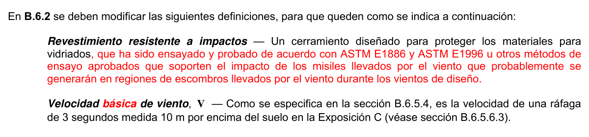

<!-- mod:1-decreto-092-2011-42 -->
> **Modificación — Decreto 092 de 2011** · anexo, p. 11
>
> En B.6.2 se deben incluir las siguientes definiciones:
>
> 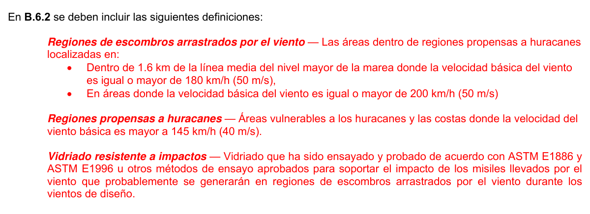

### B.6.3 — NOMENCLATURA

La nomenclatura siguiente comprende las variables utilizadas en el presente capítulo.

$A$ = área efectiva para viento, en m2

$A_{f}$ = área de un edificio u otra estructura abierta. Puede referirse al área normal a la dirección de viento o al área proyectada en un plano normal a la dirección del viento, en m2

$A_{g}$ = área bruta a la cual hace referencia $A_{o}$ , en m2

$A_{gi}$= la suma de las áreas brutas de toda la superficie del envolvente (paredes y cubierta) sin incluir $A_{g}$ , en m2

$A_{o}$ = área total de aberturas en una pared que recibe presión positiva externa, en m2

$A_{oi}$= la suma del área de aberturas de toda la superficie del envolvente (paredes y cubierta) sin incluir $A_{o}$ , en m2

$A_{og}$= área total de aberturas en toda la superficie del cerramiento (paredes y cubierta) del edificio, en m2

$A_{g}$ = área bruta de la pared sólida libre o la valla rígida, en m2

$a$ = ancho de la zona para coeficiente de presión, en m

$B$ = dimensión horizontal del edificio medido en dirección normal a la dirección del viento, en m

$b$ = factor de velocidad media de viento horaria en la ec. B.6.5-12 de la tabla B.6.5-2

$\hat{b}$ = factor de velocidad de ráfaga de 3 segundos, de la tabla B.6.5-2

$C_{f}$ = coeficiente de fuerza a usarse en el cálculo de cargas de viento para estructuras diferentes a edificios

$C_{N}$= coeficiente de presión neta a usarse en el cálculo de cargas de viento para edificios abiertos

$C_{p}$ = coeficiente de presión externa a usarse en el cálculo de cargas de viento para edificios

$c$ = factor de intensidad de turbulencia en la ec. B.6.5-3 de la tabla B.6.5-2

$D_{D'}$ = diámetro de estructura o miembro circular, en m = profundidad de elementos sobresalientes como nervaduras y cornisas, en m

$F$ = fuerza de viento de diseño para estructuras diferentes a edificios, en N

$G$ = factor de efecto ráfaga

$G_{f}$ = factor de efecto ráfaga para el SPRFV de edificios flexibles y otras estructuras

$GC_{pn}$ = coeficiente de presión combinada para un parapeto

$GC_{p}$ = producto del coeficiente de presión externa y el factor de efecto ráfaga a usarse en la determinación de cargas de viento para edificios

$GC_{pf}$ = producto del coeficiente equivalente de presión externa y el factor de efecto ráfaga a usarse en la determinación de cargas de viento para el SPRFV de edificios bajos

$GC_{pi}$ = producto del coeficiente de presión interna y el factor de efecto ráfaga a usarse en la determinación de cargas de viento para edificios

$g_{Q}$= factor pico para respuesta del entorno en las ecs. B.6.5-2 y B.6.5-6

$g_{R}$= factor pico para respuesta de resonancia en las ec. B.6.5-6

$gν$ = factor pico para respuesta de viento en las ecs. B.6.5-2 y B.6.5-6

$H$ = altura de la colina o escarpe en la fig. B.6.5-1, en m

$h$ = altura media de un edificio o altura de cualquier otra estructura. Se debe usar la altura a la cornisa si el ángulo de inclinación $e$ es menor o igual a 10o, en m.

$h_{e}$ = altura de la cornisa en una determinada pared o altura promedio de cornisa si esta varía a los largo de la estructura.

$l$ = factor de importancia

$I_{z}$ = intensidad de turbulencia de la ec. B.6.5-6

$K_{1} , K_{2} , K_{3}$ = factores de multiplicación en la fig. B.6.5-1 usados para calcular $K_{zt}$

$K_{d}$ = factor de direccionalidad de viento, en la tabla B.6.5-4

$K_{h}$ = coeficiente de exposición de presión por velocidad evaluado en $z=h$

$K_{z}$ = coeficiente de exposición de presión por velocidad evaluado a la altura $z$ .

$K_{zt}$= factor topográfico definido en la sección B.6.5.7

$L$ = dimensión horizontal del edificio medida en dirección paralela a la dirección del viento, en m

$L_{h}$ = distancia viento arriba de la cresta de la colina o escarpe en la fig. B.6.5-1, donde la diferencia en elevación de terreno es la mitad de la altura de la colina o escarpe, en m

$L_{z}$ = longitud integral a escala de la turbulencia (para modelos a escala en túnel de viento), en m

$L_{r}$ = dimensión horizontal de esquina de retorno para un muro libre o valla maciza de la fig. B.6.5-17, en m

$A$ = factor de escala de longitud integral de la tabla B.6.5-2, en m

$N_{1}$ = frecuencia reducida de la ec. B.6.5-10

$n_{1}$ = frecuencia natural del edificio, en Hz

$p$ = presión de diseño a usarse en el cálculo de cargas de viento para edificios

$p_{L}$= presión de viento actuando en la cara a sotavento en la fig. B.6.5-6, en N/m2

$p_{net}$= presión neta de viento de diseño de la ec. B.6.4-2, en N/m2

$pnet10$= presión neta de viento de diseño para la categoría de exposición B a h=10.0 m

$p_{s}$ = presión neta de viento de diseño de la ec. B.6.4-1, en N/m2

$p_{s10}$ = presión de viento de diseño simplificada para la categoría de exposición B a h=10.0 m en la Fig. B.6.4-2

$p_{w}$= presión de viento actuando en la cara a barlovento en la fig. B.6.5-6, en N/m2

$Q$ = factor de respuesta del entorno de la ec. B.6.5-4

$q$ = presión por velocidad, en N/m2

$q_{h}$ = presión por velocidad evaluada a la altura $z=h$, en N/m2

$q_{i}$ = presión por velocidad para la determinación de la presión interna, en N/m2

$q_{p}$ = presión por velocidad en la parte superior del parapeto, en N/m2

$q_{z}$ = presión por velocidad evaluada a una altura $z$ por encima del terreno, en N/m2

$R$ = factor de respuesta de resonancia de la ec. B.6.5-8

$R_{B} , R_{h} , R_{L}$= valores de la ec. B.6.5-8

$R_{i}$ = factor de reducción de la ec. B.6.5-14

$R_{n}$= valor de la ec. B.6.5-9

$s$ = dimensión vertical de un muro libre o una valla maciza de la fig. B.6.5-17, en m

$V$ = velocidad básica de viento de la fig. B.6.4-1 en m/s. La velocidad básica de viento corresponde a la velocidad de una ráfaga de 3 segundos a una altura de 10 m por encima del suelo en un terreno de categoría de exposición C

$V_{i}$ = volumen interno sin particiones, en m3.

$V_{z}$ = velocidad de viento promedia por hora a una altura ż. m/s

$W$ = ancho del edificio en las figs. B.6.5-9 y B.6.5-11A y B; y ancho de la luz en las figs. B.6.5-10 y B.6.5-12, en m

$X$ = distancia hasta el centro de presión desde el borde a barlovento, en m

$x$ = distancia tomada desde la cima en la dirección de barlovento o sotavento en la fig. B.6.5-1, en m

$z$ = altura por encima del terreno, en m

$z$ = altura equivalente de la estructura, en m

$z_{g}$ = altura nominal de la capa atmosférica limite usada en este código. Los valores aparecen en la tabla B.6.5-2

$z_{min}$ = altura mínima de exposición de la tabla B.6.5-2

$α$ = exponente para la ley potencial de la velocidad de ráfaga de 3 seg, de la tabla B.6.5-2

$\hat{α}$ = inversa de $α$ de la Tabla B.6.5-2

$α$ = exponente para la ley potencial de la velocidad media horaria del viento, ec. B.6.5-12 en la tabla B.6.5-2

$β$ = coeficiente de amortiguamiento, porcentaje crítico para edificios y otras estructuras

$ε$ = coeficiente de área sólida vs área bruta para muros libres, vallas macizas, vallas abiertas, torres de celosía y otras estructuras de celosía

$λ$ = factor de ajuste por altura y exposición del edificio de las figs. B.6.4-2 y B.6.4-3.

$ε$ = exponente para la ley potencial de la escala de longitud integral en la ec. B.6.5-5 obtenido de la tabla B.6.5-2

$η$ = valor usado en la ec. B.6.5-11A (véase sección B.6.5.8.2)

$θ$ = ángulo de inclinación de la cubierta, en grados.

$ν$ = cociente alto/ancho para vallas macizas

### B.6.4 — PROCEDIMIENTO SIMPLIFICADO

#### B.6.4.1 — ALCANCE

Un edificio cuyas cargas de viento de diseño se determinen de acuerdo con esta sección deberá cumplir las condiciones de B.6.4.1.1 o B.6.4.1.2. Si solamente cumple las condiciones de B.6.4.1.2 para el diseño de los elementos de revestimiento y componentes, el SPRFV deberá diseñarse usando el Método 2 (Procedimiento Analítico) o el Método 3 (Procedimiento de Túnel de Viento).

**B.6.4.1.1** — Sistema Principal de Resistencia de Fuerzas de Viento (SPRFV) — Para el diseño del SPRFV el edificio debe cumplir todas las siguientes condiciones:

(a) El edificio sea de diafragma simple como se define en la sección B.6.2.

(b) El edificio sea bajo de acuerdo con la sección B.6.2.

(c) El edificio sea cerrado como se define en la sección B.6.2 y cumpla las provisiones de zonas propensas a huracanes de acuerdo con la sección B.6.5.9.3.

(d) El edificio sea de forma regular como se define en la sección B.6.2.

(e) El edificio no sea clasificado como flexible como se define en la sección B.6.2.

(f) Las características de respuesta del edificio sean tales que el mismo no esté sujeto a cargas por viento a través de él, a generación de vórtices, a inestabilidad por golpeteo o aleteo, y no esté ubicado en un sitio en el que se puedan presentar efectos de canalización o sacudimiento por la estela de obstrucciones en barlovento, que obliguen a consideraciones especiales.

(g) El edificio tenga una sección transversal aproximadamente simétrica en cada dirección y tenga una cubierta plana o cubierta a dos o cuatro aguas con ángulo de inclinación $θ ≤45^{D}$ .

(h) El edificio esta eximido de los casos de carga torsional indicados en la Nota 5 de la fig. B.6.5-7, o estos casos no controlan el diseño de ninguno de los elementos del SPRFV del edificio.

<!-- mod:1-decreto-092-2011-43 -->
> **Modificación — Decreto 092 de 2011** · anexo, p. 11
>
> El literal (c) de B.6.4.1.1 debe quedar así:
>
> (c) El edificio sea cerrado como se define en la sección B.6.2 y cumpla las provisiones de regiones de escombros arrastrados por el viento de acuerdo con la sección B.6.5.9.3.

**B.6.4.1.2** — Componentes y Revestimientos — Para el diseño de los componentes y elementos de revestimiento, el edificio debe cumplir todas las siguientes condiciones:

(a) La altura promedio $h$ es igual o menor a 18.0 m.

(b) El edificio es cerrado como se define en la sección B.6.2 y cumple las provisiones de zonas propensas a huracanes de acuerdo con la sección B.6.5.9.3.

(c) El edificio es de forma regular como se define en la sección B.6.2.

(d) El edificio tiene una cubierta plana, una cubierta a dos aguas con $θ ≤45^{D}$ o una cubierta a cuatro aguas con $θ ≤27^{D}$ .

<!-- mod:1-decreto-092-2011-44 -->
> **Modificación — Decreto 092 de 2011** · anexo, p. 11
>
> El literal (b) de B.6.4.1.2 debe quedar así:
>
> (b) El edificio es cerrado como se define en la sección B.6.2 y cumpla las provisiones de regiones de escombros arrastrados por el viento de acuerdo con la sección B.6.5.9.3.

#### B.6.4.2 — PROCEDIMIENTO DE DISEÑO

(a) La velocidad básica de viento $V$ se determina de acuerdo con la sección B.6.5.4. Deberá suponerse que el viento viene de cualquier dirección horizontal.

(b) El factor de importancia I se determina de acuerdo con la sección B.6.5.5.

(c) La categoría de exposición se determina de acuerdo con la sección B.6.5.6.

(d) Se determina un coeficiente de ajuste por altura y exposición, $λ$ , de acuerdo con la fig. B.6.4-2.

**B.6.4.2.1** — Sistema Principal de Resistencia de Fuerzas de Viento (SPRFV) — Las presiones de viento de diseño simplificado, $p_{s}$ , representan la presión neta (suma de presiones internas y externas) que se debe aplicar a las proyecciones horizontales y verticales de las superficies del edificio como se muestra en la fig.

B.6.4-2. Para la presión horizontal (zonas A, B, C y D), $p_{s}$ es la combinación de las presiones netas a barlovento y sotavento, $p_{s}$ se determinará con la siguiente Ec.:

$$ p_s = \lambda\,K_{zt}\,I\,P_{S10} \tag{B.6.4-1} $$

donde;

$λ$ = factor de ajuste por altura y exposición, de la fig. B.6.4-2 (continuación).

$K_{zt}$ = factor topográfico como se define en la sección B.6.5.7 evaluado a la altura promedio de la cubierta, $h$ ecuación B.6.5-1

$I$ = factor de importancia como se define en la sección B.6.5.5

$P_{S10}$ = presión de viento de diseño simplificada para la categoría de exposición $B$ , con h=10 m de la fig. B.6.4-2.

**B.6.4.2.1.1** — Presiones Mínimas - Los efectos de carga de las presiones de viento de diseño de la sección B.6.4.2.1 no serán menores que el caso de carga mínima de la sección B.6.1.3.1, suponiendo presiones $p_{s}$, de +0.40 kN/m2 para las zonas A, B, C y D y de 0 kN/m2 para las zonas E, F, G y H.

**B.6.4.2.2** — Elementos de Revestimiento y Componentes — Para los elementos de revestimiento y componentes diseñados usando el Método Simplificado, las presiones de viento de diseño netas, $p_{net}$ representan la presión neta (suma de presiones internas y externas) que se debe aplicar en dirección normal a cada superficie del edificio como se muestra en la fig. B.6.4-3.

$$ p_{net} = \lambda\,K_{zt}\,I\,P_{net10} \tag{B.6.4-2} $$

donde;

$λ$ = factor de ajuste por altura y exposición, de la fig. B.6.4-2

$K_{zt}$= factor topográfico como se define en la sección B.6.5.7 evaluado a la altura promedio de la cubierta, $h$

$l$ = factor de importancia como se define en la sección B.6.2

$Pnet10$ = presión neta de viento de diseño para la categoría de exposición B a $h=10.0$ m

**B.6.4.2.2.1** — Presiones Mínimas — Las presiones de viento de diseño positivas y negativas, $P_{net}$ de la sección B.6.4.2.2 no serán menores a +0.4 kN/m2 y -0.4 kN/m2, respectivamente.

<!-- mod:1-decreto-092-2011-45 -->
> **Modificación — Decreto 092 de 2011** · anexo, p. 11
>
> En B.6.4.2.2 la referencia a la fig. B.4-2 de la definición de λ debe ser a la fig. B.6.4-3. En la definición de P falta nte 10 − agreagar al fina “Véase fig. 6.4-3.”
>
> 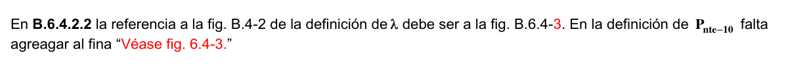

#### B.6.4.3 — REVESTIMIENTO PERMEABLE

Las cargas de viento de diseño de la fig. B.6.4-3 se usarán para todos los revestimientos permeables a menos que se demuestre a través de datos experimentales aprobados u otra literatura reconocida, que las cargas son menores para el tipo de revestimiento que está siendo considerado.

<!-- mod:2-decreto-340-2012-8 -->
> **Modificación — Decreto 340 de 2012** · anexo, p. 5
>
> La tabla y la nota de la figura B.6.4-1 deben quedar así:
>
> 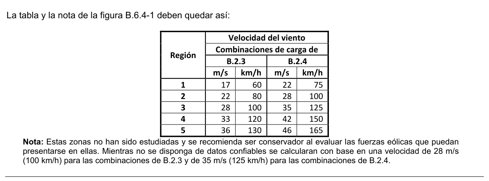

<!-- mod:2-decreto-340-2012-9 -->
> **Modificación — Decreto 340 de 2012** · anexo, p. 5
>
> En la Figura B.6.4-2 en la gráfica Longitudinal la pared marcada como B debe ser C.

<!-- mod:5-decreto-1711-2021-7 -->
> **Modificación — Decreto 1711 de 2021** · anexo, p. 4
>
> Se modifica la Figura B.6.4-1 «Velocidad del viento básico, Zonas de amenaza eólica», la cual queda así:
>
> 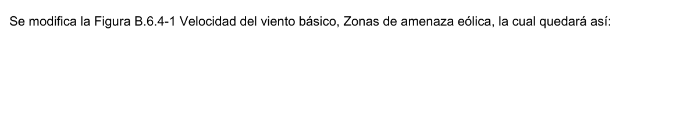
>
> 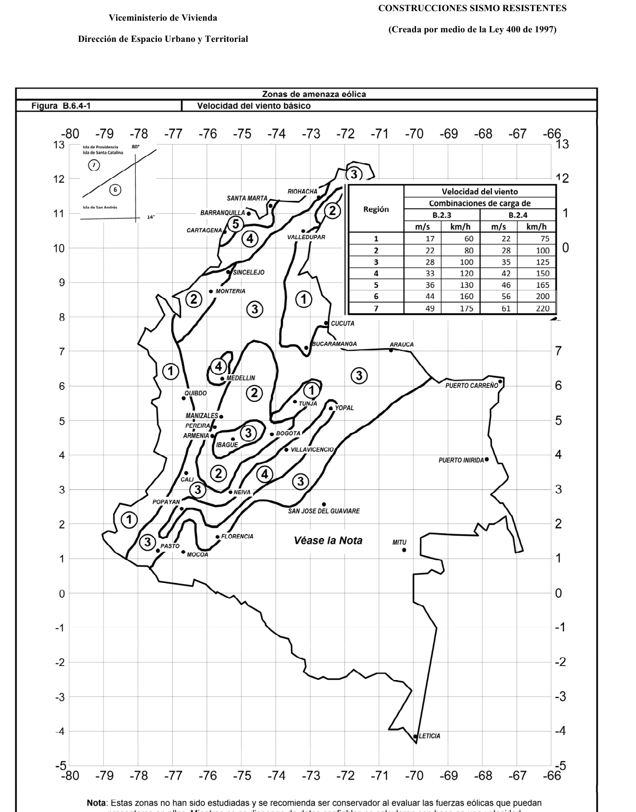

### B.6.5 — MÉTODO 2 - PROCEDIMIENTO ANALÍTICO

#### B.6.5.1 — ALCANCE

Un edificio cuyas cargas de viento de diseño sean determinadas de acuerdo con esta sección deberá cumplir las siguientes condiciones:

(a) El edificio o estructura sea de forma regular como se define en la sección B.6.2.

(b) El edificio o estructura no tiene características de respuesta que den lugar a cargas transversales de viento, generación de vórtices, inestabilidad debida a golpeteo o aleteo y que por su ubicación, tampoco deben merecer consideración especial los efectos de canalización o sacudimiento por la estela producida por las obstrucciones a barlovento.

#### B.6.5.2 — LIMITACIONES

Las especificaciones de la sección B.6.5 consideran el efecto del aumento de cargas producto de la resonancia entre ráfagas y vibraciones en la dirección del viento en edificios flexibles y otras estructuras. Los edificios o estructuras que no cumplan las consideraciones de la sección B.6.5.1 o aquellos que tengan forma irregular o características de respuesta inusuales, deberán ser diseñados usando literatura reconocida que documente esos efectos de las cargas de viento o deberán ser diseñados usando el procedimiento de túnel de viento especificado en la sección B.6.6.

**B.6.5.2.1** — Protección de otras edificaciones — No se harán reducciones de presiones de velocidad producto del apantallamiento de otras estructuras aledañas o producto de las características del terreno.

**B.6.5.2.2** — Revestimientos Permeables — Para determinar las cargas aplicables a revestimientos permeables se usarán las especificaciones de la sección B.6.5 a menos que se demuestre con ensayos aprobados o literatura reconocida que las cargas son menores.

#### B.6.5.3 — PROCEDIMIENTO DE DISEÑO

(a) La velocidad básica de viento $V$ , y el factor de dirección de viento $K_{d}$ se determinarán de acuerdo con la sección B.6.5.4.

(b) El factor de importancia $l$ se determinará de acuerdo con la sección B.6.5.5.

(c) Se determinará para cada dirección de viento una o unas categorías de exposición $K_{z}$ y un coeficiente de exposición para la presión por velocidad $K_{h}$ , de acuerdo con la sección B.6.5.6.

(d) El factor topográfico $K_{zt}$, se determinará de acuerdo con la sección B.6.5.7.

(e) El factor de efecto de ráfaga $G$ o $G_{f}$ , según aplique, se determinará de acuerdo con la sección B.6.5.8.

(f) La clasificación de cerramiento se determinará de acuerdo con la sección B.6.5.9.

(g) El Coeficiente de Presión Interna $GC_{pi}$ se determinará de acuerdo con la sección B.6.5.11.1.

(h) El Coeficiente de Presión Externo $C_{p}$ o $GC_{pf}$ o los Coeficientes de Fuerza $C_{f}$ , según aplique, se determinaran de acuerdo con la sección B.6.5.11.2 o B.6.5.11.3 respectivamente.

(i) La presión por velocidad $q_{z}$ o $q_{h}$ , según aplique, se determinará de acuerdo con la sección B.6.5.10.

(j) La Carga de Viento de Diseño $p$ o $F$ se determinará de acuerdo con las secciones B.6.5.12, B.6.5.13, B.6.5.14 y B.6.5.15, según aplique.

<!-- mod:1-decreto-092-2011-46 -->
> **Modificación — Decreto 092 de 2011** · anexo, p. 12
>
> El literal (c) de B.6.5.3 debe quedar así:
>
> 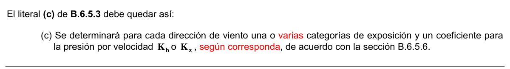

#### B.6.5.4 — VELOCIDAD DE VIENTO BÁSICA

La velocidad de viento básica, $V$ usada en la determinación de las cargas de viento de diseño edificios y otras estructuras se tomará de la Fig. B.6.4-1, excepto con lo especificado en las secciones B.6.5.4.1 y B.6.5.4.2. Se supondrá que el viento proviene de cualquier dirección horizontal.

**B.6.5.4.1** — Regiones Especiales para Viento — La velocidad básica de viento se incrementará donde existan registros o la experiencia indique velocidades de viento mayores que las expresadas en la fig. B.6.4-1.

Terrenos montañosos, precipicios y las regiones especiales de la figura B.6.4-1 se deberán estudiar para determinar si existen condiciones de viento inusuales. La autoridad respectiva ajustará los valores de la fig.

B.6.4-1 para reflejar velocidad de viento locales mayores. Este ajuste se debe hacer basado en información meteorológica y en una estimación de la velocidad básica del viento según las especificaciones de la sección B.6.5.4.2.

**B.6.5.4.2** — Estimación de la Velocidad Básica del Viento a partir de Información Climática Regional — Los datos climáticos regionales se pueden usar en lugar de las velocidades básicas de viento dadas en la figura B.6.4-1 solamente cuando la autoridad competente considere que se han cumplido las siguientes condiciones:

**B.6.5.4.2.1** — Se han utilizado procedimientos estadísticos aprobados para el análisis de valores extremos en el tratamiento de los datos, y

**B.6.5.4.2.2** — Se han tenido en cuenta la longitud de registros, el error de muestreo, el tiempo promedio, la altura del anemómetro, la calidad de los datos y la exposición del terreno.

**B.6.5.4.3** — Limitaciones — Los tornados no se han considerado en los cálculos de la velocidad de viento básica.

**B.6.5.4.4** — Factor de Dirección de Viento — El Factor de Dirección de Viento, $K_{d}$ , se determinará con la tabla B.6.5-4. Este factor solo aplicará cuando se use conjuntamente con las combinaciones de carga especificadas en las secciones B.2.3 y B.2.4.

#### B.6.5.5 — FACTOR DE IMPORTANCIA

El factor de importancia, $I$ , para el edificio u otra estructura debe determinarse de la tabla B.6.5-1. de acuerdo con los grupos de uso presentados en la sección A.2.5

#### B.6.5.6 — EXPOSICIÓN

Para cada dirección de viento considerada, la categoría de exposición a barlovento se determinará con base en la rugosidad del terreno que a su vez es determinada por la topografía natural, la vegetación y las estructuras construidas en éste.

**B.6.5.6.1** — Direcciones de Viento y Sectores — Para cada dirección de viento seleccionada para la evaluación de cargas de viento, se debe determinar la exposición del edificio o la estructura para los dos sectores a barlovento que se extienden a 45o a cada lado de la dirección de viento elegida. Las exposiciones en estos dos sectores se deben determinar de acuerdo con las secciones B.6.5.6.2 y B.6.5.6.3. La exposición que produzca las mayores cargas de viento se usará para representar el viento de esa dirección.

**B.6.5.6.2** — Categorías de Rugosidad de Terreno — Escogiendo entre las categorías de este numeral, se determinará la rugosidad del terreno dentro de cada sector de 45o para una distancia viento arriba como se define en la sección B.6.5.6.3. Esto se hace con el propósito de asignarle al terreno una categoría de exposición como se define en la sección B.6.5.6.3.

Rugosidad de Terreno B — Áreas urbanas y suburbanas, áreas boscosas u otros terrenos con numerosas obstrucciones del tamaño, iguales o mayores al de una vivienda unifamiliar y con poca separación entre ellas.

Rugosidad de Terreno C — Terreno abierto con pocas obstrucciones y con alturas inferiores a 9.0 m. Esta categoría incluye campos planos abiertos, praderas y todas las superficies acuáticas en zonas propensas a huracanes.

Rugosidad de Terreno D — Áreas planas y no obstruidas y superficies acuáticas por fuera de regiones propensas a huracanes. Esta categoría incluye pantanos, salinas y superficies de hielo.

<!-- mod:1-decreto-092-2011-47 -->
> **Modificación — Decreto 092 de 2011** · anexo, p. 12
>
> En B.6.5.6.2 las definiciones de Rugosidad del Terreno C y D deben corregirse así:
>
> Rugosidad de Terreno C — Terreno abierto con pocas obstrucciones y con alturas inferiores a 9.0 m. Esta categoría incluye campos planos abiertos, praderas y todas las superficies acuáticas en zonas propensas a huracanes.
>
> Rugosidad de Terreno D — Áreas planas y no obstruidas y superficies acuáticas por fuera de en regiones propensas a huracanes. Esta categoría incluye pantanos, salinas y superficies de hielo.

**B.6.5.6.3** — Categorías de Exposición Exposición B — La categoría de exposición B aplica cuando la rugosidad del terreno, como se define en Rugosidad de Terreno B, prevalece por una distancia de al menos 800 m o 20 veces la altura del edificio, la que sea mayor, en la dirección al viento.

EXCEPCIÓN — Para edificios cuya altura media sea menor o igual a 9.0 m, la distancia viento arriba puede reducirse a 460 m.

Exposición C — La categoría de exposición C aplicará para todos los casos donde no apliquen las categorías B y D.

Exposición D — La categoría de exposición D aplica cuando la rugosidad del terreno, como se define en Rugosidad de Terreno D, prevalece por una distancia mayor a 1500 m o 20 veces la altura del edificio, la que sea mayor, en la dirección de barlovento. La categoría de exposición D se extenderá hacia las áreas viento abajo de las Rugosidades de Terreno B o C por una distancia de 200 m o 20 veces la altura de la edificación, la que sea mayor.

Para una edificación que se ubique en una zona de transición entre categorías, se usará la categoría que produzca mayores fuerzas de diseño.

EXCEPCIÓN - Se permite usar una categoría de exposición intermedia entre las categorías anteriores en una zona de transición, siempre y cuando esta se determine con un proceso analítico definido en la literatura reconocida.

**B.6.5.6.4** — Categorías de Exposición para el SPRFV

**B.6.5.6.4.1** — Edificios y Otras Estructuras — Las cargas de viento para el diseño del SPRFV determinadas de la fig. B.6.5-3 deberán basarse en las categorías de exposición definidas en la sección B.6.5.6.3., para cada dirección de viento considerada.

**B.6.5.6.4.2** — Edificios Bajos — Las cargas de viento para el diseño del SPRFV de edificios bajos se determinarán usando una presión por velocidad $q_{h}$ basada en la categoría de exposición que produzca las mayores cargas de viento para cualquier dirección de viento donde se usen los coeficientes de presión externa $GC_{pf}$ dados en la fig. B.6.5-7.

**B.6.5.6.5** — Categoría de Exposición para Componentes y Elementos de Revestimiento — Las presiones de diseño para componentes y elementos de revestimiento, en edificios y otras estructuras, deberán basarse en la exposición que de por resultado las mayores cargas de viento en cualquier dirección de viento.

**B.6.5.6.6** — Coeficiente de Exposición de Presión por velocidad — Basado en la categoría de exposición determinada en la sección B.6.5.3, se define de la Tabla B.6.5-3 un coeficiente de exposición de presión por velocidad $K_{z}$ o $K_{h}$ , según aplique. Para una edificación que se ubique en una zona de transición entre categorías de exposición, es decir cerca a un cambio de rugosidad de terreno, se permitirá tomar valores intermedios de $K_{z}$ o $K_{h}$ , siempre y cuando se determinen por medio de un método racional de análisis definido en la literatura reconocida.

#### B.6.5.7 — EFECTOS TOPOGRÁFICOS

**B.6.5.7.1** — Aumento de velocidad sobre Colinas o Escarpes — Se deben incluir en el diseño los efectos de aumento de velocidad del viento sobre colinas aisladas, o escarpes, que constituyan cambios abruptos en la topografía general. Los edificios, las condiciones del sitio y la localización deben cumplir todas las siguientes condiciones:

(a) Que la colina, o escarpe esté aislada y sin obstrucciones en barlovento, por otros accidentes topográficos de altura cercana a 100 veces su altura (100H) o 3 km, la que sea menor. La distancia se debe medir horizontalmente del punto desde el cual la altura H de la loma, colina o escarpe se mide.

(b) Que la colina, o escarpe sobresalga por encima del terreno viento arriba por un factor de 2 o más, dentro de un radio de 3 km.

(c) Que la estructura esté localizada en la mitad superior de la colina o cerca de la cresta del escarpe, como se muestra en la fig. B.6.5-1.

(d) Que $H /L_{h}≥0.2$.

(e) $H$ es mayor o igual a 4.5 m para la Exposición C y D y 18 m para la Exposición B.

**B.6.5.7.2** — Factor Topográfico — El efecto de aumento de velocidad de viento se incluirá en el cálculo de cargas de viento de diseño usando el factor $K_{zt}$:

$$ K_{zt} = (1 + K_1 K_2 K_3)^2 \tag{B.6.5-1} $$

Donde $K_{1}$ , $K_{2}$ y $K_{3}$ se dan en la Fig. B.6.5-1.

Si el sitio o la localización de la estructura no cumple las condiciones especificadas en la sección B.6.5.7.1, entonces $K_{zt}=1.0$.

#### B.6.5.8 — FACTOR DE EFECTO RÁFAGA

**B.6.5.8.1** — Estructuras Rígidas — Para estructuras rígidas como se definen en la sección B.6.2, el factor de efecto ráfaga se tomará como 0.85 o se calculará con la siguiente fórmula:

$$ G = 0.925 \left(\dfrac{1 + 1.7\,g_Q\,I_{\bar{z}}\,Q}{1 + 1.7\,g_v\,I_{\bar{z}}}\right) \tag{B.6.5-2} $$

$$ I_{\bar{z}} = c \left(\dfrac{10}{\bar{z}}\right)^{1/6} \tag{B.6.5-3} $$

Donde $I_{z}$ = la intensidad de turbulencia a la altura $z$ , donde $z$ = la altura equivalente de la estructura definida como $0.6h$ , pero no menor a $z_{min}$ para todas la alturas de edificios $h$ . Para cada exposición $z_{min}$ y $c$ se listan en la tabla B.6.5-2; $g_{Q}$ y $g_{v}$ se tomaran como 3.4. La respuesta del entorno $Q$ se define como:

$$ Q = \sqrt{\dfrac{1}{1 + 0.62 \left(\dfrac{B + h}{L_{\bar{z}}}\right)^{0.63}}} \tag{B.6.5-4} $$

Donde $B$ y $h$ se definen en la sección B.6.3; y $L_{z}$ = longitud integral a escala de la turbulencia (para modelos a escala en túnel de viento). $L_{z}$ está definido por:

$$ L_{\bar{z}} = \ell \left(\dfrac{\bar{z}}{10}\right)^{\bar{\varepsilon}} \tag{B.6.5-5} $$

Donde $A$ y $ε$ son constantes definidas en la tabla B.6.5-2.

**B.6.5.8.2** — Estructuras Flexibles o Dinámicamente Sensibles — Para estructuras flexibles o dinámicamente sensibles como se define en la sección B.6.2, el factor efecto ráfaga se calculará mediante la expresión:

$$ G_f = 0.925 \left(\dfrac{1 + 1.7\,I_{\bar{z}} \sqrt{g_Q^2 Q^2 + g_R^2 R^2}}{1 + 1.7\,g_v\,I_{\bar{z}}}\right) \tag{B.6.5-6} $$

$g_{Q}$ y $gν$ se tomarán como 3.4 y $g_{R}$ se calculará con la siguiente ecuación:

$$ g_R = \sqrt{2 \ln(3600\,n_1)} + \dfrac{0.577}{\sqrt{2 \ln(3600\,n_1)}} \tag{B.6.5-7} $$

$R$ , el factor de respuesta de resonancia se calcula con la siguiente ecuación:

$$ R = \sqrt{\dfrac{1}{\beta}\,R_n R_h R_B\,(0.53 + 0.47\,R_L)} \tag{B.6.5-8} $$

$$ R_n = \dfrac{7.47\,N_1}{(1 + 10.3\,N_1)^{5/3}} \tag{B.6.5-9} $$

$$ N_1 = \dfrac{n_1\,L_{\bar{z}}}{\bar{V}_{\bar{z}}} \tag{B.6.5-10} $$

$$ R_\ell = \dfrac{1}{\eta} - \dfrac{1}{2\eta^2}\left(1 - e^{-2\eta}\right) \quad \text{para } \eta > 0 \tag{B.6.5-11a} $$

para

$$ R_\ell = 1 \quad \text{para } \eta = 0 \tag{B.6.5-11b} $$

para Donde el subíndice $A$ en la ec. B.6-11a se tomará como $h$ , $B$ y $L$ respectivamente donde $h$ , $B$ y $L$ se definen en la sección B.6.3.

$η_{1}$ = Frecuencia natural del edificio

$R_{A}=R_{h}$ tomando $η =4.6n_{1} h /V_{z}$

$R_{A}=R_{B}$ tomando $η =4.6n_{1} EB /V_{z}$

$R_{A}=R_{L}$ tomando $η =15.4n_{1} L /V_{z}$

$β$ = porcentaje de amortiguamiento critico

$V_{z}$ = velocidad de viento promedia por hora a una altura $z$ determinada con la ecuación:

$$ \bar{V}_{\bar{z}} = \bar{b} \left(\dfrac{\bar{z}}{10}\right)^{\bar{\alpha}} V \tag{B.6.5-12} $$

Donde $b$ y $α$ son constantes listadas en la tabla B.6.5-2 y V es la velocidad básica del viento en m/s.

**B.6.5.8.3** — Análisis Racional — En lugar de los procedimientos definidos en las secciones B.6.5.8.1 y B.6.5.8.2, se permite la determinación del factor efecto ráfaga por medio de cualquier método racional definido en literatura reconocida.

<!-- mod:1-decreto-092-2011-48 -->
> **Modificación — Decreto 092 de 2011** · anexo, p. 12
>
> El literal B.6.5.8.3, la segunda definición de la variable RA después de la ecuación B.6.5-11b, debe quedar así:
>
> 

**B.6.5.8.4** — Limitaciones — Donde aparezcan en tablas coeficientes de presión y factores de efecto ráfaga combinados ($GC_{p}$ ,$GC_{pi}$, y $GC_{pf}$), no se calculará el factor efecto ráfaga por separado.

#### B.6.5.9 — CLASIFICACIONES DE LOS CERRAMIENTOS

**B.6.5.9.1** — General — Para efectos de la determinación de coeficientes de presión interna, todos los edificios se deben clasificar como cerrados, parcialmente cerrados o abiertos de acuerdo con la sección B.6.2.

**B.6.5.9.2** — Aberturas — Se deben cuantificar las aberturas en el cerramiento del edificio para determinar la clasificación de cerramiento como se define en la sección B.6.5.9.1.

**B.6.5.9.3** — Zonas propensas a huracanes — Los vidrios de edificios localizados en zonas propensas a huracanes, deberán protegerse con una cobertura resistente a impacto o ser vidrios resistentes a impactos de acuerdo con los requerimientos especificados en las normas ASTM E1886 y ASTM E1996 u otros métodos de ensayo aprobados y criterios de desempeño.

EXCEPCIONES:

(a) Podrán no estar protegidos los vidrios en edificios de categoría II, III o IV localizados a más de 18.0 m por encima del nivel del suelo y a más de 9.0 m sobre cubiertas con superficies de agregado localizados a 450 m al interior del edificio.

(b) Se permiten los vidrios sin protección en edificios de categoría I.

<!-- mod:1-decreto-092-2011-49 -->
> **Modificación — Decreto 092 de 2011** · anexo, p. 12
>
> El primer párrafo del literal B.6.5.9.3 debe quedar así:
>
> **B.6.5.9.3** — Escombros arrastrados por el viento — Los vidrios de edificios localizados en regiones de escombros arrastrados por el viento, deberán protegerse con una cobertura resistente a impacto o ser vidrios resistentes a impactos de acuerdo con los requerimientos especificados en las normas ASTM E1886 y ASTM E 1996 u otros métodos de ensayo aprobados y criterios de desempeño.

<!-- mod:1-decreto-092-2011-50 -->
> **Modificación — Decreto 092 de 2011** · anexo, p. 12
>
> En el literal (a) de B.6.5.9.3 donde dice “... a 450 al interior del edificio...”, debe ser “... a 450 m al alrededor del edificio...”.

**B.6.5.9.4** — Clasificaciones Múltiples — Si por definición un edificio cumple con los parámetros de edificio “abierto” y “parcialmente cerrado”, se clasificará como un edificio “abierto”. Un edificio que no cumpla con las definiciones de edificio “abierto” o “parcialmente cerrado” se clasificará como un edificio “cerrado”.

#### B.6.5.10 — PRESIÓN POR VELOCIDAD

La presión por velocidad, $q_{z}$ , evaluada a la altura $z$ se calculará con la siguiente expresión:

$$ q_z = 0.613\,K_z K_{zt} K_d V^2 I \quad \text{en (N/m}^2\text{); } V \text{ en m/s} \tag{B.6.5-13} $$

en (N/m2); $V$ en m/s Donde $K_{d}$ es el factor de dirección de viento definido en la sección B.6.5.4.4, $K_{z}$ es coeficiente de exposición de presión por velocidad definido en la sección B.6.5.6.6, $K_{zt}$ es el factor topográfico definido en la sección B.6.5.7.2 y $q_{h}$ es la presión por velocidad calculada usando la ecuación B.6.5-13 a la altura media de la cubierta, $h$ .

El coeficiente numérico 0.613 se usará siempre que no haya suficientes registros climáticos para justificar la selección de otro valor.

#### B.6.5.11 — COEFICIENTES DE PRESIÓN Y FUERZA

**B.6.5.11.1** — Coeficiente de Presión Interna — Los coeficientes de presión interna, $GC_{pi}$, se determinarán de la Figura B.6.5-2 basados en la clasificación de cerramientos determinada en la sección B.6.5.9.

**B.6.5.11.1.1** — Factor de Reducción para edificios de gran volumen, $R_{i}$ — Para un edificio parcialmente cerrado que contenga un solo espacio sin particiones, el coeficiente de presión interna, $GC_{pi}$, se multiplicará por el siguiente factor de reducción, $R_{i}$ :

$$ R_i = 1.0 \quad \text{o} \quad R_i = 0.5 \left(1 + \dfrac{1}{\sqrt{1 + \dfrac{V_i}{11000\,A_{og}}}}\right) \le 1.0 \tag{B.6.5-14} $$

o Donde:

$A_{og}$= área total de aberturas en el cerramiento del edificio (paredes y cubiertas, en m2)

$V_{i}$ = volumen interno sin particiones, en m3

**B.6.5.11.2** — Coeficientes de Presión Externa

**B.6.5.11.2.1** — Sistemas Principales de Resistencia a Fuerzas de Viento — Los coeficientes de presión externa, $C_{p}$ , para los Sistemas Principales de Resistencia de Fuerzas de Viento (SPRFV) se dan en las figs. B.6.5-3, B.6.5-4 y B.6.5-5. Las combinaciones entre coeficientes de presión externa y factores de efecto de ráfaga, $GP_{pf}$ para edificios bajos se dan en la fig. B.6.5-7. Los coeficientes de presión y factores de efecto ráfaga de la Fig. B.6.5-7 no se deberán tomar por separado.

**B.6.5.11.2.2** — Revestimiento y Componentes — Las combinaciones entre coeficientes de presión externa y los factores de efecto de ráfaga, $GC_{p}$ , para elementos de revestimiento y componentes se dan en las figs. B.6.5-8A a B.6.5-14. Los coeficientes de presión y factores de efecto ráfaga de la fig.

B.6.5-7 no se deberán tomar por separado.

**B.6.5.11.3** — Coeficientes de Fuerza — En las figs. B.6.5-17 a B.6.5-19 se dan coeficientes de fuerza, $C_{f}$ .

**B.6.5.11.4** — Cornisas de cubiertas

**B.6.5.11.4.1** — Sistemas Principales de Resistencia a Fuerzas de Viento — Los aleros a barlovento de las cubiertas se diseñarán con una presión positiva en la cara inferior, producto del coeficiente $C_{p}=0.8$ y las presiones determinadas usando las figs. B.6.5-3 y B.6.5-5.

**B.6.5.11.4.2** — Revestimiento y Componentes — Los aleros deben diseñarse para presiones determinadas a partir de los coeficientes de presión dados en las figs. B.5.6-8B, C y D.

**B.6.5.11.5** — Parapetos

**B.6.5.11.5.1** — Sistemas Principales de Resistencia a Fuerzas de Viento — Los coeficientes de presión para el efecto de parapetos en las cargas del SPRFV se dan en la sección B.6.5.12.2.4.

**B.6.5.11.5.2** — Revestimiento y Componentes — Los coeficientes de presión para el diseño de elementos de revestimiento y componentes de parapetos se toman de las tablas de coeficientes de presión de cubiertas y paredes como se especifica en la sección B.6.5.12.4.4.

#### B.6.5.12 — FUERZAS DE VIENTO DE DISEÑO EN EDIFICIOS CERRADOS O PARCIALMENTE CERRADOS

**B.6.5.12.1** — General

**B.6.5.12.1.1** — Convención de Signos — Las presiones positivas actúan hacia la superficie en estudio y las presiones negativas actúan hacia afuera de la superficie en estudio.

**B.6.5.12.1.2** — Condición de Carga Crítica — Los valores de presiones internas y externas se combinarán en forma algebraica para determinar el caso de carga mas crítico.

**B.6.5.12.1.3** — Áreas Aferentes Mayores de 65 m2 — Los elementos de revestimiento y componentes que tengan un área aferente mayor a 65 m2 se podrán diseñar usando las especificaciones de los SPRFV.

**B.6.5.12.2** — Sistemas Principales de Resistencia de Fuerzas de Viento

**B.6.5.12.2.1** — Edificios Rígidos de Cualquier Altura — Las presiones de viento de diseño para el SPRFV de edificios se determinarán mediante la ecuación:

$$ p = q\,G C_p - q_i\,(G C_{pi}) \quad (\mathrm{N/m^2}) \tag{B.6.5-15} $$

(N/m2) Donde:

$q_{=}q_{z}$ para paredes a barlovento evaluadas a una altura $z$ por encima del terreno.

$q_{=}q_{h}$ para paredes a sotavento, paredes de costado y cubiertas, evaluados a una altura $h$ .

$q_{i}=q_{h}$ para paredes a barlovento, paredes de costado, paredes a sotavento y cubiertas de edificios cerrados y para la evaluación de presiones internas negativas en edificios parcialmente cerrados.

$q_{i}=q_{z}$ para la evaluación de presiones internas positivas en edificios parcialmente cerrados, donde $z$ es el nivel de la abertura más elevada del edificio que podría afectar la presión interna positiva.

Para edificios ubicados regiones en las que se pueda dar el arrastre de fragmentos por el viento, los vidrios en los 20 m inferiores que no sean resistentes al impacto o que no estén protegidos con un elemento resistente al impacto, deberán tratarse como una abertura en el edificio de acuerdo con la sección B.6.5.9.3. Para la evaluación de la presión interna positiva, $q_{i}$ se puede evaluar en forma conservadora a la altura $h (q_{i}=q_{h})$.

$G$ = factor de efecto ráfaga de la sección B.6.5.8

$C_{P}$= coeficientes de presión externa de las Figs. B.6.5-3 o B.6.5-5.

$GC_{pi}$ = coeficientes de presión interna de la Fig. B.6.5-2 $q$ y $q_{i}$ se evaluarán usando la exposición definida en la sección B.6.5.6.3. Las presiones se aplicarán simultáneamente en paredes a barlovento y sotavento y en cubiertas como se define en la Fig. B.6.5-3 y B.6.5-5.

**B.6.5.12.2.2** — Edificios Bajos — Alternativamente, las presiones de viento de diseño para el SPRFV en edificios bajos se determinarán mediante la ecuación:

$$ p = q_h \left[(G C_{pf}) - (G C_{pi})\right] \quad \text{en } (\mathrm{N/m^2}) \tag{B.6.5-16} $$

Donde:

$q_{h}$ = presión por velocidad evaluada a la altura media de la cubierta, $h$ usando la exposición definida en la sección B.6.5.6.3

$GC_{pf}$ = coeficientes de presión externa de la Fig. B.6.5-7

$GC_{pi}$ = coeficientes de presión interna de la Fig. B.6.5-2

**B.6.5.12.2.3** — Edificios Flexibles — Las presiones de viento de diseño para el Sistemas Principales de Resistencia de Fuerzas de Viento en edificios flexibles se determinarán con la ecuación:

$$ p = q\,G_f C_p - q_i\,(G C_{pi}) \quad \text{en } (\mathrm{N/m^2}) \tag{B.6.5-17} $$

en (N/m2) Donde $q$ , $q_{i}$ y $q (GC_{pi})$ se definen en la sección 6.5.12.2.1 y $G_{f}$ es igual al factor de efecto ráfaga como se define en la sección B.6.5.8.2.

**B.6.5.12.2.4** — Parapetos — Las presiones de viento de diseño que toman en cuenta el efecto de parapetos en el SPRFV de edificios rígidos, bajos o flexibles con cubiertas planas, a dos aguas o a cuatro aguas, se determinarán con la ecuación:

$$ p_p = q_p\,G C_{pn} \quad \text{en } (\mathrm{N/m}) \tag{B.6.5-18} $$

en (N/m) Donde:

$p_{p}$ = presión neta combinada en el parapeto producto de la combinación de las presiones netas en las superficies anterior y posterior del parapeto. Los signos positivo (y negativo) significan presiones netas actuando hacia el frente del parapeto (y hacia afuera del exterior del mismo).

$q_{p}$ = presión por velocidad evaluada en la parte más alta del parapeto

$GC_{pn}$ = Coeficiente de presión neta combinada = +1.5 para parapeto a barlovento = -1.0 para parapeto a sotavento

**B.6.5.12.3** — Casos de Carga de Viento de Diseño — El SPRFV de edificios de cualquier altura, cuyas cargas de viento se hayan determinado bajo las especificaciones de las secciones B.6.5.12.2.1 y B.6.5.12.2.3, se deberán diseñar teniendo en cuenta los casos de carga definidos en la fig. B.6.5-6. La excentricidad e para estructuras rígidas se medirá desde el centro geométrico de la cara del edificio en cada eje $(e_{x} , e_{y})$. La excentricidad e para estructuras flexibles se determinará mediante la siguiente ecuación y se considerará para cada eje principal $(e_{x} , e_{y})$:

$$ e = \dfrac{e_Q + 1.7\,I_{\bar{z}} \sqrt{(g_Q Q e_Q)^2 + (g_R R e_R)^2}}{1 + 1.7\,I_{\bar{z}} \sqrt{(g_Q Q)^2 + (g_R R)^2}} \tag{B.6.5-19} $$

Donde:

$e_{Q}$= excentricidad e para estructuras rígidas según la fig. B.6.5-6

$e_{R}$= distancia entre el centro de cortante elástico y el centro de masa para cada piso $I_{z}$ , $g_{Q}$, $Q$ , $g_{R}$ y $R$ se definen de acuerdo con la sección B.6.5.8.

La excentricidad e será positiva o negativa, la que produzca el efecto de carga más severo.

EXCEPCIÓN — Los edificios de un piso de altura con $h$ menor de 9.0 m, edificios de dos pisos o menos con pórticos de construcción liviana y edificios de dos pisos o menos diseñados con diafragmas flexibles, se pueden diseñar solamente con los casos de carga 1 y 3 de la fig. B.6.5-6.

**B.6.5.12.4** — Elementos de Revestimiento y Componentes

**B.6.5.12.4.1** — Edificios Bajos y Edificios con $h_{<}18.0$ m — Las presiones de viento de diseño para elementos de revestimiento y componentes de edificios bajos y edificios con $h_{≤}18.0$ m, se determinarán con la expresión:

$$ p = q_h \left[(G C_p) - (G C_{pi})\right] \quad \text{en } (\mathrm{N/m^2}) \tag{B.6.5-20} $$

Donde:

$q_{h}$ = presión por velocidad evaluada a la altura media del edificio, $h$ , usando la exposición definida en la sección B.6.5.6.3

$(GC_{p})$ = coeficientes de presión externa especificados en de las figs. B.6.5-8 a B.6.5-13

$(GC_{pi})$ = coeficiente de presión interna de la Fig. B.6.5-2

**B.6.5.12.4.2** — Edificios con $h_{>}18.0$ m — Las presiones de viento de diseño para elementos de revestimiento y componentes de edificios con $h_{>}18.0$ m, se determinarán con la ecuación:

$$ p = q\,(G C_p) - q_i\,(G C_{pi}) \quad \text{en } (\mathrm{N/m^2}) \tag{B.6.5-21} $$

en (N/m2) Donde:

$q_{=}q_{z}$ para muros a barlovento evaluada a una altura $z$ por encima del terreno.

$q_{=}q_{h}$ para muros a sotavento, muros laterales y cubiertas, evaluada a una altura $h$ .

$q_{i}=q_{h}$ para muros a barlovento, muros laterales, muros a sotavento y cubiertas de edificios cerrados y para la evaluación de presiones internas negativas en edificios parcialmente cerrados.

$q_{i}=q_{z}$ para la evaluación de presiones internas positivas en edificios parcialmente cerrados, donde $z$ es el nivel de la abertura más alta que podría afectar la presión interna positiva del edificio. Para edificios ubicados en regiones en las que el viento pueda arrastrar fragmentos, los vidrios que no sean resistentes al impacto o que no estén protegidos con un elemento resistente al impacto, deberán tratarse como una abertura en el edificio de acuerdo con la sección B.6.5.9.3. Para la evaluación de la presión interna positiva, $q_{i}$ se puede evaluar a la altura $h (q_{i}=q_{h})$.

$(GC_{p})$ = coeficiente de presión externa de la Fig. B.6.5-14.

$(GC_{pi})$ = coeficiente de presión interna de la Fig. B.6.5-2.

$q$ y $q_{i}$ se evaluaran usando la exposición definida en la sección B.6.5.6.3.

**B.6.5.12.4.3** — Presiones de Viento de Diseño Alternativas para Elementos de Revestimiento y Componentes en Edificios con 18.0 m < h < 27 m — Como alternativa a los requerimientos de la sección B.6.5.12.4.2, el diseño de elementos de revestimiento y componentes de edificios con una altura media mayor a 18.0 y menor de 27 m, se podrán usar los valores de las figs. B.6.5-8 a B.6.5- 14, con la condición que la relación altura ancho sea 1 o menor de 1 (excepto en los casos permitidos por la Nota 6 de la fig. B.6.5-14), y si se usa la ecuación B.6.5-20.

**B.6.5.12.4.4** — Parapetos — Las presiones de vientos de diseño sobre elementos de revestimiento y componentes de parapetos se diseñarán con la ecuación:

$$ p = q_p\,(G C_p - G C_{pi}) \tag{B.6.5-22} $$

Donde:

$q_{p}$ = presión por velocidad evaluada en la parte superior del parapeto

$GC_{p}$ = coeficiente de presión externa de las figs. B.6.5-8 a B.6.5-14.

$GC_{pi}$= coeficiente de presión interna de la fig. B.6.5-2, basado en la porosidad del revestimiento del parapeto.

Se considerarán dos casos de carga. Caso de Carga A: consiste en aplicar la presión positiva sobre muros de la fig. B.6.5-8A o de la fig. B.6.5-14 a la superficie frontal del parapeto mientras se aplica la respectiva presión negativa de borde o de zona esquinera de las figs. B.6.5-8 a B.6.5-14 a la superficie posterior. Caso de Carga B: consiste en aplicar la presión positiva sobre muros de las figs.

B.6.5-8A o la fig. B.6.5-14 a la superficie posterior del parapeto y la presión negativa sobre muros de las figs. B.6.5-8A o la Fig. B.6.5-14 a la superficie frontal del parapeto. Las zonas esquineras y bordes se tomarán de acuerdo con lo mostrado en las figs. B.6.5-8 a B.6.5-14. $GC_{p}$ se determinará para el ángulo de cubierta apropiado y el área de viento efectiva de las figs. B.6-11 a B.6-17. Si se presentase presión interna, se deberán evaluar ambos casos de carga bajo presiones internas negativas y positivas.

#### B.6.5.13 — CARGAS DE VIENTO DE DISEÑO EN EDIFICIOS ABIERTOS CON CUBIERTAS A UNA, DOS Y

AGUAS Y EN ARTESA

**B.6.5.13.1** — General

**B.6.5.13.1.1** — Convención de Signos — Las presiones positivas actúan hacia la superficie en estudio y las presiones negativas actúan hacia afuera de la superficie en estudio.

**B.6.5.13.1.2** — Condición de Carga Crítica — Los coeficientes de presión neta $C_{N}$ incluyen los aportes de las superficies superiores e inferiores. Se deben investigar todos los casos de carga mostrados para cada ángulo de cubierta.

**B.6.5.13.2** — Sistemas Principales de Resistencia a Fuerzas de Viento — La presión de diseño neta para el SPRFV en cubiertas a una, dos aguas o cubiertas en artesa, se determinará por medio de la ecuación:

$$ p = q_h\,G C_N \tag{B.6.5-23} $$

$q_{h}$ = presión por velocidad evaluada a la altura promedio del cubierta, $h$ , usando la exposición, definida en la sección B.6.5.6.3, que resulte en las mayores cargas de viento para cualquier dirección de viento del sitio.

$G$ = factor de efecto ráfaga de la sección B.6.5.8.

$C_{N}$ = coeficiente de presión neta determinado de las figs. B.6.5-15A a B.6.5-15D.

Para cubiertas libres con un ángulo $θ$ menor o igual a 5o, que contengan paneles de fascia, estos se considerarán como un parapeto invertido. El aporte de cargas al SPRFV por parte de la fascia, se determinará usando la sección B.6.5.12.2.4 con $q_{p}$ igual a $q_{h}$ .

**B.6.5.13.3** — Elementos de Revestimiento y Componentes — La presión neta de diseño para elementos de revestimiento y los componentes de cubiertas a una o dos aguas o en artesa se determinará con la ecuación:

$$ p = q_h\,G C_N \tag{B.6.5-24} $$

Donde:

$q_{h}$ = presión por velocidad evaluada a la altura promedio del cubierta, $h$ , usando la exposición, definida en la sección B.6.5.6.3, que resulte en las mayores cargas de viento para cualquier dirección de viento del sitio.

$G$ = factor de efecto ráfaga de la Sección B.6.5.8.

$C_{N}$ = coeficiente de presión neta determinado de las figs. B.6.5-16A a B.6.5-16C.

#### B.6.5.14 — CARGAS DE VIENTO DE DISEÑO EN MUROS LIBRES Y VALLAS MACIZAS

La fuerza de viento de diseño para muros libres y vallas macizas se determinará con la ecuación:

$$ F = q_h\,G C_f A_s \quad \text{en (N)} \tag{B.6.5-25} $$

en (N) Donde:

$q_{h}$ = presión por velocidad evaluada a la altura $h$ (definida en la fig. B.6.5-17), usando la exposición, definida en la sección B.6.5.6.4.1.

$G$ = factor de efecto ráfaga de la sección B.6.5.8.

$C_{f}$ = coeficiente de fuerza neta de la fig. B.6.5-17.

$A_{s}$ = área bruta del muro libre y sólido o la valla sólida, en m2.

#### B.6.5.15 — CARGAS DE VIENTO DE DISEÑO EN OTRAS ESTRUCTURAS

La fuerza de viento de diseño para otras estructuras se determinará con la expresión:

$$ F = q_z\,G C_f A_f \quad \text{en (N)} \tag{B.6.5-26} $$

en (N) Donde:

$q_{z}$ = presión por velocidad evaluada a la altura $z$ del centroide del área $A_{f}$ , usando la exposición, definida en la sección B.6.5.6.3.

$G$ = factor de efecto ráfaga de la sección B.6.5.8.

$C_{f}$ = coeficientes de fuerza de las Figs. B.6.5-18 a B.6.5-19.

$A_{f} s$ = área proyectada normal al viento, excepto donde $C_{f}$ se haya especificado para la superficie real, en m2.

**B.6.5.15.1** — Estructuras y Equipos sobre Cubiertas en Edificios con $h_{≤}18.0$ m — La fuerza en estructuras y equipos sobre cubiertas, que tengan $A_{f}$ menor de $(0.1Bh )$, localizados en edificios con $h_{≤}18.0$ m, se determinará con la Ec. B.6-38, multiplicada por un factor de 1.9. Este factor se podrá reducir linealmente desde 1.9 hasta 1.0 a medida que el valor de $A_{f}$ se aumenta de $(0.1Bh)$ a $(Bh )$.

<!-- mod:1-decreto-092-2011-52 -->
> **Modificación — Decreto 092 de 2011** · anexo, p. 12
>
> En la figura B.6.5-3 en la gráfica longitudinal, la pared marcada como B debe ser C y en el diagrama localizado en el centro con el título “Cubiertas de pendiente única”, se debe incluir el símbolo que indica que la medida de la altura h corresponde al centro de la luz de la cubierta, como se indica a continuación:
>
> 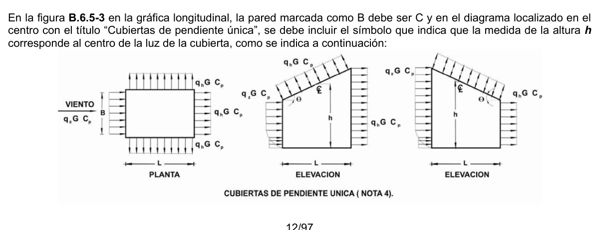
>
> 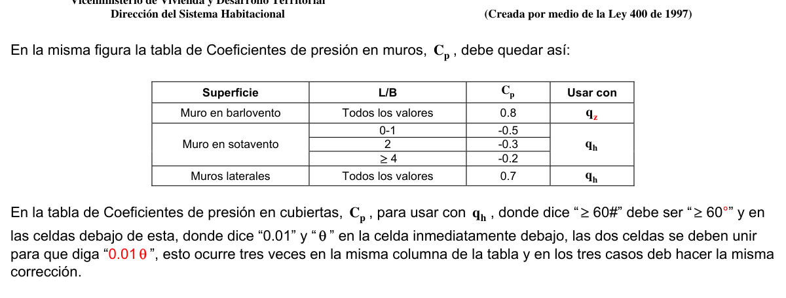

<!-- mod:1-decreto-092-2011-53 -->
> **Modificación — Decreto 092 de 2011** · anexo, p. 13
>
> La Figura B.6.5-4 debe quedar como se indica a continuación:
>
> 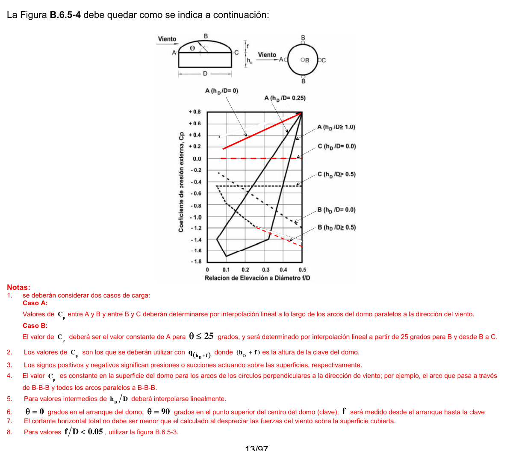

<!-- mod:1-decreto-092-2011-54 -->
> **Modificación — Decreto 092 de 2011** · anexo, p. 14
>
> En la Figura B.6.5-5 deben hacerse las siguientes correcciones:
>
> 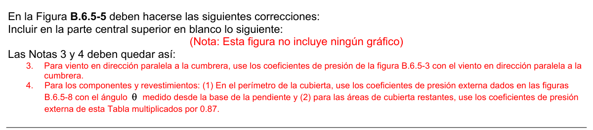

<!-- mod:1-decreto-092-2011-55 -->
> **Modificación — Decreto 092 de 2011** · anexo, p. 14
>
> En la nota 7. de la Figura B.6.5-7, debe quitarse la M que aparece debajo del 7., donde dice “use” debe decir “usar”, y donde dice “localice” debe ser “localizar”.

<!-- mod:1-decreto-092-2011-56 -->
> **Modificación — Decreto 092 de 2011** · anexo, p. 14
>
> En la nota 5. de la Figura B.6.5-8B donde dice “... los valores positivos de GC en la zona 2 y 4 deberán...” debe ser p ““... los valores positivos de GC en la zona 2 y 3 deberán...”.
>
> 

<!-- mod:1-decreto-092-2011-61 -->
> **Modificación — Decreto 092 de 2011** · anexo, p. 15
>
> En la Figura B.6.5-15A se debe reemplazar la tabla de valores por la siguiente tabla:
>
> 
>
> 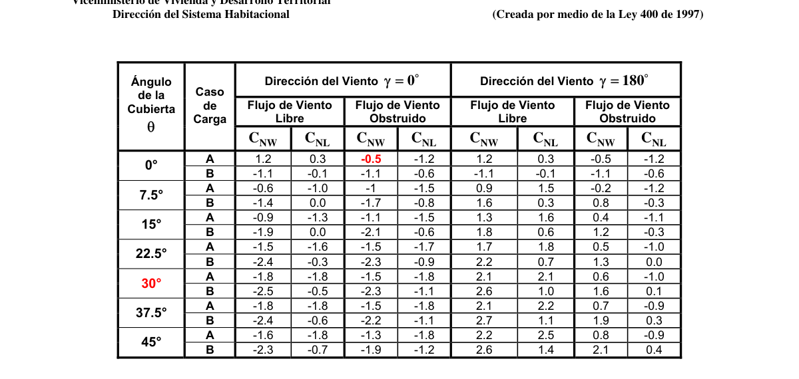

<!-- mod:1-decreto-092-2011-62 -->
> **Modificación — Decreto 092 de 2011** · anexo, p. 16
>
> En la Figura B.6.5-16A se debe reemplazar el gráfico por el siguiente gráfico:

<!-- mod:1-decreto-092-2011-63 -->
> **Modificación — Decreto 092 de 2011** · anexo, p. 16
>
> En la Figura B.6.5-16A se debe reemplazar la tabla de valores por la siguiente tabla:
>
> 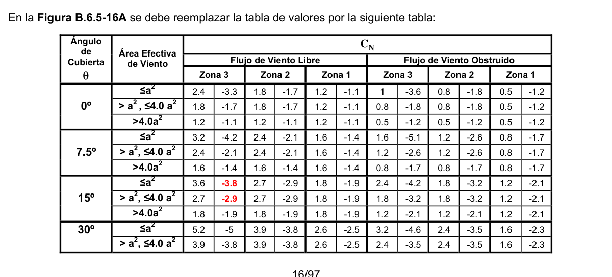
>
> 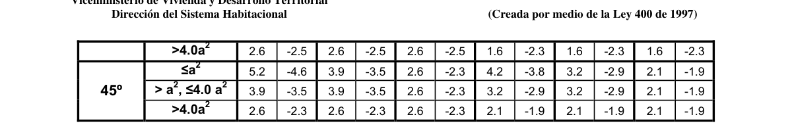

<!-- mod:1-decreto-092-2011-64 -->
> **Modificación — Decreto 092 de 2011** · anexo, p. 17
>
> En la Figura B.6.5-16C se debe reemplazar la tabla de valores por la siguiente tabla:
>
> 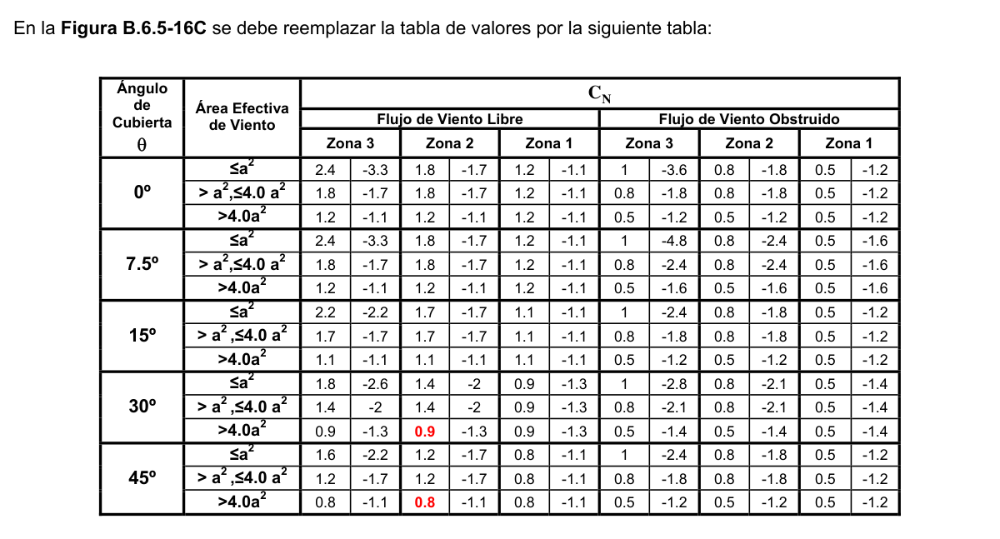

### B.6.6 — MÉTODO 3

PROCEDIMIENTO DE TÚNEL DE VIENTO

#### B.6.6.1 — ALCANCE

Los ensayos de túnel de viento deben ser usados donde sea requerido de acuerdo con la sección B.6.5.2. Estos ensayos deben permitirse en lugar de los Métodos 1 y 2 para cualquier edificio o estructura.

#### B.6.6.2 — CONDICIONES DE ENSAYOS

Los ensayos de túnel de viento que empleen fluidos diferentes al aire para determinar las cargas de diseño de viento para cualquier edificio u otra estructura, deben ser realizados de acuerdo con los requisitos de esta sección. Los ensayos para determinar las variaciones y el promedio de las fuerzas y presiones deben reunir las siguientes condiciones:

**B.6.6.2.1** — La capa de borde para la atmósfera natural se ha modelado teniendo en cuenta la variación de la velocidad del viento con la altura.

**B.6.6.2.2** — Las escalas relevantes de macro y micro-longitud de la componente longitudinal de la turbulencia atmosférica se modelan aproximadamente a la misma escala que se ha usado para modelar el edificio o la estructura.

**B.6.6.2.3** — El edificio u otra estructura modelada y las estructuras y topografía de los alrededores son geométricamente similares a sus contrapartes de escala natural, excepto que, para edificios bajos que reúnen las condiciones de la sección B.6.5.1, los ensayos deben ser permitidos para los edificios escalados en una sola categoría de exposición como se define en la sección B.6.5.6.3.

**B.6.6.2.4** — El área proyectada del edificio u otra estructura modelada y sus alrededores es menor que el 8% del área de la sección transversal de ensayo a menos que se haga una corrección por bloqueo.

**B.6.6.2.5** — El gradiente de presión longitudinal en la sección de ensayo del túnel de viento debe ser considerado.

**B.6.6.2.6** — Los efectos del número de Reynolds sobre las presiones y fuerzas se minimizan.

**B.6.6.2.7** — Las características de respuesta de la instrumentación del túnel de viento son consistentes con las mediciones requeridas.

#### B.6.6.3 — RESPUESTA DINÁMICA

Los ensayos con el propósito de determinar la respuesta dinámica del edificio o de otra estructura deben estar de acuerdo con la sección B.6.6.2. El modelo estructural y el análisis respectivo deben tener en cuenta la distribución de masa, la rigidez y el amortiguamiento.

#### B.6.6.4 — LIMITACIONES

**B.6.6.4.1** — Limitaciones en velocidades de viento —La variación de velocidades básicas de viento con la dirección no se deben permitir a menos que el análisis para velocidades de viento este de acuerdo a los requisitos de la sección B.6.5.4.2

| Zonas de amenaza eólica |  |
|---|---|
| Figura B.6.4-1 | Velocidad del viento básico |
| -80-79-78-77-76-75-74-73-72-71-70-69-68-67-66 1313 -82 514 12 SAN ANDRES YPROVIDENCIA312 RIOHACHA SANTA MARTA 11 BARRANQUILLA2Región Velocidad del Viento 11 CARTAGENA 51 17 m/s (60 km/h) 104 VALLEDUPAR2 22 m/s (80 km/h) 10 3 28 m/s (100 km/h) SINCELEJO4 33 m/s (120 km/h) 95 36 m/s (130 km/h) 9 MONTERIA 21 3 8 CUCUTA8 7 BUCARAMANGA ARAUCA 7 14 MEDELLIN3 6 QUIBDO21 PUERTO CARREÑO6 TUNJA YOPAL 5 PEREIRA MANIZALES5 ARMENIA3 BOGOTA IBAGUE 4 VILLAVICENCIO PUERTO INIRIDA4 CALI 24 3 33 NEIVA3 POPAYAN SAN JOSE DEL GUAVIARE 212 3 PASTO FLORENCIA Véase la Nota MITU 1 MOCOA1 00 -1-1 -2-2 -3-3 -4 LETICIA -4 -5-5 -80-79-78-77-76-75-74-73-72-71-70-69-68-67-66 Nota: estas zonas no han sido estudiadas y se recomienda ser conservador al evaluar las fuerzas eólicas que puedan Presentarse en ellas. Mientras no se disponga de datos confiables se calcularan con base en una velocidad de 28 m/s (100 km/h). |  |

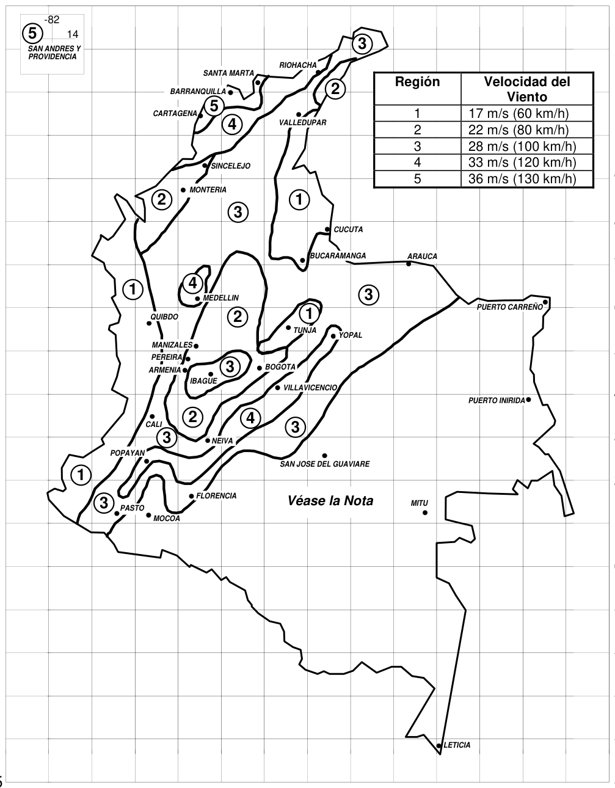

| Sistema Principal de Resistencia de Fuerza de Viento ( SPRFV) – Método 1 |  | $h≤18.0$ m |
|---|---|---|
| Figura B.6.4-2 | Presiones de Viento de Diseño | Muros y Cubiertas |
| Edificios Cerrados |  |  |
| Notas: 1. Las presiones mostradas se aplican a las proyecciones verticales y horizontales para la categoría de exposición B, a una altura $h=10.0$m, $I=1.0$ y $K_{zt}=1.0$. Para ajustar a otras condiciones se debe usar la Ecuación B.6.4-1. 2. Los patrones de carga mostrados deben aplicarse a cada esquina del edificio y se tomara cada una como la esquina de referencia (Véase Figura B 6.5-7). 3. Para el diseño del SPRFV longitudinal use $θ =0^{D}$ , y localice la zona de borde $E /F$ , $G /H$ a la mitad de longitud del edificio. 4. Los casos de carga 1 y 2 deben verificarse para $25^{D}< θ ≤45^{D}$ . Se da el caso de carga $2$ a $25^{D}$ solo para interpolaciones entre $25^{D}$ y $30^{D}$ . 5. Los signos positivo y negativo significan presiones y succiones actuando sobre las superficies respectivamente. 6. Se permite interpolación lineal para pendientes diferentes a las mostradas. 7. La carga total horizontal no será menor de la determinada suponiendo $p_{s}=0$ en las zonas B y D. 8. Las zonas de presión representan lo siguiente: Zonas Horizontales de Presión – Suma de las presiones netas (internas y externas) a barlovento y sotavento, en la proyección vertical de: A – Zona final del muro C – Zona interior del muro B – Zona final de la cubierta D – Zona interior de la cubierta Zonas Verticales de Presión – Suma de las presiones netas (internas y externas), en la proyección horizontal de: E – Zona final de cubierta a barlovento G – Zona interior de cubierta a barlovento F – Zona final de cubierta a sotavento H – Zona interior de cubierta a sotavento 9. Cuando las zonas E o G se ubiquen en el alero del lado a sotavento del edificio, se debe usar $E_{OH}$ y $G_{OH}$ para la presión en la proyección horizontal del alero. La presión de los aleros en el lado a sotavento y en los costados será la presión básica de la zona. 10. Notación: $a$ : 10% de la menor dimensión horizontal o $0.4h$ , la que sea menor. No debe ser menor al 4% de la menor dimensión horizontal o 0.9m. $h$ : altura media de la cubierta en metros. Cuando $θ ≤10^{D}$ , se usara la altura hasta el alero. $θ$ : Angulo de inclinación de la cubierta, en grados. |  |  |

| Sistema Principal de Resistencia de Fuerzas de Viento – Método 1 |  | $h≤18.0$ m |
|---|---|---|
| Figura B.6.4-2 ( Continuación) | Presiones de Viento de Diseño | Muros y Cubiertas |
| Edificios Cerrados |  |  |
| Procedimiento Simplificado: Presión Básica de Viento, $p_{s10}$ (kN/m2) (Exposición B a una altura $h=10.0$ m, $K_{zt}=1.0$, con $I=1.0$) Viento m/s Velocidad Básica de (km/h) Inclinación de la Angulo de (grados) cubierta Caso de Carga A Presiones Horizontales B C D E Zonas Presiones Verticales F G H EOHAleros GOH 0 a 5 1 0.11 -0.05 0.07 -0.03 -0.13 -0.07 -0.09 -0.06 -0.18 -0.14 10 1 0.12 -0.05 0.08 -0.03 -0.13 -0.08 -0.09 -0.06 -0.18 -0.14 17 15 1 0.13 -0.04 0.09 -0.02 -0.13 -0.08 -0.09 -0.06 -0.18 -0.14 20 1 0.15 -0.04 0.10 -0.02 -0.13 -0.09 -0.09 -0.07 -0.18 -0.14 (60) 25 2 1 0.13 ---- 0.02 ---- 0.10 ---- 0.02 ---- -0.06 -0.02 -0.08 -0.04 -0.04 -0.01 -0.03 -0.06 -0.11 ---- -0.09 ---- 1 0.12 0.08 0.09 0.06 0.01 -0.07 0.00 -0.06 -0.04 -0.05 30 a 45 2 0.12 0.08 0.09 0.06 0.05 -0.04 0.04 -0.03 -0.04 -0.05 0 a 5 1 0.19 -0.10 0.12 -0.06 -0.23 -0.13 -0.16 -0.10 -0.32 -0.25 10 1 0.21 -0.09 0.14 -0.05 -0.23 -0.14 -0.16 -0.11 -0.32 -0.25 22 15 1 0.24 -0.08 0.16 -0.04 -0.23 -0.15 -0.16 -0.11 -0.32 -0.25 20 1 0.26 -0.07 0.17 -0.04 -0.23 -0.16 -0.16 -0.12 -0.32 -0.25 (80) 25 1 2 0.24 ---- 0.04 --- 0.17 --- 0.04 --- -0.10 -0.04 -0.14 -0.08 -0.08 -0.01 -0.11 -0.05 -0.19 --- -0.17 --- 30 a 45 1 0.21 0.14 0.17 0.11 0.02 -0.13 0.00 -0.11 -0.07 -0.09 2 0.21 0.14 0.17 0.11 0.08 -0.06 0.07 -0.05 -0.07 -0.09 0 a 5 1 0.29 -0.15 0.19 -0.09 -0.35 -0.20 -0.25 -0.16 -0.49 -0.39 10 1 0.33 -0.14 0.22 -0.08 -0.35 -0.21 -0.25 -0.17 -0.49 -0.39 28 15 1 0.37 -0.12 0.25 -0.07 -0.35 -0.23 -0.25 -0.18 -0.49 -0.39 20 1 0.41 -0.11 0.27 -0.06 -0.35 -0.25 -0.25 -0.19 -0.49 -0.39 1 0.37 0.06 0.27 0.06 -0.16 -0.22 -0.12 -0.18 -0.30 -0.26 (100) 25 2 ---- ---- ---- ---- -0.06 -0.12 -0.02 -0.08 ---- --- 1 0.33 0.23 0.26 0.18 0.03 -0.20 0.01 -0.17 -0.12 -0.13 30 a 45 2 0.33 0.23 0.26 0.18 0.13 -0.10 0.11 -0.07 -0.12 -0.13 0 a 5 1 0.42 -0.22 0.28 -0.13 -0.51 -0.29 -0.35 -0.22 -0.71 -0.56 10 1 0.48 -0.20 0.32 -0.11 -0.51 -0.31 -0.35 -0.24 -0.71 -0.56 33 15 1 0.53 -0.18 0.35 -0.10 -0.51 -0.33 -0.35 -0.25 -0.71 -0.56 20 1 0.59 -0.15 0.39 -0.08 -0.51 -0.35 -0.35 -0.27 -0.71 -0.56 (120) 25 2 1 0.53 --- 0.08 --- 0.38 --- 0.09 --- -0.24 -0.09 -0.32 -0.17 -0.17 -0.03 -0.26 -0.11 -0.44 --- -0.37 --- 1 0.48 0.32 0.38 0.26 0.04 -0.29 0.01 -0.25 -0.17 -0.19 30 a 45 2 0.48 0.32 0.38 0.26 0.18 -0.14 0.16 -0.10 -0.17 -0.19 0 a 5 1 0.50 -0.26 0.33 -0.15 -0.60 -0.34 -0.41 -0.26 -0.83 -0.65 10 1 0.56 -0.23 0.37 -0.13 -0.60 -0.36 -0.41 -0.28 -0.83 -0.65 36 15 1 0.62 -0.21 0.41 -0.12 -0.60 -0.39 -0.41 -0.30 -0.83 -0.65 20 1 0.69 -0.18 0.46 -0.10 -0.60 -0.41 -0.41 -0.32 -0.83 -0.65 (130) 25 2 1 0.62 -- 0.10 -- 0.45 -- 0.10 -- -0.28 -0.10 -0.38 -0.20 -0.20 -0.03 -0.13 -0.30 -0.51 -- -0.44 -- 1 0.56 0.38 0.44 0.30 0.04 -0.34 0.01 -0.29 -0.19 -0.22 30 a 45 2 0.56 0.38 0.44 0.30 0.22 -0.17 0.19 -0.12 -0.19 -0.22 |  |  |

| Velocidad Básica de Viento m/s (km/h) | Angulo de Inclinación de la cubierta (grados) | Caso de Carga | Zonas |  |  |  |  |  |  |  |  |  |
|---|---|---|---|---|---|---|---|---|---|---|---|---|
|  |  |  | Presiones Horizontales |  |  |  | Presiones Verticales |  |  |  | Aleros |  |
|  |  |  | A | B | C | D | E | F | G | H | EOH | GOH |
| 17 (60) | 0 a 5 | 1 | 0.11 | -0.05 | 0.07 | -0.03 | -0.13 | -0.07 | -0.09 | -0.06 | -0.18 | -0.14 |
|  | 10 | 1 | 0.12 | -0.05 | 0.08 | -0.03 | -0.13 | -0.08 | -0.09 | -0.06 | -0.18 | -0.14 |
|  | 15 | 1 | 0.13 | -0.04 | 0.09 | -0.02 | -0.13 | -0.08 | -0.09 | -0.06 | -0.18 | -0.14 |
|  | 20 | 1 | 0.15 | -0.04 | 0.10 | -0.02 | -0.13 | -0.09 | -0.09 | -0.07 | -0.18 | -0.14 |
|  | 25 | 1 | 0.13 | 0.02 | 0.10 | 0.02 | -0.06 | -0.08 | -0.04 | -0.06 | -0.11 | -0.09 |
|  |  | 2 | ---- | ---- | ---- | ---- | -0.02 | -0.04 | -0.01 | -0.03 | ---- | ---- |
|  | 30 a 45 | 1 | 0.12 | 0.08 | 0.09 | 0.06 | 0.01 | -0.07 | 0.00 | -0.06 | -0.04 | -0.05 |
|  |  | 2 | 0.12 | 0.08 | 0.09 | 0.06 | 0.05 | -0.04 | 0.04 | -0.03 | -0.04 | -0.05 |
| 22 (80) | 0 a 5 | 1 | 0.19 | -0.10 | 0.12 | -0.06 | -0.23 | -0.13 | -0.16 | -0.10 | -0.32 | -0.25 |
|  | 10 | 1 | 0.21 | -0.09 | 0.14 | -0.05 | -0.23 | -0.14 | -0.16 | -0.11 | -0.32 | -0.25 |
|  | 15 | 1 | 0.24 | -0.08 | 0.16 | -0.04 | -0.23 | -0.15 | -0.16 | -0.11 | -0.32 | -0.25 |
|  | 20 | 1 | 0.26 | -0.07 | 0.17 | -0.04 | -0.23 | -0.16 | -0.16 | -0.12 | -0.32 | -0.25 |
|  | 25 | 1 | 0.24 | 0.04 | 0.17 | 0.04 | -0.10 | -0.14 | -0.08 | -0.11 | -0.19 | -0.17 |
|  |  | 2 | ---- | --- | --- | --- | -0.04 | -0.08 | -0.01 | -0.05 | --- | --- |
|  | 30 a 45 | 1 | 0.21 | 0.14 | 0.17 | 0.11 | 0.02 | -0.13 | 0.00 | -0.11 | -0.07 | -0.09 |
|  |  | 2 | 0.21 | 0.14 | 0.17 | 0.11 | 0.08 | -0.06 | 0.07 | -0.05 | -0.07 | -0.09 |
| 28 (100) | 0 a 5 | 1 | 0.29 | -0.15 | 0.19 | -0.09 | -0.35 | -0.20 | -0.25 | -0.16 | -0.49 | -0.39 |
|  | 10 | 1 | 0.33 | -0.14 | 0.22 | -0.08 | -0.35 | -0.21 | -0.25 | -0.17 | -0.49 | -0.39 |
|  | 15 | 1 | 0.37 | -0.12 | 0.25 | -0.07 | -0.35 | -0.23 | -0.25 | -0.18 | -0.49 | -0.39 |
|  | 20 | 1 | 0.41 | -0.11 | 0.27 | -0.06 | -0.35 | -0.25 | -0.25 | -0.19 | -0.49 | -0.39 |
|  | 25 | 1 | 0.37 | 0.06 | 0.27 | 0.06 | -0.16 | -0.22 | -0.12 | -0.18 | -0.30 | -0.26 |
|  |  | 2 | ---- | ---- | ---- | ---- | -0.06 | -0.12 | -0.02 | -0.08 | ---- | --- |
|  | 30 a 45 | 1 | 0.33 | 0.23 | 0.26 | 0.18 | 0.03 | -0.20 | 0.01 | -0.17 | -0.12 | -0.13 |
|  |  | 2 | 0.33 | 0.23 | 0.26 | 0.18 | 0.13 | -0.10 | 0.11 | -0.07 | -0.12 | -0.13 |
| 33 (120) | 0 a 5 | 1 | 0.42 | -0.22 | 0.28 | -0.13 | -0.51 | -0.29 | -0.35 | -0.22 | -0.71 | -0.56 |
|  | 10 | 1 | 0.48 | -0.20 | 0.32 | -0.11 | -0.51 | -0.31 | -0.35 | -0.24 | -0.71 | -0.56 |
|  | 15 | 1 | 0.53 | -0.18 | 0.35 | -0.10 | -0.51 | -0.33 | -0.35 | -0.25 | -0.71 | -0.56 |
|  | 20 | 1 | 0.59 | -0.15 | 0.39 | -0.08 | -0.51 | -0.35 | -0.35 | -0.27 | -0.71 | -0.56 |
|  | 25 | 1 | 0.53 | 0.08 | 0.38 | 0.09 | -0.24 | -0.32 | -0.17 | -0.26 | -0.44 | -0.37 |
|  |  | 2 | --- | --- | --- | --- | -0.09 | -0.17 | -0.03 | -0.11 | --- | --- |
|  | 30 a 45 | 1 | 0.48 | 0.32 | 0.38 | 0.26 | 0.04 | -0.29 | 0.01 | -0.25 | -0.17 | -0.19 |
|  |  | 2 | 0.48 | 0.32 | 0.38 | 0.26 | 0.18 | -0.14 | 0.16 | -0.10 | -0.17 | -0.19 |
| 36 (130) | 0 a 5 | 1 | 0.50 | -0.26 | 0.33 | -0.15 | -0.60 | -0.34 | -0.41 | -0.26 | -0.83 | -0.65 |
|  | 10 | 1 | 0.56 | -0.23 | 0.37 | -0.13 | -0.60 | -0.36 | -0.41 | -0.28 | -0.83 | -0.65 |
|  | 15 | 1 | 0.62 | -0.21 | 0.41 | -0.12 | -0.60 | -0.39 | -0.41 | -0.30 | -0.83 | -0.65 |
|  | 20 | 1 | 0.69 | -0.18 | 0.46 | -0.10 | -0.60 | -0.41 | -0.41 | -0.32 | -0.83 | -0.65 |
|  | 25 | 1 | 0.62 | 0.10 | 0.45 | 0.10 | -0.28 | -0.38 | -0.20 | -0.30 | -0.51 | -0.44 |
|  |  | 2 | -- | -- | -- | -- | -0.10 | -0.20 | -0.03 | -0.13 | -- | -- |
|  | 30 a 45 | 1 | 0.56 | 0.38 | 0.44 | 0.30 | 0.04 | -0.34 | 0.01 | -0.29 | -0.19 | -0.22 |
|  |  | 2 | 0.56 | 0.38 | 0.44 | 0.30 | 0.22 | -0.17 | 0.19 | -0.12 | -0.19 | -0.22 |

| Sistema Principal de Resistencia de Fuerzas de Viento – Método 1 |  | $h≤18.0$ m |
|---|---|---|
| Figura B.6.4-2 (Continuación) | Presiones de Viento de Diseño | Muros y Cubiertas |
| Edificios Cerrados |  |  |
| Factor de Ajuste por Altura del Edificio y Exposición, $λ$ Altura Media del Exposición Edificio (m) B C D 4,5 1.00 1.21 1.47 6,0 1.00 1.29 1.55 7,5 1.00 1.35 1.61 9,0 1.00 1.40 1.66 10,5 1.05 1.45 1.70 12,0 1.09 1.49 1.74 13,5 1.12 1.53 1.78 15,0 1.16 1.56 1.81 16,5 1.19 1.59 1.84 18,0 1.22 1.62 1.87 |  |  |

| Altura Media del Edificio (m) | Exposición |  |  |
|---|---|---|---|
|  | B | C | D |
| 4,5 | 1.00 | 1.21 | 1.47 |
| 6,0 | 1.00 | 1.29 | 1.55 |
| 7,5 | 1.00 | 1.35 | 1.61 |
| 9,0 | 1.00 | 1.40 | 1.66 |
| 10,5 | 1.05 | 1.45 | 1.70 |
| 12,0 | 1.09 | 1.49 | 1.74 |
| 13,5 | 1.12 | 1.53 | 1.78 |
| 15,0 | 1.16 | 1.56 | 1.81 |
| 16,5 | 1.19 | 1.59 | 1.84 |
| 18,0 | 1.22 | 1.62 | 1.87 |

| Componentes y Revestimientos – Método 1 |  | $h≤18.0$ m |
|---|---|---|
| Figura B.6.4-3 | Presiones de Viento de Diseño | Muros y Cubiertas |
| Edificios Cerrados |  |  |
| Cubierta Plana Cubierta a Cuatro Aguas $(7^{D}< θ ≤27^{D} )$ Cubierta a Dos Aguas $(θ ≤7^{D} )$ Cubierta a Dos Aguas $(7^{D}< θ ≤45^{D} )$ Zonas Interiores Zonas Finales Zonas Esquineras Cubiertas – Zona 1 Cubiertas – Zona 2 Cubiertas – Zona 3 Muros – Zona 4 Muros – Zona 5 Notas: 1. Las presiones mostradas se aplican en dirección normal a la superficie, para la categoría de exposición B, a una altura, $h=10.0$ m, $I=1.0$ y $K_{zt}=1.0$ Para ajustar a otras condiciones se debe usar la Ecuación B.6.4.2. 2. Los signos positivos y negativos representan presiones y succiones sobre las superficies respectivamente. 3. Para cubiertas a cuatro aguas con $θ ≤25^{D}$ , en la zona 3 se debe tratar como Zona 2. 4. Para valores de Áreas de Viento Efectivas entre los dados, se permite interpolar o usar el valor asociado al Área de Viento efectivamente menor. 5.- Notación: $a$ : 10% de la menor dimensión horizontal o $0.4h$ , la que sea menor. No debe ser menor al 4% de la menor dimensión horizontal o 0.9m. $h$ : altura media de la cubierta en metros. Cuando $θ ≤10^{D}$ , se usara la altura hasta el alero. $θ$ : Ángulo de inclinación de la cubierta, en grados. |  |  |

| Componentes y Revestimientos – Método 1 |  | $h≤18.0$ m |
|---|---|---|
| Figura B.6.4 -3 (Continuación) | Presiones Netas de Viento de Diseño | Muros y Cubiertas |
| Edificios Cerrados |  |  |
| Presión Neta de Viento de Diseño, $pnet10$ (kN/m2) (Exposición B a una altura $h=10.0$ m, $K_{zt}=1.0$, con $I=1.0$) Área de Velocidad Básica de Viento V m/s (km/h) Zona Viento Efectiva (m2) 17 (60) 22 (80) 28 (100) 33 (120) 36 (130) 1 1 0.05 -0.120.09 -0.210.14 -0.330.20 -0.48 0.23 -0.56 1 2 0.05 -0.120.08 -0.210.13 -0.320.18 -0.47 0.22 -0.55 Cubierta con 0 < θ ≤ 7 grados 1 1 2 2 3 3 $2 2$ 10 10 5 5 1 2 1 2 0.04 0.04 0.04 0.04 0.05 0.05 0.05 0.05 -0.13-0.11-0.15-0.11-0.20-0.18-0.30-0.250.07 0.07 0.07 0.07 0.09 0.08 0.09 0.08 -0.23-0.19-0.27-0.36-0.32-0.54-0.45-020 0.11 0.11 0.12 0.14 0.13 0.14 0.13 0.12 -0.36-0.30-0.42-0.56-0.50-0.84-0.70-0.300.15 0.15 0.17 0.20 0.18 0.20 0.18 0.17 -0.52 -0.44 -0.60 -0.80 -0.72 -1.21 -1.00 -0.45 0.18 0.18 0.19 0.23 0.22 0.23 0.22 0.19 -0.61-0.51-0.71-0.94-0.84-1.42-1.18-0.53 3 5 0.04 -0.180.07 -0.320.12 -0.500.17 -0.73 0.19 -0.85 3 10 0.04 -0.130.07 -0.230.11 -0.360.15 -0.52 0.18 -0.61 1 1 0.07 -0.110.12 -0.190.19 -0.300.28 -0.44 0.32 -0.51 1 2 0.06 -0.11.011 -0.190.17 -0.300.25 -0.43 0.29 -0.50 cubierta con 7 < θ ≤ 27 grados 1 1 2 2 2 2 3 3 10 10 5 1 2 5 1 2 0.05 0.05 0.06 0.07 0.06 0.06 0.07 0.06 -0.10-0.14-0.10-0.19-0.17-0.16-0.28-0.260.09 0.09 0.10 0.12 0.11 0.10 0.12 0.11 -0.18-0.25-0.18-0.34-0.31-0.28-0.50-0.470.14 0.14 0.15 0.19 0.17 0.15 0.19 0.17 -0.28-0.39-0.28-0.53-0.49-0.43-0.78-0.730.20 0.20 0.22 0.28 0.25 0.22 0.28 0.25 -0.40 -0.56 -0.41 -0.76 -0.70 -0.62 -1.13 -1.05 0.23 0.23 0.26 0.32 0.29 0.26 0.32 0.29 -0.47-0.66-0.48-0.89-0.82-0.73-1.32-1.24 3 5 0.06 -0.240.10 -0.430.15 -0.670.22 -0.96 0.26 -1.12 3 10 0.05 -0.220.09 -0.390.14 -0.610.20 -0.88 0.23 -1.04 1 1 0.11 -0.120.19 -0.210.30 -0.330.44 -0.48 0.51 -0.56 1 2 0.11 -0.110.19 -0.200.30 -0.310.43 -0.45 0.50 -0.53 Cubierta con 27 < θ ≤ 45 grados 1 1 2 2 3 3 $2 2$ 10 10 5 5 1 2 1 2 0.10 0.10 0.10 0.10 0.11 0.11 0.11 0.11 -0.12-0.10-0.13-0.11-0.14-0.13-0.14-0.130.18 0.18 0.18 0.18 0.19 0.19 0.19 0.19 -0.21-0.18-0.22-0.19-0.25-0.24-0.25-0.240.28 0.28 0.28 0.28 0.30 0.30 0.30 0.30 -0.33-0.28-0.35-0.29-0.39-0.37-0.39-0.370.40 0.40 0.41 0.41 0.44 0.43 0.44 0.43 -0.48 -0.40 -0.50 -0.42 -0.56 -0.53 -0.56 -0.53 0.47 0.47 0.48 0.48 0.51 0.50 0.51 0.50 -0.56-0.47-0.59-0.50-0.66-0.63-0.66-0.63 3 5 0.10 -0.130.18 -0.220.28 -0.350.41 -0.50 0.48 -0.59 3 10 0.10 -0.120.18 -0.210.28 -0.330.40 -0.48 0.47 -0.56 4 1 0.12 -0.130.21 -0.230.33 -0.360.48 -0.52 0.56 -0.61 Muro 4 4 2 5 0.11 0.11 -0.12-0.120.20 0.19 -0.22-0.210.32 0.30 -0.35-0.320.46 0.43 -0.50 -0.47 0.54 0.50 -0.58-0.55 $4$ 10 0.10 -0.110.18 -0.200.28 -0.310.41 -0.45 0.48 -0.53 |  |  |

|  | Zona | Área de Viento Efectiva (m2) | Velocidad Básica de Viento V m/s (km/h) |  |  |  |  |  |  |  |  |  |
|---|---|---|---|---|---|---|---|---|---|---|---|---|
|  |  |  | 17 (60) |  | 22 (80) |  | 28 (100) |  | 33 (120) |  | 36 (130) |  |
| Cubierta con 0 < θ ≤ 7 grados | 1 | 1 | 0.05 | -0.12 | 0.09 | -0.21 | 0.14 | -0.33 | 0.20 | -0.48 | 0.23 | -0.56 |
|  | 1 | 2 | 0.05 | -0.12 | 0.08 | -0.21 | 0.13 | -0.32 | 0.18 | -0.47 | 0.22 | -0.55 |
|  | 1 | 5 | 0.04 | -0.11 | 0.07 | -020 | 0.12 | -0.30 | 0.17 | -0.45 | 0.19 | -0.53 |
|  | 1 | 10 | 0.04 | -0.11 | 0.07 | -0.19 | 0.11 | -0.30 | 0.15 | -0.44 | 0.18 | -0.51 |
|  | 2 | 1 | 0.05 | -0.20 | 0.09 | -0.36 | 0.14 | -0.56 | 0.20 | -0.80 | 0.23 | -0.94 |
|  | 2 | 2 | 0.05 | -0.18 | 0.08 | -0.32 | 0.13 | -0.50 | 0.18 | -0.72 | 0.22 | -0.84 |
|  | $2$ | 5 | 0.04 | -0.15 | 0.07 | -0.27 | 0.12 | -0.42 | 0.17 | -0.60 | 0.19 | -0.71 |
|  | $2$ | 10 | 0.04 | -0.13 | 0.07 | -0.23 | 0.11 | -0.36 | 0.15 | -0.52 | 0.18 | -0.61 |
|  | 3 | 1 | 0.05 | -0.30 | 0.09 | -0.54 | 0.14 | -0.84 | 0.20 | -1.21 | 0.23 | -1.42 |
|  | 3 | 2 | 0.05 | -0.25 | 0.08 | -0.45 | 0.13 | -0.70 | 0.18 | -1.00 | 0.22 | -1.18 |
|  | 3 | 5 | 0.04 | -0.18 | 0.07 | -0.32 | 0.12 | -0.50 | 0.17 | -0.73 | 0.19 | -0.85 |
|  | 3 | 10 | 0.04 | -0.13 | 0.07 | -0.23 | 0.11 | -0.36 | 0.15 | -0.52 | 0.18 | -0.61 |
| cubierta con 7 < θ ≤ 27 grados | 1 | 1 | 0.07 | -0.11 | 0.12 | -0.19 | 0.19 | -0.30 | 0.28 | -0.44 | 0.32 | -0.51 |
|  | 1 | 2 | 0.06 | -0.11 | .011 | -0.19 | 0.17 | -0.30 | 0.25 | -0.43 | 0.29 | -0.50 |
|  | 1 | 5 | 0.06 | -0.10 | 0.10 | -0.18 | 0.15 | -0.28 | 0.22 | -0.41 | 0.26 | -0.48 |
|  | 1 | 10 | 0.05 | -0.10 | 0.09 | -0.18 | 0.14 | -0.28 | 0.20 | -0.40 | 0.23 | -0.47 |
|  | 2 | 1 | 0.07 | -0.19 | 0.12 | -0.34 | 0.19 | -0.53 | 0.28 | -0.76 | 0.32 | -0.89 |
|  | 2 | 2 | 0.06 | -0.17 | 0.11 | -0.31 | 0.17 | -0.49 | 0.25 | -0.70 | 0.29 | -0.82 |
|  | 2 | 5 | 0.06 | -0.16 | 0.10 | -0.28 | 0.15 | -0.43 | 0.22 | -0.62 | 0.26 | -0.73 |
|  | 2 | 10 | 0.05 | -0.14 | 0.09 | -0.25 | 0.14 | -0.39 | 0.20 | -0.56 | 0.23 | -0.66 |
|  | 3 | 1 | 0.07 | -0.28 | 0.12 | -0.50 | 0.19 | -0.78 | 0.28 | -1.13 | 0.32 | -1.32 |
|  | 3 | 2 | 0.06 | -0.26 | 0.11 | -0.47 | 0.17 | -0.73 | 0.25 | -1.05 | 0.29 | -1.24 |
|  | 3 | 5 | 0.06 | -0.24 | 0.10 | -0.43 | 0.15 | -0.67 | 0.22 | -0.96 | 0.26 | -1.12 |
|  | 3 | 10 | 0.05 | -0.22 | 0.09 | -0.39 | 0.14 | -0.61 | 0.20 | -0.88 | 0.23 | -1.04 |
| Cubierta con 27 < θ ≤ 45 grados | 1 | 1 | 0.11 | -0.12 | 0.19 | -0.21 | 0.30 | -0.33 | 0.44 | -0.48 | 0.51 | -0.56 |
|  | 1 | 2 | 0.11 | -0.11 | 0.19 | -0.20 | 0.30 | -0.31 | 0.43 | -0.45 | 0.50 | -0.53 |
|  | 1 | 5 | 0.10 | -0.11 | 0.18 | -0.19 | 0.28 | -0.29 | 0.41 | -0.42 | 0.48 | -0.50 |
|  | 1 | 10 | 0.10 | -0.10 | 0.18 | -0.18 | 0.28 | -0.28 | 0.40 | -0.40 | 0.47 | -0.47 |
|  | 2 | 1 | 0.11 | -0.14 | 0.19 | -0.25 | 0.30 | -0.39 | 0.44 | -0.56 | 0.51 | -0.66 |
|  | 2 | 2 | 0.11 | -0.13 | 0.19 | -0.24 | 0.30 | -0.37 | 0.43 | -0.53 | 0.50 | -0.63 |
|  | $2$ | 5 | 0.10 | -0.13 | 0.18 | -0.22 | 0.28 | -0.35 | 0.41 | -0.50 | 0.48 | -0.59 |
|  | $2$ | 10 | 0.10 | -0.12 | 0.18 | -0.21 | 0.28 | -0.33 | 0.40 | -0.48 | 0.47 | -0.56 |
|  | 3 | 1 | 0.11 | -0.14 | 0.19 | -0.25 | 0.30 | -0.39 | 0.44 | -0.56 | 0.51 | -0.66 |
|  | 3 | 2 | 0.11 | -0.13 | 0.19 | -0.24 | 0.30 | -0.37 | 0.43 | -0.53 | 0.50 | -0.63 |
|  | 3 | 5 | 0.10 | -0.13 | 0.18 | -0.22 | 0.28 | -0.35 | 0.41 | -0.50 | 0.48 | -0.59 |
|  | 3 | 10 | 0.10 | -0.12 | 0.18 | -0.21 | 0.28 | -0.33 | 0.40 | -0.48 | 0.47 | -0.56 |
| Muro | 4 | 1 | 0.12 | -0.13 | 0.21 | -0.23 | 0.33 | -0.36 | 0.48 | -0.52 | 0.56 | -0.61 |
|  | 4 | 2 | 0.11 | -0.12 | 0.20 | -0.22 | 0.32 | -0.35 | 0.46 | -0.50 | 0.54 | -0.58 |
|  | 4 | 5 | 0.11 | -0.12 | 0.19 | -0.21 | 0.30 | -0.32 | 0.43 | -0.47 | 0.50 | -0.55 |
|  | $4$ | 10 | 0.10 | -0.11 | 0.18 | -0.20 | 0.28 | -0.31 | 0.41 | -0.45 | 0.48 | -0.53 |

| Componentes y Revestimientos – Método 1 |  | $h≤18.0$ m |
|---|---|---|
| Figura B.6.4 -3 (Continuación) | Presiones Netas de Viento de Diseño | Muros y Cubiertas |
| Edificios Cerrados |  |  |
| Presión Neta de Diseño, $pnet10$ (kN/m2) (Exposición B a una altura $h=10.0$ m, $K_{zt}=1.0$, con $I=1.0$) Área de Zona Viento Velocidad Básica de Viento V m/s (km/h) Efectiva (m2) 17 (60) 22 (80) 28 (100) 33 (120) 36 (130) 4 50 0.09 -0.10 0.16 -0.18 0.25 -0.28 0.36 -0.40 0.42 -0.47 5 1 0.12 -0.16 0.21 -0.28 0.33 -0.45 0.48 -0.64 0.56 -0.75 Muro 5 5 2 5 0.11 0.11 -0.15 -0.14 0.20 0.19 -0.27 -0.24 0.32 0.30 -0.41 -0.38 0.46 0.43 -0.60 -0.54 0.54 0.50 -0.70 -0.64 5 10 0.10 -0.12 0.18 -0.22 0.28 -0.35 0.41 -0.50 0.48 -0.58 5 50 0.09 -0.10 0.16 -0.18 0.25 -0.28 0.36 -0.40 0.42 -0.47 |  |  |

|  | Zona | Área de Viento Efectiva (m2) | Velocidad Básica de Viento V m/s (km/h) |  |  |  |  |  |  |  |  |  |
|---|---|---|---|---|---|---|---|---|---|---|---|---|
|  |  |  | 17 (60) |  | 22 (80) |  | 28 (100) |  | 33 (120) |  | 36 (130) |  |
| Muro | 4 | 50 | 0.09 | -0.10 | 0.16 | -0.18 | 0.25 | -0.28 | 0.36 | -0.40 | 0.42 | -0.47 |
|  | 5 | 1 | 0.12 | -0.16 | 0.21 | -0.28 | 0.33 | -0.45 | 0.48 | -0.64 | 0.56 | -0.75 |
|  | 5 | 2 | 0.11 | -0.15 | 0.20 | -0.27 | 0.32 | -0.41 | 0.46 | -0.60 | 0.54 | -0.70 |
|  | 5 | 5 | 0.11 | -0.14 | 0.19 | -0.24 | 0.30 | -0.38 | 0.43 | -0.54 | 0.50 | -0.64 |
|  | 5 | 10 | 0.10 | -0.12 | 0.18 | -0.22 | 0.28 | -0.35 | 0.41 | -0.50 | 0.48 | -0.58 |
|  | 5 | 50 | 0.09 | -0.10 | 0.16 | -0.18 | 0.25 | -0.28 | 0.36 | -0.40 | 0.42 | -0.47 |

| Componentes y Revestimientos – Método 1 |  | $h≤18.0$ m |
|---|---|---|
| Figura B.6.4 -3 (Continuación) | Presiones Netas de Viento de Diseño | Muros y Cubiertas |
| Edificios Cerrados |  |  |
| Presión Neta de Diseño de Alero, $pnet10$ (kN/m2) (Exposición B a una altura $h=10.0$ m, con $I=1.0$) Área de Velocidad Básica de Viento V (km/h) Viento Zona Efectiva 17 22 28 33 36 (m2) (60) (80) (100) (120) (130) 2 1 -0.17 -0.31 -0.48 -0.69 -0.81 Cubierta con 0 < θ ≤ 7 grados 2 2 2 3 3 3 10 2 5 1 2 5 -0.16 -0.28 -0.22 -0.14 -017 -017 -0.29 -0.29 -0.51 -0.40 -0.25 -0.30 -0.46 -0.45 -0.47 -0.79 -0.62 -0.39 -0.66 -0.68 -0.65 -1.14 -0.89 -0.57 -0.77 -0.79 -0.76 -1.33 -1.04 -0.67 3 10 -0.08 -0.15 -0.23 -0.33 -0.39 2 1 -0.22 -0.40 -0.62 -0.89 -1.05 Cubierta con 7 < θ ≤ 27 grados 2 2 2 3 3 3 10 2 5 1 2 5 -0.22 -0.22 -0.22 -0.38 -0.29 -034 -0.40 -0.60 -0.40 -0.67 -0.52 .0.40 -0.62 -0.94 -0.62 -0.62 -1.04 -0.81 -0.89 -1.35 -0.89 -0.89 -1.50 -1.16 -1.05 -1.59 -1.05 -1.05 -1.76 -1.36 3 10 -0.25 -0.45 -0.70 -1.02 -1.19 2 1 -0.20 -0.36 -0.56 -0.81 -0.95 Cubierta con 27 < θ ≤ 45 grados 2 2 2 3 3 3 3 10 2 5 1 2 5 -0.18 -0.20 -0.19 -0.20 -0.19 -020 -0.32 -0.35 -0.35 -0.34 -0.36 -0.34 -0.55 -0.51 -0.55 -0.52 -0.56 -0.52 -0.79 -0.73 -0.79 -0.76 -0.81 -0.76 -0.93 -0.86 -0.93 -0.89 -0.95 -0.89 10 -0.18 -0.32 -0.51 -0.73 -0.86 Factor de Ajuste por Altura del Edificio y Exposición, $λ$ Altura Media del Exposición Edificio (m) B C D 4.5 1.00 1.21 1.47 6.0 1.00 1.29 1.55 7.5 1.00 1.35 1.61 9.0 1.00 1.40 1.66 10.5 1.05 1.45 1.70 12.0 1.09 1.49 1.74 13.5 1.12 1.53 1.78 15.0 1.16 1.56 1.81 16.5 1.19 1.59 1.84 18.0 1.22 1.62 1.87 |  |  |

|  | Zona | Área de Viento Efectiva (m2) | Velocidad Básica de Viento V (km/h) |  |  |  |  |
|---|---|---|---|---|---|---|---|
|  |  |  | 17 (60) | 22 (80) | 28 (100) | 33 (120) | 36 (130) |
| Cubierta con 0 < θ ≤ 7 grados | 2 | 1 | -0.17 | -0.31 | -0.48 | -0.69 | -0.81 |
|  | 2 | 2 | -017 | -0.30 | -0.47 | -0.68 | -0.79 |
|  | 2 | 5 | -017 | -0.29 | -0.46 | -0.66 | -0.77 |
|  | 2 | 10 | -0.16 | -0.29 | -0.45 | -0.65 | -0.76 |
|  | 3 | 1 | -0.28 | -0.51 | -0.79 | -1.14 | -1.33 |
|  | 3 | 2 | -0.22 | -0.40 | -0.62 | -0.89 | -1.04 |
|  | 3 | 5 | -0.14 | -0.25 | -0.39 | -0.57 | -0.67 |
|  | 3 | 10 | -0.08 | -0.15 | -0.23 | -0.33 | -0.39 |
| Cubierta con 7 < θ ≤ 27 grados | 2 | 1 | -0.22 | -0.40 | -0.62 | -0.89 | -1.05 |
|  | 2 | 2 | -0.22 | .0.40 | -0.62 | -0.89 | -1.05 |
|  | 2 | 5 | -0.22 | -0.40 | -0.62 | -0.89 | -1.05 |
|  | 2 | 10 | -0.22 | -0.40 | -0.62 | -0.89 | -1.05 |
|  | 3 | 1 | -0.38 | -0.67 | -1.04 | -1.50 | -1.76 |
|  | 3 | 2 | -034 | -0.60 | -0.94 | -1.35 | -1.59 |
|  | 3 | 5 | -0.29 | -0.52 | -0.81 | -1.16 | -1.36 |
|  | 3 | 10 | -0.25 | -0.45 | -0.70 | -1.02 | -1.19 |
| Cubierta con 27 < θ ≤ 45 grados | 2 | 1 | -0.20 | -0.36 | -0.56 | -0.81 | -0.95 |
|  | 2 | 2 | -0.20 | -0.35 | -0.55 | -0.79 | -0.93 |
|  | 2 | 5 | -0.19 | -0.34 | -0.52 | -0.76 | -0.89 |
|  | 2 | 10 | -0.18 | -0.32 | -0.51 | -0.73 | -0.86 |
|  | 3 | 1 | -0.20 | -0.36 | -0.56 | -0.81 | -0.95 |
|  | 3 | 2 | -020 | -0.35 | -0.55 | -0.79 | -0.93 |
|  | 3 | 5 | -0.19 | -0.34 | -0.52 | -0.76 | -0.89 |
|  | 3 | 10 | -0.18 | -0.32 | -0.51 | -0.73 | -0.86 |

| Altura Media del Edificio (m) | Exposición |  |  |
|---|---|---|---|
|  | B | C | D |
| 4.5 | 1.00 | 1.21 | 1.47 |
| 6.0 | 1.00 | 1.29 | 1.55 |
| 7.5 | 1.00 | 1.35 | 1.61 |
| 9.0 | 1.00 | 1.40 | 1.66 |
| 10.5 | 1.05 | 1.45 | 1.70 |
| 12.0 | 1.09 | 1.49 | 1.74 |
| 13.5 | 1.12 | 1.53 | 1.78 |
| 15.0 | 1.16 | 1.56 | 1.81 |
| 16.5 | 1.19 | 1.59 | 1.84 |
| 18.0 | 1.22 | 1.62 | 1.87 |

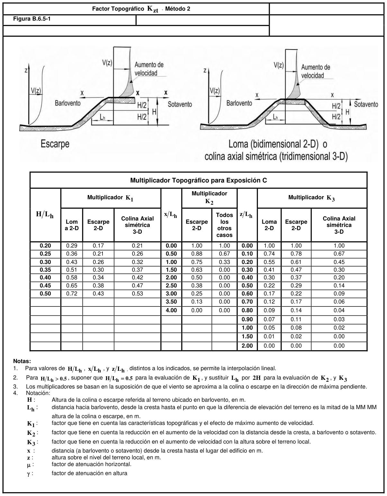

| Multiplicador Topográfico para Exposición C |  |  |  |  |  |  |  |  |  |  |
|---|---|---|---|---|---|---|---|---|---|---|
| $H /L_{h}$ | Multiplicador $K_{1}$ |  |  | $x /L_{h}$ | Multiplicador $K_{2}$ |  | $z /L_{h}$ | Multiplicador $K_{3}$ |  |  |
|  | Lom a 2-D | Escarpe 2-D | Colina Axial simétrica 3-D |  | Escarpe 2-D | Todos los otros casos |  | Loma 2-D | Escarpe 2-D | Colina Axial simétrica 3-D |
| 0.20 | 0.29 | 0.17 | 0.21 | 0.00 | 1.00 | 1.00 | 0.00 | 1.00 | 1.00 | 1.00 |
| 0.25 | 0.36 | 0.21 | 0.26 | 0.50 | 0.88 | 0.67 | 0.10 | 0.74 | 0.78 | 0.67 |
| 0.30 | 0.43 | 0.26 | 0.32 | 1.00 | 0.75 | 0.33 | 0.20 | 0.55 | 0.61 | 0.45 |
| 0.35 | 0.51 | 0.30 | 0.37 | 1.50 | 0.63 | 0.00 | 0.30 | 0.41 | 0.47 | 0.30 |
| 0.40 | 0.58 | 0.34 | 0.42 | 2.00 | 0.50 | 0.00 | 0.40 | 0.30 | 0.37 | 0.20 |
| 0.45 | 0.65 | 0.38 | 0.47 | 2.50 | 0.38 | 0.00 | 0.50 | 0.22 | 0.29 | 0.14 |
| 0.50 | 0.72 | 0.43 | 0.53 | 3.00 | 0.25 | 0.00 | 0.60 | 0.17 | 0.22 | 0.09 |
|  |  |  |  | 3.50 | 0.13 | 0.00 | 0.70 | 0.12 | 0.17 | 0.06 |
|  |  |  |  | 4.00 | 0.00 | 0.00 | 0.80 | 0.09 | 0.14 | 0.04 |
|  |  |  |  |  |  |  | 0.90 | 0.07 | 0.11 | 0.03 |
|  |  |  |  |  |  |  | 1.00 | 0.05 | 0.08 | 0.02 |
|  |  |  |  |  |  |  | 1.50 | 0.01 | 0.02 | 0.00 |
|  |  |  |  |  |  |  | 2.00 | 0.00 | 0.00 | 0.00 |

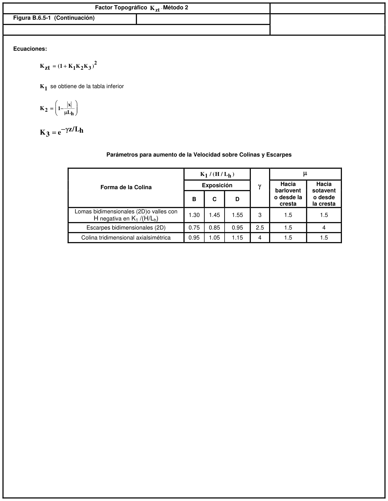

| Forma de la Colina | $K1/ (H / L h)$ |  |  | $γ$ | $μ$ |  |
|---|---|---|---|---|---|---|
|  | Exposición |  |  |  | Hacia barlovent o desde la cresta | Hacia sotavent o desde la cresta |
|  | B | C | D |  |  |  |
| Lomas bidimensionales (2D)o valles con H negativa en K1 /(H/Lh) | 1.30 | 1.45 | 1.55 | 3 | 1.5 | 1.5 |
| Escarpes bidimensionales (2D) | 0.75 | 0.85 | 0.95 | 2.5 | 1.5 | 4 |
| Colina tridimensional axialsimétrica | 0.95 | 1.05 | 1.15 | 4 | 1.5 | 1.5 |

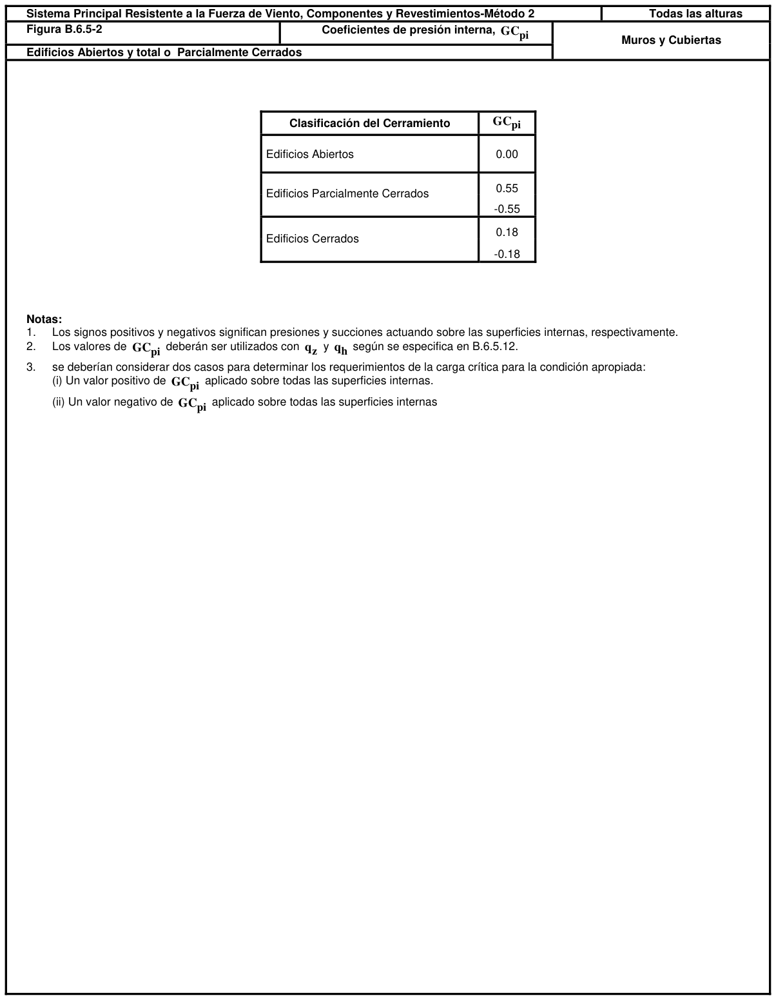

| Clasificación del Cerramiento | $GC_{pi}$ |
|---|---|
| Edificios Abiertos | 0.00 |
| Edificios Parcialmente Cerrados | 0.55 |
|  | -0.55 |
| Edificios Cerrados | 0.18 |
|  | -0.18 |

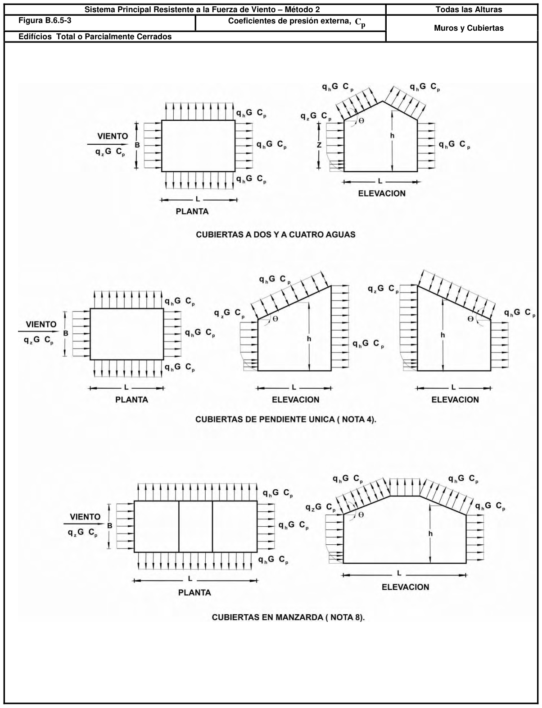

| Sistema Principal Resistente a la Fuerza de Viento – Método 2 |  | Todas las Alturas |
|---|---|---|
| Figura B.6.5-3 ( Continuación) | Coeficientes de presión externa, $C_{p}$ | Muros y Cubiertas |
| Edifícios Total o Parcialmente Cerrados |  |  |
**Coeficientes de presión en muros, $C_{p}$**

| Superficie | L/B | $C_{p}$ | Usar con |
|---|---|---|---|
| Muro en barlovento | Todos los valores | 0.8 | $q_{z}$ |
| Muro en sotavento | 0-1 | -0.5 | $q_{h}$ |
|  | 2 | -0.3 |  |
|  | ≥4 | -0.2 |  |
| Muros laterales | Todos los valores | -0.7 | $q_{h}$ |

**Coeficientes de presión en cubiertas, $C_{p}$, para usar con $q_{h}$**

Dirección del viento normal a la cumbrera para $\theta \ge 10^{\circ}$:

| $h/L$ | Barlovento 10° | 15° | 20° | 25° | 30° | 35° | 45° | ≥60° # | Sotavento 10° | 15° | ≥20° |
|---|---|---|---|---|---|---|---|---|---|---|---|
| ≤0.25 | -0.70 | -0.50 | -0.30 | -0.20 | -0.20 | 0.0* | 0.40 | 0.01θ | -0.30 | -0.50 | -0.60 |
|  | -0.18 | 0.0* | 0.20 | 0.30 | -0.30 | 0.40 |  |  |  |  |  |
| 0.50 | -0.90 | -0.70 | -0.40 | -0.30 | -0.20 | -0.20 | 0.0* | 0.01θ | -0.50 | -0.50 | -0.60 |
|  | -0.18 | -0.18 | 0.0* | 0.20 | 0.20 | 0.30 | 0.40 |  |  |  |  |
| ≥1.0 | -1.3** | -1.00 | -0.70 | -0.50 | -0.30 | -0.20 | 0.0* | 0.01θ | -0.70 | -0.60 | -0.60 |
|  | -0.18 | -0.18 | -0.18 | 0.0* | 0.20 | 0.20 | 0.30 |  | -0.70 | -0.60 | -0.60 |

Dirección del viento normal a la cumbrera para $\theta < 10^{\circ}$ y paralela a la cumbrera para todo $\theta$:

| $h/L$ | Distancia horizontal desde el borde de barlovento | $C_{p}$ |
|---|---|---|
| ≤0.5 | 0 a h/2 | -0.9, -0.18 |
|  | h/2 a h | -0.9, -0.18 |
|  | h a 2h | -0.5, -0.18 |
|  | > 2h | -0.3, -0.18 |
| ≥1.0 | 0 a h/2 | -1.3**, -0.18 |
|  | > h/2 | -0.7, -0.18 |

\* Valor dado para fines de interpolación.

\*\* Valor que puede reducirse linealmente con el área sobre la cual es aplicable, como sigue:

| Área (m²) | Factor de reducción |
|---|---|
| <10 | 1 |
| 20 | 0.9 |
| >100 | 0.8 |

\# Para cubiertas con ángulo $\theta \le 80^{\circ}$ usar $C_{p} = 0.8$.

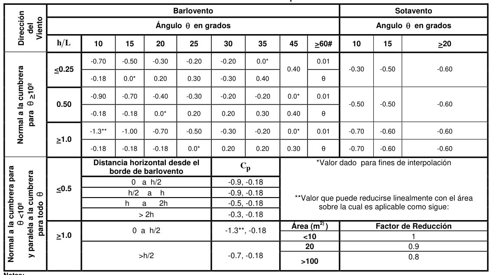

| Sistema Principal Resistente a la Fuerza de Viento.– Método 2 |  | Todas las Alturas |
|---|---|---|
| Figura B.6.5-4 | Coeficientes de presión externa, $C_{p}$ | Domos (cubiertas abovedadas) |
| Estructuras y Edificios Total o Parcialmente cerrados |  |  |
| Notas: 1. se deberán considerar dos casos de carga: Caso A: Valores de $C_{p}$ entre A y B y entre B y C deberán determinarse por interpolación lineal a lo largo de los arcos del domo paralelos a la MM MM dirección del viento. Caso B: El valor de $C_{p}$ deberá ser el valor constante de A para $θ ≤25$ grados, y será determinado por interpolación lineal a partir de 25 grados MM para B y desde B a C. 2. Los valores de $C_{p}$ son los que se deberán utilizar con $q_{h}(+f)$ donde $h_{D}+f$es la altura de la clave del domo. 3. Los signos positivos y negativos significan presiones o succiones actuando sobre las superficies, respectivamente. 4. El valor $C_{p}$ es constante en la superficie del domo para los arcos de los círculos perpendiculares a la dirección de viento; por ejemplo, el arco M que pasa a través de B-B-B y todos los arcos paralelos a B-B-B. 5. Para valores intermedios de $h_{D}/D$ deberá interpolarse linealmente. 6. $θ =0$ grados en el arranque del domo, $θ =90$ grados en el punto superior del centro del domo (clave); $f$ será medido desde el arranque hasta la M clave 7. El cortante horizontal total no debe ser menor que el calculado al despreciar las fuerzas del viento sobre la superficie cubierta. 8. Para valores $f /D<0.05$, utilizar la figura B.6.5-3. |  |  |

| Sistema Principal Resistente a la Fuerza de Viento–Componentes y Revestimientos Método 2 |  | Todas las alturas |
|---|---|---|
| Figura B.6.5-5 | Coeficientes de presión externa, $C_{p}$ | Cubiertas en Arcos |
| Edificios y Estructuras total y Parcialmente Cerrados |  |  |
| $C_{p}$ Condiciones Relación Cuarto a Cuarto a Altura/Luz, r Barlovento Medio Central Sotavento 0 < r < 0.2 -0.9 -0.7 - r -0.5 Cubierta sobre estructura 0.2 ≤ r< 0.3* 1.5r -0.3 -0.7 - r -0.5 elevada 0.3 ≤ r< 0.6 2.75r-0.7 -0.7 - r -0.5 Cubierta con el arranque desde nivel del piso 0<r ≤0.6 1.4r -0.7 - r -0.5 *Cuando la relación altura a longitud es $0.2≤r≤0.3$, los coeficientes alternativos dados por $6r−2.1$ podrán también ser usados para cuarto a barlovento Notas: 1. Los valores listados se usarán para determinar las cargas promedio sobre los sistemas principales resistentes a las fuerzas del viento. 2. Los signos positivos y negativos indican presiones y succiones actuando sobre las superficies, respectivamente. 3. Para viento en dirección paralela a la cumbrera, use los coeficientes de presión de la figura B.6.5-3 con el viento en dirección paralela a la M M cumbre. 4. Para los componentes y revestimientos: (1) En el perímetro de la cubierta, use los coeficientes de presión externa dados en las figuras B.6.5- 8 M con el ángulo $θ$ medido desde la base de la pendiente y (2) para las áreas de cubierta restantes, use los coeficientes de presión externa de M esta tabla multiplicados por 0.87. |  |  |

| Condiciones | Relación Altura/Luz, r | $C_{p}$ |  |  |
|---|---|---|---|---|
|  |  | Cuarto a Barlovento | Medio Central | Cuarto a Sotavento |
| Cubierta sobre estructura elevada | 0 < r < 0.2 | -0.9 | -0.7 - r | -0.5 |
|  | 0.2 ≤ r< 0.3* | 1.5r -0.3 | -0.7 - r | -0.5 |
|  | 0.3 ≤ r< 0.6 | 2.75r-0.7 | -0.7 - r | -0.5 |
| Cubierta con el arranque desde nivel del piso | 0<r ≤0.6 | 1.4r | -0.7 - r | -0.5 |

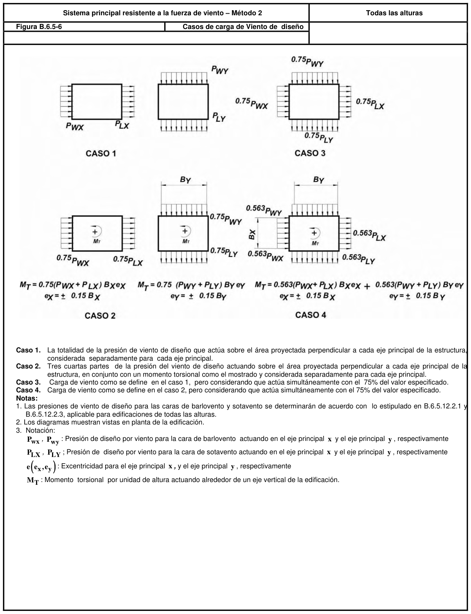

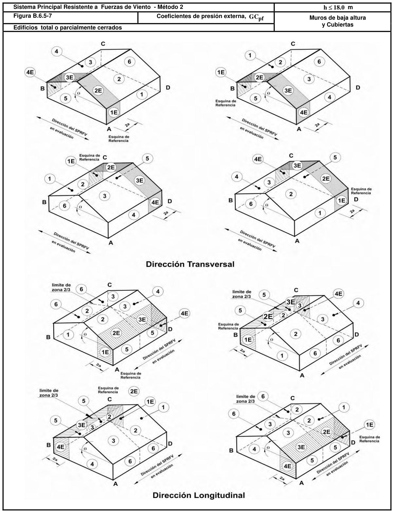

| Sistema Principal Resistente a la Fuerza de viento - Método 2 |  | $h≤18.0$ m |
|---|---|---|
| Figura B.6.5-7 (Continuación) | Coeficientes de presión externa, $GC_{pf}$ | Muros de baja altura y Cubiertas |
| Edificios total o parcialmente cerrados |  |  |
| Cubierta Superficie de la edificación Ángulo $θ$ 1 2 3 4 5 6 1E 2E 3E 4E (grados) 0-5 0.40 -0.69 -0.37 -0.29 -0.45 -0.45 0.61 -1.07 -0.53 -0.43 20 0.53 -0.69 -0.48 -0.43 -0.45 -0.45 0.80 -1.07 -0.69 -0.64 30-45 0.56 0.21 -0.43 -0.37 -0.45 -0.45 0.69 0.27 -0.53 -0.48 90 0.56 0.56 -0.37 -0.37 -0.45 -0.45 0.69 0.69 -0.48 -0.48 Notas: 1. Signos positivos y negativos representan presiones y succiones actuando sobre las superficies. 2. Para valores de $θ$ distintos a los mostrados, se permite interpolación lineal. 3. El edificio debe diseñarse para todas las direcciones del viento usando los 8 patrones de carga mostrados. Los patrones de carga son aplicados para cada esquina de la edificación llamada la esquina de referencia. 4. Las combinaciones de presiones externas e internas (véase figura B.6.5-2) se evaluarán como se requiera para obtener las condiciones más severas de carga. 5. Para los casos de carga torsionales mostrados abajo, las presiones en las zonas designadas con "T" (1T, 2T, 3T, 4T) serán 25% de las presiones de viento totales de diseño (zonas 1, 2, 3, 4). Excepción: En edificaciones de un solo nivel con $h$ menor igual a 9.0 m, edificaciones aporticadas con dos o menos niveles con construcción liviana y edificaciones con dos niveles o menos diseñados con diafragmas flexibles no requieren ser diseñados para los casos de cargas torsionales. Las cargas torsionales deberán ser aplicadas a los ocho patrones de carga básicos usando las figuras abajo mostradas, aplicadas a cada esquina referencia. 6. Excepto para pórticos resistentes a momento, el cortante horizontal total no deberá ser menor que el determinado despreciando las fuerzas de viento sobre la superficie de la cubierta. 7. Para el diseño del sistema principal (SPRFV) deberá proveerse resistencia lateral en la dirección paralela a la cumbrera o para las cubiertas M planas, use $θ =0^{D}$ y localice el límite de la zonas 2 y 3 a la mitad de la longitud de la edificación. 8. El coeficiente de presión de la cubierta $GC_{pf}$, cuando es negativo en la Zona 2 ó 2E, se aplicará en Zona 2/2E a una distancia del borde de la cubierta igual a 0.5 veces la dimensión horizontal del edificio paralelo a la dirección del SPRFV que está diseñándose o 2.5 veces la altura del alero, $h_{e}$ , en el muro a barlovento, el que sea menor; el restante de la Zona 2/2E que se extiende hasta la cumbrera usará el coeficiente de presión $GC_{pf}$ para Zona 3/3E. 9. Notación: $a$ : 10% de la menor dimensión horizontal ó $0.4h$ , la que sea menor, pero no menos del 4% de la menor dimensión horizontal ó 1.0 m. $h$ : Altura promedio de la cubierta, en metros, exceptuando que para $θ ≤10^{D}$ , se usará la altura del alero. $θ$ : Angulo de la cubierta con respecto a la horizontal, en grados. CASOS DE CARGA TORSIONAL |  |  |

| Cubierta Ángulo $θ$ (grados) | Superficie de la edificación |  |  |  |  |  |  |  |  |  |
|---|---|---|---|---|---|---|---|---|---|---|
|  | 1 | 2 | 3 | 4 | 5 | 6 | 1E | 2E | 3E | 4E |
| 0-5 | 0.40 | -0.69 | -0.37 | -0.29 | -0.45 | -0.45 | 0.61 | -1.07 | -0.53 | -0.43 |
| 20 | 0.53 | -0.69 | -0.48 | -0.43 | -0.45 | -0.45 | 0.80 | -1.07 | -0.69 | -0.64 |
| 30-45 | 0.56 | 0.21 | -0.43 | -0.37 | -0.45 | -0.45 | 0.69 | 0.27 | -0.53 | -0.48 |
| 90 | 0.56 | 0.56 | -0.37 | -0.37 | -0.45 | -0.45 | 0.69 | 0.69 | -0.48 | -0.48 |

| Componentes y Revestimientos – Método 2 |  | $h≤18.0$ m |
|---|---|---|
| Figura B.6.5-8A | Coeficientes de presión externa, $GC_{p}$ | Muros |
| Edificios total o parcialmente cerrados |  |  |
| Notas: 1. Lar ordenadas $GC_{p}$, son los valores a ser usados con $q_{h}$. 2. Las abscisas representan las áreas efectivas expuestas al viento, en metros cuadrados. 3. Los signos positivos y negativos significan presiones y succiones actuando sobre las superficies consideradas. 4. Cada componente se diseñará para as presiones y succiones máximas. 5. Los valores de $GC_{p}$ para paredes serán reducidos en 10% cuando el ángulo $θ ≤10^{D}$ . 6. Notación: $a$ : 10% de la dimensión horizontal ó $0.4h$ , la que sea menor, pero no menos del 4% de la menor dimensión horizontal ó 1.0 m.. $h$ : Altura promedio de la cubierta, en metros, exceptuando que para $θ ≤10^{D}$ , se usará la altura del alero. $θ$ : Angulo de la cubierta medido desde la horizontal, en grados |  |  |

| Componentes y Revestimientos – Método 2 |  | $h≤18.0$ m |
|---|---|---|
| Figura B.6.5-8B | Coeficientes de presión externa $GC_{p}$ | Cubiertas a dos aguas $θ ≤7^{D}$ |
| Edificios Total o Parcialmente Cerrados |  |  |
| Notas: 1. Las ordenadas $GC_{p}$ son los valores a ser usados con $q_{h}$ . 2. Las abscisas representan las áreas efectivas expuestas al viento, metros cuadrados. 3. Los signos positivos y negativos significan presiones y succiones actuando sobre las superficies consideradas. 4. Cada componente se diseñará para las presiones y succiones máximas. 5. Si existe un antepecho con altura igual o mayor a 1.0 m alrededor de la cubierta con $θ ≤7^{D}$ , los valores negativos de $GC_{p}$en la Zona 3 deberán ser iguales a los de la Zona 2 y los valores positivos de $GC_{p}$ en la Zona 2 y 4 deberán ser iguales a aquellos dados para paredes en Zonas 4 y 5 respectivamente en la Figura B.6.5-8A. . 6. Los valores de $GC_{p}$ para los aleros de las cubiertas, incluyen las contribuciones de presión de las superficies superiores e inferiores. 7. Notación: $a$ : 10% de la dimensión horizontal ó $0.4h$ , la que sea menor, pero no menos del 4% de la menor dimensión horizontal ó 1.0 m. $h$ : Se usará la altura del alero para $θ ≤10^{D}$ . $θ$ : Angulo de la cubierta medido desde la horizontal, en grados. |  |  |

| Componentes y Revestimientos – Método 2 |  | $h≤18.0$ m |
|---|---|---|
| Figura B.6.5-8C | Coeficientes de Presión Externa, | Cubiertas a dos y a cuatro aguas |
| Edificios Cerrados y Parcialmente Cerrados |  |  |
| Notas: 1. Las ordenadas $GC_{p}$ son los valores para ser usados con $q_{h}$ 2. Las abscisas representan las áreas efectivas expuestas al viento en m2. 3. Los signos positivos y negativos significan presiones y succiones actuando sobre las superficies consideradas. 4. Cada componente se diseñará para las presiones y succiones máximas. 5. Los valores de $GC_{p}$ para aleros de cubierta incluyen las contribuciones de presión de las superficies inferior y superior. 6. Para las cubiertas a cuatro aguas con $θ ≤27^{D}$ , la Zona 3 debe ser considerada como la Zona 2. 7. Notación: $a$ : 10% de la menor dimensión horizontal o $0.4h$ , el que sea menor, pero no menos de 4% de la menor dimensión horizontal o 1.0 m. $h$ : La altura promedio de la cubierta en m, excepto que la altura del alero debe usarse para $θ ≤10^{D}$ . $θ$ : ángulo de la cubierta medido desde la horizontal, en grados. |  |  |

| Componentes y Revestimientos – Método 2 |  | $h≤18.0$ m |
|---|---|---|
| Figura B.6.5-8D | Coeficientes de Presión Externa, $GC_{p}$ | Cubiertas a dos aguas $27^{D}< θ ≤45^{D}$ |
| Edificios Cerrados, Parcialmente Cerrados |  |  |
| Notas: 1. Las ordenadas $GC_{p}$ son los valores para ser usados con $q_{h}$ 2. Las abscisas representan las áreas efectivas expuestas al viento en m2. 3. Los signos positivos y negativos significan presiones y succiones actuando sobre las superficies consideradas. 4. Cada componente se diseñará para las presiones y succiones máximas. 5. Los valores de $GC_{p}$ para aleros incluyen las contribuciones de las superficies de arriba y de abajo. 6. Notación: $a$ : 10% de la menor dimensión horizontal o $0.4h$ , el que sea menor, pero no menos de 4% de la menor dimensión horizontal o 1.0 m. $h$ : La altura promedio de la cubierta en m. $θ$ : ángulo de la cubierta medido desde la horizontal, en grados. |  |  |

| Componentes y Revestimientos – Método 2 |  | $h≤18.0$m |
|---|---|---|
| Figura B.6.5-9 | Coeficientes de Presión Externa, $GC_{p}$ | Cubiertas Escalonadas |
| Edificios Cerrados, Parcialmente Cerrados |  |  |
| Notas: 1. En el nivel inferior plano, las cubiertas escalonadas mostradas en la Figura B.6.5-9, las designaciones de zona y coeficientes de presión de la Figura B.6.5-8B se deben usar, excepto que para las intersecciones de la parte superior de la cubierta con las paredes, Zona 3 debe ser tratada como Zona 2, y Zona 2 como Zona 1. Los valores positivos de $GC_{p}$ iguales a los de las paredes en la Figura B.6.5-8A deben usarse en las áreas achuradas mostradas en la Figura B.6.5-9.. 2. Notación: $b$ : $1.5h_{1}$ en Figura B.6.5-9, pero no mayor que 30.0 m $h$ : Promedio de la altura de la cubierta, en m. $h_{i}$ : $h_{1}$ o $h_{2}$ en la Figura B.6.5-9; $h=h_{1}+h_{2}$; $h_{1}≥3.0$ m; $h_{1}/h_{2}=0.3$ a $0.7$ $W$ : ancho del edificio en la Figura B.6.5-9 $W_{i}$ : $W_{1}$ o $W_{2}$ o $W_{3}$ en la Figura B.6.5-9. $W=W_{1}+W_{2}$ o $W_{1}+W_{2}+W_{3}$; $W_{i} /W=0.25$ a $0.75$ $θ$ : ángulo de la cubierta medido desde la horizontal, en grados. |  |  |

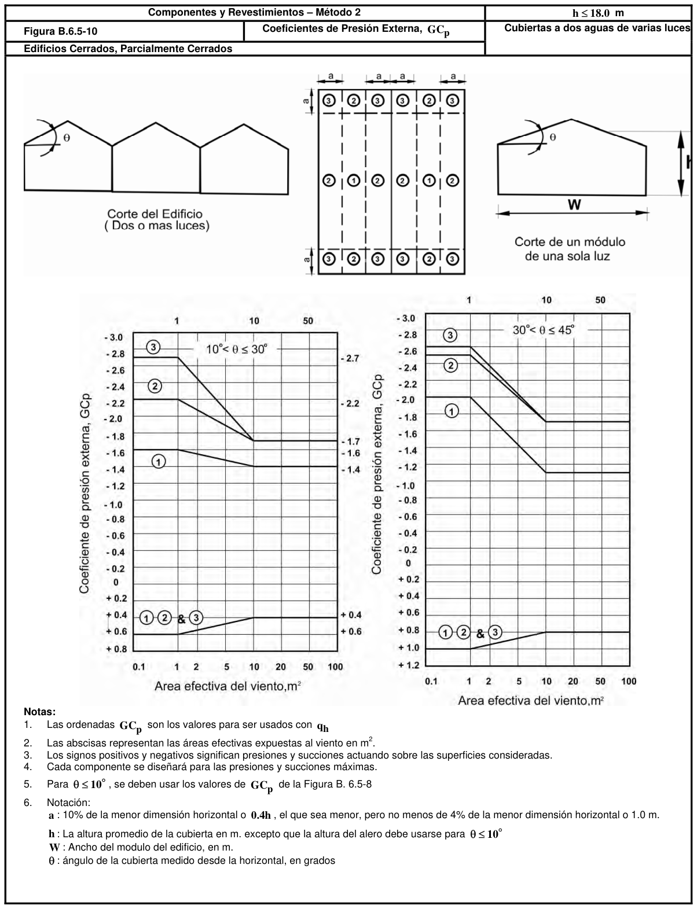

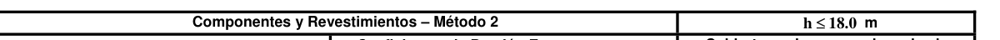

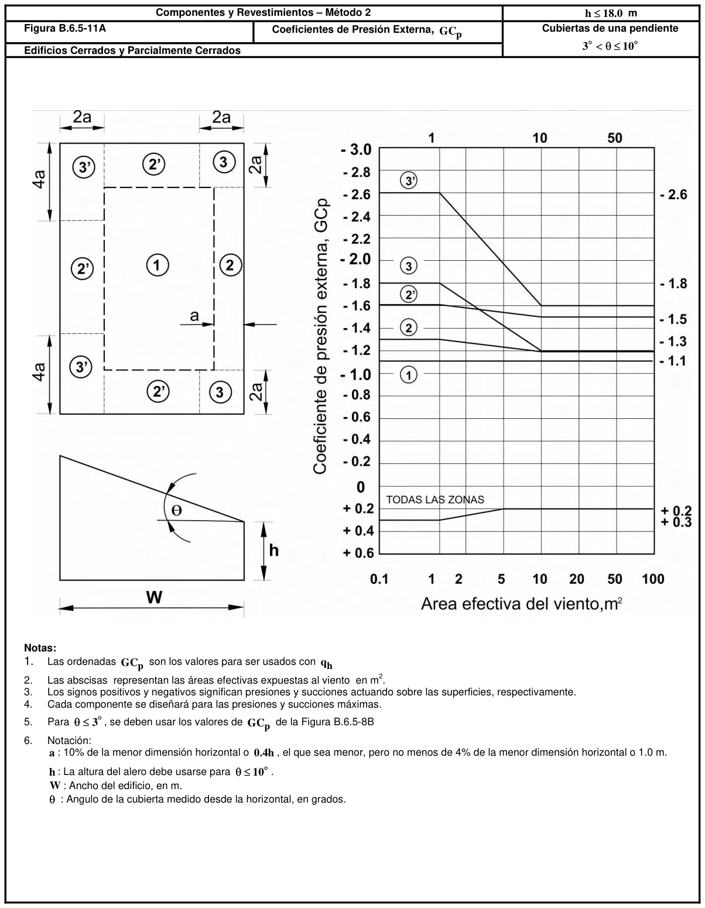

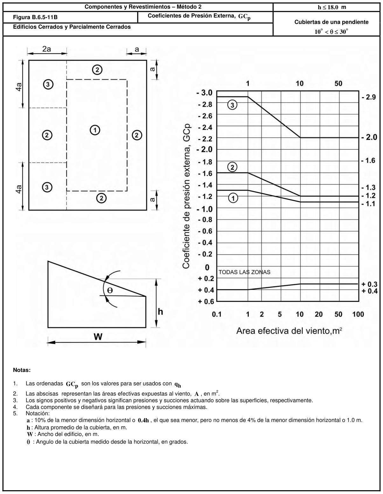

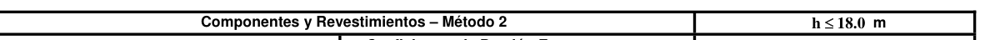

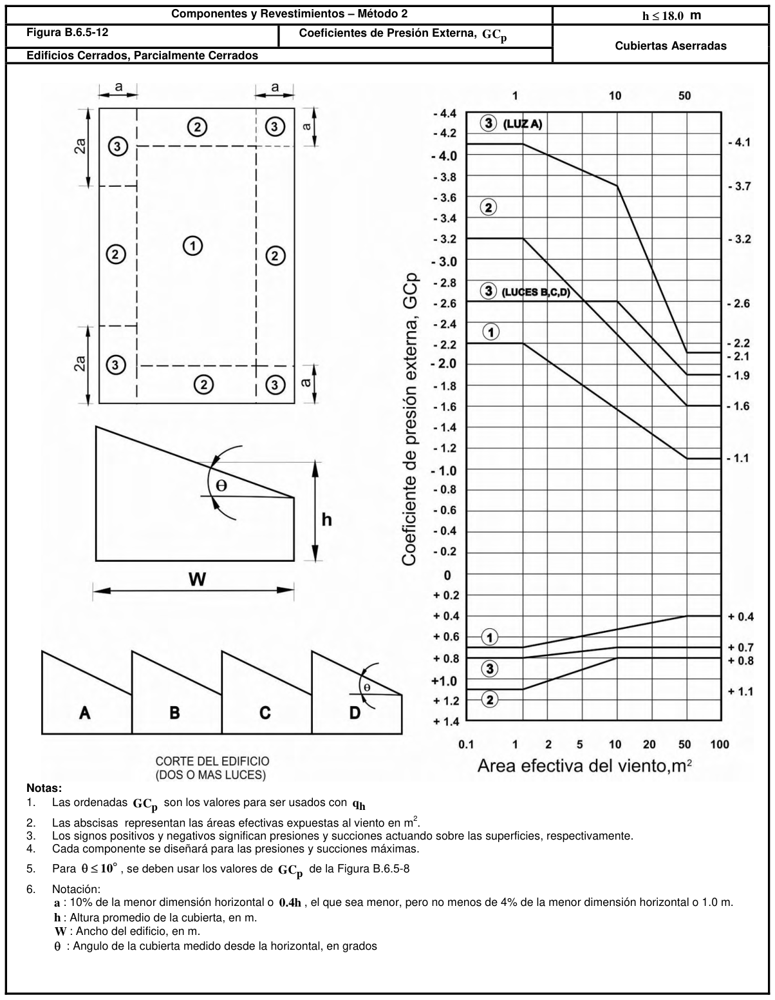

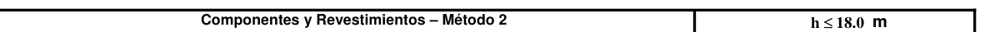

| Componentes y Revestimientos – Método 2 |  | Todas las Alturas |
|---|---|---|
| Figura B.6.5-13 | Coeficientes de Presión Externa, $GC_{p}$ | Cubiertas en Domos |
| Edificios Cerrados y Parcialmente Cerrados |  |  |
| Coeficiente de Presión Externa Para Domos con Base Circular Presión Negativa Presión Positiva Presión Positiva $θ$ , grados 0 - 90 0 - 60 61 - 90 $GC_{p}$-0.9 +0.9 +0.5 Notas: 1. Los valores de $GC_{p}$ para ser usados con $q_{(h_{D}+f)}$ donde $h_{D}+f$ es la altura a la cresta del domo 2. Los signos positivos y negativos significan presiones y succiones actuando sobre las superficies, respectivamente. 3. Cada componente se diseñará para las presiones y succiones máximas. 4. Los valores aplican para $0.0≤h_{D}/D≤0.5$, $0.2≤f /D≤0.5$ 5. $θ =0^{D}$ en la base del domo, $θ =90^{D}$ en el centro del punto mas alto del domo, $f$ es medida desde la base del domo hasta el tope. |  |  |

| Coeficiente de Presión Externa Para Domos con Base Circular |  |  |  |
|---|---|---|---|
| $θ$ , grados | Presión Negativa | Presión Positiva | Presión Positiva |
|  | 0 - 90 | 0 - 60 | 61 - 90 |
| $GC_{p}$ | -0.9 | +0.9 | +0.5 |

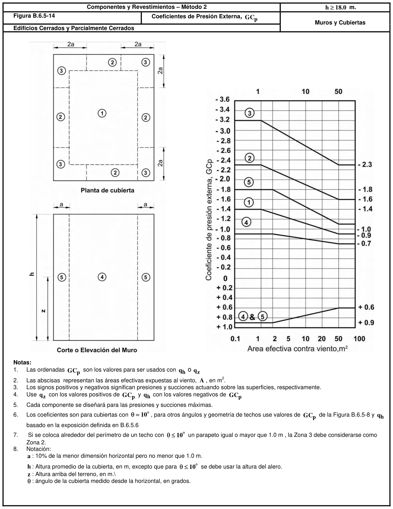

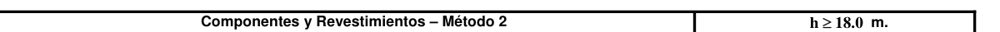

| Sistema Principal Resistente a Fuerzas de Viento |  | $0.25≤h /L≤1.0$ |
|---|---|---|
| Figura B.6.5-15A | Coeficientes de Presión Neta, $C_{N}$ | Cubiertas libres de una pendiente $θ ≤45^{D}$ , $γ =0^{D}$ , $180^{D}$ |
| Edificios Abiertos |  |  |
| Ángulo Dirección del Viento $γ =0^{D}$Dirección del Viento $γ =180^{D}$ de la Caso Cubierta de Flujo de Viento Flujo de Viento Flujo de Viento Flujo de Viento $θ$ Carga Libre Obstruido Libre Obstruido $C_{NW}C_{NL}C_{NW}C_{NL}C_{NW}C_{NL}C_{NW}C_{NL}$ 0⁰ A 1.2 0.3 -0.3 -1.2 1.2 0.3 -0.5 -1.2 B -1.1 -0.1 -1.1 -0.6 -1.1 -0.1 -1.1 -0.6 7.5⁰ A -0.6 -1.0 -1 -1.5 0.9 1.5 -0.2 -1.2 B -1.4 0.0 -1.7 -0.8 1.6 0.3 0.8 -0.3 15⁰ A -0.9 -1.3 -1.1 -1.5 1.3 1.6 0.4 -1.1 B -1.9 0.0 -2.1 -0.6 1.8 0.6 1.2 -0.3 22.5⁰ A -1.5 -1.6 -1.5 -1.7 1.7 1.8 0.5 -1.0 B -2.4 -0.3 -2.3 -0.9 2.2 0.7 1.3 0.0 36⁰ A -1.8 -1.8 -1.5 -1.8 2.1 2.1 0.6 -1.0 B -2.5 -0.5 -2.3 -1.1 2.6 1.0 1.6 0.1 37.5⁰ A -1.8 -1.8 -1.5 -1.8 2.1 2.2 0.7 -0.9 B -2.4 -0.6 -2.2 -1.1 2.7 1.1 1.9 0.3 45⁰ A -1.6 -1.8 -1.3 -1.8 2.2 2.5 0.8 -0.9 B -2.3 -0.7 -1.9 -1.2 2.6 1.4 2.1 0.4 Notas: 1. $C_{NW}$ y $C_{NL}$ denotan las presiones netas (contribuciones de las superficies de arriba y de abajo) para la mitad de las superficies de techo para barlovento y sotavento respectivamente. 2. El flujo de viento libre denota flujo de viento relativamente sin obstrucción, con bloqueo igual o menor al 50%. Flujo de viento obstruido denota objetos debajo del techo que inhiben el flujo del viento (bloqueo mayor al 50%). 3. Los signos positivos y negativos significan presiones y succiones actuando sobre las superficies, respectivamente. 4. Para valores de $θ$ entre 7.5º y 45º se permite interpolación lineal, para valores de $θ$ menores de 7.5º use los coeficientes de $θ =0^{D}$ . 5. Todos los casos de carga mostrados para cada ángulo de techo deben ser investigados. 6. Notación: $L$ : Dimensión horizontal del techo medida a lo largo de la dirección del viento, en m. $h$ : Altura promedio de la cubierta, en m. $γ$ : Dirección del viento en grados. $θ$ : ángulo de la cubierta medido desde la horizontal, en grados. |  |  |

| Ángulo de la Cubierta $θ$ | Caso de Carga | Dirección del Viento $γ =0^{D}$ |  |  |  | Dirección del Viento $γ =180^{D}$ |  |  |  |
|---|---|---|---|---|---|---|---|---|---|
|  |  | Flujo de Viento Libre |  | Flujo de Viento Obstruido |  | Flujo de Viento Libre |  | Flujo de Viento Obstruido |  |
|  |  | $C_{NW}$ | $C_{NL}$ | $C_{NW}$ | $C_{NL}$ | $C_{NW}$ | $C_{NL}$ | $C_{NW}$ | $C_{NL}$ |
| 0⁰ 7.5⁰ 15⁰ 22.5⁰ 36⁰ 37.5⁰ 45⁰ | A B A B A B A B A B A B A B | 1.2 | 0.3 | -0.3 | -1.2 | 1.2 | 0.3 | -0.5 | -1.2 |
|  |  | -1.1 | -0.1 | -1.1 | -0.6 | -1.1 | -0.1 | -1.1 | -0.6 |
|  |  | -0.6 | -1.0 | -1 | -1.5 | 0.9 | 1.5 | -0.2 | -1.2 |
|  |  | -1.4 | 0.0 | -1.7 | -0.8 | 1.6 | 0.3 | 0.8 | -0.3 |
|  |  | -0.9 | -1.3 | -1.1 | -1.5 | 1.3 | 1.6 | 0.4 | -1.1 |
|  |  | -1.9 | 0.0 | -2.1 | -0.6 | 1.8 | 0.6 | 1.2 | -0.3 |
|  |  | -1.5 | -1.6 | -1.5 | -1.7 | 1.7 | 1.8 | 0.5 | -1.0 |
|  |  | -2.4 | -0.3 | -2.3 | -0.9 | 2.2 | 0.7 | 1.3 | 0.0 |
|  |  | -1.8 | -1.8 | -1.5 | -1.8 | 2.1 | 2.1 | 0.6 | -1.0 |
|  |  | -2.5 | -0.5 | -2.3 | -1.1 | 2.6 | 1.0 | 1.6 | 0.1 |
|  |  | -1.8 | -1.8 | -1.5 | -1.8 | 2.1 | 2.2 | 0.7 | -0.9 |
|  |  | -2.4 | -0.6 | -2.2 | -1.1 | 2.7 | 1.1 | 1.9 | 0.3 |
|  |  | -1.6 | -1.8 | -1.3 | -1.8 | 2.2 | 2.5 | 0.8 | -0.9 |
|  |  | -2.3 | -0.7 | -1.9 | -1.2 | 2.6 | 1.4 | 2.1 | 0.4 |

| Sistema Principal Resistente a Fuerzas de Viento |  | $0.25≤h /L≤1.0$ |
|---|---|---|
| Figura B.6.5-15B | Coeficientes de Presión Neta, $C_{N}$ | Cubiertas libres a dos aguas $θ ≤45^{D}$ , $γ =0^{D}$ , $180^{D}$ |
| Edificios Abiertos |  |  |
| Dirección del Viento $γ =0^{D}$ , $180^{D}$ Ángulo de la Cubierta $θ$ Caso de Carga Flujo de Viento Libre Flujo de Viento Obstruido $C_{NW}C_{NL}C_{NW}C_{NL}$ A 1.1 -0.3 -1.6 -1.0 7.5º B 0.2 -1.2 -0.9 -1.7 A 1.1 -0.4 -1.2 -1 15º B 0.1 -1.1 -0.6 -1.6 A 1.1 0.1 -1.2 -1.2 22.5º B -0.1 -0.8 -0.8 -1.7 A 1.3 0.3 -0.7 -0.7 30º B -0.1 -0.9 -0.2 -1.1 A 1.3 0.6 -0.6 -0.6 37.5º B -0.2 -0.6 -0.3 -0.9 A 1.1 0.9 -0.5 -0.5 45º B -0.3 -0.5 -0.3 -0.7 Notas: 1. $C_{NW}$ y $C_{NL}$ denotan las presiones netas (contribuciones de las superficies de arriba y de abajo) para la mitad de las superficies de techo para barlovento y sotavento respectivamente. 2. El flujo de viento libre denota flujo de viento relativamente sin obstrucción, con bloqueo igual o menor al 50%. Flujo de viento obstruido denota objetos debajo del techo que inhiben el flujo del viento (bloqueo mayor al 50%) 3. Los signos positivos y negativos significan presiones y succiones actuando sobre las superficies, respectivamente. 4. Para valores de $θ$ entre 7.5º y 45º se permite interpolación lineal, para valores de $θ$ menores de 7.5º use los coeficientes de de carga para techos de una sola pendiente. 5. Todos los casos de carga mostrados para cada ángulo de techo deben ser investigados. 6. Notación: $L$ : Dimensión horizontal del techo medida a lo largo de la dirección del viento, en m. $h$ : Altura promedio de la cubierta, en m. $γ$ : Dirección del viento en grados. $θ$ : ángulo de la cubierta medido desde la horizontal, en grados. |  |  |

| Ángulo de la Cubierta $θ$ | Caso de Carga | Dirección del Viento $γ =0^{D}$ , $180^{D}$ |  |  |  |
|---|---|---|---|---|---|
|  |  | Flujo de Viento Libre |  | Flujo de Viento Obstruido |  |
|  |  | $C_{NW}$ | $C_{NL}$ | $C_{NW}$ | $C_{NL}$ |
| 7.5º | A | 1.1 | -0.3 | -1.6 | -1.0 |
|  | B | 0.2 | -1.2 | -0.9 | -1.7 |
| 15º | A B | 1.1 | -0.4 | -1.2 | -1 |
|  |  | 0.1 | -1.1 | -0.6 | -1.6 |
| 22.5º | A B | 1.1 | 0.1 | -1.2 | -1.2 |
|  |  | -0.1 | -0.8 | -0.8 | -1.7 |
| 30º | A B | 1.3 | 0.3 | -0.7 | -0.7 |
|  |  | -0.1 | -0.9 | -0.2 | -1.1 |
| 37.5º | A B | 1.3 | 0.6 | -0.6 | -0.6 |
|  |  | -0.2 | -0.6 | -0.3 | -0.9 |
| 45º | A B | 1.1 | 0.9 | -0.5 | -0.5 |
|  |  | -0.3 | -0.5 | -0.3 | -0.7 |

| Sistema Principal Resistente a Fuerzas de Viento |  | $0.25≤h /L≤1.0$ |
|---|---|---|
| Figura B.6.5-15C | Coeficientes de Presión Neta, $C_{N}$ | Cubiertas en Artesa (dos aguas invertidas) $θ ≤45^{D}$ , $γ =0^{D}$ , $180^{D}$ |
| Edificios Abiertos |  |  |
| Dirección del Viento $γ =0^{D}$ , $180^{D}$ Ángulo de la Cubierta $θ$ Caso de Carga Flujo de Viento Libre Flujo de Viento Obstruido $C_{NW}C_{NL}C_{NW}C_{NL}$ 7.5º A -1.1 0.3 -1.6 -0.5 B -0.2 1.2 -0.9 -0.8 A -1.1 0.4 -1.2 -0.5 15º B 0.1 1.1 -0.6 -0.8 A -1.1 -0.1 -1.2 -0.6 22.5º B -0.1 0.8 -0.8 -0.8 A -1.3 -0.3 -1.4 -0.4 30º B -0.1 0.9 -0.2 -0.5 A -1.3 -0.6 -1.4 -0.3 37.5º B 0.2 0.6 -0.3 -0.4 A -1.1 -0.9 -1.2 -0.3 45º B 0.3 0.5 -0.3 -0.4 Notas: 1. $C_{NW}$ y $C_{NL}$ denotan las presiones netas (contribuciones de las superficies de arriba y de abajo) para la mitad de las superficies de techo para barlovento y sotavento respectivamente. 2. El flujo de viento libre denota flujo de viento relativamente sin obstrucción, con bloqueo igual o menor al 50%. Flujo de viento obstruido denota objetos debajo del techo que inhiben el flujo del viento (bloqueo mayor al 50%) 3. Los signos positivos y negativos significan presiones y succiones actuando sobre las superficies consideradas. 4. Para valores de $θ$ entre 7.5º y 45º se permite interpolación lineal, para valores de $θ$ menores de 7.5º use los coeficientes de de carga para techos de una sola pendiente. 5. Todos los casos de carga mostrados para cada ángulo de techo deben ser investigados. 6. Notación: $L$ : Dimensión horizontal del techo medida a lo largo de la dirección del viento, en m. $h$ : Altura promedio de la cubierta, en m. $γ$ : Dirección del viento en grados. $θ$ : ángulo de la cubierta medido desde la horizontal, en grados |  |  |

| Ángulo de la Cubierta $θ$ | Caso de Carga | Dirección del Viento $γ =0^{D}$ , $180^{D}$ |  |  |  |
|---|---|---|---|---|---|
|  |  | Flujo de Viento Libre |  | Flujo de Viento Obstruido |  |
|  |  | $C_{NW}$ | $C_{NL}$ | $C_{NW}$ | $C_{NL}$ |
| 7.5º | A | -1.1 | 0.3 | -1.6 | -0.5 |
|  | B | -0.2 | 1.2 | -0.9 | -0.8 |
| 15º | A B | -1.1 | 0.4 | -1.2 | -0.5 |
|  |  | 0.1 | 1.1 | -0.6 | -0.8 |
| 22.5º | A B | -1.1 | -0.1 | -1.2 | -0.6 |
|  |  | -0.1 | 0.8 | -0.8 | -0.8 |
| 30º | A B | -1.3 | -0.3 | -1.4 | -0.4 |
|  |  | -0.1 | 0.9 | -0.2 | -0.5 |
| 37.5º | A B | -1.3 | -0.6 | -1.4 | -0.3 |
|  |  | 0.2 | 0.6 | -0.3 | -0.4 |
| 45º | A B | -1.1 | -0.9 | -1.2 | -0.3 |
|  |  | 0.3 | 0.5 | -0.3 | -0.4 |

| Sistema Principal Resistente a Fuerzas de Viento (SPRFV) |  | $0.25≤h /L≤1.0$ m |
|---|---|---|
| Figura B.6.5-15D | Coeficientes de Presión Neta, $C_{N}$ | Cubiertas libres en distintas formas $θ ≤45^{D}$ , $γ =0^{D}$ , $180^{D}$ |
| Edificios Abiertos |  |  |
| Distancia Flujo de Flujo de Horizontal Desde el Ángulo de la Cubierta Caso de Carga Viento Libre Obstruido Viento barlovento borde de $θ C_{N} C_{N}$ A -0.8 -1.2 Todas las ≤ h formas B 0.8 0.5 $θ ≤45^{D}$ º Todas las A -0.6 -0.9 > h, ≤ 2h formas B 0.5 0.5 $θ ≤45^{D}$ Todas las A -0.3 -0.6 > 2h formas B 0.3 0.3 $θ ≤45^{D}$ Notas: 1. $C_{N}$ denota las presiones netas (contribuciones de las superficies de arriba y de abajo) 2. El flujo de viento libre denota flujo de viento relativamente sin obstrucción, con bloqueo igual o menor al 50%. Flujo de viento obstruido denota objetos debajo del techo que inhiben el flujo del viento (bloqueo mayor al 50%) 3. Los signos positivos y negativos significan presiones y succiones actuando sobre las superficies, respectivamente. $D$ y $0.05$ Figura B.6.5-15A para otros valores de $h /L$ 5. Todos los casos de carga mostrados para cada ángulo de techo deben ser investigados. 6. Notación: $L$ : Dimensión horizontal del techo medida a lo largo de la dirección del viento, en m. $h$ : Altura promedio de la cubierta, en m. $γ$ : Dirección del viento en grados. $θ$ : ángulo de la cubierta medido desde la horizontal, en grados. |  |  |

| Distancia Horizontal Desde el borde de barlovento | Ángulo de la Cubierta $θ$ | Caso de Carga | Flujo de Viento Libre | Flujo de Viento Obstruido |
|---|---|---|---|---|
|  |  |  | $C_{N}$ | $C_{N}$ |
| ≤ h | Todas las formas $θ ≤45^{D}$ º | A | -0.8 | -1.2 |
|  |  | B | 0.8 | 0.5 |
| > h, ≤ 2h | Todas las formas $θ ≤45^{D}$ | A | -0.6 | -0.9 |
|  |  | B | 0.5 | 0.5 |
| > 2h | Todas las formas $θ ≤45^{D}$ | A | -0.3 | -0.6 |
|  |  | B | 0.3 | 0.3 |

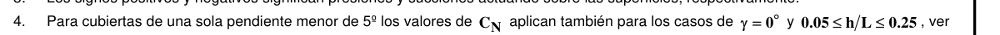

| Componentes y Revestimientos |  | $0.25≤h /L≤1.0$ m |
|---|---|---|
| Figura B.6.5-16A | Coeficientes de Presión Neta, $C_{N}$ | Cubiertas Libres de una Pendiente |
| Edificios Abiertos |  |  |
| Ángulo $C_{N}$ Cubierta de Área Efectiva de Viento Flujo de Viento Libre Flujo de Viento Obstruido $θ$ Zona 3 Zona 2 Zona 1 Zona 3 Zona 2 Zona 1 ≤a2 2.4 -3.3 1.8 -1.7 1.2 -1.1 1 -3.6 0.8 -1.8 0.5 -1.2 0º > a2 , ≤4.0 a2 1.8 -1.7 1.8 -1.7 1.2 -1.1 0.8 -1.8 0.8 -1.8 0.5 -1.2 >4.0a2 1.2 -1.1 1.2 -1.1 1.2 -1.1 0.5 -1.2 0.5 -1.2 0.5 -1.2 ≤a2 3.2 -4.2 2.4 -2.1 1.6 -1.4 1.6 -5.1 1.2 -2.6 0.8 -1.7 7.5º > a2, ≤4.0 a2 2.4 -2.1 2.4 -2.1 1.6 -1.4 1.2 -2.6 1.2 -2.6 0.8 -1.7 >4.0a2 1.6 -1.4 1.6 -1.4 1.6 -1.4 0.8 -1.7 0.8 -1.7 0.8 -1.7 ≤a2 3.6 -3.4 2.7 -2.9 1.8 -1.9 2.4 -4.2 1.8 -3.2 1.2 -2.1 15º > a2, ≤4.0 a2 2.7 -3.9 2.7 -2.9 1.8 -1.9 1.8 -3.2 1.8 -3.2 1.2 -2.1 >4.0a2 1.8 -1.9 1.8 -1.9 1.8 -1.9 1.2 -2.1 1.2 -2.1 1.2 -2.1 ≤a2 5.2 -5 3.9 -3.8 2.6 -2.5 3.2 -4.6 2.4 -3.5 1.6 -2.3 30º > a2, ≤4.0 a2 3.9 -3.8 3.9 -3.8 2.6 -2.5 2.4 -3.5 2.4 -3.5 1.6 -2.3 >4.0a2 2.6 -2.5 2.6 -2.5 2.6 -2.5 1.6 -2.3 1.6 -2.3 1.6 -2.3 ≤a2 5.2 -4.6 3.9 -3.5 2.6 -2.3 4.2 -3.8 3.2 -2.9 2.1 -1.9 45º > a2, ≤4.0 a2 3.9 -3.5 3.9 -3.5 2.6 -2.3 3.2 -2.9 3.2 -2.9 2.1 -1.9 >4.0a2 2.6 -2.3 2.6 -2.3 2.6 -2.3 2.1 -1.9 2.1 -1.9 2.1 -1.9 Notas: 1. $C_{N}$ identifica las presiones netas (contribuciones de las superficies superior e inferior) 2. Flujo de viento libre identifica flujos de viento relativamente sin obstrucción, con bloqueo menor o igual al 50%. Flujo obstruido de viento identifica objetos bajo cubierta que inhiben el flujo de viento (bloqueo mayor al 50%). 3. Para valores de $θ$ diferentes a los que se muestran, se permite interpolación lineal. 1. Los signos positivos y negativos significan presiones y succiones actuando sobre las superficies, respectivamente. 2. Cada componente se diseñará para los coeficientes de presiones y succiones mostrados. 4. Notación: $a$ : 10% de la menor dimensión horizontal o $0.4h$ , el que sea menor, pero no menos de 4% de la menor dimensión horizontal o 1.0 m. $h$ : Altura promedio de la cubierta, en m. $L$ : Dimensión horizontal del edificio, medida a lo largo de la dirección del viento, en m. $θ$ : ángulo de la cubierta medido desde la horizontal, en grados$.$ |  |  |

| Ángulo de Cubierta $θ$ | Área Efectiva de Viento | $C_{N}$ |  |  |  |  |  |  |  |  |  |  |  |
|---|---|---|---|---|---|---|---|---|---|---|---|---|---|
|  |  | Flujo de Viento Libre |  |  |  |  |  | Flujo de Viento Obstruido |  |  |  |  |  |
|  |  | Zona 3 |  | Zona 2 |  | Zona 1 |  | Zona 3 |  | Zona 2 |  | Zona 1 |  |
| 0º | ≤a2 | 2.4 | -3.3 | 1.8 | -1.7 | 1.2 | -1.1 | 1 | -3.6 | 0.8 | -1.8 | 0.5 | -1.2 |
|  | > a2 , ≤4.0 a2 | 1.8 | -1.7 | 1.8 | -1.7 | 1.2 | -1.1 | 0.8 | -1.8 | 0.8 | -1.8 | 0.5 | -1.2 |
|  | >4.0a2 | 1.2 | -1.1 | 1.2 | -1.1 | 1.2 | -1.1 | 0.5 | -1.2 | 0.5 | -1.2 | 0.5 | -1.2 |
| 7.5º | ≤a2 | 3.2 | -4.2 | 2.4 | -2.1 | 1.6 | -1.4 | 1.6 | -5.1 | 1.2 | -2.6 | 0.8 | -1.7 |
|  | > a2, ≤4.0 a2 | 2.4 | -2.1 | 2.4 | -2.1 | 1.6 | -1.4 | 1.2 | -2.6 | 1.2 | -2.6 | 0.8 | -1.7 |
|  | >4.0a2 | 1.6 | -1.4 | 1.6 | -1.4 | 1.6 | -1.4 | 0.8 | -1.7 | 0.8 | -1.7 | 0.8 | -1.7 |
| 15º | ≤a2 | 3.6 | -3.4 | 2.7 | -2.9 | 1.8 | -1.9 | 2.4 | -4.2 | 1.8 | -3.2 | 1.2 | -2.1 |
|  | > a2, ≤4.0 a2 | 2.7 | -3.9 | 2.7 | -2.9 | 1.8 | -1.9 | 1.8 | -3.2 | 1.8 | -3.2 | 1.2 | -2.1 |
|  | >4.0a2 | 1.8 | -1.9 | 1.8 | -1.9 | 1.8 | -1.9 | 1.2 | -2.1 | 1.2 | -2.1 | 1.2 | -2.1 |
| 30º | ≤a2 | 5.2 | -5 | 3.9 | -3.8 | 2.6 | -2.5 | 3.2 | -4.6 | 2.4 | -3.5 | 1.6 | -2.3 |
|  | > a2, ≤4.0 a2 | 3.9 | -3.8 | 3.9 | -3.8 | 2.6 | -2.5 | 2.4 | -3.5 | 2.4 | -3.5 | 1.6 | -2.3 |
|  | >4.0a2 | 2.6 | -2.5 | 2.6 | -2.5 | 2.6 | -2.5 | 1.6 | -2.3 | 1.6 | -2.3 | 1.6 | -2.3 |
| 45º | ≤a2 | 5.2 | -4.6 | 3.9 | -3.5 | 2.6 | -2.3 | 4.2 | -3.8 | 3.2 | -2.9 | 2.1 | -1.9 |
|  | > a2, ≤4.0 a2 | 3.9 | -3.5 | 3.9 | -3.5 | 2.6 | -2.3 | 3.2 | -2.9 | 3.2 | -2.9 | 2.1 | -1.9 |
|  | >4.0a2 | 2.6 | -2.3 | 2.6 | -2.3 | 2.6 | -2.3 | 2.1 | -1.9 | 2.1 | -1.9 | 2.1 | -1.9 |

| Componentes y Revestimientos |  | $0.25≤h /L≤1.0$ m |
|---|---|---|
| Figura B.6.5-16B | Coeficientes de Presión Neta, $C_{N}$ | Cubiertas Libres de dos aguas $θ ≤45^{D}$ |
| Edificios Abiertos |  |  |
| Ángulo de $C_{N}$ Cubierta Área Efectiva Flujo de Viento Libre Flujo de Viento Obstruido de Viento $θ$ Zona 3 Zona 2 Zona 1 Zona 3 Zona 2 Zona 1 ≤a2 2.4 -3.3 1.8 -1.7 1.2 -1.1 1 -3.6 0.8 -1.8 0.5 -1.2 0º > a2, ≤4.0 a2 1.8 -1.7 1.8 -1.7 1.2 -1.1 0.8 -1.8 0.8 -1.8 0.5 -1.2 >4.0a2 1.2 -1.1 1.2 -1.1 1.2 -1.1 0.5 -1.2 0.5 -1.2 0.5 -1.2 ≤a2 2.2 -3.6 1.7 -1.8 1.1 -1.2 1 -5.1 0.8 -2.6 0.5 -1.7 7.5º > a2,≤4.0 a2 1.7 -1.8 1.7 -1.8 1.1 -1.2 0.8 -2.6 0.8 -2.6 0.5 -1.7 >4.0a2 1.1 -1.2 1.1 -1.2 1.1 -1.2 0.5 -1.7 0.5 -1.7 0.5 -1.7 ≤a2 2.2 -2.2 1.7 -1.7 1.1 -1.1 1 -3.2 0.8 -2.4 0.5 -1.6 15º > a2,≤4.0 a2 1.7 -1.7 1.7 -1.7 1.1 -1.1 0.8 -2.4 0.8 -2.4 0.5 -1.6 >4.0a2 1.1 -1.1 1.1 -1.1 1.1 -1.1 0.5 -1.6 0.5 -1.6 0.5 -1.6 ≤a2 2.6 -1.8 2 -1.4 1.3 -0.9 1 -2.4 0.8 -1.8 0.5 -1.2 30º > a2,≤4.0 a2 2 -1.4 2 -1.4 1.3 -0.9 0.8 -1.8 0.8 -1.8 0.5 -1.2 >4.0a2 1.3 -0.9 1.3 -0.9 1.3 -0.9 0.5 -1.2 0.5 -1.2 0.5 -1.2 ≤a2 2.2 -1.6 1.7 -1.2 1.1 -0.8 1 -2.4 0.8 -1.8 0.5 -1.2 45º > a2,≤4.0 a2 1.7 -1.2 1.7 -1.2 1.1 -0.8 0.8 -1.8 0.8 -1.8 0.5 -1.2 >4.0a2 1.1 -0.8 1.1 -0.8 1.1 -0.8 0.5 -1.2 0.5 -1.2 0.5 -1.2 Notas: 1. $C_{N}$ identifica las presiones netas (contribuciones de las superficies superior e inferior) 2. Flujo de viento libre identifica flujos de viento relativamente sin obstrucción, con bloqueo menor o igual al 50%. Flujo obstruido de viento identifica objetos bajo cubierta que inhiben el flujo de viento (bloqueo mayor al 50%). 3. Para valores de $θ$ diferentes a los que se muestran, se permite interpolación lineal. 4. Los signos positivos y negativos significan presiones y succiones actuando sobre las superficies, respectivamente. 5. Cada componente se diseñará para los coeficientes de presiones y succiones mostrados. 6. Notación: $a$ : 10% de la menor dimensión horizontal o $0.4h$ , el que sea menor, pero no menos de 4% de la menor dimensión horizontal o 1.0 m. $h$ : Altura promedio de la cubierta, en m. $L$ : Dimensión horizontal del edificio, medida a lo largo de la dirección del viento, en m. $θ$ : ángulo de la cubierta medido desde la horizontal, en grados. |  |  |

| Ángulo de Cubierta $θ$ | Área Efectiva de Viento | $C_{N}$ |  |  |  |  |  |  |  |  |  |  |  |
|---|---|---|---|---|---|---|---|---|---|---|---|---|---|
|  |  | Flujo de Viento Libre |  |  |  |  |  | Flujo de Viento Obstruido |  |  |  |  |  |
|  |  | Zona 3 |  | Zona 2 |  | Zona 1 |  | Zona 3 |  | Zona 2 |  | Zona 1 |  |
| 0º | ≤a2 | 2.4 | -3.3 | 1.8 | -1.7 | 1.2 | -1.1 | 1 | -3.6 | 0.8 | -1.8 | 0.5 | -1.2 |
|  | > a2, ≤4.0 a2 | 1.8 | -1.7 | 1.8 | -1.7 | 1.2 | -1.1 | 0.8 | -1.8 | 0.8 | -1.8 | 0.5 | -1.2 |
|  | >4.0a2 | 1.2 | -1.1 | 1.2 | -1.1 | 1.2 | -1.1 | 0.5 | -1.2 | 0.5 | -1.2 | 0.5 | -1.2 |
| 7.5º | ≤a2 | 2.2 | -3.6 | 1.7 | -1.8 | 1.1 | -1.2 | 1 | -5.1 | 0.8 | -2.6 | 0.5 | -1.7 |
|  | > a2,≤4.0 a2 | 1.7 | -1.8 | 1.7 | -1.8 | 1.1 | -1.2 | 0.8 | -2.6 | 0.8 | -2.6 | 0.5 | -1.7 |
|  | >4.0a2 | 1.1 | -1.2 | 1.1 | -1.2 | 1.1 | -1.2 | 0.5 | -1.7 | 0.5 | -1.7 | 0.5 | -1.7 |
| 15º | ≤a2 | 2.2 | -2.2 | 1.7 | -1.7 | 1.1 | -1.1 | 1 | -3.2 | 0.8 | -2.4 | 0.5 | -1.6 |
|  | > a2,≤4.0 a2 | 1.7 | -1.7 | 1.7 | -1.7 | 1.1 | -1.1 | 0.8 | -2.4 | 0.8 | -2.4 | 0.5 | -1.6 |
|  | >4.0a2 | 1.1 | -1.1 | 1.1 | -1.1 | 1.1 | -1.1 | 0.5 | -1.6 | 0.5 | -1.6 | 0.5 | -1.6 |
| 30º | ≤a2 | 2.6 | -1.8 | 2 | -1.4 | 1.3 | -0.9 | 1 | -2.4 | 0.8 | -1.8 | 0.5 | -1.2 |
|  | > a2,≤4.0 a2 | 2 | -1.4 | 2 | -1.4 | 1.3 | -0.9 | 0.8 | -1.8 | 0.8 | -1.8 | 0.5 | -1.2 |
|  | >4.0a2 | 1.3 | -0.9 | 1.3 | -0.9 | 1.3 | -0.9 | 0.5 | -1.2 | 0.5 | -1.2 | 0.5 | -1.2 |
| 45º | ≤a2 | 2.2 | -1.6 | 1.7 | -1.2 | 1.1 | -0.8 | 1 | -2.4 | 0.8 | -1.8 | 0.5 | -1.2 |
|  | > a2,≤4.0 a2 | 1.7 | -1.2 | 1.7 | -1.2 | 1.1 | -0.8 | 0.8 | -1.8 | 0.8 | -1.8 | 0.5 | -1.2 |
|  | >4.0a2 | 1.1 | -0.8 | 1.1 | -0.8 | 1.1 | -0.8 | 0.5 | -1.2 | 0.5 | -1.2 | 0.5 | -1.2 |

| Componentes y Revestimientos |  | $0.25≤h /L≤1.0$ m |
|---|---|---|
| Figura B.6.5-16C | Coeficientes de Presión Neta, $C_{N}$ | Cubiertas en Artesa (dos aguas invertidas) $θ ≤45^{D}$ |
| Edificios Abiertos |  |  |
| Ángulo $C_{N}$ Cubierta de Área Efectiva de Viento Flujo de Viento Libre Flujo de Viento Obstruido $θ$ Zona 3 Zona 2 Zona 1 Zona 3 Zona 2 Zona 1 ≤a2 2.4 -3.3 1.8 -1.7 1.2 -1.1 1 -3.6 0.8 -1.8 0.5 -1.2 0º > a2, ≤4.0 a2 1.8 -1.7 1.8 -1.7 1.2 -1.1 0.8 -1.8 0.8 -1.8 0.5 -1.2 >4.0a2 1.2 -1.1 1.2 -1.1 1.2 -1.1 0.5 -1.2 0.5 -1.2 0.5 -1.2 ≤a2 2.4 -3.3 1.8 -1.7 1.2 -1.1 1 -4.8 0.8 -2.4 0.5 -1.6 7.5º > a2, ≤4.0 a2 1.8 -1.7 1.8 -1.7 1.2 -1.1 0.8 -2.4 0.8 -2.4 0.5 -1.6 >4.0a2 1.2 -1.1 1.2 -1.1 1.2 -1.1 0.5 -1.6 0.5 -1.6 0.5 -1.6 ≤a2 2.2 -2.2 1.7 -1.7 1.1 -1.1 1 -2.4 0.8 -1.8 0.5 -1.2 15º > a2 ,≤4.0 a2 1.7 -1.7 1.7 -1.7 1.1 -1.1 0.8 -1.8 0.8 -1.8 0.5 -1.2 >4.0a2 1.1 -1.1 1.1 -1.1 1.1 -1.1 0.5 -1.2 0.5 -1.2 0.5 -1.2 ≤a2 1.8 -2.6 1.4 -2 0.9 -1.3 1 -2.8 0.8 -2.1 0.5 -1.4 30º > a2 ,≤4.0 a2 1.4 -2 1.4 -2 0.9 -1.3 0.8 -2.1 0.8 -2.1 0.5 -1.4 >4.0a2 0.9 -1.3 1.9 -1.3 0.9 -1.3 0.5 -1.4 0.5 -1.4 0.5 -1.4 ≤a2 1.6 -2.2 1.2 -1.7 0.8 -1.1 1 -2.4 0.8 -1.8 0.5 -1.2 45º > a2 ,≤4.0 a2 1.2 -1.7 1.2 -1.7 0.8 -1.1 0.8 -1.8 0.8 -1.8 0.5 -1.2 >4.0a2 0.8 -1.1 1.8 -1.1 0.8 -1.1 0.5 -1.2 0.5 -1.2 0.5 -1.2 Notas: 1. $C_{N}$ identifica las presiones netas (contribuciones de las superficies superior e inferior) 2. Flujo de viento libre identifica flujos de viento relativamente sin obstrucción, con bloqueo menor o igual al 50%. Flujo de viento obstruido identifica objetos bajo cubierta que inhiben el flujo de viento (bloqueo mayor al 50%). 3. Para valores de $θ$ diferentes a los que se muestran, se permite interpolación lineal. 4. Los signos positivos y negativos significan presiones y succiones actuando sobre las superficies, respectivamente. 5. Cada componente se diseñará para los coeficientes de presiones y succiones mostrados. 6. Notación: $a$ : 10% de la menor dimensión horizontal o $0.4h$ , el que sea menor, pero no menos de 4% de la menor dimensión horizontal o 1.0 m. $h$ : Altura promedio de la cubierta, en m. $L$ : Dimensión horizontal del edificio, medida a lo largo de la dirección del viento, en m. $θ$ : ángulo de la cubierta medido desde la horizontal, en grados. |  |  |

| Ángulo de Cubierta $θ$ | Área Efectiva de Viento | $C_{N}$ |  |  |  |  |  |  |  |  |  |  |  |
|---|---|---|---|---|---|---|---|---|---|---|---|---|---|
|  |  | Flujo de Viento Libre |  |  |  |  |  | Flujo de Viento Obstruido |  |  |  |  |  |
|  |  | Zona 3 |  | Zona 2 |  | Zona 1 |  | Zona 3 |  | Zona 2 |  | Zona 1 |  |
| 0º | ≤a2 | 2.4 | -3.3 | 1.8 | -1.7 | 1.2 | -1.1 | 1 | -3.6 | 0.8 | -1.8 | 0.5 | -1.2 |
|  | > a2, ≤4.0 a2 | 1.8 | -1.7 | 1.8 | -1.7 | 1.2 | -1.1 | 0.8 | -1.8 | 0.8 | -1.8 | 0.5 | -1.2 |
|  | >4.0a2 | 1.2 | -1.1 | 1.2 | -1.1 | 1.2 | -1.1 | 0.5 | -1.2 | 0.5 | -1.2 | 0.5 | -1.2 |
| 7.5º | ≤a2 | 2.4 | -3.3 | 1.8 | -1.7 | 1.2 | -1.1 | 1 | -4.8 | 0.8 | -2.4 | 0.5 | -1.6 |
|  | > a2, ≤4.0 a2 | 1.8 | -1.7 | 1.8 | -1.7 | 1.2 | -1.1 | 0.8 | -2.4 | 0.8 | -2.4 | 0.5 | -1.6 |
|  | >4.0a2 | 1.2 | -1.1 | 1.2 | -1.1 | 1.2 | -1.1 | 0.5 | -1.6 | 0.5 | -1.6 | 0.5 | -1.6 |
| 15º | ≤a2 | 2.2 | -2.2 | 1.7 | -1.7 | 1.1 | -1.1 | 1 | -2.4 | 0.8 | -1.8 | 0.5 | -1.2 |
|  | > a2 ,≤4.0 a2 | 1.7 | -1.7 | 1.7 | -1.7 | 1.1 | -1.1 | 0.8 | -1.8 | 0.8 | -1.8 | 0.5 | -1.2 |
|  | >4.0a2 | 1.1 | -1.1 | 1.1 | -1.1 | 1.1 | -1.1 | 0.5 | -1.2 | 0.5 | -1.2 | 0.5 | -1.2 |
| 30º | ≤a2 | 1.8 | -2.6 | 1.4 | -2 | 0.9 | -1.3 | 1 | -2.8 | 0.8 | -2.1 | 0.5 | -1.4 |
|  | > a2 ,≤4.0 a2 | 1.4 | -2 | 1.4 | -2 | 0.9 | -1.3 | 0.8 | -2.1 | 0.8 | -2.1 | 0.5 | -1.4 |
|  | >4.0a2 | 0.9 | -1.3 | 1.9 | -1.3 | 0.9 | -1.3 | 0.5 | -1.4 | 0.5 | -1.4 | 0.5 | -1.4 |
| 45º | ≤a2 | 1.6 | -2.2 | 1.2 | -1.7 | 0.8 | -1.1 | 1 | -2.4 | 0.8 | -1.8 | 0.5 | -1.2 |
|  | > a2 ,≤4.0 a2 | 1.2 | -1.7 | 1.2 | -1.7 | 0.8 | -1.1 | 0.8 | -1.8 | 0.8 | -1.8 | 0.5 | -1.2 |
|  | >4.0a2 | 0.8 | -1.1 | 1.8 | -1.1 | 0.8 | -1.1 | 0.5 | -1.2 | 0.5 | -1.2 | 0.5 | -1.2 |

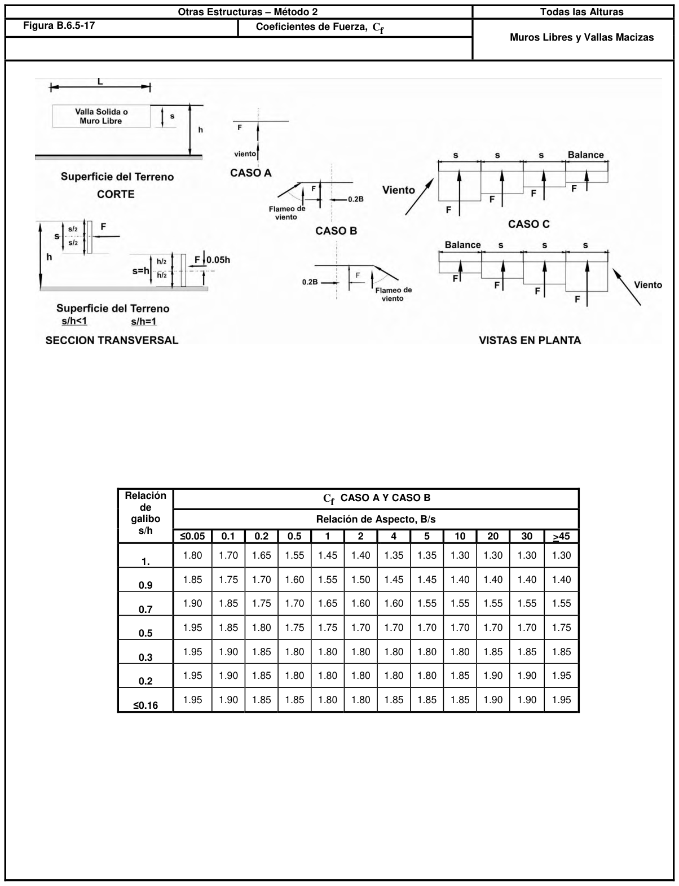

| Relación de galibo s/h | $C_{f}$ CASO A Y CASO B |  |  |  |  |  |  |  |  |  |  |  |
|---|---|---|---|---|---|---|---|---|---|---|---|---|
|  | Relación de Aspecto, B/s |  |  |  |  |  |  |  |  |  |  |  |
|  | ≤0.05 | 0.1 | 0.2 | 0.5 | 1 | 2 | 4 | 5 | 10 | 20 | 30 | >45 |
| 1. | 1.80 | 1.70 | 1.65 | 1.55 | 1.45 | 1.40 | 1.35 | 1.35 | 1.30 | 1.30 | 1.30 | 1.30 |
| 0.9 | 1.85 | 1.75 | 1.70 | 1.60 | 1.55 | 1.50 | 1.45 | 1.45 | 1.40 | 1.40 | 1.40 | 1.40 |
| 0.7 | 1.90 | 1.85 | 1.75 | 1.70 | 1.65 | 1.60 | 1.60 | 1.55 | 1.55 | 1.55 | 1.55 | 1.55 |
| 0.5 | 1.95 | 1.85 | 1.80 | 1.75 | 1.75 | 1.70 | 1.70 | 1.70 | 1.70 | 1.70 | 1.70 | 1.75 |
| 0.3 | 1.95 | 1.90 | 1.85 | 1.80 | 1.80 | 1.80 | 1.80 | 1.80 | 1.80 | 1.85 | 1.85 | 1.85 |
| 0.2 | 1.95 | 1.90 | 1.85 | 1.80 | 1.80 | 1.80 | 1.80 | 1.80 | 1.85 | 1.90 | 1.90 | 1.95 |
| ≤0.16 | 1.95 | 1.90 | 1.85 | 1.85 | 1.80 | 1.80 | 1.85 | 1.85 | 1.85 | 1.90 | 1.90 | 1.95 |

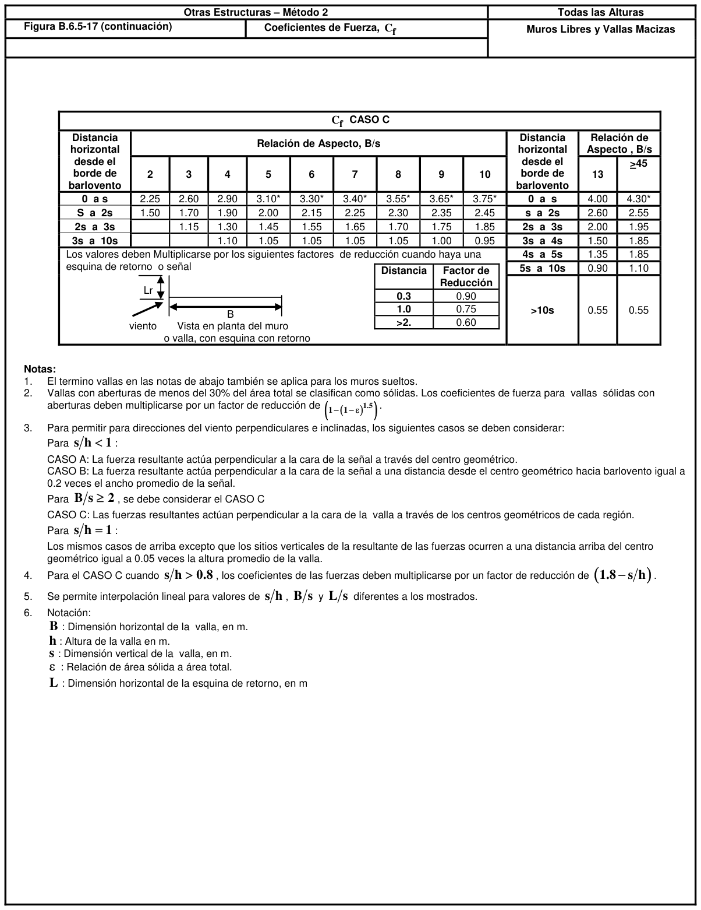

| $C_{f}$ CASO C |  |  |  |  |  |  |  |  |  |  |  |  |
|---|---|---|---|---|---|---|---|---|---|---|---|---|
| Distancia horizontal desde el borde de barlovento | Relación de Aspecto, B/s |  |  |  |  |  |  |  |  | Distancia horizontal desde el borde de barlovento | Relación de Aspecto , B/s |  |
|  | 2 | 3 | 4 | 5 | 6 | 7 | 8 | 9 | 10 |  | 13 | >45 |
| 0 a s | 2.25 | 2.60 | 2.90 | 3.10* | 3.30* | 3.40* | 3.55* | 3.65* | 3.75* | 0 a s | 4.00 | 4.30* |
| S a 2s | 1.50 | 1.70 | 1.90 | 2.00 | 2.15 | 2.25 | 2.30 | 2.35 | 2.45 | s a 2s | 2.60 | 2.55 |
| 2s a 3s |  | 1.15 | 1.30 | 1.45 | 1.55 | 1.65 | 1.70 | 1.75 | 1.85 | 2s a 3s | 2.00 | 1.95 |
| 3s a 10s |  |  | 1.10 | 1.05 | 1.05 | 1.05 | 1.05 | 1.00 | 0.95 | 3s a 4s | 1.50 | 1.85 |
| Los valores deben Multiplicarse por los siguientes factores de reducción cuando haya una esquina de retorno o señal DistanciaFactor de Reducción Lr 0.3 0.90 B 1.0 0.75 viento Vista en planta del muro >2. 0.60 o valla, con esquina con retorno |  |  |  |  |  |  |  |  |  | 4s a 5s | 1.35 | 1.85 |
|  |  |  |  |  |  |  |  |  |  | 5s a 10s | 0.90 | 1.10 |
|  |  |  |  |  |  |  |  |  |  | >10s | 0.55 | 0.55 |

| Distancia | Factor de Reducción |
|---|---|
| 0.3 | 0.90 |
| 1.0 | 0.75 |
| >2. | 0.60 |

| Otras Estructuras – Método 2 |  | Todas las Alturas |
|---|---|---|
| Figura B.6.5-18 | Coeficientes de Fuerza, $C_{f}$ | Chimeneas, Tanques, Equipo de Cubierta y Estructuras Similares |
| Edificios Abiertos |  |  |
| Sección Transversal Tipo de superficie $h /D$ 1 7 25 Cuadrada (Viento Perpendicular a la cara) Todas 1.3 1.4 2.0 Cuadrada (Viento a lo largo de la diagonal) Todas 1.0 1.1 1.5 Hexagonal u Octagonal Todas 1.0 1.2 1.4 $Redonda (D \sqrt{q_{z}}>2.5)$Moderadamente Suave 0.5 0.6 0.7 $(D \sqrt{q_{z}}>5.3,D en m,q_{z}en N /m^{2})$Rugosa Muy Rugosa( D1 ( D/D=0.02)1/D=0.08)0.7 0.8 0.8 1.0 0.9 0.2 $Redonda (D \sqrt{q_{z}}≤2.5)$ $(D \sqrt{q_{z}}≤5.3,D en m,q_{z}en N /m^{2})$Todas 0.7 0.8 1.2 Notas: 1. La fuerza de viento de diseño, debe calcularse basada en el área de la estructura proyectada sobre un plano perpendicular a la dirección del viento. La fuerza debe suponerse que actúa paralela a la dirección del viento. 2. Se permite interpolación lineal para los otros valores de $h /D$ diferentes a los mostrados. 3. Notación: $D$ : Diámetro de la sección transversal circular y la menor dimensión horizontal de las secciones transversales cuadradas, hexagonales u octogonales a la altura considerada, en m. $D'$ : Profundidad de los elementos que sobresalen tales como relieves, defensas, en m. $h$ : Altura de la estructura, en m. $q_{z}$: Velocidad de presión evaluada a la altura z sobre el terreno, en N$/m^{2}.$ |  |  |

| Sección Transversal | Tipo de superficie | $h /D$ |  |  |
|---|---|---|---|---|
|  |  | 1 | 7 | 25 |
| Cuadrada (Viento Perpendicular a la cara) | Todas | 1.3 | 1.4 | 2.0 |
| Cuadrada (Viento a lo largo de la diagonal) | Todas | 1.0 | 1.1 | 1.5 |
| Hexagonal u Octagonal | Todas | 1.0 | 1.2 | 1.4 |
| $Redonda (D \sqrt{q_{z}}>2.5)$ $(D \sqrt{q_{z}}>5.3,D en m,q_{z}en N /m^{2})$ | Moderadamente Suave | 0.5 | 0.6 | 0.7 |
|  | Rugosa ( D1/D=0.02) | 0.7 | 0.8 | 0.9 |
|  | Muy Rugosa ( D1/D=0.08) | 0.8 | 1.0 | 0.2 |
| $Redonda (D \sqrt{q_{z}}≤2.5)$ $(D \sqrt{q_{z}}≤5.3,D en m,q_{z}en N /m^{2})$ | Todas | 0.7 | 0.8 | 1.2 |

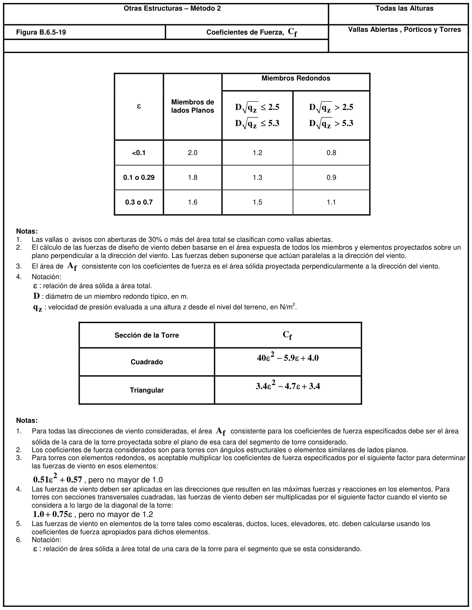

| $ε$ | Miembros de lados Planos | Miembros Redondos |  |
|---|---|---|---|
|  |  | $D \sqrt{q_{z}}≤2.5$ $D \sqrt{q_{z}}≤5.3$ | $D \sqrt{q_{z}}>2.5$ $D \sqrt{q_{z}}>5.3$ |
| <0.1 | 2.0 | 1.2 | 0.8 |
| 0.1 o 0.29 | 1.8 | 1.3 | 0.9 |
| 0.3 o 0.7 | 1.6 | 1.5 | 1.1 |

| Sección de la Torre | $C_{f}$ |
|---|---|
| Cuadrado | $40ε^{2}−5.9ε +4.0$ |
| Triangular | $3.4ε^{2}−4.7ε +3.4$ |

<!-- mod:1-decreto-092-2011-58 -->
> **Modificación — Decreto 092 de 2011** · anexo, p. 15
>
> En la nota 5. de la Figura B.6.5-12 donde dice “...los valores de GC de la figura B.6.5-8.” debe ser ““... los valores de p GC de la figura B.6.5-8B.”.
>
> 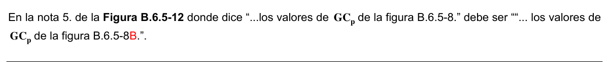

<!-- mod:1-decreto-092-2011-59 -->
> **Modificación — Decreto 092 de 2011** · anexo, p. 15
>
> El título de la Figura B.6.5-14, dice “ h ≥ 18.0 m ” y debe ser “ h > 18.0 m ”. Además en la Nota 6 de la misma Figura B.6.5-14 donde dice “Los coeficientes son para cubiertas con θ = 10 ° ” debe ser “Los coeficientes son para cubiertas con θ ≤ 10 ° ”.
>
> 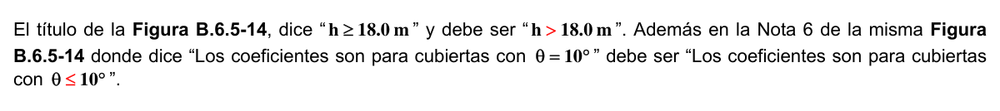

Factor de Importancia. $I$ (Cargas de Viento)

**Tabla B.6.5-1**

| Categoría | Regiones no propensas a huracanes, y regiones con posibilidad de huracanes de $V_{=}40_{−}45$ m/s | Regiones con posibilidades de huracanes y $V>45$ m/s |
|---|---|---|
| I | 0.87 | 0.77 |
| II | 1.00 | 1.00 |
| III | 1.15 | 1.15 |
| IV | 1.15 | 1.15 |

Notas:

1. Las categorías de los edificios y de las estructuras se listan en la sección A.2.5 del presente reglamento.

Constante de Exposición del Terreno

**Tabla B.6.5-2**

| Exposición | $α$ | $Z_{g}$ | $\hat{a}$ | $\hat{b}$ | $α$ | $b$ | $c$ | $A$ (m) | $ε$ | $Z_{min}$* (m) |
|---|---|---|---|---|---|---|---|---|---|---|
| B | 7.0 | 365.8 | 1/7.0 | 0.84 | 1/4.0 | 0.45 | 0.30 | 97.5 | 1/3 | 9.0 |
| C | 9.5 | 274.3 | 1/9.5 | 1.00 | 1/6.5 | 0.65 | 0.20 | 152.4 | 1/5 | 4.5 |
| D | 11.5 | 213.4 | 1/11.5 | 1.07 | 1/9.0 | 0.80 | 0.15 | 198.1 | 1/8 | 2.0 |

* $Z_{min}$ mínima altura usada para asegurar que la altura equivalente $Z$ es mayor de 0.6 h o $Z_{min}$ Para edificios con $h_{≤}Z_{min}$, $Z$ debe tomarse como $Z_{min}$ Coeficientes de Exposición para la Presión Dinámica, $, K_{h}$ y $K_{z}$

**Tabla B.6.5-3**

| Altura sobre el terreno Z | Exposición, Nota 1 |  |  |  |
|---|---|---|---|---|
|  | B |  | C | D |
| m | Caso 1 | Caso 2 | Casos 1 y 2 | Casos 1 y 2 |
| 0 - 45 | 0.7 | 0.57 | 0.85 | 1.03 |
| 6.0 | 0.7 | 0.62 | 0.90 | 1.08 |
| 7.5 | 0.7 | 0.66 | 0.94 | 1.12 |
| 9.0 | 0.7 | 0.70 | 0.98 | 1.16 |
| 12.0 | 0.76 | 0.76 | 1.04 | 1.22 |
| 15.0 | 0.81 | 0.81 | 1.09 | 1.27 |
| 18.0 | 0.85 | 0.85 | 1.13 | 1.31 |
| 20.0 | 0.89 | 0.89 | 1.17 | 1.34 |
| 24.5 | 0.93 | 0.93 | 1.21 | 1.38 |
| 27.5 | 0.96 | 0.96 | 1.24 | 1.40 |
| 30.5 | 0.99 | 0.99 | 1.26 | 1.43 |
| 36.5 | 1.04 | 1.04 | 1.36 | 1.52 |
| 42.5 | 1.09 | 1.09 | 1.36 | 1.52 |
| 49.0 | 1.13 | 1.13 | 1.39 | 1.55 |
| 55.0 | 1.17 | 1.17 | 1.43 | 1.58 |
| 60.0 | 1.20 | 1.20 | 1.46 | 1.61 |
| 76.0 | 1.28 | 1.28 | 1.53 | 1.68 |
| 90.0 | 1.35 | 1.35 | 1.59 | 1.73 |
| 107.0 | 1.41 | 1.41 | 1.64 | 1.78 |
| 122.0 | 1.47 | 1.47 | 1.69 | 1.82 |
| 137.0 | 1.52 | 1.52 | 1.73 | 1.86 |
| 152.0 | 1.56 | 1.56 | 1.77 | 1.89 |

Notas:

<!-- mod:1-decreto-092-2011-65 -->
> **Modificación — Decreto 092 de 2011** · anexo, p. 17
>
> En la Tabla B.6.5-3 en la primera línea de valores numéricos, en su primera columna dice “0 - 45” y debe ser “0 - 4.5”.

1. CASO 1 a. Todos los componentes y recubrimientos b. Sistema Principal Resistente a Cargas de Viento en edificios bajos diseñados usando la Fig. B.6.5-7 CASO 2 a. Todos los Sistemas Principales Resistentes a Cargas de Viento de los edificios excepto aquellos de los edificios bajos diseñados usando la Fig. B.6.5-7 b. Todos los Sistemas Principales Resistentes a Cargas de Viento en otras estructuras.

. 2. El coeficiente de exposición de presión dinámica, $K_{z}$, puede ser determinado de la siguiente fórmula:

$$ K_z = 2.01 \left(\dfrac{Z}{Z_g}\right)^{2/\alpha} \quad \text{para } 4.0\text{ m} \le Z \le Z_g $$

$$ K_z = 2.01 \left(\dfrac{4.0}{Z_g}\right)^{2/\alpha} \quad \text{para } Z < 4.0\text{ m} $$

$Z$ no debe tomarse menos que 9.0 m para el caso 1 en exposición B

3. $α$ y $Z_{g}$ están tabulados en la Tabla B.6.5-2 $.$ 4. Se acepta interpolación lineal para valores intermedios de la altura $Z$ $.$ 5. Las categorías de exposición se definen en B.6.5-6 Factor de Direccionalidad del Viento, $K_{d}$

**Tabla B.6.5-4**

| Tipo de Estructura | Factor de Direccionalidad del Viento, $K_{d}$ * |
|---|---|
| Edificios Sistema Principal de Resistencia de Cargas de Viento | 0.85 |
| Componentes y Recubrimientos | 0.85 |
| Cubiertas Abovedadas | 0.85 |
| Chimeneas, Tanques y Estructuras Similares Cuadradas | 0.90 |
| Hexagonales | 0.95 |
| Redondas | 0.95 |
| Avisos Sólidos | 0.85 |
| Avisos Abiertos y Estructura Rectangular | 0.85 |
| Torres en Celosía Triangular, Cuadrada y Rectangular | 0.85 |
| Todas las otras secciones transversales | 0.95 |

* El factor de direccionalidad $K_{d}$ ha sido calibrado con las combinaciones de carga especificadas. Este factor debe usarse cuando se usen las combinaciones B.2.3 y B.2.4 correspondientes.

<!-- mod:1-decreto-092-2011-51 -->
> **Modificación — Decreto 092 de 2011** · anexo, p. 12
>
> Se debe agregar el literal B.6.6.5, el cual debe quedar así:
>
> **B.6.6.5** — ESCOMBROS ARRASTRADOS POR EL VIENTO — Vidrieras en edificaciones en regiones de escombros arrastrados por el viento deben ser protegidas de acuerdo con la sección B.6.5.9.3.

<!-- mod:1-decreto-092-2011-57 -->
> **Modificación — Decreto 092 de 2011** · anexo, p. 14
>
> En la Figura B.6-5-8B, el gráfico debe substituirse por el siguiente gráfico:

<!-- mod:1-decreto-092-2011-60 -->
> **Modificación — Decreto 092 de 2011** · anexo, p. 15
>
> En la Figura B.6-5-14, el gráfico de la izquierda debe substituirse por el siguiente gráfico:
