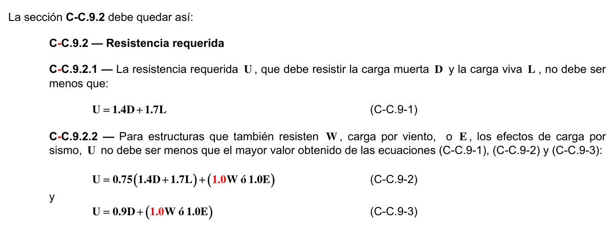

# C-C — Factores de carga y reducción de la resistencia alternativos

### C-C.9.1 — Alcance

Se permite diseñar el concreto estructural usando los factores de combinación de carga y de reducción de resistencia del Apéndice C. Cuando se utilice en el diseño el Apéndice C-C, C-C.9.2.1 a C-C.9.2.7 deben reemplazar C.9.2.1 a C.9.2.5, y C-C.9.3.1 a C-C.9.3.5 deben reemplazar C.9.3.1 a C.9.3.5.

### C-C.9.2 — Resistencia requerida

**C-C.9.2.1** — La resistencia requerida $U$ , que debe resistir la carga muerta $D$ y la carga viva $L$ , no debe ser menos que:

$$ U = 1.4D + 1.7L \tag{C-C.9-1} $$

**C-C.9.2.2** — Para estructuras que también resisten $W$ , carga por viento, o $E$ , los efectos de carga por sismo, $U$ no debe ser menos que el mayor valor obtenido de las ecuaciones (C-C.9-1), (C-C.9-2) y (C-C.9-3):

$$ U = 0.75\left(1.4D + 1.7L\right) + \left(1.6W \text{ ó } 1.0E\right) \tag{C-C.9-2} $$

y

$$ U = 0.9D + \left(1.6W \text{ ó } 1.0E\right) \tag{C-C.9-3} $$

Cuando $W$ no ha sido reducida por un factor de direccionalidad, se permite usar $1.3W$ en vez de $1.6W$ en las ecuaciones (C-C.9-2) y (C-C.9-3). Cuando $E$ se basa en fuerzas sísmicas al nivel de servicio, se debe usar $1.4E$ en lugar de $1.0E$ en las ecuaciones (C-C.9-2) y (C-C.9-3).

**C-C.9.2.3** — Para estructuras que resisten $H$ , cargas debidas al peso y presión del suelo, el agua en el suelo, u otros materiales relacionados, $U$ no debe ser menor que el mayor valor obtenido de las ecuaciones (C-C.9-1) y (C-C.9-4):

$$ U = 1.4D + 1.7L + 1.7H \tag{C-C.9-4} $$

En la ecuación (C-C.9-4) donde $D$ o $L$ reduzcan el efecto de $H$ , $0.9D$ debe sustituir a $1.4D$ y usar un valor cero en $L$ para determinar la mayor resistencia requerida $U$ .

**C-C.9.2.4** — Para estructuras que resisten $F$ , carga debida al peso y presión de fluidos con densidades bien definidas, el factor de carga para $F$ debe ser 1.4, y $F$ debe añadirse a todas las combinaciones de carga que incluyan la carga viva $L$ .

**C-C.9.2.5** — Si en el diseño se toma en cuenta la resistencia a los efectos de impacto, éstos deben incluirse con $L$ .

**C-C.9.2.6** — Cuando los efectos estructurales de los asentamientos diferenciales, el flujo plástico, la retracción, la expansión de concretos de retracción compensada o las variaciones de temperatura, $T$ , sean significativos $U$ no debe ser menor que el valor obtenido de las ecuaciones (C-C.9-5) y (C-C.9-6):

$$ U = 0.75\left(1.4D + 1.4T + 1.7L\right) \tag{C-C.9-5} $$

$$ U = 1.4\left(D + T\right) \tag{C-C.9-6} $$

El estimativo de los asentamientos diferenciales, el flujo plástico, la retracción, la expansión de concretos de retracción compensada o las variaciones de temperatura deben basarse en una evaluación realista de tales efectos que ocurran durante el servicio de la estructura.

**C-C.9.2.7** — Para el diseño de zonas de anclaje de postensado debe usarse un factor 1.2 para la fuerza máxima del gato de preesforzado.

<!-- mod:1-decreto-092-2011-152 -->
> **Modificación — Decreto 092 de 2011** · anexo, p. 32
>
> La sección C-C.9.2 debe quedar así:
>
> 

### C-C.9.3 — Resistencia de diseño

**C-C.9.3.1** — La resistencia de diseño proporcionada por un elemento, sus conexiones con otros elementos, así como por sus secciones transversales, en términos de flexión, carga axial, cortante y torsión, deben tomarse como la resistencia nominal calculada de acuerdo con los requisitos y suposiciones de este Título C del Reglamento NSR-10, multiplicada por los factores $φ$ de C-C.9.3.2, C-C.9.3.4. y C-C.9.3.5.

#### C-C.9.3.2 — El factor de reducción de resistencia, $φ$ , debe ser el siguiente:

**C-C.9.3.2.1** — Secciones controladas por tracción, como se define en C.10.3.4 (véase también C-C.9.3.2.7) $.............................................................................................................................$ 0.90

**C-C.9.3.2.2** — Secciones controladas por compresión, como se define en C.10.3.3:

(a) Elementos con refuerzo en espiral que cumple con C.10.9.3 $............................................................$ 0.75

(b) Otros elementos reforzados $.....................................................................................................................$ 0.70 Para las secciones con deformación unitaria neta de tracción en el acero extremo en tracción en el estado de resistencia nominal, $ε_{t}$, está entre los límites para las secciones controladas por compresión y secciones controladas por tracción, se permite que $φ$ sea incrementado linealmente desde el valor para secciones controladas por compresión hasta 0.90 a medida que $ε_{t}$ aumente desde el límite de deformación unitaria controlada por compresión hasta 0.005.

En forma alternativa, cuando se usa el apéndice C-B para elementos en que $f_{y}$ no excede los 420 MPa, con refuerzo simétrico, y con $(d_{s}−d_{'})/h$ no menor de 0.70, se permite que $φ$ aumente linealmente hasta 0.90 a medida que $φ_{P}$ decrece desde $0.10f_{c} 'A_{g}$ hasta cero. Para otros elementos reforzados, se permite que $φ$ aumente linealmente hasta 0.90 a medida que $φP_{n}$ decrece desde $0.10f'_{c} A_{g}$ o $φP_{b}$, el que sea menor, hasta cero.

**C-C.9.3.2.3** — Cortante y torsión $..................................................................................................................$ 0.85

**C-C.9.3.2.4** — Aplastamiento en el concreto (excepto para anclajes de postensado y modelos puntal-tensor) $..............................................................................................................$ 0.70

**C-C.9.3.2.5** — Zonas de anclaje de postensado $........................................................................................$ 0.85

**C-C.9.3.2.6** — Modelos puntal-tensor (Apéndice C-A), puntales, tensores, zonas nodales y áreas de aplastamiento en esos modelos $.........................................................................$ 0.85

**C-C.9.3.2.7** — En elementos preesforzados, las secciones de flexión sin carga axial, donde el confinamiento del torón es menor que la longitud de desarrollo como lo exige C.12.9.1.1 $...........................................................................................................$ 0.85

**C-C.9.3.3** — Las longitudes de desarrollo especificadas en el Capítulo C.12 no requieren de un factor $φ$ .

**C-C.9.3.4** — Para estructuras con capacidad de disipación de energía moderada (DMO) o especial (DES) que dependen de muros estructurales, construidos en sitio o prefabricados, o pórticos resistentes a momento para resistir los efectos sísmicos, $E$ , $φ$ debe modificarse de acuerdo con lo indicado en (a) hasta (c):

(a) Para cualquier elemento estructural diseñado para resistir $E$ , $φ$ para cortante debe ser 0.60 si la resistencia nominal a cortante del elemento es menor que el cortante correspondiente al desarrollo de la resistencia nominal a flexión del elemento. La resistencia nominal a flexión debe determinarse considerando las cargas axiales mayoradas más críticas, incluyendo$E$ ;

(b) Para diafragmas, $φ$ para cortante no debe exceder el mínimo $φ$ para cortante usado para los elementos verticales del sistema primario resistente a fuerzas laterales;

(c) Para nudos y vigas de acople reforzadas en forma diagonal, $φ$ para cortante debe ser 0.85.

**C-C.9.3.5** — En el Capítulo C.22 $φ$ debe ser 0.65 para flexión, compresión, cortante y aplastamiento en concreto estructural simple.

" Notas:
