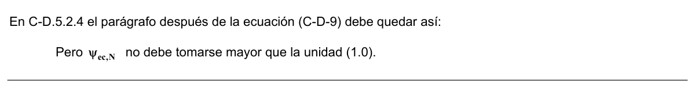

# C-D — Anclaje al concreto

## C-D.1 — Definiciones

Anclaje (Anchor) —Un dispositivo de acero ya sea preinstalado antes de colocar el concreto o postinstalado en un elemento de concreto endurecido y usado para transmitir fuerzas aplicadas, incluidos los tornillos con cabeza, los tornillos con extremo con forma de gancho (J o L), pernos con cabeza, anclajes de expansión, o anclajes con sobreperforación en su base.

Anclaje con sobreperforación en su base (Undercut anchor) — Un anclaje postinstalado que desarrolla su resistencia a la tracción con base en un mecanismo de trabazón proporcionado por la sobreperforación del concreto en el extremo embebido del anclaje. La sobreperforación se logra con un taladro especial antes de instalar el anclaje o de manera alternativa, por medio del mismo anclaje durante su instalación.

Anclaje de expansión (Expansion anchor) — Un anclaje postinstalado, insertado en el concreto endurecido que transfiere cargas hacia y desde el concreto por apoyo directo o fricción, o ambos. Los anclajes de expansión pueden ser de torsión controlada, donde la expansión se obtiene mediante una torsión que actúa en el tornillo o perno; o de desplazamiento controlado, donde la expansión se logra por fuerzas de impacto que actúan en una camisa o tapón y la expansión es controlada por la longitud de desplazamiento de la camisa o tapón.

Anclaje postinstalado (Post-installed anchor) — Un anclaje instalado en el concreto endurecido. Los anclajes de expansión y los anclajes con sobreperforación en su base son ejemplos de anclajes postinstalados.

Anclaje preinstalado (Cast-in anchor) — Un tornillo con cabeza, perno con cabeza, o tornillo con gancho, instalado antes de colocar el concreto.

Área proyectada (Projected area) — El área en la superficie libre del elemento de concreto que se usa para representar la base mayor de la superficie de falla rectilínea supuesta.

Camisa de espaciamiento (Distance sleeve) — Una camisa que envuelve la parte central de un elemento de anclaje con sobreperforación en su base, un elemento de anclaje de expansión de torsión controlada, o un elemento de anclaje de expansión de desplazamiento controlado, pero que no se expande.

Camisa de expansión (Expansion sleeve) — La parte externa de un anclaje de expansión que es forzada hacia afuera por la parte central, ya sea aplicando una torsión o impacto, para apoyarse contra los lados de un orificio perforado previamente.

Distancia al borde (Edge distance) — La distancia desde el borde de la superficie de concreto al centro del anclaje más cercano.

Elemento dúctil de acero (Ductile steel element) — Un elemento con un alargamiento en tracción medido experimentalmente mayor al 14 por ciento, y una reducción de área de al menos un 30 por ciento. Un elemento que cumple con las disposiciones de la NTC 4034 (ASTM A307) se considera un elemento dúctil.

Elemento frágil de acero (Brittle steel element) — Un elemento con un alargamiento en tracción medido experimentalmente menor al 14 por ciento, o una reducción en área de menos del 30 por ciento, o ambos.

Fijación (Aattachment) — Un dispositivo estructural, externo a la superficie del concreto, que transmite o recibe fuerzas de los elementos de anclaje.

Grupo de anclajes (Anchor group) — Un grupo de elementos de anclaje de aproximadamente la misma profundidad de embebido efectivo, en el cual cada elemento de anclaje está espaciado al menos $3h_{ef}$de uno o más anclajes adyacentes al estar sometido a tracción, ó $3c_{a1}$ de uno o más anclajes adyacentes al estar sometido a cortante.

Solamente aquellos anclajes susceptibles de sufrir el modo particular de falla que está bajo investigación pueden ser incluidos en el grupo.

Insertos especiales (Specialty insert) — Anclajes preinstalados para ser instalados antes de la colocación del concreto, prediseñados y prefabricados, diseñados especialmente para fijar conexiones atornilladas o ranuradas. Los insertos especiales se usan con frecuencia para manipular, transportar y levantar, pero también se emplean para anclar elementos estructurales. Estos insertos especiales no están cubiertos dentro del alcance de este apéndice.

Percentil del 5 por ciento (Five percent fractile) — Un término estadístico que significa un 90 por ciento de confianza de que existe un 95 por ciento de probabilidad de que la resistencia real exceda a la resistencia nominal.

Perno con cabeza (Headed stud) — Un anclaje de acero que cumple con los requisitos de la AWS D1.1, fijado a una platina o aditamento de acero similar, mediante el proceso de soldadura de arco, antes de colocar el concreto.

Profundidad efectiva de embebido (Effective embedment depth) — Profundidad total a través de la cual el anclaje transfiere fuerzas hacia o desde el concreto que lo rodea. La profundidad efectiva de embebido generalmente es la profundidad de la superficie de falla del concreto en las aplicaciones en tracción. Para tornillos con cabeza preinstalados y pernos con cabeza, la profundidad efectiva de embebido se mide desde la superficie de contacto de apoyo de la cabeza.

Refuerzo suplementario (Supplementary reinforcement) — Refuerzo colocado para restringir el prisma de falla potencial por arrancamiento del concreto, pero que no está diseñado para transferir la carga total de diseño desde los anclajes hacia el elemento estructural.

Refuerzo del anclaje (Anchor reinforcement) — Refuerzo usado para transferir toda la fuerza de diseño desde los anclajes hacia el elemento estructural. Véase C-D.5.2.9 ó C-D.6.2.9.

Resistencia al arrancamiento del concreto por tracción del anclaje (Concrete breakout strength) — Resistencia de un volumen de concreto que rodea al anclaje o grupo de anclajes, para desprenderse del elemento.

Resistencia a la extracción por deslizamiento del anclaje (Anchor pullout strength) — Resistencia del anclaje o un componente principal del dispositivo de anclaje que se desliza fuera del concreto sin romper una parte sustancial del concreto que lo rodea.

Resistencia al desprendimiento del concreto por cabeceo del anclaje (Concrete pryout strength) — Resistencia que corresponde a la formación en anclajes cortos y rígidos de un descascaramiento de concreto detrás de elementos y en dirección opuesta a la fuerza cortante aplicada.

Resistencia al desprendimiento lateral del concreto (Side-face blowout strength) — Resistencia de los anclajes con mayor profundidad de embebido, pero con menor espesor del recubrimiento lateral, que corresponde a un descascaramiento del concreto que rodea la cara lateral de la cabeza embebida, sin que ocurran arrancamientos mayores en la parte superior de la superficie de concreto.

Tornillo con gancho (Hooked bolt) — Un anclaje preinstalado embebido anclado principalmente por el apoyo de un doblez en 90° (extremo en L) o un gancho en 180° (extremo en J) contra el concreto, en su extremo embebido, con un valor mínimo $e_{h}$ mayor que $3d_{a}$ .

## C-D.2 — Alcance

**C-D.2.1** — Este apéndice proporciona los requisitos de diseño para los anclajes en el concreto, utilizados para transmitir las cargas estructurales por medio de tracción, cortante o combinación de tracción y cortante, entre (a) elementos estructurales conectados; o (b) aditamentos y elementos estructurales relacionadas con la seguridad. Los niveles de seguridad especificados están orientados a las condiciones durante la vida útil más que a situaciones durante la construcción o manejo de corta duración.

<!-- mod:3-decreto-945-2017-63 -->
> **Modificación — Decreto 945 de 2017** · anexo, p. 33
>
> Se agrega al final: «El presente Apéndice C-D del Reglamento NSR-10 está basado en el Apéndice D del documento ACI 318-08. El Apéndice D del documento ACI 318-11 introdujo modificaciones importantes, especialmente en el uso de anclajes adheridos sometidos a tracción, por esta razón se permite la utilización del Apéndice D del documento ACI 318S-11 en español, publicado por la Seccional Colombiana del Instituto Americano del Concreto, ACI, para determinar el grado de seguridad de cualquier aplicación de anclajes adheridos sometidos a tracción.»

**C-D.2.2** — Este apéndice se refiere tanto a los anclajes preinstalados antes de la colocación del concreto como a anclajes postinstalados. No se incluyen insertos especiales, tornillos pasantes, anclajes múltiples conectados a una sola platina de acero en el extremo embebido de los anclajes, anclajes pegados o inyectados con mortero, ni anclajes directos como pernos o clavos instalados neumáticamente o utilizando pólvora. El refuerzo utilizado como parte del anclaje debe diseñarse de acuerdo con otras partes de este Título C del Reglamento NSR-10.

**C-D.2.3** — Se incluyen los pernos con cabeza y tornillos con cabeza, los cuales poseen una geometría que ha demostrado tener una resistencia a la extracción por deslizamiento en concreto no fisurado igual o superior a $1.4N_{p}$ (donde $N_{p}$ está dado por la ecuación (C-D-15)). Se incluyen los tornillos con gancho que tienen una geometría que ha demostrado dar una resistencia a la extracción por deslizamiento en concreto no fisurado igual o superior a $1.4N_{p}$ sin considerar el beneficio de la fricción (donde $N_{p}$ está dado por la ecuación (C-D-16)). Se incluyen los anclajes postinstalados que cumplen con los requisitos de evaluación del ACI 355.2. La bondad de los anclajes postinstalados para el uso en concreto debe quedar demostrada por medio de los ensayos de calificación previa del ACI 355.2.

**C-D.2.4** — Las aplicaciones con carga que sean predominantemente ciclos de fatiga fuertes o cargas de impacto no están cubiertas por este Apéndice.

## C-D.3 — Requisitos generales

**C-D.3.1** — Los anclajes y grupos de anclajes deben diseñarse para los efectos críticos producidos por las cargas mayoradas determinadas por medio de un análisis elástico. Se permite el enfoque del análisis plástico cuando la resistencia nominal está controlada por elementos de acero dúctiles y siempre que se tenga en cuenta la compatibilidad de deformaciones.

**C-D.3.2** — La resistencia de diseño de los anclajes debe ser igual o exceder la resistencia mayorada calculada con las combinaciones de cargas de C.9.2 ó C-C.9.2.

**C-D.3.3** — Cuando el diseño de un anclaje incluye fuerzas sísmicas para estructuras con capacidad de disipación moderada (DMO) y especial (DES), se deben cumplir los requisitos adicionales de C-D.3.3.1 a C-D.3.3.6.

**C-D.3.3.1** — Las disposiciones del Apéndice C-D no son aplicables al diseño de anclajes en las zonas de articulación plástica de estructuras de concreto sometidas a fuerzas sísmicas.

**C-D.3.3.2** — Los anclajes estructurales postinstalados deben estar calificados para su uso en concreto agrietado y deben cumplir con los Ensayos de Simulación Sísmica de acuerdo con el ACI 355.2. La resistencia a la extracción por deslizamiento $N_{p}$ y la resistencia del acero del anclaje en cortante $V_{sa}$ deben basarse en los resultados del ACI 355.2 – Ensayos de Simulación Sísmica.

**C-D.3.3.3** — La resistencia de diseño del anclaje asociado con modos de falla del concreto debe tomarse como $0.75 φN_{n}$ y $0.75 φV_{n}$, donde $φ$ es dado en C-D.4.4 ó C-D.4.5 y $N_{n}$ y $V_{n}$ se determinan según C-D.5.2, C-D.5.3, C- D.5.4, C-D.6.2 y C-D.6.3 suponiendo que el concreto está agrietado, a menos que se demuestre que el concreto se mantiene sin agrietar.

**C-D.3.3.4** — Se deben diseñar los anclajes de manera que estén controlados por la resistencia del acero de un elemento de acero dúctil de acuerdo con C-D.5.1 y C-D.6.1, a menos que se cumpla con C-D.3.3.5 ó C-D.3.3.6.

**C-D.3.3.5** — En lugar de C-D.3.3.4, el aditamento que el anclaje conecta a la estructura debe ser diseñado de manera que la fijación llegue a fluencia dúctil con el nivel de carga correspondiente a fuerzas de anclaje no mayores que la resistencia de diseño de los anclajes especificada en C-D.3.3.3.

**C-D.3.3.6** — Como alternativa a C-D.3.3.4 y C-D.3.3.5, se permite tomar la resistencia de diseño de los anclajes como 0.4 veces la resistencia de diseño determinada con C-D.3.3.3. Para el anclaje de muros de carga de aporticamiento ligero, se permite tomar la resistencia de diseño de los anclajes como 0.5 veces la resistencia de diseño determinada con C-D.3.3.3.

**C-D.3.4** — El factor de modificación $λ$ para concreto de peso liviano en este Apéndice debe estar de acuerdo con 8.6.1 a menos que se especifique de otro modo.

**C-D.3.5** — Los valores de $f_{c}'$ usados para los cálculos en este apéndice, no deben exceder 70 MPa para los anclajes preinstalados y 55 MPa para los anclajes postinstalados. Se requieren ensayos para los anclajes postinstalados cuando se emplean en concreto con $f_{c}'$ mayor a 55 MPa.

## C-D.4 — Requisitos generales para la resistencia de los anclajes

**C-D.4.1** — El diseño por resistencia de los anclajes debe basarse en cálculos que empleen modelos de diseño que satisfagan los requisitos de C-D.4.2, o bien con base en resultados de ensayos, utilizando un percentil del 5 por ciento de los resultados de ensayo para lo siguiente:

(a) Resistencia a tracción del acero del anclaje (C-D.5.1).

(b) Resistencia al cortante del acero del anclaje (C-D.6.1).

(c) Resistencia al arrancamiento del concreto de anclaje por tracción (C-D.5.2).

(d) Resistencia al arrancamiento del concreto de anclaje por cortante (C-D.6.2).

(e) Resistencia a la extracción por deslizamiento del anclaje por tracción (C-D.5.3).

(f) Resistencia al desprendimiento lateral del concreto de anclaje por tracción (C-D.5.4), y

(g) Resistencia al desprendimiento del concreto por cabeceo del anclaje por cortante (C-D.6.3).

Además, los anclajes deben cumplir las distancias al borde, espaciamiento y espesor para evitar las fallas por hendimiento, como lo exige C-D.8.

#### C-D.4.1.1 — Para el diseño de los anclajes, salvo lo exigido en C-D.3.3,

$φN_{n}≥N_{ua}$(C-D-1) $φV_{n}≥V_{ua}$(C-D-2)

**C-D.4.1.2** — En las ecuaciones (C-D-1) y (C-D-2), $φN_{n}$ y $φV_{n}$ son las resistencias de diseño más bajas determinadas para todas las modalidades pertinentes de falla. $φN_{n}$ es la resistencia de diseño más baja en tracción de un anclaje o grupos de anclajes, determinada según las consideraciones de $φN_{sa}$,$φnN_{pn}$, ya sea $φN_{sb}$ ó $φN_{sbg}$, y $φN_{cb}$ ó $φN_{cbg}$.$φV_{n}$ es la resistencia de diseño más baja para cortante de un anclaje o un grupo de anclajes determinada de las consideraciones de $φV_{sa}$, ya sea $φV_{cb}$ ó $φV_{cbg}$, y $φV_{cp}$ ó $φV_{cpg}$.

**C-D.4.1.3** — Cuando se encuentran presentes tanto $N_{ua}$ como $V_{ua}$, se deben considerar los efectos de interacción, de acuerdo con C-D.4.3.

**C-D.4.2** — La resistencia nominal para cualquier anclaje o grupo de anclajes debe basarse en los modelos de diseño que resulten en predicciones de resistencia que concuerden sustancialmente con los resultados de ensayos de amplio alcance. Los materiales empleados en los ensayos deben ser compatibles con los materiales usados en la estructura.

La resistencia nominal debe basarse en el percentil de 5 por ciento de la resistencia básica individual del anclaje. Para resistencias nominales relacionadas con la resistencia del concreto, deben considerarse las modificaciones debido a efectos del tamaño, el número de anclajes, los efectos del espaciamiento reducido de los anclajes, proximidad a los bordes, espesor del elemento de concreto, solicitaciones excéntricas de grupos de anclajes y la presencia o ausencia de fisuración. Los límites para las distancias a los bordes y espaciamiento entre los anclajes establecidos en los modelos de diseño deben ser congruentes con los utilizados en los ensayos que se utilicen para verificar el modelo.

**C-D.4.2.1** — En los modelos de diseño usados para cumplir con C-D.4.2, se puede incluir el efecto del refuerzo colocado para restringir el arrancamiento del concreto. Donde se coloca refuerzo del anclaje, según C-D.5.2.9 y C- D.6.2.9, no se requieren cálculos para la resistencia al arrancamiento del concreto, según C-D.5.2 y C-D.6.2.

**C-D.4.2.2** — Para anclajes con diámetros que no excedan 50 mm, y profundidades de embebido que no excedan 635 mm, las exigencias para prevenir el arrancamiento del concreto se deben considerar satisfechas si se cumple con los procedimientos de diseño de C-D.5.2 y C-D.6.2.

**C-D.4.3** — Para el diseño para cargas de tracción y cortante que actúan en forma simultánea se debe usar una expresión de interacción que resulte en una resistencia que concuerde con los resultados de ensayos exhaustivos. Se debe considerar que C-D.7 satisface dichos requisitos.

**C-D.4.4** — Cuando se usan las combinaciones de carga de C.9.2, los factores de reducción de resistencia $φ$ para anclajes en concreto deben ser:

a) Anclaje controlado por la resistencia de un elemento de acero dúctil

i) Cargas de tracción$..........................$0.75 ii) Fuerza cortante$...............................$0.65

b) Anclaje controlado por la resistencia de un elemento de acero frágil

i) Cargas de tracción$..........................$0.65 ii) Fuerza cortante$...............................$0.60

c) Anclaje controlado por la resistencia al arrancamiento, desprendimiento lateral, extracción por deslizamiento o desprendimiento por cabeceo del anclaje Condición A Condición B

i) Cargas de cortante 0.75 0.70 ii) Cargas de tracción Pernos con cabeza, tornillos con cabeza o con gancho preinstalados 0.75 0.70 Anclajes postinstalados de acuerdo con las categorías de ACI 355.2 Categoría 1 0.75 0.65 (Baja sensibilidad a la instalación y confiabilidad alta) Categoría 2 0.65 0.55 (Sensibilidad media a la instalación y confiabilidad mediana) Categoría 3 0.55 0.45 (Alta sensibilidad y confiabilidad baja) La condición A se aplica donde existe refuerzo suplementario excepto para resistencia a la extracción por deslizamiento o al desprendimiento por cabeceo del anclaje.

La condición B se aplica donde no existe refuerzo suplementario, o donde controla la resistencia a la extracción por deslizamiento o al desprendimiento por cabeceo del anclaje.

**C-D.4.5** — Cuando se usan las combinaciones de carga del Apéndice C, el factor de reducción de resistencia $φ$ para los anclajes en el concreto debe ser:

a) Anclaje controlado por la resistencia de un elemento de acero dúctil

i) Cargas de tracción$..........................$0.80 ii) Fuerza cortante$...............................$0.75

b) Anclaje controlado por la resistencia de un elemento de acero frágil

i) Cargas de tracción$..........................$0.70 ii) Fuerza cortante$...............................$0.65

c) Anclaje controlado por la resistencia al arrancamiento, desprendimiento lateral, deslizamiento del anclaje, o desprendimiento por cabeceo del anclaje.

Condición A Condición B

i) Fuerza cortante 0.85 0.75 ii) Cargas de tracción Conectores, pernos con cabeza, o pernos con gancho embebidos 0.85 0.75 Anclajes postinstalados de alguna categoría, según lo determina el ACI 355.2 Categoría 1 0.85 0.75 (Baja sensibilidad a la instalación y alta confiabilidad) Categoría 2 0.75 0.65 (Sensibilidad media a la instalación y mediana confiabilidad) Categoría 3 0.65 0.55 (Alta sensibilidad y Confiabilidad baja) La condición A se aplica donde existe refuerzo suplementario excepto para resistencia a la extracción por deslizamiento o al desprendimiento por cabeceo del anclaje.

La condición B se aplica donde no existe refuerzo suplementario, o donde controla la resistencia a la extracción por deslizamiento o al desprendimiento por cabeceo del anclaje.

## C-D.5 — Requisitos de diseño para cargas de tracción

### C-D.5.1 — Resistencia del acero de un anclaje en tracción

**C-D.5.1.1** — La resistencia nominal de un anclaje en tracción controlada por el acero, $N_{sa}$, debe ser evaluada mediante cálculos basados en las propiedades del material del anclaje y en las dimensiones físicas del anclaje.

**C-D.5.1.2** — La resistencia nominal de un solo anclaje o grupo de anclajes en tracción, $N_{sa}$, no debe exceder:

$N_{sa}=nA_{se,N} f_{uta}$(C-D-3) Donde $n$ es el número de anclajes en el grupo, $A_{se,N}$ es el área transversal efectiva del anclaje en tracción, mm2, y $f_{uta}$ no debe ser mayor que el menor de $1.9f_{ya}$ ó 860 MPa.

### C-D.5.2 — Resistencia al arrancamiento del concreto de un anclaje en tracción

**C-D.5.2.1** — La resistencia nominal de arrancamiento del concreto, $N_{cb}$ ó $N_{cbg}$ de un solo anclaje o grupo de anclajes en tracción no debe exceder de:

(a) para un solo anclaje:

$A_{Nc}$

$N_{cb}=ψ_{ed,N}ψ_{c,N}ψ_{cp,N}N_{b}$(C-D-4) $A_{Nco}$

(b) para un grupo de anclajes:

$A_{Nc}$

$N_{cbg}=ψ_{ec,N}ψ_{ed,N}ψ_{c,N}ψ_{cp,N}N_{b}$(C-D-5) $A_{Nco}$ Los factores $ψ_{ec,N}$,$ψ_{ed,N}$,$ψ_{c,N}$, y $ψ_{cp,N}$ se encuentran definidos en C-D.5.2.4, C-D.5.2.5, C-D.5.2.6 y C-D.5.2.7 respectivamente. $A_{Nc}$ es el área proyectada de la superficie de falla para un solo anclaje o grupo de anclajes, que debe ser aproximada a la base de la figura geométrica rectilínea que resulta al proyectar la superficie de falla hacia fuera en $1.5h_{ef}$ desde la línea del eje del anclaje o, en el caso de un grupo de anclajes, desde una línea a través de una fila de anclajes adyacentes. $A_{Nc}$ no debe exceder a $nA_{Nco}$, donde $n$ es el número de anclajes en tracción en el grupo. $A_{Nco}$ es el área proyectada de la superficie de falla de un solo anclaje con una distancia del borde igual o mayor a $1.5h_{ef}$.

$A_{Nco}=9h_{ef}^{2}$(C-D-6)

**C-D.5.2.2** — La resistencia básica al arrancamiento del concreto de un solo anclaje en tracción embebido en concreto fisurado, $N_{b}$ , no debe exceder de

$N_{b}=k_{c}λ\sqrt{f_{c}^{'} }h^{1.5}_{ef}$(C-D-7) donde

$k_{c}=10$ para los anclajes preinstalados, y

$k_{c}=7$ para los anclajes postinstalados.

Se debe permitir que el valor de $k_{c}$ para anclajes postinstalados sea incrementado sobre 7 basándose en los ensayos específicos para productos del ACI 355.2, pero en ningún caso puede exceder de 10.

De manera alternativa, para pernos con cabeza preinstalados con 280 mm$≤h_{ef}≤$635 mm ,$N_{b}$ no debe exceder de:

$N_{b}=3.9λ\sqrt{f_{c} '}h_{ef}^{5/3}$(C-D-8)

**C-D.5.2.3** — Donde los anclajes se ubican a menos de $1.5h_{ef}$, de tres o más bordes, el valor de $h_{ef}$ usado en las ecuaciones (C-D-4) a la (C-D-11) debe ser mayor entre $c_{a,\text{máx}}/1.5$ y un tercio del espaciamiento máximo entre los anclajes dentro del grupo.

**C-D.5.2.4** — El factor de modificación para grupos de anclajes sometido a cargas excéntricas de tracción es:

$$ \psi_{ec,N} = \dfrac{1}{\left(1 + \dfrac{2e'_N}{3h_{ef}}\right)} $$

(C-D-9) Pero$ψ_{ec,N}$ no debe tomarse menor que la unidad (1.0).

Si la carga sobre un grupo de anclajes es tal que sólo algunos anclajes se encuentran en tracción, únicamente esos anclajes que se encuentran en tracción deben considerarse para determinar la excentricidad $e_{N}'$ en la ecuación (C-D- 9) y para calcular $N_{cbg}$ en la ecuación (C-D-5).

Cuando las cargas excéntricas existen alrededor de dos ejes, el factor de modificación, $ψ_{ec,N}$, debe calcularse para cada eje individualmente y el producto de esos factores debe usarse como $ψ_{ec,N}$, en la ecuación (C-D-5).

<!-- mod:2-decreto-340-2012-30 -->
> **Modificación — Decreto 340 de 2012** · anexo, p. 7
>
> En C-D.5.2.4 el parágrafo después de la ecuación (C-D-9) debe quedar así:
>
> 

**C-D.5.2.5** — El factor de modificación para los efectos del borde para anclajes solos o grupos de anclajes en tracción es:

$ψ_{ed,N}=1$si$c_{a,\text{mín}}≥1.5h_{ef}$(C-D-10) $c_{a,\text{mín}}$

$ψ_{ed,N}=0.7+0.3$si$c_{a,\text{mín}}<1.5h_{ef}$(C-D-11) $1.5h_{ef}$

**C-D.5.2.6** — Para anclajes ubicados en una región de un elemento de concreto, donde los análisis señalan que no hay fisuración para niveles de cargas de servicio, se permite el siguiente factor de modificación:

$ψ_{c,N}=1.25$ para anclajes preinstalados

$ψ_{c,N}=1.4$ para anclajes postinstalados, donde el valor de $k_{c}$ usado en la ecuación (C-D-7) es igual a 7.

Cuando el valor de $k_{c}$ usado en la ecuación (C-D-7) se toma de ACI 355.2 para anclajes postinstalados, calificados para ser utilizados en concreto fisurado y no fisurado, los valores de $k_{c}$ y de $ψ_{c,N}$ deben basarse en el informe para evaluación de productos del ACI 355.2.

Cuando el valor de $k_{c}$ usado en la ecuación (C-D-7) se tome del informe para evaluación de productos del ACI 355.2 para anclajes postinstalados, calificados para ser utilizados únicamente en concreto no fisurado, $ψ_{c,N}$ debe tomarse como 1.0.

Cuando el análisis indica fisuración para niveles de cargas de servicio, $ψ_{c,N}$, debe tomarse igual a 1.0 para ambos anclajes, preinstalados y postinstalados. Los anclajes postinstalados deben ser calificados para su empleo en concreto fisurado de acuerdo con el ACI 355.2. La fisuración en el concreto debe ser controlada mediante refuerzo de flexión distribuido de acuerdo con 10.6.4 ó un control de fisuración equivalente proporcionado mediante refuerzo de confinamiento.

**C-D.5.2.7** — El factor de modificación para anclajes postinstalados diseñados para concreto no fisurado de acuerdo con C-D.5.2.6 sin refuerzo suplementario para controlar el hendimiento, $ψ_{cp,N}$ debe calcularse como sigue utilizando la distancia crítica$c_{ac}$ como se define en C-D.8.6:

$ψ_{cp,N}=1.0$ si$ca,min≥c_{ac}$(C-D-12)

$ψ_{cp,N}=c_{a,\text{mín}}$ si$ca,min<c_{ac}$(C-D-13) $c_{ac}$ Pero$ψ_{cp,N}$ determinado por medio de la ecuación (C-D-13) no debe tomarse menor que $1.5h_{ef}/c_{ac}$donde la distancia crítica$c_{ac}$, se encuentra definida en C-D.8.6.

Para todos los demás casos, incluyendo los anclajes preinstalados, $ψ_{cp,N}$, debe tomarse como 1.0.

**C-D.5.2.8** — Cuando se agrega una platina adicional o arandela a la cabeza del anclaje, se puede calcular el área proyectada de la superficie de falla, proyectando la superficie de falla $1.5h_{ef}$ hacia afuera del perímetro efectivo de la platina o arandela. El perímetro efectivo no debe exceder el valor en una sección proyectada hacia fuera más del espesor de la arandela o platina desde el borde exterior de la cabeza del anclaje.

**C-D.5.2.9** — Donde el refuerzo del anclaje se desarrolla de acuerdo al Capítulo C.21 a ambos lados de la superficie de arrancamiento, se permite usar la resistencia de diseño del refuerzo del anclaje para determinar $φN_{n}$, en lugar de la resistencia al arrancamiento del concreto. En el diseño del refuerzo del anclaje, se permite usar un factor de reducción de resistencia de 0.75.

<!-- mod:1-decreto-092-2011-153 -->
> **Modificación — Decreto 092 de 2011** · anexo, p. 33
>
> En C-D.5.2.9 la referencia al Capítulo C.21 debe ser al Capítulo C.12.

**C-D.5.3** — Resistencia a la extracción por deslizamiento de un anclaje en tracción

**C-D.5.3.1** — La resistencia nominal a la extracción por deslizamiento de un anclaje en tracción, $N_{pn}$, no debe exceder:

$N_{pn}= ψ_{c,P}N_{p}$(C-D-14) donde $ψ_{c,P}$ se identifica en C-D.5.3.6.

**C-D.5.3.2** — Para los anclajes de expansión postinstalados y anclajes con sobreperforación en su base los valores de$N_{p}$ deben basarse en los resultados con un porcentil del 5 por ciento de ensayos realizados y evaluados de acuerdo con el ACI 355.2. No se permite determinar la resistencia a la extracción por deslizamiento para esos anclajes por cálculo.

**C-D.5.3.3** — Para pernos preinstalados con cabeza y tornillos con cabeza individuales, se puede evaluar la resistencia a la extracción por deslizamiento usando D.5.3.4. Para tornillos individuales con extremo en forma de L o J, se puede evaluar la resistencia a la extracción por deslizamiento en tracción usando C-D.5.3.5. Alternativamente, se pueden usar valores de $N_{p}$ basados en los resultados de ensayos con un percentil del 5 por ciento de ensayos realizados y evaluados de la misma manera que los procedimientos del ACI 355.2, pero sin el beneficio de la fricción.

**C-D.5.3.4** — La resistencia a la extracción por deslizamiento a tracción de un perno o tornillo con cabeza individual, N p, para ser empleada en la ecuación (C-D-14) no debe exceder:

$N_{p}=8A_{brg} f_{c}'$(C-D-15)

**C-D.5.3.5** — La resistencia a la extracción por deslizamiento por tracción de un tornillo individual con gancho, N p, para ser empleada en la ecuación (C-D-14) no debe exceder:

$N_{p}=0.9f_{c} 'e_{h} d_{a}$(C-D-16) donde $3d_{a}≤e_{h}≤4.5d_{a}$

**C-D.5.3.6** — Para un anclaje ubicado en una región de un elemento de concreto, donde el análisis indica que no existen fisuras para niveles de carga de servicio, se permite el siguiente factor de modificación:

$ψ_{c,P}=1.4$ Cuando el análisis indica fisuración al nivel de cargas de servicio, $ψ_{c,P}$ debe ser tomado como 1.0.

**C-D.5.4** — Resistencia al desprendimiento lateral del concreto en un anclaje con cabeza en tracción

**C-D.5.4.1** — Para un anclaje individual con cabeza con un embebido profundo cercano a un borde $h_{ef}>2.5c_{a1}$, la resistencia nominal al desprendimiento lateral, Nsb, no debe exceder:

$N_{sb}=13c_{a1}\sqrt{A_{brg}}λ\sqrt{f_{c}'}$(C-D-17) Si$c_{a2}$ para el perno con cabeza individual es menos que $3c_{a1}$, el valor de $N_{sb}$ debe multiplicarse por el factor $(1+c_{a2}/c_{a1})/4$ donde $1.0≤c_{a2}/c_{a1}≤3.0$.

**C-D.5.4.2** — Para un grupo de anclajes con cabeza con embebido profundo localizados cerca a un borde $(h_{ef}>2.5c_{a1})$ y con un espaciamiento entre los anclajes menor que $6c_{a1}$, la resistencia nominal de esos anclajes susceptibles a una falla por desprendimiento lateral del concreto $N_{sbg}$ no debe exceder:

$$ N_{sbg} = \left(1 + \dfrac{s}{6c_{a1}}\right)N_{sb} $$

(C-D-18) donde $s$ es el espaciamiento de los anclajes exteriores a lo largo del borde y $N_{sb}$ se obtiene de la ecuación (C-D-17) sin modificaciones debido a la distancia perpendicular al borde.

## C-D.6 — Requisitos de diseño para solicitaciones de cortante

### C-D.6.1 — Resistencia del acero del anclaje sometido a cortante

**C-D.6.1.1** — La resistencia nominal de un anclaje a cortante cuando está controlada por el acero $V_{sa}$ debe ser evaluada por cálculo con base en las propiedades del material del anclaje y las dimensiones físicas del anclaje.

**C-D.6.1.2** — La resistencia nominal de un anclaje individual o de un grupo de anclajes en cortante, $V_{sa}$ no debe exceder lo establecido de (a) hasta (c):

(a) Para conectores preinstalados

$V_{sa}=nA_{se,V} f_{uta}$(C-D-19) donde $n$ es el número de anclajes en el grupo, $A_{se,V}$ es el área transversal efectiva del anclaje en cortante, mm2, y $f_{uta}$ no debe tomarse mayor que el menor entre $1.9f_{ya}$ y 860 MPa.

(b) Para anclajes preinstalados de tornillo con cabeza o con gancho y para anclajes postinstalados donde las camisas no se extienden a través del plano de cortante

$V_{sa}=n0.6A_{se,V} f_{uta}$(C-D-20) donde $n$ es el número de anclajes en el grupo, $A_{se,V}$ es el área transversal efectiva del anclaje en cortante, pulg2, y $f_{uta}$ no debe tomarse mayor que el menor entre $1.9f_{ya}$ ó 860 MPa.

(b) Para anclajes postinstalados donde las camisas se extienden a través del plano de cortante, $V_{sa}$ debe basarse en los resultados de los ensayos realizados y evaluados de acuerdo con el ACI 355.2. De manera alternativa, se permite usar la ecuación (C-D-20).

<!-- mod:2-decreto-340-2012-31 -->
> **Modificación — Decreto 340 de 2012** · anexo, p. 7
>
> En el literal (b) de C-D.6.1.2 donde dice “pulg2” debe ser “en mm2”.

**C-D.6.1.3** — Cuando los anclajes se usan con platinas de apoyo inyectadas con mortero, las resistencias nominales de C-D.6.1.2 deben multiplicarse por un factor igual a 0.80.

### C-D.6.2 — Resistencia al arrancamiento del concreto de anclajes a cortante

**C-D.6.2.1** — La resistencia nominal al arrancamiento del concreto, Vcb o Vcbg, en cortante de un anclaje individual o de un grupo de anclajes no debe exceder:

(a) Para una fuerza cortante perpendicular al borde sobre un anclaje individual:

$A_{Vc}$

$V_{cb}=ψ_{ed,V}ψ_{c,V}ψ_{h,V}V_{b}$(C-D-21) $A_{Vco}$

(b) Para una fuerza cortante perpendicular al borde sobre un grupo de anclajes:

$A_{Vc}$

$V_{cbg}=ψ_{ec,V}ψ_{ed,V}ψ_{c,V}ψ_{h,V}V_{b}$(C-D-22) $A_{Vco}$

(c) Para una fuerza cortante paralela a un borde, se permite que $V_{cb}$ ó $V_{cbg}$ sea el doble del valor de la fuerza cortante determinada por las ecuaciones (C-D-21) o (C-D-22), respectivamente, suponiendo que la fuerza cortante actúa perpendicular al borde con $ψ_{ed,V}$ tomado igual a 1.0.

(d) Para anclajes ubicados en una esquina, la resistencia nominal límite al arrancamiento del concreto debe ser determinada para cada borde, y debe usarse el valor mínimo.

Los factores $ψ_{ec,V}$,$ψ_{ed,V}$,$ψ_{c,V}$ y $ψ_{h,V}$ se encuentran definidos en C-D.6.2.5, C-D.6.2.6, C-D.6.2.7 y C-D.6.2.8, respectivamente. $V_{b}$ es el valor de la resistencia básica al arrancamiento del concreto por cortante para un solo anclaje. $A_{Vc}$ es el área proyectada de la superficie de falla sobre un lado del elemento de concreto en su borde, para un anclaje individual o para un grupo de anclajes. Se permite evaluar $A_{V,c}$ como el área proyectada de la superficie de falla sobre la cara lateral del elemento para anclajes individuales y grupos de anclajes. Se permite evaluar $A_{V,c}$como la base de medio tronco de pirámide proyectada a la cara lateral del elemento donde la parte superior de la media pirámide está definida por el eje de la fila de anclajes seleccionada como crítica. El valor de $c_{a1}$ debe tomarse como la distancia desde el borde hasta dicho eje. $A_{V,c}$ no debe exceder a $nA_{Vco}$, donde $n$ es el número de anclajes del grupo.

$A_{Vco}$ es el área proyectada para un anclaje individual en un elemento alto con una distancia al borde igual o mayor que$1.5c_{a1}$ en dirección perpendicular a la fuerza cortante. Se permite evaluar $A_{Vco}$ como la base de una media pirámide con una longitud lateral paralela al borde de $3c_{a1}$ y una profundidad de $1.5c_{a1}$:

$A_{Vco}=4.5 (c_{a1})2$(C-D-23) Cuando los anclajes se encuentran ubicados a distintas distancias del borde y los anclajes están soldados al aditamento de manera que distribuya la fuerza a todos los anclajes, se puede evaluar la resistencia basándose en la distancia desde el borde hasta la fila de anclajes más alejada. En este caso, se puede basar el valor $c_{a1}$ en la distancia desde el borde al eje de la fila de anclajes más alejada que fue seleccionada como crítica, y se debe suponer que toda la fuerza cortante será resistida sólo por esta fila crítica de anclajes.

**C-D.6.2.2** — La resistencia básica al arrancamiento por cortante del concreto de un anclaje individual en concreto fisurado, $V_{b}$ , no debe exceder:

$$ V_b = 0.6\left(\dfrac{\ell_e}{d_a}\right)^{0.2}\sqrt{d_a}\,\lambda\sqrt{f'_c}\left(c_{a1}\right)^{1.5} $$

(C-D-24) donde $ℓ_{e}$ es la longitud de apoyo de carga del anclaje en cortante:

$ℓ_{e}=h_{ef}$ para anclajes de rigidez constante en toda la sección de longitud de embebido, tal como anclajes con cabeza y anclajes postinstalados con una camisa tubular en toda la longitud de embebido,

$ℓ_{e}=2d_{a}$ para anclajes de expansión de torque controlado con una camisa distanciadora separada de la camisa de expansión, y $ℓ_{e}≤8d_{a}$ en los otros casos.

**C-D.6.2.3** — Para los pernos con cabeza, tornillos con cabeza o con gancho, preinstalados, que están soldados en forma continua a aditamentos de acero, con un espesor mínimo igual al mayor entre 10 mm y a la mitad del diámetro del anclaje, la resistencia básica al arrancamiento del concreto en cortante de un solo anclaje en concreto fisurado, $V_{b}$ , no debe exceder:

$$ V_b = 0.66\left(\dfrac{\ell_e}{d_a}\right)^{0.2}\sqrt{d_a}\,\lambda\sqrt{f'_c}\left(c_{a1}\right)^{1.5} $$

(C-D-25) donde $ℓ_{e}$ se define en C-D.6.2.2 y siempre que:

(a) para un grupo de anclajes, la resistencia sea determinada con base en la resistencia de la fila de anclajes más alejada del borde;

(b) el espaciamiento de los anclajes, $s$ , no sea menor de 65 mm.; y

(c) se coloque refuerzo suplementario en las esquinas si $c_{a2}≤1.5h_{ef}$.

**C-D.6.2.4** — Donde los anclajes están influenciados por tres o más bordes, el valor de $c_{a1}$ empleado en las ecuaciones (C-D-23) a la (C-D-29) no debe exceder al mayor de $c_{a2}/1.5$ en cualquier dirección, $h_{a}/1.5$ y un tercio del espaciamiento máximo entre los anclajes dentro del grupo.

**C-D.6.2.5** — El factor de modificación para grupos de anclajes cargados excéntricamente, $ψ_{ec,V}$, debe calcularse como $1$

$ψ_{ec,V}=$ (C-D-26) $2e_{v}'$ $1+$ $3c_{a1}$ Pero $ψ_{ec,V}$ no debe tomarse mayor que la unidad (1.0).

Si la carga en un grupo de anclajes es tal que solo algunos anclajes se encuentran cargados en corte en la misma dirección, solo esos anclajes que se encuentran cargados en corte en la misma dirección pueden ser considerados al determinar la excentricidad $e_{V}'$ para ser usada en la ecuación (C-D-26) y para calcular $V_{cbg}$ en la ecuación (C-D-22).

**C-D.6.2.6** — El factor de modificación para el efecto del borde para anclajes sencillos o grupos de anclajes cargados en cortante es:

$ψ_{ed,V}=1.0$si$c_{a2}≥1.5c_{a1}$ (C-D-27) $c_{a2}$

$ψ_{ed,V}=0.7+0.3$si$c_{a2}<1.5c_{a1}$ (C-D-28) $1.5c_{a1}$

**C-D.6.2.7** — Para anclajes ubicados en una región de un elemento de concreto donde el análisis indica que no hay fisuración debido a cargas de servicio, se permite el siguiente factor de modificación:

$ψ_{c,V}=1.4$ Para anclajes ubicados en una región de un elemento de concreto, donde el análisis indica fisuración para niveles de cargas de servicio, se permiten los siguientes factores de modificación:

$ψ_{c,V}=1.0$ para anclajes en concreto fisurado sin refuerzo suplementario o refuerzo de borde menor que una barra de diámetro No. 4 (1/2”) ó 12M (12 mm);

$ψ_{c,V}=1.2$ para anclajes en concreto fisurado con refuerzo consistente en barras de diámetro No. 4 (1/2”) ó 12M (12 mm), o mayor, localizadas entre el anclaje y el borde; y

$ψ_{c,V}=1.4$ para anclajes en concreto fisurado con refuerzo consistente en una barra de diámetro No. 4 (1/2”) ó 12M (12 mm), o mayor, localizada entre el anclaje y el borde, y con el refuerzo confinado por estribos espaciados a no más de 100 mm.

**C-D.6.2.8** — Para anclajes ubicados en un elementos de concreto, donde$h_{a}<1.5c_{a1}$,$ψ_{h,V}$debe calcularse así: $\sqrt{1.5c_{a1}}$

$ψ_{h,V}=$(C-D-29) $h_{a}$ Pero $ψ_{h,V}$no debe tomarse menor que la unidad (1.0).

**C-D.6.2.9** — Donde el refuerzo del anclaje se desarrolla de acuerdo al Capítulo C.12, a ambos lados de la superficie de ruptura, o encierra al anclaje y se desarrolla más allá de la superficie de ruptura, para determinar $φV_{n}$, se permite usar la resistencia de diseño del refuerzo del anclaje en vez de la resistencia al arrancamiento del concreto. Se permite usar un factor de reducción de resistencia de 0.75 para el diseño del refuerzo del anclaje.

**C-D.6.3** — Resistencia al desprendimiento del concreto por cabeceo del anclaje sometido a cortante

**C-D.6.3.1** — La resistencia nominal al desprendimiento por cabeceo del anclaje causado por cortante $V_{cp}$ o $V_{cpg}$ no debe exceder de:

(a) para un solo anclaje

$V_{cp}=k_{cp}N_{cb}$(C-D-30)

(b) para un grupo de anclajes

$V_{cpg}=k_{cp}N_{cbg}$(C-D-31) donde

$k_{cp}=1.0$ para $h_{ef}<65$ mm, y

$k_{cp}=2.0$ para $h_{ef}≥65$ mm.

$N_{cb}$ y $N_{cbg}$ deben ser determinados mediante la ecuación (C-D-4) y la ecuación (C-D-5), respectivamente.

## C-D.7 — Interacción de las fuerzas de tracción y cortante

A menos que sea determinado de acuerdo con C-D.4.3, los anclajes o grupo de anclajes que se encuentran sometidos tanto a cargas axiales como de cortante, deben ser diseñados para satisfacer las disposiciones de C-D.7.1 a C-D.7.3. El valor de $φN_{n}$ debe ser el exigido en C-D.4.1.2. El valor de $φV_{n}$ debe ser el definido en C-D.4.1.2.

**C-D.7.1** — Si $V_{ua}≤0.2φ V_{n}$, entonces se permite usar la resistencia total en tracción: $φN_{n}≥N_{ua}$.

**C-D.7.2** — Si $N_{ua}≤0.2φ N_{n}$, entonces se permite usar la resistencia total por cortante: $φV_{n}≥V_{ua}$.

### C-D.7.3 — Si $V_{ua}>0.2φ V_{n}$, y $N_{ua}>0.2φ N_{n}$, entonces:

$N_{ua}V_{ua}$ $+≤1.2$(C-D-32) $φN_{n}φV_{n}$

**C-D.8** — Distancias al borde, espaciamientos y espesores requeridos para evitar las fallas por hendimiento Los espaciamientos mínimos y distancias al borde para anclajes, y los espesores mínimos de los elementos deben cumplir con C-D.8.1 hasta C-D.8.6, a menos que se coloque refuerzo suplementario para controlar el hendimiento. Se permiten valores menores para determinados productos basados en ensayos específicos realizados de

**C-D.8.1** — A menos que se determinen siguiendo C-D.8.4, el espaciamiento mínimo entre centro y centro de los anclajes debe ser de $4d_{a}$ para anclajes preinstalados que no serán sometidos a torsión, y $6d_{a}$ para anclajes preinstalados y postinstalados que serán sometidos a torsión. acuerdo con el ACI 355.2.

**C-D.8.2** — A menos que se determine de acuerdo con C-D.8.4, las distancias mínimas al borde para los anclajes con cabeza preinstalados que no serán torsionados deben basarse en los requisitos mínimos de recubrimiento para el refuerzo de C.7.7. Para los anclajes con cabeza preinstalados que serán sometidos a torsión, la distancia mínima al borde es de $6d_{a}$ .

**C-D.8.3** — A menos que sea determinado de acuerdo con C-D.8.4, las distancias mínimas al borde para anclajes postinstalados deben basarse en el mayor de los requisitos mínimos de recubrimiento especificado para refuerzos de C.7.7, o los requisitos para la distancia mínima al borde para los productos determinado por ensayos de acuerdo con el ACI 355.2, y no deben ser menor de 2.0 veces el tamaño máximo del agregado. En ausencia de información sobre los ensayos específicos para los productos según ACI 355.2, la distancia mínima al borde no debe ser menor de:

Anclajes con sobreperforacion en su base $............6d_{a}$ Anclajes controlados por torque $..............................8d_{a}$ Anclajes controlados por desplazamiento $............10d_{a}$

**C-D.8.4** — Para los anclajes donde la instalación no produce una fuerza de hendimiento y que no serán sometidos a torsión, si la distancia al borde o espaciamiento es menor al especificado en C-D.8.1 a C-D.8.3, los cálculos deben realizarse sustituyendo $d_{a}$ por un valor menor $d_{a}'$ que cumpla con los requisitos de C-D.8.1 a C-D.8.3. Las fuerzas calculadas aplicadas al anclaje deben limitarse a los valores que corresponden a un anclaje de diámetro $d_{a}'$ .

**C-D.8.5** — El valor de $h_{ef}$ para un anclaje postinstalado, de expansión o con sobreperforación en su base, no debe exceder al mayor entre 2/3 del espesor del elemento o el espesor del elemento menos 100 mm.

**C-D.8.6** — A menos que se determine mediante ensayos de tracción, de acuerdo con el ACI 355.2, la distancia crítica de borde, $c_{ac}$, no debe tomarse menor que:

Anclajes con sobreperforación en su base$.........2.5h_{ef}$ Anclajes de torsión controlada $................................4h_{ef}$ Anclajes de desplazamiento controlado $................4h_{ef}$

**C-D.8.7** — Los planos y especificaciones del proyecto deben especificar los anclajes con la distancia mínima al borde que se supuso en el diseño.

## C-D.9 — Instalación de los anclajes

<!-- mod:2-decreto-340-2012-32 -->
> *Texto vigente según el Decreto 340 de 2012 (anexo, p. 7).*

**C-D.9.1** — Los anclajes deben ser instalados por personal calificado de acuerdo con los planos y especificaciones del proyecto, los cuales deben requerir que la instalación de anclajes postinstalados se realice de acuerdo con las instrucciones impresas del fabricante. La instalación de anclajes adheridos debe realizarse por personal entrenado para instalar anclajes adheridos.
