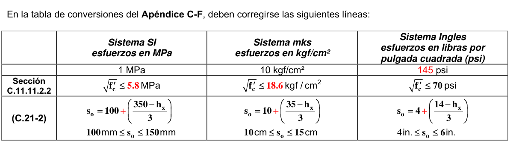

# C-F — Equivalencia entre el sistema SI, el sistema mks, y el sistema inglés de las ecuaciones no homogéneas del Título C del Reglamento

| Referencia | Sistema SI (esfuerzos en MPa) | Sistema mks (esfuerzos en kgf/cm²) | Sistema inglés (esfuerzos en psi) |
|---|---|---|---|
| | 1 MPa | 10 kgf/cm² | 142.2 psi |
| | $f'_c$ = 21 MPa | $f'_c$ = 210 kgf/cm² | $f'_c$ = 3,000 psi |
| | $f'_c$ = 28 MPa | $f'_c$ = 280 kgf/cm² | $f'_c$ = 4,000 psi |
| | $f'_c$ = 35 MPa | $f'_c$ = 350 kgf/cm² | $f'_c$ = 5,000 psi |
| | $f'_c$ = 40 MPa | $f'_c$ = 420 kgf/cm² | $f'_c$ = 6,000 psi |
| | $f_y$ = 280 MPa | $f_y$ = 2 800 kgf/cm² | $f_y$ = 40,000 psi |
| | $f_y$ = 420 MPa | $f_y$ = 4 200 kgf/cm² | $f_y$ = 60,000 psi |
| | $f_{pu}$ = 1 725 MPa | $f_{pu}$ = 17 600 kgf/cm² | $f_{pu}$ = 250,000 psi |
| | $f_{pu}$ = 1 860 MPa | $f_{pu}$ = 19 000 kgf/cm² | $f_{pu}$ = 270,000 psi |
| | $\sqrt{f'_c}$ en MPa | $3.18\sqrt{f'_c}$ en kgf/cm² | $12\sqrt{f'_c}$ en psi |
| | $0.313\sqrt{f'_c}$ en MPa | $\sqrt{f'_c}$ en kgf/cm² | $3.77\sqrt{f'_c}$ en psi |
| | $0.083\sqrt{f'_c}$ en MPa | $0.27\sqrt{f'_c}$ en kgf/cm² | $\sqrt{f'_c}$ en psi |
| | $0.17\sqrt{f'_c}$ en MPa | $0.53\sqrt{f'_c}$ en kgf/cm² | $2\sqrt{f'_c}$ en psi |
| (C.5-2) | $f'_{cr} = f'_c + 2.33 s_s - 3.5$ | $f'_{cr} = f'_c + 2.33 s_s - 35$ | $f'_{cr} = f'_c + 2.33 s_s - 500$ |
| Tabla C.5.3.2.2 | $f'_{cr} = f'_c + 7.0$ | $f'_{cr} = f'_c + 70$ | $f'_{cr} = f'_c + 1000$ |
| Tabla C.5.3.2.2 | $f'_{cr} = f'_c + 8.3$ | $f'_{cr} = f'_c + 84$ | $f'_{cr} = f'_c + 1200$ |
| Tabla C.5.3.2.2 | $f'_{cr} = 1.10 f'_c + 5.0$ | $f'_{cr} = 1.10 f'_c + 50$ | $f'_{cr} = 1.10 f'_c + 700$ |
| Sección C.7.12.2.1(c) | $\dfrac{0.0018 \times 420}{f_y}$ | $\dfrac{0.0018 \times 4\,200}{f_y}$ | $\dfrac{0.0018 \times 60{,}000}{f_y}$ |
| Sección C.8.5.1 | $E_c = w_c^{1.5}\,0.043\sqrt{f'_c}$ | $E_c = w_c^{1.5}\,0.14\sqrt{f'_c}$ | $E_c = w_c^{1.5}\,33\sqrt{f'_c}$ |
| Sección C.8.5.1 | $E_c = 4700\sqrt{f'_c}$ | $E_c = 15100\sqrt{f'_c}$ | $E_c = 57{,}000\sqrt{f'_c}$ |
| Sección C.8.6.1 | $\lambda = f_{ct}/\left(0.56\sqrt{f'_c}\right) \le 1.0$ | $\lambda = f_{ct}/\left(1.78\sqrt{f'_c}\right) \le 1.0$ | $\lambda = f_{ct}/\left(6.7\sqrt{f'_c}\right) \le 1.0$ |
| Tabla C.9.5(a) | $\left(1.65 - 0.0003 w_c\right) \ge 1.09$ | $\left(1.65 - 0.0003 w_c\right) \ge 1.09$ | $\left(1.65 - 0.005 w_c\right) \ge 1.09$ |
| Tabla C.9.5(a) | $\left(0.4 + \dfrac{f_y}{700}\right)$ | $\left(0.4 + \dfrac{f_y}{7000}\right)$ | $\left(0.4 + \dfrac{f_y}{100{,}000}\right)$ |
| (C.9-10) | $f_r = 0.62\lambda\sqrt{f'_c}$ | $f_r = 2\lambda\sqrt{f'_c}$ | $f_r = 7.5\lambda\sqrt{f'_c}$ |
| (C.9-12) | $h = \dfrac{\ell_n\left(0.8 + \dfrac{f_y}{1400}\right)}{36 + 5\beta\left(\alpha_{fm} - 0.2\right)} \ge 125\ \text{mm}$ | $h = \dfrac{\ell_n\left(0.8 + \dfrac{f_y}{14000}\right)}{36 + 5\beta\left(\alpha_{fm} - 0.2\right)} \ge 12.5\ \text{cm}$ | $h = \dfrac{\ell_n\left(0.8 + \dfrac{f_y}{200{,}000}\right)}{36 + 5\beta\left(\alpha_{fm} - 0.2\right)} \ge 5\ \text{in.}$ |
| (C.9-13) | $h = \dfrac{\ell_n\left(0.8 + \dfrac{f_y}{1400}\right)}{36 + 9\beta} \ge 90\ \text{mm}$ | $h = \dfrac{\ell_n\left(0.8 + \dfrac{f_y}{14000}\right)}{36 + 9\beta} \ge 9\ \text{cm}$ | $h = \dfrac{\ell_n\left(0.8 + \dfrac{f_y}{200{,}000}\right)}{36 + 9\beta} \ge 3.5\ \text{in.}$ |
| (C.10-3) | $A_{s,min} = \dfrac{0.25\sqrt{f'_c}}{f_y} b_w d \ge \dfrac{1.4}{f_y} b_w d$ | $A_{s,min} = \dfrac{0.8\sqrt{f'_c}}{f_y} b_w d \ge \dfrac{14}{f_y} b_w d$ | $A_{s,min} = \dfrac{3\sqrt{f'_c}}{f_y} b_w d \ge \dfrac{200}{f_y} b_w d$ |
| (C.10-4) | $s = 380\left(\dfrac{280}{f_s}\right) - 2.5 c_c \le 300\left(\dfrac{280}{f_s}\right)$ | $s = 38\left(\dfrac{2800}{f_s}\right) - 2.5 c_c \le 30\left(\dfrac{2800}{f_s}\right)$ | $s = 15\left(\dfrac{40{,}000}{f_s}\right) - 2.5 c_c \le 12\left(\dfrac{40{,}000}{f_s}\right)$ |
| (C.10-17) | $M_{2,min} = P_u\left(15 + 0.03h\right)$ | $M_{2,min} = P_u\left(1.5 + 0.03h\right)$ | $M_{2,min} = P_u\left(0.6 + 0.03h\right)$ |
| Sección C.11.1.2 | $\sqrt{f'_c} \le 8.3$ MPa | $\sqrt{f'_c} \le 27$ kgf/cm² | $\sqrt{f'_c} \le 100$ psi |
| (C.11-3) | $V_c = 0.17\lambda\sqrt{f'_c}\,b_w d$ | $V_c = 0.53\lambda\sqrt{f'_c}\,b_w d$ | $V_c = 2\lambda\sqrt{f'_c}\,b_w d$ |
| (C.11-4) | $V_c = 0.17\left(1 + \dfrac{N_u}{14A_g}\right)\lambda\sqrt{f'_c}\,b_w d$ | $V_c = 0.53\left(1 + \dfrac{N_u}{140A_g}\right)\lambda\sqrt{f'_c}\,b_w d$ | $V_c = 2\left(1 + \dfrac{N_u}{2000A_g}\right)\lambda\sqrt{f'_c}\,b_w d$ |
| (C.11-5) | $V_c = \left(0.16\lambda\sqrt{f'_c} + 17\rho_w\dfrac{V_u d}{M_u}\right) b_w d \le 0.29\lambda\sqrt{f'_c}\,b_w d$ | $V_c = \left(0.5\lambda\sqrt{f'_c} + 176\rho_w\dfrac{V_u d}{M_u}\right) b_w d \le 0.93\lambda\sqrt{f'_c}\,b_w d$ | $V_c = \left(1.9\lambda\sqrt{f'_c} + 2500\rho_w\dfrac{V_u d}{M_u}\right) b_w d \le 3.5\lambda\sqrt{f'_c}\,b_w d$ |
| (C.11-7) | $V_c = 0.29\lambda\sqrt{f'_c}\,b_w d\sqrt{1 + \dfrac{0.29N_u}{A_g}}$ | $V_c = 0.93\lambda\sqrt{f'_c}\,b_w d\sqrt{1 + \dfrac{N_u}{35A_g}}$ | $V_c = 3.5\lambda\sqrt{f'_c}\,b_w d\sqrt{1 + \dfrac{N_u}{500A_g}}$ |
| (C.11-8) | $V_c = 0.17\left(1 + \dfrac{0.29N_u}{A_g}\right)\lambda\sqrt{f'_c}\,b_w d \ge 0$ | $V_c = 0.53\left(1 + \dfrac{N_u}{35A_g}\right)\lambda\sqrt{f'_c}\,b_w d \ge 0$ | $V_c = 2\left(1 + \dfrac{N_u}{500A_g}\right)\lambda\sqrt{f'_c}\,b_w d \ge 0$ |
| (C.11-9) | $V_c = \left(0.05\lambda\sqrt{f'_c} + 4.8\dfrac{V_u d_p}{M_u}\right) b_w d$ $0.17\lambda\sqrt{f'_c}\,b_w d \le V_c \le 0.42\lambda\sqrt{f'_c}\,b_w d$ | $V_c = \left(0.16\lambda\sqrt{f'_c} + 49\dfrac{V_u d_p}{M_u}\right) b_w d$ $0.53\lambda\sqrt{f'_c}\,b_w d \le V_c \le 1.33\lambda\sqrt{f'_c}\,b_w d$ | $V_c = \left(0.6\lambda\sqrt{f'_c} + 700\dfrac{V_u d_p}{M_u}\right) b_w d$ $2\lambda\sqrt{f'_c}\,b_w d \le V_c \le 5\lambda\sqrt{f'_c}\,b_w d$ |
| (C.11-10) | $V_{ci} = 0.05\lambda\sqrt{f'_c}\,b_w d_p + V_d + \dfrac{V_i M_{cre}}{M_{max}} \ge 0.14\lambda\sqrt{f'_c}\,b_w d$ | $V_{ci} = 0.16\lambda\sqrt{f'_c}\,b_w d_p + V_d + \dfrac{V_i M_{cre}}{M_{max}} \ge 0.45\lambda\sqrt{f'_c}\,b_w d$ | $V_{ci} = 0.6\lambda\sqrt{f'_c}\,b_w d_p + V_d + \dfrac{V_i M_{cre}}{M_{max}} \ge 1.7\lambda\sqrt{f'_c}\,b_w d$ |
| (C.11-11) | $M_{cre} = \left(\dfrac{I}{y_t}\right)\left(0.5\lambda\sqrt{f'_c} + f_{pe} - f_d\right)$ | $M_{cre} = \left(\dfrac{I}{y_t}\right)\left(1.6\lambda\sqrt{f'_c} + f_{pe} - f_d\right)$ | $M_{cre} = \left(\dfrac{I}{y_t}\right)\left(6\lambda\sqrt{f'_c} + f_{pe} - f_d\right)$ |
| (C.11-12) | $V_{cw} = \left(0.29\lambda\sqrt{f'_c} + 0.3 f_{pc}\right) b_w d_p + V_p$ $0.33\lambda\sqrt{f'_c}$ | $V_{cw} = \left(0.93\lambda\sqrt{f'_c} + 0.3 f_{pc}\right) b_w d_p + V_p$ $1.1\lambda\sqrt{f'_c}$ | $V_{cw} = \left(3.5\lambda\sqrt{f'_c} + 0.3 f_{pc}\right) b_w d_p + V_p$ $4\lambda\sqrt{f'_c}$ |
| Sección C.11.4.5.3 | $0.33\sqrt{f'_c}\,b_w d$ | $1.1\sqrt{f'_c}\,b_w d$ | $4\sqrt{f'_c}\,b_w d$ |
| Sección C.11.4.6.1(f) | $\phi 0.17\sqrt{f'_c}\,b_w d$ | $\phi 0.53\sqrt{f'_c}\,b_w d$ | $\phi 2\sqrt{f'_c}\,b_w d$ |
| (C.11-13) | $A_{v,min} = 0.062\sqrt{f'_c}\,\dfrac{b_w s}{f_{yt}} \ge 0.35\dfrac{b_w s}{f_{yt}}$ | $A_{v,min} = 0.2\sqrt{f'_c}\,\dfrac{b_w s}{f_{yt}} \ge 3.5\dfrac{b_w s}{f_{yt}}$ | $A_{v,min} = 0.75\sqrt{f'_c}\,\dfrac{b_w s}{f_{yt}} \ge \dfrac{50 b_w s}{f_{yt}}$ |
| (C.11-17) | $V_s = A_v f_y \sin\alpha \le 0.25\sqrt{f'_c}\,b_w d$ | $V_s = A_v f_y \sin\alpha \le 0.8\sqrt{f'_c}\,b_w d$ | $V_s = A_v f_y \sin\alpha \le 3\sqrt{f'_c}\,b_w d$ |
| Sección C.11.4.7.9 | $0.66\sqrt{f'_c}\,b_w d$ | $2.2\sqrt{f'_c}\,b_w d$ | $8\sqrt{f'_c}\,b_w d$ |
| Sección C.11.5.1(a) | $T_u < \phi 0.083\lambda\sqrt{f'_c}\left(\dfrac{A_{cp}^2}{p_{cp}}\right)$ | $T_u < \phi 0.27\lambda\sqrt{f'_c}\left(\dfrac{A_{cp}^2}{p_{cp}}\right)$ | $T_u < \phi\lambda\sqrt{f'_c}\left(\dfrac{A_{cp}^2}{p_{cp}}\right)$ |
| Sección C.11.5.1(b) | $T_u < \phi 0.083\lambda\sqrt{f'_c}\left(\dfrac{A_{cp}^2}{p_{cp}}\right)\sqrt{1 + \dfrac{f_{pc}}{0.33\lambda\sqrt{f'_c}}}$ | $T_u < \phi\lambda 0.27\sqrt{f'_c}\left(\dfrac{A_{cp}^2}{p_{cp}}\right)\sqrt{1 + \dfrac{f_{pc}}{\lambda\sqrt{f'_c}}}$ | $T_u < \phi\lambda\sqrt{f'_c}\left(\dfrac{A_{cp}^2}{p_{cp}}\right)\sqrt{1 + \dfrac{f_{pc}}{4\lambda\sqrt{f'_c}}}$ |
| Sección C.11.5.1(c) | $T_u < \phi 0.083\lambda\sqrt{f'_c}\left(\dfrac{A_{cp}^2}{p_{cp}}\right)\sqrt{1 + \dfrac{N_u}{0.33A_g\lambda\sqrt{f'_c}}}$ | $T_u < \phi 0.27\lambda\sqrt{f'_c}\left(\dfrac{A_{cp}^2}{p_{cp}}\right)\sqrt{1 + \dfrac{N_u}{A_g\lambda\sqrt{f'_c}}}$ | $T_u < \phi\lambda\sqrt{f'_c}\left(\dfrac{A_{cp}^2}{p_{cp}}\right)\sqrt{1 + \dfrac{N_u}{4A_g\lambda\sqrt{f'_c}}}$ |
| Sección C.11.5.2.2(a) | $T_u = \phi 0.33\lambda\sqrt{f'_c}\left(\dfrac{A_{cp}^2}{p_{cp}}\right)$ | $T_u = \phi\lambda\sqrt{f'_c}\left(\dfrac{A_{cp}^2}{p_{cp}}\right)$ | $T_u = \phi 4\lambda\sqrt{f'_c}\left(\dfrac{A_{cp}^2}{p_{cp}}\right)$ |
| Sección C.11.5.2.2(b) | $T_u = \phi 0.33\lambda\sqrt{f'_c}\left(\dfrac{A_{cp}^2}{p_{cp}}\right)\sqrt{1 + \dfrac{f_{pc}}{0.33\lambda\sqrt{f'_c}}}$ | $T_u = \phi\lambda\sqrt{f'_c}\left(\dfrac{A_{cp}^2}{p_{cp}}\right)\sqrt{1 + \dfrac{f_{pc}}{\lambda\sqrt{f'_c}}}$ | $T_u = \phi 4\lambda\sqrt{f'_c}\left(\dfrac{A_{cp}^2}{p_{cp}}\right)\sqrt{1 + \dfrac{f_{pc}}{4\lambda\sqrt{f'_c}}}$ |
| Sección C.11.5.2.2(c) | $T_u = \phi 0.33\lambda\sqrt{f'_c}\left(\dfrac{A_{cp}^2}{p_{cp}}\right)\sqrt{1 + \dfrac{N_u}{0.33A_g\lambda\sqrt{f'_c}}}$ | $T_u = \phi\lambda\sqrt{f'_c}\left(\dfrac{A_{cp}^2}{p_{cp}}\right)\sqrt{1 + \dfrac{N_u}{A_g\lambda\sqrt{f'_c}}}$ | $T_u = \phi 4\lambda\sqrt{f'_c}\left(\dfrac{A_{cp}^2}{p_{cp}}\right)\sqrt{1 + \dfrac{N_u}{4A_g\lambda\sqrt{f'_c}}}$ |
| (C.11-18) | $\sqrt{\left(\dfrac{V_u}{b_w d}\right)^2 + \left(\dfrac{T_u p_h}{1.7A_{oh}^2}\right)^2} \le \phi\left(\dfrac{V_c}{b_w d} + 0.66\sqrt{f'_c}\right)$ | $\sqrt{\left(\dfrac{V_u}{b_w d}\right)^2 + \left(\dfrac{T_u p_h}{1.7A_{oh}^2}\right)^2} \le \phi\left(\dfrac{V_c}{b_w d} + 2\sqrt{f'_c}\right)$ | $\sqrt{\left(\dfrac{V_u}{b_w d}\right)^2 + \left(\dfrac{T_u p_h}{1.7A_{oh}^2}\right)^2} \le \phi\left(\dfrac{V_c}{b_w d} + 8\sqrt{f'_c}\right)$ |
| (C.11-19) | $\left(\dfrac{V_u}{b_w d}\right) + \left(\dfrac{T_u p_h}{1.7A_{oh}^2}\right) \le \phi\left(\dfrac{V_c}{b_w d} + 0.66\sqrt{f'_c}\right)$ | $\left(\dfrac{V_u}{b_w d}\right) + \left(\dfrac{T_u p_h}{1.7A_{oh}^2}\right) \le \phi\left(\dfrac{V_c}{b_w d} + 2\sqrt{f'_c}\right)$ | $\left(\dfrac{V_u}{b_w d}\right) + \left(\dfrac{T_u p_h}{1.7A_{oh}^2}\right) \le \phi\left(\dfrac{V_c}{b_w d} + 8\sqrt{f'_c}\right)$ |
| (C.11-23) | $\left(A_v + 2A_t\right) = 0.062\sqrt{f'_c}\,\dfrac{b_w s}{f_{yt}} \ge \dfrac{0.35 b_w s}{f_{yt}}$ | $\left(A_v + 2A_t\right) = 0.2\sqrt{f'_c}\,\dfrac{b_w s}{f_{yt}} \ge \dfrac{3.5 b_w s}{f_{yt}}$ | $\left(A_v + 2A_t\right) = 0.75\sqrt{f'_c}\,\dfrac{b_w s}{f_{yt}} \ge \dfrac{50 b_w s}{f_{yt}}$ |
| (C.11-24) | $A_{\ell,min} = \dfrac{0.42\sqrt{f'_c}A_{cp}}{f_y} - \left(\dfrac{A_t}{s}\right)p_h\dfrac{f_{yt}}{f_y}$ $\dfrac{A_t}{s} \ge \dfrac{0.175 b_w}{f_{yt}}$ | $A_{\ell,min} = \dfrac{1.33\sqrt{f'_c}A_{cp}}{f_y} - \left(\dfrac{A_t}{s}\right)p_h\dfrac{f_{yt}}{f_y}$ $\dfrac{A_t}{s} \ge \dfrac{1.75 b_w}{f_{yt}}$ | $A_{\ell,min} = \dfrac{5\sqrt{f'_c}A_{cp}}{f_y} - \left(\dfrac{A_t}{s}\right)p_h\dfrac{f_{yt}}{f_y}$ $\dfrac{A_t}{s} \ge \dfrac{25 b_w}{f_{yt}}$ |
| Sección C.11.6.5 | $\left(3.3 + 0.08f'_c\right)A_c$ $11A_c$ $5.5A_c$ | $\left(34 + 0.08f'_c\right)A_c$ $110A_c$ $55A_c$ | $\left(480 + 0.08f'_c\right)A_c$ $1600A_c$ $800A_c$ |
| Sección C.11.7.3 | $0.83\sqrt{f'_c}\,b_w d$ | $2.65\sqrt{f'_c}\,b_w d$ | $10\sqrt{f'_c}\,b_w d$ |
| Sección C.11.8.3.2.1 | $\left(3.3 + 0.08f'_c\right)b_w d$ $11 b_w d$ | $\left(34 + 0.08f'_c\right)b_w d$ $110 b_w d$ | $\left(480 + 0.08f'_c\right)b_w d$ $1600 b_w d$ |
| Sección C.11.8.3.2.2 | $\left(5.5 - 1.9\dfrac{a_v}{d}\right)b_w d$ | $\left(55 - 20\dfrac{a_v}{d}\right)b_w d$ | $\left(800 - 280\dfrac{a_v}{d}\right)b_w d$ |
| Sección C.11.9.3 | $0.83\sqrt{f'_c}\,h d$ | $2.65\sqrt{f'_c}\,h d$ | $10\sqrt{f'_c}\,h d$ |
| Sección C.11.9.5 | $0.17\lambda\sqrt{f'_c}\,h d$ | $0.53\lambda\sqrt{f'_c}\,h d$ | $2\lambda\sqrt{f'_c}\,h d$ |
| (C.11-27) | $V_c = 0.27\lambda\sqrt{f'_c}\,h d + \dfrac{N_u d}{4\ell_w}$ | $V_c = 0.88\lambda\sqrt{f'_c}\,h d + \dfrac{N_u d}{4\ell_w}$ | $V_c = 3.3\lambda\sqrt{f'_c}\,h d + \dfrac{N_u d}{4\ell_w}$ |
| (C.11-28) | $V_c = \left[0.05\lambda\sqrt{f'_c} + \dfrac{\ell_w\left(0.1\lambda\sqrt{f'_c} + 0.2\dfrac{N_u}{\ell_w h}\right)}{\dfrac{M_u}{V_u} - \dfrac{\ell_w}{2}}\right]h d$ | $V_c = \left[0.16\lambda\sqrt{f'_c} + \dfrac{\ell_w\left(0.33\lambda\sqrt{f'_c} + 0.2\dfrac{N_u}{\ell_w h}\right)}{\dfrac{M_u}{V_u} - \dfrac{\ell_w}{2}}\right]h d$ | $V_c = \left[0.6\lambda\sqrt{f'_c} + \dfrac{\ell_w\left(1.25\lambda\sqrt{f'_c} + 0.2\dfrac{N_u}{\ell_w h}\right)}{\dfrac{M_u}{V_u} - \dfrac{\ell_w}{2}}\right]h d$ |
| (C.11-31) | $V_c = 0.17\left(1 + \dfrac{2}{\beta}\right)\lambda\sqrt{f'_c}\,b_o d$ | $V_c = 0.53\left(1 + \dfrac{2}{\beta}\right)\lambda\sqrt{f'_c}\,b_o d$ | $V_c = \left(2 + \dfrac{4}{\beta}\right)\lambda\sqrt{f'_c}\,b_o d$ |
| (C.11-32) | $V_c = 0.083\left(\dfrac{\alpha_s d}{b_o} + 2\right)\lambda\sqrt{f'_c}\,b_o d$ | $V_c = 0.27\left(\dfrac{\alpha_s d}{b_o} + 2\right)\lambda\sqrt{f'_c}\,b_o d$ | $V_c = \left(\dfrac{\alpha_s d}{b_o} + 2\right)\lambda\sqrt{f'_c}\,b_o d$ |
| (C.11-33) | $V_c = 0.33\lambda\sqrt{f'_c}\,b_o d$ | $V_c = \lambda\sqrt{f'_c}\,b_o d$ | $V_c = 4\lambda\sqrt{f'_c}\,b_o d$ |
| (C.11-34) | $V_c = \left(\beta_p\lambda\sqrt{f'_c} + 0.3f_{pc}\right)b_o d + V_p$ Nota: $\beta_p$ tiene unidades | $V_c = \left(3.16\beta_p\lambda\sqrt{f'_c} + 0.3f_{pc}\right)b_o d + V_p$ Nota: $\beta_p$ tiene las mismas unidades que la versión SI | $V_c = \left(\beta_p\lambda\sqrt{f'_c} + 0.3f_{pc}\right)b_o d + V_p$ Nota: $\beta_p$ tiene unidades |
| Sección C.11.11.2.2 | $\sqrt{f'_c} \le 0.5$ MPa | $\sqrt{f'_c} \le 5$ kgf/cm² | $\sqrt{f'_c} \le 70$ psi |
| Sección C.11.11.3.1 | $0.17\lambda\sqrt{f'_c}\,b_o d$ | $0.53\lambda\sqrt{f'_c}\,b_o d$ | $2\lambda\sqrt{f'_c}\,b_o d$ |
| Sección C.11.11.3.2 | $0.5\sqrt{f'_c}\,b_o d$ | $1.6\sqrt{f'_c}\,b_o d$ | $6\sqrt{f'_c}\,b_o d$ |
| Sección C.11.11.4.8 | $0.33\sqrt{f'_c}\,b_o d$ $0.58\sqrt{f'_c}\,b_o d$ | $1.1\sqrt{f'_c}\,b_o d$ $1.9\sqrt{f'_c}\,b_o d$ | $4\sqrt{f'_c}\,b_o d$ $7\sqrt{f'_c}\,b_o d$ |
| Sección C.11.11.5.1 | $0.25\lambda\sqrt{f'_c}\,b_o d$ $0.66\sqrt{f'_c}\,b_o d$ $0.17\sqrt{f'_c}$ | $0.8\lambda\sqrt{f'_c}\,b_o d$ $2.1\sqrt{f'_c}\,b_o d$ $0.53\sqrt{f'_c}$ | $3\lambda\sqrt{f'_c}\,b_o d$ $8\sqrt{f'_c}\,b_o d$ $2\sqrt{f'_c}$ |
| Sección C.11.11.5.2 | $0.5\phi\sqrt{f'_c}$ | $1.6\phi\sqrt{f'_c}$ | $6\phi\sqrt{f'_c}$ |
| Sección C.11.11.5.4 | $0.17\phi\lambda\sqrt{f'_c}$ | $0.53\phi\lambda\sqrt{f'_c}$ | $2\phi\lambda\sqrt{f'_c}$ |
| Sección C.11.11.7.2 | $0.17\phi\lambda\sqrt{f'_c}$ | $0.53\phi\lambda\sqrt{f'_c}$ | $2\phi\lambda\sqrt{f'_c}$ |
| Sección C.11.11.7.3 | $0.33\phi\lambda\sqrt{f'_c}$ | $1.1\phi\lambda\sqrt{f'_c}$ | $4\phi\lambda\sqrt{f'_c}$ |
| Sección C.12.1.2 | $\sqrt{f'_c} \le 8.3$ MPa | $\sqrt{f'_c} \le 26.5$ kgf/cm² | $\sqrt{f'_c} \le 100$ psi |
| Sección C.12.2.2 | $\ell_d = \left(\dfrac{f_y\psi_t\psi_e}{2.1\lambda\sqrt{f'_c}}\right)d_b$ | $\ell_d = \left(\dfrac{f_y\psi_t\psi_e}{6.6\lambda\sqrt{f'_c}}\right)d_b$ | $\ell_d = \left(\dfrac{f_y\psi_t\psi_e}{25\lambda\sqrt{f'_c}}\right)d_b$ |
| Sección C.12.2.2 | $\ell_d = \left(\dfrac{f_y\psi_t\psi_e}{1.7\lambda\sqrt{f'_c}}\right)d_b$ | $\ell_d = \left(\dfrac{f_y\psi_t\psi_e}{5.3\lambda\sqrt{f'_c}}\right)d_b$ | $\ell_d = \left(\dfrac{f_y\psi_t\psi_e}{20\lambda\sqrt{f'_c}}\right)d_b$ |
| Sección C.12.2.2 | $\ell_d = \left(\dfrac{f_y\psi_t\psi_e}{1.4\lambda\sqrt{f'_c}}\right)d_b$ | $\ell_d = \left(\dfrac{f_y\psi_t\psi_e}{4.4\lambda\sqrt{f'_c}}\right)d_b$ | $\ell_d = \left(\dfrac{3f_y\psi_t\psi_e}{50\lambda\sqrt{f'_c}}\right)d_b$ |
| Sección C.12.2.2 | $\ell_d = \left(\dfrac{f_y\psi_t\psi_e}{1.1\lambda\sqrt{f'_c}}\right)d_b$ | $\ell_d = \left(\dfrac{f_y\psi_t\psi_e}{3.5\lambda\sqrt{f'_c}}\right)d_b$ | $\ell_d = \left(\dfrac{3f_y\psi_t\psi_e}{40\lambda\sqrt{f'_c}}\right)d_b$ |
| (C.12-1) | $\ell_d = \dfrac{f_y}{1.1\lambda\sqrt{f'_c}}\dfrac{\psi_t\psi_e\psi_s}{\left(\dfrac{c_b + K_{tr}}{d_b}\right)}d_b$ | $\ell_d = \dfrac{f_y}{3.5\lambda\sqrt{f'_c}}\dfrac{\psi_t\psi_e\psi_s}{\left(\dfrac{c_b + K_{tr}}{d_b}\right)}d_b$ | $\ell_d = \dfrac{3f_y}{40\lambda\sqrt{f'_c}}\dfrac{\psi_t\psi_e\psi_s}{\left(\dfrac{c_b + K_{tr}}{d_b}\right)}d_b$ |
| Sección C.12.3.2 | $\left(\dfrac{0.24f_y}{\lambda\sqrt{f'_c}}\right)d_b \ge \left(0.043f_y\right)d_b$ | $\left(\dfrac{0.075f_y}{\lambda\sqrt{f'_c}}\right)d_b \ge \left(0.0044f_y\right)d_b$ | $\left(\dfrac{0.02f_y}{\lambda\sqrt{f'_c}}\right)d_b \ge \left(0.0003f_y\right)d_b$ |
| Sección C.12.5.2 | $\ell_{dh} = \left(\dfrac{0.24\psi_e f_y}{\lambda\sqrt{f'_c}}\right)d_b$ | $\ell_{dh} = \left(\dfrac{0.075\psi_e f_y}{\lambda\sqrt{f'_c}}\right)d_b$ | $\ell_{dh} = \left(\dfrac{0.02\psi_e f_y}{\lambda\sqrt{f'_c}}\right)d_b$ |
| Sección C.12.6.2 | $\ell_{dh} = \left(\dfrac{0.19\psi_e f_y}{\sqrt{f'_c}}\right)d_b$ | $\ell_{dh} = \left(\dfrac{0.06\psi_e f_y}{\sqrt{f'_c}}\right)d_b$ | $\ell_{dh} = \left(\dfrac{0.016\psi_e f_y}{\sqrt{f'_c}}\right)d_b$ |
| Sección C.12.7.2 | $\left(\dfrac{f_y - 240}{f_y}\right)$ | $\left(\dfrac{f_y - 2460}{f_y}\right)$ | $\left(\dfrac{f_y - 35{,}000}{f_y}\right)$ |
| (C-12-3) | $\ell_d = 3.3\left(\dfrac{A_b}{s}\right)\left(\dfrac{f_y}{\lambda\sqrt{f'_c}}\right)$ | $\ell_d = \left(\dfrac{A_b}{s}\right)\left(\dfrac{f_y}{\lambda\sqrt{f'_c}}\right)$ | $\ell_d = 0.27\left(\dfrac{A_b}{s}\right)\left(\dfrac{f_y}{\lambda\sqrt{f'_c}}\right)$ |
| (C-12-4) | $\ell_d = \left(\dfrac{f_{se}}{21}\right)d_b + \left(\dfrac{f_{ps} - f_{se}}{7}\right)d_b$ | $\ell_d = \left(\dfrac{f_{se}}{210}\right)d_b + \left(\dfrac{f_{ps} - f_{se}}{70}\right)d_b$ | $\ell_d = \left(\dfrac{f_{se}}{3000}\right)d_b + \left(\dfrac{f_{ps} - f_{se}}{1000}\right)d_b$ |
| Sección C.12.10.5.2 | $0.41\dfrac{b_w s}{f_{yt}}$ | $4.2\dfrac{b_w s}{f_{yt}}$ | $60\dfrac{b_w s}{f_{yt}}$ |
| Sección C.12.13.2.2 | $0.17\dfrac{d_b f_{yt}}{\lambda\sqrt{f'_c}}$ | $0.053\dfrac{d_b f_{yt}}{\lambda\sqrt{f'_c}}$ | $0.014\dfrac{d_b f_{yt}}{\lambda\sqrt{f'_c}}$ |
| Sección C.12.16.1 | $0.071 f_y d_b$ $\left(0.13 f_y - 24\right)d_b$ | $0.0073 f_y d_b$ $\left(0.013 f_y - 24\right)d_b$ | $0.0005 f_y d_b$ $\left(0.0009 f_y - 24\right)d_b$ |
| Sección C.17.5.3.1 y C.17.5.3.2 | $0.55 b_v d$ | $5.6 b_v d$ | $80 b_v d$ |
| Sección C.17.5.3.3 | $\left(1.8 + 0.6\rho_v f_y\right)\lambda b_v d \le 3.5 b_v d$ | $\left(18 + 0.6\rho_v f_y\right)\lambda b_v d \le 35 b_v d$ | $\left(260 + 0.6\rho_v f_y\right)\lambda b_v d \le 500 b_v d$ |
| Sección C.18.3.3 | (a) Clase U: $f_t \le 0.62\sqrt{f'_c}$ (b) Clase T: $0.62\sqrt{f'_c} < f_t \le 1.0\sqrt{f'_c}$ (c) Clase C: $f_t > 1.0\sqrt{f'_c}$ $f_t \le 0.50\sqrt{f'_{ci}}$ | (a) Clase U: $f_t \le 2\sqrt{f'_c}$ (b) Clase T: $2\sqrt{f'_c} < f_t \le 3.2\sqrt{f'_c}$ (c) Clase C: $f_t > 3.2\sqrt{f'_c}$ $f_t \le 1.6\sqrt{f'_{ci}}$ | (a) Clase U: $f_t \le 7.5\sqrt{f'_c}$ (b) Clase T: $7.5\sqrt{f'_c} < f_t \le 12\sqrt{f'_c}$ (c) Clase C: $f_t > 12\sqrt{f'_c}$ $f_t \le 6\sqrt{f'_{ci}}$ |
| Sección C.18.4.1(c) | $0.50\sqrt{f'_{ci}}$ $0.25\sqrt{f'_{ci}}$ | $1.6\sqrt{f'_{ci}}$ $0.8\sqrt{f'_{ci}}$ | $6\sqrt{f'_{ci}}$ $3\sqrt{f'_{ci}}$ |
| (C.18-4) | $f_{ps} = f_{se} + 70 + \dfrac{f'_c}{100\rho_p}$ | $f_{ps} = f_{se} + 700 + \dfrac{f'_c}{100\rho_p}$ | $f_{ps} = f_{se} + 10{,}000 + \dfrac{f'_c}{100\rho_p}$ |
| (C.18-5) | $f_{ps} = f_{se} + 70 + \dfrac{f'_c}{300\rho_p}$ | $f_{ps} = f_{se} + 700 + \dfrac{f'_c}{300\rho_p}$ | $f_{ps} = f_{se} + 10{,}000 + \dfrac{f'_c}{300\rho_p}$ |
| Secciones C.18.9.3.1 y C.18.9.3.2 | $0.17\sqrt{f'_c}$ | $0.53\sqrt{f'_c}$ | $2\sqrt{f'_c}$ |
| Sección C.18.12.7 | $\dfrac{2.1 b_w d}{f_y}$ | $\dfrac{21 b_w d}{f_y}$ | $\dfrac{300 b_w d}{f_y}$ |
| Sección C.18.13.4.1 | $f_{ps} = f_{se} + 70$ | $f_{ps} = f_{se} + 700$ | $f_{ps} = f_{se} + 10{,}000$ |
| Sección C.19.4.10 | $0.33\phi\lambda\sqrt{f'_c}$ | $1.1\phi\lambda\sqrt{f'_c}$ | $4\phi\lambda\sqrt{f'_c}$ |
| Sección C.21.5.2.1 | $\dfrac{1.4 b_w d}{f_y}$ | $\dfrac{14 b_w d}{f_y}$ | $\dfrac{200 b_w d}{f_y}$ |
| (C.21-2) | $s_o = 100\left(\dfrac{350 - h_x}{3}\right)$ $100\ \text{mm} \le s_o \le 150\ \text{mm}$ | $s_o = 10\left(\dfrac{35 - h_x}{3}\right)$ $10\ \text{cm} \le s_o \le 15\ \text{cm}$ | $s_o = 4\left(\dfrac{14 - h_x}{3}\right)$ $4\ \text{in.} \le s_o \le 6\ \text{in.}$ |
| Sección C.21.7.4.1 | $1.7\sqrt{f'_c}\,A_j$ $1.2\sqrt{f'_c}\,A_j$ $1.0\sqrt{f'_c}\,A_j$ | $5.3\sqrt{f'_c}\,A_j$ $4\sqrt{f'_c}\,A_j$ $3.2\sqrt{f'_c}\,A_j$ | $20\sqrt{f'_c}\,A_j$ $15\sqrt{f'_c}\,A_j$ $12\sqrt{f'_c}\,A_j$ |
| (C.21-6) | $\ell_{dh} = \dfrac{f_y d_b}{5.4\sqrt{f'_c}}$ | $\ell_{dh} = \dfrac{f_y d_b}{17.2\sqrt{f'_c}}$ | $\ell_{dh} = \dfrac{f_y d_b}{65\sqrt{f'_c}}$ |
| Sección C.21.9.2.1 | $0.083 A_{cv}\lambda\sqrt{f'_c}$ | $0.27 A_{cv}\lambda\sqrt{f'_c}$ | $A_{cv}\lambda\sqrt{f'_c}$ |
| Sección C.21.9.2.2 | $0.17 A_{cv}\lambda\sqrt{f'_c}$ | $0.53 A_{cv}\lambda\sqrt{f'_c}$ | $2 A_{cv}\lambda\sqrt{f'_c}$ |
| (C.21-7) | $V_n = A_{cv}\left(\alpha_c\lambda\sqrt{f'_c} + \rho_t f_y\right)$ $\alpha_c = 0.25$ para $\dfrac{h_w}{\ell_w} \le 1.5$ $\alpha_c = 0.17$ para $\dfrac{h_w}{\ell_w} \ge 2.0$ | $V_n = A_{cv}\left(\alpha_c\lambda\sqrt{f'_c} + \rho_t f_y\right)$ $\alpha_c = 0.80$ para $\dfrac{h_w}{\ell_w} \le 1.5$ $\alpha_c = 0.53$ para $\dfrac{h_w}{\ell_w} \ge 2.0$ | $V_n = A_{cv}\left(\alpha_c\lambda\sqrt{f'_c} + \rho_t f_y\right)$ $\alpha_c = 3.0$ para $\dfrac{h_w}{\ell_w} \le 1.5$ $\alpha_c = 2.0$ para $\dfrac{h_w}{\ell_w} \ge 2.0$ |
| Sección C.21.9.4.4 | $0.66 A_{cv}\sqrt{f'_c}$ $0.83 A_{cw}\sqrt{f'_c}$ | $2.12 A_{cv}\sqrt{f'_c}$ $2.65 A_{cw}\sqrt{f'_c}$ | $8 A_{cv}\sqrt{f'_c}$ $10 A_{cw}\sqrt{f'_c}$ |
| Sección C.21.9.4.5 | $0.83 A_{cw}\sqrt{f'_c}$ | $2.65 A_{cw}\sqrt{f'_c}$ | $10 A_{cw}\sqrt{f'_c}$ |
| Sección C.21.9.6.5(a) | $2.8/f_y$ | $28/f_y$ | $400/f_y$ |
| Sección C.21.9.6.5(b) | $0.083 A_{cv}\lambda\sqrt{f'_c}$ | $0.27 A_{cv}\lambda\sqrt{f'_c}$ | $A_{cv}\lambda\sqrt{f'_c}$ |
| Sección C.21.9.7.2 | $0.33\lambda\sqrt{f'_c}\,A_{cw}$ | $\lambda\sqrt{f'_c}\,A_{cw}$ | $4\lambda\sqrt{f'_c}\,A_{cw}$ |
| (C.21-9) | $V_n = 2A_{vd} f_y \sin\alpha \le 0.83\sqrt{f'_c}\,A_{cw}$ | $V_n = 2A_{vd} f_y \sin\alpha \le 2.65\sqrt{f'_c}\,A_{cw}$ | $V_n = 2A_{vd} f_y \sin\alpha \le 10\sqrt{f'_c}\,A_{cw}$ |
| (C.21-10) | $V_n = A_{cv}\left(0.17\lambda\sqrt{f'_c} + \rho_t f_y\right)$ | $V_n = A_{cv}\left(0.53\lambda\sqrt{f'_c} + \rho_t f_y\right)$ | $V_n = A_{cv}\left(2\lambda\sqrt{f'_c} + \rho_t f_y\right)$ |
| Sección C.21.11.9.2 | $0.66 A_{cv}\sqrt{f'_c}$ | $2.12 A_{cv}\sqrt{f'_c}$ | $8 A_{cv}\sqrt{f'_c}$ |
| Sección C.21.13.6 | $0.29\sqrt{f'_c}\,b_o d$ | $0.93\sqrt{f'_c}\,b_o d$ | $3.5\sqrt{f'_c}\,b_o d$ |
| (C.22-2) | $M_n = 0.42\lambda\sqrt{f'_c}\,S_m$ | $M_n = 1.33\lambda\sqrt{f'_c}\,S_m$ | $M_n = 5\lambda\sqrt{f'_c}\,S_m$ |
| (C.22-7) | $\dfrac{M_u}{S_m} - \dfrac{P_u}{A_g} \le \phi 0.42\lambda\sqrt{f'_c}$ | $\dfrac{M_u}{S_m} - \dfrac{P_u}{A_g} \le \phi 1.33\lambda\sqrt{f'_c}$ | $\dfrac{M_u}{S_m} - \dfrac{P_u}{A_g} \le \phi 5\lambda\sqrt{f'_c}$ |
| (C.22-9) | $V_n = 0.11\lambda\sqrt{f'_c}\,b_w h$ | $V_n = 0.35\lambda\sqrt{f'_c}\,b_w h$ | $V_n = \dfrac{4\lambda\sqrt{f'_c}}{3}\,b_w h$ |
| (C.22-10) | $V_n = 0.11\left[1 + \dfrac{2}{\beta}\right]\lambda\sqrt{f'_c}\,b_o h \le 0.22\lambda\sqrt{f'_c}\,b_o h$ | $V_n = 0.35\left[1 + \dfrac{2}{\beta}\right]\lambda\sqrt{f'_c}\,b_o h \le 0.71\lambda\sqrt{f'_c}\,b_o h$ | $V_n = \left[\dfrac{4}{3} + \dfrac{8}{3\beta}\right]\lambda\sqrt{f'_c}\,b_o h \le 2.66\lambda\sqrt{f'_c}\,b_o h$ |
| (C-B-1) | $\rho_b = \dfrac{0.85\beta_1 f'_c}{f_y}\left(\dfrac{600}{600 + f_y}\right)$ | $\rho_b = \dfrac{0.85\beta_1 f'_c}{f_y}\left(\dfrac{6120}{6120 + f_y}\right)$ | $\rho_b = \dfrac{0.85\beta_1 f'_c}{f_y}\left(\dfrac{87{,}000}{87{,}000 + f_y}\right)$ |
| (C-D-7) | $N_b = k_c\lambda\sqrt{f'_c}\,h_{ef}^{1.5}$ $k_c = 10$ ó $7$ | $N_b = k_c\lambda\sqrt{f'_c}\,h_{ef}^{1.5}$ $k_c = 10$ ó $7$ | $N_b = k_c\lambda\sqrt{f'_c}\,h_{ef}^{1.5}$ $k_c = 24$ ó $17$ |
| (C-D-8) | $N_b = 3.9\sqrt{f'_c}\,h_{ef}^{5/3}$ | $N_b = 5.8\lambda\sqrt{f'_c}\,h_{ef}^{5/3}$ | $N_b = 16\lambda\sqrt{f'_c}\,h_{ef}^{5/3}$ |
| (C-D-17) | $N_{sb} = 13 c_{a1}\sqrt{A_{brg}}\,\lambda\sqrt{f'_c}$ | $N_{sb} = 42.5 c_{a1}\sqrt{A_{brg}}\,\lambda\sqrt{f'_c}$ | $N_{sb} = 160 c_{a1}\sqrt{A_{brg}}\,\lambda\sqrt{f'_c}$ |
| (C-D-24) | $V_b = 0.6\left(\dfrac{\ell_e}{d_a}\right)^{0.2}\sqrt{d_a}\,\lambda\sqrt{f'_c}\left(c_{a1}\right)^{1.5}$ | $V_b = 1.9\left(\dfrac{\ell_e}{d_a}\right)^{0.2}\sqrt{d_a}\,\lambda\sqrt{f'_c}\left(c_{a1}\right)^{1.5}$ | $V_b = 7\left(\dfrac{\ell_e}{d_a}\right)^{0.2}\sqrt{d_a}\,\lambda\sqrt{f'_c}\left(c_{a1}\right)^{1.5}$ |
| (C-D-25) | $V_b = 0.66\left(\dfrac{\ell_e}{d_a}\right)^{0.2}\sqrt{d_a}\,\lambda\sqrt{f'_c}\left(c_{a1}\right)^{1.5}$ | $V_b = 2.1\left(\dfrac{\ell_e}{d_a}\right)^{0.2}\sqrt{d_a}\,\lambda\sqrt{f'_c}\left(c_{a1}\right)^{1.5}$ | $V_b = 8\left(\dfrac{\ell_e}{d_a}\right)^{0.2}\sqrt{d_a}\,\lambda\sqrt{f'_c}\left(c_{a1}\right)^{1.5}$ |

<!-- mod:1-decreto-092-2011-154 -->
> **Modificación — Decreto 092 de 2011** · anexo, p. 33
>
> En la tabla de conversiones del Apéndice C-F, deben corregirse las siguientes líneas:
>
> 
