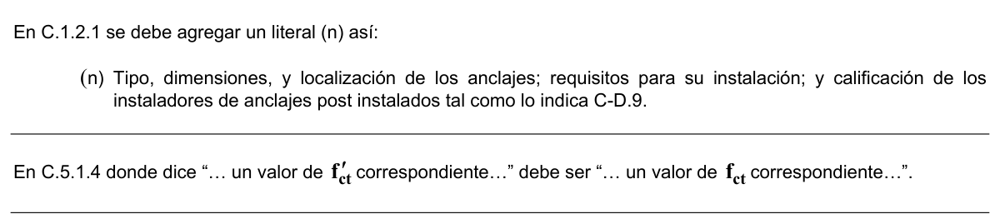

# C.1 — Requisitos generales

### C.1.1 — Alcance

**C.1.1.1** — El Título C proporciona los requisitos mínimos para el diseño y la construcción de elementos de concreto estructural de cualquier estructura construida según los requisitos del NSR-10 del cual el Título C forma parte. El Título C también cubre la evaluación de resistencia de estructuras existentes.

Para el concreto estructural, $f_{c}'$ no debe ser inferior a 17 MPa. No se establece un valor máximo para $f_{c}'$ salvo que se encuentre restringido por alguna disposición específica del Título C.

**C.1.1.2** — El Título C complementa el Reglamento NSR-10, y rige en todos los aspectos relativos al diseño y a la construcción de concreto estructural.

**C.1.1.3** — El Título C rige en todo lo concerniente al diseño, construcción y propiedades de los materiales en todos los casos en que entre en conflicto con los requisitos contenidos en otras normas a las que se haga referencia en él.

**C.1.1.4** — Los requisitos del Título C deben emplearse en el diseño de elementos de concreto estructural que sean parte de estructuras diseñadas en otro material estructural distinto del concreto estructural cubierto por otros Títulos de la NSR-10. Cuando en el Título de la NSR-10 correspondiente al material diferente de concreto estructural se requiera algo diferente a lo contenido en el Título C, regirá para esas estructuras lo requerido allí.

**C.1.1.5** — Para estructuras especiales tales como arcos, tolvas y silos, tanques, estanques, estructuras resistentes a explosiones y chimeneas, las disposiciones del Título C regirán cuando sean aplicables. Véase también 22.1.3.

<!-- mod:1-decreto-092-2011-66 -->
> **Modificación — Decreto 092 de 2011** · anexo, p. 17
>
> En el literal C.1.1.5 debe quitarse la referencia a tanques y estanques, dado que este tema está cubierto en el Capítulo C.23, y debe modificarse a C.22.1.3 la referencia que se da al final de la sección, así:
>
> **C.1.1.5** — Para estructuras especiales tales como arcos, tolvas y silos, tanques, estanques, estructuras resistentes a explosiones y chimeneas, las disposiciones del Título C regirán cuando sean aplicables. Véase también C.22.1.3.

**C.1.1.6** — El Título C controla el diseño estructural e instalación de las porciones de pilotes de concreto, pilas excavadas y cajones de cimentación que quedan enterrados en el suelo en el Capítulo C.15.

**C.1.1.7** — El Título C no rige para el diseño y construcción de losas sobre el terreno, a menos que la losa transmita cargas verticales o fuerzas laterales provenientes de otras partes de la estructura al suelo.

<!-- mod:3-decreto-945-2017-39 -->
> *Texto vigente según el Decreto 945 de 2017 (anexo, p. 31).*

**C.1.1.8** — Para efectos de cumplir los requisitos del Título C del Reglamento NSR-10, se permite utilizar el documento “AIS 114-17 Requisitos esenciales para edificaciones de concreto reforzado de tamaño y altura limitados” desarrollado por la Asociación Colombiana de Ingeniería Sísmica – AIS y la Seccional Colombiana del Instituto Americano del Concreto – ACI. El uso de este documento se limita a edificaciones de hasta cinco pisos y máximo un sótano, con no más de 1000 m2 de área por piso y otras limitaciones que deben cumplirse estrictamente. Si la edificación resultante tiene o supera los dos mil metros cuadrados (2000 m2) de área construida, la construcción debe someterse a una Supervisión Técnica Independiente de acuerdo con los requisitos y reglamentación contenida en el Título I del presente Reglamento NSR-10.

#### C.1.1.9 — Concreto sobre tableros permanentes de acero (steel form deck)

**C.1.1.9.1** — El diseño y construcción de losas de concreto estructural, construidas sobre tableros permanentes de acero consideradas como no compuestas, está regido por el Título C.

**C.1.1.9.2** — El Título C no rige para el diseño compuesto de losas de concreto estructural construidas sobre tableros permanentes de acero. El concreto usado en la construcción de tales losas debe estar regido por los Capítulos 1 a 6 del Título C, cuando sea aplicable. Las secciones de estas losas diseñadas como concreto reforzado deben estar regidas por el Título C.

<!-- mod:1-decreto-092-2011-68 -->
> **Modificación — Decreto 092 de 2011** · anexo, p. 17
>
> En C.1.1.9.2 las referencias a los Capítulos 1 al 6 del Título C deben ser a los Capítulos C.1 al C.6 del Título C.

#### C.1.1.10 — Disposiciones para resistencia sísmica

**C.1.1.10.1** — La asignación de la capacidad de disipación de energía empleada en el diseño sísmico de una estructura está regulada por el Título A de la NSR-10.

La capacidad de disipación de energía en el rango inelástico durante la respuesta ante un sismo de las estructuras de concreto estructural diseñadas de acuerdo con los requisitos del Título C del Reglamento NSR-10, está definida de la siguiente manera:

(a) – Capacidad de disipación de energía mínima (DMI) – Cuando los elementos de concreto estructural se diseñan de acuerdo con los requisitos de los Capítulos C.1 a C.19 de este Reglamento, además de los requisitos aplicables para este tipo de estructuras presentados en el Capítulo C.21.

(b) – Capacidad de disipación de energía moderada (DMO) – Cuando los elementos de concreto estructural se diseñan de acuerdo con los requisitos de los Capítulos C.1 a C.19 y además cumplen los requisitos especiales que para estructuras con capacidad de disipación de energía moderada prescribe el Capítulo C.21 de este Reglamento.

(c) – Capacidad de disipación de energía especial (DES) – Cuando los elementos de concreto estructural se diseñan de acuerdo con los requisitos de los Capítulos C.1 a C.19 y además cumplen los requisitos adicionales que para estructuras con capacidad de disipación de energía especial prescribe el Capítulo C.21 de este Reglamento.

**C.1.1.10.2** — Todas las estructuras deben cumplir con los requisitos aplicables del Capítulo 21.

<!-- mod:1-decreto-092-2011-69 -->
> **Modificación — Decreto 092 de 2011** · anexo, p. 17
>
> En C.1.1.10.2 la referencia al Capítulo 21 debe ser al Capítulo C.21.

**C.1.1.11** — El diseño y la construcción de tanques, piscinas y compartimentos estancos que sean parte del equipamento de edificaciones están cubiertos por el Capítulo C.23.

### C.1.2 — Planos y especificaciones

**C.1.2.1** — El contenido mínimo de los planos, memorias, estudios y especificaciones debe ajustarse a lo establecido en A.1.5 y en las Resoluciones emanadas de la “Comisión Asesora Permanente para el Régimen de Construcciones Sismo Resistentes” de acuerdo con lo que prescriben el Parágrafo 1 del Artículo 6 y el Artículo 42 de la Ley 400 de 1997.

Las copias de los planos de diseño, de los detalles típicos y de las especificaciones para toda construcción de concreto estructural deben llevar la firma (o sello registrado) de un de un profesional facultado para diseñar. Estos planos, detalles y especificaciones deben incluir:

(a) Nombre y fecha de publicación del Reglamento NSR y sus suplementos de acuerdo con los cuales está hecho el diseño;

(b) Carga viva y otras cargas utilizadas en el diseño;

(c) Resistencia especificada a la compresión del concreto a las edades o etapas de construcción establecidas, para las cuales se diseñó cada parte de la estructura;

(d) Resistencia especificada o tipo de acero del refuerzo;

(e) Dimensiones y localización de todos los elementos estructurales, refuerzo y anclajes;

(f) Precauciones por cambios dimensionales producidos por flujo plástico, retracción y variación de temperatura;

(g) Magnitud y localización de las fuerzas de preesforzado;

(h) Longitud de anclaje del refuerzo y localización y longitud de los empalmes por traslapo;

(i) Tipo y localización de los empalmes soldados y mecánicos del refuerzo;

(j) Ubicación y detallado de todas las juntas de contracción o expansión especificadas para concreto simple en el Capítulo 22;

(k) Resistencia mínima a compresión del concreto en el momento de postensar;

(l) Secuencia de tensionamiento de los tendones de postensado;

(m) Indicación de si una losa sobre el terreno se ha diseñado como diafragma estructural, véase la sección 21.12.3.4.

<!-- mod:1-decreto-092-2011-70 -->
> **Modificación — Decreto 092 de 2011** · anexo, p. 18
>
> En C.1.2.1 el título de la sección debe quedar así:
>
> **C.1.2** — Planos y especificaciones (Documentos contractuales) Además se debe modificar el literal (e) como se indica y agregar el siguiente literal (i).
>
> (e) Dimensiones y localización de todos los elementos estructurales y refuerzo y anclajes.
>
> (i) Tipo, dimensiones, y localización de los anclajes; requisitos para su instalación; y calificación de los instaladores de anclajes post instalados tal como lo indica C-D.9.

<!-- mod:2-decreto-340-2012-10 -->
> **Modificación — Decreto 340 de 2012** · anexo, p. 5
>
> En C.1.2.1 se debe agregar un literal (n) así:
>
> 

**C.1.2.2** — Los cálculos correspondientes al diseño se deben presentar junto con los planos cuando así lo requiera la autoridad competente. Se puede hacer el análisis y diseño por medio de programas de computación siempre que se entreguen las suposiciones de diseño, los datos de entrada y los resultados generados por el programa. Se puede usar análisis de modelos para complementar los cálculos.

### C.1.3 — Supervisión técnica

**C.1.3.1** — Las construcciones de concreto deben ser inspeccionadas de acuerdo con el Título $I$ de la NSR-10. Las construcciones de concreto deben ser inspeccionadas durante todas las etapas de la obra por, o bajo la supervisión de un profesional facultado para diseñar o por un supervisor técnico calificado, exceptuando los casos previstos por la Ley 400 de 1997, caso en el cual el control de calidad de los materiales empleados en la construcción será responsabilidad del constructor.

**C.1.3.2** — El supervisor técnico debe exigir el cumplimiento de los planos y especificaciones de diseño. A menos que se especifique otra cosa en el Título $I$ del Reglamento NSR-10, los registros de supervisión técnica deben incluir:

(a) Forma de entrega, colocación e informes de ensayos que documenten la cantidad, ubicación de la colocación, ensayos del concreto fresco, resistencia y otros ensayos para todas las clases de mezclas de concreto;

(b) Colocación y remoción de encofrados, cimbras y apuntalamientos;

(c) Colocación del refuerzo y anclajes;

(d) Mezclado, colocación y curado del concreto;

(e) Secuencia de montaje y conexión de elementos prefabricados;

(f) Tensionamiento de los tendones de preesforzado;

(g) Cualquier carga de construcción significativa aplicada sobre pisos, elementos o muros terminados;

(h) Avance general de la obra.

**C.1.3.3** — Cuando la temperatura ambiente sea menor que 4 ºC o mayor que 35 ºC, debe llevarse un registro de las temperaturas del concreto y de la protección dada al concreto durante su colocación y curado.

**C.1.3.4** — Los registros de supervisión técnica requeridos en 1.3.2 y 1.3.3 deben ser conservados por supervisor técnico durante plazo fijado por el Título $I$ con posterioridad a la terminación del proyecto.

<!-- mod:1-decreto-092-2011-71 -->
> **Modificación — Decreto 092 de 2011** · anexo, p. 18
>
> En C.1.3.4 las referencia a 1.3.2 y 1.3.3 deben ser a C.1.3.2 y C.1.3.3.

**C.1.3.5** — Para pórticos especiales resistentes a momento de acuerdo con la designación del Capítulo C.21, debe hacerse una supervisión técnica continua de la colocación del refuerzo y del concreto, realizada por un inspector calificado. El inspector debe estar bajo la dirección del supervisor técnico.

### C.1.4 — Aprobación de sistemas especiales de diseño o de construcción

Pueden emplearse en el concreto estructural sistemas alternos de diseño y construcción cuando se cumplan los requisitos establecidos en el Capítulo 2 del Título II de la Ley 400 de 1997.

### C.1.5 — Obligatoriedad de las normas técnicas citadas en el Título C

**C.1.5.1** — Las Normas Técnicas Colombianas NTC, citadas en el presente Título del Reglamento, hacen parte de él. Las normas NTC son promulgadas por el Instituto Colombiano de Normas Técnicas y Certificación ICONTEC, único organismo nacional de normalización reconocido por el gobierno de Colombia. (Véase A.1.6 y C.3.8).

**C.1.5.2** — En aquellos casos en los cuales no exista una norma NTC se acepta la utilización de normas de la Sociedad Americana de Ensayo y Materiales (American Society for Testing and Materials - ASTM) o de otras instituciones, las cuales también hacen parte del Reglamento cuando no exista la correspondiente norma NTC.

**C.1.5.3** — Al lado de las normas NTC se ha colocado entre paréntesis una norma de la ASTM o de otra institución. Esto se hace únicamente como referencia y la norma obligatoria siempre será la norma NTC. Esta norma de referencia corresponde a una norma ASTM, o de otra institución, que es compatible con los requisitos correspondientes del Reglamento, y no necesariamente corresponde a la norma de antecedente de la norma NTC.

Las normas de antecedente de las normas NTC son las que se encuentran consignadas en el texto de la misma norma.

**C.1.5.4** — Para poder utilizar en el Título C de la NSR-10 una norma diferente a las normas NTC relacionadas en C.3.8 o de la norma ASTM mencionada en el texto del Reglamento dentro del Título C cuando no existe la correspondiente norma NTC, es necesario obtener una autorización especial, como lo prescribe la Ley 400 de 1997, a través de la Comisión Asesora Permanente del Régimen de Construcciones Sismo Resistentes, creada por medio de la Ley 400 de 1997 y adscrita al Ministerio de Ambiente, Vivienda y Desarrollo Territorial.

### C.1.6 — Sistema de unidades

**C.1.6.1** — El presente Título del Reglamento está presentado en el sistema internacional de medidas (SI). En el Apéndice C-F se presenta la equivalencia entre el sistema SI, el sistema mks, y el sistema inglés de las ecuaciones no homogéneas del Título C del Reglamento.

"
