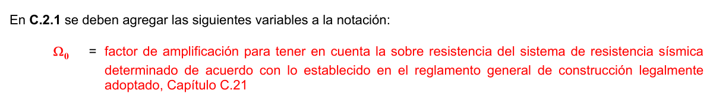
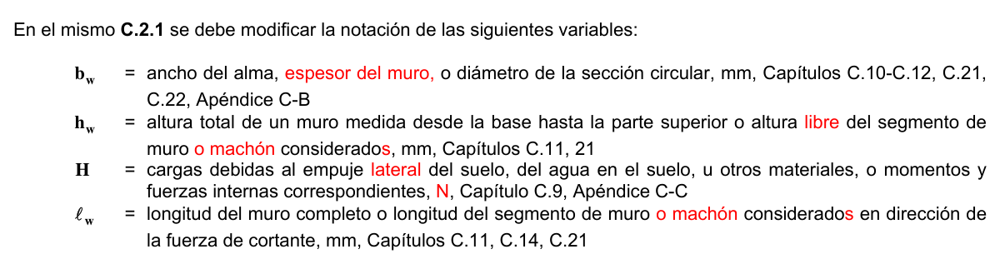
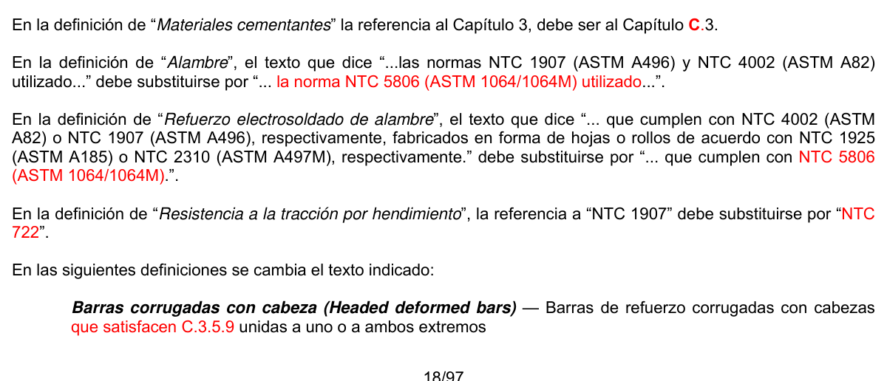
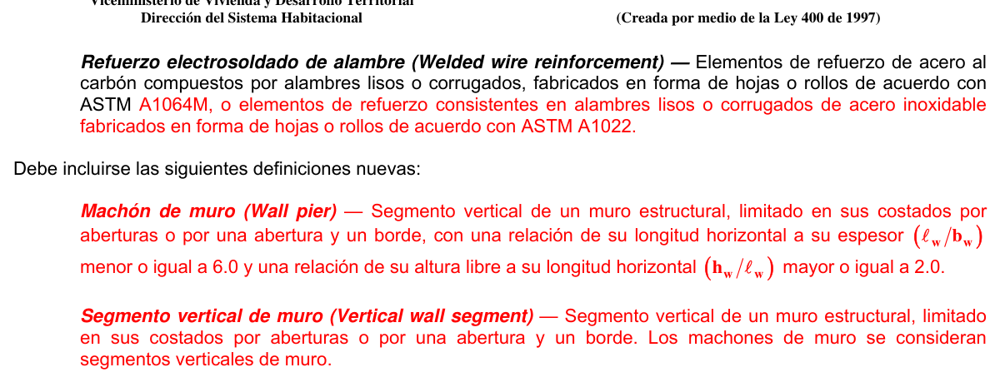

# C.2 — Notación y definiciones

### C.2.1 — Notación del Título C del Reglamento NSR-10

Los términos en esta lista se utilizan en el Título C del Reglamento NSR-10.

$a$ = profundidad del bloque rectangular equivalente de esfuerzos tal como se define en C.10.2.7.1, mm, Capítulo C.10

$a_{v}$ = luz de cortante, igual a la distancia del centro de una carga concentrada a (a) la cara del apoyo para elementos continuos o en voladizo, o (b) el centro del apoyo para elementos simplemente apoyados, mm, Capítulo C.11, Apéndice C-A

$A_{b}$ = área de una barra o alambre individual, mm2, Capítulos C.10, C.12

$A_{brg}$ = área de apoyo de la cabeza de un perno o tornillo de anclaje, o barra corrugada con cabeza mm2, Capítulo C.12, Apéndice C-D

$A_{c}$ = área de la sección de concreto que resiste la transferencia de cortante, mm2, Capítulos C.11, C.21

$A_{cf}$ = mayor área transversal bruta perteneciente a las franjas de viga-losa que corresponden a los dos pórticos equivalentes ortogonales que se intersectan en una columna de una losa en dos direcciones, mm2, Capítulo C.18

$A_{ch}$ = área de la sección transversal de un elemento estructural, medida entre los bordes exteriores del refuerzo transversal, mm2, Capítulos C.10, C.21

$A_{cp}$ = área encerrada por el perímetro exterior de la sección transversal de concreto, mm2, véase C.11.5.1, Capítulo C.11

$A_{cs}$ = área de la sección de un puntal en el extremo en un modelo puntal-tensor, medida perpendicularmente al eje del puntal, mm2, Apéndice C-A

$A_{ct}$ = área de aquella parte de la sección transversal comprendida entre la cara en tracción por flexión y el centro de gravedad de la sección bruta, mm2, Capítulo C.18

$A_{cv}$ = área bruta de la sección de concreto limitada por el espesor del alma y la longitud de la sección en la dirección de la fuerza de cortante considerada, mm2, Capítulo C.21

$A_{cw}$ = área de la sección de concreto de un machón individual, segmento horizontal de muro, o viga de acople, que resiste cortante, mm2, Capítulo C.21

$A_{f}$ = área del acero de refuerzo en una ménsula o cartela que resiste el momento mayorado, mm2, véase C.11.8, Capítulo C-11

$A_{g}$ = área bruta de la sección de concreto, mm2. Para una sección con vacíos,$A_{g}$ es el área del concreto solo y no incluye el área de los vacíos, véase C.11.5.1, Capítulos C.9-11, C.14-16, C.21, C.22, Apéndices C-B, C-C

$A_{h}$ = área total de refuerzo para cortante paralelo al refuerzo principal de tracción en una ménsula o cartela, mm2, véase C.11.9, Capítulo C.11

$A_{j}$ = área efectiva de la sección transversal dentro de un nudo medida en un plano paralelo al plano del refuerzo que genera cortante en el nudo, mm2, véase C.21.7.4.1, Capítulo C.21

$Aℓ$ = área total del refuerzo longitudinal para resistir torsión, mm2, Capítulo C.11

$A_{\ell,min}$ = área mínima de refuerzo longitudinal para resistir torsión, mm2, véase C.11.5.5.3, Capítulo C.11

$A_{n}$ = área de refuerzo en una ménsula o cartela que resiste la fuerza de tracción$N_{uc}$, mm2, véase C.11.8, Capítulo C.11

$A_{nz}$ = área de una cara de una zona de nodo o de una sección a través de una zona de nodo, mm2, Apéndice C-A

$A_{Nc}$ = área de falla proyectada del concreto en un anclaje solo o en un grupo de anclajes, utilizada para calcular la resistencia a tracción, mm2, véase C-D.5.2.1, Apéndice C-D

$A_{Nco}$ = área de falla proyectada del concreto en un anclaje solo, utilizada para calcular la resistencia a tracción cuando no se encuentra limitada por la distancia al borde o el espaciamiento, mm2, véase C-D.5.2.1, Apéndice C-D

$A_{o}$ = área bruta encerrada por la trayectoria del flujo de cortante, mm2, Capítulo C.11

$A_{oh}$ = área encerrada por el eje del refuerzo transversal cerrado más externo dispuesto para resistir la torsión, mm2, Capítulo C.11

$A_{ps}$ = área de acero preesforzado en la zona de tracción por flexión, mm2, Capítulo C.18, Apéndice C-B

$A_{s}$ = área de refuerzo longitudinal no preesforzado a tracción, mm2, Capítulos C.10-12, C.14, C.15, C.18, Apéndice C-B

$A_{s}'$ = área del refuerzo a compresión, mm2, Apéndice C-A

$A_{sc}$ = área de refuerzo principal a tracción en una ménsula o cartela, mm2, véase C.11.8.3.5, Capítulo C.11

$A_{se,N}$= área efectiva de la sección transversal del anclaje en tracción, mm2, Apéndice C-D

$A_{se,V}$= área efectiva de la sección transversal del anclaje en cortante, mm2, Apéndice C-D

$A_{sh}$ = área total de refuerzo transversal (incluyendo ganchos suplementarios) colocado dentro del espaciamiento $s$ y perpendicular a la dimensión$b_{c}$ , mm2, Capítulo C.21

$A_{si}$ = área total del refuerzo superficial con un espaciamiento $s_{i}$ colocado en la fila $i$ que atraviesa un puntal, formando un ángulo $α_{i}$con el eje del puntal, mm2, Apéndice C-A

$As,min$= área mínima de refuerzo de flexión, mm2, véase C.10.5, Capítulo C.10

$A_{st}$ = área total de refuerzo longitudinal no preesforzado (barras o perfiles de acero), mm2, Capítulos C.10, C.21

$A_{sx}$ = área del perfil o tubo estructural de acero en una sección compuesta, mm2, Capítulo C.10

$A_{t}$ = área de una rama de un estribo cerrado que resiste la torsión con un espaciamiento$s$ , mm2, Capítulo C.11

$A_{tp}$ = área de acero preesforzado en un tensor, mm2, Apéndice C-A

$A_{tr}$ = área total de todo el refuerzo transversal dentro de un espaciamiento $s$ que cruza el plano potencial de hendimiento a través del refuerzo que está siendo desarrollado, mm2, Capítulo C.12

$A_{ts}$ = área de refuerzo no preesforzado en un tensor, mm2, Apéndice C-A

$A_{v}$ = área de refuerzo de cortante con un espaciamiento $s$ , mm2, Capítulos C.11, C.17

$A_{Vc}$ = área proyectada de falla del concreto de un anclaje solo o de un grupo de anclajes, utilizada para calcular la resistencia al cortante, mm2, véase C-D.6.2.1, Apéndice C-D

$A_{Vco}$ = área proyectada de falla del concreto de un anclaje solo, utilizada para calcular la resistencia a cortante, cuando no se encuentra limitada por la influencia de una esquina, del espaciamiento, o del espesor del elemento, mm2, véase C-D.6.2.1, Apéndice C-D

$A_{vd}$ = área total de refuerzo en cada grupo de barras diagonales en una viga de acoplamiento con refuerzo en diagonal, mm2, Capítulo C.21

$A_{vf}$ = área de refuerzo de cortante por fricción, mm2, Capítulos C.11, C.21

$A_{vh}$ = área del refuerzo de cortante paralelo al refuerzo de tracción por flexión con un espaciamiento $s_{2}$, mm2, Capítulo C.11

$Av,min$= área mínima de refuerzo para cortante con un espaciamiento$s$ , mm2, véase C.11.4.6.3 y C.11.4.6.4, Capítulo C.11

$A_{1}$ = área cargada, mm2, Capítulos C.10, C.22

$A_{2}$ = el área de la base inferior del tronco mayor de la pirámide, cono o cuña ahusada, contenida en su totalidad dentro del apoyo y que tenga por base superior el área cargada y pendientes laterales de 1 vertical por 2 horizontal, mm2, Capítulos C.10, C.22

$b$ = ancho de la cara en compresión del elemento, mm, Capítulo C.10, Apéndice C-B

$b_{c}$ = dimensión transversal del núcleo del elemento medida entre los bordes externos del refuerzo transversal con área $A_{sh}$, mm, Capítulo C.21

$b_{o}$ = perímetro de la sección crítica para cortante en losas y zapatas, mm, véase C.11.11.1.2, Capítulos C.11, C.22

$b_{s}$ = ancho de un puntal, mm, Apéndice C-A

$b_{t}$ = ancho de la parte de la sección transversal que contiene los estribos cerrados que resisten la torsión, mm, Capítulo C.11

$b_{v}$ = ancho de la sección transversal en la superficie de contacto que se investiga por cortante horizontal, mm, Capítulo C.17

$b_{w}$ = ancho del alma o diámetro de la sección circular, mm, Capítulos C-10-12, C.21, C.22, Apéndice C-B

$b_{1}$ = dimensión de la sección crítica $b_{o}$ medida en la dirección de la luz para la cual se determinan los momentos, mm, Capítulo C.13

$b_{2}$ = dimensión de la sección crítica $b_{o}$ medida en dirección perpendicular a$b_{1}$ , mm, Capítulo C.13

$B_{n}$ = resistencia nominal al aplastamiento, N, Capítulo C.22

$B_{u}$ = carga mayorada de aplastamiento, N, Capítulo C.22

$c$ = distancia medida desde la fibra extrema en compresión al eje neutro, mm, Capítulos C.9, C.10, C.14, C.21

$c_{ac}$ = distancia crítica al borde requerida para desarrollar la resistencia básica del concreto al arrancamiento de un anclaje post instalado en concreto no fisurado sin refuerzo suplementario para controlar el hendimiento, mm, véase C-D.8.6, Apéndice C-D

$c_{a,\text{máx}}$= máxima distancia medida desde el centro del fuste de un anclaje al borde del concreto, mm, Apéndice C-D

$c_{a,\text{mín}}$= mínima distancia medida desde el centro del fuste de un anclaje al borde del concreto, mm, Apéndice C-D

$c_{a1}$ = distancia medida desde el centro del fuste de un anclaje hasta el borde del concreto en una dirección, mm.

Si se aplica cortante al anclaje, $c_{a1}$ se mide en la dirección de la fuerza cortante aplicada. Si se aplica tracción al anclaje, $c_{a1}$ es la mínima distancia al borde, Apéndice C-D

$c_{a2}$ = distancia desde el centro del fuste de un anclaje hasta el borde del concreto en dirección perpendicular a $c_{a1}$, mm, Apéndice C-D

$c_{b}$ = la menor de: (a) la distancia medida del centro de una barra o alambre a la superficie más cercana del concreto, o (b) la mitad de la separación centro a centro de las barras o alambres que se desarrollan, mm, Capítulo C.12

$c_{c}$ = recubrimiento libre del refuerzo, mm, véase C.10.6.4, Capítulo C.10

$c_{t}$ = distancia desde la cara interior de la columna al borde de la losa, medida paralelamente a $c_{1}$ , pero sin exceder $c_{1}$ , mm, Capítulo C.21

$c_{1}$ = dimensión de una columna rectangular o rectangular equivalente, de un capitel o de una ménsula, medida en la dirección de la luz para la cual se determinan los momentos, mm, Capítulos C.11, C.13, C.21

$c_{2}$ = dimensión de una columna rectangular o rectangular equivalente, de un capitel o de una ménsula, medida en la dirección perpendicular a $c_{1}$ , mm, Capítulo C.13

$C$ = constante de la sección transversal para definir propiedades a la torsión de losas y vigas, véase C.13.6.4.2, Capítulo C.13

$C_{a,j}$ = coeficiente para los momentos en la dirección corta de losas en dos direcciones diseñadas según C.13.9.

Capítulo C.13.

$C_{b,j}$ = coeficiente para los momentos en la dirección larga de losas en dos direcciones diseñadas según C.13.9.

Capítulo C.13.

$C_{m}$ = factor que relaciona el diagrama real de momentos con un diagrama equivalente de momento uniforme, Capítulo C.10

$d$ = distancia desde la fibra extrema en compresión hasta el centroide del refuerzo longitudinal en tracción, mm, Capítulos C.7, C.9-12, C.14, C.17, C.18, C.21, Apéndices C-B, C-C

$d'$ = distancia desde la fibra extrema en compresión al centroide del refuerzo longitudinal en compresión, mm, Capítulos C.9, C.18, Apéndice C-C

$d_{a}$ = diámetro exterior de un anclaje o diámetro del fuste del perno con cabeza, del tornillo con cabeza, o del perno con forma de gancho, mm, véase C-D.8.4, Apéndice C-D.

$d_{a}'$ = valor que se sustituye por $d_{a}$ cuando se emplea un anclaje sobre dimensionado, mm, véase C-D.8.4, Apéndice C-D

$d_{b}$ = diámetro nominal de una barra, alambre o torón de preesforzado, mm, Capítulos C.7, C.12, C.21

$d_{p}$ = distancia desde la fibra extrema en compresión al centroide del acero preesforzado, mm, Capítulos C.11, C.18, Apéndice C-B

$d_{pile}$ = diámetro del pilote medido en la base de la zapata, mm, Capítulo C.15

$d_{t}$ = distancia desde la fibra extrema en compresión al centroide de la fila extrema de acero longitudinal en tracción, mm, Capítulos C.9, C.10, Apéndice C-C

$D$ = cargas muertas, o momentos y fuerzas internas correspondientes, Capítulos C.8, C.9, C.20, C.21, Apéndice C-C

$e$ = base de los logaritmos neperianos, Capítulo C.18

$e_{h}$ = distancia desde la superficie interna del fuste de un perno en forma de J o de L hasta la parte externa de la punta del perno en forma de J o L, mm, Apéndice C-D

$e_{N}'$ = distancia entre la resultante de tracción en un grupo de anclajes cargados en tracción y el centroide del grupo de anclajes cargados en tracción, mm; $e_{N}'$ es siempre positiva, Apéndice C-D

$e_{V}'$ = distancia entre la carga resultante de cortante en un grupo de anclajes solicitados en cortante en la misma dirección y el centroide del grupo de anclajes cargados a cortante en la misma dirección, mm, $e_{V}'$ es siempre positiva, Apéndice C-D

$E$ = efectos de carga producidos por el sismo o momentos y fuerzas internas correspondientes, Capítulos C.9, C.21, Apéndice C-C

$E_{c}$ = módulo de elasticidad del concreto, MPa, véase C.8.5.1, Capítulos C.8-10, C.14, C.19

$E_{cb}$ = módulo de elasticidad del concreto de la viga, MPa, Capítulo C.13

$E_{cs}$ = módulo de elasticidad del concreto de la losa, MPa, Capítulo C.13

$EI$ = rigidez a la flexión de un elemento en compresión, N·mm2, véase C.10.10.6, Capítulo C.10

$E_{p}$ = módulo de elasticidad del acero de preesfuerzo, MPa, véase C.8.5.3, Capítulo C.8

$E_{s}$ = módulo de elasticidad del refuerzo y del acero estructural, MPa, véase C.8.5.2, Capítulos C.8, C.10, C.14

$f_{c}'$ = resistencia especificada a la compresión del concreto, MPa, Capítulos C.4, C.5, C.8-12, C.14, C.18, C.19, C.21, C.22, Apéndices C-A-D

$\sqrt{f_{c}'}$ = raíz cuadrada de la resistencia especificada a la compresión del concreto, MPa, Capítulos C.8, C.9, C.11, C.12, C.18, C.19, C.21, C.22, Apéndice C-D

$f_{ce}$= resistencia efectiva a la compresión del concreto en un puntal o zona de nodo, MPa, Capítulo C.15, Apéndice C-A

$f_{ci}'$ = resistencia especificada a la compresión del concreto al momento del preesforzado inicial, MPa, Capítulos C.7, C.18

$\sqrt{f_{ci}'}$ = raíz cuadrada de la resistencia especificada a la compresión del concreto en el momento del preesforzado inicial, MPa, Capítulo C.18

$f_{cr}'$ = resistencia promedio a la compresión requerida del concreto, empleada como base para la dosificación del concreto, MPa, Capítulo C.5

$f_{ct}$= resistencia promedio a la tracción por hendimiento del concreto liviano, MPa, Capítulos C.5, C.9, C.11, C.12, C.22

$f_{d}$ = esfuerzo debido a la carga muerta no mayorada en la fibra extrema de una sección en la cual el esfuerzo de tracción es producido por cargas externas, MPa, Capítulo C.11

$f_{dc}$ = esfuerzo de descompresión; esfuerzo en el acero de preesforzado cuando el esfuerzo en el concreto localizado al mismo nivel que el centroide del acero de preesfuerzo es igual a cero, MPa, Capítulo C.18

$f_{pc}$ = esfuerzo de compresión en el concreto (después de que han ocurrido todas las pérdidas de preesforzado) en el centroide de la sección transversal que resiste las cargas aplicadas externamente, o en la unión del alma y el ala cuando el centroide está localizado dentro del ala, MPa. (En un elemento compuesto, $f_{pc}$es el esfuerzo de compresión resultante en el centroide de la sección compuesta, o en la unión del alma y el ala cuando el centroide se encuentra dentro del ala, debido tanto al preesforzado como a los momentos resistidos por el elemento prefabricado actuando individualmente), Capítulo C.11

$f_{pe}$ = esfuerzo de compresión en el concreto debido únicamente a las fuerzas efectivas del preesforzado (después de que han ocurrido todas las pérdidas de preesforzado) en la fibra extrema de una sección en la cual los esfuerzos de tracción han sido producidos por la cargas aplicadas externamente, MPa, Capítulo C.11

$f_{ps}$ = esfuerzo en el acero de preesfuerzo en el estado de resistencia nominal a la flexión, MPa, Capítulos C.12, C.18

$f_{pu}$ = resistencia especificada a la tracción del acero de preesforzado, MPa, Capítulos C.11, C.18

$f_{py}$ = resistencia especificada a la fluencia del acero de preesforzado, MPa, Capítulo C.18

$f_{r}$ = módulo de ruptura del concreto, MPa, véase C.9.5.2.3, Capítulos C.9, C.14, C.18, Apéndice C-B

$f_{s}$ = esfuerzo en el refuerzo calculado para las cargas de servicio, MPa, Capítulos C.10, C.18

$f_{s}'$ = esfuerzo en el refuerzo a compresión bajo cargas mayoradas, MPa, Apéndice C-A

$f_{se}$= esfuerzo efectivo en el acero de preesfuerzo (después de que han ocurrido todas la pérdidas de preesforzado), MPa, Capítulos C.12, C.18, Apéndice C-A

$f_{t}$ = esfuerzo en la fibra extrema por tracción en la zona de tracción precomprimida, calculado para las cargas de servicio usando las propiedades de la sección bruta, MPa, véase C.18.3.3, Capítulo C.18

$f_{uta}$ = resistencia especificada a la tracción del acero del anclaje, MPa, Apéndice C-D

$f_{y}$ = resistencia especificada a la fluencia del refuerzo, MPa, Capítulos C.3, C.7, C.9-12, C.14, C.17-19, C.21, Apéndices C-A-C

$f_{ya}$ = resistencia especificada a la fluencia en el acero del anclaje, MPa, Apéndice C-D

$f_{yt}$ = resistencia especificada a la fluencia $f_{y}$del refuerzo transversal, MPa, Capítulos C.10-12, C.21

$F$ = cargas debidas al peso y presión de fluidos con densidades bien definidas y alturas máximas controlables, o momentos y fuerzas internas correspondientes, Capítulo C.9, Apéndice C-C

$F_{n}$ = resistencia nominal de un puntal, tensor o zona de nodo, N, Apéndice C-A

$F_{nn}$ = resistencia nominal de una cara de una zona de nodo, N, Apéndice C-A

$F_{ns}$ = resistencia nominal de un puntal, N, Apéndice C-A

$F_{nt}$ = resistencia nominal de un tensor, N, Apéndice C-A

$F_{u}$ = fuerza mayorada que actúa en un puntal, tensor, área de apoyo o zona de nodo en un modelo puntal tensor, N, Apéndice C-A

$G$ = cargas por granizo, o momentos y fuerzas internas correspondientes, Capítulo C.9

$h$ = espesor total o altura de un elemento, mm, Capítulos C.9-12, C.14, C.17, C.18, C.20-22, Apéndices C-A, C-C

$h_{a}$ = espesor de un elemento en el que se coloca un anclaje, medido paralelamente al eje del anclaje, mm, Apéndice C-D

$h_{ef}$ = profundidad efectiva de embebido del anclaje, mm, véase C-D.8.5, Apéndice C-D

$h_{v}$ = altura de la sección transversal de una cabeza de cortante, mm, Capítulo C.11

$h_{w}$ = altura total de un muro medida desde la base hasta la parte superior o altura del segmento de muro considerado, mm, Capítulos C.11, C.21

$h_{x}$ = espaciamiento máximo horizontal, medido centro a centro, entre ganchos suplementarios o ramas de estribos cerrados de confinamiento en todas las caras de la columna, mm, Capítulo C.21

$H$ = cargas debidas al peso y empuje del suelo, del agua en el suelo, u otros materiales, o momentos y fuerzas internas correspondientes, Capítulo C.9, Apéndice C-C

$I$ = momento de inercia de la sección con respecto al eje que pasa por el centroide, mm4, Capítulos C.10, C.11

$I_{b}$ = momento de inercia de la sección bruta de una viga con respecto al eje que pasa por el centroide, mm4, véase C.13.6.1.6, Capítulo C.13

$I_{cr}$ = momento de inercia de la sección fisurada transformada a concreto, mm4, Capítulo C.9

$I_{e}$ = momento de inercia efectivo para el cálculo de las deflexiones, mm4, véase C.9.5.2.3, Capítulo C.9

$I_{g}$ = momento de inercia de la sección bruta del elemento con respecto al eje que pasa por el centroide, sin tener en cuenta el refuerzo, mm4, Capítulos C.9, C.10, C.14

$I_{s}$ = Momento de inercia de la sección bruta de una losa con respecto al eje que pasa por el centroide definido para el cálculo de $α_{f}$ y$β_{t}$ , mm4, Capítulo C.13

$I_{se}$ = momento de inercia del refuerzo con respecto al eje que pasa por el centroide de la sección transversal del elemento, mm4, Capítulo C.10

$I_{sx}$ = momento de inercia de un perfil o tubo de acero estructural, con respecto al eje que pasa por el centroide de la sección transversal del elemento compuesto, mm4, Capítulo C.10

$k$ = factor de longitud efectiva para elementos en compresión, Capítulos C.10, C.14

$k_{c}$ = coeficiente para la resistencia básica al arrancamiento del concreto en tracción, Apéndice C-D

$k_{cp}$ = coeficiente para la resistencia al desprendimiento por cabeceo del anclaje, Apéndice C-D

$K$ = coeficiente de fricción por desviación accidental, por metro de tendón de preesforzado, Capítulo C.18

$K_{tr}$ = índice de refuerzo transversal, véase C.12.2.3, Capítulo C.12

$ℓ$ = luz de la viga o losa en una dirección; proyección libre del voladizo, mm, véase C.8.9, Capítulo C.9

$ℓ_{a}$ = longitud de anclaje adicional más allá del centro del apoyo o punto de inflexión, mm, Capítulo C.12

$ℓ_{c}$ = longitud del elemento en compresión en un pórtico, medida centro a centro de los nudos del pórtico, mm, Capítulo C.10, C.14, C.22

$ℓ_{d}$ = longitud de desarrollo en tracción para barras corrugadas, alambres corrugados, refuerzo electrosoldado de alambre liso o corrugado, o torones de preesfuerzo, mm, Capítulos C.7, C.12, C.19, C.21

$ℓ_{dc}$ = longitud de desarrollo de las barras corrugadas y alambres corrugados en compresión, mm, Capítulo C.12

$ℓ_{dh}$ = longitud de desarrollo en tracción de barras corrugadas o alambres corrugados con un gancho estándar, medida desde la sección crítica hasta el extremo exterior del gancho (longitud recta embebida en el concreto entre la sección crítica y el inicio del gancho [punto de tangencia] más el radio interno del doblez y un diámetro de barra), mm, véanse C.12.5 y C.21.7.5, Capítulo C.12, C.21

$ℓ_{dt}$ = longitud de desarrollo en tracción de barras corrugadas con cabeza, medida desde la sección crítica hasta la cara de apoyo de la cabeza, mm, véase C.12.6, Capítulo C.12

$ℓ_{e}$ = longitud de apoyo de la carga de un anclaje para cortante, mm, véase C-D.6.2.2, Apéndice C-D

$ℓ_{n}$ = luz libre medida entre caras de los apoyos, mm, Capítulos C.8-11, C.13, C.16, C.18, C.21

$ℓ_{na}$ = luz libre en la dirección corta medida entre caras de los apoyos para diseño de losas en dos direcciones según C.13.9, mm, Capítulo C.13

$ℓ_{nb}$ = luz libre en la dirección larga medida entre caras de los apoyos para diseño de losas en dos direcciones según C.13.9, mm, Capítulo C.13

$ℓ_{o}$ = longitud, medida desde la cara del nudo a lo largo del eje del elemento estructural, dentro de la cual debe colocarse refuerzo transversal especial, mm, Capítulo C.21

$ℓ_{px}$ = distancia desde el extremo del gato de un elemento de acero de preesfuerzo al punto bajo consideración, m, véase C.18.6.2, Capítulo C.18

$ℓ_{t}$ = luz del elemento sometido a la prueba de carga, tomada como la luz menor en sistemas de losas en dos direcciones, mm. La luz es la menor entre: (a) la distancia entre los centros de los apoyos, y (b) la distancia libre entre los apoyos más el espesor $h$ del elemento. La luz de un voladizo debe tomarse como el doble de la distancia entre la cara del apoyo y el extremo del voladizo, mm, Capítulo C.20

$ℓ_{u}$ = longitud sin soporte lateral de un elemento en compresión, mm, véase C.10.10.1.1, Capítulo C.10

$ℓ_{v}$ = longitud del brazo de la cabeza de cortante medida desde el centroide de la carga concentrada o reacción, mm, Capítulo C.11

$ℓ_{w}$ = longitud del muro completo o longitud del segmento de muro considerado en dirección de la fuerza de cortante, mm, Capítulos C.11, C.14, C.21

$ℓ_{1}$ = luz en la dirección en que se determinan los momentos, medida centro a centro de los apoyos, mm, Capítulo C.13

$ℓ_{2}$ = luz medida en la dirección perpendicular a$ℓ_{1}$ , medida centro a centro de los apoyos, mm, véanse C.13.6.2.3 y C.13.6.2.4, Capítulo C.13

$L$ = cargas vivas, o momentos y fuerzas internas correspondientes, Capítulos C.8, C.9, C.20, C.21, Apéndice C- C

$L_{e}$ = cargas por empozamiento de agua, o momentos y fuerzas internas correspondientes, Capítulo C.9

$L_{r}$ = cargas vivas de cubierta, o momentos y fuerzas internas correspondientes, Capítulo C.9

$M_{a}$ = momento máximo debido a cargas de servicio presente en el elemento en la etapa para la que se calcula la deflexión, N·mm, Capítulos C.9, C.14

$M_{as}$ = momento mayorado en la dirección de la luz corta utilizado en el diseño de losas en dos direcciones según C.13.9. N·mm, Capítulos C.13

$M_{bs}$ = momento mayorado en la dirección de la luz larga utilizado en el diseño de losas en dos direcciones según C.13.9. N·mm, Capítulos C.13

$M_{c}$ = momento mayorado amplificado por los efectos de curvatura del elemento para usarse en el diseño de un elemento en compresión, N·mm, véase C.10.10.6, Capítulo C.10

$M_{cr}$ = momento de fisuración, N·mm, véase C.9.5.2.3, Capítulos C.9, C.14

$M_{cre}$ = momento que produce fisuración por flexión en la sección debido a cargas aplicadas externamente, N·mm, Capítulo C.11

$M_{m}$ = momento mayorado modificado para tener en cuenta el efecto de compresión axial, N·mm, véase C.11.2.2.2, Capítulo C.11

$M_{max}$= máximo momento mayorado en la sección debido a las cargas aplicadas externamente, N·mm, Capítulo C.11

$M_{n}$ = resistencia nominal a flexión en la sección, N·mm, Capítulos C.11, C.12, C.14, C.18, C.21, C.22

$M_{nb}$ = resistencia nominal a flexión de la viga, incluyendo el efecto de la losa cuando está en tracción, que llega a un nudo, N·mm, véase C.21.6.2.2, Capítulo C.21

$M_{nc}$ = resistencia nominal a flexión de la columna que llega a un nudo, calculada para la carga axial mayorada, consistente con la dirección de las fuerzas laterales consideradas, que conduce a la menor resistencia a flexión, N·mm, véase C.21.6.2.2, Capítulo C.21

$M_{o}$ = momento estático total mayorado, N·mm, Capítulo C.13

$M_{p}$ = momento plástico resistente requerido en la sección transversal de una cabeza de cortante, N·mm, Capítulo C.11

$M_{pr}$ = resistencia probable a la flexión de los elementos, con o sin carga axial, determinada usando las propiedades de los elementos en las caras de los nudos suponiendo un esfuerzo en tracción para las barras longitudinales de al menos $1.25f_{y}$ y un factor de reducción de la resistencia $φ$ de 1.0, N·mm, Capítulo C.21

$M_{s}$ = momento mayorado debido a cargas que producen un desplazamiento lateral apreciable, N·mm, Capítulo C.10

$M_{slab}$= fracción del momento mayorado de la losa que es equilibrada por el momento en el apoyo, N·mm, Capítulo C.21

$M_{u}$ = momento mayorado en la sección, N·mm, Capítulos C.10, C.11, C.13, C.14, C.21, C.22

$M_{ua}$ = momento a media altura del muro debido a las cargas mayoradas laterales y verticales excéntricas, sin incluir los efectos $PΔ$, N·mm, Capítulo C.14

$M_{v}$= resistencia a momento contribuida por la cabeza de cortante, N·mm, Capítulo C.11

$M_{1}$ = el menor momento mayorado de uno de los extremos de un elemento en compresión, debe tomarse como positivo si el elemento presenta curvatura simple y negativo si tiene curvatura doble, N·mm, Capítulo C.10

$M_{1ns}$ = momento mayorado en el extremo del elemento en compresión en el cual actúa $M_{1}$ , y que se debe a cargas que no causan un desplazamiento lateral apreciable, calculado por medio de un análisis estructural elástico de primer orden, N·mm, Capítulo C.10

$M_{1s}$ = momento mayorado en el extremo del elemento en compresión en el cual actúa $M_{1}$ , y que se debe a cargas que causan un desplazamiento lateral apreciable, calculado por medio de un análisis estructural elástico de primer orden, N·mm, Capítulo C.10

$M_{2}$ = el mayor momento mayorado en los extremos de un elemento en compresión. Si existe carga transversal entre los apoyos, $M_{2}$debe tomarse como el mayor momento que ocurre en el elemento. El valor $M_{2}$es siempre positivo, N·mm, Capítulo C.10

$M2,min$= valor mínimo de $M_{2}$ , N·mm, Capítulo C.10

$M_{2ns}$ = momento mayorado en el extremo del elemento en compresión en el cual actúa $M_{2}$ , debido a cargas que no causan un desplazamiento lateral apreciable, calculado por medio de un análisis estructural elástico de primer orden, N·mm, Capítulo C.10

$M_{2s}$ = momento mayorado en el extremo del elemento en compresión en el cual actúa $M_{2}$ , debido cargas que causan un desplazamiento lateral apreciable, calculado por medio de un análisis estructural elástico de primer orden, N·mm, Capítulo C.10

$n$ = número de unidades, tales como ensayos de resistencia, barras, alambres, dispositivos de anclaje para torones individuales, anclajes, o brazos de una cabeza de cortante, Capítulos C.5, C.11, C.12, C.18, Apéndice C-D

$N_{b}$ = resistencia básica al arrancamiento del concreto en tracción de un solo anclaje en concreto fisurado, N, véase C-D.5.2.2, Apéndice C-D

$N_{c}$ = fuerza de tracción en el concreto debida a la carga muerta más la carga viva no mayoradas, N, Capítulo C.18

$N_{cb}$ = resistencia nominal al arrancamiento del concreto en tracción de un solo anclaje, N, véase C-D.5.2.1, Apéndice C-D

$N_{cbg}$ = resistencia nominal al arrancamiento del concreto en tracción de un grupo de anclajes, N, véase C-D.5.2.1, Apéndice C-D

$N_{n}$ = resistencia nominal en tracción, N, Apéndice C-D

$N_{p}$ = resistencia a la extracción por deslizamiento por tracción de un solo anclaje en concreto fisurado, N, véanse C-D.5.3.4 y C-D.5.3.5, Apéndice C-D

$N_{pn}$ = resistencia nominal a la extracción por deslizamiento por tracción de un solo anclaje, N, véase C-D.5.3.1, Apéndice C-D

$N_{sa}$ = resistencia nominal de un solo anclaje o de un grupo de anclajes en tracción determinado por la resistencia del acero, N, véanse C-D.5.1.1 y C-D.5.1.2, Apéndice C-D

$N_{sb}$ = resistencia al desprendimiento lateral de un solo anclaje, N, Apéndice C-D

$N_{sbg}$ = resistencia al desprendimiento lateral de un grupo de anclajes, N, Apéndice C-D

$N_{u}$ = carga axial mayorada normal a la sección transversal, que ocurre simultáneamente con $V_{u}$ o $T_{u}$ ; debe tomarse como positiva para compresión y como negativa para tracción, N, Capítulo C.11

$N_{ua}$ = fuerza mayorada de tracción aplicada a un anclaje o grupo de anclajes, N, Apéndice C-D

$N_{uc}$ = fuerza horizontal de tracción mayorada que actúa simultáneamente con $V_{u}$ en la parte superior de una ménsula o cartela, para ser tomada como positiva para la tracción, N, Capítulo C.11

$p_{cp}$ = perímetro exterior de la sección transversal de concreto, mm, véase C.11.5.1, Capítulo C.11

$p_{h}$ = perímetro del eje del refuerzo transversal cerrado más externo dispuesto para torsión, mm, Capítulo C.11

$P_{b}$ = resistencia axial nominal en condiciones de deformación unitaria balanceada, N, véase C.10.3.2, Capítulos C.9, C.10, Apéndices C-B, C-C

$P_{c}$ = carga crítica a pandeo, N. véase C.10.10.6, Capítulo C.10

$P_{n}$ = resistencia axial nominal de la sección transversal, N, Capítulos C.9, C.10, C.14, C.22, Apéndices C-B, C-C

$Pn,max$= máximo valor permitido de $P_{n}$ , N, véase C.10.3.6, Capítulo C.10

$P_{o}$ = resistencia axial nominal para una excentricidad igual a cero, N, Capítulo C.10

$P_{pj}$ = fuerza de preesforzado en el extremo del gato, N, Capítulo C.18

$P_{pu}$ = fuerza mayorada de preesforzado en el dispositivo de anclaje, N, Capítulo C.18

$P_{px}$ = fuerza de preesforzado evaluada a una distancia $ℓ_{px}$ del extremo del gato, N, Capítulo C.18

$P_{s}$ = carga axial no mayorada en la sección de diseño (media altura), incluyendo los efectos de peso propio, N, Capítulo C.14

$P_{u}$ = fuerza axial mayorada; debe tomarse como positiva para compresión y negativa para tracción, N, Capítulos C.10, C.14, C.21, C.22

$q_{Du}$ = carga muerta mayorada por unidad de área, Capítulo C.13

$q_{Lu}$ = carga viva mayorada por unidad de área, Capítulo C.13

$q_{u}$ = carga mayorada por unidad de área, Capítulo C.13

$Q$ = índice de estabilidad de un piso, véase C.10.10.5.2, Capítulo C.10

$r$ = radio de giro de la sección transversal de un elemento en compresión, mm, Capítulo C.10

$s$ = espaciamiento medido centro a centro de unidades tales como refuerzo longitudinal, refuerzo transversal, tendones de preesfuerzo, alambres, o anclajes, mm, Capítulos C.10-12, C.17-21, Apéndice C-D

$s_{i}$ = espaciamiento centro a centro del refuerzo en la fila $i$ adyacente a la superficie de un elemento, mm, Apéndice C-A

$s_{o}$ = espaciamiento centro a centro del refuerzo transversal dentro de una longitud $ℓ_{o}$ , mm, Capítulo C.21

$s_{s}$ = desviación estándar de la muestra, MPa, Capítulo C.5, Apéndice C-D

$s_{2}$ = espaciamiento centro a centro del refuerzo longitudinal de cortante o torsión, mm, Capítulo C.11

$S_{e}$ = momento, fuerza cortante o carga axial en la conexión correspondiente al desarrollo de la resistencia probable en los lugares seleccionados para que ocurra fluencia, basados en el mecanismo dominante de la deformación inelástica lateral, considerando tanto los efectos de carga por gravedad como por sismo, Capítulo C.21

$S_{d}$ = coeficiente de durabilidad ambiental, Capítulo C.23

$S_{m}$ = módulo elástico de la sección, mm3, Capítulo C.22

$S_{n}$ = resistencia nominal a la flexión, al cortante o a la carga axial de la conexión, Capítulo C.21

$S_{y}$ = resistencia a la fluencia de la conexión, basada en $f_{y}$, para fuerza axial, momento o cortante, Capítulo C.21

$t$ = espesor de la pared de una sección con vacíos, mm, Capítulo C.11

$T$ = efectos acumulados de variación de temperatura, flujo plástico, retracción, asentamiento diferencial, y retracción del concreto de retracción compensada, Capítulo C.9, Apéndice C-C

$T_{n}$ = resistencia nominal a torsión, N·mm, Capítulo C.11

$T_{u}$ = torsión mayorada en la sección, N·mm, Capítulo C.11

$U$ = resistencia requerida para resistir las cargas mayoradas o momentos y fuerzas internas correspondientes, Capítulo C.9, Apéndice C-C

$v_{n}$ = esfuerzo resistente nominal de cortante, MPa, véase C.11.11.6.2, Capítulos C.11, C.21

$V_{b}$ = resistencia básica al arrancamiento por cortante de un solo anclaje en concreto fisurado, N, véanse C- D.6.2.2 y C-D.6.2.3, apéndice C-D

$V_{c}$ = resistencia nominal al cortante proporcionada por el concreto, N, Capítulos C.8, C.11, C.13, C.21

$V_{cb}$ = resistencia nominal al arrancamiento del concreto por cortante de un solo anclaje, N, véase C-D.6.2.1, Apéndice C-D

$V_{cbg}$ = resistencia nominal al arrancamiento del concreto al cortante de un grupo de anclajes, N, véase C-D.6.2.1, Apéndice C-D

$V_{ci}$ = resistencia nominal al cortante proporcionada por el concreto cuando se produce la fisuración diagonal como resultado de la combinación de cortante y momento, N, Capítulo C.11

$V_{cp}$ = resistencia nominal al desprendimiento del concreto por cabeceo de un anclaje solo, N, véase C-D.6.3.1, Apéndice C-D

$V_{cpg}$ = resistencia nominal al desprendimiento del concreto por cabeceo de un grupo de anclajes, N, véase C- D.6.3.1, Apéndice C-D

$V_{cw}$ = resistencia nominal a cortante proporcionada por el concreto cuando se produce la fisuración diagonal como resultado de esfuerzos principales altos de tracción en el alma, N, Capítulo C.11

$V_{d}$ = fuerza cortante en la sección debido a la carga muerta no mayorada, N, Capítulo C.11

$V_{e}$ = fuerza cortante de diseño correspondiente al desarrollo de la resistencia probable a momento del elemento, N, véanse C.21.5.4.1 y C.21.6.5.1, Capítulo C.21

$V_{i}$ = fuerza cortante mayorada en la sección, debido a cargas aplicadas externamente que se presentan simultáneamente con $M_{\text{máx}}$, N, Capítulo C.11

$V_{n}$ = resistencia nominal a cortante, N, Capítulos C.8, C.10, C.11, C.21, C.22, Apéndice C-D

$V_{nh}$ = resistencia nominal a cortante horizontal, N, Capítulo C.17

$V_{p}$ = componente vertical de la fuerza efectiva de preesforzado en una sección, N, Capítulo C.11

$V_{s}$ = resistencia nominal a cortante proporcionada por el refuerzo de cortante, N, Capítulo C.11

$V_{sa}$ = resistencia nominal a cortante de un solo anclaje o de un grupo de anclajes determinada por la resistencia del acero, N, véanse C-D.6.1.1 y C-D.6.1.2, Apéndice C-D

$V_{u}$ = fuerza cortante mayorada en la sección, N, Capítulos C.11-13, C.17, C.21, C.22

$V_{ua}$ = fuerza cortante mayorada aplicada a un anclaje solo o aun grupo de anclajes, N, Apéndice C-D.

$V_{ug}$ = fuerza cortante mayorada en la sección crítica de la losa por comportamiento en dos direcciones debido a las cargas gravitacionales, N, véase C.21.13.6

$V_{us}$ = cortante horizontal mayorado en un piso, N, Capítulo C.10

$w_{c}$ = densidad (peso unitario) del concreto de peso normal o densidad de equilibrio del concreto liviano, kg/m3, Capítulos C.8 y C.9

$w_{u}$ = carga mayorada por unidad de longitud de viga, o losa en una dirección, Capítulo C.8

$W$ = carga por viento, o momentos y fuerzas internas correspondientes, Capítulo C.9, Apéndice C-C

$x$ = menor dimensión de la parte rectangular de una sección transversal, mm, Capítulo C.13

$y$ = mayor dimensión de la parte rectangular de una sección transversal, mm, Capítulo C.13

$y_{t}$ = distancia desde el eje que pasa por el centroide de la sección bruta a la fibra extrema en tracción, sin considerar el refuerzo, mm, Capítulos C.9, C.11

$α$ = ángulo que define la orientación del refuerzo, Capítulos C.11, C.21, Apéndice C-A

$α_{c}$ = coeficiente que define la contribución relativa de la resistencia del concreto a la resistencia nominal a cortante del muro, véase C.21.9.4.1, Capítulo C.21

$α_{f}$ = relación entre la rigidez a flexión de una sección de viga y la rigidez a flexión de una franja de losa limitada lateralmente por los ejes centrales de los paneles adyacentes (si los hay) a cada lado de la viga, véase C.13.6.1.6, Capítulos C.9, C.13

$α_{fm}$ = valor promedio de $α_{f}$ para todas las vigas en los bordes de un panel, Capítulo C.9

$α_{f1}$ = $α_{f}$ en la dirección de$ℓ_{1}$ , Capítulo C.13

$α_{f2}$ = $α_{f}$ en la dirección de$ℓ_{2}$ , Capítulo C.13

$α_{i}$ = ángulo entre el eje de un puntal y las barras en la fila $i$ del refuerzo que atraviesa ese puntal, Apéndice C-A

$α_{px}$ = cambio angular total de la trayectoria del tendón desde el extremo del gato hasta cualquier punto bajo consideración, radianes, Capítulo C.18

$α_{s}$ = constante usada para calcular $V_{c}$ en losas y zapatas, Capítulo C.11

$α_{v}$ = relación de rigidez a la flexión entre el brazo de una cabeza de cortante y la sección de losa compuesta que lo rodea, véase C.11.11.4.5, Capítulo C.11

$β$ = relación de la dimensión larga a corta: de las luces libres para losas en dos direcciones, véanse C.9.5.3.3 y C.22.5.4; de los lados de una columna, del área de carga concentrada o de reacción, véase C.11.11.2.1; o de los lados de una zapata, véase C.15.4.4.2, Capítulos C.9, C.11, C.15, C.22

$β_{b}$ = relación entre el área del refuerzo suspendido en una sección y el área total del refuerzo en tracción de la sección, Capítulo C.12

$β_{dns} =$ relación utilizada para calcular la reducción de rigidez de las columnas debido a las cargas axiales permanentes, véase C.10.10.6.2, Capítulo C.10

$β_{ds} =$ relación utilizada para calcular la reducción de rigidez de las columnas debido a las cargas laterales permanentes, véase C.10.10.4.2, Capítulo C.10

$β_{n}$ = factor para calcular el efecto del anclaje de los tirantes en la resistencia efectiva a la compresión de una zona de nodo, Apéndice C-A

$β_{p}$ = factor usado para calcular $V_{c}$ en losas preesforzadas, Capítulo C.11

$β_{s}$ = factor para tener en cuenta el efecto del refuerzo de confinamiento y la fisuración en la resistencia efectiva a la compresión del concreto en un puntal, Apéndice C-A

$β_{t}$ = relación entre la rigidez a torsión de la sección de la viga de borde y la rigidez a flexión de una franja de losa cuyo ancho es igual a la longitud de la luz de la viga medida centro a centro de los apoyos, véase C.13.6.4.2, Capítulo C.13

$β_{1}$ = factor que relaciona la profundidad de bloque rectangular equivalente de esfuerzos de compresión con la profundidad del eje neutro, véase C.10.2.7.3, Capítulos C.10, C.18, Apéndice C-B

$γ_{f}$ = factor utilizado para determinar el momento no balanceado transmitido por flexión en las conexiones losa- columna, véase C.13.5.3.2, Capítulos C.11, C.13, C.21

$γ_{p}$ = factor por tipo de acero de preesforzado, véase C.18.7.2, Capítulo C.18.

$γ_{s}$ = factor utilizado para determinar la porción del refuerzo que se debe localizar en la banda central de una zapata, véase C.15.4.4.2, Capítulo C.15

$γ_{v}$ = factor que se utiliza para determinar el momento no balanceado transmitido por excentricidad del cortante en las conexiones losa columna, véase C.11.11.7.1, Capítulo C.11

$δ$ = factor de amplificación de momento para tener en cuenta los efectos de la curvatura entre los extremos del elemento en compresión, Capítulo C.10

$δ_{s}$ = factor de amplificación del momento en pórticos no arriostrados contra desplazamiento lateral, para tener en cuenta el desplazamiento lateral causado por las cargas gravitacionales y laterales, Capítulo C.10

$δ_{u}$ = desplazamiento de diseño, mm, Capítulo C.21

$Δ_{cr}$ = deflexión fuera del plano, calculada a media altura del muro, correspondiente al momento de fisuración, $M_{cr}$, mm, Capítulo C.14

$Δ_{f,p}$ = aumento en el esfuerzo en los aceros de preesforzado debido a las cargas mayoradas, MPa, Apéndice C-A

$Δ_{f}$ = esfuerzo en el acero de preesforzado bajo cargas de servicio menos el esfuerzo de descompresión, MPa, Capítulo C.18

$Δ_{n}$ = deflexión fuera del plano calculada a media altura del muro correspondiente a la capacidad nominal a flexión, $M_{n}$ , mm, Capítulo C.14

$Δ_{o}$ = desplazamiento lateral relativo (deriva) medido entre la parte superior e inferior de un piso debida a las fuerzas laterales, calculado por medio de un análisis estructural elástico de primer orden utilizando valores de rigidez que cumplan con C.10.10.5.2, mm, Capítulo C.10

$Δ_{r}$ = diferencia entre las deflexiones inicial y final (después de la remoción de la carga) en una prueba de carga o la repetición de la prueba de carga, mm, Capítulo C.20

$Δ_{s}$ = máxima deflexión fuera del plano calculada en o cerca de la media altura del muro debido a las cargas de servicio, mm, Capítulo C.14

$Δ_{u}$ = deflexión calculada a media altura del muro debida a las cargas mayoradas, mm, Capítulo C.14

$Δ_{1}$ = deflexión máxima medida durante la primera prueba de carga, mm, véase C.20.5.2, Capítulo C.20

$Δ_{2}$ = deflexión máxima medida durante la segunda prueba de carga, relativa a la posición de la estructura al iniciar la segunda prueba de carga, mm, véase C.20.5.2, Capítulo C.20

$ε_{t}$ = deformación unitaria neta de tracción en el acero longitudinal extremo en tracción, en el estado de resistencia nominal, excluyendo las deformaciones unitarias causadas por preesfuerzo efectivo, flujo plástico, retracción de fraguado, y variación de temperatura, Capítulos C.8-10, Apéndice C-C

$θ$ = ángulo entre el eje de un puntal, diagonal de compresión, o campo de compresión y la cuerda de tracción de un elemento, Capítulo C.11, Apéndice C-A

$λ$ = factor de modificación que tiene en cuenta las propiedades mecánicas reducidas del concreto de peso liviano, relativa a los concretos de peso normal de igual resistencia a la compresión, véase C.8.6.1, C.11.7.4.3, C.12.2.4(d), C.12.5.2, Capítulos C.9, C.11, C.12, C.19, C.21, C.22 y Apéndices C-A y C-D

$λ_{Δ}$ = factor para deflexiones adicionales debidas a efectos de largo plazo, véase C.9.5.2.5, Capítulo C.9

$μ$ = coeficiente de fricción, véase C.11.6.4.3, Capítulos 1 C.1, C.21

$μ_{p}$ = coeficiente de fricción por curvatura en postensado, Capítulo C.18

$ξ$ = factor que depende del tiempo para cargas sostenidas, véase C.9.5.2.5, Capítulo C.9

$ρ$ = cuantía del refuerzo $A_{s}$ evaluada sobre el área $bd$ , Capítulos C.10, C.11, C.13, C.21, Apéndice C-B

$ρ'$ = cuantía del refuerzo$A_{s}'$ evaluada sobre el área $bd$ , Capítulo C.9, Apéndice C-B

$ρ_{b}$ = cuantía de refuerzo $A_{s}$ evaluada sobre el área $bd$ que produce condiciones balanceadas de deformación unitaria, véase C.10.3.2, Capítulos C.10, C.13, C.14, Apéndice C-B

$ρℓ$ = relación entre el área de refuerzo longitudinal distribuido al área bruta de concreto perpendicular a este refuerzo, Capítulos C.11, C.14, C.21

$ρ_{p}$ = cuantía de refuerzo $A_{ps}$ evaluada sobre el área $bd_{p}$ , Capítulo C.18

$ρ_{s}$ = relación entre el volumen de refuerzo en espiral y el volumen total del núcleo confinado por la espiral (medido hasta el diámetro exterior de la espiral), Capítulos C.10, C.21

$ρ_{t}$ = cuantía del área de refuerzo transversal distribuido al área bruta de concreto de una sección perpendicular a este refuerzo, Capítulos C.11, C.14, C.21

$ρ_{v}$ = relación entre el área de estribos y el área de la superficie de contacto, véase C.17.5.3.3, Capítulo C.17

$ρ_{w}$ = cuantía del área de refuerzo $A_{s}$ evaluada sobre el área $b_{w} d$ , Capítulo C.11

$φ$ = factor de reducción de resistencia, véase C.9.3, Capítulos C.8-11, C.13, C.14, C.17-22, Apéndices C-A-D

$ψ_{c,N}$ = factor de modificación para la resistencia a tracción de anclajes con base en presencia o ausencia de fisuras en el concreto, véase C-D.5.2.6, Apéndice C-D

$ψ_{c,P}$ = factor de modificación para la resistencia a la extracción por deslizamiento con base en la presencia o ausencia de fisuras en el concreto, véase C-D.5.3.6, Apéndice C-D

$ψ_{c,V}$ = factor de modificación para resistencia a cortante de anclajes con base en la presencia o ausencia de fisuras en el concreto y la presencia o ausencia de refuerzo suplementario, véase C-D.6.2.7 para anclajes sometidos a cortante, Apéndice C-D

$ψ_{cp,N}$= factor de modificación para la resistencia a tracción de anclajes postinstalados utilizados en concreto no fisurado y sin refuerzo suplementario, véase C-D.5.2.7, Apéndice C-D

$ψ_{e}$ = factor de modificación para la longitud de desarrollo con base en el revestimiento del refuerzo, véase C.12.2.4, Capítulo C.12

$ψ_{ec,N}$= factor de modificación para la resistencia a tracción de anclajes con base en la excentricidad de las cargas aplicadas, véase C-D.5.2.4, Apéndice C-D

$ψ_{ec,V}$= factor de modificación para la resistencia a cortante de anclajes con base en la excentricidad de las cargas aplicadas, véase C-D.6.2.5, Apéndice C-D

$ψ_{ed,N}$= factor de modificación para la resistencia a tracción de anclajes con base en la proximidad a los bordes del elementos de concreto, véase C-D.5.2.5, Apéndice C-D

$ψ_{ed,V}$= factor de modificación para la resistencia a cortante de anclajes con base en la proximidad a los bordes del elementos de concreto, véase C-D.6.2.6, Apéndice C-D

$ψ_{h}$ = factor de modificación para la resistencia a cortante de anclajes colocados en elementos de concreto con $h_{a}<1.5c_{a1}$, véase C-D.6.2.8, Apéndice C-D

$ψ_{s}$ = factor de modificación para la longitud de desarrollo con base en el tamaño del refuerzo, véase C.12.2.4, Capítulo C.12

$ψ_{t}$ = factor de modificación para la longitud de desarrollo con base en la localización del refuerzo, véase C.12.2.4, Capítulo C.12

$ψ_{w}$ = factor de modificación para la longitud de desarrollo del alambre corrugado soldado en tracción, véase C.12.7, Capítulo C.12

$ω$ = índice del refuerzo a tracción, véase C.18.7.2, Capítulo C.18, Apéndice C-B

$ω'$ = índice del refuerzo a compresión, véase C.18.7.2, Capítulo C.18, Apéndice C-B

$ω_{p}$ = índice de acero de preesfuerzo, véase C-B.18.8.1, Apéndice C-B

$ω_{pw}$ = índice de acero de preesfuerzo para secciones con alas, véase C-B.18.8.1, Apéndice C-B

$ω_{w}$ = índice de refuerzo a tracción para secciones con alas, véase C-B.18.8.1, Apéndice C-B

$ω'w$ = índice de refuerzo a compresión para secciones con alas, véase C-B.18.8.1, Apéndice C-B

<!-- mod:1-decreto-092-2011-72 -->
> **Modificación — Decreto 092 de 2011** · anexo, p. 18
>
> En C.2.1 se deben agregar las siguientes variables a la notación:
>
> 

<!-- mod:1-decreto-092-2011-73 -->
> **Modificación — Decreto 092 de 2011** · anexo, p. 18
>
> En el mismo C.2.1 se debe modificar la notación de las siguientes variables:
>
> 

### C.2.2 — Definiciones

A continuación se definen los términos de uso general en el Título C del Reglamento NSR-10. Las definiciones especializadas aparecen en los capítulos correspondientes.

Ábaco (Drop panel) — Proyección debajo de la losa usada para reducir la cantidad de refuerzo negativo sobre una columna o el espesor mínimo requerido para una losa, y para aumentar la resistencia a cortante de la losa. Véase C.13.2.5 y C.13.3.7.

Acero de preesforzado (Prestressing steel) — Elemento de acero de alta resistencia como alambre, barra, torón, o un paquete (tendón) de estos elemento, utilizado para aplicar fuerzas de preesforzado al concreto.

Acero extremo en tracción (Extreme tension steel) — Refuerzo (preesforzado o no preesforzado) más alejado de la fibra extrema en compresión.

Aditivo (Admixture) — Material distinto del agua, de los agregados o del cemento hidráulico, utilizado como componente del concreto, y que se añade a éste antes o durante su mezclado a fin de modificar sus propiedades.

Agregado liviano (Lightweight aggregate) — Agregado que cumple con los requisitos de la NTC 4045 (ASTM C330) y con una densidad cuando está suelto y seco de 1120 kg/m3 o menos, determinado según la ASTM C29.

Agregado (Aggregate) — Material granular, como arena, grava, piedra triturada y escoria de hierro de alto horno, empleado con un medio cementante para formar concreto o mortero hidráulicos.

Alambre (Wire) - Elemento de acero que cumple las normas NTC 1907 (ASTM A496) y NTC 4002 (ASTM A82) utilizado como refuerzo, cuyo diámetro es menor del No, 2 (1/4") ó 6M (6 mm). Puede ser liso o corrugado. Su utilización está limitada:

(a) como componente de las mallas electrosoldadas,

(b) individualmente como refuerzo de retracción y temperatura de elementos cuyo espesor impide el uso de barras normales de refuerzo,

(c) individualmente como refuerzo de flexión en elementos que no formen parte del sistema de resistencia sísmica y cuyo espesor impide el uso de barras normales de refuerzo.

Alambre de preesfuerzo (Prestressing wire) - Elemento de acero que cumple la norma NTC 159 (ASTM A421) utilizado individualmente como acero de preesfuerzo.

Altura útil de la sección ($d$ ) (Effective depth of section) — La distancia medida desde la fibra extrema en compresión hasta el centroide del refuerzo longitudinal sometido a tracción.

Asentamiento (Settlement) - Hundimiento o descenso del nivel de una estructura debido a la compresión y deformación del suelo o roca de cimentación.

Asentamiento (Slump) (ensayo de) - Resultado del ensayo de manejabilidad de una mezcla de concreto.

Autoridad Competente (Building official) — El funcionario u otra autoridad competente, encargada de administrar y hacer cumplir este Reglamento NSR-10, o su representante debidamente autorizado.

Barras corrugadas con cabeza (Headed deformed bars) — Barras de refuerzo corrugadas con cabezas unidas a uno o a ambos extremos. La cabeza debe quedar unida al extremo de la barra usando soldadura o forja, roscado con filamentos compatibles internos en la cabeza y en el extremo de la barra, o bien con una tuerca separada atornillada que asegure la cabeza a la barra. El área neta de apoyo de una barra corrugada con cabeza es igual al área bruta de la cabeza menos la mayor entre el área de la barra y el área de cualquiera obstrucción.

Base de la estructura (Base of structure) — Nivel al cual se supone que los movimientos horizontales del suelo producidos por un sismo se imparten a la edificación. Este nivel no necesariamente coincide con el nivel del terreno.

Véase el Capítulo C.21.

Capacidad de disipación de energía (Energy dissipation capacity o toughness) - Es la capacidad que tiene un sistema estructural, un elemento estructural, o una sección de un elemento estructural, de trabajar dentro del rango inelástico de respuesta sin perder su resistencia. Se cuantifica por medio de la energía de deformación que el sistema, elemento o sección es capaz de disipar en ciclos histeréticos consecutivos. Cuando hace referencia al sistema de resistencia sísmica de la edificación como un todo, se define por medio del coeficiente de capacidad de disipación de energía $R$ . El grado de capacidad de disipación de energía se clasifica como especial (DES), moderado (DMO) y mínimo (DMI).

Carga de servicio (Service load) — La carga, especificada por el Título B del Reglamento NSR-10 (sin factores de carga).

Carga mayorada (Factored Load) — La carga, multiplicada por los factores de carga apropiados, que se utiliza para diseñar los elementos utilizando el método de diseño por resistencia del Reglamento NSR-10. Véanse C.8.1.1 y C.9.2.

Carga muerta (Dead load) — Cargas muertas soportadas por un elemento, según se definen en el Título B del Reglamento NSR-10 (sin factores de carga).

Carga viva (Live load) — Carga viva especificada en el Título B del Reglamento NSR-10 (sin factores de carga).

Cercha estructural (Structural truss) — Entramado de elementos de concreto reforzado sometido principalmente a fuerzas axiales.

Cimbra (Shores) - Estructura provisional de madera o elementos metálicos, de forma, dimensiones y seguridad adecuadas para la colocación del refuerzo y el concreto de un elemento estructural, y sostenerlos mientras el concreto adquiere la resistencia adecuada.

Cimentación (Foundation) - Conjunto de los elementos estructurales destinados a transmitir las cargas de una estructura al suelo o roca de apoyo.

Columna (Column) — Elemento con una relación entre altura y menor dimensión lateral mayor de 3 usado principalmente para resistir carga axial de compresión. Para un elemento de sección variable, la menor dimensión lateral es promedio de las dimensiones superior e inferior del lado menor.

Combinaciones de carga de diseño (Design load combination) — Combinación de cargas y fuerzas mayoradas dadas en C.9.2.

Concreto (Concrete) — Mezcla de cemento pórtland o cualquier otro cemento hidráulico, agregado fino, agregado grueso y agua, con o sin aditivos.

Concreto completamente liviano (All-lightweight concrete) — Concreto de peso liviano que contiene agregado fino y grueso de peso liviano, y que cumple con lo especificado en NTC 4045 (ASTM C330).

Concreto de peso normal (Normalweight concrete) — Concreto que contiene agregados que cumplen con lo especificado en NTC 174 (ASTM C33).

Concreto estructural (Structural concrete) — Todo concreto utilizado con propósitos estructurales incluyendo concreto simple y reforzado.

Concreto liviano (Lightweight concrete) — Concreto con agregado liviano que tiene una densidad de equilibrio, tal como la define NTC 4022 (ASTM C567), entre 1440 y 1840 kg/m3. El concreto liviano cubierto por el Título C del Reglamento NSR-10 corresponde a un concreto cuyos componentes cumplen de manera estricta lo requerido en este Título C. Los concretos livianos que no cumplan estos requisitos solo pueden emplearse con una autorización previas de la Comisión Asesora Permanente del Régimen de Construcciones Sismo Resistentes, creada por medio de la Ley 400 de 1997 y adscrita al Ministerio de Ambiente, Vivienda y Desarrollo Territorial, de acuerdo con lo que la Ley 400 de 1997 prescribe para la aprobación de materiales que se salen del alcance del Reglamento NSR-10.

Concreto liviano de arena de peso normal (Sand-lightweight concrete) — Concreto liviano que contiene agregados finos de peso normal y que cumplen con lo especificado en la NTC 174 (ASTM C33) y agregados gruesos de peso liviano que cumplen con lo especificado en la NTC 4045 (ASTM C330).

Concreto prefabricado (Precast concrete) — Elemento de concreto estructural construido en un lugar diferente de su ubicación final en la estructura.

Concreto preesforzado (Prestressed concrete) — Concreto estructural al que se le han introducido esfuerzos internos con el fin de reducir los esfuerzos potenciales de tracción en el concreto causados por las cargas.

Concreto reforzado (Reinforced concrete) — Concreto estructural reforzado con no menos de la cantidad mínima de acero de preesforzado o refuerzo no preesforzado especificado en los Capítulos C.1 al C.21 y en los Apéndices C- A al C-C.

Concreto reforzado con fibras de acero (Steel fiber-reinforced concrete) — Concreto que contiene fibras de acero dispersas, orientadas aleatoriamente.

Concreto simple (Plain concrete) — Concreto estructural sin refuerzo o con menos refuerzo que el mínimo especificado para concreto reforzado.

Conexión (Connection) — Una zona que une dos o más elementos. En el Capítulo C.21, una conexión también se refiere a una zona que une elementos en que uno o más son prefabricados, y a la cual aplican las siguientes definiciones más específicas:

Conexión dúctil (Ductile connection) — Conexión en la cual se presenta fluencia como consecuencia de los desplazamientos de diseño para sismo.

Conexión fuerte (Strong connection) — Conexión que se mantiene elástica cuando los elementos que se conectan presentan fluencia como consecuencia de los desplazamientos de diseño para sismo.

Curado (Curing) - Proceso por medio del cual el concreto endurece y adquiere resistencia, una vez colocado en su posición final.

Deformación unitaria neta de tracción (Net tensile strain) — Deformación unitaria de tracción cuando se alcanza la resistencia nominal, excluidas las deformaciones unitarias debidas al preesforzado efectivo, flujo plástico, retracción y temperatura.

Densidad de equilibrio (Equilibrium density) — Densidad del concreto de peso liviano después de estar expuesto a una humedad relativa de $50±5$ por ciento y a una temperatura de 23$±$ 2 °C por un período de tiempo suficiente para alcanzar una densidad constante (véase NTC 4022 [ASTM C567]).

Deriva de piso de diseño (Design story drift ratio) — Diferencia relativa del desplazamiento de diseño entre la parte superior e inferior de un piso, dividido por la altura del piso. Véase el Título A y el Capítulo C.21.

Descolgado para cortante (Shear cap) — Proyección bajo una losa usada para aumentar la resistencia a cortante de la losa. Véase C.13.2.6.

Desplazamiento de diseño (Design displacement) — Desplazamiento lateral total esperado para el sismo de diseño, según lo requerido por el Titulo A del Reglamento NSR-10. Véase Capítulo C.21.

Diafragma estructural (Structural diaphragm) — Elemento estructural, como una losa de piso o cubierta, que transmite fuerzas que actúan en el plano del diafragma hacia los elementos verticales del sistema de resistencia ante fuerzas sísmicas. Véase el Capítulo C.21 para los requerimientos para estructuras resistentes a sismos.

Dispositivo básico de anclaje para un torón (Basic monostrand anchorage device) — Dispositivo de anclaje usado con cualquier torón individual o barra individual de 15 mm o menos de diámetro, que satisfaga C.18.21.1 y los requisitos para elementos de anclaje fabricados industrialmente del ACI 423.6.

Dispositivo básico de anclaje para varios torones (Basic multistrand anchorage device) — Dispositivo de anclaje usado con varios torones, barras o alambres, o con barras mayores a 15 mm de diámetro, que satisface C.18.21.1 y los requisitos para los esfuerzos de aplastamiento y la rigidez mínima de platina de la especificación para puentes de AASHTO, División I, Artículos C.9.21.7.2.2 al C.9.21.7.2.4 Dispositivo de anclaje (Anchorage device) — En postensado, el dispositivo usado para transferir la fuerza de postensado desde el acero de preesforzado al concreto.

Dispositivo especial de anclaje (Special anchorage device) — Dispositivo de anclaje que satisface C.18.15.1 y los ensayos de aceptación normalizados de AASHTO “Standard Specifications for Highway Bridges”, División II, Artículo C.10.3.2.3.

Documentos contractuales (Contract documents) — Documentos, incluyendo los planos y las especificaciones del proyecto, necesarios para la obra en cuestión.

Ducto de Postensado (Duct) — Ducto (liso o corrugado) para colocar el acero preesforzado que se requiere para aplicar el postensado. Las exigencias para los ductos de postensado se encuentran en C.18.17.

Elemento colector (Collector element) — Elemento que actúa en tracción o compresión axial para transmitir las fuerzas inducidas por el sismo entre un diafragma estructural y los elementos verticales del sistema de resistencia ante fuerzas sísmicas. Véase el Capítulo C.21.

Elemento de borde (Boundary element) — Zonas a lo largo de los bordes de los muros y de los diafragmas estructurales, reforzados con refuerzo longitudinal y transversal. Los elementos de borde no requieren necesariamente de un incremento en el espesor del muro o del diafragma. Los bordes de las aberturas en los muros y diafragmas deben estar provistos de elementos de borde según lo requerido en C.21.9.6 ó C.21.11.7.5. Véase el Capítulo C.21.

Elemento de borde especial (Special boundary element) — Elemento de borde requerido en las secciones C.21.7.6.2 ó C.21.7.6.3.

Elementos compuestos de concreto sometidos a flexión (Composite concrete flexural members) — Elementos prefabricados de concreto o elementos construidos en obra sometidos a flexión, fabricados en etapas separadas, pero interconectados de tal manera que todos los elementos responden a las cargas como una unidad.

Encofrados y formaletas (Formwork) - Moldes con la forma y las dimensiones de los elementos estructurales, en los cuales se coloca el refuerzo y se vierte el concreto fresco.

Envoltura para tendones de preesfuerzo no adheridos (Sheating) — Material que encapsula el acero de preesforzado para impedir la adherencia del acero de preesforzado al concreto que lo rodea, para proporcionar protección contra la corrosión y para contener la envoltura inhibidora de la corrosión.

Esfuerzo (Stress) — Fuerza por unidad de área.

Estribo (Stirrup) — Refuerzo empleado para resistir esfuerzos de cortante y de torsión en un elemento estructural; por lo general consiste en barras, alambres o refuerzo electro soldado de alambre (liso o corrugado) ya sea sin dobleces o doblados en forma de L, de U o en formas rectangulares, y colocados perpendicularmente o en ángulo con respecto al refuerzo longitudinal. (En inglés el término “stirrup” se aplica normalmente al refuerzo transversal de elementos sometidos a flexión y el término “tie” a los que están en elementos sometidos a compresión.) Véase también “Estribo (Tie)”.

Estribo (Tie) — Barra o alambre doblados que abraza el refuerzo longitudinal. Es aceptable una barra o alambre continuo doblado en forma de círculo, rectángulo, u otra forma poligonal sin esquinas reentrantes. Véase también “Estribo (Stirrup)”.

Estribo cerrado de confinamiento (Hoop) — Es un estribo cerrado o un estribo enrollado en forma continua. Un estribo cerrado de confinamiento puede estar constituido por varios elementos cada uno de los cuales debe tener ganchos sísmicos en sus extremos. Un estribo enrollado continuo debe tener ganchos sísmicos en ambos extremos.

Véase Capítulo C.21.

Factor de carga (Load factor) – También se denomina coeficiente de carga. Es un coeficiente que tiene en cuenta las desviaciones inevitables de las cargas reales con respecto a las cargas nominales y las incertidumbres que se tienen en el análisis estructural al transformar las cargas en efectos internos en los elementos, y por la probabilidad de que más de una carga extrema ocurra simultáneamente. Véase B.2.1.

Factor de reducción de resistencia (Strength reduction factor) $()φ$ - También se denomina coeficiente de reducción de resistencia. Coeficiente que multiplica la resistencia nominal para convertirla en resistencia de diseño.

Véase de B.2.1.

Fricción por curvatura (Curvature friction) — Fricción que resulta de los dobleces o la curvatura del trazado especificado de los tendones de preesforzado.

Fricción por desviación involuntaria (Wobble friction) — En concreto preesforzado, la fricción provocada por una desviación no intencional del ducto de preesforzado de su perfil especificado.

Fuerza del gato de tensionamiento (Jacking force) — En concreto preesforzado, la fuerza que temporalmente ejerce el dispositivo que se utiliza para tensionar el acero de preesforzado.

Fuerzas sísmicas (Seismic forces) - Son las fuerzas sísmicas prescritas en el Título A del Reglamento NSR-10.

Gancho estándar (Standard hook) - Doblez en el extremo de una barra de refuerzo que cumple los requisitos del Capítulo C.7.

Gancho sísmico (Seismic hook) — Gancho en el extremo de un estribo o gancho suplementario que tiene un doblez de más de 135 grados, excepto que en los estribos cerrados de confinamiento circulares deben tener un doblez no menor de 90 grados. Los ganchos sísmicos deben tener una extensión de $6d_{b}$ (pero no menor de 75 mm) que enganche el refuerzo longitudinal y se proyecte hacia el interior del estribo o estribo cerrado de confinamiento. Véase C.7.1.4 y el Capítulo C.21.

Gancho suplementario (Crosstie) — Barra de refuerzo continua utilizada como refuerzo transversal fabricado con barra de diámetro No, 3 (3/8") ó 10M (10 mm) o mayor, que tiene un gancho sísmico en sus extremos y se permite que en uno de sus extremos se utilice un gancho no menor de 90 grados con una extensión mínima de seis veces el diámetro en el otro extremo. Los ganchos deben abrazar las barras longitudinales periféricas. Los ganchos de 90 grados de dos ganchos suplementarios sucesivos, que abrazan las mismas barras longitudinales deben quedar con los extremos alternados. Los estribos suplementarios deben ser fabricados del mismo diámetro y resistencia a la fluencia de los estribos de confinamiento principales. Véanse los Capítulos C.7, C.21.

Junta de construcción (Construction joint) - Interrupción de la colocación del concreto, ya sea temporal, de construcción, o permanente.

Junta de contracción (Contraction joint) — Muesca moldeada, aserrada o labrada en una estructura de concreto para crear un plano de debilidad y regular la ubicación del agrietamiento resultante de las variaciones dimensionales de diferentes partes de la estructura.

Junta de expansión (Isolation joint) — Separación entre partes adyacentes de una estructura de concreto, usualmente un plano vertical, en una ubicación definida en el diseño de tal modo que interfiera al mínimo con el comportamiento de la estructura, y al mismo tiempo permita movimientos relativos en tres direcciones y evite la formación en otro lugar de fisuras en el concreto y a través de la cual se interrumpe parte o todo el refuerzo adherido.

Límite de la deformación unitaria controlada por compresión (Compression controlled strain limit) — Deformación unitaria neta en tracción bajo condiciones de deformación unitaria balanceada. Véase C.10.3.3.

Longitud embebida (Embedment length) — Longitud del refuerzo embebido en el concreto que se extiende más allá de una sección crítica.

Longitud de desarrollo con gancho estándar (Development length for a bar with a standard hook) - Es la distancia más corta entre la sección crítica donde la barra debe desarrollar su resistencia total, y una tangente a la cara exterior del gancho de 90º o de 180º.

Longitud de desarrollo (Development length) — Longitud embebida del refuerzo, incluyendo torones de preesforzado, en el concreto que se requiere para poder desarrollar la resistencia de diseño del refuerzo en una sección crítica. Véase C.9.3.3.

Longitud de transferencia (Transfer length) — Longitud embebida del torón de preesforzado en el concreto que se requiere para transferir el preesfuerzo efectivo al concreto.

Luz (Span length) — Véase C.8.9.

Materiales cementantes (Cementitious materials) — Materiales que se especifican en el Capítulo 3, que tienen propiedades cementantes por sí mismos al ser utilizados en el concreto, tales como el cemento pórtland, los cementos hidráulicos adicionados y los cementos expansivos, o dichos materiales combinados con cenizas volantes, otras puzolanas crudas o calcinadas, humo de sílice, y escoria granulada de alto horno o ambos.

Memoria de cálculos (Calculations) - Justificación técnica de las dimensiones, refuerzos y especificaciones de una estructura, tal como se presentan en los planos de construcción.

Módulo de elasticidad (Modulus of elasticity) — Relación entre el esfuerzo normal y la deformación unitaria correspondiente, para esfuerzos de tracción o compresión menores que el límite de proporcionalidad del material.

Véase C.8.5.

Muro (Wall) — Elemento, generalmente vertical, empleado para encerrar o separar espacios.

Muro estructural (Structural wall) — Muro diseñado para resistir combinaciones de cortantes, momentos y fuerzas axiales. Un muro de cortante es un muro estructural. Un muro estructural diseñado como parte del sistema resistente ante fuerzas sísmicas se clasifica de la siguiente forma:

Muro estructural especial – DES (Special structural wall) — Un muro construido en sitio o prefabricado con capacidad especial de disipación de energía (DES) que cumple con los requisitos de C.21.1.3 hasta C.21.1.7, C.21.9 y C.21.10, como sea aplicable, además de los requisitos para los muros estructurales ordinarios de concreto reforzado con capacidad mínima de disipación de energía (DMI) contenidos en los Capítulos C.1 al C.18.

Muro estructural intermedio – DMO (Intermediate structural wall) — Muro construido en sitio o prefabricado con capacidad moderada de disipación de energía (DMO) que cumple con todos los requisitos aplicables de los Capítulos C.1 al C.18, además de lo especificado en C.21.4.

Muro estructural ordinario de concreto reforzado – DMI (Ordinary reinforced concrete structural wall) — Muro con capacidad mínima de disipación de energía (DMI) que cumple con los requisitos de los Capítulos C.1 al C.18.

Muro estructural ordinario de concreto simple (Ordinary structural plain concrete wall) — Muro sin capacidad de disipación de energía que cumple con los requisitos del Capítulo C.22.

Nudo (Joint) — Parte de una estructura que es común a los elementos que se intersectan. El área efectiva de la sección transversal dentro de un nudo de un pórtico especial resistente a momento con capacidad especial de disipación de energía (DES), $A_{j}$ , para calcular la resistencia a cortante se encuentra definida en C.21.7.4.1. Véase el Capítulo C.21.

Obra (Work) — Toda la construcción o partes identificables separadamente que se debe construir de acuerdo con los documentos del contrato.

Pedestal (Pedestal) — Elemento que tiene una relación entre la altura y la menor dimensión lateral menor o igual a 3, usando principalmente para soportar cargas axiales en compresión. Para un elemento de sección variable, la menor dimensión lateral es el promedio de las dimensiones superiores e inferior del lado más pequeño.

Pernos con cabeza para refuerzo de cortante (Headed shear stud reinforcement) — Refuerzo que consiste en pernos con cabeza individuales o en grupo, con el anclaje proporcionado por una cabeza en cada extremo o por una base común consistente en una platina o un perfil de acero.

Pórtico resistente a momento (Moment frame) — Pórtico en el cual los elementos y los nudos resisten las fuerzas a través de flexión, cortante y fuerza axial. Los pórticos resistentes a momentos designados como parte del sistema de resistencia ante fuerzas sísmicas se clasifican de la siguiente forma:

Pórtico especial resistente a momento – DES (Special moment frame) — Pórtico construido en sitio que cumple con los requisitos de capacidad de disipación de energía especial (DES) contenidos en C.21.1.3 a C.21.1.7 y C.21.5 a C.21.7, o un pórtico prefabricado de capacidad de disipación de energía especial (DES) que cumple con los requisitos de C.21.1.3 a C.21.1.7 y C.21.5. Además, se deben cumplir los requisitos para pórticos ordinarios resistentes a momentos con capacidad de disipación de energía mínima (DMI).

Pórtico intermedio resistente a momento (Intermediate moment frame) — Pórtico construido en sitio que cumple con los requisitos de capacidad de disipación de energía moderada (DMO) contenidos en C.21.3 y además con los requisitos para pórticos ordinarios resistentes a momentos con capacidad de disipación de energía mínima (DMI).

Pórtico ordinario resistente a momento (Ordinary moment frame) — Pórtico prefabricado o construido en sitio que cumple con los requisitos de los Capítulos C.1 al C.18 y además con los requisitos de capacidad de disipación de energía mínima (DMI), de la sección C.21.2.

Postensado (Post-tensioning) — Método de preesforzado en el cual el acero de preesforzado se tensiona después de que el concreto ha endurecido.

Preesforzado efectivo (Effective prestress) — Esfuerzo en el acero de preesforzado después de que han ocurrido todas las pérdidas.

Prefabricado (Precast concrete) - Elemento de concreto, con o sin refuerzo, que se construye en un lugar diferente al de su posición final dentro de la estructura.

Pretensado (Pretensioning) — Método en el cual el acero de preesforzado se tensiona antes de la colocación del concreto.

Profesional facultado para diseñar (Licensed design professional) — Un individuo que está facultado para ejercer el diseño estructural, como lo define la Ley 400 de 1997 y que es el responsable del diseño estructural.

Puntales (Shores) — Elementos de apoyo, verticales o inclinados, diseñados para soportar el peso del encofrado, del concreto y de las cargas de construcción sobre ellos.

Puntales de reapuntalamiento (Reshores) — Puntales colocados ajustadamente bajo una losa de concreto u otro elemento estructural después que la cimbra y puntales originales han sido retirados de un área significativa, permitiendo así que la nueva losa o elemento estructural se deforme y soporte su propio peso y las cargas de construcción existentes antes de la instalación de los puntales de reapuntalamiento.

Recubrimiento especificado de concreto (Specified concrete cover) — Distancia entre la superficie externa del refuerzo embebido y la superficie externa más cercana del concreto indicada en los planos de diseño o en las especificaciones del proyecto.

Refuerzo (Reinforcement) — Material que cumple con lo especificado en C.3.5, excluyendo el acero de preesforzado, a menos que se incluya en forma explícita.

Refuerzo corrugado (Deformed reinforcement) — Barras de refuerzo corrugado, mallas de barras, alambre corrugado, refuerzo electrosoldado de alambre, que cumplan con C.3.5.3.

Refuerzo electrosoldado de alambre (Welded wire reinforcement) — Elementos de refuerzo compuestos por alambres lisos o corrugados, que cumplen con NTC 4002 (ASTM A82) o NTC 1907 (ASTM A496), respectivamente, fabricados en forma de hojas o rollos de acuerdo con NTC 1925 (ASTM A185) o NTC 2310 (ASTM A497M), respectivamente.

Refuerzo en espiral (Spiral reinforcement) — Refuerzo continuo enrollado en forma de hélice cilíndrica.

Refuerzo liso (Plain reinforcement) — Refuerzo que no cumple con la definición de refuerzo corrugado. Véase C.3.5.4.

Refuerzo transversal (Transverse or lateral reinforcement) - El refuerzo destinado a resistir los efectos de los esfuerzos cortantes y de torsión. Incluye, igualmente, el destinado a impedir el pandeo del refuerzo principal en las columnas o en los elementos sometidos a fuerzas de compresión, y el que produce confinamiento.

Refuerzo de retracción y temperatura (Shrinkage and temperature reinforcement) - En losas el destinado a resistir los esfuerzos causados por variación de temperatura o por retracción de fraguado.

Región confinada (Confinement region) - Es aquella parte de los elementos de concreto reforzado confinada por refuerzo transversal de confinamiento que cumple los requisitos especiales dados en el Capítulo C.21.

Región de articulación plástica (Plastic hinge region) — Longitud del elemento de pórtico en la cual se busca que ocurra fluencia a flexión debida a los desplazamientos de diseño, extendiéndose a lo menos una distancia $h$ desde la sección crítica donde se inicia la fluencia a flexión. Véase Capítulo C.21.

Resistencia a la fluencia (Yield strength) — Resistencia a la fluencia mínima especificada, o punto de fluencia del refuerzo. La resistencia a la fluencia o el punto de fluencia deben determinarse en tracción, de acuerdo con las normas ASTM aplicables, tal como se modifican en C.3.5 de este Título C del Reglamento NSR-10.

Resistencia a la tracción por hendimiento (fct) (Splitting tensile strength) — Resistencia a la tracción del concreto determinada de acuerdo con NTC 1907 (ASTM C496M), tal como se describe en la NTC 4045 (ASTM C330). Véase C.5.1.4.

Resistencia de diseño (Design strength) — Resistencia nominal multiplicada por un factor de reducción de resistencia $φ$ . Véase C.9.3.

Resistencia especificada a la compresión del concreto ( $f_{c}'$) (Specified compressive strength of concrete) — Resistencia a la compresión del concreto empleada en el diseño y evaluada de acuerdo con las consideraciones del Capítulo 5, expresada en megapascales (MPa). Cuando la cantidad $f_{c}'$ esté bajo un signo radical, se quiere indicar sólo la raíz cuadrada del valor numérico, por lo que el resultado está en megapascales (MPa).

Resistencia nominal (Nominal strength) — Resistencia de un elemento o una sección transversal calculada con las disposiciones e hipótesis del método de diseño por resistencia de este Título C del Reglamento NSR-10, antes de aplicar cualquier factor de reducción de resistencia. Véase C.9.3.1.

Resistencia requerida (Required strength) — Resistencia que un elemento, o una sección transversal del mismo, debe tener para resistir las cargas mayoradas o los momentos y fuerzas internas correspondientes combinadas según lo estipulado en este Título C del Reglamento NSR-10. Véase C.9.1.1.

Sección controlada por compresión (Compression controlled section) — Sección transversal en la cual la deformación unitaria neta por tracción en el acero extremo en tracción, a la resistencia nominal, es menor o igual al límite de deformación unitaria controlada por compresión.

Sección controlada por tracción (Tension controlled section) — Sección transversal en la cual la deformación unitaria neta de tracción en el acero extremo en tracción, en el estado de resistencia nominal, es mayor o igual que 0.005.

Sistema de resistencia ante fuerzas sísmicas (Seismic-force-resisting system) — Porción de la estructura que se diseña para resistir las fuerzas sísmicas de diseño exigidas por el Título A del Reglamento NSR-10 cumpliendo las disposiciones y combinaciones de carga aplicables.

Supervisor Técnico (Inspector) - Véase C.1.3.

Tendón (Tendon) — En aplicaciones de pretensado, el tendón es el acero preesforzado. En las aplicaciones de postensado, el tendón es el conjunto completo consistente en anclajes, acero preesforzado y envoltura para aplicaciones no adheridas o ductos inyectados con mortero para aplicaciones adheridas.

Tendón de preesfuerzo adherido (Bonded tendon) — Tendón en el que el acero de preesforzado está adherido al concreto ya sea directamente o con mortero de inyección.

Tendón de preesfuerzo no adherido (Unbonded tendon) — Tendón en el que se impide que el acero de preesforzado se adhiera al concreto y quedando libre para moverse con respecto al concreto. La fuerza de preesforzado se trasmite en forma permanente al concreto solamente en los extremos del tendón a través de los anclajes.

Torón (Strand) - Cable para concreto preesforzado compuesto por siete alambres de acero de alta resistencia trenzados, que cumple la norma NTC 2010 (ASTM A416).

Transferencia (Transfer) — Operación de transferir los esfuerzos del acero de preesforzado desde los gatos o del banco de tensionamiento al elemento de concreto.

Viga (Beam, girder) - Elemento estructural, horizontal o aproximadamente horizontal, cuya dimensión longitudinal es mayor que las otras dos y su solicitación principal es el momento flector, acompañado o no de cargas axiales, fuerzas cortantes y torsiones.

Vigueta, o nervadura (Joist) - Elemento estructural que forma parte de una losa nervada, el cual trabaja principalmente a flexión.

Zona de anclaje (Anchorage zone) — En elementos postensados, la porción del elemento a través de la cual la fuerza de preesforzado concentrada se transfiere al concreto y es distribuida de una manera más uniforme en toda la sección. Su extensión es igual a la longitud de la mayor dimensión de su sección transversal. En elementos de anclaje localizados lejos del extremo de un elemento, la zona de anclaje incluye la zona perturbada adelante y atrás del dispositivo de anclaje.

Zona de tracción precomprimida (Precompressed tensile zone) — Porción de un elemento preesforzado donde ocurriría tracción producida por flexión si la fuerza de preesfuerzo no estuviera presente, calculada usando las propiedades de la sección bruta, bajo carga muerta y viva no mayoradas.

]

<!-- mod:1-decreto-092-2011-74 -->
> **Modificación — Decreto 092 de 2011** · anexo, p. 18
>
> En C.2.2 deben modificarse las siguientes definiciones. En la definición de “Materiales cementantes” la referencia al Capítulo 3, debe ser al Capítulo C.3.
>
> 
>
> 
