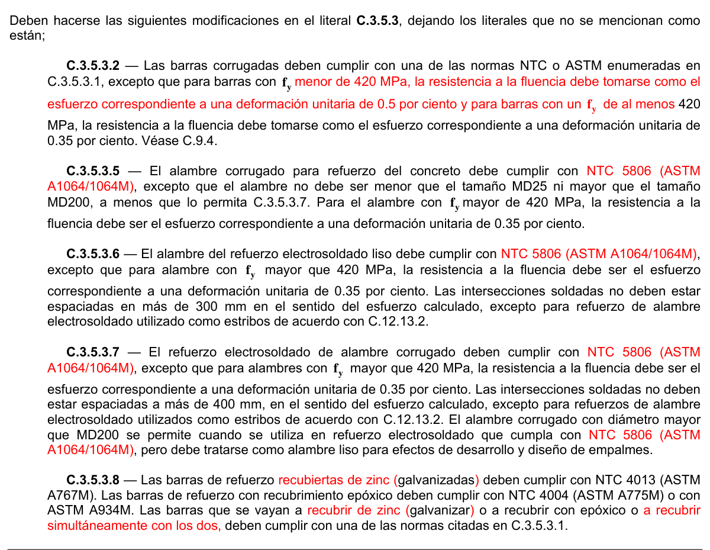
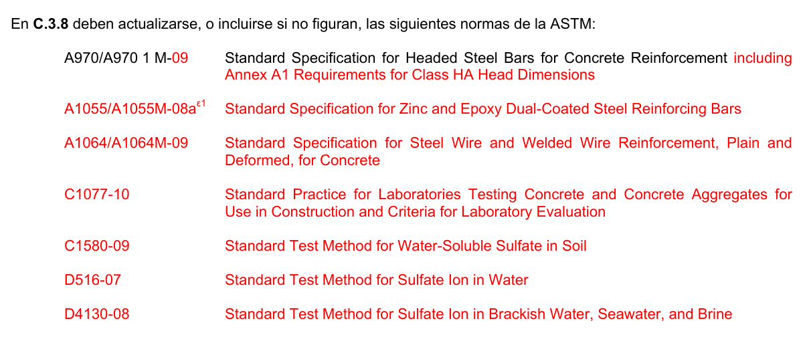

# C.3 — Materiales

### C.3.1 — Ensayos de materiales

**C.3.1.1** — Para asegurarse que los materiales utilizados en la obra sean de la calidad especificada, deben realizarse los ensayos correspondientes sobre muestras representativas de los materiales de la construcción. Cuando se trate de edificaciones que deben someterse a Supervisión Técnica de acuerdo con la exigido por la Ley 400 de 1997 el Supervisor Técnico establecerá un programa de control de calidad de acuerdo con lo exigido en A.1.3.9, en el presente Título C, y en el Título $I$ de la NSR-10. Cuando la edificación no requiere Supervisión Técnica debe cumplirse lo exigido en el Artículo 19 de la Ley 400 de 1997 siendo responsabilidad del constructor realizar y documentar los controles de calidad de los materiales que exige el Reglamento, los cuales para concreto estructural están contenidos en el presente Título C, además de los exigidos en el Titulo $I$ del Reglamento. (Véase A.1.3.9.6).

**C.3.1.2** — Los ensayos de materiales y del concreto deben hacerse de acuerdo con las normas técnicas colombianas, NTC, promulgadas por el Instituto Colombiano de Normas Técnicas y Certificación ICONTEC indicadas en C.3.8. A falta de ellas deben seguirse las normas de la Sociedad Americana para Ensayos y Materiales (ASTM), de la Asociación Americana de Soldadura (AWS), de la Asociación Americana de Oficiales Estatales de Carreteras y Transporte (AASHTO), del Instituto del Postensado (PTI), del Instituto Americano del Concreto (ACI) mencionadas en el Título C este Reglamento NSR-10. En C.3.8 se listan las normas NTC, promulgadas por el ICONTEC, ASTM, AWS, AASHTO, PTI y ACI mencionadas en este Título C del Reglamento NSR-10, las cuales hacen parte del mismo. En CR.3.8 se enumeran las normas ASTM que se mencionan en el Título C del Reglamento. Debe consultarse C.1.5 respecto a la obligatoriedad de las normas técnicas mencionadas en el Título C del Reglamento NSR-10.

**C.3.1.3** — El registro completo de los ensayos de materiales y del concreto debe estar siempre disponible para revisión durante el desarrollo de la obra y conservarse de acuerdo con lo prescrito en el Título $I$ del Reglamento NSR- 10.

### C.3.2 — Materiales cementantes

**C.3.2.1** — Los materiales cementantes deben cumplir con las normas relevantes así:

(a) Cemento fabricado bajo las normas NTC 121 y NTC 321 y también se permite el uso de cementos fabricados bajo la norma ASTM C150.

(b) Cementos hidráulicos adicionados fabricados bajo la norma ASTM C595, pero se excluyen los Tipos IS (b70) ya que no pueden ser empleados como constituyentes cementantes principales en el concreto estructural.

(c) Cemento hidráulico expansivo fabricado bajo la norma NTC 4578 (ASTM C845).

(d) Cemento hidráulico fabricado bajo la norma ASTM C1157.

(e) Ceniza volante, puzolana natural y materiales calcinados que cumple la norma NTC 3493 (ASTM C618).

(f) Escoria granulada molida de alto horno que cumple la norma NTC 4018 (ASTM C989)

(g) Humo de sílice que cumple la norma NTC 4637 (ASTM C1240).

(h) Cemento blanco que cumple con la norma NTC 1362

(i) Se prohíbe el uso de los cementos denominados de mampostería en la fabricación de concreto.

**C.3.2.2** — Los materiales cementantes empleados en la obra deben corresponder a los que se han tomado como base para la selección de la dosificación del concreto. Véase C.5.2.

### C.3.3 — Agregados

**C.3.3.1** — Los agregados para concreto deben cumplir con una de las siguientes normas:

(a) Agregado de peso normal: NTC 174 (ASTM C33),

(b) Agregado liviano: NTC 4045 (ASTM C330).

Se permite el uso de agregados que han demostrado a través de ensayos o por experiencias prácticas que producen concreto de resistencia y durabilidad adecuadas, siempre y cuando sean aprobados por el Supervisor Técnico.

#### C.3.3.2 — El tamaño máximo nominal del agregado grueso no debe ser superior a:

(a) 1/5 de la menor separación entre los lados del encofrado, ni a

(b) 1/3 de la altura de la losa, ni a

(c) 3/4 del espaciamiento mínimo libre entre las barras o alambres individuales de refuerzo, paquetes de barras, tendones individuales, paquetes de tendones o ductos.

Estas limitaciones se pueden omitir si a juicio del profesional facultado para diseñar la trabajabilidad y los métodos de compactación son tales que el concreto se puede colocar sin la formación de hormigueros, vacíos o segregación en la mezcla.

### C.3.4 — Agua

**C.3.4.1** — El agua empleada en el mezclado del concreto debe cumplir con las disposiciones de la norma NTC 3459 (BS3148) o de la norma ASTM C1602M cuando sean menos exigentes que los de la norma NTC 3459.

**C.3.4.2** — El agua de mezclado para concreto preesforzado o para concreto que contenga elementos de aluminio embebidos, incluyendo la parte del agua de mezclado con la que contribuye la humedad libre de los agregados, no debe contener cantidades perjudiciales de iones de cloruros. Véase C.4.3.1.

### C.3.5 — Acero de refuerzo

**C.3.5.1** — El refuerzo debe ser corrugado. El refuerzo liso solo puede utilizarse en estribos, espirales o tendones, y refuerzo de repartición y temperatura. Además, se pueden utilizar cuando el Título C del Reglamento NSR-10 así lo permita: refuerzo consistente en pernos con cabeza para refuerzo de cortante, perfiles de acero estructural o en tubos, o elementos tubulares de acero. Las fibras de acero deformadas dispersas se permiten solamente para resistir cortante bajo las condiciones indicadas en C.11.4.6.1(f).

**C.3.5.2** — La soldadura de barras de refuerzo debe realizarse de acuerdo con la norma NTC 4040 (AWS D1.4). La ubicación y tipo de los empalmes soldados y otras soldaduras requeridas en las barras de refuerzo deben estar indicados en los planos de diseño o en las especificaciones del proyecto. Las normas NTC para barras de refuerzo, excepto NTC 2289 (ASTM A706M), deben ser complementadas para requerir un informe de las propiedades necesarias del material para cumplir con los requisitos de NTC 4040 (AWS D1.4).

#### C.3.5.3 — Refuerzo corrugado

**C.3.5.3.1** — Las barras de refuerzo corrugado deben ser de acero de baja aleación que cumplan con la norma NTC 2289 (ASTM A706M). Se permite el uso de barras de acero inoxidable fabricadas bajo la norma ASTM A955M siempre y cuando cumplan a su vez los requisitos de NTC 2289 (ASTM A706M). Además deben tenerse en cuenta los siguientes aspectos:

(a) La resistencia a la fluencia debe corresponder a la determinada por ensayos sobre barras de tamaño completo. Los esfuerzos obtenidos por medio del ensayo de tracción deben calcularse utilizando el área nominal de la barra tal como se indica en las Tablas C.3.5.3-1 y C.3.5.3-2.

(b) No se permite el uso de acero corrugado de refuerzo fabricado bajo las norma NTC 245, ni ningún otro tipo de acero que haya sido trabajado en frío o trefilado, a menos que esté explícitamente permitido por la norma bajo la cual se fabrica cualquiera de los materiales permitidos por el Reglamento NSR-10.

**Tabla C.3.5.3-1**

DIMENSIONES NOMINALES DE LAS BARRAS DE REFUERZO (Diámetros basados en milímetros)

| Designación de la barra (véase la nota) | DIMENSIONES NOMINALES Diámetro Área Perímetro mm mm² mm |  |  | Masa kg/m |
|---|---|---|---|---|
| 6M | 6.0 | 28.3 | 18.85 | 0.222 |
| 8M | 8.0 | 50.3 | 25.14 | 0.394 |
| 10M | 10.0 | 78.5 | 31.42 | 0.616 |
| 12M | 12.0 | 113.1 | 37.70 | 0.887 |
| 16M | 16.0 | 201.1 | 50.27 | 1.577 |
| 18M | 18.0 | 254.5 | 56.55 | 1.996 |
| 20M | 20.0 | 314.2 | 62.83 | 2.465 |
| 22M | 22.0 | 380.1 | 69.12 | 2.982 |
| 25M | 25.0 | 490.9 | 78.54 | 3.851 |
| 30M | 30.0 | 706.9 | 94.25 | 5.544 |
| 32M | 32.0 | 804.2 | 100.53 | 6.309 |
| 36M | 36.0 | 1017.9 | 113.10 | 7.985 |
| 45M | 45.0 | 1590.4 | 141.37 | 12.477 |
| 55M | 55.0 | 2375.8 | 172.79 | 18.638 |

Nota: La M indica que son diámetros nominales en mm.

**Tabla C.3.5.3-2**

DIMENSIONES NOMINALES DE LAS BARRAS DE REFUERZO (Diámetros basados en octavos de pulgada)

| Designación de la barra (véase la nota) | Diámetro de referencia en pulgadas | DIMENSIONES NOMINALES Diámetro Area Perímetro mm mm² mm |  |  | Masa kg/m |
|---|---|---|---|---|---|
| No. 2 | 1/4” | 6.4 | 32 | 20.0 | 0.250 |
| No. 3 | 3/8” | 9.5 | 71 | 30.0 | 0.560 |
| No. 4 | 1/2” | 12.7 | 129 | 40.0 | 0.994 |
| No. 5 | 5/8” | 15.9 | 199 | 50.0 | 1.552 |
| No. 6 | 3/4” | 19.1 | 284 | 60.0 | 2.235 |
| No. 7 | 7/8” | 22.2 | 387 | 70.0 | 3.042 |
| No. 8 | 1” | 25.4 | 510 | 80.0 | 3.973 |
| No. 9 | 1-1/8” | 28.7 | 645 | 90.0 | 5.060 |
| No. 10 | 1-1/4” | 32.3 | 819 | 101.3 | 6.404 |
| No. 11 | 1-3/8” | 35.8 | 1006 | 112.5 | 7.907 |
| No. 14 | 1-3/4” | 43.0 | 1452 | 135.1 | 11.380 |
| No. 18 | 2-1/4” | 57.3 | 2581 | 180.1 | 20.240 |

Nota: El No. de la barra indica el número de octavos de pulgada del diámetro de referencia

**C.3.5.3.2** — Las barras corrugadas deben cumplir con una de las normas NTC o ASTM enumeradas en C.3.5.3.1, excepto que para barras con $f_{y}$mayor que 420 MPa, la resistencia a la fluencia debe tomarse como el esfuerzo correspondiente a una deformación unitaria de 0.35 por ciento. Véase C.9.4.

**C.3.5.3.3** — Se permite usar las barras de refuerzo que cumplen con ASTM A1035M como refuerzo transversal en C.21.6.4 o refuerzo en espiral en C.10.9.3.

**C.3.5.3.4** — Las parrillas de refuerzo para concreto deben ajustarse a NTC 2043 (ASTM A184M). Las barras de refuerzo, utilizadas en las parrillas de refuerzo, deben cumplir con NTC 2289 (ASTM A706M).

**C.3.5.3.5** — El alambre corrugado para refuerzo del concreto debe cumplir con NTC 1907 (ASTM A496M), excepto que el alambre no debe ser menor que el tamaño MD25 (5.6 mm de diámetro) ni mayor que el tamaño MD200 (16 mm de diámetro), a menos que lo permita C.3.5.3.7. Para el alambre con $f_{y}$mayor de 420 MPa, la resistencia a la fluencia debe ser el esfuerzo correspondiente a una deformación unitaria de 0.35 por ciento. No se permite el uso de alambres individuales, corrugados o lisos, como refuerzo en forma de estribos ni como refuerzo longitudinal en elementos que formen parte del sistema de resistencia sísmica.

**C.3.5.3.6** — El alambre del refuerzo electrosoldado liso debe cumplir con NTC 1925 (ASTM A185M), excepto que para alambre con $f_{y}$ mayor que 420 MPa, la resistencia a la fluencia debe ser el esfuerzo correspondiente a una deformación unitaria de 0.35 por ciento. Las intersecciones soldadas no deben estar espaciadas en más de 300 mm en el sentido del esfuerzo calculado, excepto para refuerzo de alambre electrosoldado utilizado como estribos de acuerdo con C.12.13.2.

<!-- mod:1-decreto-092-2011-76 -->
> **Modificación — Decreto 092 de 2011** · anexo, p. 19
>
> En C.3.5.3.6 la referencia a “NTC 1925 (ASTM A185M)” debe substituirse por “NTC 5806 (ASTM A1064/1064M)”.

**C.3.5.3.7** — El refuerzo electrosoldado de alambre corrugado deben cumplir con NTC 2310 (ASTM A497M), excepto que para alambres con $f_{y}$ mayor que 420 MPa, la resistencia a la fluencia debe ser el esfuerzo correspondiente a una deformación unitaria de 0.35 por ciento. Las intersecciones soldadas no deben estar espaciadas a más de 400 mm, en el sentido del esfuerzo calculado, excepto para refuerzos de alambre electrosoldado utilizados como estribos de acuerdo con C.12.13.2. El alambre corrugado con diámetro mayor que MD200 (16 mm de diámetro) se permite cuando se utiliza en refuerzo electrosoldado que cumpla con NTC 2310 (ASTM A497M), pero debe tratarse como alambre liso para efectos de desarrollo y diseño de empalmes.

<!-- mod:1-decreto-092-2011-77 -->
> **Modificación — Decreto 092 de 2011** · anexo, p. 20
>
> En C.3.5.3.7 las dos referencias a “NTC 2310 (ASTM A497M)” deben substituirse por “NTC 5806 (ASTM A1064/1064M)”.

**C.3.5.3.8** — Las barras de refuerzo galvanizadas deben cumplir con NTC 4013 (ASTM A767M). Las barras de refuerzo con recubrimiento epóxico deben cumplir con NTC 4004 (ASTM A775M) o con ASTM A934M. Las barras que se vayan a galvanizar o a recubrir con epóxico deben cumplir con la norma NTC 2289 (ASTM A706M).

**C.3.5.3.9** — Los alambres y el refuerzo electrosoldado de alambre recubiertos con epóxico deben cumplir con ASTM A884M. Los alambres que se vayan a recubrir con epóxico deben cumplir con C.3.5.3.4 y el refuerzo electrosoldado de alambre que se vaya a recubrir con epóxico debe cumplir con C.3.5.3.5 ó C.3.5.3.6.

**C.3.5.3.10** — El alambre de acero inoxidable corrugado y el refuerzo electrosoldado de alambre de acero inoxidable liso y corrugado para refuerzo del concreto debe cumplir con la ASTM A1022M, excepto que el alambre corrugado no debe ser menor del tamaño MD25 (5.6 mm de diámetro) ni mayor que el tamaño MD200 (16 mm de diámetro), y ka resistencia a la fluencia de alambre con $f_{y}$mayor de 420 MPa, la resistencia a la fluencia debe tomarse como el esfuerzo correspondiente a una deformación unitaria de 0.35 por ciento. El alambre corrugado mayor que el tamaño MD200 (16 mm de diámetro) se permite cuando se utiliza en refuerzo electrosoldado de alambre que cumpla con ASTM A1022M, pero debe tratarse como alambre liso para efectos de desarrollo y diseño de empalmes. Las intersecciones soldadas en la dirección del esfuerzo calculado no deben estar espaciadas en más de 300 mm para el alambre electrosoldado liso o de 400 mm para el alambre electrosoldado corrugado, excepto para refuerzo de alambre electrosoldado utilizado como estribos de acuerdo con C.12.13.2.

<!-- mod:1-decreto-092-2011-75 -->
> **Modificación — Decreto 092 de 2011** · anexo, p. 19
>
> Deben hacerse las siguientes modificaciones en el literal C.3.5.3, dejando los literales que no se mencionan como están; C.3.5.3.2 — Las barras corrugadas deben cumplir con una de las normas NTC o ASTM enumeradas en C.3.5.3.1, excepto que para barras con yf menor de 420 MPa, la resistencia a la fluencia debe tomarse como el esfuerzo correspondiente a una deformación unitaria de 0.5 por ciento y para barras con un yf de al menos 420 MPa, la resistencia a la fluencia debe tomarse como el esfuerzo correspondiente a una deformación unitaria de 0.35 por ciento. Véase C.9.4.
>
> 

<!-- mod:1-decreto-092-2011-78 -->
> **Modificación — Decreto 092 de 2011** · anexo, p. 20
>
> En C.3.5.3.10 las dos referencias a “NTC 1022 (ASTM A497M)” deben substituirse por “NTC 5806 (ASTM A1064/1064M)”.

#### C.3.5.4 — Refuerzo liso

**C.3.5.4.1** — El refuerzo liso solo se permite en estribos, refuerzo de retracción y temperatura o refuerzo en espiral y no puede utilizarse como refuerzo longitudinal a flexión, excepto cuando conforma mallas electrosoldadas y deben cumplir con la norma NTC 161 (ASTM A615M) o con los requisitos para refuerzo corrugado especificados en C.3.5.3.1.

**C.3.5.4.2** — Los alambres lisos para refuerzo en espiral deben cumplir con NTC 4002 (ASTM A82M), excepto que para alambres con $f_{y}$superior a 420 MPa, la resistencia a la fluencia debe tomarse como el esfuerzo correspondiente a una deformación unitaria de 0.35 por ciento.

<!-- mod:1-decreto-092-2011-79 -->
> **Modificación — Decreto 092 de 2011** · anexo, p. 20
>
> En C.3.5.4.2 las dos referencias a “NTC 4002 (ASTM A82M)” deben substituirse por “NTC 5806 (ASTM A1064/1064M)”.

#### C.3.5.5 — Pernos con cabeza para refuerzo de cortante

**C.3.5.5.1** — Los pernos con cabeza y sus ensamblajes deben cumplir con ASTM A1044M.

#### C.3.5.6 — Acero de preesfuerzo

**C.3.5.6.1** — El acero preesforzado debe cumplir con una de las normas siguientes:

(a) Alambre: NTC 159 (ASTM A421M).

(b) Alambre de baja relajación: NTC 159 (ASTM A421M).

(c) Torón: NTC 2010 (ASTM A416M).

(d) Barras de alta resistencia: NTC 2142 (ASTM A722M).

**C.3.5.6.2** — Los alambres, los torones y las barras que no figuran específicamente en las normas NTC 159 (ASTM A421M), NTC 2010 (ASTM A416M), o NTC 2142 (ASTM A722M), se pueden usar, siempre que se demuestre que cumplen con los requisitos mínimos de estas normas, y que no tienen propiedades que los hagan menos satisfactorios que los de las normas NTC 159 (ASTM A421M), NTC 2010 (ASTM A416M), o NTC 2142 (ASTM A722M).

#### C.3.5.7 — Acero estructural, tubos de acero o tuberías

**C.3.5.7.1** — El acero estructural utilizado junto con barras de refuerzo en elementos compuestos sometidos a compresión que cumpla con los requisitos de C.10.13.7 o C.10.13.8, debe ajustarse a una de las siguientes normas:

(a) Acero al carbón; NTC 1920 (ASTM A36M).

(b) Acero de alta resistencia de baja aleación: NTC 1950 (ASTM A242M).

(c) Acero de alta resistencia de baja aleación al Columbio-Vanadio: NTC 1985 (ASTM A572M).

(d) Acero alta resistencia de baja aleación de 345 MPa NTC 2012 (ASTM A588M).

(e) Perfiles estructurales: ASTM A992M.

**C.3.5.7.2** — Los tubos de acero o tuberías para elementos compuestos sometidos a compresión, que estén formados por un tubo de acero relleno de concreto, que cumpla con los requisitos de C.10.13.6, deben cumplir con una de las siguientes normas:

(a) Acero negro, por inmersión en caliente, recubiertos de cinc, Grado B de NTC 3470 (ASTM A53M).

(b) Formados en frío, soldados, sin costura: NTC 4526 (ASTM A500M).

(c) Formados en caliente, soldados, sin costura: NTC 2374 (ASTM A501).

**C.3.5.8** — El acero usado en el refuerzo para concreto compuesto por fibras dispersas de acero debe ser corrugado y cumplir con NTC 5214 (ASTM A820M). Las fibras de acero deben tener una relación de longitud a diámetro no menor a 50 y no mayor a 100.

**C.3.5.9** — Las barras corrugadas con cabeza deben cumplir con la norma ASTM A970M, y las obstrucciones o interrupciones del corrugado de la barra, si lo hay, no debe ser mayor de $2d_{b}$ medido desde la cara de apoyo de la cabeza.

#### C.3.5.10 — Evaluación y aceptación del acero de refuerzo

<!-- mod:3-decreto-945-2017-40 -->
> *Texto vigente según el Decreto 945 de 2017 (anexo, p. 32).*

**C.3.5.10.1** — Deben tomarse y ensayarse, como mínimo, muestras de los aceros de refuerzo utilizados en la obra consistentes en muestras de todos los diámetros de barra utilizados por lo menos una vez por cada 200 toneladas de acero de refuerzo utilizado cuando se trate de aceros de fabricación nacional y por cada 100 toneladas de acero de refuerzo utilizado cuando se trate aceros importados. Los ensayos deben realizarse de acuerdo con lo especificado en la norma NTC, de las enumeradas en C.3.8, correspondiente al tipo de acero.

**C.3.5.10.2** — Los ensayos deben demostrar, inequívocamente, que el acero utilizado cumple la norma técnica NTC correspondiente y el laboratorio que realice los ensayos debe certificar la conformidad con ella. Copia de estos certificados de conformidad deben remitirse al Supervisor Técnico y al ingeniero diseñador estructural.

**C.3.5.10.3** — El certificado de conformidad expedido por el laboratorio debe contener como mínimo lo siguiente:

(a) nombre y dirección de la obra

(b) fecha de recepción de las muestras y fecha de realización de los ensayos,

(c) fabricante y norma NTC bajo la cual se fabricó el material y bajo la cual se realizaron los ensayos,

(d) peso por unidad de longitud de la barra, alambre, malla o torón de refuerzo, y su conformidad con las variaciones permitidas, y su diámetro nominal,

(e) características del corrugado, cuando se trate de acero corrugado,

(f) resultados del ensayo de tracción, los cuales deben incluir: la resistencia a la fluencia y la resistencia última, evaluadas utilizando el área nominal de la barra, alambre, malla o torón de refuerzo indicada en la norma NTC correspondiente, y el porcentaje de alargamiento obtenido del ensayo,

(g) resultado del ensayo de doblamiento,

(h) composición química cuando ésta se solicita.

(i) conformidad con la norma de fabricación y

(j) nombre y firma de director del laboratorio.

### C.3.6 — Aditivos

**C.3.6.1** — Los aditivos para reducción de agua y modificación del tiempo de fraguado deben cumplir con la norma NTC 1299 (ASTM C494M). Los aditivos para producir concreto fluido deben cumplir la norma NTC 4023 (ASTM C1017M).

**C.3.6.2** — Los aditivos incorporadores de aire deben cumplir con la norma NTC 3502 (ASTM C260).

**C.3.6.3** — Los aditivos que se usen en el concreto y que no cumplan con C.3.6.1 y C.3.6.2 deben someterse a la aprobación previa del Supervisor Técnico.

**C.3.6.4** — El cloruro de calcio o los aditivos que contengan cloruros que no provengan de impurezas de los componentes del aditivo, no deben emplearse en concreto preesforzado, en concreto que contenga aluminio embebido o en concreto construido en encofrados permanentes de acero galvanizado. Véanse C.4.3.1 y C.6.3.2.

**C.3.6.5** — Los aditivos usados en el concreto que contengan cemento expansivo que cumpla con la norma NTC 4578 (ASTM C845), deben ser compatibles con el cemento y no producir efectos nocivos.

### C.3.7 — Almacenamiento de materiales

**C.3.7.1** — El material cementante y los agregados deben almacenarse de tal manera que se prevenga su deterioro o la introducción de materia extraña.

**C.3.7.2** — Cualquier material que se haya deteriorado o contaminado no debe utilizarse en el concreto.

### C.3.8 — Normas citadas

**C.3.8.1** — Las normas NTC del Instituto Colombiano de Normas Técnicas y Certificación, ICONTEC que se mencionan en este Título C del Reglamento NSR-10 se relacionan a continuación con su designación de serie y se consideran parte del Reglamento NSR-10, como si estuvieran totalmente reproducidas aquí (véase A.1.6 y C.1.5):

Normas NTC promulgadas por el ICONTEC:

NTC 1 – Ensayo de doblamiento para productos metálicos. (ASTM A370) NTC 2 – Ensayo de tracción para productos de acero. (ASTM A370) NTC 30 – Cemento Portland – Clasificación y nomenclatura.

NTC 121 – Cemento Portland – Especificaciones físicas y mecánicas (ASTM C150).

NTC 159 – Alambres de acero, sin recubrimiento, liberados de esfuerzos, para concreto preesforzado. (ASTM A421) NTC 161 – Barras lisas de acero al carbono para concreto armado. (Nota: C.3.5.5 impone limitaciones a la utilización de este tipo de acero de refuerzo). (ASTM A615) NTC 174 – Especificaciones de los agregados para concreto. (ASTM C33) NTC 220 – Método para determinar la resistencia a la compresión de morteros de cemento hidráulico usando cubos de 50 mm de lado. (ASTM C109) NTC 245 – Barras de acero al carbono trabajadas en frío para concreto reforzado armado. (Nota: C.3.5.3 prohíbe el uso de este tipo de acero).

NTC 248 – Barras corrugadas de acero al carbono para concreto reforzado armado. (Nota: C.3.5.3 prohíbe el uso de este tipo de acero como acero corrugado). (ASTM A615) NTC 321 – Cemento Portland – Especificaciones químicas.

NTC 396 – Método de ensayo para determinar el asentamiento del concreto. (ASTM C143) NTC 423 – Barras de acero al carbono, terminadas en frío de calidad estándar. (ASTM A108) NTC 454 – Hormigón fresco, toma de muestras. (ASTM C172) NTC 504 – Refrentado de especímenes cilíndricos de concreto. (ASTM C617) NTC 550 – Elaboración y curado de especímenes de concreto en obra. (ASTM C31) NTC 673 – Ensayo de resistencia a la compresión de cilindros de concreto. (ASTM C39) NTC 722 – Ensayo de tracción indirecta de cilindros de concreto. (ASTM C496) NTC 1032 – Método de ensayo para la determinación del contenido de aire en el concreto fresco. método de presión. (ASTM 231) NTC 1299 – Aditivos químicos para el concreto. (ASTM C494) NTC 1377 – Elaboración y curado de especímenes de concreto para ensayo laboratorio. (ASTM C192) NTC 1907 – Alambre de acero para concreto armado. (ASTM A496) NTC 1920 – Acero estructural. (ASTM A36) NTC 1925 – Mallas soldadas fabricadas con alambre liso de acero para concreto reforzado. (ASTM A185) NTC 1950 – Acero estructural de baja aleación y alta resistencia. (ASTM A242) NTC 1985 – Acero de calidad estructural de alta resistencia y baja aleación al Columbio (Nionio). (ASTM A 572) NTC 2010 – Cordones de acero de siete alambres, sin recubrimiento, para concreto preesforzado. (ASTM A416) NTC 2012 – Acero estructural de baja aleación y alta resistencia con punto de fluencia mínimo de 345 MPa, en espesores hasta 100 mm. (ASTM A588) NTC 2240 – Agregados usados en morteros de mampostería. (ASTM C144) NTC 2043 – Mallas fabricadas con barras corrugadas de acero para hormigon reforzado. (ASTM A184) NTC 2142 – Barras de acero de alta resistencia, sin revestimiento, para concreto pretensado. (ASTM A722) NTC 2289 – Barras y rollos corrugados de acero de baja aleación y/o termotratados para concreto reforzado en construcciones de diseño sismo resistente. (ASTM A706) NTC 2310 – Mallas soldadas fabricadas con alambre corrugado para refuerzo de concreto. (ASTM A497) NTC 2374 – Tubos redondos, rectangulares y cuadrados de acero al carbono con o sin costura, formados en caliente para propósitos estructurales. (ASTM A501) NTC 3318 – Concreto premezclado. (ASTM C94) NTC 3330 – Método de ensayo para determinar el cambio longitudinal de morteros de cemento hidráulico expuestos a una solución de sulfatos. (ASTM C1012) NTC 3353 – Definiciones y métodos para los ensayos mecánicos de productos de acero. (ASTM A370) NTC 3459 – Agua para la elaboración de concreto. (BS 3148) NTC 3470 – Tubos de acero soldados o sin costura recubiertos de cinc por inmersión en caliente, o pavonados.

(ASTM A53) NTC 3493 – Cenizas volantes y puzolanas naturales, calcinadas o crudas, utilizadas como aditivos minerales en el concreto de cemento Portland. (ASTM C618) NTC 3502 – Aditivos incorporadores de aire para concreto. (ASTM C260) NTC 3658 – Método de la obtención y ensayo de núcleos extraídos y vigas de concreto aserradas. (ASTM C42) NTC 4002 – Siderurgia. Alambre liso de acero para refuerzo de concreto. (ASTM A82) NTC 4004 – Barras de acero de refuerzo con recubrimiento epóxico para refuerzo de concreto. (ASTM A775) NTC 4013 – Barras de acero recubiertas con cinc (galvanizadas) para refuerzo de concreto. (ASTM A767) NTC 4018 – Escoria de alto horno, granulada y molida, para ser uso en concreto y morteros. (ASTM C989) NTC 4022 – Masa unitaria de concreto liviano estructural. (ASTM C567) NTC 4023 – Especificaciones para aditivos químicos usados en la producción de concreto fluido. (ASTM C1017) NTC 4025 – Método de ensayo para determinar el módulo de elasticidad estático y la relación de Poisson en concreto a compresión. (ASTM C469) NTC 4027 – Concreto hecho por bachada volumétrica y mezclado continuo. (ASTM C685) NTC 4034 – Elementos de fijación. Especificación para tornillos y pernos de acero al carbono, con 60 000 psi de resistencia a la tensión. (ASTM A307) NTC 4040 – Procedimientos de soldadura aplicables al acero para refuerzo de concreto. (ANSI/AWS D1.4) NTC 4045 – Agregados livianos para concreto estructural. (ASTM C330) NTC 4049 – Método para determinar los cloruros solubles en agua presentes en el concreto. (ASTM C1218) NTC 4526 – Mallas electrosoldadas de acero, fabricadas con alambre corrugado, para refuerzo de concreto.

(ASTM A500) NTC 4578 – Cemento hidráulico expansivo. (ASTM C845) NTC 4637 – Especificaciones para el uso de microsílica como adición en mortero y concreto de cemento hidráulico. (ASTM 1240) NTC 5214 – Fibras de acero para refuerzo de concreto. (ASTM A820) NTC 5541 – Concretos reforzados con fibra. (ASTM C1116) En el momento de la adopción del Reglamento NSR-10, para las siguientes normas ASTM mencionadas en el Reglamento dentro del Título C no existía una norma NTC correspondiente y por lo tanto las siguientes normas ASTM se consideran parte del Reglamento NSR-10:

ASTM C150-05 – Standard Specification for Portland Cement ASTM A421/A421M-05 – Standard Specification for Uncoated Stress-Relieved Steel Wire for Prestressed Concrete ASTM A884/A884M-06 – Standard Specification for Epoxy-Coated Steel Wire and Welded Wire Reinforcement ASTM A934/A934M-07 – Standard Specification for Epoxy-Coated Prefabricated Steel Reinforcing Bars ASTM A955/A955M-07a – Standard Specification for Deformed and Plain Stainless-Steel Bars for Concrete Reinforcement ASTM A970/A970M-06 – Standard Specification for Headed Steel Bars for Concrete Reinforcement ASTM A992/A992M-06a – Standard Specification for Structural Steel Shapes ASTM A1022/A1022M-07 – Standard Specification for Deformed and Plain Stainless-Steel Wire and Welded Wire for Concrete Reinforcement ASTM A1035/A1035M-07 – Standard Specification for Deformed and Plain Low-Carbon, Chromium, Steel Bars for Concrete Reinforcement ASTM A1044/A1044M-05 – Standard Specification for Steel Stud Assemblies for Shear Reinforcement of Concrete ASTM C29/C29M-97 – Standard Test Method for Bulk Density (“Unit Weight”) and Voids in Aggregates ASTM C595-07 Standard – Specification for Blended Hydraulic Cements ASTM C1157-03 – Standard Performance Specification for Hydraulic Cement ASTM C1602/C1602M-06 – Standard Specification for Mixing Water Used in the Production of Hydraulic Cement Concrete ASTM C1609/C1609M-06 – Standard Test Method for Flexural Performance of Fiber-Reinforced Concrete (Using Beam With Third-Point Loading)

**C.3.8.2** — Se declara que la norma NTC 4040 (Structural Welding Code—Reinforcing Steel AWS D1.4/D1.4M:2005) forma parte de este Reglamento NSR-10, como si estuviera totalmente reproducida aquí.

**C.3.8.3** — Se declara que “Specification for Unbonded Single Strand Tendons (ACI 423.7-07)” es parte de este Reglamento NSR-10 como si estuviera completamente reproducido aquí.

**C.3.8.4** — Se declara que los artículos C.9.21.7.2 y C.9.21.7.3 de la División I y el artículo C.10.3.2.3 de la División II de AASHTO “Standard Specification for Highway Bridges” (AASHTO 17ª Edición, 2002) forman parte de este Reglamento NSR-10 como si estuvieran completamente reproducidos aquí, para los fines citados en C.18.15.1.

**C.3.8.5** — Se declara que “Qualification of Post-Installed Mechanical Anchors in Concrete (ACI 355.2-07)” es parte de este Reglamento NSR-10 como si estuviera completamente reproducido aquí, para los fines citados en el Apéndice C-D.

**C.3.8.6** — Se declara que “Structural Welding Code - Steel (AWS D 1.1/D.1.1M:2006)” del American Welding Society es parte de este Reglamento NSR-10 como si estuviera completamente reproducido aquí.

<!-- mod:1-decreto-092-2011-82 -->
> **Modificación — Decreto 092 de 2011** · anexo, p. 20
>
> El literal C.3.8.6 debe quedar así:
>
> **C.3.8.6** — Se declara que la norma NTC 4040 (Structural Welding Code - Steel (AWS D 1.1/D.1.1M:2006) del American Welding Society) es parte de este Reglamento NSR-10 como si estuviera completamente reproducido aquí.

**C.3.8.7** — Se declara que “Acceptance Criteria for Moment Frames Based on Structural Testing (ACI 374.1-05)” es parte de este Reglamento NSR-10 como si estuviera completamente reproducido aquí.

**C.3.8.8** — Se declara que “Acceptance Criteria for Special Unbonded Post-Tensioned Precast Structural Walls Based on Validation Testing (ACI ITG 5.1-07)” es parte de este Reglamento NSR-10 como si estuviera completamente reproducido aquí.

" Notas

<!-- mod:1-decreto-092-2011-80 -->
> **Modificación — Decreto 092 de 2011** · anexo, p. 20
>
> En C.3.8 las referencias a las normas NTC 1907, 1925, 2310 y 4002 deben suprimirse y se debe incluir una nueva referencia a la norma NTC 5806 — Alambre de acero liso y grafilado y mallas electrosoldadas para refuerzo de concreto (ASTM A1064/1064M). En la misma sección se debe incluir la referencia a la norma NTC 5653 — Método para la determinación de la gravedad especifica, absorción y vacíos en el concreto endurecido (ASTM C642).
>
> Además en C.3.8 el texto de la norma NTC 4526 debe quedar asi: “NTC 4526 — Tubería estructural de acero al carbono formada en frío, con y sin costura, redonda y de otras formas (ASTM A500)”.

<!-- mod:1-decreto-092-2011-81 -->
> **Modificación — Decreto 092 de 2011** · anexo, p. 20
>
> En C.3.8 deben actualizarse, o incluirse si no figuran, las siguientes normas de la ASTM:
>
> 

<!-- mod:1-decreto-092-2011-83 -->
> **Modificación — Decreto 092 de 2011** · anexo, p. 20
>
> Se debe adicionar el siguiente literal C.3.8.9.
>
> **C.3.8.9** — Se declara que “Qualification of Post-Installed Adhesive Anchors in Concrete (ACI 355.1-11)” es parte de este Reglamento como si estuviera completamente reproducido aquí, para los propósitos que se citan en el Apéndice C-D.
