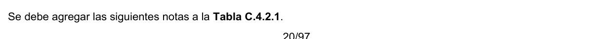
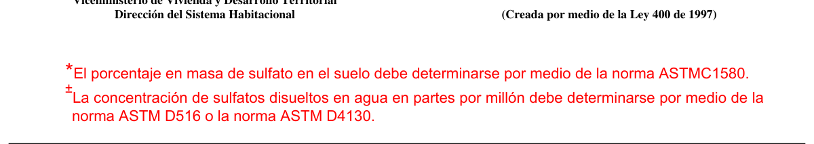

# C.4 — Requisitos de durabilidad

### C.4.1 — Generalidades

**C.4.1.1** — El valor de $f_{c}'$ debe ser el mayor de los valores requeridos: (a) por C.1.1.1, (b) para durabilidad en el Capítulo C.4, y (c) para los requisitos de resistencia estructural; y debe ser aplicado en la dosificación de la mezcla de C.5.3 y para la evaluación y aceptación del concreto de C.5.6. Las mezclas de concreto deben ser dosificadas para cumplir con la relación máxima agua-material cementante (a/mc) y otros requisitos basados en la clase de exposición asignada al elemento estructural de concreto. Todos los materiales cementantes especificados en C.3.2.1 y las combinaciones de estos materiales deben estar incluidos en los cálculos de la relación a/mc de la mezcla de concreto.

**C.4.1.2** — Los límites máximos de la relación a/mc del Capítulo C.4 no se aplican al concreto de peso liviano.

### C.4.2 — Categorías y clases de exposición

**C.4.2.1** — El profesional facultado para diseñar debe asignar las clases de exposición de acuerdo con la severidad de la exposición anticipada de los elementos de concreto estructural para cada categoría de exposición según la tabla C.4.2.1.

**Tabla C.4.2.1** — CATEGORIAS Y CLASES DE EXPOSICIÓN

| Categoría | Severidad | Clase | Condición |  |
|---|---|---|---|---|
| F Congela- miento y deshielo | No es aplicable | F0 | Concreto no expuesto a ciclos de congelamiento y deshielo |  |
|  | Moderada | F1 | Concreto expuesto a ciclos de congelamiento y deshielo y exposición ocasional a la humedad |  |
|  | Severa | F2 | Concreto expuesto a ciclos de congelamiento y deshielo y en contacto continuo con la humedad |  |
|  | Muy severa | F3 | Concreto expuesto a ciclos de congelamiento y deshielo que estará en contacto continuo con la humedad y expuesto a productos químicos descongelantes |  |
| S Sulfato |  |  | Sulfatos solubles en agua$($SO4$)$ en el suelo, % en peso | Sulfato$($SO4$)$ disuelto en agua, ppm |
|  | No aplicable | S0 | $SO_{4}<0.10$ | $SO_{4}<150$ |
|  | Moderada | S1 | $0.10≤SO_{4}<0$ | $0150≤SO_{4}<1500$ agua marina |
|  | Severa | S2 | $0.20≤SO_{4}≤2$ | $21500≤SO_{4}≤$ $10000$ |
|  | Muy severa | S3 | $SO_{4}>2.00$ | $SO_{4}>10000$ |
| P Requiere baja permea- bilidad | No aplicable | P0 | En contacto con el agua donde no se requiere baja permeabilidad |  |
|  | Requerida | P1 | En contacto con el agua donde se requiera baja permeabilidad |  |
| C Protección del refuerzo para la corrosión | No aplicable | C0 | Concreto seco o protegido contra la humedad |  |
|  | Moderada | C1 | Concreto expuesto a la humedad, pero no a una fuente externa de cloruros |  |
|  | Severa | C2 | Concreto expuesto a la humedad y a una fuente externa de cloruros provenientes de productos químicos descongelantes, sal, agua salobre, agua de mar o salpicaduras del mismo origen |  |

<!-- mod:1-decreto-092-2011-84 -->
> **Modificación — Decreto 092 de 2011** · anexo, p. 20
>
> Se debe agregar las siguientes notas a la Tabla C.4.2.1.
>
> 
>
> 

### C.4.3 — Requisitos para mezclas de concreto

**C.4.3.1** — Con base en las clases de exposición asignadas en la tabla C.4.2.1, las mezclas de concreto deben cumplir con los requisitos más restrictivos de la tabla C.4.3.1

**Tabla C.4.3.1** — REQUISITOS PARA EL CONCRETO SEGÚN LA CLASE DE EXPOSICIÓN

| Clase de Expo- sición | Rel. $a/mc$ máx.± | $fc'$ min. MPa | Requisitos mínimos adicionales |  |  |  |
|---|---|---|---|---|---|---|
|  |  |  | Contenido de aire |  |  | Límites en los cemen- tantes |
| F0 | N/A | 17 | N/A |  |  | N/A |
| F1 | 0.45 | 31 | tabla C.4.4.1 |  |  | N/A |
| F2 | 0.45 | 31 | tabla C.4.4.1 |  |  | N/A |
| F3 | 0.45 | 31 | tabla C.4.4.1 |  |  | tabla C.4.4.2 |
|  |  |  | Tipos de material cementante* |  |  | Aditivo cloruro de calcio |
|  |  |  | ASTM C 150 | ASTM C 595 | ASTM C 1157 |  |
| S0 | N/A | 17 | Sin restric- ción en el tipo | Sin restric- ción en el tipo | Sin restric- ción en el tipo | Sin restric- ción |
| S1 | 0.50 | 28 | II†‡ | IP(MS), IS(<70) (MS) | MS | Sin restric- ción |
| S2 | 0.45 | 31 | V‡ | IP(HS), IS(<70) (HS) | HS | No se permite |
| S3 | 0.45 | 31 | V puzola- nas o escoria§ | IP(HS) y puzola- nas o escoria§ o IS(<70) (HS) y puzola- nas o escoria§ | HS y puzola- nas o escoria§ | No se permite |
| P0 | N/A | 17 | Ninguna |  |  |  |
| P1 | 0.50 | 28 | Ninguna |  |  |  |
|  |  |  | Contenido máximo de iones de cloruro (CI–) soluble en agua en el concreto, porcentaje por peso de cemento |  | Requisitos relacionados |  |
|  |  |  | Concreto reforzado | Concreto Preesfor- zado |  |  |
| C0 | N/A | 17 | 1.00 | 0.06 | Ninguno |  |
| C1 | 0.50 | 17 | 0.30 | 0.06 |  |  |
| C2 | 0.40 | 35 | 0.15 | 0.06 | 7.7.6, 18.16# |  |

*Se pueden permitir combinaciones alternativas de materiales cementantes diferentes a los mencionados en la tabla C.4.3.1 siempre que sean ensayados para comprobar la resistencia a los sulfatos y deben cumplirse los criterios de C.4.5.1.

†Para exposición al agua marina, se permiten otros tipos de cemento pórtland con contenidos de hasta 10 por ciento de aluminato tricálcico (C3A) si la relación a/mc no excede 0.40.

‡Se permiten otros tipos de cemento como el tipo III o tipo I en exposiciones clase S1 o S2 si el contenido de C3A es menor al 8 ó 5 por ciento, respectivamente.

§La cantidad de la fuente específica de puzolana o escoria que se debe usar no debe ser inferior a la cantidad que haya sido determinada por experiencia en mejorar la resistencia a sulfatos cuando se usa en concretos que contienen cemento tipo V. De manera alternativa, la cantidad de la fuente específica de puzolana o escoria que se debe usar no debe ser menor a la cantidad ensayada según la NTC 3330 (ASTM C1012) y debe cumplir con los requisitos de C.4.5.1.

d El contenido de iones cloruro solubles en agua provenientes de los ingredientes incluyendo el agua, agregados, materiales cementantes y aditivos de la mezclas de concreto, deben ser determinados según los requisitos de la NTC 4049 (ASTM C1218M), a edades que van de 28 a 42 días #Se deben cumplir los requisitos de C.7.7.5 véase C.18.16 para tendones de preesfuerzo no adheridos ±Para concreto liviano véase C.4.1.2

### C.4.4 — Requisitos adicionales para exposición a congelamiento y deshielo

**C.4.4.1** — El concreto de peso normal y liviano expuesto a clases exposición F1, F2 ó F3 debe tener aire incorporado, con el contenido de aire indicado en la tabla C.4.4.1. La tolerancia en el contenido de aire incorporado debe ser de ±1.5 por ciento. Para un $f_{c}'$ mayor de 35 MPa, se puede reducir el aire incorporado indicado en la tabla C.4.4.1 en 1 por ciento.

**Tabla C.4.4.1** — CONTENIDO TOTAL DE AIRE PARA CONCRETO EXPUESTO

A CICLOS DE CONGELAMIENTO Y DESHIELO

| Tamaño máximo nominal del agregado* (mm) | Contenido de aire, porcentaje |  |
|---|---|---|
|  | Exposición Clase F1 | Exposición Clases F2 y F3 |
| 9.5 | 6 | 7.5 |
| 12.5 | 5.5 | 7 |
| 19.0 | 5 | 6 |
| 25.0 | 4.5 | 6 |
| 37.5 | 4.5 | 5.5 |
| 50† | 4 | 5 |
| 75† | 3.5 | 4.5 |

*Véase NTC 174 (ASTM C33) para las tolerancias por mayor tamaño para diversas designaciones de tamaño máximo nominal.

†Estos contenidos de aire se aplican a la mezcla total. Al ensayar estos concretos, sin embargo, se retiran las partículas de agregado mayores de 40 mm sacándolas mediante tamizado, y se determina el contenido de aire en la fracción tamizada. (la tolerancia en el contenido de aire incorporado se aplica a este valor). El contenido de aire de la mezcla total se calcula a partir del valor determinado en la fracción cribada que pasa el tamiz de 40 mm., indicado en la NTC 1032 (ASTM C231).

**C.4.4.2** — La cantidad de puzolanas, incluida la ceniza volante, humo de sílice y escoria en el concreto para exposición clase F3 no debe exceder los límites establecidos en la tabla C.4.4.2

**Tabla C.4.4.2** — REQUISITOS PARA CONCRETO SOMETIDO A CLASE DE EXPOSICIÓN F3

| Materiales cementantes | Porcentaje máximo sobre el total de materiales cementantes en peso* |
|---|---|
| Cenizas volantes u otras puzolanas que cumplen NTC 3493 (ASTM C618) | 25 |
| Escoria que cumple NTC 4018 (ASTM C989) | 50 |
| Humo de sílice que cumple NTC 4637 (ASTM C1240) | 10 |
| Total de cenizas volantes u otras puzolanas, escoria y humo de sílice | 50ಳ |
| Total de cenizas volantes u otras puzolanas y humo de sílice | 35ಳ |

* El total de materiales cementantes también incluye cementos ASTM C150, ASTM C595, NTC 4578 (ASTM C845) y ASTM C1157. Los porcentajes máximos anteriores incluyen:

(a) Cenizas volantes u otras puzolanas presentes en cementos adicionados tipo IP, según ASTM C595 o ASTM C1157

(b) Escoria usada en la fabricación de cementos adicionados Tipo IS, según ASTM C595 ó ASTM C1157.

(c) Humo de sílice, según NTC 4637 (ASTM C1240), presente en cementos adicionados.

ಳLas cenizas volantes u otras puzolanas y el humo sílice no deben constituir más del 25 y 10 por ciento, respectivamente, del peso total de materiales cementantes.

### C.4.5 — Materiales cementantes alternativos para exposición a sulfatos

**C.4.5.1** — Se permite usar combinaciones alternativas para los materiales cementantes mencionados en la tabla C.4.3.1 cuando se lleven a cabo ensayos de resistencia a los sulfatos y se cumplan los criterios de la tabla C.4.5.1.

**Tabla C.4.5.1** — REQUISITOS PARA ESTABLECER LA CONVENIENCIA DE LAS COMBINACIONES DE

MATERIALES CEMENTANTES EXPUESTOS A SULFATOS SOLUBLES EN AGUA

| Clase de exposición | Expansión máxima al ser ensayada usando NTC 3330 (ASTM C1012) |  |  |
|---|---|---|---|
|  | A 6 meses | A 12 meses | A 18 meses |
| S1 | 0.10 por ciento |  |  |
| S2 | 0.05 por ciento | 0.10 por ciento* |  |
| S3 |  |  | 0.10 por ciento |

* El límite de expansión a los 12 meses sólo se aplica cuando el límite a los 6 meses no es alcanzado.

"
