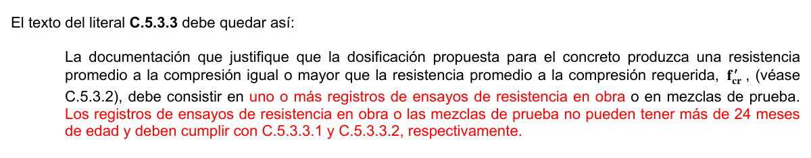

# C.5 — Calidad del concreto, mezclado y colocación

### C.5.1 — Generalidades

**C.5.1.1** — El concreto debe dosificarse para que proporcione una resistencia promedio a la compresión, $f_{cr}'$ , según se establece en C.5.3.2, y debe satisfacer los criterios de durabilidad del Capítulo C.4. El concreto debe producirse de manera que se minimice la frecuencia de resultados de resistencia inferiores a $f_{c}'$ , como se establece en C.5.6.3.3.

Para concreto diseñado y construido de acuerdo con el Reglamento NSR-10, $f_{c}'$ no puede ser inferior a 17 MPa.

**C.5.1.2** — Los requisitos para $f_{c}'$ deben basarse en ensayos de cilindros, hechos y ensayados como se establece en C.5.6.3.

**C.5.1.3** — A menos que se especifique lo contrario $f_{c}'$ debe basarse en ensayos a los 28 días. Si el ensayo no es a los 28 días, la edad de ensayo para obtener $f_{c}'$ debe indicarse en los planos o especificaciones de diseño.

**C.5.1.4** — Cuando los criterios de diseño de C.8.6.1, C.12.2.4(d) y C.22.5.6.1 indiquen el empleo de un valor de resistencia a la tracción por hendimiento del concreto, deben realizarse ensayos de laboratorio de acuerdo con NTC 4045 (ASTM C330) para establecer un valor de $f_{ct}'$ correspondiente a $f_{c}'$ .

**C.5.1.5** — Los ensayos de resistencia a la tracción por hendimiento no deben emplearse como base para la aceptación del concreto en obra.

**C.5.1.6** — El concreto reforzado con fibra de acero debe cumplir con NTC 5541 (ASTM C1116). El $f_{c}'$ mínimo para el concreto reforzado con fibra de acero debe cumplir con C.5.1.1.

### C.5.2 — Dosificación del concreto

**C.5.2.1** — La dosificación de los materiales para el concreto debe establecerse para lograr:

(a) Trabajabilidad y consistencia que permitan colocar fácilmente el concreto dentro del encofrado y alrededor del refuerzo bajo las condiciones de colocación que vayan a emplearse, sin segregación ni exudación excesiva.

(b) Resistencia a exposiciones especiales, según lo requerido en el Capítulo C.4.

(c) Conformidad con los requisitos del ensayo de resistencia de C.5.6.

**C.5.2.2** — Cuando se empleen materiales diferentes para distintas partes de la obra propuesta, debe evaluarse cada una de las combinaciones.

**C.5.2.3** — La dosificación del concreto debe establecerse de acuerdo con C.5.3, o alternativamente con C.5.4, y debe cumplir con los requisitos correspondientes del Capítulo C.4.

**C.5.3** — Dosificación basada en la experiencia en obra o en mezclas de prueba o ambas

#### C.5.3.1 — Desviación estándar de la muestra

**C.5.3.1.1** — Cuando una planta de concreto tiene registros de ensayos de menos de 12 meses de antigüedad, debe establecerse una desviación estándar $s_{s}$, de la muestra. Los registros de ensayos a partir de los cuales se calcula $s_{s}$deben cumplir las siguientes condiciones:

(a) Representar materiales, procedimientos de control de calidad y condiciones similares a las esperadas, y las variaciones de los materiales y de las proporciones dentro de la muestra no deben haber sido más restrictivas que las de la obra propuesta.

(b) Representar un concreto producido para que cumpla con una resistencia o resistencias a la compresión especificadas, dentro de 7 MPa de fc$'$ .

(c) Consistir al menos de 30 ensayos consecutivos, o de dos grupos de ensayos consecutivos totalizando al menos 30 ensayos como se define en C.5.6.2.4, excepto por lo especificado en C.5.3.1.2.

<!-- mod:1-decreto-092-2011-85 -->
> **Modificación — Decreto 092 de 2011** · anexo, p. 21
>
> En C.5.3.1.1 y C.5.3.1.2 donde se indica “12 meses” en el texto de ambos literales, debe substituirse por “24 meses”.

**C.5.3.1.2** — Cuando la instalación productora de concreto no tenga registros de ensayos que se ajusten a los requisitos de C.5.3.1.1(c), pero sí tenga un registros de ensayos de menos de 12 meses de antigüedad, basados en 15 a 29 ensayos consecutivos, se debe establecer la desviación estándar de la muestra $s_{s}$como el producto de la desviación estándar de la muestra calculada y el factor de modificación de la tabla C.5.3.1.2. Para que sean aceptables, los registros de ensayos deben ajustarse a los requisitos (a) y (b) de C.5.3.1.1, y deben representar un solo registro de ensayos consecutivos que abarque un período no menor de 45 días calendario consecutivos.

**Tabla C.5.3.1.2** — FACTOR DE MODIFICACIÓN PARA LA DESVIACIÓN ESTÁNDAR

DE LA MUESTRA CUANDO SE DISPONE DE MENOS DE 30 ENSAYOS

| Número de ensayos* | Factor de modificación para la desviación estándar de la muestra † |
|---|---|
| Menos de 15 | Emplee la tabla C.5.3.2.2 |
| 15 | 1.16 |
| 20 | 1.08 |
| 25 | 1.03 |
| 30 o más | 1.00 |

* Interpolar para un número de ensayos intermedios.

† Desviación estándar de la muestra modificada, $s_{s}$, para usar en la determinación de la resistencia promedio requerida $f_{cr}'$ de C.5.3.2.1.

#### C.5.3.2 — Resistencia promedio requerida

**C.5.3.2.1** — La resistencia promedio a la compresión requerida, $f_{cr}'$ , usada como base para la dosificación del concreto debe ser determinada según la tabla C.5.3.2.1, empleando la desviación estándar,$s_{s}$, calculada de acuerdo con C.5.3.1.1 o con C.5.3.1.2.

**Tabla C.5.3.2.1** — RESISTENCIA PROMEDIO A LA COMPRESIÓN REQUERIDA CUANDO HAY DATOS

DISPONIBLES PARA ESTABLECER UNA DESVIACIÓN ESTÁNDAR DE LA MUESTRA

| Resistencia especificada a la compresión, MPa | Resistencia promedio requerida a la compresión, MPa |
|---|---|
|  | Usar el mayor valor obtenido de las ecuaciones (C.5-1) y (C.5-2) |
|  | Usar el mayor valor obtenido con las ecuaciones (C.5-1) y (C.5-3) |

$$ f'_{cr} = f'_c + 1.34\,s_s \tag{C.5-1} $$

$$ f'_{cr} = f'_c + 2.33\,s_s - 3.5 \tag{C.5-2} $$

$$ f'_{cr} = 0.90\,f'_c + 2.33\,s_s \tag{C.5-3} $$

**C.5.3.2.2** — Cuando una instalación productora de concreto no tenga registros de ensayos de resistencia en obra para el cálculo de $s_{s}$ que se ajuste a los requisitos de C.5.3.1.1 o de C.5.3.1.2, $f_{cr}'$ debe determinarse de la tabla C.5.3.2.2, y la documentación relativa a la resistencia promedio debe cumplir con los requisitos de C.5.3.3.

**Tabla C.5.3.2.2** — RESISTENCIA PROMEDIO A LA COMPRESIÓN REQUERIDA CUANDO NO HAY DATOS

DISPONIBLES PARA ESTABLECER UNA DESVIACIÓN ESTÁNDAR DE LA MUESTRA

| Resistencia especificada a la compresión, MPa | Resistencia promedio requerida a la compresión, MPa |
|---|---|
| $f_{c}' <21$ | $f_{cr}'=f_{c}'+7.0$ |
| $21≤f_{c}'≤35$ | $f_{cr}'=f_{c}'+8.3$ |
| $f_{c}' >35$ | $f_{cr}'=1.10f_{c}'+5.0$ |

#### C.5.3.3 — Documentación de la resistencia promedio a la compresión

La documentación que justifique que la dosificación propuesta para el concreto produzca una resistencia promedio a la compresión igual o mayor que la resistencia promedio a la compresión requerida, $f_{cr}'$ , (véase C.5.3.2), debe consistir en un registro de ensayos de resistencia en obra, en varios registros de ensayos de resistencia, o en mezclas de prueba.

**C.5.3.3.1** — Cuando de acuerdo con C.5.3.1.1 ó C.5.3.1.2 se empleen registros de ensayos para demostrar que las dosificaciones propuestas para el concreto producirán $f_{cr}'$ (véase C.5.3.2), dichos registros deben representar materiales y condiciones similares a las esperadas. Los cambios en los materiales, condiciones y dosificaciones dentro de los registros de ensayos no deben ser más restrictivos que los de la obra propuesta. Con el propósito de documentar la resistencia promedio potencial, pueden aceptarse registros de ensayos que consistan en menos de 30, pero no menos de 10 ensayos consecutivos siempre que abarquen un período no menor de 45 días. La dosificación requerida para el concreto puede establecerse por interpolación entre las resistencias y las dosificaciones de dos o más registros de ensayo, siempre y cuando cumpla con los otros requisitos de esta sección.

**C.5.3.3.2** — Cuando no se dispone de un registro aceptable de resultados de ensayos en obra, se permite que la dosificación del concreto se establezca con mezclas de prueba que cumplan con los siguientes requisitos:

(a) Los materiales deben ser los propuestos para la obra.

(b) Las mezclas de prueba deben tener un rango de dosificaciones que produzcan una gama de resistencias a compresión que abarquen $f_{cr}'$ y que cumplan con los requisitos de durabilidad del Capítulo C.4.

(b) Las mezclas de prueba deben tener un asentamiento dentro del rango especificado para la obra propuesta; y para concreto con aire incorporado, el contenido de aire debe estar dentro de la tolerancia especificada para la obra propuesta.

(c) Para cada mezcla de prueba deben fabricarse y curarse al menos dos probetas cilíndricas de 150 por 300 mm o tres probetas de 100 por 200 mm de acuerdo con la NTC 1377 (ASTM C192M). Las probetas deben ensayarse a los 28 días o a la edad de ensayo establecida para $f_{c}'$ .

(d) Los resultados de los ensayos de resistencia a la compresión de las muestras de prueba, a la edad de ensayo establecida, deben ser usadas para establecer la composición de la mezcla de concreto propuesta para la obra.

La mezcla de concreto propuesta debe alcanzar una resistencia promedio a la compresión como lo exige C.5.3.2 y cumplir con los criterios de durabilidad aplicables del Capítulo C.4.

**C.5.4** — Dosificación cuando no se cuenta con experiencia en obra o mezclas de prueba

**C.5.4.1** — Si los datos requeridos por C.5.3 no están disponibles, la dosificación del concreto debe basarse en otras experiencias o información con la aprobación del profesional facultado para diseñar. La resistencia promedio de compresión requerida $f_{cr}'$ del concreto producido con materiales similares a aquellos propuestos para su uso debe ser al menos 8.3 MPa mayor que $f_{c}'$ . Esta alternativa no debe ser usada si $f_{c}'$ es mayor a 35 MPa.

**C.5.4.2** — El concreto dosificado de acuerdo con esta sección debe ajustarse a los requisitos de durabilidad del Capítulo C.4 y a los criterios para ensayos de resistencia a compresión de C.5.6

<!-- mod:1-decreto-092-2011-86 -->
> **Modificación — Decreto 092 de 2011** · anexo, p. 21
>
> El texto del literal C.5.3.3 debe quedar así:
>
> 

### C.5.5 — Reducción de la resistencia promedio a la compresión

En la medida que se disponga de más datos durante la construcción, se permite reducir la cantidad por la cual la resistencia promedio requerida, $f_{cr}'$ , debe exceder $f_{c}'$ , siempre que:

(a) Se disponga de 30 o más ensayos y el promedio de los resultados de los ensayos exceda el requerido por C.5.3.2.1, empleando una desviación estándar de la muestra calculada de acuerdo con la C.5.3.1.1, o

(b) Se disponga de 15 a 29 ensayos y el promedio de los resultados de los ensayos exceda al requerido por C.5.3.2.1, utilizando una desviación estándar de la muestra calculada de acuerdo con C.5.3.1.2, y

(c) Se cumpla con los requisitos de exposición especial del Capítulo C.4.

### C.5.6 — Evaluación y aceptación del concreto

**C.5.6.1** — El concreto debe ensayarse de acuerdo con los requisitos de C.5.6.2 a C.5.6.5. Los ensayos de concreto fresco realizados en la obra, la preparación de probetas que requieran de un curado bajo condiciones de obra, la preparación de probetas que se vayan a ensayar en laboratorio y el registro de temperaturas del concreto fresco mientras se preparan las probetas de resistencia debe ser realizado por técnicos calificados en ensayos de campo.

Todos los ensayos de laboratorio deben ser realizados por técnicos de laboratorio calificados.

<!-- mod:1-decreto-092-2011-87 -->
> **Modificación — Decreto 092 de 2011** · anexo, p. 21
>
> El literal C.5.6.1 debe quedar así:
>
> **C.5.6.1** — El concreto debe ensayarse de acuerdo con los requisitos de C.5.6.2 a C.5.6.5. El laboratorio que realice los ensayos de aceptación debe cumplir con la norma ASTM C1077. Los ensayos de concreto fresco realizados en la obra, la preparación de probetas que requieran de un curado bajo condiciones de obra, la preparación de probetas que se vayan a ensayar en laboratorio y el registro de temperaturas del concreto fresco mientras se preparan las probetas de resistencia debe ser realizado por técnicos calificados en ensayos de campo. Todos los ensayos de laboratorio deben ser realizados por técnicos de laboratorio calificados. Los informes de los ensayos de aceptación se deben distribuir al profesional facultado para diseñar, al supervisor técnico, al contratista, al productor del concreto, y, cuando lo requiera, al propietario, y a la autoridad competente.

#### C.5.6.2 — Frecuencia de los ensayos

**C.5.6.2.1** — Las muestras (véase C.5.6.2.4) para los ensayos de resistencia de cada clase de concreto colocado cada día deben tomarse no menos de una vez al día, ni menos de una vez por cada 40 m3 de concreto, ni menos de una vez por cada 200 m2 de superficie de losas o muros. De igual manera, como mínimo, debe tomarse una muestra por cada 50 tandas de mezclado de cada clase de concreto.

**C.5.6.2.2** — Cuando en un proyecto dado el volumen total de concreto sea tal que la frecuencia de ensayos requerida por C.5.6.2.1 proporcione menos de cinco ensayos de resistencia para cada clase dada de concreto, los ensayos deben hacerse por lo menos en cinco tandas de mezclado seleccionadas al azar, o en cada tanda cuando se empleen menos de cinco.

**C.5.6.2.3** — Cuando la cantidad total de una clase dada de concreto sea menor que 10 m3, no se requieren ensayos de resistencia cuando la evidencia de que la resistencia es satisfactoria sea aprobada por el Supervisor Técnico.

**C.5.6.2.4** — Un ensayo de resistencia debe ser el promedio de las resistencias de al menos dos probetas de 150 por 300 mm o de al menos tres probetas de 100 por 200 mm, preparadas de la misma muestra de concreto y ensayadas a 28 días o a la edad de ensayo establecida para la determinación de $f_{c}'$ .

#### C.5.6.3 — Probetas curadas en forma estándar

**C.5.6.3.1** — Las muestras para ensayos de resistencia deben tomarse de acuerdo con NTC 454 (ASTM C172).

**C.5.6.3.2** — Los cilindros para los ensayos de resistencia deben ser fabricados y curados en laboratorio de acuerdo con NTC 550 (ASTM C31M), y deben ensayarse de acuerdo con NTC 673 (ASTM C39M). Los cilindros deben ser de 100 por 200 mm o de 150 por 300 mm.

**C.5.6.3.3** — El nivel de resistencia de una clase determinada de concreto se considera satisfactorio si cumple con los dos requisitos siguientes:

(a) Cada promedio aritmético de tres ensayos de resistencia consecutivos (véase C.5.6.2.4) es igual o superior a $f_{c}'$ .

(b) Ningún resultado del ensayo de resistencia (véase C.5.6.2.4) es menor que $f_{c}'$ por más de 3.5 MPa cuando $f_{c}'$ es 35 MPa o menor; o por más de $0.10f_{c}'$ cuando $f_{c}'$ es mayor a 35 MPa.

**C.5.6.3.4** — Cuando no se cumpla con cualquiera de los dos requisitos de C.5.6.3.3, deben tomarse las medidas necesarias para incrementar el promedio de los resultados de los siguientes ensayos de resistencia. Cuando no se satisfagan los requisitos de C.5.6.3.3(b) debe cumplirse lo requerido por C.5.6.5.

#### C.5.6.4 — Probetas curadas en obra

**C.5.6.4.1** — Si lo requiere la autoridad competente, deben realizarse ensayos de resistencia de cilindros curados en condiciones de obra.

**C.5.6.4.2** — Los cilindros curados en obra deben curarse en condiciones de obra de acuerdo con NTC 550 (ASTM C31M).

**C.5.6.4.3** — Los cilindros de ensayo curados en obra deben fabricarse al mismo tiempo y usando el mismo material empleado en la confección de los cilindros de ensayo curados en laboratorio.

**C.5.6.4.4** — Los procedimientos para proteger y curar el concreto deben mejorarse cuando la resistencia de cilindros curados en la obra, a la edad de ensayo establecida para determinar $f_{c}'$ , sea inferior al 85 por ciento de la resistencia de cilindros compañeros curados en laboratorio. La limitación del 85 por ciento no se aplica cuando la resistencia de aquellos que fueron curados en la obra exceda a $f_{c}'$ en más de 3.5 MPa.

#### C.5.6.5 — Investigación de los resultados de ensayos con baja resistencia

**C.5.6.5.1** — Si cualquier ensayo de resistencia (véase C.5.6.2.4) de cilindros curados en el laboratorio es menor que$f_{c}'$ por más de los valores dados en C.5.6.3.3(b), o si los ensayos de cilindros curados en la obra indican deficiencia de protección y de curado (véase C.5.6.4.4), deben tomarse medidas para asegurar que no se pone en peligro la capacidad de carga y la durabilidad de la estructura.

**C.5.6.5.2** — Si se confirma la posibilidad que el concreto sea de baja resistencia y los cálculos indican que la capacidad de soportar las cargas se redujo significativamente, deben permitirse ensayos de núcleos extraídos de la zona en cuestión de acuerdo con NTC 3658 (ASTM C42M). En esos casos deben tomarse tres núcleos por cada resultado del ensayo de resistencia (véase C.5.6.2.4) que sea menor que los valores señalados en C.5.6.3.3 (b).

**C.5.6.5.3** — Los núcleos deben ser extraídos, la humedad debe preservarse colocando los núcleos dentro de recipientes o bolsas herméticas, deben ser transportados al laboratorio y ensayarse de acuerdo con la NTC 3658 (ASTM C42). Los núcleos deben ser ensayados no antes de 48 horas y no más tarde de los 7 días de extraídos, a menos que el profesional facultado para diseñar apruebe algo diferente. Quien especifique los ensayos mencionado en la NTC 3658 (ASTM C42M) debe ser un profesional facultado para diseñar.

**C.5.6.5.4** — El concreto de la zona representada por los núcleos se considera estructuralmente adecuado si el promedio de tres núcleos es por lo menos igual al 85 por ciento de $f_{c}'$ , y ningún núcleo tiene una resistencia menor del 75 por ciento de $f_{c}'$ . Cuando los núcleos den valores erráticos, se debe permitir extraer núcleos adicionales de la misma zona.

**C.5.6.5.5** — Si los criterios de 5.6.5.4 no se cumplen, y si la seguridad estructural permanece en duda, la autoridad competente está facultada para ordenar pruebas de carga de acuerdo con el Capítulo C.20 para la parte dudosa de la estructura, o para tomar otras medidas según las circunstancias.

<!-- mod:1-decreto-092-2011-88 -->
> **Modificación — Decreto 092 de 2011** · anexo, p. 21
>
> En C.5.6.5.5 la referencia a 5.6.5.4 debe ser a C.5.6.5.4.

#### C.5.6.6 — Concreto reforzado con fibra de acero

**C.5.6.6.1** — La aceptación de concreto reforzado con fibra de acero utilizado en vigas de acuerdo con C.11.4.6.1(f) se debe determinar por medio de ensayos realizados de acuerdo con ASTM C1609. Además, el procedimiento de ensayo de la resistencia debe cumplir C.5.6.1.

**C.5.6.6.2** — El concreto reforzado con fibra de acero se considera aceptable para resistencia a cortante si cumple con las condiciones (a), (b), y (c):

(a) La masa de las fibras de acero corrugadas por metro cúbico de concreto es mayor o igual a 60 kg.

(b) La resistencia residual obtenida en el ensayo a flexión realizado de acuerdo con ASTM C1609 cuando se llega a una deflexión en el centro de la luz igual a 1/300 de la luz, es mayor o igual al 90 por ciento de la resistencia del primer pico de resistencia obtenido en el ensayo a flexión o del 90 por ciento de la resistencia correspondiente a $f_{f}$ obtenido por medio de la ecuación (C.9-10), la que sea mayor; y

(c) La resistencia residual obtenida en el ensayo a flexión realizado de acuerdo con ASTM C1609 cuando se llega a una deflexión en el centro de la luz igual a 1/150 de la luz es mayor o igual al 75 por ciento de la resistencia del primer pico de resistencia obtenido en el ensayo a flexión o del 75 por ciento de la resistencia correspondiente a $f_{f}$ obtenido por medio de la ecuación (C.9-10), la que sea mayor.

### C.5.7 — Preparación del equipo y del lugar de colocación

**C.5.7.1** — La preparación previa a la colocación del concreto debe incluir lo siguiente:

(a) Todo equipo de mezclado y transporte del concreto debe estar limpio;

(b) Deben retirarse todos los escombros y el hielo de los espacios que serán ocupados por el concreto;

(c) El encofrado debe estar recubierto con un desmoldante adecuado.

(d) Las unidades de albañilería de relleno en contacto con el concreto deben estar adecuadamente humedecidas;

(e) El refuerzo debe estar completamente libre de hielo o de otros recubrimientos perjudiciales;

(f) El agua libre debe ser retirada del lugar de colocación del concreto antes de depositarlo, a menos que se vaya a emplear un tubo para colocación bajo agua (tremie) o que lo permita la autoridad competente;

(g) La superficie del concreto endurecido debe estar libre de lechada y de otros materiales perjudiciales o deleznables antes de colocar concreto adicional sobre ella.

### C.5.8 — Mezclado

**C.5.8.1** — Todo concreto debe mezclarse hasta que se logre una distribución uniforme de los materiales y la mezcladora debe descargarse completamente antes de que se vuelva a cargar.

**C.5.8.2** — El concreto premezclado debe mezclarse y entregarse de acuerdo con los requisitos de NTC 3318 (ASTM C94M) o NTC 4027 (ASTM C685M).

**C.5.8.3** — El concreto mezclado en obra se debe mezclar de acuerdo con (a) a (e):

(a) El mezclado debe hacerse en una mezcladora de un tipo aprobado;

(b) La mezcladora debe hacerse girar a la velocidad recomendada por el fabricante;

(c) El mezclado debe prolongarse por lo menos durante 90 segundos después de que todos los materiales estén dentro del tambor, a menos que se demuestre que un tiempo menor es satisfactorio mediante ensayos de uniformidad de mezclado, NTC 3318 (ASTM C94M).

(d) El manejo, la dosificación y el mezclado de los materiales deben cumplir con las disposiciones aplicables de NTC 3318 (ASTM C94M).

(e) Debe llevarse un registro detallado para identificar:

(1) Número de tandas de mezclado producidas; (2) Dosificación del concreto producido; (3) Localización aproximada de depósito final en la estructura; (4) Hora y fecha del mezclado y de su colocación;

### C.5.9 — Transporte

**C.5.9.1** — El concreto debe transportarse desde la mezcladora al sitio final de colocación empleando métodos que eviten la segregación o la pérdida de material.

**C.5.9.2** — El equipo de transporte debe ser capaz de proporcionar un abastecimiento de concreto en el sitio de colocación sin segregación de los componentes, y sin interrupciones que pudieran causar pérdidas de plasticidad entre capas sucesivas de colocación.

### C.5.10 — Colocación

**C.5.10.1** — El concreto debe depositarse lo más cerca posible de su ubicación final para evitar la segregación debida a su manipulación o desplazamiento.

**C.5.10.2** — La colocación debe efectuarse a una velocidad tal que el concreto conserve su estado plástico en todo momento y fluya fácilmente dentro de los espacios entre el refuerzo.

**C.5.10.3** — No debe colocarse en la estructura concreto que haya endurecido parcialmente, o que se haya contaminado con materiales extraños.

**C.5.10.4** — No debe utilizarse concreto al que después de preparado se le adiciones agua, ni que haya sido mezclado después de su fraguado inicial, a menos sea aprobado por el profesional facultado para diseñar.

**C.5.10.5** — Una vez iniciada la colocación del concreto, ésta debe efectuarse en una operación continua hasta que se termine el llenado del panel o sección, definida por sus límites o juntas predeterminadas, excepto en lo permitido o prohibido por C.6.4.

**C.5.10.6** — La superficie superior de las capas colocadas entre encofrados verticales por lo general debe estar a nivel.

**C.5.10.7** — Cuando se requieran juntas de construcción, éstas deben hacerse de acuerdo con C.6.4.

**C.5.10.8** — Todo concreto debe compactarse cuidadosamente por medios adecuados durante la colocación, y debe acomodarse por completo alrededor del refuerzo y de la instalaciones embebidas, y en las esquinas del encofrado.

### C.5.11 — Curado

**C.5.11.1** — A menos que el curado se realice de acuerdo con C.5.11.3, el concreto debe mantenerse a una temperatura por encima de 10º C y en condiciones de humedad por lo menos durante los primeros 7 días después de la colocación (excepto para concreto de alta resistencia inicial).

**C.5.11.2** — El concreto de alta resistencia inicial debe mantenerse por encima de 10º C y en condiciones de humedad por lo menos los 3 primeros días, excepto cuando se cure de acuerdo con C.5.11.3.

#### C.5.11.3 — Curado acelerado

**C.5.11.3.1** — El curado con vapor a alta presión, vapor a presión atmosférica, calor y humedad, u otro proceso aceptado, puede emplearse para acelerar el desarrollo de resistencia y reducir el tiempo de curado.

**C.5.11.3.2** — El curado acelerado debe proporcionar una resistencia a la compresión del concreto, en la etapa de carga considerada, por lo menos igual a la resistencia de diseño requerida en dicha etapa de carga.

**C.5.11.3.3** — El procedimiento de curado debe ser tal que produzca un concreto con una durabilidad equivalente al menos a la que se obtiene usando los métodos de curado indicados en C.5.11.1 ó C.5.11.2.

**C.5.11.4** — Cuando lo requiera el profesional facultado para diseñar, deben realizarse ensayos complementarios de resistencia, de acuerdo con C.5.6.4, para asegurar que el curado sea satisfactorio.

### C.5.12 — Requisitos para clima frío

**C.5.12.1** — Debe disponerse de un equipo adecuado con el fin de calentar los materiales para la fabricación del concreto y protegerlo contra temperaturas de congelamiento o cercanas a ella.

**C.5.12.2** — Todos los materiales componentes del concreto y todo el acero de refuerzo, el encofrado, los rellenos y el suelo con el que habrá de estar en contacto el concreto deben estar libres de escarcha.

#### C.5.12.3 — No deben utilizarse materiales congelados o que contengan hielo.

### C.5.13 — Requisitos para clima cálido

En clima cálido debe darse adecuada atención a los materiales componentes, a los métodos de producción, al manejo, a la colocación, a la protección y al curado a fin de evitar temperaturas excesivas en el concreto o la evaporación del agua, lo cual podría afectar la resistencia requerida o el funcionamiento del elemento o de la estructura.

"
