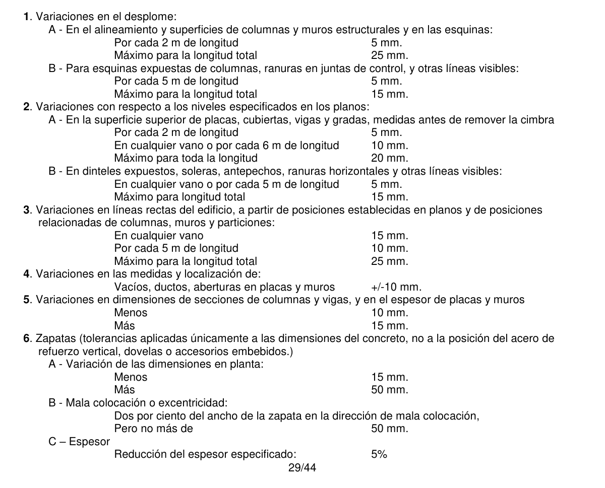
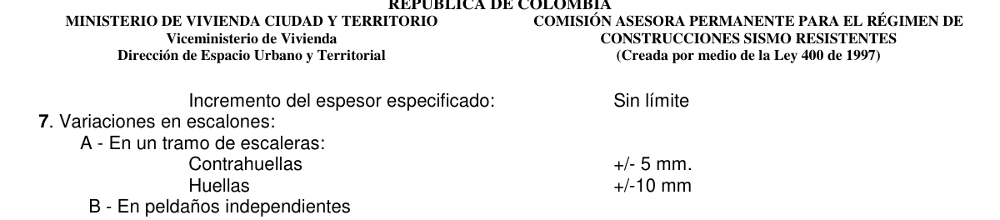

# C.6 — Cimbras y encofrados, embebidos y juntas de construcción

### C.6.1 — Diseño de cimbras y encofrados

**C.6.1.1** — El objeto de las cimbras y encofrados es obtener una estructura que cumpla con la forma, los niveles y las dimensiones de los elementos según lo indicado en los planos de diseño y en las especificaciones.

**C.6.1.2** — Las cimbras y encofrados deben ser esencialmente y suficientemente herméticos para impedir la fuga del mortero.

**C.6.1.3** — Las cimbras y encofrados deben estar adecuadamente arriostrados o amarrados entre si, de tal manera que conserven su posición y forma.

**C.6.1.4** — Las cimbras y encofrados y sus apoyos deben diseñarse de tal manera que no dañen la estructura previamente construida.

**C.6.1.5** — El diseño de las cimbras y encofrados debe tener en cuenta los siguientes factores:

(a) Velocidad y método de colocación del concreto;

(b) Cargas de construcción, incluyendo cargas verticales, horizontales y de impacto;

(c) Requisitos especiales de las cimbras y encofrados para la construcción de cáscaras, losas plegadas, domos, concreto arquitectónico u otros tipos de elementos similares;

**C.6.1.6** — Las cimbras y encofrados para elementos de concreto preesforzado deben estar diseñadas y construidas de tal manera que permitan desplazamientos del elemento sin causar daños durante la aplicación de la fuerza de preesforzado.

### C.6.2 — Descimbrado, puntales y reapuntalamiento

#### C.6.2.1 — Descimbrado

La cimbra debe retirarse de tal manera que no se afecte negativamente la seguridad o funcionamiento de la estructura. El concreto expuesto por el descimbrado debe tener suficiente resistencia para no ser dañado por las operaciones de descimbrado.

#### C.6.2.2 — Retiro de puntales y reapuntalamiento

Los requisitos de C.6.2.2.1 a C.6.2.2.3 se deben cumplir en la construcción de vigas y losas excepto cuando se construyan sobre el terreno.

**C.6.2.2.1** — Con anterioridad al inicio de la construcción, el constructor debe definir un procedimiento y una programación para la remoción de los apuntalamientos y para la instalación de los reapuntalamientos, y para calcular las cargas transferidas a la estructura durante el proceso.

(a) El análisis estructural y los datos sobre resistencia del concreto empleados en la planificación e implementación del descimbrado y retiro de apuntalamientos deben ser entregados por el constructor a la autoridad competente cuando ésta lo requiera;

(b) Solamente cuando la estructura, en su estado de avance, en conjunto con las cimbras y apuntalamiento aun existentes tengan suficiente resistencia para soportar de manera segura su propio peso y las cargas colocadas sobre ella, pueden apoyarse cargas de construcción sobre la estructura o descimbrar cualquier porción de ella.

(c) La demostración de que la resistencia es adecuada debe basarse en un análisis estructural que tenga en cuenta las cargas propuestas, la resistencia del sistema de encofrado y cimbra, y la resistencia del concreto. La resistencia del concreto debe estar basada en ensayos de probetas curadas en obra o, cuando lo apruebe la autoridad competente, en otros procedimientos para evaluar la resistencia del concreto.

**C.6.2.2.2** — No se pueden soportar en la estructura sin cimbra cargas de construcción que excedan la suma de las cargas muertas más vivas utilizadas en el diseño, a menos que por medio de un análisis estructural se demuestre que existe resistencia suficiente para sostener estas cargas adicionales.

**C.6.2.2.3** — Las cimbras para elementos de concreto preesforzado no deben ser removidas hasta que se haya aplicado suficiente preesfuerzo para permitir que el elemento soporte su propio peso y las cargas de construcción previstas.

### C.6.3 — Embebidos en el concreto

**C.6.3.1** — Se permite, previa aprobación del profesional facultado para diseñar, embeber cualquier material que no sea perjudicial para el concreto y que esté dentro de las limitaciones de 6.3, siempre y cuando se considere que ellos no reemplazan estructuralmente al concreto desplazado, excepto en lo previsto en 6.3.6.

**C.6.3.2** — Todo tipo de embebido de aluminio en el concreto estructural debe ser protegido en su superficie o recubierto para evitar la reacción concreto-aluminio, o la acción electrolítica entre el aluminio y el acero.

**C.6.3.3** — Los ductos, tuberías e insertos que pasen a través de losas, muros o vigas, no deben debilitar significativamente la resistencia de la estructura.

**C.6.3.4** — Los ductos y tuberías, junto con sus conexiones, embebidas en una columna, no deben ocupar más del 4 por ciento del área de la sección transversal que se empleó para calcular su resistencia, o de la requerida para la protección contra el fuego.

**C.6.3.5** — Excepto cuando los planos de los ductos y tuberías hayan sido aprobados por el profesional facultado para diseñar, las tuberías y ductos embebidos en una losa, muro o viga (diferentes de los que sólo pasan a través de estos elementos) deben satisfacer C.6.3.5.1 a C.6.3.5.3.

**C.6.3.5.1** — No deben tener dimensiones exteriores mayores que 1/3 del espesor total de la losa, muro o viga, donde estén embebidos.

**C.6.3.5.2** — No deben estar espaciados a menos de 3 veces su diámetro o ancho medido de centro a centro.

**C.6.3.5.3** — No deben afectar significativamente la resistencia del elemento.

**C.6.3.6** — Se puede considerar que los ductos, tuberías e insertos sustituyen estructuralmente en compresión al concreto desplazado si cumplen con C.6.3.6.1 a C.6.3.6.3.

**C.6.3.6.1** — No estén expuestos a la corrosión o a otra causa de deterioro.

**C.6.3.6.2** — Sean de acero o hierro sin revestimiento o galvanizado, de espesor no menor que el del tubo de acero calibre estándar número 40.

**C.6.3.6.3** — Tengan un diámetro interior nominal no superior a 50 mm y estén separados no menos de 3 diámetros medido de centro a centro.

**C.6.3.7** — Las tuberías y sus conexiones deben diseñarse para resistir los efectos del fluido, la presión y la temperatura a las cuales van a estar sometidas.

**C.6.3.8** — Ningún líquido, gas o vapor, excepto el agua cuya temperatura y presión no excedan de 32º C ni 0.35 MPa, respectivamente, debe colocarse en las tuberías hasta que el concreto haya alcanzado su resistencia de diseño.

**C.6.3.9** — En losas macizas, las tuberías deben colocarse entre las capas de refuerzo superior e inferior, a menos que se requiera para irradiar calor o fundir nieve.

**C.6.3.10** — El recubrimiento de concreto para las tuberías, conductos, y sus conexiones no debe ser menor de 40 mm en superficies de concreto expuestas a la intemperie o en contacto con el suelo, ni menos de 20 mm en aquellas que no estén directamente en contacto con el suelo o expuestas a la intemperie.

**C.6.3.11** — Debe colocarse refuerzo en dirección normal a la tubería, con un área no menor de 0.002 veces el área de la sección de concreto.

**C.6.3.12** — Las tuberías y ductos deben fabricarse e instalarse de tal forma que no requiera cortar, doblar o desplazar el refuerzo de su posición apropiada.

### C.6.4 — Juntas de construcción

**C.6.4.1** — La superficie de las juntas de construcción del concreto deben limpiarse y debe estar libre de lechada.

**C.6.4.2** — Inmediatamente antes de iniciar una nueva etapa de colocación de concreto, deben mojarse todas las juntas de construcción y debe eliminarse el agua apozada.

**C.6.4.3** — Las juntas de construcción deben hacerse y ubicarse de manera que no perjudiquen la resistencia de la estructura. Deben tomarse medidas para la transferencia apropiada de cortante y de otras fuerzas a través de las juntas de construcción. Véase C.11.6.9.

**C.6.4.4** — Las juntas de construcción en entrepisos deben estar localizadas dentro del tercio central del vano de las losas, vigas y vigas principales.

**C.6.4.5** — Las juntas de construcción en las vigas principales deben desplazarse a una distancia mínima de dos veces el ancho de las vigas que las intersecten.

**C.6.4.6** — Las vigas, vigas principales, o losas apoyadas sobre columnas o muros no deben construirse hasta que el concreto del apoyo vertical haya endurecido hasta el punto que haya dejado de ser plástico.

**C.6.4.7** — Las vigas, vigas principales, capiteles de columnas, descolgados para cortante y ábacos, deben construirse monolíticamente como parte del sistema de losas, a menos que en los planos o especificaciones se indique de otro modo.

" NOTAS

<!-- mod:3-decreto-945-2017-59 -->
> **Modificación — Decreto 945 de 2017** · anexo, p. 32
>
> Se incluye la nueva sección C.6.5:
>
> **C.6.5 — Límites de tolerancias**
>
> **C.6.5.1** — En ausencia de especificaciones producidas por el diseñador estructural y a menos que se especifique lo contrario por parte del Supervisor Técnico Independiente, los encofrados, cimbras y formaletas deben construirse de manera que las superficies del concreto terminado cumplan con los límites de tolerancias presentados en la Tabla C.6.5-1.
>
> 
> 
