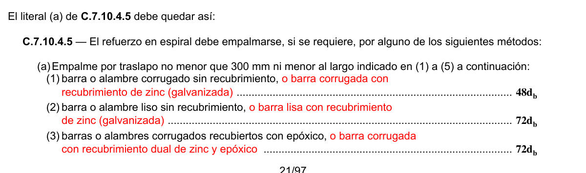
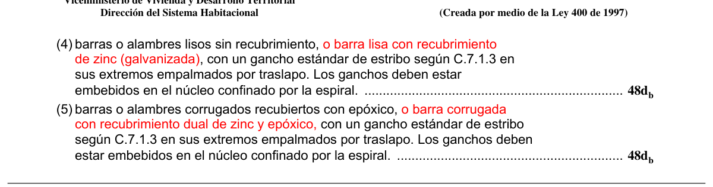

# C.7 — Detalles del refuerzo

### C.7.1 — Ganchos estándar

El término “gancho estándar” se emplea en el Título C del Reglamento NSR-10 con uno de los siguientes significados:

**C.7.1.1** — Doblez de 180º más una extensión de $4d_{b}$ , pero no menor de 65 mm en el extremo libre de la barra.

**C.7.1.2** — Doblez de 90º más una extensión de $12d_{b}$ en el extremo libre de la barra.

#### C.7.1.3 — Para estribos y ganchos de estribo

(a) Barra No. 5 (5/8”) ó 16M (16 mm) y menores, doblez de 90º más $6d_{b}$ de extensión en el extremo libre de la barra, ó

(b) Barra No. 6 (3/4”) ó 20M (20 mm), No. 7 (7/8”) ó 22M (22 mm), y No. 8 (1”) ó 25M (25 mm), doblez de 90º más extensión de $12d_{b}$ en el extremo libre de la barra, ó

(c) Barra No. 8 (1”) ó 25M (25 mm) y menor, doblez de 135º más extensión de $6d_{b}$ en el extremo libre de la barra.

**C.7.1.4** — En los estribos de confinamiento requeridos en el Capítulo C.21 en estructuras de capacidad de disipación de energía moderada (DMO) y especial (DES), para construcción sismo resistente, deben emplearse ganchos sísmicos con un doblez de 135º o más, con una extensión de $6d_{b}$ pero no menor de 75 mm, que abraza el refuerzo longitudinal del elemento y se proyecta hacia el interior de la sección del elemento. En los ganchos suplementarios el doblez en los extremos debe ser un gancho sísmico de 135º, o más, con una extensión de $6d_{b}$ , pero no menor de 75 mm, y se permite que en uno de los extremos se utilice un gancho de 90º, o más, con una extensión de $6d_{b}$ . Los ganchos sísmicos están definidos en C.2.2

### C.7.2 — Diámetros mínimos de doblado

**C.7.2.1** — El diámetro de doblado, medido en la cara interior de la barra, excepto para estribos de diámetros No. 3 (3/8”) ó 10M (10 mm) a No. 5 (5/8”) ó 16M (16 mm), no debe ser menor que los valores de la tabla C.7.2.

**C.7.2.2** — El diámetro interior de doblado para estribos no debe ser menor que $4d_{b}$ para barras No. 5 (5/8”) ó 16M (16 mm) y menores. Para barras mayores que No. 5 (5/8”) ó 16M (16 mm), el diámetro de doblado debe cumplir con lo estipulado en la tabla C.7.2.

**C.7.2.3** — El diámetro interior de doblado en refuerzo electrosoldado de alambre (corrugado o liso) para estribos no debe ser menor que $4d_{b}$ para alambre corrugado mayor de MD40 (7.1 mm de diámetro), y $2d_{b}$ para los demás diámetros de alambre. Ningún doblez con diámetro interior menor de $8d_{b}$ debe estar a menos de $4d_{b}$ de la intersección soldada más cercana.

**Tabla C.7.2** — DIÁMETROS MÍNIMOS DE DOBLADO

| Diámetro de las barras | Diámetro mínimo de doblado |
|---|---|
| No. 3 (3/8”) ó 10M (10 mm) a No. 8 (1”) ó 25M (25 mm) | $6d_{b}$ |
| No. 9 (1-1/8”) ó 30M (30 mm), No. 10 (1-1/4”) ó 32M (32 mm) y No. 11 (1-3/8”) ó 36M (36 mm) | $8d_{b}$ |
| No. 14 (1-3/4”) ó 45M (45 mm) y No. 18 (2-1/4”) ó 55M (55 mm) | $10d_{b}$ |

### C.7.3 — Doblado

**C.7.3.1** — Todo refuerzo debe doblarse en frío, a menos que el profesional facultado para diseñar permita otra cosa.

**C.7.3.2** — Ningún refuerzo parcialmente embebido en el concreto puede doblarse en la obra, excepto cuando así se indique en los planos de diseño o lo permita el profesional facultado para diseñar.

### C.7.4 — Condiciones de la superficie del refuerzo

**C.7.4.1** — En el momento que es colocado el concreto, el refuerzo debe estar libre de barro, aceite u otros recubrimientos no metálicos que reduzcan la adherencia. Se permiten los recubrimientos epóxicos de barras que cumplan con las normas citadas en C.3.5.3.8 y C.3.5.3.9.

**C.7.4.2** — El refuerzo, excepto el acero de preesforzado, con óxido, escamas o una combinación de ambos, debe considerarse satisfactorio si las dimensiones mínimas (incluyendo la altura de los resaltes del corrugado) y el peso de una muestra limpiada utilizando un cepillo de alambre de acero, cumple con las especificaciones NTC (o ASTM en su defecto) aplicables indicadas en C.3.5.

**C.7.4.3** — El acero de preesforzado debe estar limpio y libre de óxido excesivo, aceite, mugre, escamas y picaduras. Es admisible una oxidación ligera.

### C.7.5 — Colocación del refuerzo

**C.7.5.1** — El refuerzo, incluyendo los tendones y los ductos de preesforzado, debe colocarse con precisión y estar adecuadamente asegurado antes de colocar el concreto, y debe fijarse para evitar su desplazamiento dentro de las tolerancias aceptables dadas en C.7.5.2.

**C.7.5.2** — A menos que el profesional facultado para diseñar especifique otra cosa, el refuerzo, incluyendo los tendones y ductos de preesforzado, debe colocarse en las posiciones especificadas dentro de las tolerancias indicadas en C.7.5.2.1 y C.7.5.2.2.

**C.7.5.2.1** — La tolerancia para $d$ y para el recubrimiento de concreto en elementos sometidos a flexión, muros y elementos sometidos a compresión debe ser la siguiente:

|  | Tolerancia en $d$ | Tolerancia en el recubrimiento especificado del concreto |
|---|---|---|
| $d$ a 200 mm | ± 10 mm | -10 mm |
| $d$ > 200 mm | ± 13 mm | -13 mm |

excepto que la tolerancia para la distancia libre al fondo de las cimbras debe ser menos 6 mm. Además, la tolerancia para el recubrimiento tampoco debe exceder menos 1/3 del recubrimiento de concreto especificado en los planos de diseño y especificaciones del proyecto.

**C.7.5.2.2** — La tolerancia para la ubicación longitudinal de los dobleces y extremos del refuerzo debe ser de ±50 mm, excepto en los extremos discontinuos de las ménsulas o cartelas donde la tolerancia debe ser ±13 mm y en los extremos discontinuos de otros elementos donde la tolerancia debe ser ±25 mm. La tolerancia para el recubrimiento de concreto de C.7.5.2.1 también se aplica a los extremos discontinuos de los elementos.

**C.7.5.3** — El refuerzo electrosoldado de alambre (fabricado con alambre cuyo tamaño no sea superior a MW30 o MD30 ó 6.2 mm de diámetro) utilizada en losas con vanos menores de 3 m se puede doblar desde un punto situado cerca de la cara superior sobre el apoyo, hasta otro punto localizado cerca de la cara inferior en el centro del vano, siempre y cuando este refuerzo sea continuo sobre el apoyo o esté debidamente anclado en él.

**C.7.5.4** — No se permite soldar las barras que se intersecten con el fin de sujetar el refuerzo, a menos que lo autorice el profesional facultado para diseñar.

### C.7.6 — Límites del espaciamiento del refuerzo

**C.7.6.1** — La distancia libre mínima entre barras paralelas de una capa debe ser $d_{b}$ , pero no menor de 25 mm. Véase también C.3.3.2.

**C.7.6.2** — Cuando el refuerzo paralelo se coloque en dos o más capas, las barras de las capas superiores deben colocarse exactamente sobre las de las capas inferiores, con una distancia libre entre capas no menor de 25 mm.

**C.7.6.3** — En elementos a compresión reforzados con espirales o estribos, la distancia libre entre barras longitudinales no debe ser menor de $1.5d_{b}$ , ni de 40 mm. Véase también C.3.3.2.

**C.7.6.4** — La limitación de distancia libre entre barras también se debe aplicar a la distancia libre entre un empalme por traslapo y los empalmes o barras adyacentes.

**C.7.6.5** — En muros y losas, exceptuando las losas nervadas, la separación del refuerzo principal por flexión no debe ser mayor de 3 veces el espesor del muro o de la losa, ni de 450 mm, excepto que en secciones críticas de losas en dos direcciones no debe exceder 2 veces el espesor de la losa (véase el Capítulo C.13). Cuando se trate de refuerzo de temperatura en losas la separación máxima no debe exceder 5 veces el espesor de la losa ni 450 mm (véase C.7.12).

#### C.7.6.6 — Paquetes de barras

**C.7.6.6.1** — Los grupos de barras paralelas dispuestas en un paquete para trabajar como una unidad, deben limitarse a 4 barras para cada paquete.

**C.7.6.6.2** — Los paquetes de barras deben estar colocados dentro de estribos.

**C.7.6.6.3** — En vigas las barras mayores a No. 11 (1-3/8”) ó 36M (36 mm) no deben agruparse en paquetes.

**C.7.6.6.4** — En elementos sometidos a flexión, cada una de las barras de un paquete que termina dentro del vano debe terminarse en lugares diferentes separados al menos $40d_{b}$ .

**C.7.6.6.5** — Cuando las limitaciones de espaciamiento y los requisitos de recubrimiento del concreto se basan en el diámetro de las barras $d_{b}$ , un paquete de barras debe considerarse como una sola barra de diámetro equivalente al que se deduzca del área total de las barras del paquete.

#### C.7.6.7 — Tendones y ductos

**C.7.6.7.1** — El espaciamiento entre el extremo y el centro de los tendones de pretensado a cada lado de un elemento no debe ser menor que $4d_{b}$ para torones o $5d_{b}$ para alambres, excepto que si la resistencia del concreto a la compresión especificada al momento del preesforzado inicial, $f_{ci}'$ , es de 28 MPa o más, el espaciamiento mínimo, medido centro a centro, de los torones debe ser 45 mm para torones de 12.7 mm de diámetro nominal o menores, y de 50 mm para torones de 15.2 mm de diámetro nominal. Véase también C.3.3.2. Se permite un espaciamiento más cercano o agrupar tendones en el sector central del vano.

**C.7.6.7.2** — Se permite agrupar los ductos de postensado si se demuestra que el concreto puede colocarse satisfactoriamente, y se toman medidas para evitar que el acero de preesforzado rompa la separación entre ductos de postensado al tensionarlo.

### C.7.7 — Protección de concreto para el refuerzo

#### C.7.7.1 — Concreto construido en sitio (no preesforzado)

A menos que en C.7.7.6 ó C.7.7.8 se exija un recubrimiento mayor de concreto, el recubrimiento especificado para el refuerzo no debe ser menor que lo siguiente:

Recubrimiento de concreto, mm

(a) Concreto colocado contra el suelo y expuesto permanentemente a él ............................................................ 75

(b) Concreto expuesto a suelo o a la intemperie:

Barras No. 6 (3/4”) ó 20M (20 mm) a No. 18 (2-1/4”) ó 55M (55 mm) ........................................................ 50 Barras No. 5 (5/8”) ó 16M (16 mm), alambre MW200 ó MD200 (16 mm de diámetro) y menores .................................................................................................................................................... 40

(c) Concreto no expuesto a la intemperie ni en contacto con el suelo:

Losas, muros, viguetas:

Barras No. 14 (1-3/4”) ó 45M (45 mm) y No. 18 (2-1/4”) ó 55M (55 mm) ...................................... 40 Barras No. 11 (1-3/8”) ó 36M (36 mm) y menores ......................................................................... 20 Vigas, columnas:

Armadura principal, estribos, espirales........................................................................................... 40 Cáscaras y placas plegadas:

Barra No. 6 (3/4”) ó 20M (20 mm) y mayores ................................................................................. 20 Barras No. 5 (5/8”) ó 16M (16 mm), alambres MW200 ó MD200 (16 mm de diámetro) y menores ....................................................................................................................................... 13

#### C.7.7.2 — Concreto construido en sitio (preesforzado)

A menos que en C.7.7.6 ó C.7.7.8 se exija un recubrimiento mayor de concreto, el recubrimiento especificado para el refuerzo preesforzado y no preesforzado, ductos y accesorios de los extremos, no debe ser menor que lo siguiente:

Recubrimiento de concreto, mm

(a) Concreto colocado contra el suelo y expuesto permanentemente a él ............................................................ 75

(b) Concreto expuesto a suelo o a la intemperie:

Paneles de muros, losas, viguetas .............................................................................................................. 25 Otros elementos .......................................................................................................................................... 40

(c) Concreto no expuesto a la intemperie ni en contacto con el suelo:

Losas, muros, viguetas ................................................................................................................................ 20 Vigas, columnas:

Refuerzo principal ........................................................................................................................... 40 Estribos y espirales ......................................................................................................................... 25 Cáscaras y losas plegadas:

Barra No. 5 (5/8”) ó 16M (16 mm), alambre MW200 ó MD200 (16 mm de diámetro), y menores ....................................................................................................................................... 10 Otros refuerzos ..............................................................................................................................$d_{b}$ pero no menos de .......................................................................................................................... 20

**C.7.7.3** — Concreto prefabricado (fabricado bajo condiciones de control de planta) A menos que en C.7.7.6 ó C.7.7.8 se exija un recubrimiento mayor de concreto, el recubrimiento especificado para el refuerzo preesforzado y no preesforzado, ductos y accesorios de los extremos, no debe ser menor que lo siguiente:

Recubrimiento de concreto, mm

(a) Concreto expuesto al suelo o a la intemperie:

Paneles de muros:

Barras No. 14 (1-3/4”) ó 45M (45 mm) y No. 18 (2-1/4”) ó 55M (55 mm), tendones de preesforzado mayores de 40 mm de diámetro .......................................................... 40 Barras No. 11 (1-3/8”) ó 36M (36 mm) y menores, tendones de preesforzado de 40 mm de diámetro y menores, alambres MW200 ó MD200 (16 mm de diámetro) y menores ................ 20 Otros elementos:

Barras No. 14 (1-3/4”) ó 45M (45 mm) y No. 18 (2-1/4”) ó 55M (55 mm), tendones de preesforzado mayores de 40 mm de diámetro .......................................................... 50 Barras No. 6 (3/4”) ó 20M (20 mm) al No. 11 (1-3/8”) ó 36M (36 mm), tendones de preesforzado mayores de 16 mm de diámetro hasta 40 mm de diámetro ................ 40 Barras No. 5 (5/8”) ó 16M (16 mm) y menores, tendones de preesforzado de 16 mm de diámetro y menores, alambre MW200 ó MD200 (16 mm de diámetro) y menores ................... 30

(b) Concreto no expuesto a la acción de la intemperie ni en contacto con el suelo:

Losas, muros, viguetas:

Barras No. 14 (1-3/4”) ó 45M (45 mm) y No. 18 (2-1/4”) ó 55M (55 mm), tendones de preesforzado mayores a 40 mm de diámetro ........................................................................................ 30 Tendones de preesforzado de 40 mm de diámetro y menores ............................................................. 20 Barras No. 11 (1-3/8”) ó 36M (36 mm) y menores, alambre MW200 ó MD200 (16 mm de diámetro) y menores ............................................................................................... 16 Vigas, columnas:

Refuerzo principal................................................................................................................................. $d_{b}$ pero no menor de 16 mm y no mayor de 40 mm Estribos, espirales ................................................................................................................................. .10 Cáscaras, y losas plegadas:

Tendones de preesforzado .................................................................................................................... 20 Barras No. 6 (3/4”) ó 20M (20 mm) y mayores ...................................................................................... 16 Barras No. 5 (5/8”) ó 16M (16 mm) y menores, Alambre MW200 ó MD200 (16 mm de diámetro) y menores ............................................................................................... 10

#### C.7.7.4 — Paquetes de barras

El recubrimiento de concreto mínimo especificado para los paquetes de barras no debe ser menor que el diámetro equivalente del paquete, pero no necesita ser mayor de 50 mm; excepto para concreto construido contra el suelo y permanentemente expuesto a él, caso en el cual el recubrimiento de concreto especificado no debe ser menor que 75 mm.

#### C.7.7.5 — Pernos con cabeza para refuerzo de cortante

Para los pernos con cabeza para refuerzo de cortante, el recubrimiento especificado de concreto para las cabezas y la base común no debe ser menor que el requerido para el refuerzo en el tipo de elemento en el que se colocará el perno soldado con cabeza.

#### C.7.7.6 — Ambientes corrosivos

En ambientes corrosivos u otras condiciones severas de exposición, debe aumentarse adecuadamente el espesor del recubrimiento de concreto y deben cumplir los requisitos pertinentes para el concreto, basados en las categorías de exposición aplicables del Capítulo C.4, o bien, debe disponerse de otro tipo de protección.

**C.7.7.6.1** — Para elementos de concreto preesforzado expuestos a medios corrosivos o a otras categorías severas de exposición como las definidas en el Capítulo C.4, y que se encuentran clasificadas como Clase T ó C en C.18.3.3, el recubrimiento de concreto especificado no debe ser menor de 1.5 veces el recubrimiento para los refuerzos preesforzados requeridos por C.7.7.2 ó C.7.7.3. Este requisito puede obviarse si la zona precomprimida de tracción no se encuentra en tracción bajo la acción de las cargas permanentes.

<!-- mod:1-decreto-092-2011-89 -->
> **Modificación — Decreto 092 de 2011** · anexo, p. 21
>
> El literal C.7.7.6 debe quedar así:
>
> En ambientes corrosivos u otras condiciones severas de exposición, debe aumentarse el recubrimiento de concreto cuando lo considere necesario el profesional facultado para diseñar y así lo especifique.  Se deben cumplir los requisitos aplicables para el concreto, basados en las categorías de exposición del Capítulo C.4, o bien, debe disponerse de otro tipo de protección.

#### C.7.7.7 — Ampliaciones futuras

El refuerzo expuesto, los insertos y las platinas que se pretendan unir con ampliaciones futuras deben protegerse contra la corrosión.

#### C.7.7.8 — Protección contra el fuego

Si el Título J del Reglamento NSR-10 requiere un espesor de recubrimiento para protección contra el fuego mayor que el recubrimiento de concreto dado en C.7.7.1 a C.7.7.7, debe especificarse ese espesor mayor (véase J.3.5.2).

### C.7.8 — Detalles especiales del refuerzo para columnas

#### C.7.8.1 — Barras dobladas por cambio de sección

Las barras longitudinales dobladas debido a un cambio de sección deben cumplir con lo siguiente:

**C.7.8.1.1** — La pendiente de la parte inclinada de una barra de este tipo no debe exceder de 1 a 6 con respecto al eje de la columna.

**C.7.8.1.2** — Las partes de la barra que estén arriba y debajo de la zona del doblez deben ser paralelas al eje de la columna.

**C.7.8.1.3** — Debe proporcionarse soporte horizontal adecuado a la barra doblada por cambio de sección por medio de estribos transversales, espirales, o porciones del sistema de entrepiso. El soporte horizontal debe diseñarse para resistir 1.5 veces la componente horizontal de la fuerza calculada en la porción inclinada de la barra. Los estribos transversales o espirales, en caso de utilizarse, se deben colocar a una distancia no mayor de 150 mm de los puntos de doblado.

**C.7.8.1.4** — Las barras en los cambios de sección se deben doblar antes de su colocación en el encofrado. Véase C.7.3.

**C.7.8.1.5** — Cuando la cara de una columna está desalineada 75 mm o más por cambio de sección, las barras longitudinales no se deben doblar. Se deben proporcionar espigos (dowels) empalmados por traslapo con las barras longitudinales adyacentes a las caras desalineadas de la columna. Los empalmes por traslapo deben cumplir con lo especificado en C.12.17.

#### C.7.8.2 — Núcleos de acero

La transmisión de cargas en los núcleos de acero estructural de elementos compuestos sometidos a compresión debe ser proporcionada de acuerdo con lo siguiente:

**C.7.8.2.1** — Los extremos de los núcleos de acero estructural deben terminarse con precisión para poner en contacto los apoyos en los extremos, y deben tomarse medidas adecuadas para alinear un núcleo con respecto al otro en contacto concéntrico.

**C.7.8.2.2** — La capacidad de transferencia de carga por apoyo en los empalmes de los extremos se debe considerar como máximo igual a un 50 por ciento del esfuerzo total de compresión en el núcleo de acero.

**C.7.8.2.3** — La transmisión de esfuerzos entre la base de la columna y la zapata debe diseñarse de acuerdo con lo especificado en C.15.8.

**C.7.8.2.4** — La base de la sección de acero estructural debe diseñarse de manera que transmita la carga total de todo el elemento compuesto a la zapata; o se debe diseñar para que transmita únicamente la carga del núcleo de acero, siempre y cuando se disponga de una amplia sección de concreto capaz de transferir a la zapata la porción de la carga total soportada por la sección de concreto reforzado, por medio de compresión en el concreto y por refuerzo.

### C.7.9 — Conexiones

**C.7.9.1** — En las conexiones de los elementos principales de pórticos (tales como vigas y columnas) debe disponerse de confinamiento para los empalmes del refuerzo que continúa y para el anclaje del refuerzo que termina en tales conexiones.

**C.7.9.2** — El confinamiento en las conexiones debe consistir en concreto exterior, o en estribos cerrados o espirales interiores.

### C.7.10 — Refuerzo transversal para elementos a compresión

**C.7.10.1** — El refuerzo transversal de elementos a compresión debe cumplir con las disposiciones de C.7.10.4 y C.7.10.5 y cuando se requiere refuerzo por cortante o por torsión, este debe cumplir con las disposiciones del Capítulo C.11.

**C.7.10.2** — Los requisitos para el refuerzo transversal de elementos compuestos sometidos a compresión deben cumplir con lo especificado en C.10.13. El refuerzo transversal de tendones debe cumplir con los requisitos de C.18.11.

**C.7.10.3** — Los requisitos para el refuerzo transversal de C.7.10, C.10.13 y C.18.11 pueden ser omitidos cuando ensayos y análisis estructural muestren una adecuada resistencia y factibilidad de construcción.

#### C.7.10.4 — Espirales

El refuerzo en espiral para elementos a compresión debe cumplir con C.10.9.3 y lo siguiente:

**C.7.10.4.1** — Las espirales deben consistir en barras o alambres continuos espaciados uniformemente, con un tamaño y disposición que permitan su manejo y colocación sin distorsión de las dimensiones de diseño.

**C.7.10.4.2** — Para elementos construidos en obra, el diámetro de barra utilizada en espirales no debe ser menor de 10 mm.

**C.7.10.4.3** — El espaciamiento libre entre hélices de la espiral no debe exceder de 75 mm ni ser menor de 25 mm. Véase también C.3.3.2.

**C.7.10.4.4** — El anclaje de la espiral debe consistir en 1.5 vueltas adicionales de la barra o alambre en cada extremo de la espiral.

**C.7.10.4.5** — El refuerzo en espiral debe empalmarse, si se requiere, por alguno de los siguientes métodos:

(a) Empalme por traslapo no menor que 300 mm ni menor al largo indicado en (1) a (5) a continuación:

(1) barra o alambre corrugado sin recubrimiento ....................................................................................$48d_{b}$ (2) barra o alambre liso sin recubrimiento ...............................................................................................$72d_{b}$ (3) barras o alambres corrugados recubiertos con epóxico ....................................................................$72d_{b}$ (4) barras o alambres lisos sin recubrimiento con un gancho estándar de estribo según C.7.1.3 en sus extremos empalmados por traslapo. Los ganchos deben estar embebidos en el núcleo confinado por la espiral. .....................................................................$48d_{b}$ (5) barras o alambres corrugados recubiertos con epóxico con un gancho estándar de estribo según C.7.1.3 en sus extremos empalmados por traslapo. Los ganchos deben estar embebidos en el núcleo confinado por la espiral. ..........................................................$48d_{b}$

(b) Empalme mecánico o soldado completo de acuerdo con C.12.14.3.

<!-- mod:1-decreto-092-2011-90 -->
> **Modificación — Decreto 092 de 2011** · anexo, p. 21
>
> El literal (a) de C.7.10.4.5 debe quedar así:
>
> 
>
> 

**C.7.10.4.6** — Las espirales deben extenderse desde la parte superior de la zapata o losa en cualquier nivel, hasta la altura del refuerzo horizontal más bajo del elemento soportado.

**C.7.10.4.7** — Cuando no existan vigas o ménsulas en todos los lados de una columna, deben colocarse estribos por encima de la terminación de la espiral hasta la parte inferior de la losa, ábaco, o descolgado para cortante.

**C.7.10.4.8** — En columnas con capitel, la espiral debe extenderse hasta un nivel en el cual el diámetro o ancho del capitel sea dos veces el de la columna.

**C.7.10.4.9** — Las espirales deben mantenerse firmemente colocadas y bien alineadas.

#### C.7.10.5 — Estribos

Los estribos para elementos sometidos a compresión deben cumplir con lo siguiente:

**C.7.10.5.1** — Todas las barras no preesforzadas deben estar confinadas por medio de estribos transversales de por lo menos diámetro No. 3 (3/8”) ó 10M (10 mm), para barras longitudinales No. 10 (1-1/4”) ó 32M (32 mm) o menores; y diámetro No. 4 (1/2”) ó 12M (12 mm) como mínimo, para barras longitudinales No. 11 (1-3/8”) ó 36M (36 mm), No. 14 (1-3/4”) ó 45M (45 mm) y No. 18 (2-1/4”) ó 55M (55 mm) y paquetes de barras. En estructuras de capacidad de disipación de energía mínima (DMI) se permiten estribos de barra Nº 2 (1/4") ó 6M(6 mm) cuando las columnas soportan únicamente uno o dos pisos.

**C.7.10.5.2** — El espaciamiento vertical de los estribos no debe exceder 16 diámetros de barra longitudinal, 48 diámetros de barra o alambre de los estribos, o la menor dimensión del elemento sometido a compresión.

**C.7.10.5.3** — Los estribos deben disponerse de tal forma que cada barra longitudinal de esquina y barra alterna tenga apoyo lateral proporcionado por la esquina de un estribo con un ángulo interior no mayor de 135º, y ninguna barra longitudinal debe estar separada a más de 150 mm libres de una barra apoyada lateralmente. Cuando las barras longitudinales estén localizadas alrededor del perímetro de un círculo, se permite el uso de un estribo circular completo.

**C.7.10.5.4** — La distancia vertical entre los estribos de los extremos del elemento y la parte superior de la zapata o losa de entrepiso, o el refuerzo horizontal más bajo de la losa, ábaco superior o descolgado para cortante, debe ser menor a la mitad del espaciamiento entre estribos.

<!-- mod:1-decreto-092-2011-92 -->
> **Modificación — Decreto 092 de 2011** · anexo, p. 22
>
> Se renumeran las secciones C.7.10.5.4 como C.7.10.5.5, la C.7.10.5.5 como C.7.10,5.6 y la C.7.10. 5.6. como C.7.10.5.7.

**C.7.10.5.5** — Cuando vigas o ménsulas concurran a una columna desde cuatro direcciones, se permite colocar el último estribo a no más de 75 mm debajo del refuerzo más bajo de la viga o ménsula de menor altura.

**C.7.10.5.6** — Cuando se coloquen pernos de anclaje en los extremos de las columnas o pedestales, los pernos deben estar circundados por refuerzo lateral que también rodee al menos cuatro barras verticales de la columna o pedestal. El refuerzo transversal debe distribuirse dentro de 125 mm medidos desde el parte superior de la columna o pedestal y debe consistir en al menos dos barras No. 4 (1/2”) ó 12M (12 mm) o tres barras No. 3 (3/8”) ó 10M (10 mm).

<!-- mod:1-decreto-092-2011-91 -->
> **Modificación — Decreto 092 de 2011** · anexo, p. 22
>
> En C.7.10.5 deben hacerse los siguientes cambios:
>
> **C.7.10.5.3** — Los estribos rectilíneos deben disponerse de tal forma que cada barra longitudinal de esquina y barra alterna tenga apoyo lateral proporcionado por la esquina de un estribo con un ángulo interior no mayor de 135º, y ninguna barra longitudinal debe estar separada a más de 150 mm libres de una barra apoyada lateralmente. Cuando las barras longitudinales estén localizadas alrededor del perímetro de un círculo, se permite el uso de un estribo circular completo.
>
> **C.7.10.5.4** — Cuando las barras longitudinales estén localizadas alrededor del perímetro de un círculo, se permite el uso de un estribo circular completo. Los extremos del estribo circular deben traslaparse al menos 150 mm y terminar con ganchos estándar que abracen una barra longitudinal de la columna. El traslapo en los extremos de estribos circulares adyacentes se debe escalonar a lo largo del perímetro encerrado por las barras longitudinales.

### C.7.11 — Refuerzo transversal para elementos a flexión

**C.7.11.1** — El refuerzo a compresión en vigas debe confinarse con estribos que cumplan las limitaciones de tamaño y espaciamiento de C.7.10.5, o bien con un refuerzo electrosoldado de alambre de un área equivalente. Tales estribos deben colocarse a lo largo de toda la distancia donde se requiera refuerzo a compresión.

**C.7.11.2** — El refuerzo transversal para elementos de pórticos sometidos a esfuerzos reversibles de flexión o a torsión en los apoyos debe consistir en estribos cerrados o espirales colocados alrededor del refuerzo de flexión.

**C.7.11.3** — Los estribos cerrados se deben formar de una sola pieza con sus ganchos extremos colocados superpuestos abrazando la misma barra longitudinal, o se deben formar de una o dos piezas unidas mediante un empalme por traslapo Clase B (longitud de traslapo de $1.3ℓ_{d}$ ) o anclándolas de acuerdo con C.12.13.

### C.7.12 — Refuerzo de retracción y temperatura

**C.7.12.1** — En losas estructurales donde el refuerzo a flexión se extiende en una sola dirección, se debe colocar refuerzo normal al refuerzo a flexión para resistir los esfuerzos debidos a retracción y temperatura.

**C.7.12.1.1** — El refuerzo de retracción y temperatura debe proveerse de acuerdo con C.7.12.2 ó C.7.12.3.

<!-- mod:3-decreto-945-2017-41 -->
> *Texto vigente según el Decreto 945 de 2017 (anexo, p. 33).*

**C.7.12.1.2** — Cuando los movimientos por retracción y temperatura están restringidos de manera significativa, deben considerarse los requisitos de C.8.2.4 y C.9.2.5.

**C.7.12.2** — El refuerzo corrugado, que cumpla con C.3.5.3, empleado como refuerzo de retracción y temperatura debe colocarse de acuerdo con lo siguiente:

**C.7.12.2.1** — La cuantía de refuerzo de retracción y temperatura debe ser al menos igual a los valores dados a continuación, pero no menos que 0.0014:

(a) En losas donde se empleen barras corrugadas Grado 280 o 350 ..................................................... 0.0020

(b) En losas donde se empleen barras corrugadas Grado 420 o refuerzo electrosoldado de alambre.... 0.0018

(c) En losas donde se utilice refuerzo de una resistencia a la fluencia mayor que 420 MPa, medida a una deformación unitaria de 0.35 por ciento ............................................. $\dfrac{0.0018 \times 420}{f_y}$

<!-- mod:2-decreto-340-2012-11 -->
> **Modificación — Decreto 340 de 2012** · anexo, p. 5
>
> El primer parágrafo de la sección C.7.12.2.1 debe quedar así:
>
> **C.7.12.2.1** — La cuantía de refuerzo de retracción y temperatura medida sobre el área bruta de la sección, debe ser al menos igual a los valores dados a continuación, pero no menos que 0.0014:

**C.7.12.2.2** — El refuerzo de retracción y temperatura no debe colocarse con una separación mayor de 5 veces el espesor de la losa ni de 450 mm.

**C.7.12.2.3** — En todas las secciones donde se requiera, el refuerzo por retracción y temperatura debe ser capaz de desarrollar $f_{y}$en tracción de acuerdo con el Capítulo C.12.

**C.7.12.3** — El acero de preesforzado, que cumpla con C.3.5.6, empleado como refuerzo de retracción y temperatura, debe suministrarse de acuerdo con lo siguiente:

**C.7.12.3.1** — Se deben diseñar los tendones para que produzcan un esfuerzo promedio de compresión mínima de 0.7 MPa en el área bruta del concreto usando esfuerzos de preesforzado efectivo, después de las pérdidas, de acuerdo con C.18.6.

**C.7.12.3.2** — El espaciamiento entre los tendones no debe exceder 1.8 m.

**C.7.12.3.3** — Si el espaciamiento entre los tendones excede 1.4 m se debe colocar refuerzo adherido adicional de retracción y temperatura, de acuerdo con C.7.12.2, entre los tendones en los bordes de la losa, en una zona que se extiende desde el borde en una distancia igual al espaciamiento entre los tendones.

<!-- mod:1-decreto-092-2011-93 -->
> **Modificación — Decreto 092 de 2011** · anexo, p. 22
>
> Los siguientes literales de C.7.12.3 deben modificarse como se indica:
>
> **C.7.12.3.2** — En construcción monolítica vaciada en sitio de vigas y losa postensada el área bruta de una viga y la zona aferente de la losa debe incluir el alma de la viga y la porción de losa hasta la mitad de la distancia a las almas de las vigas adyacentes. Se permite incluir la fuerza efectiva del preesfuerzo de los tendones de las vigas en el cálculo de la fuerza total de preesfuerzo que actúa sobre el área bruta de la sección de concreto.

<!-- mod:1-decreto-092-2011-94 -->
> **Modificación — Decreto 092 de 2011** · anexo, p. 22
>
> Incluir nuevos literales C.7.12.3.3 y C.7.12.3.4:
>
> **C.7.12.3.3** —  Cuando la losa está apoyada sobre muros o no es monolítica con las vigas, el área bruta de concreto corresponde a la sección aferente de losa al tendón o grupo de tendones.
>
> **C.7.12.3.4** — En todos los casos, se requiere como mínimo un tendón localizado en la losa entre las caras de las almas de las vigas o de los muros. La separación entre tendones en la losa y la distancia entre las caras de las vigas o los muros y el tendón más cercano no debe exceder 1.80 m.

<!-- mod:1-decreto-092-2011-95 -->
> **Modificación — Decreto 092 de 2011** · anexo, p. 22
>
> El literal C.7.12.3.3 se renumera como C.7.12.3.5 y queda ahora así:
>
> **C.7.12.3.5** —Donde el espaciamiento entre los tendones de la losa excede 1.4 m se debe colocar refuerzo no preesforzado adicional de retracción y temperatura, de acuerdo con C.7.12.2, entre las caras de las vigas o muros, paralelo al refuerzo de retracción y temperatura de la losa y tendones de temperatura. Este refuerzo adicional de retracción y temperatura debe extenderse a partir de los bordes de la losa por una distancia mayor o igual a la separación entre tendones, excepto que C.7.12.2.3 no aplica en este caso.

### C.7.13 — Requisitos para la integridad estructural

**C.7.13.1** — El detallado del refuerzo y conexiones, debe ser tal que los elementos de la estructura queden eficazmente unidos entre sí para garantizar la integridad de toda la estructura.

**C.7.13.2** — Para estructuras construidas en obra, los siguientes requisitos deben constituir los mínimos exigibles:

**C.7.13.2.1** — En la construcción con viguetas, como se define en C.8.13.1 a C.8.13.3, al menos una barra de la parte inferior debe ser continua o debe empalmarse por traslapo con un empalme por traslapo de tracción Clase B, o un empalme mecánico o soldado que cumpla con C.12.14.3, y en los apoyos no continuos debe ser anclado para desarrollar $f_{y}$ en la cara del apoyo usando un gancho estándar que cumpla con C.12.5 o una barra corrugada con cabeza que cumpla con C.12.6.

**C.7.13.2.2** — Las vigas del perímetro de la estructura deben tener un refuerzo continuo en toda su longitud y en los apoyos debe pasar a través de la región circunscrita por el refuerzo longitudinal de la columna, cumpliendo con (a) y (b):

(a) al menos un sexto del refuerzo de tracción requerido para momento negativo en el apoyo, pero no menos de dos barras; y

(b) al menos un cuarto del refuerzo de tracción para momento positivo requerido en la mitad del vano, pero no menos dos barras.

En apoyos no continuos, el refuerzo debe ser anclado para desarrollar $f_{y}$ en la cara del apoyo usando un gancho estándar que cumpla con C.12.5 o una barra corrugada con cabeza que cumpla con C.12.6

**C.7.13.2.3** — El refuerzo continuo exigido en C.7.13.2.2 debe estar rodeado por refuerzo transversal del tipo especificado en C.11.5.4.1. El refuerzo transversal debe estar anclado como se especifica en C.11.5.4.2. No es necesario que el refuerzo transversal se extienda a través de la columna.

**C.7.13.2.4** — Cuando se requieran empalmes para satisfacer C.7.13.2.2 el refuerzo superior debe ser empalmado por traslapo cerca de o en la mitad del vano y el refuerzo inferior debe ser empalmado por traslapo cerca del apoyo o en él. Los empalmes deben ser empalmes de tracción Clase B, o empalmes mecánicos o soldados que cumplan los requisitos de C.12.14.3.

**C.7.13.2.5** — En vigas distintas a las del perímetro, donde se coloque refuerzo transversal como el que se define en C.7.13.2.3, no hay requisitos adicionales para el refuerzo longitudinal de integridad. Donde no se coloque este refuerzo, al menos un cuarto del refuerzo para momento positivo requerido en la mitad del vano, pero no menos de dos barras, debe pasar en el apoyo a través de la región circunscrita por el refuerzo longitudinal de la columna y debe ser continuo o debe empalmarse por traslapo sobre o cerca del apoyo con un empalme de tracción de Clase B o con un empalme mecánico o soldado de acuerdo con C.12.14.3. En los apoyos no continuos, el refuerzo debe anclarse para desarrollar $f_{y}$ en la cara del apoyo usando un gancho estándar que cumpla con C.12.5 o una barra corrugada con cabeza que cumpla con C.12.6.

**C.7.13.2.6** — Para la construcción de losas en dos direcciones no preesforzadas, véase C.13.3.8.5.

**C.7.13.2.7** — Para la construcción de losas en dos direcciones preesforzadas, véase C.18.12.6 y C.18.12.7.

**C.7.13.3** — Para construcciones de concreto prefabricado, deben proporcionarse amarres de tracción en sentido transversal, longitudinal y vertical, y alrededor del perímetro de la estructura, para unir efectivamente los elementos.

Debe aplicarse las disposiciones de C.16.5.

#### C.7.13.4 — Para la construcción de losas izadas véase C.13.3.8.6 y C.18.12.6.

"
