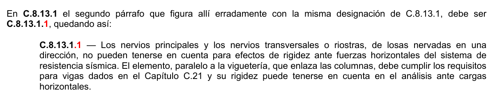
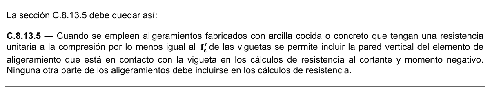

# C.8 — Análisis y diseño consideraciones generales

### C.8.1 — Métodos de diseño

**C.8.1.1** — En el diseño de concreto estructural, los elementos deben diseñarse para que tengan una resistencia adecuada, de acuerdo con las disposiciones del presente Título del Reglamento NSR-10, utilizando los factores de carga y los factores de reducción de resistencia $φ$ especificados en el Capítulo C.9.

**C.8.1.2** — Se permite el diseño del concreto reforzado usando las disposiciones del Apéndice C-B.

**C.8.1.3** — Los anclajes instalados en el concreto para transferir las cargas entre los elementos conectados incluidos dentro del alcance del Apéndice C-D, deben ser diseñados de acuerdo con el Apéndice C-D.

### C.8.2 — Cargas

**C.8.2.1** — Las disposiciones de diseño del Título C del Reglamento NSR-10 se basan en la suposición que las estructuras deben diseñarse para resistir todas las cargas solicitadas.

**C.8.2.2** — Las cargas de servicio deben cumplir con los requisitos del Título B del Reglamento NSR-10, inclusive las reducciones de carga viva que se permitan allí.

**C.8.2.3** — En el diseño para fuerzas por viento y sismo, las partes integrales de la estructura deben diseñarse para resistir las fuerzas laterales totales. Las fuerzas de viento están prescritas en el Capítulo B.6 del Título B Reglamento NSR-10 y las fuerzas de sismo en el Título A del Reglamento NSR-10.

**C.8.2.4** — Debe prestarse especial atención a los efectos de las fuerzas debidas al preesforzado, cargas de puente grúas, vibración, impacto, retracción, variación de temperatura, flujo plástico, expansión de concretos de retracción compensada y asentamientos diferenciales de los apoyos.

### C.8.3 — Métodos de análisis

**C.8.3.1** — Todos los elementos de pórticos o estructuras continuas deben diseñarse para resistir los efectos máximos producidas por las cargas mayoradas determinadas de acuerdo con la teoría del análisis elástico, excepto cuando se modifiquen de acuerdo con C.8.4.

**C.8.3.2** — Se permite el uso de modelos puntal-tensor para el diseño del concreto estructural. Véase el Apéndice C-A.

### C.8.4 — Redistribución de momentos en elementos continuos sometidos a flexión

**C.8.4.1** — Excepto cuando se empleen valores aproximados de los momentos, se permite disminuir los momentos mayorados calculados por medio de la teoría elástica en las secciones de máximo momento negativo o máximo momento positivo de cualquier vano de elementos continuos sometidos a flexión para cualquier disposición de carga supuesta, en no más de $1000ε_{t}$ por ciento, con un máximo de 20 por ciento.

**C.8.4.2** — La redistribución de momentos debe hacerse solamente si $ε_{t}$ es igual o mayor que 0.0075 en la sección en la que se está reduciendo el momento.

**C.8.4.3** — El momento reducido debe usarse para calcular los momentos redistribuidos en todas las otras secciones dentro del vano. El equilibrio estático se debe mantener después de la redistribución de los momentos para cada disposición de las cargas.

### C.8.5 — Módulo de elasticidad

**C.8.5.1** — El módulo de elasticidad, $E_{c}$ , para el concreto puede tomarse como $w^{1.5}_{c}0.043 \sqrt{f_{c}'}$ (en MPa), para valores de$w_{c}$ comprendidos entre 1440 y 2560 kg/m3. Para concreto de densidad normal, $E_{c}$ puede tomarse como $4700 \sqrt{f_{c}' }$.

**C.8.5.2** — El módulo de elasticidad,$E_{s}$ , para el acero de refuerzo no preesforzado puede tomarse como 200 000 MPa.

**C.8.5.3** — El módulo de elasticidad, $E_{p}$ , para el acero de preesforzado debe determinarse mediante ensayos o ser informado por el fabricante.

### C.8.6 — Concreto liviano

**C.8.6.1** — Para el uso de concreto de peso liviano, debe emplearse el factor de modificación $λ$ como multiplicador de $\sqrt{f_{c}'}$ en todas las ecuaciones y secciones aplicables del Título C del Reglamento NSR-10, donde $λ =0.85$ para concreto liviano de arena de peso normal y 0.75 para los otros concretos de peso liviano. Se permite la interpolación entre 0.75 y 0.85, con base en fracciones volumétricas, cuando una porción de los agregados finos de peso liviano es reemplazada por agregado fino de peso normal. Se permite la interpolación lineal entre 0.85 y 1.0 para el concreto que contiene agregado fino de peso normal y una combinación de agregados gruesos de peso normal y de peso liviano. Para el concreto de peso normal $λ =1.0$. Si se especifica la resistencia promedio a la tracción por hendimiento del concreto de peso liviano, $f_{ct}$, entonces $λ =f_{ct}/(0.56 \sqrt{f_{c}'})≤1.0$.

### C.8.7 — Rigidez

**C.8.7.1** — Se permite que se adopte cualquier conjunto de suposiciones razonables para calcular las rigideces relativas a flexión y torsión de columnas, muros y sistemas de entrepisos y cubierta. Las suposiciones que se hagan deben ser consistentes en todo el análisis.

**C.8.7.2** — Al determinar los momentos y diseñar los elementos debe considerarse el efecto de las cartelas.

### C.8.8 — Rigidez efectiva para determinar las deflexiones laterales

**C.8.8.1** — Las deflexiones laterales de los sistemas estructurales de concreto reforzado provenientes de las fuerza laterales de servicio deben calcularse ya sea mediante un análisis linear usando una rigidez de los elementos calculada como 1.4 veces la rigidez a flexión definida en C.8.8.2 y C.8.8.3, o bien, usando un análisis más detallado.

Las propiedades de los elementos no se deben tomar mayores que las propiedades de la sección bruta.

<!-- mod:2-decreto-340-2012-12 -->
> **Modificación — Decreto 340 de 2012** · anexo, p. 5
>
> En la sección C.8.8.1 donde dice “… laterales de servicio deben calcularse ya sea mediante un análisis linear usando…” debe substituirse por “… laterales de servicio pueden calcularse ya sea mediante un análisis lineal usando…”.

**C.8.8.2** — Las deflexiones laterales de sistemas estructurales de concreto reforzado provenientes de fuerzas laterales mayoradas deben calcularse ya sea mediante un análisis lineal con la rigidez de los elementos definida por (a) o (b), o bien, usando un análisis más detallado que considere la rigidez reducida de todos los elementos bajo las condiciones de carga:

(a) por las propiedades de las secciones definidas en C.10.10.4(a) hasta (c), o

(b) el 50 por ciento de los valores de rigidez basados en las propiedades de la sección bruta.

<!-- mod:2-decreto-340-2012-13 -->
> **Modificación — Decreto 340 de 2012** · anexo, p. 6
>
> En la sección C.8.8.2 donde dice “… laterales mayoradas deben calcularse…” debe substituirse por “… laterales mayoradas pueden calcularse…”.

**C.8.8.3** — Cuando se designan losas de dos direcciones sin vigas como parte del sistema de resistencia ante fuerzas sísmicas, las deflexiones laterales que resultan de las cargas laterales mayoradas pueden ser calculadas usando un análisis lineal. La rigidez de los elementos de la losa debe definirse con un modelo que esté sustancialmente de acuerdo con los resultados de ensayos experimentales representativos y análisis, y la rigidez de los otros elementos estructurales, como se define en C.8.8.2. Estos sistemas están restringidos en su uso por el Título A del Reglamento NSR-10.

### C.8.9 — Longitud del vano

**C.8.9.1** — La luz de los elementos que no se construyan monolíticamente con sus apoyos debe considerarse como la luz libre más la altura del elemento, pero no debe exceder la distancia entre los centros de los apoyos.

**C.8.9.2** — En el análisis estructural de pórticos o elementos continuos para determinar los momentos, la luz debe considerarse como la distancia entre los centros de los apoyos.

**C.8.9.3** — Para vigas construidas integralmente con sus apoyos, se permite diseñar con base en los momentos en la cara de los apoyos.

**C.8.9.4** — Se permite analizar las losas macizas o nervadas construidas monolíticamente con sus apoyos, con luces libres no mayores de 3 m, como losas continuas sobre apoyos simples, con luces iguales a las luces libres de la losa, despreciando el ancho de las vigas.

### C.8.10 — Columnas

**C.8.10.1** — Las columnas se deben diseñar para resistir las fuerzas axiales que provienen de las cargas mayoradas de todos los pisos o cubierta, y el momento máximo debido a las cargas mayoradas en un solo vano adyacente del entrepiso o cubierta bajo consideración. También debe considerarse la condición de carga que produzca la máxima relación entre momento y carga axial.

**C.8.10.2** — En pórticos o en elementos continuos debe prestarse atención al efecto de las cargas no balanceadas de entrepisos o cubierta, tanto en las columnas exteriores como interiores, y a la carga excéntrica debida a otras causas.

**C.8.10.3** — Para calcular los momentos debidos a cargas gravitacionales en columnas construidas monolíticamente con la estructura, los extremos lejanos de las columnas se pueden considerar empotrados.

**C.8.10.4** — La resistencia a la flexión de la columna en cualquier piso o en la cubierta se debe determinar distribuyendo el momento entre las columnas inmediatamente sobre y bajo el entrepiso bajo consideración, en proporción a las rigideces relativas de las columnas y según las condiciones de restricción al giro.

### C.8.11 — Disposición de la carga viva

#### C.8.11.1 — Se permite suponer que:

(a) la carga viva está aplicada únicamente al piso o cubierta bajo consideración, y

(b) los extremos lejanos de las columnas construidas monolíticamente con la estructura están empotrados.

**C.8.11.2** — Se permite suponer que la disposición de la carga viva está limitada a las combinaciones de:

(a) carga muerta mayorada en todos los vanos con la carga viva mayorada en dos vanos adyacentes, y

(b) carga muerta mayorada en todos los vanos con la carga viva mayorada en vanos alternados.

### C.8.12 — Sistemas de vigas T

**C.8.12.1** — En la construcción de vigas T, el ala y el alma deben construirse monolíticamente o, de lo contrario, deben estar efectivamente unidas entre sí.

**C.8.12.2** — El ancho efectivo de la losa usada como ala de las vigas T no debe exceder 1/4 de la luz de la viga, y el ancho sobresaliente efectivo del ala a cada lado del alma no debe exceder:

(a) 8 veces el espesor de losa, y

(b) la mitad de la distancia libre a la siguiente alma

**C.8.12.3** — Para vigas que tengan losa a un solo lado, el ancho sobresaliente efectivo del ala no debe exceder:

(a) 1/12 de la luz de la viga,

(b) 6 veces el espesor de la losa, y

(c) la mitad de la distancia libre a la siguiente alma.

**C.8.12.4** — En vigas aisladas, en las que solamente se utilice la forma T para proporcionar con el ala un área adicional de compresión, el ala debe tener un espesor no menor de 1/2 del ancho del alma, y un ancho efectivo no mayor de 4 veces el ancho del alma.

**C.8.12.5** — Cuando el refuerzo principal de flexión en una losa que se considere como ala de una viga T (excluyendo las viguetas) sea paralelo a la viga, se debe disponer de refuerzo perpendicular a la viga en la parte superior de la losa de acuerdo con lo siguiente:

**C.8.12.5.1** — El refuerzo transversal se debe diseñar para resistir la carga mayorada que actúa sobre el ala suponiendo que ésta trabaja en voladizo. Para vigas aisladas debe considerarse el ancho total del ala. Para otros tipos de vigas T, sólo es necesario considerar el ancho sobresaliente efectivo del ala.

**C.8.12.5.2** — El espaciamiento del refuerzo transversal no debe exceder de 5 veces el espesor de la losa ni de 450 mm.

### C.8.13 — Viguetas en losas nervadas

**C.8.13.1** — La losa nervada consiste en una combinación monolítica o prefabricada de viguetas regularmente espaciadas en una o dos direcciones, y una losa colocada en la parte superior que actúa también en una dirección o en dos direcciones ortogonales. La loseta puede ser parcialmente prefabricada, pero como mínimo una parte de su espesor debe ser vaciado en sitio.

<!-- mod:1-decreto-092-2011-96 -->
> **Modificación — Decreto 092 de 2011** · anexo, p. 23
>
> En C.8.13.1 el segundo párrafo que figura allí erradamente con la misma designación de C.8.13.1, debe ser C.8.13.1.1, quedando así:
>
> 

**C.8.13.1** — Los nervios principales y los nervios transversales o riostras, de losas nervadas en una dirección, no pueden tenerse en cuenta para efectos de rigidez ante fuerzas horizontales del sistema de resistencia sísmica. El elemento, paralelo a la viguetería, que enlaza las columnas, debe cumplir los requisitos para vigas dados en el Capítulo C.21 y su rigidez puede tenerse en cuenta en el análisis ante cargas horizontales.

**C.8.13.2** — El ancho de las nervaduras no debe ser menor de 100 mm en su parte superior y su ancho promedio no puede ser menor de 80 mm; y debe tener una altura no mayor de 5 veces su ancho promedio.

**C.8.13.3** — Para losas nervadas en una dirección, la separación máxima entre nervios, medida centro a centro, no puede ser mayor que 2.5 veces el espesor total de la losa, sin exceder 1.20 m. Para losas nervadas en dos direcciones, la separación máxima entre nervios, medida centro a centro, no puede ser mayor que 3.5 veces el espesor total de la losa, sin exceder 1.50 m.

**C.8.13.3.1** — Cuando se trate de losas nervadas en una dirección, deben colocarse viguetas transversales de repartición con una separación libre máxima de 10 veces el espesor total de la losa, sin exceder 4.0 m.

**C.8.13.3.2** — Estas viguetas transversales de repartición deben diseñarse, a flexión y a cortante, de tal manera que sean capaces de transportar la carga total (muerta más viva) de cada nervio a los dos nervios adyacentes.

**C.8.13.3.3** — En el diseño de los elementos donde se apoyen estas viguetas transversales de repartición debe considerarse el efecto de la carga que puedan transportar considerando una carga aferente equivalente al doble de la carga total que lleva un nervio típico principal.

**C.8.13.4** — Las losas nervadas que no cumplan con las limitaciones de C.8.13.1 a C.8.13.3, deben diseñarse como losas y vigas.

**C.8.13.5** — Cuando se empleen aligeramientos fabricados con arcilla cocida u concreto que tengan una resistencia unitaria a la compresión por lo menos igual al $f_{c}'$ de las viguetas:

**C.8.13.5.1** — Se permite incluir la pared vertical del elemento de aligeramiento que está en contacto con la vigueta en los cálculos de resistencia al cortante y momento negativo. Ninguna otra parte de los aligeramientos debe incluirse en los cálculos de resistencia.

<!-- mod:2-decreto-340-2012-15 -->
> **Modificación — Decreto 340 de 2012** · anexo, p. 6
>
> La sección C.8.13.5.1 se suprime.

**C.8.13.5.2** — La porción vaciada en sitio de la loseta superior debe tener al menos 45 mm de espesor, pero ésta no debe ser menor de 1/20 de la distancia libre entre los nervios. El espesor de la losa de concreto vaciada en sitio sobre aligeramientos permanentes de concreto, de arcilla cocida, o plaquetas prefabricadas, la parte vaciada en sitio del espesor mínimo de la loseta superior puede reducirse a 40 mm.

<!-- mod:2-decreto-340-2012-16 -->
> **Modificación — Decreto 340 de 2012** · anexo, p. 6
>
> La sección C.8.13.5.2 se renumera y reemplaza la sección C.8.13.6, quedando así:
>
> **C.8.13.6** — La porción vaciada en sitio de la losa superior debe tener al menos 45 mm de espesor, pero ésta no debe ser menor de 1/20 de la distancia libre entre los nervios. El espesor de la losa de concreto vaciada en sitio sobre aligeramientos permanentes de concreto, de arcilla cocida, o plaquetas prefabricadas, la parte vaciada en sitio del espesor mínimo de la loseta superior puede reducirse a 40 mm.

**C.8.13.5.3** — En losas nervadas en una dirección, se debe disponer en la losa refuerzo normal a las nervaduras de acuerdo con lo requerido en C.7.12.

<!-- mod:2-decreto-340-2012-14 -->
> **Modificación — Decreto 340 de 2012** · anexo, p. 6
>
> La sección C.8.13.5 debe quedar así:
>
> 

<!-- mod:2-decreto-340-2012-17 -->
> **Modificación — Decreto 340 de 2012** · anexo, p. 6
>
> La sección C.8.13.5.3 se suprime.

**C.8.13.6** — Cuando se utilicen encofrados o aligeramientos removibles que no cumplan con C.8.13.5:

**C.8.13.6.1** — El espesor de la losa no debe ser menor que 1/12 de la distancia libre entre las nervaduras, ni menor de 50 mm.

<!-- mod:2-decreto-340-2012-18 -->
> **Modificación — Decreto 340 de 2012** · anexo, p. 6
>
> El texto de la sección C.8.13.6.1 se suprime y la sección C.8.13.6.2 se renumera como C.8.13.6.1 quedando así:
>
> **C.8.13.6.1** — La losa superior debe llevar refuerzo perpendicular a las viguetas que cumpla lo requerido por flexión, considerando las concentraciones de carga, si las hay, pero no menor que el que se estipula en C.7.12.

**C.8.13.6.2** — La losa debe llevar refuerzo perpendicular a las viguetas que cumpla lo requerido por flexión, considerando las concentraciones de carga, si las hay, pero no menor que el que se estipula en C.7.12.

**C.8.13.7** — Cuando en la losa se coloquen ductos o tuberías embebidas según lo permitido en C.6.3, el espesor en cualquier punto de ésta debe ser al menos 25 mm mayor que la altura total del ducto o tubería. Tales ductos o tuberías no deben afectar significativamente la resistencia del sistema.

**C.8.13.8** — En losas nervadas, puede considerarse que $V_{c}$ es un 10 por ciento mayor que lo especificado en el Capítulo C.11.

### C.8.14 — Acabado de piso separado

**C.8.14.1** — El acabado del piso no debe incluirse como parte de un elemento estructural, a menos que sea construido monolíticamente con la losa o se diseñe de acuerdo con los requisitos del Capítulo C.17.

**C.8.14.2** — Se permite que todo acabado de concreto de un piso pueda considerarse como parte del recubrimiento requerido, o del espesor total, para efecto de consideraciones no estructurales.

" Notas:
