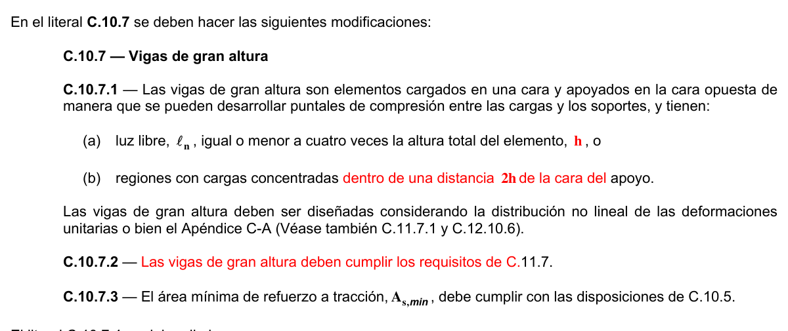

# C.10 — Flexión y cargas axiales

### C.10.1 — Alcance

Las disposiciones del Capítulo C.10 se deben aplicar al diseño de elementos sometidos a flexión o cargas axiales, o a la combinación de flexión y cargas axiales.

### C.10.2 — Suposiciones de diseño

**C.10.2.1** — El diseño por resistencia de elementos sometidos a flexión y cargas axiales debe basarse en las hipótesis dadas en C.10.2.2 a C.10.2.7, y debe satisfacer las condiciones de equilibrio y de compatibilidad de deformaciones.

**C.10.2.2** — Las deformaciones unitarias en el refuerzo y en el concreto deben suponerse directamente proporcionales a la distancia desde el eje neutro, excepto que, para las vigas de gran altura definidas en C.10.7.1, debe emplearse un análisis que considere una distribución no lineal de las deformaciones unitarias. Alternativamente, se permite emplear el modelo puntal-tensor. Véanse C.10.7, C.11.7 y el Apéndice C-A.

**C.10.2.3** — La máxima deformación unitaria utilizable en la fibra extrema sometida a compresión del concreto se supone igual a 0.003.

**C.10.2.4** — El esfuerzo en el refuerzo cuando sea menor que $f_{y}$debe tomarse como $E_{s}$ veces la deformación unitaria del acero. Para deformaciones unitarias mayores que las correspondientes a $f_{y}$, el esfuerzo se considera independiente de la deformación unitaria e igual a $f_{y}$.

**C.10.2.5** — La resistencia a la tracción del concreto no debe considerarse en los cálculos de elementos de concreto reforzado sometidos a flexión y a carga axial, excepto cuando se cumplan los requisitos de C.18.4.

**C.10.2.6** — La relación entre la distribución de los esfuerzos de compresión en el concreto y la deformación unitaria en el concreto se debe suponer rectangular, trapezoidal, parabólica o de cualquier otra forma que de origen a una predicción de la resistencia que coincida con los resultados de ensayos representativos.

**C.10.2.7** — Los requisitos de C.10.2.6 se satisfacen con una distribución rectangular equivalente de esfuerzos en el concreto, definida como sigue:

**C.10.2.7.1** — Un esfuerzo en el concreto de $0.85f_{c}'$ uniformemente distribuido en una zona de compresión equivalente, limitada por los bordes de la sección transversal y por una línea recta paralela al eje neutro, a una distancia $a = \beta_{1} c$ de la fibra de deformación unitaria máxima en compresión.

**C.10.2.7.2** — La distancia desde la fibra de deformación unitaria máxima al eje neutro, $c$ , se debe medir en dirección perpendicular al eje neutro.

**C.10.2.7.3** — Para $f_{c}'$ entre 17 y 28 MPa, el factor $β_{1}$ se debe tomar como 0.85. Para $f_{c}'$ superior a 28 MPa, $β_{1}$ se debe disminuir en forma lineal a razón de 0.05 por cada 7 MPa de aumento sobre 28 MPa, sin embargo, $β_{1}$ no debe ser menor de 0.65.

### C.10.3 — Principios y requisitos generales

**C.10.3.1** — El diseño de las secciones transversales sometidas a cargas de flexión, ó cargas axiales, o a la combinación de ambas (flexo-compresión) debe basarse en el equilibrio y la compatibilidad de deformaciones, utilizando las hipótesis de C.10.2.

**C.10.3.2** — La condición de deformación balanceada existe en una sección transversal cuando el refuerzo en tracción alcanza la deformación unitaria correspondiente a $f_{y}$al mismo tiempo que el concreto en compresión alcanza su deformación unitaria última supuesta de 0.003.

**C.10.3.3** — Las secciones se denominan controladas por compresión si la deformación unitaria neta de tracción en el acero extremo en tracción,$ε_{t}$, es igual o menor que el límite de deformación unitaria controlada por compresión cuando el concreto en compresión alcanza su límite de deformación supuesto de 0.003. El límite de deformación unitaria controlada por compresión es la deformación unitaria neta de tracción del refuerzo en condiciones de deformación unitaria balanceada. Para refuerzo Grado 420, y para todos los refuerzos preesforzados, se permite fijar el límite de deformación unitaria controlada por compresión en 0.002.

**C.10.3.4** — Las secciones son controladas por tracción si la deformación unitaria neta de tracción en el refuerzo de acero extremo en tracción, $ε_{t}$, es igual o mayor a 0.005, justo cuando el concreto en compresión alcanza su límite de deformación unitaria asumido de 0.003. Las secciones con $ε_{t}$ entre el límite de deformación unitaria controlada por compresión y 0.005 constituyen una región de transición entre secciones controladas por compresión y secciones controladas por tracción.

**C.10.3.5** — Para elementos no preesforzados en flexión y elementos no preesforzados con carga axial mayorada de compresión menor a $0.10f_{c} 'A_{g}$, $ε_{t}$ en el estado de resistencia nominal no debe ser menor a 0.004.

**C.10.3.5.1** — Se permite el uso de refuerzo de compresión en conjunto con refuerzo adicional de tracción para aumentar la resistencia de elementos sometidos a flexión.

**C.10.3.6** — La resistencia axial de diseño $φ_{P}$ de elementos en compresión no debe tomarse mayor que $φPn,max$calculado usando la ecuación (C.10-1) ó (C.10-2).

**C.10.3.6.1** — Para elementos no preesforzados con refuerzo en espiral que cumplan con C.7.10.4, o para elementos compuestos que cumplan con C.10.13:

$$ \phi P_{n(max)} = 0.80\,\phi \left[0.85\,f'_c\,(A_g - A_{st}) + f_y A_{st}\right] \tag{C.10-1} $$

**C.10.3.6.2** — Para elementos no preesforzados con estribos que cumplan con C.7.10.5:

$$ \phi P_{n(max)} = 0.75\,\phi \left[0.85\,f'_c\,(A_g - A_{st}) + f_y A_{st}\right] \tag{C.10-2} $$

**C.10.3.6.3** — Para elementos preesforzados, la resistencia axial de diseño, $φP_{n}$, no debe tomarse mayor que 0.80 (para elementos con refuerzo en espiral) ó 0.75 (para elementos con estribos) de la carga axial de diseño con excentricidad nula $φP_{o}$.

**C.10.3.7** — Los elementos sometidos a carga axial de compresión deben diseñarse para el momento máximo que puede acompañar a la carga axial. La fuerza axial mayorada $P_{u}$ , a una excentricidad dada, no debe exceder la dada en C.10.3.6. El momento máximo mayorado $M_{u}$ debe incrementarse por los efectos de esbeltez de acuerdo con C.10.10.

### C.10.4 — Distancia entre los apoyos laterales de elementos sometidos a flexión

**C.10.4.1** — La separación entre los apoyos laterales de una viga no debe exceder de 50 veces el menor ancho $b$ del ala o cara de compresión.

**C.10.4.2** — Deben tomarse en cuenta los efectos de la excentricidad lateral de la carga al determinar la separación entre los apoyos laterales.

### C.10.5 — Refuerzo mínimo en elementos sometidos a flexión

**C.10.5.1** — En toda sección de un elemento sometido a flexión cuando por análisis se requiera refuerzo de tracción, excepto lo establecido en C.10.5.2, C.10.5.3 y C.10.5.4, el$A_{s}$ proporcionado no debe ser menor que el obtenido por medio de:

$$ A_{s,min} = \dfrac{0.25\sqrt{f'_c}}{f_y}\,b_w d \tag{C.10-3} $$

pero no menor a $1.4b_{w} d /f_{y}$

**C.10.5.2** — Para los elementos estáticamente determinados con el ala en tracción, $As,min$ no debe ser menor que el valor dado por la ecuación (C.10-3) reemplazando $b_{w}$ por $2b_{w}$ o el ancho del ala, el que sea menor.

**C.10.5.3** — Los requisitos de C.10.5.1 y C.10.5.2 no necesitan ser aplicados si en cada sección el $A_{s}$ proporcionado es al menos un tercio superior al requerido por análisis.

**C.10.5.4** — Para losas estructurales y zapatas de espesor uniforme, $A_{s,min}$ en la dirección de la luz debe ser el mismo requerido por C.7.12.2.1. El espaciamiento máximo de este refuerzo no debe exceder tres veces el espesor, ni 450 mm.

**C.10.6** — Distribución del refuerzo de flexión en vigas y losas en una dirección

**C.10.6.1** — Esta sección establece reglas para la distribución del refuerzo a flexión a fin de controlar el agrietamiento por flexión en vigas y en losas en una dirección (losas reforzadas para resistir los esfuerzos de flexión en una sola dirección).

**C.10.6.2** — La distribución del refuerzo a flexión en losas en dos direcciones se debe hacer de acuerdo con las disposiciones de C.13.3.

**C.10.6.3** — El refuerzo de tracción por flexión debe distribuirse adecuadamente en las zonas de tracción máxima a flexión de la sección transversal de un elemento, según los requisitos de C.10.6.4.

**C.10.6.4** — El espaciamiento del refuerzo más cercano a una superficie en tracción, $s$ , no debe ser mayor que el dado por:

$$ s = 380 \left(\dfrac{280}{f_s}\right) - 2.5\,c_c \tag{C.10-4} $$

pero no mayor que $300(280 /f_{s} )$ , donde $c_{c}$es la menor distancia desde la superficie del refuerzo o acero de preesforzado a la cara en tracción. Si al refuerzo más cercano a la cara en tracción extrema corresponde a una sola barra o un solo alambre, el valor de $s$ a utilizar en la ecuación (C.10-4) es el ancho de la cara en tracción extrema.

El esfuerzo calculado $f_{s}$ (MPa) en el refuerzo más cercano a la cara en tracción para cargas de servicio debe obtenerse con base en el momento no mayorado. Se permite tomar $f_{s}$ como 2/3 de $f_{y}$.

**C.10.6.5** — Las disposiciones de C.10.6.4 no son suficientes para estructuras que quedan expuestas a medios muy agresivos, o cuando se diseñan para ser impermeables. Para tales estructuras se requieren precauciones e investigaciones especiales.

**C.10.6.6** — Cuando las alas de las vigas T están en tracción, parte del refuerzo de tracción por flexión debe distribuirse sobre un ancho efectivo del ala como se define en C.8.12 o un ancho igual a 1/10 de la luz, el que sea menor. Si el ancho efectivo del ala excede de 1/10 de la luz, se debe colocar algún refuerzo longitudinal en las zonas más externas del ala.

**C.10.6.7** — Donde $h$ de una viga o vigueta sea mayor de 900 mm, debe colocarse refuerzo superficial longitudinal uniformemente distribuido en ambas caras laterales del elemento dentro de una distancia $h /2$ cercana a la cara de tracción. El espaciamiento $s$ debe ser el indicado en C.10.6.4, donde $c_{c}$ es la menor distancia medida desde la superficie del refuerzo, o acero de preesfuerzo, superficial a la cara lateral del elemento. Se puede incluir tal refuerzo en el cálculo de la resistencia únicamente si se hace un análisis de compatibilidad de deformaciones para determinar los esfuerzos de las barras o alambres individuales.

### C.10.7 — Vigas de gran altura

**C.10.7.1** — Las vigas de gran altura son elementos cargados en una cara y apoyados en la cara opuesta de manera que se pueden desarrollar puntales de compresión entre las cargas y los soportes, y tienen:

(a) luz libre, $ℓ_{n}$ , igual o menor a cuatro veces la altura total del elemento, o

(b) regiones con cargas concentradas a menos de dos veces la altura del elemento medido desde la sección de apoyo.

Las vigas de gran altura deben ser diseñadas considerando la distribución no lineal de las deformaciones unitarias o bien el Apéndice C-A (Véase también C.11.7.1 y C.12.10.6). Debe tenerse en cuenta el pandeo lateral.

#### C.10.7.2 — $V_{n}$ para vigas de gran altura debe estar de acuerdo con C.11.7.

**C.10.7.3** — El área mínima de refuerzo a tracción,$A_{s,min}$ , debe cumplir con las disposiciones de C.10.5.

**C.10.7.4** — El refuerzo mínimo horizontal y vertical en las caras laterales de vigas de gran altura sometidas a flexión debe cumplir con C-A.3.3 ó C.11.7.4 y C.11.7.5.

<!-- mod:1-decreto-092-2011-99 -->
> **Modificación — Decreto 092 de 2011** · anexo, p. 25
>
> En el literal C.10.7 se deben hacer las siguientes modificaciones:
>
> 

<!-- mod:1-decreto-092-2011-100 -->
> **Modificación — Decreto 092 de 2011** · anexo, p. 25
>
> El literal C.10.7.4 se debe eliminar.

### C.10.8 — Dimensiones de diseño para elementos a compresión (columnas)

#### C.10.8.1 — Elementos en compresión aislados con espirales múltiples

Los límites exteriores de la sección transversal efectiva de un elemento en compresión, con dos o más espirales entrelazados, debe tomarse a una distancia fuera de los límites extremos de los espirales igual al recubrimiento mínimo del concreto requerido en C.7.7.

#### C.10.8.2 — Elementos en compresión construidos monolíticamente con muros

Los límites exteriores de la sección transversal efectiva de un elemento en compresión con espirales o estribos, construido monolíticamente con un muro o pilar de concreto, no deben tomarse a más de 40 mm fuera de la espiral o estribos de dicho elemento.

#### C.10.8.3 — Elementos en compresión de sección circular equivalente

En lugar de utilizar el área bruta para el diseño de un elemento sometido a compresión de sección transversal cuadrada, octogonal o de otra forma geométrica, se permite utilizar una sección circular con diámetro igual a la menor dimensión lateral de la sección real. El área bruta considerada, las cuantías requeridas de refuerzo y la resistencia de diseño deben basarse en dicha sección circular.

#### C.10.8.4 — Límites de la sección

Para un elemento a compresión que tenga una sección transversal mayor que la requerida por las consideraciones de carga, se permite emplear un área efectiva reducida $A_{g}$ , no menor que la mitad del área total, con el fin de determinar el refuerzo mínimo y la resistencia. Esta disposición no se aplica en elementos (pórticos resistentes a momento o muros estructurales) con capacidad de disipación de energía moderada (DMO) o especial (DES) diseñados de acuerdo con el Capítulo C.21.

### C.10.9 — Límites del refuerzo de elementos a compresión (columnas)

**C.10.9.1** — El área de refuerzo longitudinal,$A_{st}$ , para elementos no compuestos a compresión no debe ser menor que$0.01A_{g}$ ni mayor que$0.04A_{g}$ . Para estructuras con capacidad de disipación de energía moderada (DMO) y especial (DES) en el Capítulo C.21 se restringe el área máxima admisible.

**C.10.9.2** — El número mínimo de barras longitudinales en elementos sometidos a compresión debe ser de 4 para barras dentro de estribos circulares o rectangulares, 3 para barras dentro de estribos triangulares y 6 para barras rodeadas por espirales, que cumplan con C.10.9.3.

**C.10.9.3** — La cuantía volumétrica del refuerzo en espiral, $ρ_{s}$ , no debe ser menor que el valor dado por:

$$ \rho_s = 0.45 \left(\dfrac{A_g}{A_{ch}} - 1\right) \dfrac{f'_c}{f_{yt}} \tag{C.10-5} $$

donde el valor de $f_{yt}$ a usar en la ecuación (C.10-5) no debe ser mayor de 700 MPa. Para $f_{yt}$ mayor de 420 MPa, no deben usarse empalmes por traslapo de acuerdo con C.7.10.4.5(a).

### C.10.10 — Efectos de esbeltez en elementos a compresión

#### C.10.10.1 — Se permite ignorar los efectos de esbeltez en los siguientes casos:

a) en elementos sometidos a compresión no arriostrados contra desplazamientos laterales cuando:

$$ \dfrac{k\,\ell_u}{r} \le 22 \tag{C.10-6} $$

b) en elementos a compresión arriostrados contra desplazamientos laterales cuando:

$$ \dfrac{k\,\ell_u}{r} \le 34 - 12\,(M_1/M_2) \le 40 \tag{C.10-7} $$

donde el término $M_{1}/M_{2}$ es positivo si la columna está flectada en curvatura simple y negativo si el elemento tiene curvatura doble.

Se permite considerar los elementos a compresión como arriostrados contra desplazamientos laterales cuando los elementos de arriostramiento tienen una rigidez total que restringe los movimientos laterales de ese piso de al menos doce veces la rigidez bruta de las columnas dentro del piso.

**C.10.10.1.1** — La longitud no apoyada lateralmente de un elemento en compresión, $ℓ_{u}$ , debe tomarse como la distancia libre entre losas de piso, vigas u otros elementos capaces de proporcionar apoyo lateral en la dirección que se está considerando. Cuando existan capiteles o cartelas en las columnas, $ℓ_{u}$ debe medirse hasta el extremo inferior del capitel o cartela en el plano considerado.

**C.10.10.1.2** — Se puede tomar el radio de giro, $r$ , igual a 0.3 veces la dimensión total de la sección en la dirección en la cual se está considerando la estabilidad para el caso de elementos rectangulares y 0.25 veces el diámetro para elementos circulares en compresión. Para otras formas, se permite calcular $r$ para la sección bruta de concreto.

**C.10.10.2** — Cuando los efectos de la esbeltez no son ignorados como lo permite C.10.10.1, el diseño de elementos a compresión, vigas de restricción y otros elementos de apoyo debe basarse en las fuerzas y momentos mayorados de un análisis de segundo orden que cumpla con C.10.10.3, C.10.10.4 ó C.10.10.5. Estos elementos también deben cumplir con C.10.10.2.1 y C.10.10.2.2. Las dimensiones de la sección transversal de cada elemento usadas en el análisis deben encontrarse dentro del 10 por ciento de las dimensiones de los elementos señalados en los planos de diseño, de lo contrario, el análisis debe repetirse.

**C.10.10.2.1** — Los momentos totales, incluyendo los efectos de segundo orden, de elementos en compresión, vigas de restricción u otros elementos estructurales no deben exceder 1.4 veces los momentos debidos a los efectos de primer orden.

**C.10.10.2.2** — Los efectos de segundo orden se deben considerar a lo largo de la longitud de los elementos a compresión. Se permite calcular estos efectos usando el procedimiento de magnificación de momento descrito en C.10.10.6.

#### C.10.10.3 — Análisis no lineal de segundo orden

El análisis de segundo orden debe considerar la no linealidad del material, la curvatura del elemento y la deriva, duración de la carga, retracción y flujo plástico e interacción con la cimentación. El procedimiento de análisis debe demostrar que lleva a una predicción de la resistencia sustancialmente de acuerdo con los resultados de los ensayos representativos de estructuras de concreto reforzado estáticamente indeterminadas.

#### C.10.10.4 — Análisis elástico de segundo orden

El análisis elástico de segundo orden debe tener en cuenta las propiedades de la sección determinadas considerando la influencia de las cargas axiales, la presencia de regiones agrietadas a lo largo del elemento y los efectos de duración de las cargas.

**C.10.10.4.1** — Se permite usar las siguientes propiedades para los elementos en la estructura:

(a) Módulo de elasticidad .............................................................................................................. $E_{c}$ de C.8.5.1

(b) Momentos de inercia, $l$ Elementos en compresión:

Columnas ........................................................................................................................................ $0.70l_{g}$ Muros – no agrietados .................................................................................................................... $0.70l_{g}$ – agrietados .......................................................................................................................... $0.35l_{g}$ Elementos a flexión:

Vigas ............................................................................................................................................... $0.35l_{g}$ Placas planas y losas planas ......................................................................................................... $0.25l_{g}$

(c) Área ....................................................................................................................................................... $1.0A_{g}$ Como alternativa, se permite que los momentos de inercia de los elementos sometidos a compresión y a flexión, $l$ , se calculen como sigue:

Elementos en compresión:

$$ I = \left(0.80 + 25\,\dfrac{A_{st}}{A_g}\right) \left(1 - \dfrac{M_u}{P_u h} - 0.5\,\dfrac{P_u}{P_o}\right) I_g \le 0.875\,I_g \tag{C.10-8} $$

donde $P_{u}$ y $M_{u}$ debe provenir de la combinación de carga particular en consideración, o la combinación de $P_{u}$ y $M_{u}$ que resulta del menor valor de $l$ . No hay necesidad de usar un valor de $l$ menor de $0.35l_{g}$ .

Elementos a flexión:

$$ I = (0.10 + 25\,\rho) \left(1.2 - 0.2\,\dfrac{b_w}{d}\right) I_g \le 0.5\,I_g \tag{C.10-9} $$

Para elementos continuos sometidos a flexión, se permite que $l$ sea el promedio de los valores obtenidos de la ecuación (C.10-9) para secciones críticas de momento positivo y negativo. No hay necesidad de usar un valor de $l$ menor de $0.25l_{g}$ .

Las dimensiones de la sección transversal de cada elemento usadas en el análisis no deben apartarse más del 10 por ciento de las dimensiones mostradas en los planos de construcción, de lo contrario debe repetirse el análisis.

<!-- mod:2-decreto-340-2012-20 -->
> **Modificación — Decreto 340 de 2012** · anexo, p. 6
>
> En C.10.10.4.1 en el párrafo que sigue a la ecuación C.10-8 donde dice “… que resulta del menor valor de…” debe decir “… que resulta en el menor valor de…”

**C.10.10.4.2** — Para elementos sometidos a compresión, $l$ debe dividirse por $1+ β_{ds}$ cuando existen cargas laterales sostenidas. El término $β_{ds}$ es la relación entre la máxima fuerza de cortante sostenida mayorada dentro de un piso y la máxima fuerza de cortante mayorada asociada con la misma combinación de carga, pero no debe ser mayor de 1.0.

#### C.10.10.5 — Procedimiento de magnificación de momentos

Las columnas y pisos en una estructura deben designarse como parte de estructuras con desplazamiento lateral (no arriostradas) o sin desplazamiento lateral (arriostradas). El diseño de columnas en estructuras sin desplazamiento lateral (arriostradas) debe basarse en C.10.10.6. El diseño de columnas en estructuras con desplazamiento lateral (no arriostradas) debe basarse en C.10.10.7.

**C.10.10.5.1** — Se permite suponer como arriostrada (sin desplazamiento lateral) una columna dentro de una estructura, si el incremento en los momentos extremos de la columna debido a los efectos de segundo orden no excede de un 5 por ciento de los momentos extremos de primer orden.

**C.10.10.5.2** — Se permite suponer como arriostrado (sin desplazamiento lateral) a un piso en la estructura si:

$$ Q = \dfrac{\sum P_u \Delta_o}{V_{us}\,\ell_c} \le 0.05 \tag{C.10-10} $$

donde $ΣP_{u}$ y $V_{us}$ son la carga vertical total y el cortante horizontal mayorados del piso, respectivamente, en el piso bajo consideración y $Δ_{o}$ es la deformación lateral relativa (deriva) de primer orden entre la parte superior e inferior del piso debido a $V_{us}$ .

**C.10.10.6** — Procedimiento de magnificación de momentos— Estructuras sin desplazamiento lateral Los elementos a compresión deben diseñarse para la fuerza axial mayorada $P_{u}$ y para el momento mayorado amplificado para los efectos de curvatura del elemento, $M_{c}$ , como sigue:

$$ M_c = \delta\,M_2 \tag{C.10-11} $$

Donde

$$ \delta = \dfrac{C_m}{1 - \dfrac{P_u}{0.75\,P_c}} \ge 1.0 \tag{C.10-12} $$

y

$$ P_c = \dfrac{\pi^2 EI}{(k\,\ell_u)^2} \tag{C.10-13} $$

**C.10.10.6.1** — $El$ debe tomarse como:

$$ EI = \dfrac{0.2\,E_c I_g + E_s I_{se}}{1 + \beta_{dns}} \tag{C.10-14} $$

o

$$ EI = \dfrac{0.4\,E_c I_g}{1 + \beta_{dns}} \tag{C.10-15} $$

Como alternativa, se permite que $El$ sea calculado usando el valor $l$ de la ecuación (C.10-8) dividido por $(1+ β_{dns})$.

**C.10.10.6.2** — El término $β_{dns}$es la relación entre la máxima carga axial sostenida mayorada dentro de un piso y la máxima carga axial mayorada asociada con la misma combinación de carga, pero no debe ser mayor de 1.0.

**C.10.10.6.3** — Se permite considerar el factor de longitud efectiva, $k$ , como 1.0.

**C.10.10.6.4** — Para elementos sin cargas transversales entre los apoyos, $C_{m}$ debe considerarse como:

$$ C_m = 0.6 + 0.4\,\dfrac{M_1}{M_2} \tag{C.10-16} $$

Donde el término $M_{1}/M_{2}$ es positivo si la columna está flectada en curvatura simple y negativo si el elemento tiene curvatura doble. Para elementos con cargas transversales entre los apoyos, $C_{m}$ debe considerarse como 1.0.

**C.10.10.6.5** — El momento mayorado, $M_{2}$ , en la ecuación (C.10-11) no debe ser menor de

$$ M_{2,min} = P_u\,(15 + 0.03\,h) \tag{C.10-17} $$

en cada eje separadamente, donde 15 y $h$ están en mm. Para los elementos en que $M2,min$, excede a $M_{2}$ , el valor de $C_{m}$ en la ecuación (10-16) debe ser igual a 1.0, ó estar basado en la relación de los momentos calculados en los extremos, $M_{1}/M_{2}$ .

**C.10.10.7** — Procedimiento de magnificación de momentos— Estructuras con desplazamiento lateral Los momentos $M_{1}$ y $M_{2}$ en los extremos de un elemento individual a compresión deben tomarse como:

$$ M_1 = M_{1ns} + \delta_s M_{1s} \tag{C.10-18} $$

$$ M_2 = M_{2ns} + \delta_s M_{2s} \tag{C.10-19} $$

donde $δ_{s}$ se calcula según C.10.10.7.3 ó C.10.10.7.4.

**C.10.10.7.1** — Los elementos a flexión deben ser diseñados para todos los momentos extremos magnificados de los elementos a compresión en el nudo.

**C.10.10.7.2** — El factor de longitud efectiva $k$ debe ser determinado usando los valores $E_{c}$ e $l$ dados en C.10.10.4 y no debe ser menor de 1.0.

**C.10.10.7.3** — El magnificador de momento $δ_{s}$ debe ser calculado como:

$$ \delta_s = \dfrac{1}{1 - Q} \ge 1 \tag{C.10-20} $$

Si el $δ_{s}$ calculado por la ecuación (C.10-20) excede de 1.5, el $δ_{s}$ debe ser calculado usando el análisis elástico de segundo orden ó C.10.10.7.4.

**C.10.10.7.4** — Alternativamente, se permite calcular $δ_{s}$ como:

$$ \delta_s = \dfrac{1}{1 - \dfrac{\sum P_u}{0.75 \sum P_c}} \ge 1 \tag{C.10-21} $$

donde $ΣP_{u}$ es la sumatoria de todas las cargas verticales mayoradas en un piso y $ΣP_{c}$ es la sumatoria de todas las columnas que resisten el desplazamiento lateral en un piso. $ΣP_{u}$ se calcula usando la ecuación (C.10-13) con el valor $k$ de terminado en C.10.10.7.2 y $El$ de C.10.10.6.1 donde $β_{ds}$debe sustituir a $β_{dns}$.

### C.10.11 — Elementos cargados axialmente que soportan sistemas de losas

Los elementos cargados axialmente que soportan un sistema de losas incluido dentro del alcance de C.13.1, deben diseñarse como se dispone en el Capítulo C.10 y de acuerdo con los requisitos adicionales del Capítulo C.13.

### C.10.12 — Transmisión de cargas de las columnas a través de losas de entrepiso

Si el $f_{c}'$ de una columna es 1.4 veces mayor que el del sistema de entrepiso para el caso de columnas interiores o de borde, o mayor que 1.2 veces para el caso de columnas esquineras, la transmisión de la carga a través de la losa de entrepiso debe hacerse de acuerdo con C.10.12.1, ó C.10.12.2.

**C.10.12.1** — La resistencia de la columna en el nudo puede calcularse utilizando una resistencia efectiva del concreto de la columna dentro del nudo, $(=f'_{ce})$, calculada en función de la resistencia del concreto de la columna, $(=f'_{cc})$, y de la losa, $(=f'_{cs})$, así:

(a) Para columnas interiores:

$$ (f'_c)_e = \dfrac{0.25}{(h/c_2)}\,(f'_c)_c + \left[1.4 - \dfrac{0.35}{(h/c_2)}\right] (f'_c)_s \le (f'_c)_c \tag{C.10-22} $$

En la ecuación anterior el cociente $(h /c_{2})$no debe ser menor de un tercio, donde $h$ es la espesor total de la losa, y $c_{2}$ es la menor dimensión de la sección de la columna.

(b) Para columnas de borde:

$$ (f'_c)_e = 1.4\,(f'_c)_s \le (f'_c)_c \tag{C.10-23} $$

(c) Para columnas esquineras:

$$ (f'_c)_e = 1.2\,(f'_c)_s \le (f'_c)_c \tag{C.10-24} $$

en cualquiera de los casos (a) a (c), pueden utilizarse barras longitudinales adicionales y estribos o espirales, si así se requiere.

**C.10.12.2** — Debe colocarse concreto de resistencia igual a la especificada para la columna en el entrepiso en la zona de la columna. La superficie superior del concreto de la columna debe extenderse 600 mm dentro de la losa a partir de la cara de la columna. El concreto de la columna debe ser monolítico con el concreto del piso y debe colocarse de acuerdo con C.6.4.6 y C.6.4.7.

### C.10.13 — Elementos compuestos sometidos a compresión

**C.10.13.1** — Los elementos compuestos sometidos a compresión deben incluir todos aquellos elementos que estén reforzados longitudinalmente con perfiles de acero estructural, tuberías o tubos, con o sin barras longitudinales.

**C.10.13.2** — La resistencia de los elementos compuestos debe calcularse para las mismas condiciones limitantes que se aplican a los elementos comunes de concreto reforzado.

**C.10.13.3** — Cualquier resistencia a la carga axial asignada al concreto de un elemento compuesto debe transmitirse al concreto mediante elementos o ménsulas que se apoyen directamente en el concreto del elemento compuesto.

**C.10.13.4** — Toda resistencia a carga axial no asignada al concreto en un elemento compuesto debe ser desarrollada por conexión directa al perfil, tubería o tubo de acero estructural.

**C.10.13.5** — Para la evaluación de los efectos de esbeltez, el radio de giro, $r$ , de la sección compuesta no debe ser mayor que el valor dado por

$$ r = \sqrt{\dfrac{(E_c I_g / 5) + E_s I_{sx}}{(E_c A_g / 5) + E_s A_{sx}}} \tag{C.10-25} $$

y como alternativa a un cálculo más preciso, $EI$ en la ecuación (C.10-13) debe tomarse ya sea como lo indica la ecuación (C.10-14) o por medio de

$$ EI = \dfrac{(E_c I_g / 5)}{1 + \beta_{dns}} + E_s I_{sx} \tag{C.10-26} $$

#### C.10.13.6 — Núcleo de concreto confinado en acero estructural

**C.10.13.6.1** — Para un elemento compuesto con el núcleo de concreto confinado por acero estructural, el espesor del acero de confinamiento no debe ser menor que:

$b \sqrt{3E_{s}f_{y} }$, para cada cara de ancho $b$ ni que:

$f_{y}$ $h \sqrt{8E_{s} }$, para secciones circulares de diámetro $h$

**C.10.13.6.2** — Se permite que las barras longitudinales localizadas dentro del núcleo de concreto confinado se utilicen en el cálculo de $A_{sx}$ e $I_{sx}$.

#### C.10.13.7 — Refuerzo en espiral alrededor de un núcleo de acero estructural

Un elemento compuesto, hecho de concreto reforzado con espiral alrededor de un núcleo de acero estructural debe satisfacer C.10.13.7.1 a C.10.13.7.4.

**C.10.13.7.1** — La resistencia a la fluencia de diseño del núcleo de acero estructural debe ser la resistencia a la fluencia especificada mínima para el grado del acero estructural usado, pero sin exceder de 350 MPa.

**C.10.13.7.2** — El refuerzo en espiral debe cumplir con lo especificado en C.10.9.3.

**C.10.13.7.3** — Las barras longitudinales localizadas dentro de la espiral no deben tener un área menor de 0.01 ni mayor de 0.08 veces el área neta de la sección de concreto.

**C.10.13.7.4** — Se permite que las barras longitudinales localizadas dentro de la espiral se consideren en el cálculo de $A_{sx}$ e $I_{sx}$.

#### C.10.13.8 — Estribos de refuerzo alrededor de un núcleo de acero estructural

Un elemento compuesto, hecho de concreto confinado lateralmente con estribos alrededor de un núcleo de acero estructural, debe cumplir con C.10.13.8.1. a C.10.13.8.7.

**C.10.13.8.1** — La resistencia a la fluencia de diseño del núcleo de acero estructural debe ser la resistencia a la fluencia especificada mínima para el grado de acero estructural usado, pero no debe exceder de 350 MPa.

**C.10.13.8.2** — Los estribos transversales deben extenderse por completo alrededor del núcleo de acero estructural.

**C.10.13.8.3** — Los estribos transversales deben tener un diámetro no menor que 0.02 veces la mayor dimensión lateral del elemento compuesto, excepto que los estribos no deben ser menores a XY. 10 y no necesitan ser mayores de XY. 16. Puede emplearse refuerzo electrosoldado de alambre de un área equivalente.

<!-- mod:1-decreto-092-2011-101 -->
> **Modificación — Decreto 092 de 2011** · anexo, p. 25
>
> El literal C.10.13.8.3 debe quedar así:
>
> **C.10.13.8.3** — Los estribos transversales deben tener un diámetro no menor que 0.02 veces la mayor dimensión lateral del elemento compuesto, excepto que los estribos no deben ser menores a No. 3 (3/8”) ó 10M (10 mm) y no necesitan ser mayores de No. 5 (5/8”) ó 16M (16 mm). Puede emplearse refuerzo electrosoldado de alambre de un área equivalente.

**C.10.13.8.4** — El espaciamiento vertical entre los estribos transversales no debe exceder de la mitad de la menor dimensión lateral del elemento compuesto, ni de 48 veces el diámetro de los estribos, ni 16 veces el diámetro de las barras longitudinales.

**C.10.13.8.5** — Las barras longitudinales colocadas dentro de los estribos no deben ser menores de 0.01 ni mayores de 0.08 veces al área neta del concreto.

**C.10.13.8.6** — Debe colocarse una barra longitudinal en cada esquina de una sección rectangular, con otras barras longitudinales espaciadas a menos de 1/2 de la menor dimensión lateral del elemento compuesto.

**C.10.13.8.7** — Se permite que las barras longitudinales colocadas dentro de los estribos se consideren para calcular $A_{sx}$ y $I_{sx}$.

### C.10.14 — Resistencia al aplastamiento

**C.10.14.1** — La resistencia de diseño al aplastamiento del concreto no debe exceder $φ(0.85f_{c} 'A_{1})$ excepto cuando la superficie de soporte sea más ancha en todos los lados que el área cargada, en cuyo caso, se permite que la resistencia de diseño al aplastamiento en el área cargada sea multiplicada por $\sqrt{(A_{2}/A_{1})}$, pero no más que 2.

#### C.10.14.2 — La sección C.10.14 no es aplicable a anclajes de postensado.

" Notas:
