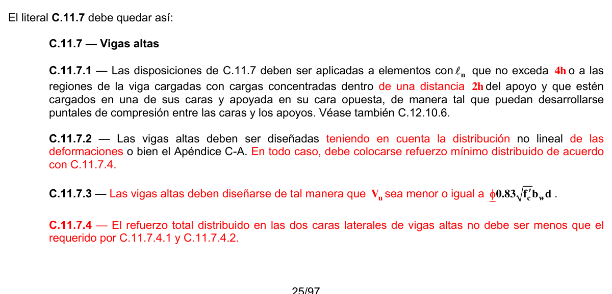
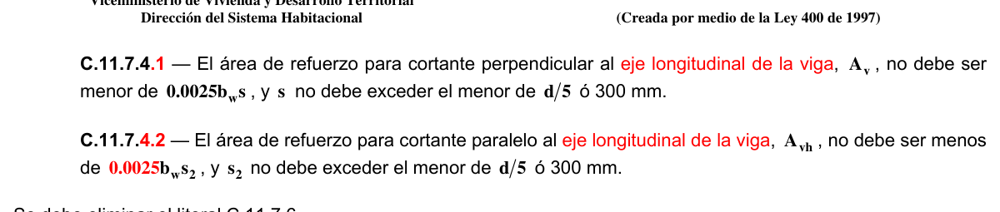

# C.11 — Cortante y torsión

### C.11.1 — Resistencia al cortante

**C.11.1.1** — Salvo para elementos diseñados de acuerdo con el Apéndice A, el diseño de secciones transversales sometidas a cortante debe estar basado en

$$ \phi V_n \ge V_u \tag{C.11-1} $$

donde $V_{u}$ es la fuerza cortante mayorada en la sección considerada y $V_{n}$ es la resistencia nominal al cortante calculada mediante

$$ V_n = V_c + V_s \tag{C.11-2} $$

donde $V_{c}$ es la resistencia nominal al cortante proporcionada por el concreto, calculada de acuerdo con C.11.2, C.11.3, o C.11.11 y $V_{s}$ es la resistencia nominal al cortante proporcionada por el refuerzo de cortante calculada de acuerdo con C.11.4, C.11.9.9 o C.11.11.

**C.11.1.1.1** — Al determinar $V_{n}$ , debe considerarse el efecto de cualquier abertura en los elementos.

**C.11.1.1.2** — Al determinar $V_{c}$ , cuando sea aplicable, pueden incluirse los efectos de tracción axial debida al flujo plástico y retracción en elementos restringidos y los efectos de la compresión inclinada por flexión en los elementos de altura variable.

<!-- mod:2-decreto-340-2012-21 -->
> **Modificación — Decreto 340 de 2012** · anexo, p. 6
>
> En C.11.1.1 donde dice “Apéndice A”, debe ser “Apéndice C-A”.

**C.11.1.2** — Los valores de $\sqrt{f_{c}'}$ usados en este Capítulo no deben exceder 8.3 MPa excepto en lo permitido en C.11.1.2.1.

**C.11.1.2.1** — Se permite usar valores de $\sqrt{f_{c}'}$ mayores que 8.3 MPa al calcular $V_{c}$ ,$V_{ci}$ y $V_{cw}$ para vigas de concreto reforzado o preesforzado y losas nervadas de concreto con un refuerzo mínimo en el alma, de acuerdo con C.11.4.6.3, C.11.4.6.4 ó C.11.5.5.2.

**C.11.1.3** — Se permite calcular el máximo $V_{u}$ en los apoyos de acuerdo con C.11.1.3.1 u C.11.1.3.2 cuando se cumplan todas las condiciones (a), (b) y (c) siguientes:

(a) la reacción en el apoyo en dirección del cortante aplicado introduce compresión en las zonas extremas del elemento,

(b) las cargas son aplicadas en o cerca de la cara superior del elemento,

(c) ninguna carga concentrada se aplica entre la cara del apoyo y la ubicación de la sección crítica definida en C.11.1.3.1 u C.11.1.3.2.

**C.11.1.3.1** — Para elementos no preesforzados, se permite diseñar las secciones localizadas a una distancia menor a $d$ medida desde la cara del apoyo para el $V_{u}$ calculado a la distancia $d$ .

**C.11.1.3.2** — Para elementos de concreto preesforzado, se permite diseñar las secciones localizadas a una distancia menor que $h /2$ desde la cara del apoyo para el $V_{u}$ calculado para una distancia $h /2$ .

**C.11.1.4** — Para elementos de gran altura, losas y zapatas, muros, ménsulas y cartelas, deben aplicarse las disposiciones especiales de C.11.7 a C.11.11.

### C.11.2 — Resistencia al cortante proporcionada por el concreto en elementos no

preesforzados

**C.11.2.1** — Se debe calcular $V_{c}$ siguiendo los requisitos de C.11.2.1.1 a C.11.2.1.3, a menos que se realice un cálculo más detallado, según C.11.2.2. A todo lo largo del presente Capítulo, excepto en C.11.6, $λ$ debe usarse como se define en C.8.6.1.

**C.11.2.1.1** — Para elementos sometidos únicamente a cortante y flexión:

$$ V_c = 0.17\,\lambda \sqrt{f'_c}\,b_w d \tag{C.11-3} $$

**C.11.2.1.2** — Para elementos sometidos a compresión axial:

$$ V_c = 0.17 \left(1 + \dfrac{N_u}{14\,A_g}\right) \lambda \sqrt{f'_c}\,b_w d \tag{C.11-4} $$

La cantidad $N_{u}/A_{g}$ debe expresarse en MPa.

**C.11.2.1.3** — Para elementos sometidos a tracción axial significativa, $V_{c}$ debe tomarse como cero a menos que se haga un análisis más detallado usando C.11.2.2.3.

**C.11.2.2** — Se permite calcular $V_{c}$ mediante el método más detallado de C.11.2.2.1 a C.11.2.2.3.

**C.11.2.2.1** — Para elementos sometidos únicamente a cortante y flexión:

$$ V_c = \left(0.16\,\lambda \sqrt{f'_c} + 17\,\rho_w \dfrac{V_u d}{M_u}\right) b_w d \tag{C.11-5} $$

pero no mayor que $0.29λ\sqrt{f_{c} '}b_{w} d$. Al calcular $V_{c}$ por medio de la ecuación (C.11-5), $V_{u} d /M_{u}$ no debe tomarse mayor que 1.0, y $M_{u}$ ocurre simultáneamente con $V_{u}$ en la sección considerada.

**C.11.2.2.2** — Para elementos sometidos a compresión axial, se permite utilizar la ecuación (C.11-5) para calcular $V_{c}$ con $M_{m}$ sustituyendo a $M_{u}$ y $V_{u} d /M_{u}$ no limitada a 1.0, donde

$$ M_m = M_u - N_u \left(\dfrac{4h - d}{8}\right) \tag{C.11-6} $$

Sin embargo, $V_{c}$ no debe tomarse mayor que

$$ V_c = 0.29\,\lambda \sqrt{f'_c}\,b_w d \sqrt{1 + \dfrac{0.29\,N_u}{A_g}} \tag{C.11-7} $$

La cantidad $N_{u}/A_{g}$ debe expresarse en MPa. Cuando $M_{m}$ calculado, por medio de la ecuación (C.11-6) es negativo, $V_{c}$ debe calcularse por medio de la ecuación (C.11-7).

**C.11.2.2.3** — Para elementos sometidos a tracción axial significativa:

$$ V_c = 0.17 \left(1 + \dfrac{0.29\,N_u}{A_g}\right) \lambda \sqrt{f'_c}\,b_w d \tag{C.11-8} $$

pero no menor que cero, donde $N_{u}$ es negativa para la tracción. $N_{u}/A_{g}$ debe expresarse en MPa.

**C.11.2.3** — Para elementos circulares, el área usada para calcular $V_{c}$ debe tomarse como el producto del diámetro y la altura efectiva de la sección de concreto. Se permite tomar $d$ como 0.80 veces el diámetro de la sección de concreto.

### C.11.3 — Resistencia al cortante proporcionada por el concreto en elementos

preesforzados

**C.11.3.1** — En los requisitos de C.11.3, $d$ debe tomarse como la distancia de la fibra extrema en compresión al centroide de refuerzo longitudinal preesforzado y no preesforzado en tracción, si lo hay, pero no hay necesidad de tomarlo menor que $0.80h$ .

**C.11.3.2** — Para elementos que tengan una fuerza efectiva de preesforzado no menor al 40 por ciento de la resistencia a la tracción del refuerzo de flexión, a menos que se efectúe un cálculo más detallado de acuerdo con C.11.3.3,

$$ V_c = \left(0.05\,\lambda \sqrt{f'_c} + 4.8\,\dfrac{V_u d_p}{M_u}\right) b_w d \tag{C.11-9} $$

pero no es necesario considerar a $V_{c}$ menor que $0.17λ\sqrt{f_{c} '}b_{w} d$.$V_{c}$ no debe tomarse mayor que $0.42λ\sqrt{f_{c} '}b_{w} d$ ni que el valor dado en C.11.3.4 u C.11.3.5. $V_{u} d_{p}/M_{u}$ no se debe tomar mayor que 1.0, donde $M_{u}$ ocurre simultáneamente con$V_{u}$ en la sección considerada.

**C.11.3.3** — $V_{c}$ puede calcularse de acuerdo con C.11.3.3.1 y C.11.3.3.2, y $V_{c}$ debe ser el menor de $V_{ci}$ y $V_{cw}$.

**C.11.3.3.1** — $V_{ci}$ se debe calcular por medio de:

$$ V_{ci} = 0.05\,\lambda \sqrt{f'_c}\,b_w d_p + V_d + \dfrac{V_i M_{cre}}{M_{max}} \tag{C.11-10} $$

donde $d_{p}$ no debe tomarse menor que $0.80h$ y

$$ M_{cre} = \left(\dfrac{I}{y_t}\right) \left(0.5\,\lambda \sqrt{f'_c} + f_{pe} - f_d\right) \tag{C.11-11} $$

y los valores de $M_{max}$ y $V_{i}$ se deben calcular con la combinación de carga que causa el máximo momento mayorado en la sección. No hay necesidad de tomar $V_{ci}$ menor que $0.14λ\sqrt{f_{c} '}b_{w} d$

**C.11.3.3.2** — $V_{cw}$ se debe calcular por medio de

$$ V_{cw} = \left(0.29\,\lambda \sqrt{f'_c} + 0.3\,f_{pc}\right) b_w d_p + V_p \tag{C.11-12} $$

donde no hay necesidad de tomar $d_{p}$ menor de $0.80h$ .

Alternativamente,$V_{cw}$ puede calcularse como la fuerza cortante que corresponde a la carga muerta más la carga viva que produce un esfuerzo principal de tracción de $0.33λ\sqrt{f_{c}'}$ en el eje centroidal del elemento o en la intersección del ala con el alma cuando el eje centroidal está en el ala. En elementos compuestos, el esfuerzo principal de tracción se debe calcular utilizando la sección transversal que resiste la carga viva.

**C.11.3.4** — En un elemento preesforzado en el cual la sección a una distancia $h /2$ medida a partir de la cara del apoyo esté más cercana del extremo del elemento que la longitud de transferencia del acero de preesforzado, debe tenerse en cuenta la reducción del preesforzado cuando se calcule $V_{cw}$. Este valor de $V_{cw}$ también debe considerarse como el límite máximo para la ecuación (C.11-9). Debe suponerse que la fuerza de preesforzado varía linealmente desde cero en el extremo del acero de preesforzado hasta un máximo a una distancia del extremo del acero de preesforzado igual a la longitud de transferencia, que se supone de 50 diámetros en torones y de 100 diámetros en alambres individuales.

**C.11.3.5** — En un elemento preesforzado pretensado donde la adherencia de algunos tendones no se extienda hasta el extremo del elemento, debe considerarse un preesforzado reducido al calcular $V_{c}$ de acuerdo con C.11.3.2 o C.11.3.3. El valor de $V_{cw}$ calculado usando el preesforzado reducido también debe tomarse como el límite máximo para la ecuación (C.11-9). La fuerza de preesforzado debida a los tendones en los que la adherencia no se extienda hasta el extremo del elemento, puede suponerse que varía linealmente desde cero en el punto en que comienza la adherencia, hasta un máximo a una distancia desde este punto igual a la longitud de transferencia, suponiéndola de 50 diámetros en torones y de 100 diámetros en alambres individuales.

### C.11.4 — Resistencia al cortante proporcionada por el refuerzo de cortante

#### C.11.4.1 — Tipos de refuerzo de cortante

**C.11.4.1.1** — Se permite refuerzo para cortante consistente en:

(a) Estribos perpendiculares al eje del elemento

(b) Refuerzo electrosoldado de alambre con alambres localizados perpendicularmente al eje del elemento.

(c) Espirales, estribos circulares y estribos cerrados de confinamiento.

**C.11.4.1.2** — Para elementos no preesforzados, se permite que el refuerzo para cortante también consista en:

(a) Estribos que formen un ángulo de 45º o más con el refuerzo longitudinal por tracción.

(b) Refuerzo longitudinal con una parte doblada que forme un ángulo de 30º o más con el refuerzo longitudinal de tracción.

(c) Combinaciones de estribos y refuerzo longitudinal doblado.

**C.11.4.2** — Los valores de $f_{y}$ y $f_{yt}$ usados en el diseño del refuerzo para cortante no debe exceder 420 MPa, excepto que el valor no debe exceder 550 MPa para refuerzo electrosoldado de alambre corrugado.

**C.11.4.3** — Cuando los requisitos de C.11.5 se utilicen en elementos preesforzados, $d$ debe tomarse como la distancia medida desde la fibra extrema en compresión al centroide de refuerzo longitudinal en tracción, preesforzado y no preesforzado, si lo hay, pero no hay necesidad de tomarlo menor de $0.80h$ .

**C.11.4.4** — Los estribos y otras barras o alambres usados como refuerzo de cortante deben extenderse hasta una distancia $d$ medida desde la fibra extrema en compresión y deben desarrollarse en ambos extremos de acuerdo con lo indicado en C.12.13.

#### C.11.4.5 — Límites para el espaciamiento del refuerzo de cortante

**C.11.4.5.1** — El espaciamiento del refuerzo de cortante colocado perpendicularmente al eje del elemento no debe exceder de $d /2$ en elementos de concreto no preesforzado, de $0.75h$ en elementos preesforzados, ni de 600 mm.

**C.11.4.5.2** — Los estribos inclinados y el refuerzo longitudinal doblado deben estar espaciados de manera tal que cada línea a 45º, que se extienda hacia la reacción desde la mitad de la altura del elemento, $d /2$ , hasta el refuerzo longitudinal de tracción, debe estar cruzada por lo menos por una línea de refuerzo de cortante.

**C.11.4.5.3** — Donde $V_{s}$ sobrepase $0.33 \sqrt{f_{c} '}b_{w} d$ las separaciones máximas dadas en C.11.4.5.1 y C.11.4.5.2 se deben reducir a la mitad.

#### C.11.4.6 — Refuerzo mínimo a cortante

**C.11.4.6.1** — Debe colocarse un área mínima de refuerzo para cortante, $A_{v}$ ,min , en todo elemento de concreto reforzado sometido a flexión (preesforzado y no preesforzado) donde $V_{u}$ exceda $0.5_{φ} V_{c}$, excepto en:

(a) Zapatas y losas sólidas.

(b) Elementos alveolares con una altura total, sin incluir el afinado de piso, no mayor de 315 mm y unidades alveolares donde $V_{u}$ no es mayor de $0.5_{φ} V_{cw}$.

(c) Losas nervadas de concreto con viguetas definidas en 8.13.

(d) Vigas con $h$ no mayor que 250 mm.

(e) Vigas integrales con losas con $h$ no mayor de 600 mm, y no mayor que el mayor de 2.5 veces el espesor del ala, ó 0.5 veces el ancho del alma.

(f) Vigas construidas con concreto de peso normal reforzado con fibra de acero, con un $f_{c}'$ que no excede de 40 MPa, con un $h$ no mayor de 600 mm, y $V_{u}$ no mayor de $φ0.17 \sqrt{f_{c} '}b_{w} d$.

<!-- mod:1-decreto-092-2011-102 -->
> **Modificación — Decreto 092 de 2011** · anexo, p. 25
>
> En el literal (c) de C.11.4.6.1 la referencia a 8.13 debe ser a C.8.13.

**C.11.4.6.2** — Se permite que los requisitos mínimos de refuerzo para cortante de C.11.4.6.1 sean ignorados si se demuestra por medio de ensayos que $M_{n}$ y$V_{n}$ requeridos puede desarrollarse cuando se suprime el refuerzo para cortante. Dichos ensayos deben simular efectos de asentamiento diferencial, flujo plástico, retracción, y variación de temperatura, basados en una evaluación realista de la ocurrencia de dichos efectos en condiciones de servicio.

**C.11.4.6.3** — Cuando se requiera refuerzo para cortante, de acuerdo con C.11.4.6.1 o para resistencia y cuando C.11.5.1 permita que la torsión sea despreciada, $A_{v}$ ,min para elementos preesforzados (excepto en lo previsto por C.11.4.6.4) y no preesforzados se debe calcular mediante:

$$ A_{v,min} = 0.062 \sqrt{f'_c}\,\dfrac{b_w s}{f_{yt}} \tag{C.11-13} $$

Pero no debe ser menor a $(0.35b_{w} s)/f_{yt}$.

**C.11.4.6.4** — Para elementos preesforzados que tengan una fuerza de preesforzado efectiva no menor al 40 por ciento de la resistencia a la tracción del refuerzo por flexión, $A_{v}$ ,min no debe ser menor que el menor valor dado por las ecuaciones (C.11-13) o (C.11-14).

$$ A_{v,min} = \dfrac{A_{ps} f_{pu} s}{80\,f_{yt} d} \sqrt{\dfrac{d}{b_w}} \tag{C.11-14} $$

#### C.11.4.7 — Diseño del refuerzo para cortante

**C.11.4.7.1** — Donde $V_{u}$ excede $φ_{V}$, el refuerzo para cortante debe proporcionarse de acuerdo con las ecuaciones (C.11-1) y (C.11-2), donde $V_{s}$ debe calcularse de acuerdo con C.11.4.7.2 a C.11.4.7.9.

**C.11.4.7.2** — Donde se utilice refuerzo para cortante perpendicular al eje del elemento:

$$ V_s = \dfrac{A_v f_{yt} d}{s} \tag{C.11-15} $$

donde $A_{v}$ es el área de refuerzo para cortante dentro del espaciamiento$s$ .

**C.11.4.7.3** — Donde se usen estribos circulares, estribos cerrados de confinamiento o espirales como refuerzo para cortante, $V_{s}$ debe calcularse usando la ecuación (C.11-15), donde $d$ se define en C.11.2.3 para elementos circulares y $A_{v}$ debe tomarse como dos veces el área de la barra en una estribo circular, estribo cerrado de confinamiento, o espiral con un espaciamiento $s$ ,$f_{yt}$ es la resistencia a la fluencia especificada del estribo circular, estribo cerrado de confinamiento o espiral y $s$ se mide en la dirección paralela al refuerzo longitudinal.

**C.11.4.7.4** — Donde se utilicen estribos inclinados como refuerzo para cortante:

$$ V_s = \dfrac{A_v f_{yt}\,(\operatorname{sen}\alpha + \cos\alpha)\,d}{s} \tag{C.11-16} $$

Donde $α$ es el ángulo entre los estribos inclinados y el eje longitudinal del elemento, y $s$ se mide en la dirección paralela al eje longitudinal.

**C.11.4.7.5** — Donde el refuerzo para cortante consiste en una barra individual ó en un solo grupo de barras paralelas, todas dobladas a la misma distancia del apoyo:

$$ V_s = A_v f_y \operatorname{sen}\alpha \tag{C.11-17} $$

pero no mayor que $0.25 \sqrt{f_{c} '}b_{w} d$, donde $α$ es el ángulo entre el refuerzo doblado y el eje longitudinal del elemento.

**C.11.4.7.6** — Donde el refuerzo para cortante consiste en una serie de barras paralelas dobladas o grupos de barras paralelas dobladas a diferentes distancias del apoyo, $V_{s}$ se debe calcular por medio de la ecuación (C.11-16).

**C.11.4.7.7** — Solamente las tres cuartas partes centrales de la porción inclinada de cualquier barra longitudinal que esté doblada se pueden considerar efectivas como refuerzo para cortante.

**C.11.4.7.8** — Donde se emplee más de un tipo de refuerzo para cortante para reforzar la misma porción de un elemento,$V_{s}$ debe calcularse como la suma de los valores calculados para los diversos tipos de refuerzo para cortante.

**C.11.4.7.9** — $V_{s}$ no debe considerarse mayor que $0.66 \sqrt{f_{c} '}b_{w} d$.

### C.11.5 — Diseño para torsión

El diseño para torsión debe realizarse de acuerdo con C.11.5.1 a C.11.5.6, ó C.11.5.7.

#### C.11.5.1 — Umbral de Torsión

Se permite despreciar los efectos de la torsión si el momento torsional mayorado $T_{u}$ es menor que:

(a) en elementos no preesforzados

$$ \phi 0.083\lambda\sqrt{f'_c}\left(\dfrac{A_{cp}^2}{p_{cp}}\right) $$

(b) en elementos preesforzados

$$ \phi 0.083\lambda\sqrt{f'_c}\left(\dfrac{A_{cp}^2}{p_{cp}}\right)\sqrt{1 + \dfrac{f_{cp}}{0.33\lambda\sqrt{f'_c}}} $$

(c) Para elementos no preesforzados sometidos a tracción axial o fuerzas de compresión:

$$ \phi 0.083\lambda\sqrt{f'_c}\left(\dfrac{A_{cp}^2}{p_{cp}}\right)\sqrt{1 + \dfrac{N_u}{0.33A_g\lambda\sqrt{f'_c}}} $$

En elementos construidos monolíticamente con una losa, el ancho sobresaliente del ala usado para calcular $A_{cp}$ y $p_{cp}$ debe cumplir con C.13.2.4. Para una sección hueca, se debe usar $A_{g}$ en lugar de $A_{cp}$ en C.11.5.1 y en los límites externos de la sección deben cumplir con C.13.2.4.

**C.11.5.1.1** — Para los elementos aislados con alas y para elementos construidos monolíticamente con una losa, el ancho sobresaliente del ala utilizado para calcular $A_{cp}$ y $p_{cp}$ debe cumplir con C.13.2.4, excepto que las alas sobresalientes pueden despreciarse cuando el parámetro $A_{cp}^{2}/p_{cp}$ calculado para una viga con alas es menor al calculado para la misma viga ignorando las alas.

#### C.11.5.2 — Cálculo del momento torsional mayorado

**C.11.5.2.1** — Si se requiere del momento torsional mayorado $T_{u}$ en un elemento para mantener el equilibrio y su valor excede el mínimo dado en C.11.5.1, el elemento debe ser diseñado para soportar $T_{u}$ de acuerdo con C.11.5.3 a C.11.5.6.

**C.11.5.2.2** — En una estructura estáticamente indeterminada, donde se puede producir una reducción del momento torsional en el elemento debido a la redistribución de fuerzas internas después del agrietamiento, se permite reducir el máximo $T_{u}$ a los valores dados en (a), (b) o (c) según corresponda:

(a) En elementos no preesforzados, en las secciones descritas en C.11.5.2.4:

$$ \phi 0.33\lambda\sqrt{f'_c}\left(\dfrac{A_{cp}^2}{p_{cp}}\right) $$

(b) En elementos preesforzados, en las secciones descritas en C.11.5.2.5:

$$ \phi 0.33\lambda\sqrt{f'_c}\left(\dfrac{A_{cp}^2}{p_{cp}}\right)\sqrt{1 + \dfrac{f_{pc}}{0.33\lambda\sqrt{f'_c}}} $$

(c) Para elementos no preesforzados sometidos a una fuerza axial de tracción o compresión:

$$ \phi 0.33\lambda\sqrt{f'_c}\left(\dfrac{A_{cp}^2}{p_{cp}}\right)\sqrt{1 + \dfrac{N_u}{0.33A_g\lambda\sqrt{f'_c}}} $$

En los casos (a), (b) ó (c), los momentos de flexión y las fuerzas cortantes redistribuidas a los elementos adyacentes deben usarse en el diseño de estos elementos. Para secciones huecas, $A_{cp}$ no debe ser reemplazado por $A_{g}$ en C.11.5.2.2.

**C.11.5.2.3** — A menos que se determine por medio de un análisis más exacto, se permite tomar las cargas torsionales de la losa como uniformemente distribuidas a lo largo del elemento.

**C.11.5.2.4** — En elementos no preesforzados, las secciones ubicadas a menos de una distancia $d$ de la cara de un apoyo deben ser diseñadas por lo menos para $T_{u}$ calculada a una distancia $d$ . Si se presenta un torque concentrado dentro de dicha distancia, la sección crítica de diseño debe ser la cara del apoyo.

**C.11.5.2.5** — En elementos preesforzados, las secciones ubicadas a menos de una distancia $h /2$ de la cara de un apoyo deben ser diseñadas por lo menos para $T_{u}$ calculada a una distancia $h /2$ . Si se presenta un torque concentrado dentro de dicha distancia, la sección crítica de diseño debe ser la cara del apoyo.

#### C.11.5.3 — Resistencia al momento torsional

**C.11.5.3.1** — Las dimensiones de la sección transversal deben ser tales que:

(a) en secciones sólidas:

$$ \sqrt{\left(\dfrac{V_u}{b_w d}\right)^2 + \left(\dfrac{T_u p_h}{1.7\,A_{oh}^2}\right)^2} \le \phi \left(\dfrac{V_c}{b_w d} + 0.66\sqrt{f'_c}\right) \tag{C.11-18} $$

(b) en secciones huecas:

$$ \left(\dfrac{V_u}{b_w d}\right) + \left(\dfrac{T_u p_h}{1.7\,A_{oh}^2}\right) \le \phi \left(\dfrac{V_c}{b_w d} + 0.66\sqrt{f'_c}\right) \tag{C.11-19} $$

Para elementos preesforzados, $d$ debe determinarse de acuerdo con C.11.4.3.

**C.11.5.3.2** — Si el espesor de la pared varía a lo largo del perímetro de una sección hueca, la ecuación (C.11-19) debe ser evaluada en la ubicación en donde el lado izquierdo de la ecuación (C.11-19) sea máximo.

**C.11.5.3.3** — Si el espesor de la pared es menor que $A_{oh}/p_{h}$ , el segundo término en la ecuación (C.11-19) debe ser tomado como:

$$ \left(\dfrac{T_u}{1.7A_{oh}\,t}\right) $$

donde $t$ es el espesor de la pared de la sección hueca en la ubicación donde se están verificando los esfuerzos.

**C.11.5.3.4** — Los valores de $f_{y}$ y $f_{yt}$usados en diseño de refuerzo para torsión no debe exceder 420 MPa.

**C.11.5.3.5** — Donde $T_{u}$ excede la torsión crítica, el diseño de la sección debe basarse en:

$$ \phi T_n \ge T_u \tag{C.11-20} $$

**C.11.5.3.6** — $T_{n}$ debe calcularse por medio de:

$$ T_n = \dfrac{2\,A_o A_t f_{yt}}{s} \cot\theta \tag{C.11-21} $$

donde $A_{o}$ debe determinarse por análisis, excepto que se permite tomar $A_{o}$ igual a $0.85A_{oh}$;$φθ$ no debe tomarse menor a 30° ni mayor que 60°. Se puede tomar $θ$ igual a:

(a) 45° en elementos no preesforzados o con un preesforzado menor al indicado en (b),

(b) 37.5° para elementos preesforzados con una fuerza efectiva de preesforzado no menor a un 40 por ciento de la resistencia a tracción del refuerzo longitudinal.

**C.11.5.3.7** — El área adicional de refuerzo longitudinal necesario para resistir torsión, $Aℓ$ , no debe ser menor que:

$$ A_\ell = \dfrac{A_t}{s}\,p_h \left(\dfrac{f_{yt}}{f_y}\right) \cot^2\theta \tag{C.11-22} $$

donde $θ$ debe tener el mismo valor usado en la ecuación (C.11-21) y $A_{t}/s$ debe tomarse como la cantidad calculada con la ecuación (C.11-21) sin modificarla de acuerdo con C.11.5.5.2 ó C.11.5.5.3; $f_{yt}$se refiere al refuerzo transversal cerrado para torsión y $f_{y}$ al refuerzo longitudinal de torsión.

**C.11.5.3.8** — El refuerzo necesario para torsión debe ser agregado al necesario para el cortante, momento y fuerza axial que actúan en combinación con la torsión. Debe cumplirse con el requisito más restrictivo para el espaciamiento y la colocación.

**C.11.5.3.9** — Se permite reducir el área de refuerzo longitudinal para torsión en la zona de compresión por flexión en una cantidad igual a $M_{u}/(0.9df_{y})$, donde $M_{u}$ ocurre en la sección simultáneamente con $T_{u}$ , pero el refuerzo provisto no debe ser menor que el requerido por C.11.5.5.3 ó C.11.5.6.2.

**C.11.5.3.10** — En vigas preesforzadas:

(a) el total del refuerzo longitudinal, incluyendo el acero de preesforzado, debe resistir en cada sección $M_{u}$ en dicha sección más una fuerza de tracción longitudinal concéntrica adicional igual a $A_{ℓ} f_{y}$, basada en el valor de $T_{u}$ en esa sección, y

(b) el espaciamiento del refuerzo longitudinal incluyendo los tendones debe satisfacer los requisitos de C.11.6.6.2.

**C.11.5.3.11** — En vigas preesforzadas, se permite reducir el área de refuerzo longitudinal para torsión, en el lado en compresión debido a flexión del elemento, por debajo de la requerida en C.11.5.3.10 de acuerdo con C.11.5.3.9.

#### C.11.5.4 — Detalles del refuerzo para torsión

**C.11.5.4.1** — El refuerzo para torsión debe consistir en barras longitudinales o tendones y en uno o más de los siguientes tipos de refuerzo:

(a) estribos cerrados perpendiculares al eje del elemento, o

(b) un conjunto cerrado compuesto por refuerzo electrosoldado de alambre, con alambres transversales perpendiculares al eje del elemento, o

(c) refuerzo en espiral en vigas no preesforzadas.

**C.11.5.4.2** — El refuerzo transversal para torsión debe estar anclado por uno de los siguientes medios:

(a) un gancho estándar de 135° ó un gancho sísmico, como se define en C.2.2, alrededor de una barra longitudinal, o

(b) de acuerdo con C.12.13.2.1, C.12.13.2.2 ó C.12.13.2.3 en zonas donde el concreto que rodea al anclaje está protegido contra el descascaramiento mediante un ala, losa o elemento similar.

**C.11.5.4.3** — El refuerzo longitudinal para torsión debe ser desarrollado en ambos extremos.

**C.11.5.4.4** — En secciones huecas a torsión, la distancia desde el eje del refuerzo transversal para torsión hasta la cara interior de la pared de la sección hueca no debe ser menor que $0.5A_{oh}/p_{h}$ .

#### C.11.5.5 — Refuerzo mínimo para torsión

**C.11.5.5.1** — Debe proporcionarse un área mínima de refuerzo para torsión en toda zona donde $T_{u}$ supere el valor del umbral de torsión dado en C.11.5.1.

**C.11.5.5.2** — Donde se requiera refuerzo para torsión de acuerdo con C.11.5.5.1, el área mínima de estribos cerrados debe calcularse como:

$$ (A_v + 2\,A_t) = 0.062 \sqrt{f'_c}\,\dfrac{b_w s}{f_{yt}} \tag{C.11-23} $$

Pero no debe ser menor de $(0.35b_{w} s)/f_{yt}$.

**C.11.5.5.3** — Donde se requiera refuerzo para torsión de acuerdo con C.11.5.5.1, el área mínima total de refuerzo longitudinal para torsión, $Aℓ$,min , debe calcularse como:

$$ A_{\ell,min} = \dfrac{0.42 \sqrt{f'_c}\,A_{cp}}{f_y} - \left(\dfrac{A_t}{s}\right) p_h \dfrac{f_{yt}}{f_y} \tag{C.11-24} $$

donde $A_{t}/s$ no debe tomarse menor que $0.175b_{w}/f_{yt}$;$f_{yt}$se refiere al refuerzo transversal cerrado para torsión y $f_{y}$al refuerzo longitudinal para torsión.

#### C.11.5.6 — Espaciamiento del refuerzo para torsión

**C.11.5.6.1** — El espaciamiento del refuerzo transversal para torsión no debe exceder el menor valor entre $p_{h}/8$ y 300 mm.

**C.11.5.6.2** — El refuerzo longitudinal requerido para torsión debe estar distribuido a lo largo del perímetro del estribo cerrado con un espaciamiento máximo de 300 mm. Las barras longitudinales o tendones deben estar dentro de los estribos. Debe haber al menos una barra longitudinal o tendón en cada esquina de los estribos. Las barras longitudinales deben tener un diámetro de al menos 0.042 veces el espaciamiento entre estribos, pero no menos de diámetro No. 3 (3/8”) ó 10M (10 mm).

**C.11.5.6.3** — El refuerzo para torsión debe disponerse en una distancia al menos $(b_{t}+d)$ más allá del punto en que se requiera por análisis.

#### C.11.5.7 — Diseño alternativo para torsión

Para el diseño a torsión de secciones sólidas dentro del alcance de este Título C del Reglamento NSR-10 con una relación de forma de la sección, $h /b_{t}$ , de tres o más, se puede utilizar otro procedimiento, cuya bondad se haya demostrado por análisis y concordancia adecuada con los resultados de ensayos de alcance apropiado. Las secciones C.11.5.4 y C.11.5.6 aplican.

### C.11.6 — Cortante por fricción

**C.11.6.1** — Las disposiciones de C.11.6 se aplican cuando es adecuado considerar la transmisión del cortante a través de un plano dado, tal como una fisura existente o potencial, una superficie de contacto entre materiales distintos, o una superficie de contacto entre dos concretos colocados en diferentes momentos.

**C.11.6.2** — El diseño de secciones sometidas a transferencia de cortante, como las descritas en C.11.6.1, deben basarse en la ecuación (C.11-1), donde $V_{n}$ se calcula de acuerdo con las disposiciones de C.11.6.3 ó C.11.6.4.

**C.11.6.3** — Debe suponerse que se presenta una fisura a lo largo del plano de cortante considerado. El área requerida de refuerzo de cortante por fricción $A_{vf}$, a través del plano de cortante, debe diseñarse aplicando lo estipulado en C.11.6.4 o cualquier otro método de diseño de transferencia de cortante concordante con los resultados de ensayos experimentales representativos.

**C.11.6.3.1** — Las disposiciones de C.11.6.5 a C.11.6.10 deben aplicarse para todos los cálculos de resistencia a la transferencia de cortante.

#### C.11.6.4 — Método de diseño de cortante por fricción

**C.11.6.4.1** — Donde el refuerzo de cortante por fricción es perpendicular al plano de cortante, $V_{n}$ debe calcularse mediante:

$$ V_n = A_{vf} f_y \mu \tag{C.11-25} $$

donde $μ$ es el coeficiente de fricción de acuerdo con C.11.6.4.3.

**C.11.6.4.2** — Donde el refuerzo de cortante por fricción está inclinado en relación con el plano de cortante, de manera que el esfuerzo cortante produce tracción en el refuerzo de cortante por fricción, $V_{n}$ debe calcularse mediante

$$ V_n = A_{vf} f_y\,(\mu \operatorname{sen}\alpha + \cos\alpha) \tag{C.11-26} $$

donde $α$ es el ángulo entre el refuerzo de cortante por fricción y el plano de cortante.

**C.11.6.4.3** — El coeficiente de fricción $μ$ en las ecuaciones (C.11-25) y (C.11-26) debe ser tomado como: Para concreto colocado monolíticamente ............................................................................................... $1.4λ$ Concreto colocado sobre concreto endurecido con la superficie intencionalmente rugosa como se especifica en C.11.6.9 ............................................................................................................................ $1.0λ$ Concreto colocado sobre concreto endurecido no intencionalmente rugoso ......................................... $0.6λ$ Concreto anclado a acero estructural mediante pernos con cabeza o mediante barras de refuerzo (véase C.11.6.10) .................................................................................................................................... $0.7λ$ donde $λ =1.0$ para concreto normal, 0.75 para concreto liviano en todos sus componentes. Para otros casos $λ$ debe ser determinado con base en las dosificaciones volumétricas de los agregados de peso liviano y normal como se especifica en C.8.6.1, pero no debe exceder de 0.85.

**C.11.6.5** — Para concreto de peso normal ya sea colocado monolíticamente o colocado contra concreto endurecido con su superficie intencionalmente rugosa como se especifica en 11.6.9, $V_{n}$ no debe exceder al menor de $0.2f_{c} 'A_{c}$, $(3.3+0.08f_{c}')A_{c}$ y $11A_{c}$ , donde $A_{c}$ es el área de la sección de concreto que resiste la transferencia de cortante en mm2 y 3.3 y 11.0 están en MPa. Para todos los demás casos, $V_{n}$ no debe exceder al menor de $0.2f_{c} 'A_{c}$ ó $5.5A_{c}$ (5.5 en MPa). Si se coloca concreto de menor resistencia contra un concreto de mayor resistencia, el valor de $f_{c}'$ debe ser el$f_{c}'$ para el concreto de más baja resistencia.

**C.11.6.6** — El valor de $f_{y}$ utilizado para diseño del refuerzo de cortante por fricción no debe exceder 420 MPa.

**C.11.6.7** — La tracción neta a través del plano de cortante debe ser resistida mediante refuerzo adicional. Se permite tomar la compresión neta permanente a través del plano de cortante como aditiva a la fuerza en el refuerzo de cortante por fricción, $A_{vf} f_{y}$ , al calcular el $A_{vf}$ requerido.

**C.11.6.8** — El refuerzo de cortante por fricción debe colocarse apropiadamente a lo largo del plano de cortante, y debe estar anclado para desarrollar $f_{y}$ en ambos lados mediante una longitud embebida en el concreto, ganchos, o soldadura a dispositivos especiales.

**C.11.6.9** — Para los fines de C.11.6, cuando el concreto se coloca sobre concreto previamente endurecido, la interfaz donde se produce la transferencia de cortante debe estar limpia y libre de lechada. Cuando $μ$ se supone igual a $1.0λ$ , la interfaz debe hacerse rugosa con una amplitud completa de aproximadamente 6 mm.

**C.11.6.10** — Cuando el cortante se transfiere entre acero laminado y concreto empleando pasadores con cabeza o barras de refuerzo soldadas, el acero debe estar limpio y sin pintura.

### C.11.7 — Vigas altas

**C.11.7.1** — Las disposiciones de C.11.7 deben ser aplicadas a elementos con$ℓ_{n}$ que no exceda cuatro veces la altura total del elemento o a las regiones de la viga cargadas con cargas concentradas dentro del doble de la altura del elemento desde el apoyo y que estén cargados en una de sus caras y apoyada en su cara opuesta, de manera tal que puedan desarrollarse puntales de compresión entre las caras y los apoyos. Véase también C.12.10.6.

**C.11.7.2** — Las vigas altas deben ser diseñadas usando el análisis no lineal como lo permite C.10.7.1 ó bien, el Apéndice C-A.

**C.11.7.3** — $V_{n}$ para las vigas altas no debe exceder $0.83 \sqrt{f_{c} '}b_{w} d$.

**C.11.7.4** — El área de refuerzo para cortante perpendicular al refuerzo de tracción por flexión, $A_{v}$ , no debe ser menor de$0.0025b_{w} s$ , y $s$ no debe exceder el menor de $d /5$ ó 300 mm.

**C.11.7.5** — El área de refuerzo para cortante paralelo al refuerzo de tracción por flexión, $A_{vh}$, no debe ser menos de $0.0015b_{w} s_{2}$ , y $s_{2}$ no debe exceder el menor de $d /5$ ó 300 mm.

**C.11.7.6** — Se permite diseñar el refuerzo cumpliendo con las disposiciones de C-A.3.3 en lugar del refuerzo horizontal y vertical mínimo especificado en C.11.7.4 y C.11.7.5.

<!-- mod:1-decreto-092-2011-103 -->
> **Modificación — Decreto 092 de 2011** · anexo, p. 25
>
> El literal C.11.7 debe quedar así:
>
> 
>
> 

<!-- mod:1-decreto-092-2011-104 -->
> **Modificación — Decreto 092 de 2011** · anexo, p. 26
>
> Se debe eliminar el literal C.11.7.6.

### C.11.8 — Disposiciones especiales para ménsulas y cartelas

**C.11.8.1** — Se puede utilizar el Apéndice C-A en el diseño de ménsulas y cartelas con una relación de luz de cortante a altura, $a_{v}/d$ , menor que 2. Se puede diseñar ménsulas y cartelas utilizando C.11.8.3 y C.11.8.4, cuando:

(a) $a_{v}/d$ , no mayor que 1, y

(b) Cuando están sometidas a una fuerza mayorada de tracción horizontal, $N_{uc}$, no mayor que $V_{u}$ .

Los requisitos de C.11.8.2, C.11.8.3.2.1, C.11.8.3.2.2, C.11.8.5, C.11.8.6 y C.11.8.7 aplican al diseño de ménsulas y cartelas. La altura útil $d$ debe ser determinada en la cara del apoyo.

**C.11.8.2** — La altura en el borde exterior del área de apoyo no debe ser menor de $0.5d$ .

**C.11.8.3** — La sección en la cara del apoyo debe diseñarse para resistir simultáneamente $V_u$, un momento mayorado $\left[V_u a_v + N_{uc}\,(h - d)\right]$ y una fuerza mayorada de tracción horizontal, $N_{uc}$.

**C.11.8.3.1** — En todos los cálculos de diseño de acuerdo con C.11.8, $φ$ debe tomarse igual a 0.75.

**C.11.8.3.2** — El diseño del refuerzo de cortante por fricción, $A_{vf}$ para resistir $V_{u}$ debe cumplir con C.11.6.

**C.11.8.3.2.1** — Para concreto de densidad normal $V_{n}$ no debe exceder al menor de $0.2f'_{c} b_{w} d$, $(3.3 + 0.08f'_{c})b_{w} d$ y $11b_{w} d$ , donde 3.3 y 11 están en MPa.

**C.11.8.3.2.2** — Para el concreto liviano en todos sus componentes o concreto liviano con arena de peso normal $V_{n}$ no debe tomarse mayor que el menor de $(0.2−0.07a_{v}/d )f_{c} 'b_{w} d$ ó $(5.5−1.9a_{v}/d )b_{w} d$, donde 5.5 y 1.9 están en MPa.

**C.11.8.3.3** — El refuerzo $A_f$ para resistir el momento mayorado $\left[V_u a_v + N_{uc}\,(h - d)\right]$ debe calcularse de acuerdo con C.10.2 y C.10.3.

**C.11.8.3.4** — El refuerzo $A_{n}$ para resistir la fuerza mayorada de tracción $N_{uc}$ debe determinarse de $φA_{n} f_{y}≥N_{uc}$. La fuerza de tracción mayorada, $N_{uc}$, no debe tomarse menor que $0.2V_{u}$ , a menos que se tomen disposiciones especiales para evitar las fuerzas de tracción. $N_{uc}$ debe considerarse como una carga viva aún cuando la tracción resulte de restricción al flujo plástico, retracción, o variación de temperatura.

**C.11.8.3.5** — El área del refuerzo principal de tracción $A_{sc}$, no debe ser menos que la mayor entre $(A_{f}+A_{n})$ y $(2A_{vf}/3_{+}A_{n})$.

**C.11.8.4** — El área total,$A_{h}$ , de estribos cerrados o estribos paralelos al refuerzo principal de tracción no debe ser menos que $0.5 (A_{sc}−A_{n})$.$A_{h}$ debe distribuirse uniformemente dentro de los $(2 /3 )d$ adyacentes al refuerzo principal de tracción.

#### C.11.8.5 — $A_{sc}/bd$ no debe ser menor que $0.04 (f_{c}^{'}/f_{y})$.

**C.11.8.6** — En la cara frontal de una ménsula o cartela, el refuerzo principal de tracción debe anclarse de acuerdo con uno de los métodos siguientes:

(a) Mediante soldadura estructural a una barra transversal de por lo menos el mismo diámetro; la soldadura debe diseñarse para desarrollar $f_{y}$del refuerzo principal de tracción.

(b) Mediante doblado hacia atrás del refuerzo principal de tracción para formar un lazo horizontal o,

(c) Mediante algún otro medio de anclaje positivo.

**C.11.8.7** — El área de apoyo sobre una ménsula o cartela no debe proyectarse más allá de la porción recta de las barras de refuerzo principal de tracción, ni proyectarse más allá de la cara interior de la barra transversal de anclaje (cuando ésta exista).

### C.11.9 — Disposiciones especiales para muros

**C.11.9.1** — El diseño para fuerzas cortantes perpendiculares al plano del muro debe hacerse según lo estipulado en las disposiciones para losas de C.11.11. El diseño para fuerzas cortantes horizontales en el plano del muro debe hacerse de acuerdo con las disposiciones de C.11.9.2 a C.11.9.9. De manera alternativa, se permite diseñar muros con una altura máxima que no exceda al doble del largo del muro para las fuerzas cortantes horizontales de acuerdo con el Apéndice C-A y C.11.9.9.2 a C.11.9.9.5.

**C.11.9.2** — El diseño de la sección horizontal para cortante en el plano del muro debe estar basado en las ecuaciones (C.11-1) y (C.11-2), donde $V_{c}$ debe estar de acuerdo con C.11.9.5 ó C.11.9.6, y $V_{s}$ debe cumplir con lo estipulado en C.11.9.9.

**C.11.9.3** — $V_{n}$ en cualquier sección horizontal para cortante en el plano del muro no debe tomarse mayor que $0.83 \sqrt{f_{c}^{'} }hd$, donde $h$ es el espesor del muro y $d$ se define en C.11.9.4.

**C.11.9.4** — Para el diseño de fuerza cortantes horizontales en el plano del muro, $d$ debe considerarse igual a $0.8ℓ_{w}$. Se puede utilizar un valor mayor de $d$ , igual a la distancia de la fibra extrema en compresión a la resultante de las fuerzas de todo el refuerzo en tracción, cuando la ubicación de la resultante se determine por un análisis de compatibilidad de deformaciones.

**C.11.9.5** — A menos que se haga un cálculo más detallado de acuerdo con C.11.9.6, $V_{c}$ no se debe tomar mayor que$0.17_{λ}\sqrt{f_{c}^{'} }hd$ para muros sometidos a compresión axial, ni $V_{c}$ debe tomarse mayor que el valor dado en C.11.2.2.3 para muros sometidos a tracción axial.

**C.11.9.6** — $V_{c}$ puede ser el menor de los valores calculados por medio de las ecuaciones (C.11-29) y (C.11-30).

$$ V_c = 0.27\,\lambda \sqrt{f'_c}\,h d + \dfrac{N_u d}{4\,\ell_w} \tag{C.11-27} $$

ó

$$ V_c = \left[0.05\,\lambda \sqrt{f'_c} + \dfrac{\ell_w \left(0.1\,\lambda \sqrt{f'_c} + 0.2\,\dfrac{N_u}{\ell_w h}\right)}{\dfrac{M_u}{V_u} - \dfrac{\ell_w}{2}}\right] h d \tag{C.11-28} $$

donde $ℓ_{w}$ es la longitud total del muro y $N_{u}$ es positivo para compresión y negativo para tracción. Si $(M_{u}/V_{u}− ℓ_{w}/2)$ es negativo, no se debe utilizar la ecuación (C.11-28).

**C.11.9.7** — Se permite que las secciones situadas más cerca de la base del muro que una distancia $ℓ_{w} /2$ o la mitad de la altura del muro, la que sea menor, sean diseñadas para el mismo $V_{c}$ calculado para una distancia $ℓ_{w} /2$ o la mitad de la altura.

**C.11.9.8** — Donde $V_{u}$ sea menor que $0.5 φV_{c}$, el refuerzo debe proporcionarse según lo estipulado en C.11.9.9, o de acuerdo con el Capítulo C.14. Donde $V_{u}$ sea mayor que $0.5 φV_{c}$, el refuerzo del muro para resistir el cortante debe proporcionarse según lo estipulado en C.11.9.9.

#### C.11.9.9 — Diseño del refuerzo para cortante en muros

**C.11.9.9.1** — Donde $V_{u}$ exceda $φV_{c}$, el refuerzo para cortante horizontal debe diseñarse para satisfacer las ecuaciones (C.11-1) y (C.11-2), donde $V_{s}$ se debe calcular por medio de:

$$ V_s = \dfrac{A_v f_y d}{s} \tag{C.11-29} $$

donde $A_{v}$ es el área de refuerzo horizontal para cortante con espaciamiento $s$ , y $d$ se determina de acuerdo con C.11.9.4. El refuerzo vertical para cortante debe proporcionarse de acuerdo con C.11.9.9.4.

**C.11.9.9.2** — La cuantía de refuerzo horizontal para cortante, $ρ_{t}$ , no debe ser menor que 0.0025.

**C.11.9.9.3** — El espaciamiento del refuerzo horizontal para cortante no debe exceder el menor de $ℓ_{w} /5$, $3h$ , ó 450 mm, donde $ℓ_{w}$es la longitud total del muro.

**C.11.9.9.4** — La cuantía de refuerzo vertical para cortante, $ρℓ$ , no debe ser menor que la mayor de:

$$ \rho_\ell = 0.0025 + 0.5 \left(2.5 - \dfrac{h_w}{\ell_w}\right) (\rho_t - 0.0025) \tag{C.11-30} $$

y 0.0025, pero no necesita ser mayor $ρ_{t}$ requerido por C.11.9.9.1. En la ecuación (C.11-30), $ℓ_{w}$es la longitud total del muro y $h_{w}$ es la altura total del muro.

**C.11.9.9.5** — El espaciamiento del refuerzo vertical para cortante no debe exceder el menor de $ℓ_{w} /3$, $3h$ , ó 450 mm, donde $ℓ_{w}$es la longitud total del muro.

### C.11.10 — Transmisión de momentos a las columnas

**C.11.10.1** — Cuando la carga por gravedad, viento, sismo u otras fuerzas laterales produzcan transmisión de momento en las conexiones de los elementos de la estructura a las columnas, el cortante que se derive de la transmisión de momento debe tomarse en consideración en el diseño del refuerzo transversal de las columnas.

**C.11.10.2** — Excepto para las conexiones que no forman parte de un sistema primario resistente a fuerzas sísmicas y que están confinadas en cuatro lados por vigas o losas de altura aproximadamente igual, las conexiones deben tener refuerzo transversal no menor al requerido por la ecuación (C.11-13) dentro de la columna a una profundidad no menor que la que tenga la conexión más alta de los elementos del pórtico a las columnas. Véase también C.7.9.

### C.11.11 — Disposiciones para losas y zapatas

**C.11.11.1** — La resistencia a cortante de losas y zapatas en la cercanía de las columnas, de las cargas concentradas o de las reacciones está regida por la más severa de las siguientes dos condiciones:

**C.11.11.1.1** — Comportamiento como viga en donde cada una de las secciones críticas que van a investigarse se extienden en un plano a través del ancho total. Para el comportamiento como viga, la losa o la zapata deben diseñarse de acuerdo con C.11.1 a C.11.4.

**C.11.11.1.2** — Para comportamiento en dos direcciones, cada una de las secciones críticas que van a investigarse deben estar localizadas de modo que su perímetro, $b_{o}$ , es un mínimo, pero no debe estar más cerca de $d /2$ de:

(a) los bordes o las esquinas de las columnas, cargas concentradas, o áreas de reacción, o

(b) los cambios en la altura de la losa, tales como los bordes de capiteles, o ábacos, o descolgados para cortante.

Para losas o zapatas con comportamiento en dos direcciones, el diseño debe realizarse de acuerdo con C.11.11.2 a C.11.11.6.

**C.11.11.1.3** — Para columnas cuadradas o rectangulares, cargas concentradas, o áreas de reacción, se permiten secciones críticas con cuatro lados rectos.

**C.11.11.2** — El diseño de una losa o zapata con comportamiento en dos direcciones está basado en las ecuaciones (C.11-1) y (C.11-2). $V_{c}$ debe ser calculado de acuerdo con C.11.11.2.1, C.11.11.2.2, ò C.11.11.3.1. $V_{s}$ debe ser calculado de acuerdo con C.11.11.3. Para losas con cabezas de cortante, $V_{n}$ debe estar de acuerdo con C.11.11.4.

Cuando el momento es transferido entre una losa y una columna, debe cumplirse C.11.11.7.

**C.11.11.2.1** — Para losas no preesforzadas y zapatas, $V_{c}$ debe ser el menor entre (a), (b) y (c):

$$ V_c = 0.17 \left(1 + \dfrac{2}{\beta}\right) \lambda \sqrt{f'_c}\,b_o d \tag{C.11-31} $$

(a) donde $β$ es la relación del lado largo al lado corto de la columna, la carga concentrada, o el área de reacción,

$$ V_c = 0.083 \left(\dfrac{\alpha_s d}{b_o} + 2\right) \lambda \sqrt{f'_c}\,b_o d \tag{C.11-32} $$

(b) donde $α_{s}$ es 40 para columnas interiores, 30 para columnas de borde, y 20 para columnas en esquina, y

$$ V_c = 0.33\,\lambda \sqrt{f'_c}\,b_o d \tag{C.11-33} $$

(c)

**C.11.11.2.2** — En columnas de losas preesforzadas en dos direcciones y zapatas que cumplan con los requisitos de C.18.9.3

$$ V_c = \left(\beta_p \lambda \sqrt{f'_c} + 0.3\,f_{pc}\right) b_o d + V_p \tag{C.11-34} $$

donde $β_{p}$ es el menor entre 0.29 y $0.083\left(\alpha_{s} d/b_{o} + 1.5\right)$,$α_{s}$ es 40 para columnas interiores, 30 para columnas de borde y 20 para columnas en esquina, $b_{o}$ es el perímetro de la sección crítica definida en C.11.11.1.2, $f_{pc}$ se toma como el valor promedio de $f_{pc}$ para las dos direcciones, y $V_{p}$ es la componente vertical de todas las fuerzas efectivas de preesforzado que cruzan la sección crítica. Se permite calcular $V_{c}$ con la ecuación (C.11-34) si se satisface lo siguiente; en caso contrario se debe aplicar C.11.11.2.1:

(a) ninguna porción de la sección transversal de una columna debe estar más cerca a un borde discontinuo que 4 veces el espesor de la losa, y

(b) $\sqrt{f_{c}'}$ utilizado en la ecuación (C.11-34) no debe tomarse mayor que 0.5 MPa y

(c) $f_{pc}$ en cada dirección no debe ser menor que 0.9 MPa, ni tomarse mayor que 3.5 MPa.

**C.11.11.3** — Se permite emplear refuerzo de cortante consistente en barras o alambres y estribos de una o varias ramas en losas y zapatas con $d$ mayor o igual a 150 mm, pero no menor de 16 veces el diámetro de la barra de refuerzo al cortante. El refuerzo de cortante debe estar en concordancia con C.11.11.3.1 a C.11.11.3.4.

**C.11.11.3.1** — $V_{n}$ debe calcularse con la ecuación (11-2), donde $V_{c}$ no debe tomarse mayor que $0.17λ\sqrt{f_{c} '}b_{o} d$, y $V_{s}$ debe calcularse de acuerdo con C.11.4. En la ecuación (C.11-15), $A_{v}$ debe tomarse como el área de sección transversal de todas las ramas de refuerzo en una línea periférica que es geométricamente similar al perímetro de la sección de la columna.

<!-- mod:1-decreto-092-2011-105 -->
> **Modificación — Decreto 092 de 2011** · anexo, p. 26
>
> En C.11.11.3.1 la referencia a la ecuación (11-2) debe ser a la ecuación (C.11-2).

**C.11.11.3.2** — $V_{n}$ no debe considerarse mayor que $0.5 \sqrt{f_{c} '}b_{o} d$.

**C.11.11.3.3** — La distancia entre la cara de la columna y la primera línea de las ramas de los estribos que rodean la columna no deben exceder a $d /2$ . El espaciamiento entre las ramas adyacentes de los estribos en la primera línea de refuerzo para cortante no debe exceder $2d$ medido en una dirección paralela a la cara de la columna. El espaciamiento entre las líneas sucesivas de refuerzo para cortante que rodean la columna no debe exceder de $d /2$ en una dirección perpendicular a la cara de la columna.

**C.11.11.3.4** — El refuerzo para cortante en losas debe cumplir con los requisitos de C.12.13 y debe amarrar el refuerzo de flexión longitudinal en la dirección que esté siendo considerado.

**C.11.11.4** — En losas se permite emplear refuerzo para cortante consistente en vigas estructurales $I$ o canales de acero (cabezas de cortante). Las disposiciones de C.11.11.4.1 a C.11.11.4.9 deben aplicarse cuando el cortante por carga gravitacional se transmita en las columnas de apoyo interiores. Cuando se transfiere momento a las columnas, debe aplicarse C.11.11.7.3.

**C.11.11.4.1** — Cada cabeza de cortante debe consistir en perfiles de acero soldados fabricados con soldadura de penetración completa formando brazos idénticos en ángulo recto. Los brazos de la cabeza de cortante no deben interrumpirse dentro de la sección de la columna.

**C.11.11.4.2** — La altura de la cabeza de cortante no debe ser mayor que 70 veces el espesor del alma del perfil de acero.

**C.11.11.4.3** — Se permite cortar los extremos de los brazos de cada elemento de la cabeza de cortante en ángulos no menores que 30º con la horizontal, siempre que el momento plástico resistente de la sección variable restante sea adecuado para resistir la fuerza de cortante atribuida a ese brazo de la cabeza de cortante.

**C.11.11.4.4** — Todas las alas de comprensión de los perfiles de acero deben localizarse dentro de $0.3d$ de la superficie en comprensión de la losa.

**C.11.11.4.5** — La relación $α_{v}$ entre la rigidez de flexión de cada brazo de la cabeza de cortante y la rigidez de la sección de la losa compuesta agrietada que lo rodea, de un ancho $(c_{2}+d)$, no debe ser menor que 0.15.

**C.11.11.4.6** — La resistencia a momento plástico $M_{p}$ , requerido para cada brazo de la cabeza de cortante, debe calcularse de acuerdo con:

$$ M_p = \dfrac{V_u}{2\phi n} \left[h_v + \alpha_v \left(\ell_v - \dfrac{c_1}{2}\right)\right] \tag{C.11-35} $$

donde $φ$ es para elementos controlados por tracción $n$ es el número de brazos y $ℓ_{v}$ es la longitud mínima de cada brazo de la cabeza de cortante requerida para cumplir con los requisitos de C.11.11.4.7 y C.11.11.4.8.

**C.11.11.4.7** — La sección crítica de la losa para cortante debe ser perpendicular al plano de ella y debe atravesar cada brazo de la cabeza de cortante a 3/4 de la distancia $\left[\ell_v - (c_1/2)\right]$ desde la cara de la columna hasta el extremo de la brazo de la cabeza de cortante. La sección crítica debe localizarse de tal forma que su perímetro $b_{o}$ sea mínimo, pero no necesita estar más próximo que el perímetro definido en C.11.11.1.2(a).

**C.11.11.4.8** — $V_{n}$ no debe tomarse mayor que $0.33 \sqrt{f_{c} '}b_{o} d$ en la sección crítica definida en C.11.11.4.7. Cuando se proporcionan cabezas de cortante, la resistencia al cortante $V_{n}$ no se debe considerar mayor que $0.58 \sqrt{f_{c} '}b_{o} d$ en la sección crítica definida en C.11.11.1.2(a).

**C.11.11.4.9** — El momento resistente $M_{v}$ contribuido a cada franja de columna de la losa por una cabeza de cortante no debe tomarse mayor que:

$$ M_v = \dfrac{\phi \alpha_v V_u}{2n} \left(\ell_v - \dfrac{c_1}{2}\right) \tag{C.11-36} $$

donde $φ$ es para elementos controlados por tracción, $n$ es el número de brazos de la cabeza de cortante y $ℓ_{v}$ es la longitud de cada brazo de la cabeza de cortante realmente colocado. No obstante, $M_{v}$ no debe tomarse mayor que el menor de:

(a) el 30 por ciento del momento mayorado total requerido para cada franja de columna de la losa,

(b) la variación en la longitud $ℓ_{v}$ del momento de la franja de columna,

(c) $M_{p}$ calculado por medio de la ecuación (C.11-35).

**C.11.11.4.10** — Cuando se consideran momentos no balanceados, la cabeza de cortante debe tener el anclaje adecuado para transmitir $M_{p}$ a la columna.

**C.11.11.5** — Se permiten pernos con cabeza para refuerzo de cortante, colocados perpendicularmente al plano de una losa o zapata, en losas y zapatas descritas en C.11.11.5.1 a C.11.11.5.4. La altura total del ensamblaje del perno con cabeza no debe ser menor que el espesor del elemento menos la suma de: (1) el recubrimiento de concreto en el refuerzo superior a flexión; (2) el recubrimiento de concreto en la base común, y (3) la mitad del diámetro de la barra del refuerzo para flexión a tracción. Donde exista refuerzo para flexión a tracción en la base de la sección, como en una zapata, la altura total del dispositivo del perno a cortante no debe ser menor que el espesor del elemento menos la suma de: (1) el recubrimiento de concreto en el refuerzo inferior a flexión; (2) el recubrimiento de concreto en la cabeza del perno y (3) la mitad del diámetro de la barra del refuerzo inferior para flexión.

**C.11.11.5.1** — Para la sección crítica definida en C.11.11.1.2, $V_{n}$ debe calcularse con la ecuación (C.11-2); $V_{c}$ y $V_{n}$ no deben exceder de $0.25λ\sqrt{f_{c} '}b_{o} d$, y $0.66 \sqrt{f_{c} '}b_{o} d$, respectivamente. $V_{s}$ debe calcularse usando la ecuación (C.11- 15) con $A_{v}$ igual al área de la sección transversal de todos los refuerzos a cortante en una línea periférica que sea aproximadamente paralela al perímetro de la sección de la columna, donde $s$ es el espaciamiento de las líneas periféricas del perno soldado con cabeza. $A_{v} f_{y}/(b_{o} s)$ no debe ser menor de $0.17 \sqrt{f_{c}' }$.

**C.11.11.5.2** — El espaciamiento entre la cara de la columna y la primera línea perimetral del refuerzo a cortante no debe exceder de $d /2$ . El espaciamiento entre las líneas periféricas del refuerzo a cortante, medido en una dirección perpendicular a cualquier cara de la columna, debe ser constante. Para losas preesforzadas o zapatas que cumplen con C.11.11.2.2, este espaciamiento no debe exceder de $0.75d$ ; para todas las demás losas y zapatas, el espaciamiento debe basarse en el valor del esfuerzo a cortante debido a la fuerza de cortante mayorada y al momento no balanceado en la sección crítica definida en C.11.11.1.2, y no debe exceder de:

(a) $0.75d$ donde los esfuerzos máximos de cortante debido a las cargas mayoradas son igual o menor a $0.5φ\sqrt{f_{c}'}$, y

(b) $0.5d$ donde los esfuerzos máximos de cortante debido a las cargas mayoradas son mayor a $0.5φ\sqrt{f_{c}'}$,

**C.11.11.5.3** — El espaciamiento entre elementos de refuerzo a cortante adyacentes, medido en el perímetro de la primera línea perimetral del refuerzo a cortante, no debe exceder de $2d$ .

**C.11.11.5.4** — La fuerza cortante debida a la fuerza de cortante y momento mayorados no debe exceder de $0.17φλ\sqrt{f_{c}'}$ en la sección crítica ubicada $d /2$ fuera de la línea perimetral más externa del refuerzo a cortante.

#### C.11.11.6 — Aberturas en losas

Cuando las aberturas de las losas están situadas a una distancia de la zona de carga concentrada o de reacción menor a 10 veces la altura de la losa, o cuando las aberturas de las losas planas están localizadas dentro de las franjas de columnas que se definen en el Capítulo C.13, las secciones críticas de la losa para cortante, que se definen en C.11.11.1.2 y C.11.11.4.7, deben modificarse como sigue:

**C.11.11.6.1** — En losas sin cabezas de cortante, no debe considerarse efectiva aquella parte del perímetro de la sección crítica que esté circunscrita por líneas rectas que se proyectan desde el centroide de la columna, de la carga concentrada o del área de la reacción y que son tangentes a los límites de las aberturas.

**C.11.11.6.2** — En losas con cabezas de cortante, la parte del perímetro que se considera no efectiva debe ser 1/2 de la que se define en C.11.11.6.1.

#### C.11.11.7 — Transferencia de momento en las conexiones de losa a columna

**C.11.11.7.1** — Donde la carga gravitacional, por viento, o sismo, u otras fuerzas laterales produzcan transmisión de momento no balanceado $M_{u}$ entre una losa y una columna, $γ_{f}M_{u}$ debe ser transmitido por flexión de acuerdo con C.13.5.3. El resto del momento no balanceado dado por $γ_{v}M_{u}$ se considera transferido por excentricidad de cortante alrededor del centroide de la sección crítica definida en C.11.11.1.2, donde

$$ \gamma_v = (1 - \gamma_f) \tag{C.11-37} $$

**C.11.11.7.2** — El esfuerzo cortante que resulta de la transferencia de momento por excentricidad de cortante debe suponerse que varía linealmente alrededor del centroide de las secciones críticas definidas en C.11.11.1.2. El máximo esfuerzo cortante debido a $V_{u}$ y $M_{u}$ no debe exceder $φv_{n}$:

(a) Para elementos sin refuerzo para cortante

$$ \phi v_n = \phi V_c / (b_o d) \tag{C.11-38} $$

donde $V_{c}$ se define en C.11.11.2.1 ó C.11.11.2.2.

(b) Para elementos con refuerzo para cortante distinto a cabezas de cortante:

$$ \phi v_n = \phi\,(V_c + V_s) / b_o d \tag{C.11-39} $$

donde $V_{c}$ y $V_{s}$ se definen en C.11.11.3.1. El diseño debe tomar en cuenta la variación del esfuerzo cortante alrededor de la columna. El esfuerzo cortante debido a la fuerza cortante y momento mayorados no deben exceder de $0.17φλ\sqrt{f_{c}'}$ en la sección crítica ubicada a $d /2$ fuera de la línea exterior de las ramas del estribo que rodean la columna.

**C.11.11.7.3** — Cuando se provee refuerzo para cortante consistente en vigas I o canales de acero (cabezas de cortante), la suma de los esfuerzos cortantes debidas a la acción de la carga vertical sobre la sección crítica definida por C.11.11.4.7 y los esfuerzos cortantes que resultan del momento transferido por excentricidad de cortante alrededor del centroide de la sección crítica definida en C.11.11.1.2(a) y C.11.11.1.3 no debe exceder de $φ0.33λ\sqrt{f_{c}'}$.

" Notas:
