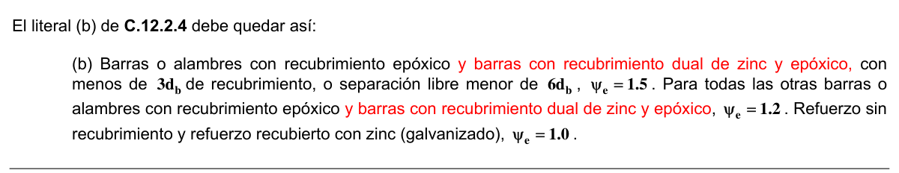
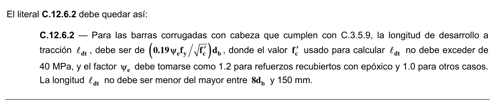
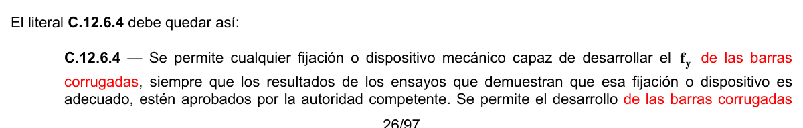

# C.12 — Longitudes de desarrollo y empalmes del refuerzo

### C.12.1 — Desarrollo del refuerzo

Generalidades

**C.12.1.1** — La tracción o comprensión calculada en el refuerzo de cada sección de elementos de concreto estructural debe ser desarrollada hacia cada lado de dicha sección mediante una longitud embebida en el concreto por medio de gancho, barra corrugada con cabeza o dispositivo mecánico, o una combinación de ellos. Los ganchos y barras corrugadas con cabeza no se deben emplear para desarrollar barras en compresión.

**C.12.1.2** — Los valores de $\sqrt{f_{c}'}$ usados en este Capítulo no deben exceder de 8.3 MPa.

**C.12.1.3** — Además de los requisitos establecidos en este Capítulo que afectan el detalle del refuerzo, se deben cumplir los requisitos de integridad estructural de C.7.13.

### C.12.2 — Desarrollo de barras corrugadas y de alambres corrugados a tracción

**C.12.2.1** — La longitud de desarrollo para barras corrugadas y alambre corrugado en tracción, $ℓ_{d}$ , debe determinarse a partir de C.12.2.2 ó C.12.2.3, con los factores de modificación de C.12.2.4 y C.12.2.5, pero $ℓ_{d}$ no debe ser menor que 300 mm.

#### C.12.2.2 — Para barras corrugadas o alambres corrugados, $ℓ_{d}$ debe ser:

| Espaciamiento y recubrimiento | Barras No. 6 (3/4”) ó 20M (20 mm) o menores y alambres corrugados | Barras No. 7 (7/8”) ó 22M (22 mm) y mayores |
|---|---|---|
| Espaciamiento libre entre barras o alambres que están siendo empalmados o desarrolladas no menor que $d_{b}$ , recubrimiento libre no menor que $d_{b}$ , y estribos a lo largo de $ℓ_{d}$ no menos que el mínimo del Título C del Reglamento NSR-10 o espaciamiento libre entre barras o alambres que están siendo desarrolladas o empalmadas no menor a $2d_{b}$ y recubrimiento libre no menor a $d_{b}$ | $\left(\dfrac{f_y\psi_t\psi_e}{2.1\lambda\sqrt{f'_c}}\right)d_b$ | $\left(\dfrac{f_y\psi_t\psi_e}{1.7\lambda\sqrt{f'_c}}\right)d_b$ |
| Otros casos | $\left(\dfrac{f_y\psi_t\psi_e}{1.4\lambda\sqrt{f'_c}}\right)d_b$ | $\left(\dfrac{f_y\psi_t\psi_e\lambda}{1.1\lambda\sqrt{f'_c}}\right)d_b$ |

#### C.12.2.3 — Para barras corrugadas y alambres corrugados $ℓ_{d}$ debe ser:

$$ \ell_d = \left(\dfrac{f_y \psi_t \psi_e \psi_s}{1.1\,\lambda \sqrt{f'_c} \left(\dfrac{c_b + K_{tr}}{d_b}\right)}\right) d_b \tag{C.12-1} $$

en donde el término $(c_{b}+K_{tr}/d_{b})$ no debe tomarse mayor a 2.5 y

$$ K_{tr} = \dfrac{40\,A_{tr}}{s\,n} \tag{C.12-2} $$

en donde $n$ es el número de barras o alambres que se empalman o desarrollan dentro del plano de hendimiento. Se puede usar $K_{tr}=0$ como una simplificación de diseño aún si hay refuerzo transversal presente.

**C.12.2.4** — Los factores a usar en las expresiones para la longitud de desarrollo de barras y alambres corrugados en tracción en C.12.2 son los siguientes:

(a) Cuando para el refuerzo horizontal se colocan más 300 mm de concreto fresco debajo de la longitud de desarrollo o un empalme, $ψ_{t} =1.3$. Otras situaciones $ψ_{t} =1.0$.

(b) Barras o alambres con recubrimiento epóxico con menos de $3d_{b}$ de recubrimiento, o separación libre menor de

$6d_{b}$ , $ψ_{e} =1.5$. Para todas las otras barras o alambres con recubrimiento epóxico, $ψ_{e} =1.2$. Refuerzo sin recubrimiento y refuerzo recubierto con cinc (galvanizado), $ψ_{e} =1.0$.

No obstante, el producto $ψ_{t} ψ_{e}$ no necesita ser mayor de 1.7.

(c) Para barras No. 6 (3/4”) ó 20M (20 mm) o menores y alambres corrugados, $ψ_{s} =0.8$. Para barras No. 7 (7/8”) ó 22M (22 mm) y mayores, $ψ_{s} =1.0$.

(d) Donde se use concreto liviano, $λ$ no debe exceder de 0.75 a menos que se especifique $f_{ct}$ (véase C.8.6.1).

Donde se use concreto de peso normal, $λ =1.0$.

<!-- mod:1-decreto-092-2011-106 -->
> **Modificación — Decreto 092 de 2011** · anexo, p. 26
>
> En C.12.2.3 la expresión matemática incluida en el segundo parágrafo debe quedar así:
>
> 

<!-- mod:1-decreto-092-2011-107 -->
> **Modificación — Decreto 092 de 2011** · anexo, p. 26
>
> El literal (b) de C.12.2.4 debe quedar así:
>
> 

#### C.12.2.5 — Refuerzo en exceso

Se permite reducir $ℓ_{d}$ en ($A_{s}$ requerido) / ($A_{s}$ suministrado) cuando el refuerzo en un elemento sometido a flexión excede el requerido por análisis, excepto cuando se requiere específicamente anclaje o desarrollo para $f_{y}$ o el refuerzo sea diseñado según C.21.2.1.6.

### C.12.3 — Desarrollo de barras corrugadas y alambres corrugados a compresión

**C.12.3.1** — La longitud de desarrollo para barras corrugadas y alambre a compresión, $ℓ_{dc}$, se debe calcular a partir de C.12.3.2 y de los factores de modificación de C.12.3.3, pero $ℓ_{dc}$ no debe ser menor de 200 mm.

**C.12.3.2** — Para las barras corrugadas y alambres corrugados, $ℓ_{dc}$ debe tomarse como el mayor entre $(0.24f_{y}/λ\sqrt{f_{c}'})d_{b}$ y $(0.043f_{y})d_{b}$ , donde $λ$ se toma como indica C.12.2.4(d) y la constante 0.043 tiene la unidad de mm2/N

**C.12.3.3** — Se permite multiplicar la longitud $ℓ_{dc}$ en 12.3.2 por los siguientes factores:

a) El refuerzo excede lo requerido por el análisis ................................................................................................................. ($A_{s}$ requerido)/($A_{s}$ proporcionado)

b) El refuerzo está confinado por una espiral cuya barra tiene un diámetro no menor de 6 mm y no más que 100 mm de paso o dentro de estribos No. 13 de acuerdo con C.7.10.5, y espaciadas a distancias no mayores que 100 mm medidos entre centros ................................0.75

<!-- mod:1-decreto-092-2011-108 -->
> **Modificación — Decreto 092 de 2011** · anexo, p. 26
>
> En C.12.3.3 la referencia a 12.3.2 debe ser a C.12.3.2.

<!-- mod:1-decreto-092-2011-109 -->
> **Modificación — Decreto 092 de 2011** · anexo, p. 26
>
> En el literal (b) de C.12.3.3 la referencia a “... estribos No. 13...” debe ser a “... estribos Nº 4 (1/2”) ó 12M (12 mm)...”.

### C.12.4 — Desarrollo de paquetes de barras

**C.12.4.1** — La longitud de desarrollo de cada barra individual dentro de un paquete de barras sometido a tracción o a comprensión, debe ser aquella de la barra individual aumentada un 20 por ciento para un paquete de 3 barras y en un 33 por ciento para un paquete de 4 barras.

**C.12.4.2** — Para determinar los valores adecuados de espaciamiento y recubrimiento en C.12.2.2, así como el parámetro de confinamiento en C.12.2.3 y el factor $ψ_{e}$ en C.12.2.4(b), un paquete de barras debe ser tratado como una sola barra de un diámetro derivado del área total equivalente y con un centroide que coincide con el del paquete de barras.

### C.12.5 — Desarrollo de ganchos estándar en tracción

**C.12.5.1** — La longitud de desarrollo para barras corrugadas en tracción que terminen en un gancho estándar (véase C.7.1),$ℓ_{dh}$ se debe calcular de C.12.5.2 y los factores de modificación de C.12.5.3, pero$ℓ_{dh}$no debe ser menor que el mayor de$8d_{b}$ y 150 mm.

<!-- mod:3-decreto-945-2017-60 -->
> *Texto vigente según el Decreto 945 de 2017 (anexo, p. 33).*

**C.12.5.2** — Para las barras corrugadas, $\ell_{dh}$ debe ser $\left(0.24\,\psi_e f_y / \lambda\sqrt{f'_c}\right) d_b$ con $\psi_e$ igual a 1.2 para barras con recubrimiento epóxico y $\lambda$ igual a 0.75 para concreto con agregados livianos. Para otros casos, $\psi_e$ y $\lambda$ deben tomarse igual a 1.0.

**C.12.5.3** — La longitud $ℓ_{dh}$en C.12.5.2 se puede multiplicar por los siguientes factores cuando corresponda:

a) Para ganchos de barras No. 36 y menores, con recubrimiento lateral (normal al plano del gancho) no menor de 65 mm, y para ganchos de 90º, con recubrimiento en la extensión de la barra más allá del gancho no menor de 50 mm ................................................................... 0.7

b) Para ganchos de 90º de barras No. 36 y menores que se encuentran confinados por estribos perpendiculares a la barra que se está desarrollando, espaciados a lo largo de $ℓ_{dh}$ a no más de $3d_{b}$ ; o bien, rodeado con estribos paralelos a la barra que se está desarrollando y espaciados a no más de $3d_{b}$ a lo largo de la longitud de desarrollo del extremo del gancho más el doblez .............................................................................................. 0.8

c) Para ganchos de 180º de barra No. 11 (1-3/8”) ó 36M (36 mm) y menores que se encuentran confinados con estribos perpendiculares a la barra que se está desarrollando, espaciados a no más de $3d_{b}$ a lo largo de $ℓ_{dh}$ ............................................................................. 0.8

d) Cuando no se requiera específicamente anclaje o longitud de desarrollo para $f_{y}$, y se dispone de una cuantía de refuerzo mayor a la requerida por análisis ..................................................................................... ($A_{s}$ requerido) / ($A_{s}$ proporcionado).

En C.12.5.3(b) y C.12.5.3(c), $d_{b}$ es el diámetro de la barra del gancho, y el primer estribo debe confinar la parte doblada del gancho, a una distancia menor a $2d_{b}$ del borde externo del gancho.

<!-- mod:1-decreto-092-2011-110 -->
> **Modificación — Decreto 092 de 2011** · anexo, p. 26
>
> En el literal (a) de C.12.5.3 la referencia a “... barras No. 36...” debe ser a “... barras Nº 11 (1-3/8”), 32M (32 mm)...”.

<!-- mod:1-decreto-092-2011-111 -->
> **Modificación — Decreto 092 de 2011** · anexo, p. 26
>
> En el literal (b) de C.12.5.3 la referencia a “... barras No. 36...” debe ser a “... barras Nº 11 (1-3/8”), 32M (32 mm)...”.

**C.12.5.4** — Para barras que son desarrolladas mediante un gancho estándar en extremos discontinuos de elementos con recubrimiento sobre el gancho de menos de 65 mm en ambos lados y en el borde superior (o inferior), la barra con el gancho se debe confinar con estribos, perpendicular a la barra en desarrollo, espaciados en no más de $3d_{b}$ a lo largo de $ℓ_{dh}$. El primer estribo debe confinar la parte doblada del gancho dentro de $2d_{b}$ del exterior del doblez, donde $d_{b}$ es el diámetro de la barra con gancho. En este caso, no deben aplicarse los factores de C.12.5.3. (b) y (c).

**C.12.5.5** — Los ganchos no deben considerarse efectivos para el desarrollo de barras en comprensión.

**C.12.6** — Desarrollo de las barras corrugadas con cabeza y ancladas mecánicamente en tracción

**C.12.6.1** — La longitud de desarrollo en tracción de las barras corrugadas con cabeza, $ℓ_{dt}$, debe ser determinada con C.12.6.2. El uso de cabezas para desarrollar las barras corrugadas en tracción debe quedar limitado a condiciones que cumplan con (a) hasta la (f):

(a) El $f_{y}$ de la barra no debe exceder de 420 MPa.

(b) El tamaño de la barra no debe ser mayor de No. 11 (1-3/8”) ó 36M (36 mm)

(c) El concreto debe ser de peso normal

(d) El área de apoyo de la cabeza $A_{brg}$ no debe ser menor a$4A_{b}$

(e) El recubrimiento libre para la barra no debe ser menor de $2d_{b}$ , y

(f) El espaciamiento libre entre las barras no debe se menor de $4d_{b}$

**C.12.6.2** — Para las barras corrugadas con cabeza que cumplen con C.3.5.9, la longitud de desarrollo a tracción $ℓ_{dt}$, debe ser de $(0.19ψ_{e}f_{y}/\sqrt{f_{c}'})d_{b}$, donde el valor $f_{c}'$ usado para calcular $ℓ_{dt}$ no debe exceder de 40 MPa, y el factor $ψ_{e}$ debe tomarse como 1.2 para refuerzos recubiertos con epóxico y 1.0 para otros casos. Donde el refuerzo esté en exceso sobre el requerido por el análisis, excepto donde el desarrollo de $f_{y}$ se requiera específicamente, se permite que $ℓ_{dt}$ sea multiplicado por ($A_{s}$ requerido)/($A_{s}$ entregado). La longitud $ℓ_{dt}$ no debe ser menor del mayor entre $8d_{b}$ y 150 mm.

<!-- mod:1-decreto-092-2011-112 -->
> **Modificación — Decreto 092 de 2011** · anexo, p. 26
>
> El literal C.12.6.2 debe quedar así:
>
> 

**C.12.6.3** — Las cabezas no se consideran efectivas en el desarrollo de las barras a compresión.

**C.12.6.4** — Se permite cualquier fijación o dispositivo mecánico capaz de desarrollar el $f_{y}$ del refuerzo, siempre que los resultados de los ensayos que demuestran que esa fijación o dispositivo es adecuado, estén aprobados por la autoridad competente. Se permite el desarrollo del refuerzo consistente en una combinación de anclaje mecánico más longitud de embebido del refuerzo entre la sección crítica y la fijación o dispositivo mecánico.

<!-- mod:1-decreto-092-2011-113 -->
> **Modificación — Decreto 092 de 2011** · anexo, p. 26
>
> El literal C.12.6.4 debe quedar así:
>
> 
>
> 

### C.12.7 — Desarrollo de refuerzo electrosoldado de alambre corrugado a tracción

**C.12.7.1** — La longitud de desarrollo del refuerzo electrosoldado de alambre corrugado en tracción, $ℓ_{d}$ medida desde el punto de sección crítica hasta el extremo del alambre, debe calcularse como el producto de $ℓ_{d}$ , de C.12.2.2 ó C.12.2.3 multiplicado por un factor para refuerzo electrosoldado de alambre $ψ_{w}$ obtenido de C.12.7.2 ó C.12.7.3. Se permite reducir $ℓ_{d}$ de acuerdo con C.12.2.5 cuando sea aplicable, pero $ℓ_{d}$ no debe ser menor a 200 mm, excepto para el cálculo de los empalmes por traslapo de acuerdo con C.12.18. Cuando se utilice $ψ_{w}$ de C.12.7.2, se permite usar un factor por revestimiento epóxico $ψ_{e}$ igual a 1.0 para refuerzo electrosoldado de alambre corrugado revestido con epóxico en C.12.2.2 y C.12.2.3.

**C.12.7.2** — Para refuerzo electrosoldado de alambre corrugado con al menos un alambre transversal dentro de $ℓ_{d}$ y a no menos de 50 mm de la sección crítica $ψ_{w}$ debe tomarse como el mayor de:

$$ \frac{(f_y - 240)}{f_y} $$

o

$$ \left(\frac{5d_b}{s_w}\right) $$

pero no necesita ser mayor a 1.0, donde $s$ es la separación entre alambres que se desarrollan.

**C.12.7.3** — Para refuerzo electrosoldado de alambre corrugado sin alambres transversales dentro de $ℓ_{d}$ o con un alambre único a menos de 50 mm del punto de sección crítica, $ψ_{w}$ debe tomarse como 1.0, y $ℓ_{d}$ debe determinarse igual que para alambre corrugado.

**C.12.7.4** — Cuando se presente algún alambre liso, o alambres corrugados de tamaño mayor que MD200 (16 mm de diámetro), en el refuerzo electrosoldado de alambre corrugado en la dirección de la longitud de desarrollo, el refuerzo electrosoldado de alambre debe ser desarrollado de acuerdo con C.12.8.

### C.12.8 — Desarrollo de refuerzo electrosoldado de alambre liso a tracción

La resistencia a la fluencia del refuerzo electrosoldado de alambre liso, debe considerarse que se desarrolla mediante el embebido en el concreto de 2 alambres transversales, con el alambre transversal más próximo a no menos de 50 mm de la sección crítica. Sin embargo, $ℓ_{d}$ no debe ser menor que:

$$ \ell_d = 3.3 \left(\dfrac{A_b}{s}\right) \left(\dfrac{f_y}{\lambda \sqrt{f'_c}}\right) \tag{C.12-3} $$

donde $ℓ_{d}$ se mide desde la sección crítica hasta el alambre transversal más alejado, $s$ es el espaciamiento entre alambres a desarrollarse, y $λ$ se da en C.12.2.4(d). Cuando el refuerzo proporcionado excede del requerido, $ℓ_{d}$ puede reducirse de acuerdo con C.12.2.5. La longitud $ℓ_{d}$ no debe ser menor a 150 mm excepto para el cálculo de empalmes por traslapo de acuerdo con C.12.19.

### C.12.9 — Desarrollo de torones de preesforzado

**C.12.9.1** — Salvo como se dispone en C.12.9.1.1, los torones de preesforzado de siete alambres deben adherirse más allá de la sección crítica en una distancia no menor que:

$$ \ell_d = \left(\dfrac{f_{se}}{21}\right) d_b + \left(\dfrac{f_{ps} - f_{se}}{7}\right) d_b \tag{C.12-4} $$

Las expresiones entre paréntesis se utilizan como constantes sin unidades.

**C.12.9.1.1** — Se permite un embebido menor que $ℓ_{d}$ en una sección de un elemento siempre que el esfuerzo de diseño del torón para esa sección no exceda los valores obtenidos a partir de la relación bilineal de la ecuación (C.12- 4).

**C.12.9.2** — Se permite limitar el estudio a aquellas secciones transversales más cercanas a cada extremo del elemento que requieran desarrollar su resistencia total de diseño bajo las cargas mayoradas, salvo donde la adherencia de uno o más torones no se extiende hasta el extremo del elemento, o donde se aplican cargas concentradas dentro de la longitud de desarrollo del torón.

**C.12.9.3** — Cuando la adherencia del torón no se extienda hasta el extremo del elemento, y el diseño incluya tracciones para la carga de servicio en la zona precomprimida de tracción, como lo permite C.18.4.2, se debe duplicar $ℓ_{d}$ especificada en C.12.9.1.

### C.12.10 — Desarrollo del refuerzo de flexión

Generalidades

**C.12.10.1** — Se permite desarrollar el refuerzo de tracción doblándolo dentro del alma para anclarlo o hacerlo continuo con el refuerzo de la cara opuesta del elemento.

**C.12.10.2** — Las secciones críticas para el desarrollo del refuerzo en elementos sometidos a flexión son los puntos donde se presentan esfuerzos máximos y puntos del vano donde termina o se dobla el refuerzo adyacente. Las disposiciones de C.12.11.3 deben cumplirse.

**C.12.10.3** — El refuerzo se debe extender más allá del punto en el que ya no es necesario para resistir flexión por una distancia igual a $d$ ó $12d_{b}$ , la que sea mayor, excepto en los apoyos de vigas simplemente apoyadas y en el extremo libre de voladizos.

**C.12.10.4** — El refuerzo continuo debe tener una longitud embebida no menor que $ℓ_{d}$ más allá del punto en donde no se requiere refuerzo de tracción para resistir la flexión.

**C.12.10.5** — El refuerzo por flexión no debe terminarse en una zona de tracción, a menos que se satisfaga C.12.10.5.1, C.12.10.5.2 ó C.12.10.5.3.

**C.12.10.5.1** — $V_{u}$ en el punto terminal no excede $(2 /3)φV_{n}$.

**C.12.10.5.2** — Que se proporcione un área de estribos, que exceda lo requerido para la torsión y cortante, a lo largo de cada barra o alambre que termina por una distancia a partir del punto de término del refuerzo igual a $(3 /4 )d$ .

El exceso de área de los estribos no debe ser menor que $0.41b_{w} s /f_{yt}$. El espaciamiento $s$ no debe exceder de $d/(8β_{b})$.

**C.12.10.5.3** — Para barras WX. 36 y menores, en las que el refuerzo que continúa proporciona el doble del área requerida por la flexión en el punto terminal y $V_{u}$ no excede $(3 /4)φV_{n}$.

<!-- mod:1-decreto-092-2011-114 -->
> **Modificación — Decreto 092 de 2011** · anexo, p. 27
>
> En C.12.10.5.3 la referencia a “... barras No. 36...” debe ser a “... barras Nº 11 (1-3/8”), 32M (32 mm)...”.

**C.12.10.6** — En elementos sometidos a flexión se debe proporcionar un anclaje adecuado para el refuerzo en tracción, cuando el esfuerzo en el refuerzo no es directamente proporcional al momento, como ocurre en las zapatas inclinadas, escalonadas o de sección variable; en ménsulas; en elementos de gran altura sometidos a flexión; o en elementos en los cuales el refuerzo de tracción no es paralelo a la cara de compresión. Véanse C.12.11.4 y C.12.12.4 sobre elementos de gran altura sometidos a flexión.

### C.12.11 — Desarrollo del refuerzo para momento positivo

**C.12.11.1** — Por lo menos 1/3 del refuerzo para momento positivo en elementos simplemente apoyados y 1/4 del refuerzo para momento positivo en elementos continuos, se debe prolongar a lo largo de la misma cara del elemento hasta el apoyo. En las vigas, dicho refuerzo se debe prolongar, por lo menos 150 mm dentro del apoyo.

**C.12.11.2** — Cuando un elemento sometido a flexión sea parte fundamental de un sistema que resiste cargas laterales, el refuerzo para momento positivo que se requiere que se prolongue en el apoyo, de acuerdo con C.12.11.1, se debe anclar para que sea capaz de desarrollar $f_{y}$ en tracción en la cara de apoyo.

**C.12.11.3** — En los apoyos simples y en los puntos de inflexión, el refuerzo de tracción para momento positivo debe limitarse a un diámetro tal que $ℓ_{d}$ calculado para $f_{y}$ siguiendo C.12.2 satisfaga la ecuación (C.12-5), excepto que la ecuación (C.12-5) no necesita satisfacerse para los refuerzos que terminan más allá del eje central de los apoyos simples mediante un gancho estándar o un anclaje mecánico equivalente, como mínimo, a un gancho estándar.

$$ \ell_d \le \dfrac{M_n}{V_u} + \ell_a \tag{C.12-5} $$

Donde:

$M_{n}$ se calcula suponiendo que todo el refuerzo de la sección está sometido a $f_{y}$.

$V_{u}$ se calcula en la sección.

$ℓ_{a}$ en el apoyo debe ser la longitud embebida más allá del centro del apoyo.

$ℓ_{a}$ en el punto de inflexión debe limitarse a $d$ ó $12d_{b}$ , el que sea mayor.

Se permite aumentar el valor de $M_{n}/V_{u}$ en un 30 por ciento cuando los extremos del refuerzo estén confinados por una reacción de compresión.

**C.12.11.4** — En apoyos simples de elementos de gran altura sometidos a flexión, el refuerzo de tracción por momento positivo debe anclarse para desarrollar $f_{y}$ en tracción en la cara del apoyo, excepto que el diseño se realice utilizando el Apéndice C-A, el refuerzo positivo a tracción debe anclarse de acuerdo con C-A.4.3.. En apoyos interiores de elementos de gran altura sometidos a flexión, el refuerzo de tracción por momento positivo debe ser continuo o estar empalmado con el del vano adyacente.

### C.12.12 — Desarrollo del refuerzo para momento negativo

**C.12.12.1** — El refuerzo para momento negativo en un elemento continuo, restringido, o en voladizo, o en cualquier elemento de un pórtico rígido, debe anclarse en o a través de los elementos de apoyo mediante una longitud embebida, ganchos o anclajes mecánicos.

**C.12.12.2** — El refuerzo para momento negativo debe tener una longitud embebida en el vano según lo requerido en C.12.1 y C.12.10.3.

**C.12.12.3** — Por lo menos 1/3 del refuerzo total por tracción en el apoyo proporcionado para resistir momento negativo debe tener una longitud embebida más allá del punto de inflexión, no menor que $d$ , $12d_{b}$ ó $ℓ_{n}/16$, la que sea mayor.

**C.12.12.4** — En apoyos interiores de vigas de gran altura sometidas a flexión, el refuerzo de tracción por momento negativo debe ser continuo con el de los vanos adyacentes.

### C.12.13 — Desarrollo del refuerzo del alma

**C.12.13.1** — El refuerzo del alma debe colocarse tan cerca de las superficies de tracción y comprensión del elemento como lo permitan los requisitos de recubrimiento y la proximidad de otros refuerzos.

**C.12.13.2** — Los extremos de las ramas individuales de los estribos en U, simples o múltiples, deben anclarse de cuerdo con lo indicado en C.12.13.2.1 a C.12.3.2.5.

**C.12.13.2.1** — Para barras WX. 16 y alambre MD200 (16 mm de diámetro) y menores y para barras No. 6 (3/4”) ó 20M (20 mm), No. 7 (7/8”) ó 22M (22 mm) y No. 8 (1”) ó 25M (25 mm) con $f_{yt}$ igual a 280 MPa o menos, un gancho estándar alrededor del refuerzo longitudinal.

<!-- mod:1-decreto-092-2011-115 -->
> **Modificación — Decreto 092 de 2011** · anexo, p. 27
>
> En C.12.13.2.1 la referencia a “... barras No. 16...” debe ser a “... barras Nº 5 (5/8”) ó 16M (16 mm)...”.

**C.12.13.2.2** — Para estribos No. 6 (3/4”) ó 20M (20 mm), No. 7 (7/8”) ó 22M (22 mm) y No. 8 (1”) ó 25M (25 mm) con $f_{yt}$ mayor que 280 MPa, un gancho de estribo estándar abrazando una barra longitudinal más una longitud embebida entre el punto medio de la altura del elemento y el extremo exterior del gancho igual o mayor que $0.17d_{b} f_{yt}/(λ\sqrt{f_{c}'})$.

**C.12.13.2.3** — Para cada rama de refuerzo electrosoldado de alambre liso que forme un estribo en U sencillo, ya sea por:

(a) Dos alambres longitudinales colocados con un separación de 50 mm a lo largo del elemento en la parte superior de la U.

(b) Un alambre longitudinal colocado a no más de $d /4$ de la cara en compresión, y un segundo alambre más cercano a la cara en compresión y separado por lo menos 50 mm del primero. Se permite que el segundo alambre esté colocado en una rama del estribo después de un doblez, o en un doblez que tenga un diámetro interior de doblez no menor de $8d_{b}$ .

**C.12.13.2.4** — Para cada extremo de un estribo de una rama de refuerzo electrosoldado de alambre, liso o corrugado, dos alambres longitudinales con una separación mínima de 50 mm y con el alambre interior al menos a $d /4$ ó 50 mm, desde $d /2$ . El alambre longitudinal exterior en la cara de tracción no debe estar más lejos de la cara que la porción del refuerzo primario de flexión más cercano a la cara.

**C.12.13.2.5** — En viguetas, como se definen en C.8.11, para barras No. 4 (1/2”) ó 12M (12 mm) y alambres MD130 (12.9 mm de diámetro) o menores, un gancho estándar.

**C.12.13.3** — Entre los extremos anclados, cada doblez en la parte continua de los estribos en U, sencillos o múltiples, debe abrazar una barra longitudinal.

**C.12.13.4** — Las barras longitudinales dobladas para trabajar como refuerzo de cortante, si se extienden dentro de una zona de tracción, deben ser continuas con el refuerzo longitudinal, y si se extienden dentro de una zona de compresión, deben anclarse más allá de la mitad de la altura útil, $d /2$ , como se especifica para la longitud de desarrollo en C.12.2 para la fracción de $f_{yt}$ que se necesita para satisfacer la ecuación (C.11-17).

<!-- mod:1-decreto-092-2011-116 -->
> **Modificación — Decreto 092 de 2011** · anexo, p. 27
>
> En C.12.13.4 debe substituirse yt f por yf .
>
> 

**C.12.13.5** — Las parejas de estribos en U colocados para que formen una unidad cerrada deben considerarse adecuadamente empalmados cuando la longitud del empalme por traslapo sea de $1.3ℓ_{d}$ . En elementos con una altura útil de al menos 450 mm, los empalmes con $A_{b} f_{yt}$ no mayor que 40 kN por rama se pueden considerar adecuados si las ramas de los estribos se prolongan a lo largo de la altura total disponible del elemento.

### C.12.14 — Empalmes del refuerzo

Generalidades

**C.12.14.1** — En el refuerzo sólo se permite hacer empalmes cuando lo requieran o permitan los planos de diseño, las especificaciones, o si lo autoriza el profesional facultado para diseñar.

#### C.12.14.2 — Empalmes por traslapo

**C.12.14.2.1** — Para las barras mayores de WX. 36 no se deben utilizar empalmes por traslapo, excepto para los casos indicados en C.12.16.2 y C.15.8.2.3.

<!-- mod:1-decreto-092-2011-117 -->
> **Modificación — Decreto 092 de 2011** · anexo, p. 27
>
> En C.12.14.2.1 la referencia a “...barras mayores de No. 36...” debe ser a “...barras mayores de Nº 11 (1-3/8”), 32M (32 mm)...”.

**C.12.14.2.2** — Los empalmes por traslapo de paquetes de barras deben basarse en la longitud de empalme por traslapo requerida para las barras individuales del paquete, aumentada de acuerdo con C.12.4. Los empalmes por traslapo de las barras individuales del paquete no deben sobreponerse. No deben empalmarse por traslapo paquetes enteros.

**C.12.14.2.3** — En elementos sometidos a flexión las barras empalmadas por traslapo que no quedan en contacto entre si no deben separarse transversalmente a la menor de 1/5 de la longitud de empalme por traslapo requerida ó 150 mm.

#### C.12.14.3 — Empalmes soldados y mecánicos

**C.12.14.3.1** — Debe permitirse el uso de empalmes soldados o mecánicos.

**C.12.14.3.2** — Un empalme mecánico completo debe desarrollar en tracción o compresión, según sea requerido, al menos $1.25f_{y}$ de la barra.

**C.12.14.3.3** — Excepto en lo dispuesto por este Título C del Reglamento NSR-10, toda soldadura debe estar de acuerdo con “Structural Welding Code—Reinforcing Steel” (ANSI/AWS D1.4).

<!-- mod:1-decreto-092-2011-118 -->
> **Modificación — Decreto 092 de 2011** · anexo, p. 27
>
> En C.12.14.3.3 la referencia a “...Structural Welding Code—Reinforcing Steel (ANSI/AWS D1.4).” debe ser a “... la norma NTC 4040 (Norma ANSI/AWS D1.4 de la Sociedad Americana de Soldadura).”.

**C.12.14.3.4** — Un empalme totalmente soldado debe desarrollar, por lo menos, $1.25f_{y}$ de la barra.

**C.12.14.3.5** — Los empalmes soldados o mecánicos que no cumplan con los requisitos de C.12.14.3.2 ó C.12.14.3.4 se permiten sólo para barras No. 5 (5/8”) ó 16M (16 mm) y menores y de acuerdo con C.12.15.4.

### C.12.15 — Empalmes de alambres y barras corrugadas a tracción

**C.12.15.1** — La longitud mínima del empalme por traslapo en tracción debe ser la requerida para empalmes por traslapo Clases A o B, pero no menor que 300 mm, donde:

Empalme por traslapo Clase A .......................................................................................................................... $1.0ℓ_{d}$ Empalme por traslapo Clase B .......................................................................................................................... $1.3ℓ_{d}$ donde $ℓ_{d}$ se calcula de acuerdo con C.12.2 para desarrollar $f_{y}$, pero sin los 300 mm mínimos de C.12.2.1 y sin el factor de modificación de C.12.2.5.

**C.12.15.2** — Los empalmes por traslapo de alambres y barras corrugadas sometidas a tracción deben ser empalmes por traslapo Clase B, excepto que se admiten empalmes por traslapo de Clase A cuando:

(a) el área de refuerzo proporcionada es al menos el doble que la requerido por análisis a todo lo largo del empalme por traslapo y

(b) la mitad, o menos, del refuerzo total está empalmado dentro de la longitud de empalme por traslapo requerido.

**C.12.15.3** — Cuando se empalman por traslapo barras de diferente diámetro en tracción, la longitud del empalme por traslapo debe ser el mayor valor entre el $ℓ_{d}$ de la barra de mayor tamaño y el valor de la longitud del empalme en tracción de la barra de diámetro menor.

**C.12.15.4** — Los empalmes soldados o mecánicos utilizados donde el área de refuerzo proporcionada es menor del doble de la requerida por el análisis, deben cumplir con los requisitos de C.12.14.3.2 o de C.12.14.3.4.

**C.12.15.5** — Los empalmes soldados o mecánicos que no cumplen con los requisitos de C.12.14.3.2 ó C.12.14.3.4 se permiten para barras No. 5 (5/8”) ó 16M (16 mm) o menores si cumplen con C.12.15.5.1. a C.12.15.5.3:

**C.12.15.5.1** — Los empalmes deben estar escalonados cuando menos 600 mm.

**C.12.15.5.2** — Al calcular las fuerzas de tracción que pueden ser desarrolladas en cada sección, el esfuerzo en el refuerzo empalmado debe tomarse como la resistencia especificada del empalme, pero no mayor que $f_{y}$. El esfuerzo en el refuerzo no empalmado debe tomarse como $f_{y}$ veces la relación entre la menor longitud anclada más allá de la sección y $ℓ_{d}$ , pero no mayor que $f_{y}$.

**C.12.15.5.3** — La fuerza de tracción total que puede ser desarrollada en cada sección debe ser de al menos el doble que la requerida por el análisis, y al menos 140 MPa veces el área total del refuerzo proporcionado.

**C.12.15.6** — Los empalmes en elementos de amarre en tracción se deben hacer con un empalme soldado o mecánico completo, de acuerdo con C.12.14.3.2 ó C.12.14.3.4, y los empalmes en las barras adyacentes deben estar escalonados por lo menos a 750 mm.

### C.12.16 — Empalmes de barras corrugadas a compresión

**C.12.16.1** — La longitud de un empalme por traslapo en compresión debe ser de $0.071f_{y} d_{b}$ , para $f_{y}$ igual a 420 MPa o menor, o $(0.13f_{y}−24 )d_{b}$ para $f_{y}$ mayor que 420 MPa, pero no debe ser menor que 300 mm. Para $f_{c}'$ menor que 21 MPa, la longitud del empalme por traslapo debe incrementarse en 1/3.

**C.12.16.2** — Cuando se empalman por traslapo barras de diferente diámetro en compresión, la longitud del empalme por traslapo debe ser la mayor de $ℓ_{dc}$ de la barra de tamaño mayor, o la longitud del empalme en compresión por traslapo de la barra de diámetro menor. Se permite empalmar por traslapo barras No. 14 (1-3/4”) ó 45M (45 mm) y No.

18 (2-1/4”) ó 55M (55 mm) con barras de diámetro WX. 36 y menores.

<!-- mod:1-decreto-092-2011-119 -->
> **Modificación — Decreto 092 de 2011** · anexo, p. 27
>
> En C.12.16.2 la referencia a “... barras No. 36...” debe ser a “... barras Nº 11 (1-3/8”), 32M (32 mm)...”.

**C.12.16.3** — Los empalmes soldados o mecánicos usados en compresión deben cumplir con los requisitos de C.12.14.3.2 ó C.12.14.3.4.

#### C.12.16.4 — Empalmes a tope

**C.12.16.4.1** — En las barras que se requieren sólo para compresión, se permite transmitir el esfuerzo de compresión por apoyo directo a través de cortes a escuadra, mantenidos en contacto concéntrico por medio de un dispositivo adecuado.

**C.12.16.4.2** — Los extremos de las barras deben terminar en superficies planas que formen un ángulo recto con el eje de la barra, con una tolerancia de 1.5º, y deben ser ajustadas con una tolerancia de 3º respecto al apoyo completo después del ensamble.

**C.12.16.4.3** — Los empalmes de tope se deben usar únicamente en elementos que tengan estribos cerrados o espirales.

### C.12.17 — Requisitos especiales de empalmes en columnas

**C.12.17.1** — Los empalmes por traslapo, empalmes mecánicos, empalmes soldados a tope, conexiones mecánicas, o empalmes de tope deben usarse, con las limitaciones de C.12.17.2 a C.12.17.4. Los empalmes deben satisfacer los requisitos para todas las combinaciones de carga de la columna.

#### C.12.17.2 — Empalmes por traslapo en columnas

**C.12.17.2.1** — Cuando el esfuerzo en las barras debido a las cargas mayoradas es de compresión, los empalmes por traslapo deben cumplir con C.12.16.1, C.12.16.2, y cuando sea aplicable C.12.17.2.4 o C.12.17.2.5.

**C.12.17.2.2** — Cuando el esfuerzo en las barras debido a las cargas mayoradas es de tracción, y no excede $0.5f_{y}$ en tracción, los empalmes por traslapo por tracción deben ser Clase B si más de la mitad de las barras se empalman en cualquier sección, o empalmes por traslapo por tracción de Clase A si la mitad o menos de las barras están empalmadas por traslapo en cualquier sección, y los empalmes por traslapo tomados alternadamente están escalonados una distancia $ℓ_{d}$ .

**C.12.17.2.3** — Cuando el esfuerzo en las barras debido a las cargas mayoradas es mayor que $0.5f_{y}$ en tracción, los empalmes por traslapo por tracción deben ser Clase B.

**C.12.17.2.4** — En elementos sometidos a compresión en que los estribos a lo largo de toda la longitud del empalme por traslapo tengan un área efectiva no menor que $0.0015hs$ , en ambas direcciones, se permite multiplicar la longitud del empalme por traslapo por 0.83, pero la longitud del empalme por traslapo no debe ser menor que 300 mm. Las ramas del estribo perpendiculares a la dimensión $h$ deben usarse para determinar el área efectiva.

**C.12.17.2.5** — En elementos sometidos a compresión con espirales, se permite multiplicar la longitud del empalme por traslapo de las barras dentro de la espiral por 0.75, pero dicha longitud no debe ser menor de 300 mm.

#### C.12.17.3 — Empalmes soldados o mecánicos en columnas

Los empalmes soldados o mecánicos en columnas deben cumplir con los requisitos de C.12.14.3.2 ó C.12.14.3.4.

#### C.12.17.4 — Empalmes a tope en columnas

Se permite usar empalmes a tope que cumplan con C.12.16.4 para barras de columnas sometidas a esfuerzos de compresión con la condición de que los empalmes estén escalonados o que se especifiquen barras adicionales en las zonas de empalme. Las barras que continúan en cada cara de la columna deben tener una resistencia a la tracción, basada en $f_{y}$, no menor que $0.25f_{y}$ veces el área del refuerzo vertical en esa cara.

### C.12.18 — Empalmes de refuerzo electrosoldado de alambre corrugado a tracción

**C.12.18.1** — La longitud mínima del empalme por traslapo de refuerzo electrosoldado de alambre corrugado, medida entre los extremos de cada refuerzo electrosoldado individual, no debe ser menor que la mayor de $1.3ℓ_{d}$ y 200 mm, y la longitud de traslapo medida entre los alambres transversales más alejados de cada refuerzo electrosoldado individual no debe ser menor que 50 mm, donde $ℓ_{d}$ se calcula para desarrollar $f_{y}$ de acuerdo con C.12.7.

**C.12.18.2** — Los empalmes por traslapo de refuerzo electrosoldado de alambre corrugado, sin un alambre transversal dentro de la longitud del empalme por traslapo, se deben determinar de manera similar a los del alambre corrugado.

**C.12.18.3** — Cuando se presenta alambre liso, o alambres corrugados de tamaño mayor que MD200 (16 mm de diámetro), en el refuerzo electrosoldado de alambre corrugado en la dirección del empalme por traslapo, o cuando se está empalmando por traslapo un refuerzo electrosoldado de alambre corrugado con un refuerzo electrosoldado de alambre liso, el refuerzo electrosoldado debe ser empalmado por traslapo de acuerdo con C.12.19.

### C.12.19 — Empalmes de refuerzo electrosoldado de alambre liso a tracción

La longitud mínima de empalmes por traslapo de refuerzo electrosoldado de alambre liso debe cumplir con C.12.19.1 y C.12.19.2

**C.12.19.1** — Donde $A_{s}$ suministrada es menor que 2 veces la requerida por el análisis en la zona del empalme, la longitud del traslapo, medida entre los alambres transversales más alejados de cada refuerzo electrosoldado individual, no debe ser menor que el mayor de un espaciamiento de los alambres transversales más 50 mm, $1.5ℓ_{d}$ , y 150 mm. $ℓ_{d}$ se calcularse de acuerdo con 12.8 para desarrollar $f_{y}$.

<!-- mod:1-decreto-092-2011-120 -->
> **Modificación — Decreto 092 de 2011** · anexo, p. 27
>
> En C.12.19.1 la referencia a 12.8 debe ser a C.12.8.

**C.12.19.2** — Donde $A_{s}$ suministrada es por lo menos el doble de la requerida por análisis en la ubicación del empalme, la longitud del traslapo, medida entre los alambres transversales más alejados de cada hoja de refuerzo electrosoldado, no debe ser menor que la mayor de $1.5ℓ_{d}$ y 50 mm. $ℓ_{d}$ debe calcularse de acuerdo con C.12.8 para desarrollar $f_{y}$.

" Notas:
