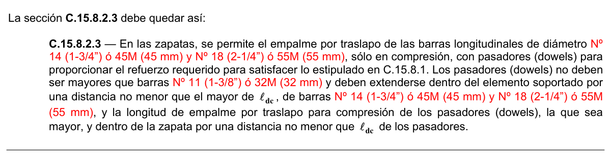

# C.15 — Cimentaciones

### C.15.1 — Alcance

**C.15.1.1** — Las disposiciones del Capítulo C.15 deben usarse en el diseño de zapatas aisladas y, cuando sean aplicables, a zapatas combinadas, zapatas sobre pilotes, losas de cimentación, pilotes, cajones de cimentación (caissons), muros y estructuras de contención y vigas de amarre de la cimentación.

**C.15.1.2** — En C.15.10 se indican los requisitos adicionales para el diseño de zapatas combinadas y losas de cimentación, en C.15.11 pilotes y cajones de cimentación, en C.15.12 muros y estructuras de contención y en C.15.13 vigas de amarre de la cimentación.

### C.15.2 — Cargas y reacciones

**C.15.2.1** — Las zapatas deben diseñarse para resistir las cargas mayoradas y las reacciones inducidas, de acuerdo con los requisitos de diseño apropiados de este Reglamento y conforme a lo dispuesto en el Capítulo C.15.

**C.15.2.2** — El área base de la zapata o el número y distribución de pilotes debe determinarse a partir de las fuerzas y momentos no mayorados transmitidos al suelo o a los pilotes a través de la zapata, y debe determinarse mediante principios de mecánica de suelos la resistencia admisible del suelo o la capacidad admisible de los pilotes.

**C.15.2.3** — El cálculo de los momentos y esfuerzos de cortante para zapatas apoyadas sobre pilotes puede basarse en la suposición de que la reacción de cualquier pilote está concentrada en el centro del mismo.

**C.15.3** — Zapatas que soportan columnas o pedestales de forma circular o de polígono regular Para la localización de las secciones críticas para momentos, cortantes, y longitud de desarrollo del refuerzo en las zapatas, se permite considerar las columnas o pedestales de concreto de forma circular o de polígono regular como elementos cuadrados con la misma área.

### C.15.4 — Momentos en zapatas

**C.15.4.1** — El momento externo en cualquier sección de una zapata debe determinarse pasando un plano vertical a través de la zapata, y calculando el momento de las fuerzas que actúan sobre el área total de la zapata que quede a un lado de dicho plano vertical.

**C.15.4.2** — El momento máximo mayorado, $M_{u}$ , para una zapata aislada debe calcularse en la forma prescrita en C.15.4.1, para las secciones críticas localizadas como se indica a continuación:

(a) En la cara de la columna, pedestal o muro, para zapatas que soporten una columna, pedestal o muro de concreto.

(b) En el punto medio entre el eje central y el borde del muro, para zapatas que soporten muros de albañilería.

(c) En el punto medio entre la cara de la columna y el borde de la platina de base de acero, para zapatas que soporten una columna con platina de acero de base.

**C.15.4.3** — En zapatas en una dirección y en zapatas cuadradas en dos direcciones, el refuerzo debe distribuirse uniformemente a lo largo del ancho total de la zapata.

**C.15.4.4** — En zapatas rectangulares en dos direcciones, el refuerzo debe distribuirse como se indica en 15.4.4.1 y 15.4.4.2.

**C.15.4.4.1** — El refuerzo en la dirección larga debe distribuirse uniformemente en el ancho total de la zapata.

**C.15.4.4.2** — Para el refuerzo en la dirección corta, una porción del refuerzo total, $γ_{s}A_{s}$, debe distribuirse en forma uniforme sobre una franja (centrada con respecto al eje de la columna o pedestal) cuyo ancho sea igual a la longitud del lado corto de la zapata. El resto del refuerzo requerido en la dirección corta, $(1− γ_{s})A_{s}$, debe distribuirse uniformemente en las zonas que queden fuera de la franja central de la zapata.

2

$γ_{s}= (β +$1$)$ (15-1) donde $β$ es la relación del lado largo al lado corto de la zapata.

### C.15.5 — Cortante en zapatas

**C.15.5.1** — La resistencia al cortante de zapatas apoyadas en suelo o en roca, debe cumplir con lo estipulado en C.11.11.

**C.15.5.2** — La ubicación de la sección crítica para cortante de acuerdo con el Capítulo C.11 debe medirse desde la cara de la columna, pedestal o muro. Para zapatas que soporten una columna o un pedestal con platina de acero de base, la sección crítica debe medirse a partir del punto definido en C.15.4.2(c).

**C.15.5.3** — Cuando la distancia entre el eje de cualquier pilote y el eje de la columna es mayor a dos veces la distancia entre la parte superior del cabezal de los pilotes y la parte superior del pilote, el cabezal de los pilotes debe cumplir con C.11.11 y C.15.5.4. Otros cabezales de pilotes deben cumplir ya sea con el Apéndice C-A, o ambos C.11.11, y C.15.5.4. Si se usa el Apéndice C-A, la resistencia a la compresión efectiva del concreto de los puntales, $f_{ce}$, debe determinarse usando C-A.3.2.2(b).

**C.15.5.4** — El cálculo del cortante en cualquier sección de una zapata apoyada sobre pilotes debe cumplir con C.15.5.4.1, C.15.5.4.2 y C.15.5.4.3.

**C.15.5.4.1** — Se debe considerar que la reacción total de todo pilote con su centro localizado a $d_{pile}/2$ o más hacia el lado de afuera de la sección produce cortante en dicha sección.

**C.15.5.4.2** — Se debe considerar que la reacción de cualquier pilote con su centro localizado $d_{pile}/2$ o más hacia el lado interior de una sección no produce cortante en dicha sección.

**C.15.5.4.3** — Para posiciones intermedias del centro del pilote, la parte de la reacción del pilote que produce cortante en la sección debe basarse en una interpolación lineal entre el valor total a $d_{pile}/2$ hacia afuera de la sección y el valor cero correspondiente a $d_{pile}/2$ hacia adentro de la sección.

### C.15.6 — Desarrollo del refuerzo en zapatas

**C.15.6.1** — El desarrollo del refuerzo en las zapatas debe hacerse de acuerdo con el Capítulo C.12.

**C.15.6.2** — La tracción o compresión calculadas en el refuerzo en cada sección debe desarrollarse a cada lado de dicha sección ya sea mediante una longitud embebida, ganchos (sólo en tracción) o dispositivos mecánicos, o bien mediante una combinación de los mismos.

**C.15.6.3** — Las secciones críticas para el desarrollo del refuerzo deben suponerse en los mismos planos definidos en C.15.4.2 para el momento máximo mayorado y en todos los demás planos verticales en los cuales se presentan cambios de sección o de refuerzo. Véase también C.12.10.6.

### C.15.7 — Altura mínima de las zapatas

La altura de las zapatas sobre el refuerzo inferior no debe ser menor de 150 mm para zapatas apoyadas sobre el suelo, ni menor de 300 mm en el caso de zapatas apoyadas sobre pilotes.

**C.15.8** — Transmisión de fuerzas en la base de columnas, muros o pedestales reforzados

**C.15.8.1** — Las fuerzas y los momentos en la base de columnas, muros o pedestales deben transmitirse al pedestal de apoyo o a la zapata a través del concreto por aplastamiento y mediante refuerzo, pasadores (dowels), y conectores mecánicos.

**C.15.8.1.1** — El esfuerzo de aplastamiento en la superficie de contacto entre el elemento de apoyo y el elemento apoyado, no debe exceder la resistencia al aplastamiento del concreto para cualquiera de las superficies, de acuerdo con lo dispuesto en C.10.14.

**C.15.8.1.2** — El refuerzo, los pasadores (dowels) o los conectores mecánicos entre elementos apoyados y de apoyo deben ser adecuados para transmitir:

(a) Toda la fuerza de compresión que exceda de la resistencia al aplastamiento del concreto de cualquiera de los elementos.

(b) Cualquier fuerza de tracción calculada a través de la interfaz.

Además, el refuerzo, las barras de traspaso o los conectores mecánicos deben satisfacer las disposiciones de C.15.8.2 ó C.15.8.3.

**C.15.8.1.3** — Cuando los momentos calculados se transmiten al pedestal o a la zapata, el refuerzo, los pasadores (dowels) o los conectores mecánicos deben tener las características necesarias para satisfacer las disposiciones de C.12.17.

**C.15.8.1.4** — Las fuerzas laterales deben transmitirse al pedestal o a la zapata de acuerdo con las disposiciones de cortante por fricción de C.11.6, o mediante otros medios apropiados.

**C.15.8.2** — En estructuras construidas en obra, debe proporcionarse el refuerzo requerido para satisfacer C.15.8.1, ya sea extendiendo las barras longitudinales dentro del pedestal de apoyo o de las zapatas, o mediante pasadores (dowels).

**C.15.8.2.1** — Para columnas y pedestales construidos en obra, el área de refuerzo a través de la interfaz no debe ser menor de 0.005$A_{g}$ , donde $A_{g}$ es el área bruta del elemento soportado.

**C.15.8.2.2** — Para muros construidos en obra, el área del refuerzo a través de la interfaz no debe ser menor que el refuerzo mínimo vertical señalado en C.14.3.2.

**C.15.8.2.3** — En las zapatas, se permite el empalme por traslapo de las barras longitudinales de diámetro RS. 43 y RS. 57, sólo en compresión, con pasadores (dowels) para proporcionar el refuerzo requerido para satisfacer lo estipulado en C.15.8.1. Los pasadores (dowels) no deben ser mayores que barras RS. 36 y deben extenderse dentro del elemento soportado por una distancia no menor que el mayor de $ℓ_{dc}$, de barras RS. 43 y RS. 57, y la longitud de empalme por traslapo para compresión de los pasadores (dowels), la que sea mayor, y dentro de la zapata por una distancia no menor que $ℓ_{dc}$ de los pasadores.

<!-- mod:1-decreto-092-2011-123 -->
> **Modificación — Decreto 092 de 2011** · anexo, p. 27
>
> La sección C.15.8.2.3 debe quedar así:
>
> 

**C.15.8.2.4** — Cuando se proporciona una conexión que permita giro (articulada) en estructuras construidas en obra, dicha conexión debe cumplir con lo especificado en C.15.8.1 y C.15.8.3.

**C.15.8.3** — En construcciones prefabricadas, se permite usar pernos de anclaje o conectores mecánicos apropiados para satisfacer lo estipulado en C.15.8.1. Los pernos de anclaje deben diseñarse de cuerdo con el Apéndice C-D.

**C.15.8.3.1** — La conexión entre columnas prefabricadas o pedestales y los elementos de apoyo debe cumplir los requisitos de C.16.5.1.3(a).

**C.15.8.3.2** — La conexión entre muros prefabricados y elementos de apoyo debe cumplir los requisitos de C.16.5.1.3(b) y (c).

**C.15.8.3.3** — Los pernos de anclaje y los conectores mecánicos deben diseñarse para alcanzar su resistencia de diseño antes de que se presente la falla de anclaje o la falla del concreto que los circunda. Los pernos de anclaje deben diseñarse de cuerdo con el Apéndice C-D.

### C.15.9 — Zapatas inclinadas o escalonadas

**C.15.9.1** — En las zapatas con pendiente o escalonadas el ángulo de la pendiente, o la altura y ubicación de los escalones deben ser tales que se satisfagan los requisitos de diseño en cada sección. (Véase también C.12.10.6)

**C.15.9.2** — Las zapatas con pendiente o escalonadas que se diseñen como una unidad, deben construirse para asegurar tal comportamiento.

### C.15.10 — Zapatas combinadas y losas de cimentación

**C.15.10.1** — Las zapatas que soporten más de una columna, pedestal o muro (zapatas combinadas y losas de cimentación) deben diseñarse para resistir las cargas mayoradas y las reacciones inducidas, de acuerdo con los requisitos de diseño apropiados de este Reglamento.

**C.15.10.2** — El Método Directo de Diseño del Capítulo C.13 no debe utilizarse para el diseño de zapatas combinadas y losas de cimentación.

**C.15.10.3** — La distribución del esfuerzo del terreno bajo zapatas combinadas y losas de cimentación debe estar de acuerdo con las propiedades del suelo y la estructura, y con principios establecidos de mecánica de suelos.

**C.15.10.4** — El acero de refuerzo mínimo en losas de cimentación no preesforzadas debe cumplir con los requisitos de C.7.12.2 en cada dirección principal. El espaciamiento máximo no debe exceder 450 mm.

### C.15.11 — Pilotes y cajones de cimentación

#### C.15.11.1 — Alcance

Los requisitos que se presentan en esta sección corresponden a los requerimientos mínimos por razones estructurales de pilotes y cajones de cimentación de concreto, incluyendo pilotes hincados, pilotes vaciados en sitio con camisa de acero, pilotes prebarrenados y cajones de cimentación excavados manual y mecánicamente. Las armaduras mínimas prescritas en la presente sección no cubren los efectos de impacto por hincado, ni las solicitaciones derivadas de empujes laterales y efectos sísmicos sobre los pilotes y cajones de cimentación, los cuales deben ser definidos por el estudio geotécnico de acuerdo con lo establecido en el Título H.

#### C.15.11.2 — Anclaje del refuerzo

El refuerzo longitudinal de los pilotes y cajones de cimentación debe anclarse en la zapata o dado, como mínimo, una distancia igual a la longitud de desarrollo en tracción, sin reducción por refuerzo en exceso, definida en el Capítulo C.12.

#### C.15.11.3 — Esfuerzos axiales máximos

Los esfuerzos axiales máximos admisibles sobre el pilote, o sobre el fuste cuando se trate de pilotes acampanados en su base, son los siguientes:

(a) Esfuerzos de compresión causados por las cargas gravitacionales (no incluye efectos de hincado):

$$ D + L \le 0.25\,f'_c A_g \tag{C.15-2} $$

$$ 1.2\,D + 1.6\,L \le 0.35\,f'_c A_g \tag{C.15-3} $$

(b) Esfuerzos de compresión causados por las cargas gravitacionales más los efectos sísmicos:

$$ D + L + 0.7\,E \le 0.33\,f'_c A_g \tag{C.15-4} $$

$$ 1.2\,D + 1.0\,L + 1.0\,E \le 0.35\,f'_c A_g \tag{C.15-5} $$

(c) Esfuerzos de tracción causados por los efectos sísmicos, cuando hay levantamiento (en este caso el pilote debe armarse en toda su longitud, a menos que el estudio geotécnico defina una longitud menor):

$$ -1.0\,D + E \le 0.9\,f_y A_{st} \tag{C.15-6} $$

#### C.15.11.4 — Esfuerzos de flexión

Cuando el pilote pueda verse sometido a momentos flectores debidos a empujes laterales o a efectos sísmicos, la determinación de los momentos de diseño debe realizarse de acuerdo con las recomendaciones del estudio geotécnico tal como lo indica el Título H. El diseño a flexión del pilote debe realizarse de acuerdo con los requisitos del presente Título C.

**Tabla C.15.11-1** — CUANTÍAS MÍNIMAS LONGITUDINALES Y TRANSVERSALES

EN PILOTES Y CAJONES DE CIMENTACIÓN VACIADOS EN SITIO

| Requisito | Estructuras con capacidad mínima (DMI) de disipación de energía | Estructuras con capacidad especial (DES) y moderada (DMO) de disipación de energía (véase la Nota) |
|---|---|---|
| Resistencia mínima del concreto , $f_{c}'$ Cuantía longitudinal mínima Número mínimo de barras longitudinales Longitud del refuerzo longitudinal, a menos que el estudio geotécnico indique que se debe utilizar una longitud mayor Diámetro de la barra de los estribos Separación máxima de los estribos | 17.5 MPa 0.0025 4 tercio superior de la longitud del pilote, pero no menos de 4 m. Nº 2 (1/4”) ó 6M (6 mm) para pilotes hasta de 500 mm de diámetro y Nº 3 (3/8”) ó 10M (10 mm) para pilotes de más de 500 mm de diámetro. 100 mm en los 600 mm superiores del pilote y 16 diámetros de barra longitudinal, a lo largo de la zona armada longitudinalmente. | 17.5 MPa 0.0050 4 mitad superior de la longitud del pilote, pero no menos de 6 m. Nº 3 (3/8”) ó 10M (10 mm) para pilotes hasta de 750 mm de diámetro y Nº 4 (1/2”) ó 12M (12 mm) para pilotes de más de 750 mm de diámetro. 75 mm en los 1.20 m superiores del pilote y 16 diámetros de barra longitudinal, a lo largo de la zona armada longitudinalmente. |

Nota: Cuando el diseño indica que se presentará disipación de energía en el rango inelástico en la zona superior del pilote o cajón, deben cumplirse los requisitos dados en el Capítulo C.21 y deben tomarse las precauciones necesarias para garantizar que la articulación plástica se presenta en la zona confinada.

#### C.15.11.5 — Cuantías mínimas y longitudes mínimas de armado

A menos que se requiera un mayor refuerzo de acuerdo con lo indicado en los Artículos C.15.11.3 y C.15.11.4, deben utilizarse las siguientes cuantías y longitudes mínimas de armado:

**C.15.11.5.1** — Pilotes y cajones de cimentación vaciados in-situ – En los pilotes y cajones de cimentación vaciados en sitio, deben tenerse todas las precauciones para evitar que haya estrangulamientos causados por derrumbes internos dentro del pilote en el momento de vaciar el concreto. Las cuantías mínimas, longitudinales y transversales para pilotes y cajones de cimentación vaciados en sitio son las dadas en la Tabla C.15.11-1.

**C.15.11.5.2** — Pilotes con camisa de acero – Los mismos requisitos que para pilotes y cajones de cimentación vaciados in-situ. Una camisa de acero, de calibre N° 14 (14 gauge) o mayor, del tipo de espiral electrosoldada, puede considerarse que reemplaza el efecto de confinamiento de los estribos; siempre y cuando se garantice la protección contra la corrosión de la camisa de acero.

**C.15.11.5.3** — Tubería rellena de concreto – Debe colocarse refuerzo longitudinal con una cuantía mínima de 0.01 en la parte superior del pilote por una distancia igual al doble de la longitud de anclaje requerida para el refuerzo.

Deben colocarse los estribos necesarios para garantizar que el refuerzo permanece en su sitio durante el vaciado del concreto.

**C.15.11.5.4** — Pilotes prefabricados de concreto reforzado – Debe colocarse refuerzo longitudinal con una cuantía mínima de 0.01 en toda la longitud del pilote. Deben colocarse estribos, o una espiral equivalente, con un diámetro de barra mínimo Nº 2 (1/4”) ó 6M (6 mm) con una separación máxima de 100 mm en los 600 mm superiores del pilote y 16 diámetros de barra longitudinal en el resto del pilote. Debe verificarse que el refuerzo mínimo anterior sea suficiente para garantizar la integridad del pilote durante el proceso de hincado, y aumentarlo en caso que se requiera una mayor cantidad. La resistencia mínima a la compresión del concreto antes de iniciar el hincado debe ser

$f_{c}' =21$ MPa. En estructuras con capacidad especial de disipación de energía (DES) debe colocarse una espiral con una cuantía mínima $ρ_{s} ≥0.006$, en vez de los estribos indicados anteriormente.

**C.15.11.5.5** — Pilotes prefabricados de concreto preesforzado – Deben colocarse estribos, o una espiral equivalente, con un diámetro de barra mínimo Nº 3 (3/8”) ó 10M (10 mm) con una separación máxima de 100 mm en los 600 mm superiores del pilote. La conexión a la zapata o dado, debe hacerse por medio de barras adicionales. La resistencia mínima a la compresión del concreto antes de iniciar el hincado debe ser $f_{c}' =28$ MPa.

**C.15.11.5.6** — Pilotes de perfil laminado de acero – En estructuras con capacidad especial de disipación de energía (DES), la conexión con la zapata o dado de cimentación debe ser capaz de resistir una fuerza de tracción igual al 10 por ciento de la capacidad a compresión del pilote.

### C.15.12 — Muros y estructuras de contención

**C.15.12.1** — Los muros y elementos de contención de concreto reforzado deben diseñarse de acuerdo con los requisitos apropiados del presente Título C del Reglamento NSR-10. Los empujes, presiones activas y pasivas del suelo, empujes inducidos por los movimientos sísmicos, y los demás parámetros requeridos para el dimensionamiento de las estructuras de contención deben ser definidos en el estudio geotécnico, de acuerdo con lo prescrito en el Título H.

**C.15.12.2** — Cuando los muros y elementos de contención están conectados o le dan apoyo al sistema de resistencia sísmica de la edificación, las conexiones entre el sistema de contención y el sistema de resistencia sísmica deben cumplir los requisitos apropiados del Título A y deben tomarse todas las precauciones para que los elementos de contención tengan un comportamiento compatible con el grado de disipación de energía en el rango inelástico propio del sistema de resistencia sísmica de la edificación.

### C.15.13 — Vigas de amarre de la cimentación

#### C.15.13.1 — Fuerzas de diseño

En el diseño de las vigas de amarre de cimentación, deben cumplirse los siguientes requisitos:

(a) Los de A.3.6.4.2 con respecto a las fuerzas axiales que debe resistir la viga de amarre por efectos sísmicos,

(b) Las recomendaciones que al respecto contenga el estudio geotécnico, y

(c) Las del Título H del Reglamento.

#### C.15.13.3 — Dimensiones mínimas

Las dimensiones de las vigas de amarre deben establecerse en función de las solicitaciones que las afecten, dentro de las cuales se cuentan la resistencia a fuerzas axiales por razones sísmicas y la rigidez y características para efectos de diferencias de carga vertical sobre los elementos de cimentación y la posibilidad de ocurrencia de asentamientos totales y diferenciales.

**C.15.13.3.1** — Las vigas de amarre deben tener una sección tal que su mayor dimensión debe ser mayor o igual a la luz dividida por 20 para estructuras con capacidad especial de disipación de energía (DES), a la luz dividida por 30 para estructuras con capacidad moderada de disipación de energía (DMO) y a la luz dividida por 40 para estructuras con capacidad mínima de disipación de energía (DMI).

#### C.15.13.2 — Refuerzo longitudinal

Las vigas de amarre sobre el terreno que enlacen dados o zapatas deben tener refuerzo longitudinal continuo, el cual debe ser capaz de desarrollar $f_{y}$por medio de anclaje en la columna exterior del vano final.

#### C.15.13.4 — Refuerzo transversal

Deben colocarse estribos cerrados en toda su longitud, con una separación que no exceda la mitad de la menor dimensión de la sección ó 300 mm. Las vigas de amarre que resistan momentos flectores provenientes de columnas deben cumplir los requisitos de separación y cantidad de refuerzo transversal que fije el Reglamento para el nivel de capacidad de disipación de energía en el rango inelástico del sistema de resistencia sísmica.
