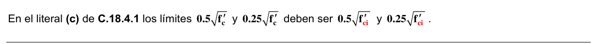
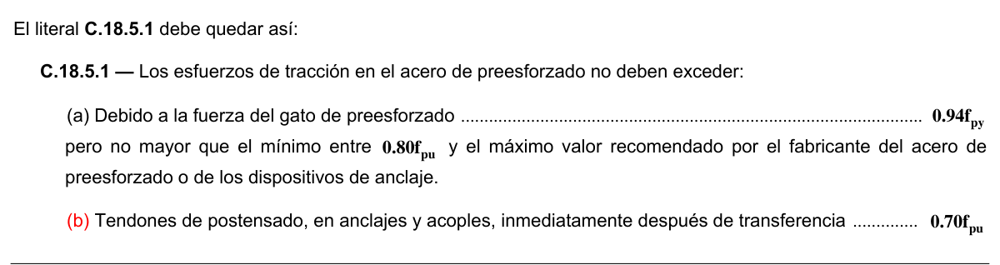

# C.18 — Concreto preesforzado

### C.18.1 — Alcance

**C.18.1.1** — Las disposiciones del Capítulo C.18 se deben aplicar a elementos preesforzados con alambre, torones o barras que cumplan con los requisitos para aceros de preesforzado de C.3.5.5.

**C.18.1.2** — Todas las disposiciones del Título C del Reglamento NSR-10 no excluidas específicamente y que no contradigan las disposiciones del Capítulo C.18, deben considerare aplicables al concreto preesforzado.

**C.18.1.3** — Las siguientes disposiciones de este Título C del Reglamento NSR-10 no deben aplicarse al concreto preesforzado excepto cuando esté específicamente señalado: C.6.4.4, C.7.6.5, C.8.12.2, C.8.12.3, C.8.12.4, C.8.13, C.10.5, C.10.6, C.10.9.1 y C.10.9.2; Capítulo C.13; y secciones C.14.3, C.14.5 y C.14.6, salvo que se puedan aplicar algunas secciones de C.10.6 como se indica en C.18.4.4.

### C.18.2 — Generalidades

**C.18.2.1** — Los elementos preesforzados deben cumplir con los requisitos de resistencia especificados en este Título C del Reglamento NSR-10.

**C.18.2.2** — El diseño de elementos preesforzados debe basarse en la resistencia y en el comportamiento en condiciones de servicio durante todas las etapas de carga que serán críticas durante la vida de la estructura, desde el momento en que el preesforzado se aplique por primera vez.

**C.18.2.3** — En el diseño deben considerarse las concentraciones de esfuerzos debidas al preesforzado.

**C.18.2.4** — Deben tomarse medidas con respecto a los efectos sobre estructuras adyacentes producidos por deformaciones plásticas y elásticas, deflexiones, cambios de longitud y rotaciones provocados por el preesforzado.

También deben incluirse los efectos debido a cambios de temperatura y a retracción.

**C.18.2.5** — Debe considerarse la posibilidad de pandeo de un elemento entre los puntos en que el concreto y el acero de preesforzado estén en contacto intermitente en un ducto de mayor tamaño del necesario, al igual que la posibilidad de pandeo de almas y alas delgadas.

**C.18.2.6** — Al calcular las propiedades de la sección antes de la adherencia del acero de preesforzado, debe considerarse el efecto de la pérdida de área debida a ductos abiertos.

### C.18.3 — Suposiciones de diseño

**C.18.3.1** — El diseño por resistencia de elementos preesforzados para cargas axiales y de flexión debe basarse en las suposiciones de C.10.2, excepto que C.10.2.4 se debe aplicar únicamente al refuerzo que cumpla con lo señalado en C.3.5.3.

**C.18.3.2** — Para el estudio de los esfuerzos en transferencia del preesforzado, bajo cargas de servicio y en el estado correspondiente a cargas de fisuración, se debe emplear la teoría elástica con las suposiciones de C.18.3.2.1 y C.18.3.2.2.

**C.18.3.2.1** — Las deformaciones unitarias varían linealmente con la altura en todas las etapas de carga.

**C.18.3.2.2** — En las secciones fisuradas el concreto no resiste tracción.

**C.18.3.3** — Los elementos preesforzados a flexión deben clasificarse como Clase U, Clase T o Clase C en función de $f_{t}$, correspondiente al esfuerzo calculado en la fibra extrema en tracción en la zona precomprimida en tracción, calculada para cargas de servicio, de la siguiente forma:

(a) Clase U: $f_{t}≤0.62 \sqrt{f_{c}'}$

(b) Clase T: $0.62 \sqrt{f_{c}'}<f_{t}≤1.0 \sqrt{f_{c}'}$

(c) Clase C: $f_{t}>1.0 \sqrt{f_{c}'}$ Los sistemas de losas preesforzadas en dos direcciones deben ser diseñadas como Clase U con $f_{t}≤0.50 \sqrt{f_{c}'}$

**C.18.3.4** — Para los elementos sometidos a flexión Clase U y Clase T, se permite calcular los esfuerzos para cargas de servicio usando la sección no fisurada. Para los elementos sometidos a flexión de la Clase C, los esfuerzos para cargas de servicio se deben calcular usando la sección transformada fisurada.

**C.18.3.5** — Las deflexiones de los elementos preesforzados sometidos a flexión deben ser calculadas de acuerdo con C.9.5.4.

### C.18.4 — Requisitos de funcionamiento

Elementos sometidos a flexión

**C.18.4.1** — Esfuerzos en el concreto inmediatamente después de la aplicación del preesforzado (antes de las pérdidas de preesforzado que dependen del tiempo).

(a) El esfuerzo en la fibra extrema en compresión, excepto lo permitido en (b), no debe exceder $............ 0.60f_{ci}'$

(b) El esfuerzo en la fibra extrema en compresión en los extremos de elementos simplemente apoyados no debe exceder $.................................................................................................................................... 0.70f_{ci}'$

(c) Donde los esfuerzos de tracción calculados, $f_{t}$, excedan de $0.5 \sqrt{f_{c}'}$ en los extremos de elementos simplemente apoyados, ó $0.25 \sqrt{f_{c}'}$ en otras ubicaciones, debe colocarse refuerzo adicional adherido (no preesforzado o preesforzado) en la zona de tracción, para resistir la fuerza total de tracción en el concreto, calculada con la suposición de sección no fisurada.

<!-- mod:1-decreto-092-2011-128 -->
> **Modificación — Decreto 092 de 2011** · anexo, p. 28
>
> En el literal (c) de C.18.4.1 los límites 0.5 f′ y 0.25 f′ deben ser 0.5 f′ y 0.25 f′ .
>
> 

**C.18.4.2** — Para los elementos preesforzados sometidos a flexión Clase U y Clase T, los esfuerzos en el concreto bajo las cargas de servicio (después de que han ocurrido todas las pérdidas de preesforzado) no deben exceder los siguientes valores:

(a) Esfuerzo en la fibra extrema en compresión debido al preesforzado y a las cargas permanentes en el tiempo $............................................................................................................................... 0.45f_{c}'$

(b) Esfuerzo en la fibra extrema en compresión debida al preesforzado y a todas las cargas $................... 0.60f_{c}'$

**C.18.4.3** — Se pueden exceder los esfuerzos admisibles del concreto, indicados en C.18.4.1 y C.18.4.2 si se demuestra mediante ensayos o análisis que no se perjudica el comportamiento.

**C.18.4.4** — Para los elementos preesforzados sometidos a flexión Clase C no sometidos a fatiga o a una exposición agresiva, el espaciamiento del refuerzo adherido más cercano al borde más alejado en tracción no debe exceder el valor dado en C.10.6.4.

Para estructuras sometidas a fatiga o expuestas a medios corrosivos, se necesitan investigaciones y precauciones especiales.

**C.18.4.4.1** — Los requisitos de espaciamiento deben ser cumplidos para el refuerzo no preesforzado y para los tendones adheridos. El espaciamiento de los tendones adheridos no debe exceder los 2/3 del espaciamiento máximo permitido para refuerzos no preesforzados.

Cuando se usa tanto el refuerzo normal como los tendones de preesforzado adheridos para cumplir con los requisitos de espaciamiento, el espacio entre una barra y un tendón no debe exceder los 5/6 del permitido por C.10.6.4. Véase también C.18.4.4.3.

**C.18.4.4.2** — Al aplicar la ecuación (C.10-4) a los tendones de preesforzado, $Δf_{ps}$ debe sustituir a $f_{s}$, donde $Δf_{ps}$ debe tomarse como el esfuerzo calculado en el acero de preesforzado debido a cargas de servicio en un análisis con sección fisurada menos el esfuerzo de descompresión $f_{dc}$. Puede considerarse $f_{dc}$ igual al esfuerzo efectivo en el acero de preesforzado $f_{se}$. Véase también C.18.4.4.3.

**C.18.4.4.3** — Al aplicar al ecuación (C.10-4) a tendones de preesforzado, la magnitud de $Δf_{ps}$ no debe exceder los 250 MPa. Cuando $Δf_{ps}$ es menor o igual a 140 MPa, los requisitos de espaciamiento de C.18.4.4.1 y C.18.4.4.2 no se aplican.

**C.18.4.4.4** — Cuando $h$ en una viga exceda de 900 mm, el área de refuerzo longitudinal de superficie compuesto de refuerzo o tendones adheridos, debe proporcionarse de acuerdo con los requisitos de C.10.6.7.

### C.18.5 — Esfuerzos admisibles en el acero de preesforzado

**C.18.5.1** — Los esfuerzos de tracción en el acero de preesforzado no deben exceder:

(a) Debido a la fuerza del gato de preesforzado $............................................................................................... 0.94f_{py}$ pero no mayor que el mínimo entre $0.80f_{pu}$y el máximo valor recomendado por el fabricante del acero de preesforzado o de los dispositivos de anclaje.

(b) Inmediatamente después de la transferencia del preesfuerzo $.................................................................. 0.82f_{py}$ pero no mayor que $0.74f_{pu}$

(c) Tendones de postensado, en anclajes y acoples, inmediatamente después de transferencia $........... 0.70f_{pu}$

<!-- mod:1-decreto-092-2011-129 -->
> **Modificación — Decreto 092 de 2011** · anexo, p. 28
>
> El literal C.18.5.1 debe quedar así:
>
> 

### C.18.6 — Pérdidas de preesfuerzo

**C.18.6.1** — Para determinar el esfuerzo efectivo en el acero de preesforzado, $f_{se}$, deben considerarse las siguientes fuentes de pérdidas de preesforzado.

(a) Asentamiento del acero de preesforzado durante la transferencia;

(b) Acortamiento elástico del concreto;

(c) Flujo plástico del concreto;

(d) Retracción del concreto;

(e) Relajación de esfuerzo en el acero de preesforzado;

(f) Pérdidas por fricción debidas a la curvatura intencional o accidental de los tendones de postensado.

#### C.18.6.2 — Pérdidas por fricción en los tendones de postensado

**C.18.6.2.1** — $P_{px}$, la fuerza en los tendones de postensado a una distancia $ℓ_{px}$ del extremo donde se aplica la fuerza del gato, debe calcularse por medio de:

$$ P_{px} = P_{pj}\,e^{-(K \ell_{px} + \mu_p \alpha_{px})} \tag{C.18-1} $$

Cuando $(Kℓ_{px}+ μ_{p}(α_{px})$no es mayor que 0.3, $P_{px}$ puede calcularse por medio de:

$P_{px}=P_{pj}(1+Kℓ_{px}+ μ_{p}(α_{px})−1$[(C.18-2)

**C.18.6.2.2** — Las pérdidas por fricción deben basarse en coeficientes de fricción por desviación accidental $K$ y por curvatura $μ_{p}$ determinados experimentalmente, y deben verificarse durante las operaciones de tensionamiento del tendón.

**C.18.6.2.3** — En los planos de diseño se deben colocar los valores de $K$ y $μ_{p}$ empleados en el diseño.

**C.18.6.3** — Cuando exista pérdida de preesforzado en un elemento debido a la unión del mismo con una estructura adyacente, dicha pérdida de preesforzado debe tenerse en cuenta en el diseño.

### C.18.7 — Resistencia a flexión

**C.18.7.1** — La resistencia a flexión de diseño para elementos sometidos a flexión se debe calcular con los métodos de diseño por resistencia de este Título C del Reglamento NSR-10. Para el acero de preesforzado, $f_{ps}$debe sustituir a $f_{y}$en los cálculos de resistencia.

**C.18.7.2** — Como alternativa a una determinación más precisa de $f_{ps}$basada en la compatibilidad de deformaciones, se pueden utilizar los siguientes valores aproximados de $f_{ps}$, siempre que $f_{se}$no sea menor que $0.50f_{pu}$.

(a) Para elementos con tendones adheridos.

$$ f_{ps} = f_{pu}\left(1 - \dfrac{\gamma_p}{\beta_1}\left[\rho_p\dfrac{f_{pu}}{f'_c} + \dfrac{d}{d_p}\left(\omega - \omega'\right)\right]\right) $$

`(C.18-3) donde $ω$ es $ρf_{y}/f_{c}'$, $ω'$ es $ρ'f_{y}/f_{c}'$, y $γ_{p}$ es 0.55 para $f_{py}/f_{pu}$ no menor de 0.80; 0.40 para $f_{py}/f_{pu}$ no menor de 0.85, y 0.28 para $f_{py}/f_{pu}$ no menor que 0.90.

Cuando se tiene en cuenta cualquier refuerzo de compresión al calcular $f_{ps}$mediante la ecuación (C.18-3) el término:

$$ \left[\rho_p\dfrac{f_{pu}}{f'_c} + \dfrac{d}{d_p}\left(\omega - \omega'\right)\right] $$

debe tomarse no menor de 0.17 y $d'$ no debe ser mayor de $0.15d_{p}$ .

(b) Para elementos con tendones no adheridos y con una relación luz-altura de 35 o menos:

$f_{c}'$

$f_{ps}=f_{se}+70+100ρ_{p}$ `(C.18-4) pero $f_{ps}$ en la ecuación (C.18-4), no debe tomarse mayor que el menor de $f_{py}$y $(f_{se}+420)$.

(c) Para elementos con tendones no adheridos y con una relación luz-altura mayor de 35:

$f_{c}'$

$f_{ps}=f_{se}+70+$`(C.18-5) $300ρ_{p}$ pero $f_{ps}$en la ecuación (C.18-5) no debe tomarse mayor que el menor de $f_{py}$y $(f_{se}+210)$.

**C.18.7.3** — Puede considerarse que el refuerzo no preesforzado que cumple con C.3.5.3, en caso de utilizarse simultáneamente con acero de preesforzado, contribuye a la fuerza de tracción y se permite incluirlo en los cálculos de resistencia a la flexión con un esfuerzo igual a $f_{y}$. Se permite incluir otros refuerzos no preesforzados en los cálculos de resistencia únicamente si se efectúa un análisis de compatibilidad de deformaciones con el fin de determinar los esfuerzos en dicho refuerzo.

### C.18.8 — Límites del refuerzo en elementos sometidos a flexión

**C.18.8.1** — Las secciones de concreto preesforzado deben clasificarse como secciones controladas por tracción, de transición o controladas por compresión, de acuerdo con C.10.3.3 y C.10.3.4. Se deben usar los factores adecuados de reducción de resistencia, $φ$ , de C.9.3.2.

**C.18.8.2** — La cantidad total de refuerzo preesforzado y no preesforzado en elementos con refuerzo preesforzado adherido, debe ser la necesaria para desarrollar una carga mayorada de por lo menos 1.2 veces la carga de fisuración, calculada con base en el módulo de rotura $f_{r}$ especificado en C.9.5.2.3. Se permite omitir esta disposición para elementos sometidos a flexión con resistencia a cortante y flexión de al menos el doble de lo exigido en C.9.2.

**C.18.8.3** — Parte o todo el refuerzo adherido consistente en barras o tendones debe colocarse lo más cerca posible de la cara en tracción en los elementos preesforzados sometidos a flexión. En elementos preesforzados con tendones no adheridos, el refuerzo mínimo adherido consistente en barras o tendones debe cumplir con los requisitos de C.18.9.

### C.18.9 — Refuerzo mínimo adherido

**C.18.9.1** — En todos los elementos sometidos a flexión con tendones no adheridos, debe proporcionarse un área mínima de refuerzo adherido, tal como se requiere en C.18.9.2 y C.18.9.3.

**C.18.9.2** — Con excepción de lo dispuesto en C.18.9.3, el área mínima del refuerzo adherido debe calcularse mediante

$A_{s}=0.004A_{ct}$I(C.18-6) donde $A_{ct}$ es el área de la porción de la sección transversal entre la cara de tracción en flexión y el centro de gravedad de la sección bruta.

**C.18.9.2.1** — El refuerzo adherido requerido por la ecuación (18-6) debe estar distribuido de manera uniforme sobre la zona de tracción precomprimida y tan cerca como sea posible de la fibra extrema en tracción.

<!-- mod:1-decreto-092-2011-130 -->
> **Modificación — Decreto 092 de 2011** · anexo, p. 28
>
> En C.18.9.2.1 la referencia a la ecuación (18-6) debe ser a (C.18-6).

**C.18.9.2.2** — El refuerzo adherido se requiere independientemente de las condiciones de esfuerzo bajo carga de servicio.

**C.18.9.3** — En sistemas de losas planas en dos direcciones, el área mínima y la distribución del refuerzo adherido deben cumplir con lo requerido en C.18.9.3.1, C.18.9.3.2 y C.18.9.3.3.

**C.18.9.3.1** — No se debe requerir refuerzo adherido en las zonas de momento positivo donde $f_{t}$, el esfuerzo de tracción en la fibra extrema en tracción de la zona de tracción precomprimida al nivel de cargas de servicio, (después de considerar todas las pérdidas de preesforzado) no excede $0.17 \sqrt{f_{c}'}$.

**C.18.9.3.2** — En zonas de momento positivo donde el esfuerzo de tracción calculado en el concreto bajo carga de servicio excede $0.17 \sqrt{f_{c}' }$, el área mínima del refuerzo adherido debe calcularse mediante:

$N_{c}$

$A_{s}=$`(C.18-7) $0.5f_{y}$ donde el valor de $f_{y}$ usado en el ecuación (C.18-7) no debe exceder de 420 MPa. El refuerzo adherido debe distribuirse de manera uniforme sobre la zona de tracción precomprimida, tan cerca como sea posible de la fibra extrema en tracción.

**C.18.9.3.3** — En zonas de momento negativo sobre las columnas de apoyo, el área mínima del refuerzo adherido, $A_{s}$ , en la parte superior de la losa en cada dirección debe calcularse mediante:

$A_{s}=0.00075A_{cf}$`(C.18-8) donde $A_{cf}$es la mayor área de la sección transversal bruta de las franjas viga-losa en los dos pórticos equivalentes ortogonales que se intersectan en la columna en una losa en dos direcciones.

El refuerzo adherido requerido por la ecuación (C.18-8) debe distribuirse entre líneas que están $1.5h$ fuera de las caras opuestas de la columna de apoyo. Deben colocarse por lo menos 4 barras o alambres en cada dirección. El espaciamiento del refuerzo adherido no debe exceder de 300 mm.

**C.18.9.4** — La longitud mínima del refuerzo adherido requerido en C.18.9.2 y C.18.9.3 debe ser la indicada en C.18.9.4.1, C.18.9.4.2 y C.18.9.4.3.

**C.18.9.4.1** — En zonas de momento positivo, la longitud mínima del refuerzo adherido debe ser 1/3 de la luz libre, $ℓ_{n}$ , y estar centrada en la zona de momento positivo.

**C.18.9.4.2** — En zonas de momento negativo, el refuerzo adherido debe prolongarse 1/6 de la luz libre, $ℓ_{n}$ , a cada lado del apoyo.

**C.18.9.4.3** — Cuando se dispone refuerzo adherido para contribuir a $φM_{n}$ de acuerdo con C.18.7.3, o para las condiciones de esfuerzo de tracción de acuerdo con C.18.9.3.2, la longitud mínima debe cumplir también con las disposiciones del Capítulo C.12.

### C.18.10 — Estructuras estáticamente indeterminadas

**C.18.10.1** — Los pórticos y elementos continuos de concreto preesforzado deben diseñarse para un comportamiento satisfactorio en condiciones de cargas de servicio y para ofrecer una resistencia adecuada.

**C.18.10.2** — El comportamiento en condiciones de carga de servicio debe determinarse mediante un análisis elástico, considerando las reacciones, momentos, cortantes y fuerzas axiales producidas por el preesforzado, flujo plástico, retracción, variaciones de temperatura, deformación axial, restricción de los elementos estructurales adyacentes y asentamientos de la cimentación.

**C.18.10.3** — Los momentos que se utilizan para calcular la resistencia requerida deben ser la suma de los momentos debidos a las reacciones inducidas por el preesforzado (con un factor de mayoración de 1.0) y los momentos debidos a las cargas de diseño mayoradas. Se permite ajustar la suma de estos momentos tal como lo indica C.18.10.4.

**C.18.10.4** — Redistribución de momentos en elementos continuos preesforzados a flexión

**C.18.10.4.1** — Cuando se provee refuerzo adherido en los apoyos de acuerdo con C.18.9, se permite disminuir los momentos negativos o positivos calculados por medio de la teoría elástica para cualquier tipo de carga, según C.8.4.

**C.18.10.4.2** — El momento reducido debe utilizarse para calcular los momentos redistribuidos en todas las demás secciones de los vanos. Se debe mantener el equilibrio estático después del a redistribución de momentos para cada disposición de carga.

### C.18.11 — Elementos a compresión

Carga axial y flexión combinadas

**C.18.11.1** — Los elementos de concreto preesforzado sometidos a carga axial y flexión combinadas, con o sin refuerzo no preesforzado, deben diseñarse de acuerdo con los métodos de diseño por resistencia de este Título C del Reglamento NSR-10 para elementos no preesforzados. Deben incluirse los efectos de preesforzado, retracción, flujo plástico y cambio de temperatura.

**C.18.11.2** — Límites del refuerzo en elementos preesforzados sometidos a compresión

**C.18.11.2.1** — Los elementos con un esfuerzo promedio de compresión en el concreto debido solamente a la fuerza de preesforzado efectivo menor que 1.6 MPa deben contar con un refuerzo mínimo de acuerdo con C.7.10, C.10.9.1 y C.10.9.2 para columnas, o con C.14.3 para muros.

**C.18.11.2.2** — Excepto en el caso de muros, los elementos con un esfuerzo promedio de compresión en el concreto, debido únicamente a la fuerza efectiva de preesforzado, igual o superior a 1.6 MPa deben tener todos los tendones rodeados por espirales o estribos laterales, de acuerdo con (a) a (d):

(a) Las espirales deben cumplir con lo indicado en C.7.10.4.

(b) Los estribos laterales deben ser por lo menos No. 10, o formarse con refuerzo electrosoldado de alambre de área equivalente, y tener un espaciamiento vertical que no exceda de 48 veces el diámetro de la barra o del alambre, ni la menor dimensión del elemento a compresión.

(c) Los estribos deben localizarse verticalmente, por encima el borde superior de la zapata o de la losa de cualquier piso, a una distancia no mayor de la mitad del espaciamiento de estribo requerido, y deben distribuirse, tal como se especifica aquí, hasta una distancia no mayor de la mitad del espaciamiento por debajo del refuerzo horizontal inferior de los elementos apoyados localizados encima.

(d) Cuando existan vigas o ménsulas que enmarquen por todos los lados a la columna, se permite terminar los estribos a no más de 75 mm por debajo del refuerzo inferior de dichas vigas o ménsulas.

<!-- mod:1-decreto-092-2011-131 -->
> **Modificación — Decreto 092 de 2011** · anexo, p. 28
>
> En el literal (b) de C.18.11.2.2 la referencia a “...estribos laterales deben ser por lo menos No. 10...” debe ser a “...estribos laterales deben ser por lo menos Nº 3 (3/8”), ó 10M (10 mm)...”.

**C.18.11.2.3** — Para muros con un esfuerzo promedio de compresión en el concreto, debido únicamente a la fuerza efectiva de preesforzado igual o mayor que 1.6 MPa, los requisitos mínimos de refuerzo de C.14.3 pueden obviarse cuando el análisis estructural demuestre una resistencia y estabilidad adecuadas.

### C.18.12 — Sistemas de losas

**C.18.12.1** — Los momentos y cortantes mayorados en sistemas de losas preesforzadas, reforzadas a flexión en más de una dirección, deben determinarse de acuerdo con las disposiciones de C.13.7 (excluyendo lo mencionado en C.13.7.7.4 y C.13.7.7.5) o mediante procedimientos de diseño más elaborados.

**C.18.12.2** — El $φM_{n}$ en losas preesforzadas exigido por C.9.3 para cada sección debe ser mayor o igual a $M_{u}$ teniendo en cuenta C.9.2, C.18.10.3 y C.18.10.4. El $φV_{n}$ de losas preesforzadas exigido por C.9.3 en la zona aledaña a las columnas debe ser mayor o igual a $V_{u}$ teniendo en cuenta C.9.2, C.11.1, C.11.11.2 y C.11.11.6.2.

**C.18.12.3** — En condiciones de carga de servicio, todas las limitaciones de funcionamiento, incluyendo los límites especificados para las deflexiones, deben cumplirse considerando adecuadamente los factores enumerados en C.18.10.2.

**C.18.12.4** — Para cargas uniformemente distribuidas, el espaciamiento de los tendones o grupos de tendones en al menos una dirección no debe exceder el menor de 8 veces el espesor de la losa ni 1.5 m. El espaciamiento de los tendones debe proveer un preesforzado promedio mínimo efectivo de 0.9 MPa sobre la sección de losa aferente al tendón o grupo de tendones. Para losas con variación de la sección transversal a lo largo del vano de la losa, ya sea paralelo o perpendicular al tendón o grupo de tendones, se requiere un preesforzado promedio mínimo efectivo de 0.9 MPa en cada sección transversal de losa aferente al tendón o grupo de tendones a lo largo del vano. Se deben considerar las cargas concentradas y las aberturas en la losas al determinar el espaciamiento de los tendones.

**C.18.12.5** — En losas con tendones no adheridos debe proporcionarse refuerzo adherido de acuerdo con C.18.9.3 y C.18.9.4.

**C.18.12.6** — Excepto lo permitido en C.18.12.7, en losas con tendones no adheridos, se debe proporcionar torones postensados de siete alambres, con un mínimo de 2 torones de 12.7 mm de diámetro o más, en cada dirección en las columnas, ya sea pasando a través de o anclados dentro de la región circunscrita por el refuerzo longitudinal de la columna. Por fuera de las caras exteriores de la columna y descolgado para cortante, estos dos tendones de integridad estructural, deben pasar bajo cualquier tendón ortogonal en los vanos adyacentes. Donde se anclen los dos tendones de integridad estructural, dentro de la región circunscrita por el refuerzo longitudinal de la columna, el anclaje debe colocarse fuera del centroide de la columna y lejos del vano anclado.

**C.18.12.7** — Se permiten losas pretensionadas que no cumplan con C.18.12.6 siempre que contengan refuerzo inferior en cada dirección, que pase dentro de la región circunscrita por el refuerzo longitudinal de la columna y están anclados en los apoyos exteriores como lo exige C.13.3.8.5. El área de refuerzo inferior en cada dirección no debe ser menor de 1.5 veces la requerida por la ecuación (C.10-3) y no menor de $2.1b_{w} d /f_{y}$ , donde $b_{w}$ es el ancho de la cara de la columna a través de la cual pasa el refuerzo. La extensión mínima de estas barras más allá de la cara de la columna o del descolgado para cortante debe ser igual o mayor a la longitud de desarrollo de la barra, según C.12.2.1.

**C.18.12.8** — En losas izadas, el refuerzo inferior de anclaje debe detallarse de acuerdo con C.13.3.8.6.

### C.18.13 — Zona de anclaje de tendones postensados

#### C.18.13.1 — Zona de anclaje

La zona de anclaje se debe considerar como compuesta de dos sectores:

(a) La zona local es el prisma rectangular (o rectangular equivalente para anclajes circulares u ovalados) que circunda al dispositivo de anclaje y cualquier refuerzo de confinamiento.

(b) La zona general que es la zona de anclaje tal como se define en C.2.2 e incluye la zona local.

#### C.18.13.2 — Zona local

**C.18.13.2.1** — El diseño de las zonas locales debe basarse en la fuerza mayorada de preesforzado, $P_{pu}$, y en los requisitos de C.9.2.5 y C.9.3.2.5.

**C.18.13.2.2** — Debe proporcionarse refuerzo a la zona local en donde se requiera para un funcionamiento adecuado del dispositivo de anclaje.

**C.18.13.2.3** — Los requisitos para la zona local de C.18.13.2.2 se satisfacen con C.18.14.1 ó C.18.15.1 y C.18.15.2.

#### C.18.13.3 — Zona general

**C.18.13.3.1** — El diseño de las zonas generales debe basarse en la fuerza mayorada de preesforzado, $P_{pu}$, y en los requisitos de C.9.2.5 y C.9.3.2.5.

**C.18.13.3.2** — Se debe proporcionar refuerzo en la zona general donde se requiera para resistir el estallido, descascaramiento y las fuerzas longitudinales de tracción en el borde inducidas por los dispositivos de anclaje. Deben considerarse los efectos de cambios abruptos en la sección.

**C.18.13.3.3** — Los requisitos para la zona general establecidos en C.18.13.3.2 se consideran satisfechos por C.18.13.4, C.18.13.5, C.18.13.6 y cuando sea aplicable lo indicado en C.18.14.2, ó C.18.14.3, ó C.18.15.3.

#### C.18.13.4 — Resistencia nominal de los materiales

**C.18.13.4.1** — El esfuerzo a tracción del refuerzo adherido a la resistencia nominal está limitado a $f_{y}$ para el refuerzo no preesforzado y a $f_{py}$ para el refuerzo preesforzado. El esfuerzo nominal de tracción del refuerzo no adherido preesforzado para resistir las fuerzas de tracción en las zonas de anclaje debe estar limitado a $f_{ps}=f_{se}+70$.

**C.18.13.4.2** — Salvo el caso de concreto confinado dentro de espirales o estribos cerrados de confinamiento que proporcionen confinamiento equivalente al indicado por la ecuación (C.10-5), la resistencia nominal a compresión del concreto en la zona general debe limitarse a $0.7^{λ} f_{ci}'$.

**C.18.13.4.3** — La resistencia a compresión del concreto en el momento de postensar, $f_{ci}'$ , debe especificarse en los planos de diseño. A menos que se usen dispositivos de anclaje sobre dimensionados para compensar la menor resistencia a compresión o que el acero esté esforzado a no más del 50 por ciento de la fuerza final del preesforzado, el acero de preesforzado no debe tensarse hasta que la resistencia a la compresión del concreto medida en ensayos consistentes con el curado del elemento, sea al menos 28 MPa para torones de varios alambres o de a lo menos 17 MPa para los tendones de un torón o para barras.

#### C.18.13.5 — Métodos de diseño

**C.18.13.5.1** — Para el diseño de zonas generales se permiten los siguientes métodos, siempre que los procedimientos específicos usados den como resultado predicciones de resistencia que concuerden sustancialmente con los resultados de ensayos de amplio alcance:

(a) Modelos de plasticidad basados en equilibrio (modelos “puntal - tensor”);

(b) Análisis lineal de esfuerzos (incluyendo análisis por elementos finitos o equivalente); o

(c) Ecuaciones simplificadas, cuando sean aplicables.

**C.18.13.5.2** — No deben usarse las ecuaciones simplificadas en los casos en que la sección transversal del elemento no sea rectangular, en donde las discontinuidades en o cerca de la zona general causen desviaciones en la trayectoria de las fuerzas, en donde la distancia mínima al borde sea menor que 1.5 veces la dimensión lateral del dispositivo de anclaje en esa dirección, o en donde se usen dispositivos múltiples de anclaje que no queden dispuestos como un solo grupo compacto.

**C.18.13.5.3** — La secuencia de tensionamiento debe especificarse en los planos y considerarse en el diseño. C,18.13.5.4 — Deben considerarse los efectos tridimensionales en el diseño y deben analizarse usando procedimientos tridimensionales o ser aproximados considerando la suma de los efectos en dos planos ortogonales.

**C.18.13.5.5** — Para los dispositivos de anclaje ubicados lejos del extremo del elemento, debe proporcionarse refuerzo adherido para transferir, al menos, $0.35P_{pu}$ a la sección de concreto que queda detrás del anclaje. Tal refuerzo debe colocarse simétricamente alrededor de los dispositivos de anclaje y debe estar completamente desarrollada tanto por detrás como adelante de los dispositivos de anclaje.

**C.18.13.5.6** — Cuando los tendones son curvados en la zona general, excepto para tendones de un alambre o donde el análisis demuestre que no se requiere refuerzo, se debe proporcionar refuerzo adherido con el objeto de resistir las fuerzas radiales y de hendimiento.

**C.18.13.5.7** — Excepto para tendones de un torón o donde el análisis demuestre que no se requiere refuerzo, se debe proporcionar un refuerzo mínimo en direcciones ortogonales paralelas a la superficie posterior de todas las zonas de anclaje con una resistencia nominal a la tracción igual al 2 por ciento de cada fuerza de preesforzado mayorada con el objeto de evitar el descascaramiento.

**C.18.13.5.8** — Debe obviarse la resistencia a la tracción del concreto al calcular el refuerzo requerido.

#### C.18.13.6 — Requisitos de detallado

La elección de los tamaños de refuerzo, espaciamientos, recubrimiento, y otros detalles para las zonas de anclaje debe contemplar las tolerancias en el doblado, fabricación e instalación del refuerzo, el tamaño del agregado y la correcta colocación y consolidación del concreto.

**C.18.14** — Diseño de las zonas de anclaje para tendones de un alambre o barras de 16 mm de diámetro

#### C.18.14.1 — Diseño de la zona local

Los dispositivos de anclaje de un solo tendón o barras de 16 mm o menos de diámetro y el refuerzo de una zona local deben cumplir con los requisitos establecidos en ACI 423.7 o con los requisitos para dispositivos especiales de anclaje indicados en C.18.15.2.

#### C.18.14.2 — Diseño de la zona general para tendones de losa

**C.18.14.2.1** — Para los dispositivos de anclaje para torones de 13 mm de diámetro o menores en losas de concreto de peso normal, se debe proporcionar refuerzo mínimo que cumpla con los requisitos de C.18.14.2.2 y C.18.14.2.3, a menos que un análisis detallado que cumpla con lo indicado en C.18.13.5 demuestre que tal refuerzo no es necesario.

**C.18.14.2.2** — Se deben disponer dos barras horizontales no menores de _`. 13 paralelas al borde de la losa. Se permite que dichas barras estén en contacto con la cara frontal del dispositivo de anclaje y deben estar dentro de una distancia $h /2$ adelante de cada dispositivo. Dichas barras deben extenderse, a lo menos, 150 mm a cada lado de los bordes exteriores de cada dispositivo.

**C.18.14.2.3** — Si el espaciamiento, centro a centro, de los dispositivos de anclaje es de 300 mm o menos, los dispositivos de anclaje se deben considerar como agrupados. Por cada grupo de seis o más dispositivos de anclaje, se deben proporcionar $n+1$ barras en horquilla o estribos cerrados al menos _`. 10, donde $n$ es la cantidad de dispositivos de anclaje. Debe colocarse una barra en horquilla o estribo entre cada dispositivo de anclaje y uno a cada lado del grupo. Las barras en horquilla o estribos deben colocarse con los extremos extendiéndose dentro de la losa perpendicularmente al borde. La parte central de las barras en horquilla o estribos deben colocarse perpendicularmente al plano de la losa desde $3h /8$ hasta $h /2$ adelante de los dispositivos de anclaje.

**C.18.14.2.4** — Para dispositivos de anclaje que no se ajusten a lo indicado en C.18.14.2.1, el refuerzo mínimo debe basarse en un análisis detallado que cumpla con los requisitos de C.18.13.5.

**C.18.14.3** — Diseño de la zona general para grupos de tendones de un alambre en vigas principales y secundarias.

El diseño de la zona general para los grupos de tendones de un alambre en vigas principales y secundarias debe cumplir con los requisitos de C.18.13.3 a la C.18.13.5.

### C.18.15 — Diseño de las zonas de anclaje para tendones de varios torones

#### C.18.15.1 — Diseño de la zona local

Los dispositivos básicos de anclaje para varios torones y el refuerzo de la zona local deben cumplir con los requisitos establecidos por AASHTO en “Standard Specification for Highway Bridges” División I, artículos C.9.21.7.2.2 al C.9.21.7.2.4.

Los dispositivos especiales de anclaje deben cumplir con los ensayos requeridos en AASHTO “Standard Specification for Highway Bridges” División I, artículo C.9.21.7.3 y descrito en AASHTO “Standard Specification for Highway Bridges” División II, artículo C.10.3.2.3.

#### C.18.15.2 — Uso de dispositivos especiales de anclaje

Cuando se vayan a usar dispositivos especiales de anclaje se debe proporcionar refuerzo de superficie suplementario en las regiones correspondientes a las zonas de anclaje, además del refuerzo de confinamiento especificada para el dispositivo de anclaje. Este refuerzo suplementario debe ser igual en configuración y por lo menos equivalente en cuantía volumétrica a cualquier refuerzo de superficie suplementario usado en los ensayos para calificar la aceptación del dispositivo de anclaje.

#### C.18.15.3 — Diseño de la zona general

El diseño de la zona general para los tendones de varios torones debe cumplir con los requisitos establecidos en C.18.13.3 a C.18.13.5.

**C.18.16** — Protección contra la corrosión de tendones de preesforzado no adheridos

**C.18.16.1** — Los aceros de preesforzado no adheridos deben estar encapsulados en un ducto de postensado. El acero de preesforzado deben quedar completamente recubierto y el ducto postensado alrededor del acero de preesforzado debe llenarse con un material adecuado que asegure la protección contra la corrosión.

**C.18.16.2** — El ducto postensado debe ser impermeable y continuo en toda la longitud no adherida.

**C.18.16.3** — Para aplicaciones en ambientes corrosivos, el ducto postensado debe estar conectado a todos los anclajes ya sean de tensionamiento, intermedios o fijos, de manera impermeable.

**C.18.16.4** — Los tendones no adheridos de un solo torón deben protegerse de la corrosión de acuerdo con lo indicado en la publicación de ACI 423.7.

### C.18.17 — Ductos para postensado

**C.18.17.1** — Los ductos para tendones que se inyectan con mortero de inyección deben ser impermeables al mortero y no reactivos con el concreto, acero de preesforzado, mortero de inyección e inhibidores de la corrosión.

**C.18.17.2** — Los ductos para tendones inyectados de un solo alambre o torones de una barra deben tener un diámetro interior al menos 6 mm mayor que el diámetro del acero de preesforzado.

**C.18.17.3** — Los ductos para alambres, torones o barras múltiples agrupadas que se vayan a inyectar con mortero de inyección deben tener un área transversal interior a lo menos igual a dos veces el área transversal del acero de preesforzado.

**C.18.17.4** — Los ductos deben mantenerse libres de agua empozada si los elementos que van a inyectarse con mortero de inyección quedan expuestos a temperaturas bajo el punto de congelamiento antes de la inyección del mortero de inyección.

### C.18.18 — Mortero de inyección para tendones adheridos

**C.18.18.1** — El mortero de inyección debe consistir en cemento portland y agua o en cemento portland, arena y agua.

**C.18.18.2** — Los materiales para el mortero de inyección deben cumplir con lo especificado en C.18.18.2.1 a C.18.18.2.4.

**C.18.18.2.1** — El cemento pórtland debe cumplir con los requisitos de C.3.2.

**C.18.18.2.2** — El agua debe cumplir con los requisitos de C.3.4.

**C.18.18.2.3** — Si se usa arena, esta debe cumplir con los requisitos de ASTM C144, excepto que se permite modificar la granulometría conforme sea necesario para lograr una trabajabilidad satisfactoria.

<!-- mod:1-decreto-092-2011-132 -->
> **Modificación — Decreto 092 de 2011** · anexo, p. 28
>
> En C.18.18.2.3 la referencia a “...requisitos de ASTM C144...” debe ser a “... los requisitos de la norma NTC 2240 (ASTM C144)...”.

**C.18.18.2.4** — Se permite el uso de aditivos que cumplan con lo establecido en C.3.6 de los cuales se sepa que no producen efectos perjudiciales en el mortero de inyección, acero u concreto. No debe emplearse cloruro de calcio.

#### C.18.18.3 — Dosificación del mortero de inyección

**C.18.18.3.1** — La dosificación del mortero de inyección debe basarse en una de las siguientes condiciones; (a) o (b):

(a) Los resultados de ensayos de mortero de inyección fresco y endurecido realizados antes de iniciar las operaciones de inyección; o

(b) Experiencia documentada previa con materiales y equipo similares y bajo condiciones de obra comparables.

**C.18.18.3.2** — El cemento utilizado en la obra debe corresponder a aquél en el cual se basó la selección de la dosificación del mortero de inyección.

**C.18.18.3.3** — El contenido de agua debe ser el mínimo necesario para el bombeo adecuado del mortero de inyección; sin embargo, la relación agua cemento no debe exceder de 0.45 en peso.

**C.18.18.3.4** — No debe añadirse agua con el objeto de aumentar la fluidez cuando ésta haya disminuido por demora en el uso del mortero de inyección.

#### C.18.18.4 — Mezclado y bombeo del mortero de inyección

**C.18.18.4.1** — El mortero de inyección debe mezclarse en un equipo capaz de efectuar el mezclado y agitación mecánica continua que produzca una distribución uniforme de los materiales, debe tamizarse y bombearse de tal manera que se llenen por completo los ductos.

**C.18.18.4.2** — La temperatura de los elementos en el momento de inyección del mortero de inyección debe estar por encima de 2 ºC y debe mantenerse por encima de esta temperatura hasta que los cubos de 50 mm fabricados con el mismo mortero de inyección y curados en la obra logren una resistencia mínima a la compresión de 5.5 MPa.

**C.18.18.4.3** — La temperatura del mortero de inyección no debe ser superior a 32ºC durante el mezclado y el bombeo.

### C.18.19 — Protección del acero de preesforzado

Las operaciones de soldadura o calentamiento en las proximidades de tendones de preesforzado deben realizarse de manera tal que el acero de preesforzado no quede expuesto a temperaturas excesivas, chispas de soldadura o descargas eléctricas.

### C.18.20 — Aplicación y medición de la fuerza de preesfuerzo

**C.18.20.1** — La fuerza de preesforzado debe determinarse por medio de los dos métodos siguientes:

(a) La medición de la elongación del acero. La elongación requerida debe determinarse a partir de las curvas promedio carga–elongación para el acero de preesforzado usado;

(b) La medición de la fuerza del gato en un manómetro calibrado o celda de carga o por medio del uso de un dinamómetro calibrado.

Debe investigarse y corregirse la causa de cualquier diferencia en la determinación de la fuerza entre los métodos (a) y (b) que exceda del 5 por ciento en los elementos pretensados o de un 7 por ciento para las construcciones postensadas.

**C.18.20.2** — Cuando la transferencia de fuerza desde los extremos del banco de pretensado se efectúe cortando el acero de preesforzado con soplete, los puntos de corte y la secuencia de cortado deben predeterminarse con el objeto de evitar esfuerzos temporales no deseados.

**C.18.20.3** — Los tramos largos de torones pretensados expuestos deben cortarse lo más cerca posible del elemento para reducir al mínimo los impactos en el concreto.

**C.18.20.4** — La pérdida total de preesforzado debida al acero de preesforzado roto que no es reemplazado no debe exceder del 2 por ciento del preesforzado total.

### C.18.21 — Anclajes y conectores para postensado

**C.18.21.1** — Los anclajes y conectores para tendones adheridos y no adheridos deben desarrollar al menos el 95 por ciento de $f_{pu}$ cuando se ensayen bajo condiciones de no adherencia, sin que excedan la deformación prevista. Para los tendones adheridos los anclajes y conectores deben ser colocados de manera que $f_{pu}$ se desarrolle al 100 por ciento en las secciones críticas, después que el acero de preesforzado esté adherido al elemento.

**C.18.21.2** — Los conectores deben colocarse en las zonas aprobadas por el profesional facultado para diseñar y ser alojadas en cajas lo suficientemente largas como para permitir los movimientos necesarios.

**C.18.21.3** — En el caso de elementos no adheridos sometidos a cargas repetitivas, debe prestarse atención especial a la posibilidad de fatiga en los anclajes y conectores.

**C.18.21.4** — Los anclajes, conectores y dispositivos auxiliares de anclaje deben estar protegidos permanentemente contra la corrosión.

### C.18.22 — Postensado externo

**C.18.22.1** — Se permite que los tendones de postensado sean externos a cualquier sección de un elemento. Para evaluar los efectos de las fuerzas de los tendones externos en la estructura de concreto se deben usar los métodos de diseño por resistencia y condiciones de servicio indicados en este Título C del Reglamento NSR-10.

**C.18.22.2** — Al calcular la resistencia a flexión se considerarán los tendones externos como tendones no adheridos a menos que se tomen las precauciones para adherir efectivamente los tendones externos a la sección de concreto en toda su longitud.

**C.18.22.3** — Los tendones externos deben acoplarse al elemento de concreto de manera tal que se mantenga la excentricidad deseada entre los tendones y el controide del concreto para todo el rango de deflexiones previstas del elemento.

**C.18.22.4** — Los tendones externos y las regiones de anclaje deben estar protegidas contra la corrosión y los detalles del sistema de protección deben estar indicados en los planos o en las especificaciones del proyecto.

" NOTAS
