# C.21 — Requisitos de diseño sismo resistente

### C.21.1 — Requisitos generales

#### C.21.1.1 — Alcance

**C.21.1.1.1** — El Capítulo C.21 contiene disposiciones para el diseño y la construcción de los elementos de concreto reforzado de una estructura en la cual las fuerzas de diseño, relacionadas con los movimientos sísmicos, se han determinado con base en la disipación de energía en el rango no lineal de respuesta.

**C.21.1.1.2** — El Título A del Reglamento NSR-10 designa la capacidad de disipación de energía de cada sistema estructural de resistencia sísmica como se indica en C.1.1.9.1 para estructuras de concreto estructural.

**C.21.1.1.3** — Todos los elementos deben cumplir los requisitos de los Capítulos C.1 a C.19 y C.22. Las estructuras asignadas a las capacidades de disipación de energía mínima (DMI), moderada (DMO) y especial (DES) deben también cumplir con C.21.1.1.4 a C.21.1.1.8 tal como sea aplicable.

**C.21.1.1.4** — Estructuras asignadas a la capacidad de disipación de energía mínima (DMI) deben cumplir C.21.1.2.

**C.21.1.1.5** — Estructuras asignadas a la capacidad de disipación de energía moderada (DMO) deben cumplir C.21.1.2 a C.21.1.8.

**C.21.1.1.6** — Estructuras asignadas a la capacidad de disipación de energía especial (DES) deben cumplir C.21.1.2 a C.21.1.8, y C.21.11 a C.21.13.

**C.21.1.1.7** — Los sistemas estructurales designados como parte del sistema de resistencia ante fuerzas sísmicas deben limitarse a aquellos designados por el Título A del Reglamento NSR-10. Los siguientes requisitos deben ser cumplidos por todo sistema estructural designado como parte del sistema de resistencia ante fuerzas sísmicas, sin distingo de su capacidad de disipación de energía:

(a) Los pórticos ordinarios resistentes a momento con capacidad mínima de disipación de energía (DMI) deben cumplir con C.21.2.

(b) Los muros estructurales ordinarios de concreto reforzado con capacidad mínima de disipación de energía (DMI) no necesitan cumplir requisito alguno del Capítulo C.21.

(c) Los pórticos intermedios resistentes a momento con capacidad moderada de disipación de energía (DMO) deben cumplir con C.21.3.

(d) Los muros estructurales intermedios prefabricados y construidos en sitio con capacidad moderada de disipación de energía (DMO) deben cumplir con C.21.4.

(e) Los pórticos especiales resistentes a momento con capacidad especial de disipación de energía (DES) deben cumplir con C.21.5 a C.21.8.

(f) Los muros estructurales especiales con capacidad especial de disipación de energía (DES) deben cumplir con C.21.9.

(g) Los muros estructurales especiales prefabricados con capacidad especial de disipación de energía (DES) deben cumplir con C.21.10.

Todos los pórticos especiales resistentes a momento y todos los muros estructurales especiales con capacidad especial de disipación de energía (DES) deben cumplir también con C.21.1.3 a C.21.1.7.

**C.21.1.1.8** — Se puede permitir un sistema estructural de concreto reforzado que no cumpla los requisitos de este Capítulo si se demuestra por medio de evidencia experimental y análisis que el sistema propuesto tiene rigidez y tenacidad igual o mayor a las de una estructura monolítica comparable de concreto reforzado que cumpla con este Capítulo. Para el efecto se debe obtener una autorización especial ante la Comisión Asesora Permanente del Régimen de Construcciones Sismo Resistentes, creada por medio de la Ley 400 de 1997 y adscrita al Ministerio de Ambiente, Vivienda y Desarrollo Territorial

#### C.21.1.2 — Análisis y diseño de elementos estructurales

**C.21.1.2.1** — En el análisis debe tenerse en cuenta la interacción de todos los elementos estructurales y no estructurales que afecten la respuesta lineal y no lineal de la estructura ante movimientos sísmicos.

**C.21.1.2.2** — Se permiten elementos rígidos no considerados como parte de un sistema de resistencia ante fuerzas sísmicas con la condición de considerar y tener en cuenta en el diseño de la estructura su efecto en la respuesta del sistema. Se deben considerar también las consecuencias de las fallas de los elementos estructurales y no estructurales que no forman parte del sistema de resistencia ante fuerzas sísmicas.

**C.21.1.2.3** — Los elementos estructurales situados por debajo de la base de la estructura y que se requieren para transmitir a la cimentación las fuerzas resultantes de los efectos sísmicos, deben cumplir también con las disposiciones del Capítulo C.21, que sean congruentes con el sistema de resistencia ante fuerzas sísmicas localizado encima de la base de la estructura.

#### C.21.1.3 — Factores de reducción de la resistencia

Los factores de reducción de la resistencia deben ser los indicados en C.9.3.4.

**C.21.1.4** — Concreto en estructuras con capacidad de disipación de energía moderada (DMO) y especial (DES)

**C.21.1.4.1** — Se deben aplicar los requisitos de C.21.1.4 a los pórticos especiales resistentes a momento, muros estructurales especiales y vigas de acople.

<!-- mod:1-decreto-092-2011-133 -->
> **Modificación — Decreto 092 de 2011** · anexo, p. 28
>
> El literal C.21.1.4.1 debe quedar así:
>
> **C.21.1.4.1** — Se deben aplicar los requisitos de C.21.1.4 a los pórticos especiales resistentes a momento, muros estructurales especiales, y todos los componentes de muros estructurales especiales incluyendo vigas de acople y machones de muro.

**C.21.1.4.2** — La resistencia especificada a la compresión del concreto, $f_{c}'$ , no debe ser menor que 21 MPa. Se exime de esta restricción a las estructuras hasta de tres pisos cuyo sistema de resistencia sísmica consista en muros de carga (véase C.1.1.1).

**C.21.1.4.3** — La resistencia especificada a la compresión del concreto liviano, $f_{c}'$ , no debe ser mayor que 35 MPa a menos que se demuestre, por medio de evidencia experimental, que los elementos estructurales hechos con dicho concreto liviano proporcionan resistencia y tenacidad iguales o mayores que las de elementos comparables hechos con concreto de peso normal de la misma resistencia. El factor de modificación $λ$ para concreto de peso liviano en este Capítulo debe concordar con C.8.6.1 a menos que específicamente se indique de otro modo.

<!-- mod:1-decreto-092-2011-134 -->
> **Modificación — Decreto 092 de 2011** · anexo, p. 28
>
> Se introduce un nuevo literal C.21.1.4.4:
>
> **C.21.1.4.4** — En estructuras asignadas a Capacidad Especial de Disipación de Energía (DES) los machones de muro deben diseñarse de acuerdo con C.21.9 o C.21.13.

**C.21.1.5** — Refuerzo en estructuras con capacidad de disipación de energía moderada (DMO) y especial (DES)

**C.21.1.5.1** — Se deben aplicar los requisitos de C.21.1.5 a los pórticos especiales resistentes a momento, muros estructurales especiales y vigas de acople.

<!-- mod:1-decreto-092-2011-135 -->
> **Modificación — Decreto 092 de 2011** · anexo, p. 28
>
> El literal C.21.1.5.1 debe quedar así:
>
> **C.21.1.5.1** — Se deben aplicar los requisitos de C.21.1.5 a los pórticos especiales resistentes a momento, muros estructurales especiales y todos los componentes de muros estructurales especiales incluyendo vigas de acople y machones de muro.

**C.21.1.5.2** — Todo el refuerzo corrugado (C.3.5.3.1) debe resistir fuerzas axiales y de flexión inducidas por sismo en elementos de pórticos, muros estructurales y vigas de acople, debe cumplir con las disposiciones de NTC 2289 (ASTM A706M).

(a) La resistencia real a la fluencia basada en ensayos realizados por la fábrica no sea mayor que $f_{y}$ en más de 125 MPa;

(b) La relación entre la resistencia real de tracción y la resistencia real de fluencia no sea menor de 1.25.

<!-- mod:1-decreto-092-2011-136 -->
> **Modificación — Decreto 092 de 2011** · anexo, p. 29
>
> El literal C.21.1.5.2 debe quedar así:
>
> 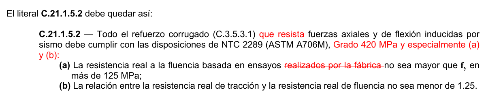

**C.21.1.5.3** — El acero de preesfuerzo que resiste fuerzas axiales y de flexión inducidas por sismo en elementos de pórticos y muros estructurales prefabricados, debe cumplir con las disposiciones de NTC 2010 (ASTM A416M) o NTC 2142 (ASTM A722M).

**C.21.1.5.4** — El valor de $f_{yt}$ usado para calcular la cuantía del refuerzo de confinamiento no debe exceder 700 MPa.

**C.21.1.5.5** — El valor de $f_{y}$ o $f_{yt}$ usado en el diseño del refuerzo a cortante debe cumplir con C.11.4.2.

**C.21.1.6** — Empalmes mecánicos en estructuras con capacidad de disipación de energía moderada (DMO) y especial (DES)

**C.21.1.6.1** — Los empalmes mecánicos deben clasificarse como Tipo 1 o Tipo 2, de acuerdo con lo siguiente:

(a) Los empalmes mecánicos Tipo 1 deben cumplir con C.12.14.3.2;

(b) Los empalmes mecánicos Tipo 2 deben cumplir con C.12.14.3.2 y deben desarrollar la resistencia a tracción especificada de las barras empalmadas.

**C.21.1.6.2** — Los empalmes mecánicos Tipo 1 no deben usarse dentro de una distancia igual al doble de la altura del elemento, medida desde la cara de la viga o columna para pórticos resistentes a momento especiales, o donde sea probable que se produzca fluencia del refuerzo como resultado de desplazamientos laterales inelásticos. Se pueden usar empalmes mecánicos tipo 2 en cualquier localización.

**C.21.1.7** — Empalmes soldados en estructuras con capacidad de disipación de energía moderada (DMO) y especial (DES)

**C.21.1.7.1** — Los empalmes soldados del refuerzo que resiste fuerzas inducidas por sismos deben cumplir con C.12.14.3.4 y no deben usarse dentro de una distancia igual al doble de la altura del elemento, medida desde la cara de la viga o columna para pórticos resistentes a momento especiales, o de donde sea probable que se produzca fluencia del refuerzo como resultado de desplazamientos laterales inelásticos.

**C.21.1.7.2** — No se puede soldar estribos, insertos, u otros elementos similares al refuerzo longitudinal requerido por el diseño.

#### C.21.1.8 — Anclaje al concreto

Los anclajes que resistan fuerzas inducidas por sismo en estructuras asignadas a capacidades de disipación de energía moderada (DMO) y especial (DES) deben cumplir los requisitos adicionales de C-D.3.3.

**C.21.2** — Pórticos ordinarios resistentes a momento con capacidad mínima de disipación de energía (DMI)

#### C.21.2.1 — Alcance

Las disposiciones de C.21.2 son aplicables a pórticos ordinarios resistentes a momento con capacidad mínima de disipación de energía (DMI) que forman parte del sistema de resistencia ante fuerzas sísmicas. Cuando el Título A del Reglamento NSR-10 permita un sistema de losas en dos direcciones, sin vigas, que se considere como parte de un pórtico del sistema de resistencia ante fuerzas sísmicas con capacidad mínima de disipación de energía (DMI), los detalles del refuerzo de cualquier vano que resiste momentos causados por $E$ deben cumplir con C.21.2.4.

**C.21.2.2** — Las vigas deben tener al menos dos barras longitudinales continuas colocadas a lo largo de ambas caras superior e inferior. Estas barras deben desarrollarse en la cara de apoyo.

**C.21.2.3** — Las columnas que tengan una altura libre menor o igual a cinco veces la dimensión $c_{1}$ deben diseñarse para cortante de acuerdo a C.21.3.3.

**C.21.2.4** — Losas en dos direcciones sin vigas con capacidad mínima de disipación de energía (DMI)

**C.21.2.4.1** — El momento mayorado de la losa en el apoyo asociado con el efecto sísmico, $E$ , debe determinarse mediante las combinaciones de cargas definidas por las ecuaciones (C.9-5) y (C.9-7). El refuerzo proporcionado para resistir $M_{slab}$, debe colocarse dentro de la franja de columna definida en C.13.2.1.

**C.21.2.4.2** — El refuerzo colocado dentro del ancho efectivo especificado en C.13.5.3.2 debe resistir $γ_{f}M_{slab}$. El ancho efectivo de la losa para las conexiones exteriores y de esquina no debe extenderse más allá de la cara de la columna una distancia mayor a $c_{t}$ medida en forma perpendicular a la luz de la losa.

**C.21.2.4.3** — No menos de la mitad del refuerzo en la franja de columna en el apoyo debe colocarse dentro del ancho efectivo de la losa especificado en C.13.5.3.2.

**C.21.2.4.4** — No menos de un cuarto del refuerzo superior en el apoyo de la franja de columna debe ser continuo a lo largo de la luz.

**C.21.2.4.5** — El refuerzo continuo inferior en la franja de columna no debe ser menor que un tercio del refuerzo superior en el apoyo en la franja de columna.

**C.21.2.4.6** — No menos de la mitad de todo el refuerzo inferior en el centro de la luz debe ser continuo y debe desarrollar $f_{y}$ en la cara del apoyo, como se define en C.13.6.2.5.

**C.21.2.4.7** — En los bordes discontinuos de la losa, todo el refuerzo superior e inferior en el apoyo debe desarrollarse en la cara del apoyo, como se define en C.13.6.2.5.

**C.21.2.4.8** — En las secciones críticas para columnas definidas en C.11.11.1.2, el cortante en dos direcciones causado por las cargas gravitacionales mayoradas no debe exceder de $0.4 φV_{c}$, donde $V_{c}$ debe ser calculado como se define en C.11.11.2.1 para las losas no preesforzadas y en C.11.11.2.2 para las losas preesforzadas. Este requisito puede obviarse si el diseño de la losa cumple con C.21.13.6.

### C.21.3 — Pórticos intermedios resistentes a momento con capacidad moderada de

disipación de energía (DMO)

#### C.21.3.1 — Alcance

Las disposiciones de C.21.3 son aplicables a pórticos intermedios resistentes a momento con capacidad moderada de disipación de energía (DMO) que forman parte del sistema de resistencia ante fuerzas sísmicas.

**C.21.3.2** — Los detalles del refuerzo en un elemento de un pórtico deben satisfacer C.21.3.4 cuando la carga axial mayorada de compresión del elemento, $P_{u}$ , no exceda $A_{g} f_{c}'/10$. Cuando $P_{u}$ es mayor, los detalles de refuerzo del pórtico deben cumplir con C.21.3.5.

**C.21.3.3** — El $φV_{n}$ de vigas y columnas que resisten efectos sísmicos, $E$ , no debe ser menor que el menor de (a) y (b):

(a) La suma del cortante asociado con el desarrollo de los momentos nominales del elemento en cada extremo restringido de la luz libre y el cortante calculado para cargas gravitacionales mayoradas.

(b) El cortante máximo obtenido de las combinaciones de carga de diseño que incluyan $E$ , considerando $E$ como el doble del prescrito por el Título A del Reglamento NSR-10.

<!-- mod:1-decreto-092-2011-137 -->
> **Modificación — Decreto 092 de 2011** · anexo, p. 29
>
> El literal C.21.3.3 debe quedar así:
>
> 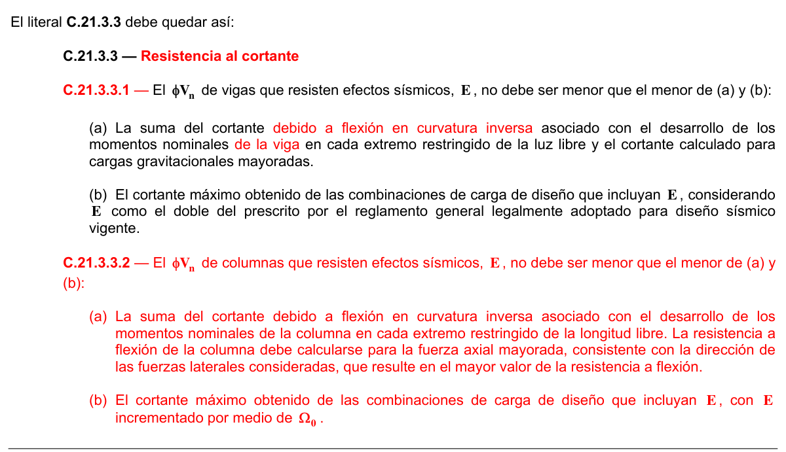

#### C.21.3.4 — Vigas con capacidad moderada de disipación de energía (DMO)

**C.21.3.4.1** — El ancho del elemento, $b_{w}$ , no debe ser menor que 200 mm.

**C.21.3.4.2** — La excentricidad respecto a la columna que le da apoyo no puede ser mayor que el 25% del ancho del apoyo medido en la dirección perpendicular a la dirección del eje longitudinal de la viga.

**C.21.3.4.3** — En cualquier sección de la viga el refuerzo superior e inferior no debe tener una cuantía, $ρ$ , inferior a la que se obtiene con la ecuación C.10-3, ni debe exceder 0.025. Debe haber al menos dos barras continuas con diámetro igual o superior a Nº 4 (1/2”) ó 12M (12 mm), tanto arriba como abajo.

**C.21.3.4.4** — La resistencia a momento positivo en la cara del nudo no debe ser menor que un tercio de la resistencia a momento negativo proporcionada en esa misma cara del nudo. La resistencia a momento negativo o positivo, en cualquier sección a lo largo de la longitud del elemento, no debe ser menor de un quinto de la resistencia máxima a momento proporcionada en la cara de cualquiera de los nudos.

**C.21.3.4.5** — No se permiten empalmes por traslapo dentro de los nudos.

**C.21.3.4.6** — En ambos extremos del elemento, deben disponerse estribos cerrados de confinamiento al menos No. 3 (3/8”) ó 10M (10 mm) por longitudes iguales a $2h$ , medidas desde la cara de elemento de apoyo hacia el centro de la luz. El primer estribo cerrado de confinamiento debe estar situado a no más de 50 mm de la cara del elemento de apoyo. El espaciamiento de los estribos cerrados de confinamiento no debe exceder el menor de (a), (b), (c) y (d):

(a) $d /4$ .

(b) Ocho veces el diámetro de la barra longitudinal confinada más pequeña.

(c) 24 veces el diámetro de la barra del estribo cerrado de confinamiento.

(d) 300 mm.

**C.21.3.4.7** — Donde se requieran estribos cerrados de confinamiento, las barras longitudinales del perímetro deben tener soporte lateral conforme a C.7.10.5.3.

**C.21.3.4.8** — Deben colocarse estribos con ganchos sísmicos en ambos extremos espaciados a no más de $d /2$ en toda la longitud del elemento.

#### C.21.3.5 — Columnas con capacidad moderada de disipación de energía (DMO)

**C.21.3.5.1** — La dimensión menor de la sección transversal, medida en una línea recta que pasa a través del centroide geométrico, no debe ser menor de 250 mm. Las columnas en forma de T, C o I pueden tener una dimensión mínima de 0.20 m pero su área no puede ser menor de 0.0625 m².

**C.21.3.5.2** — El área de refuerzo longitudinal, $A_{st}$ , no debe ser menor que $0.01A_{g}$ ni mayor que $0.04A_{g}$ .

**C.21.3.5.3** — Los empalmes mecánicos deben cumplir C.21.1.6 y los empalmes soldados deben cumplir C.21.1.7. Los empalmes por traslapo se permiten únicamente en la mitad central de la longitud del elemento y deben diseñarse como empalmes en tracción.

**C.21.3.5.4** — Debe utilizarse refuerzo en espiral, o estribos de confinamiento, como se indica a continuación, a menos que se requieran cantidades mayores por esfuerzos cortantes. Cuando se utilice refuerzo en espiral debe cumplirse con C.21.3.5.5. Cuando se utilicen estribos de confinamiento se debe cumplir con C.21.3.5.6 a C.21.3.5.11.

La Sección C.21.3.5.12 se aplica a todas las columnas, y C.21.3.5.13 se aplica a todas las columnas que soportan elementos rígidos discontinuos.

**C.21.3.5.5** — La cuantía volumétrica de refuerzo en espiral o de estribos cerrados de confinamiento circulares, $ρ_{s}$ , no debe ser menor que la requerida por la ecuación (C.21-1):

$$ \rho_s = 0.08\,\dfrac{f'_c}{f_{yt}} \tag{C.21-1} $$

y no debe ser menor que la requerida por la ecuación (C.10-5).

**C.21.3.5.6** — En ambos extremos del elemento debe proporcionarse estribos cerrados de confinamiento con un espaciamiento de $s_{o}$ por una longitud $ℓ_{o}$ , medida desde la cara del nudo. El espaciamiento $s_{o}$ no debe exceder el menor de (a), (b), (c) y (d):

(a) Ocho veces el diámetro de la barra longitudinal confinada de menor diámetro.

(b) 16 veces el diámetro de la barra del estribo cerrado de confinamiento.

(c) Un tercio de la menor dimensión de la sección transversal de la columna.

(d) 150 mm.

La longitud $ℓ_{o}$ , no debe ser menor que la mayor entre (e), (f) y (g):

(e) Una sexta parte de la luz libre de la columna.

(f) La mayor dimensión de la sección transversal de la columna.

(g) 500 mm.

**C.21.3.5.7** — El área total de la sección transversal del refuerzo de estribos cerrados de confinamiento rectangulares, $A_{sh}$, colocados en la longitud $ℓ_{o}$ no debe ser menor que la requerida por las ecuaciones (C.21-2) y (C.21-3).

$$ A_{sh} = 0.2\,\dfrac{s\,b_c f'_c}{f_{yt}} \left[\left(\dfrac{A_g}{A_{ch}}\right) - 1\right] \tag{C.21-2} $$

$$ A_{sh} = 0.06\,\dfrac{s\,b_c f'_c}{f_{yt}} \tag{C.21-3} $$

**C.21.3.5.8** — El refuerzo transversal debe disponerse mediante estribos cerrados de confinamiento rectilíneos, como mínimo de diámetro Nº 3 (3/8”) ó 10M (10 mm), con o sin ganchos suplementarios. Se pueden usar ganchos suplementarios del mismo diámetro de barra con el mismo espaciamiento de los estribos cerrados de confinamiento.

Cada extremo del gancho suplementario debe enlazar una barra perimetral del refuerzo longitudinal. Los extremos de los ganchos suplementarios consecutivos deben alternarse a lo largo del refuerzo longitudinal. El espaciamiento de los ganchos suplementarios o ramas con estribos de confinamiento rectilíneos dentro de una sección del elemento no debe exceder de 350 mm centro a centro en la dirección perpendicular al eje longitudinal del elemento estructural.

**C.21.3.5.9** — Alternativamente a lo indicado en C.21.3.5.7 y C.21.3.5.8 pueden colocarse estribos de confinamiento de diámetro Nº 3 (3/8”) ó 10M (10 mm), con $f_{yt}$ de 420 MPa, con una separación s de 100 mm. Si la distancia horizontal entre dos ramas paralelas de estribo es mayor que la mitad de la menor dimensión de la sección de la columna ó 200 mm, deben utilizarse cuantos estribos suplementarios de diámetro Nº 3 (3/8”) ó 10M (10 mm), con$f_{yt}$ de 420 MPa, sean necesarios para que esta separación entre ramas paralelas no exceda la mitad de la dimensión menor de la sección de la columna ó 200 mm. Este procedimiento alterno solo puede emplearse en columnas cuyo concreto tenga un $f_{c}'$ menor o igual a 35 MPa.

**C.21.3.5.10** — El primer estribo cerrado de confinamiento debe estar situado a no más de $s_{o}/2$ de la cara del nudo.

**C.21.3.5.11** — Fuera de la longitud $ℓ_{o}$ , deben colocarse estribos de confinamiento con la misma disposición, diámetro de barra y resistencia a la fluencia, $f_{yt}$, con un espaciamiento centro a centro que no debe ser mayor que 2 veces el espaciamiento utilizado en la longitud $ℓ_{o}$ .

**C.21.3.5.12** — El refuerzo transversal del nudo debe cumplir con C.11.10.

**C.21.3.5.13** — Las columnas que soportan reacciones de elementos rígidos discontinuos, como muros, deben estar provistas de refuerzo transversal con espaciamiento $s_{o}$, como se especifica en C.21.3.5.6, en su altura total debajo del nivel en el cual ocurre la discontinuidad, cuando la parte de la fuerza mayorada de compresión axial en estos elementos, relacionada con el efecto sísmico, excede $A_{g} f_{c}'/10$. Cuando las fuerzas de diseño han sido magnificadas para tener en cuenta la sobreresistencia de los elementos verticales del sistema de resistencia ante fuerzas sísmicas, el límite de $A_{g} f_{c}'/10$ debe ser incrementado a $A_{g} f_{c}'/4$. Este refuerzo transversal debe extenderse sobre y bajo las columnas, como se exige en C.21.6.4.6(b).

**C.21.3.6** — Resistencia mínima a flexión de las columnas de pórticos con capacidad moderada de disipación de energía (DMO)

**C.21.3.6.1** — Las columnas de pórticos con capacidad moderada de disipación de energía (DMO) deben satisfacer C.21.3.6.2 ó C.21.3.6.3.

<!-- mod:1-decreto-092-2011-138 -->
> **Modificación — Decreto 092 de 2011** · anexo, p. 29
>
> El literal C.21.3.6.1 debe quedar así:
>
> **C.21.3.6.1** — Las columnas de pórticos resistentes a momentos con capacidad moderada de disipación de energía (DMO), sistema estructural 2.a de la Tabla A.3-3 del Capítulo A.3, deben satisfacer C.21.3.6.2 ó C.21.3.6.3.

**C.21.3.6.2** — Las resistencias a flexión de las columnas deben satisfacer la ecuación (C.21-4).

$$ \sum M_{nc} \ge 1.2 \sum M_{nb} \tag{C.21-4} $$

$∑M_{nc}$ = suma de los momentos nominales de flexión de las columnas que llegan al nudo, evaluados en las caras del nudo. La resistencia a la flexión de la columna debe calcularse para la fuerza axial mayorada, congruente con la dirección de las fuerzas laterales consideradas, que conduzca a la resistencia a la flexión más baja.

$∑M_{nb}$= suma de los momentos resistentes nominales a flexión de las vigas que llegan al nudo, evaluadas en la cara del nudo. En vigas T, cuando la losa está en tracción debida a momento en la cara del nudo, el refuerzo de la losa dentro del ancho efectivo de losa definido en 8.12 debe suponerse que contribuye a $M_{nb}$ siempre que el refuerzo de la losa esté desarrollado en la sección crítica para flexión.

Las resistencias a la flexión deben sumarse de tal manera que los momentos de la columna se opongan a los momentos de la viga. Debe satisfacerse la ecuación (C.21-4) para momentos de vigas que actúen en ambas direcciones en el plano vertical del pórtico que se considera.

**C.21.3.6.3** — Cuando C.21.3.6.2 no se satisface en un nudo, la resistencia lateral y la rigidez de las columnas que soportan las reacciones provenientes de dicho nudo deben ser ignoradas al determinar la resistencia y la rigidez calculadas para la estructura. Estas columnas deben tener el refuerzo de confinamiento requerido en c.21.3.5.5, ó en C.21.3.5.7 a C.21.3.5.9 en toda la longitud vertical de la columna hasta la cimentación desde el nudo donde no se satisface. El incumplimiento del requisito solo se permite hasta en un 10 por ciento de las columnas de un mismo piso.

Si se excede este porcentaje deben rediseñarse las columnas y vigas hasta que se logre el cumplimiento del requisito contenido en C.21.3.6.2.

**C.21.4** — Muros estructurales intermedios con capacidad moderada de disipación de energía (DMO)

#### C.21.4.1 — Alcance

Los requisitos de C.21.4 se aplican a muros estructurales intermedios construidos con concreto prefabricado o vaciado en sitio que forman parte del sistema de resistencia ante fuerzas sísmicas en estructuras con capacidad moderada de disipación de energía (DMO). Los muros estructurales prefabricados, deben cumplir con C.21.4.2 y C.21.4.3 además de los requisitos para muros vaciados en sitio. Los muros vaciados en sitio deben cumplir con C.21.4.4.

**C.21.4.2** — En las conexiones entre los paneles de muro, o entre los paneles de muro y la cimentación, se debe restringir la fluencia a los elementos de acero o al refuerzo.

**C.21.4.3** — Los elementos de la conexión que no han sido diseñados para fluencia deben resistir al menos $1.5S_{y}$ .

**C.21.4.4** — Los muros estructurales intermedios con capacidad de disipación de energía moderada (DMO) y sus vigas de acople deben cumplir todos los requisitos de C.21.9 para muros estructurales especiales (DES) vaciados en sitio, con las excepciones y modificaciones que se presentan a continuación:

**C.21.4.4.1** — En C.21.9.6.2(a) para muros con capacidad moderada de disipación de energía (DMO) el cociente $δ_{u}/h_{w}$en la ecuación (C.21-11) no debe tomarse menor que 0.0035.

**C.21.4.4.2** — En C.21.9.6.3 para muros con capacidad moderada de disipación de energía (DMO) los elementos de borde deben colocarse cuando el esfuerzo de compresión máximo de la fibra extrema correspondiente a las fuerzas mayoradas incluyendo los efectos sísmicos $E$ , sobrepase $0.3f_{c}'$. Los elementos de borde especiales pueden ser descontinuados donde el esfuerzo de compresión calculado sea menor que $0.22f_{c}'$. El resto de los requisitos de esta sección se aplican como dice allí.

**C.21.4.4.3** — Para muros con capacidad moderada de disipación de energía (DMO) la sección C.21.9.6.4(c) debe substituirse por:

(c) El refuerzo transversal de los elementos especiales de borde debe cumplir con los requisitos especificados en C.21.3.5.6 (a), (b), (c) y (d), C.21.3.5.7 y C.21.3.5.8 excepto que no se necesita cumplir con la ecuación (C.21-2) y el límite de espaciamiento del refuerzo transversal de C.21.3.5.6(c) debe ser de al menos un medio de la dimensión menor del elemento de borde pero no hay necesidad de tomarla menor de 150 mm.

<!-- mod:2-decreto-340-2012-23 -->
> **Modificación — Decreto 340 de 2012** · anexo, p. 6
>
> Al final de la sección C.21.4.4.3 donde dice “… pero no hay necesidad de tomarla menor de 150 mm.”, debe ser ““… pero no hay necesidad que este espaciamiento sea menor de 75 mm.”.

**C.21.4.4.4** — La sección C.21.9.9 no hay necesidad de cumplirla.

**C.21.5** — Elementos sometidos a flexión en pórticos especiales resistentes a momento con capacidad especial de disipación de energía (DES)

<!-- mod:2-decreto-340-2012-22 -->
> **Modificación — Decreto 340 de 2012** · anexo, p. 6
>
> La sección C.21.4.1 debe quedar así:
>
> 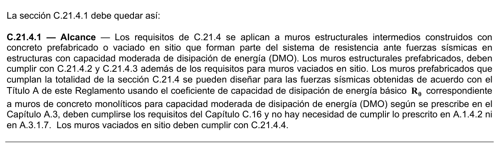

#### C.21.5.1 — Alcance

Las disposiciones de C.21.5 son aplicables a elementos de pórticos especiales resistentes a momento diseñados principalmente para resistir flexión. Estos elementos de pórtico también deben satisfacer las condiciones de C.21.5.1.1 a C.21.5.1.4.

**C.21.5.1.1** — La fuerza mayorada de compresión axial en el elemento, $P_{u}$ , no debe exceder $A_{g} f_{c}'/10$.

**C.21.5.1.2** — La luz libre del elemento, $ℓ_{n}$ , no debe ser menor que cuatro veces su altura útil.

**C.21.5.1.3** — El ancho del elemento, $b_{w}$ , no debe ser menor que el más pequeño de $0.3h$ y 250 mm.

<!-- mod:2-decreto-340-2012-24 -->
> **Modificación — Decreto 340 de 2012** · anexo, p. 6
>
> La sección C.21.5.1.3 debe quedar así:
>
> 

**C.21.5.1.4** — El ancho del elemento, $b_{w}$ , no debe exceder el ancho del elemento de apoyo $c_{2}$ , más una distancia a cada lado del elemento de apoyo que sea igual al menor de entre (a) y (b):

(a) Ancho del elemento de apoyo,$c_{2}$ , y

(b) 0.75 veces la dimensión total del elemento de apoyo $c_{1}$ .

#### C.21.5.2 — Refuerzo longitudinal

**C.21.5.2.1** — En cualquier sección de un elemento a flexión, excepto por lo dispuesto en C.10.5.3, para el refuerzo tanto superior como inferior, el área de refuerzo no debe ser menor que la dada por la ecuación (C.10-3) ni menor que $1.4b_{w} d /f_{y}$y la cuantía de refuerzo, $ρ$ , no debe exceder 0.025. Al menos dos barras deben disponerse en forma continua tanto en la parte superior como inferior.

**C.21.5.2.2** — La resistencia a momento positivo en la cara del nudo no debe ser menor que la mitad de la resistencia a momento negativo proporcionada en esa misma cara. La resistencia a momento negativo o positivo, en cualquier sección a lo largo de la longitud del elemento, debe ser menor a un cuarto de la resistencia máxima a momento proporcionada en la cara de cualquiera de los nudos.

<!-- mod:1-decreto-092-2011-139 -->
> **Modificación — Decreto 092 de 2011** · anexo, p. 29
>
> En C.21.5.2.2 falta un “no” en la última frase, después de la última coma. C.21.5.2.2 quedará así:
>
> **C.21.5.2.2** — La resistencia a momento positivo en la cara del nudo no debe ser menor que la mitad de la resistencia a momento negativo proporcionada en esa misma cara. La resistencia a momento negativo o positivo, en cualquier sección a lo largo de la longitud del elemento, no debe ser menor a un cuarto de la resistencia máxima a momento proporcionada en la cara de cualquiera de los nudos.

**C.21.5.2.3** — Sólo se permiten empalmes por traslapo de refuerzo de flexión cuando se proporcionan estribos cerrados de confinamiento o espirales en la longitud de empalme por traslapo. El espaciamiento del refuerzo transversal que confina las barras traslapadas no debe exceder al menor entre $d /4$ y 100 mm. No deben usarse empalmes por traslapo:

(a) Dentro de los nudos.

(b) En una distancia de dos veces la altura del elemento medida desde la cara del nudo, y

(c) Donde el análisis indique fluencia por flexión causada por desplazamientos laterales inelásticos del pórtico.

**C.21.5.2.4** — Los empalmes mecánicos deben cumplir con C.21.1.6 y los empalmes soldados deben cumplir con C.21.1.7.

**C.21.5.2.5** — Cuando se use preesforzado, éste debe cumplir con (a) a (d), a menos que se use en un pórtico especial a momento como lo permite C.21.8.3:

(a) El promedio de preesfuerzo, $f_{pc}$, calculado para un área igual a la menor dimensión de la sección transversal del elemento multiplicado por la dimensión transversal perpendicular no debe exceder al menor de 3.5 MPa y $f_{c}'/10$.

(b) El acero de preesforzado no debe estar adherido en las regiones potenciales de articulación plástica, y la deformación unitaria en el acero de preesforzado bajo el diseño de desplazamiento debe ser menor al 1 por ciento.

(c) El acero de preesforzado no debe contribuir con más del un cuarto de la resistencia a flexión positiva o negativa en la sección crítica de una región de articulación plástica y debe estar anclado en la cara externa del nudo o más allá de ella.

(d) Los anclajes de tendones de postensado resistentes a las fuerzas inducidas por sismo deben ser capaces de permitir que los tendones resistan 50 ciclos de carga, que ocurran dentro del 40 y 85 por ciento de la resistencia a tracción especificada del acero de preesfuerzo.

<!-- mod:2-decreto-340-2012-25 -->
> **Modificación — Decreto 340 de 2012** · anexo, p. 7
>
> En C.21.5.2.5 la referencia a C.21.8.3 debe ser a C.21.8.4.

#### C.21.5.3 — Refuerzo transversal

**C.21.5.3.1** — Deben disponerse estribos cerrados de confinamiento en las siguientes regiones de los elementos pertenecientes a pórticos:

(a) En una longitud igual a dos veces la altura del elemento, medida desde la cara de elemento de apoyo hacia el centro de la luz, en ambos extremos del elemento en flexión.

(b) En longitudes iguales a dos veces la altura del elemento a ambos lados de una sección donde puede ocurrir fluencia por flexión debido a desplazamientos laterales inelásticos del pórtico.

**C.21.5.3.2** — El primer estribo cerrado de confinamiento debe estar situado a no más de 50 mm de la cara del elemento de apoyo. El espaciamiento de los estribos cerrados de confinamiento no debe exceder el menor de (a), (b),

(c) y (d):

(a) $d /4$ ;

(b) Ocho veces el diámetro de las barras longitudinales más pequeñas.

(c) 24 veces el diámetro de la barra del estribo cerrado de confinamiento, y

(d) 300 mm.

<!-- mod:1-decreto-092-2011-140 -->
> **Modificación — Decreto 092 de 2011** · anexo, p. 29
>
> El literal C.21.5.3.2 debe quedar así:
>
> 
>
> 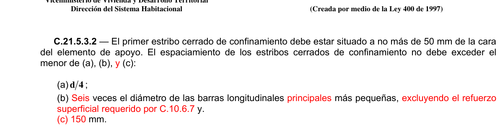

**C.21.5.3.3** — Cuando se requieran estribos cerrados de confinamiento, las barras longitudinales del perímetro deben tener soporte lateral conforme a C.7.10.5.3.

<!-- mod:1-decreto-092-2011-141 -->
> **Modificación — Decreto 092 de 2011** · anexo, p. 30
>
> El literal C.21.5.3.3 debe quedar así:
>
> **C.21.5.3.3** — Cuando se requieran estribos cerrados de confinamiento, las barras longitudinales principales para flexión más cercanas a las caras de tracción y compresión deben tener soporte lateral conforme a C.7.10.5.3 ó C.7.10.5.4. El espaciamiento entre barras longitudinales con soporte lateral no debe exceder 350 mm. No hay necesidad de dar soporte lateral al refuerzo superficial requerido por C.10.6.7.

**C.21.5.3.4** — Cuando no se requieran estribos cerrados de confinamiento, deben colocarse estribos con ganchos sísmicos en ambos extremos, espaciados a no más de $d /2$ en toda la longitud del elemento.

**C.21.5.3.5** — Los estribos que se requieran para resistir cortante deben ser estribos cerrados de confinamiento colocados en los lugares dentro de los elementos descritos en C.21.5.3.1.

**C.21.5.3.6** — Se permite que los estribos cerrados de confinamiento en elementos en flexión sean hechos hasta con dos piezas de refuerzo: un estribo con un gancho sísmico en cada extremo y cerrado por un gancho suplementario. Los ganchos suplementarios consecutivos que enlazan la misma barra longitudinal deben tener sus ganchos de 90º en lados opuestos del elemento en flexión. Si las barras de refuerzo longitudinal aseguradas por los ganchos suplementarios están confinadas por una losa en un solo lado del elemento en flexión, los ganchos de 90º de los ganchos suplementarios deben ser colocados en dicho lado.

#### C.21.5.4 — Requisitos de resistencia a cortante

**C.21.5.4.1** — Fuerzas de diseño La fuerza cortante de diseño, $V_{e}$ , se debe determinar a partir de las fuerzas estáticas en la parte del elemento comprendida entre las caras del nudo. Se debe suponer que en las caras de los nudos localizados en los extremos del elemento actúan momentos de signo opuesto correspondientes a la resistencia probable, $M_{pr}$, y que el elemento está además cargado con cargas aferentes gravitacionales mayoradas a lo largo de la luz.

**C.21.5.4.2** — Refuerzo transversal El refuerzo transversal en los lugares identificados en C.21.5.3.1 debe diseñarse para resistir cortante suponiendo

$V_{c}=0$ cuando se produzcan simultáneamente (a) y (b):

(a) La fuerza cortante inducida por el sismo calculada de acuerdo con C.21.5.4.1 representa la mitad o más de la resistencia máxima a cortante requerida en esas zonas;

(b) La fuerza axial de compresión mayorada, $P_{u}$ , incluyendo lo efectos sísmicos es menor que $A_{g} f_{c}'/20$.

**C.21.6** — Elementos sometidos a flexión y carga axial pertenecientes a pórticos especiales resistentes a momento con capacidad especial de disipación de energía (DES)

#### C.21.6.1 — Alcance

Las disposiciones de esta sección se aplican a elementos pertenecientes a pórticos especiales resistentes a momento

(a) que resisten fuerzas inducidas por sismos, y (b) que tienen una fuerza axial mayorada de compresión, $P_{u}$ , bajo cualquier combinación de carga que excede $A_{g} f_{c}'/10$. Estos elementos de pórtico también deben satisfacer C.21.6.1.1 y C.21.6.1.2.

**C.21.6.1.1** — La dimensión menor de la sección transversal, medida en una línea recta que pasa a través del centroide geométrico, no debe ser menor de 300 mm. Las columnas en forma de T, C o I pueden tener una dimensión mínima de 0.25 m pero su área no puede ser menor de 0.09 m².

<!-- mod:2-decreto-340-2012-26 -->
> *Texto vigente según el Decreto 340 de 2012 (anexo, p. 7).*

**C.21.6.1.2** — La relación entre la dimensión menor de la sección transversal y la dimensión perpendicular no debe ser menor que:

(a) 0.35 para secciones transversales cuya menor dimensión es menor o igual a 300 mm,

(b) 0.25 para secciones transversales cuya menor dimensión es mayor de 300 mm y menor o igual a 500 mm, y

(c) 0.20 para secciones transversales cuya menor dimensión es mayor de 500 mm.

#### C.21.6.2 — Resistencia mínima a flexión de columnas

**C.21.6.2.1** — Las columnas deben satisfacer C.21.6.2.2 ó C.21.6.2.3.

**C.21.6.2.2** — Las resistencias a flexión de las columnas deben satisfacer la ecuación (C.21-4), la cual se repite acá por conveniencia.

$$ \sum M_{nc} \ge 1.2\sum M_{nb} \tag{C.21-4} $$

$∑M_{nc}$ = suma de los momentos nominales de flexión de las columnas que llegan al nudo, evaluados en las caras del nudo. La resistencia a la flexión de la columna debe calcularse para la fuerza axial mayorada, congruente con la dirección de las fuerzas laterales consideradas, que conduzca a la resistencia a la flexión más baja.

$∑M_{nb}$= suma de los momentos resistentes nominales a flexión de las vigas que llegan al nudo, evaluadas en la cara del nudo. En vigas T, cuando la losa está en tracción debida a momento en la cara del nudo, el refuerzo de la losa dentro del ancho efectivo de losa definido en 8.12 debe suponerse que contribuye a $M_{nb}$ siempre que el refuerzo de la losa esté desarrollado en la sección crítica para flexión.

Las resistencias a la flexión deben sumarse de tal manera que los momentos de la columna se opongan a los momentos de la viga. Debe satisfacerse la ecuación (C.21-4) para momentos de vigas que actúen en ambas direcciones en el plano vertical del pórtico que se considera.

**C.21.6.2.3** — Cuando C.21.6.2.2 no se satisface en un nudo, la resistencia lateral y la rigidez de las columnas que soportan las reacciones provenientes de dicho nudo deben ser ignoradas al determinar la resistencia y la rigidez calculadas para la estructura. Estas columnas deben satisfacer C.21.13.

#### C.21.6.3 — Refuerzo longitudinal

**C.21.6.3.1** — El área de refuerzo longitudinal, $A_{st}$ , no debe ser menor que $0.01A_{g}$ ni mayor que $0.04A_{g}$ .

**C.21.6.3.2** — Los empalmes mecánicos deben cumplir C.21.1.6 y los empalmes soldados deben cumplir C.21.1.7. Los empalmes por traslapo se permiten sólo dentro de la mitad central de la longitud del elemento, deben diseñarse como empalmes por traslapo de tracción y deben estar confinados dentro del refuerzo transversal de acuerdo con C.21.6.4.2 y C.21.6.4.3.

<!-- mod:1-decreto-092-2011-142 -->
> **Modificación — Decreto 092 de 2011** · anexo, p. 30
>
> El literal C.21.6.3.2 debe quedar como se indica y el existente se renumera como C.21.6.3.3 así:
>
> **C.21.6.3.2** — En columnas con estribos de confinamiento circulares, el mínimo número de barras longitudinales es 6.
>
> **C.21.6.3.3** — Los empalmes mecánicos deben cumplir C.21.1.6 y los empalmes...

#### C.21.6.4 — Refuerzo transversal

**C.21.6.4.1** — El refuerzo transversal en las cantidades que se especifican en C.21.6.4.2 hasta C.21.6.4.4, debe suministrarse en una longitud $ℓ_{o}$ medida desde cada cara del nudo y a ambos lados de cualquier sección donde pueda ocurrir fluencia por flexión como resultado de desplazamientos laterales inelásticos del pórtico. La longitud $ℓ_{o}$ no debe ser menor que la mayor de (a), (b) y (c):

(a) La altura del elemento en la cara del nudo o en la sección donde puede ocurrir fluencia por flexión.

(b) Un sexto de la luz libre del elemento, y

(c) 450 mm.

**C.21.6.4.2** — El refuerzo transversal debe disponerse mediante espirales sencillas o traslapadas, que cumplan con C.7.10.4, estribos cerrados de confinamiento circulares o estribos cerrados de confinamiento rectilíneos con o sin ganchos suplementarios. Se pueden usar ganchos suplementarios del mismo diámetro de barra o con un diámetro menor y con el mismo espaciamiento de los estribos cerrados de confinamiento. Cada extremo del gancho suplementario debe enlazar una barra perimetral del refuerzo longitudinal. Los extremos de los ganchos suplementarios consecutivos deben alternarse a lo largo del refuerzo longitudinal. El espaciamiento de los ganchos suplementarios o ramas con estribos de confinamiento rectilíneos, $h_{x}$ , dentro de una sección del elemento no debe exceder de 350 mm centro a centro.

**C.21.6.4.3** — La separación del refuerzo transversal a lo largo del eje longitudinal del elemento no debe exceder la menor de (a), (b), y (c):

(a) La cuarta parte de la dimensión mínima del elemento.

(b) Seis veces el diámetro de la barra de refuerzo longitudinal menor, y

(c) $s_{o}$, según lo definido en la ecuación (C.21-5).

$$ s_o = 100 + \left(\dfrac{350 - h_x}{3}\right) \tag{C.21-5} $$

El valor de $s_{o}$ no debe ser mayor a 150 mm y no es necesario tomarlo menor a 100 mm.

**C.21.6.4.4** — Debe proporcionarse refuerzo transversal en las cantidades que se especifican de (a) o (b), a menos que en 21.6.5 se exija mayor cantidad.

(a) La cuantía volumétrica de refuerzo en espiral o de estribos cerrados de confinamiento circulares, $ρ_{s}$ , no debe ser menor que la requerida por la ecuación (C.21-6):

$$ \rho_s = 0.12\,\dfrac{f'_c}{f_{yt}} \tag{C.21-6} $$

y no debe ser menor que la requerida por la ecuación (C.10-5).

(b) El área total de la sección transversal del refuerzo de estribos cerrados de confinamiento rectangulares, $A_{sh}$, no debe ser menor que la requerida por las ecuaciones (C.21-7) y (C.21-8).

$$ A_{sh} = 0.3\,\dfrac{s\,b_c f'_c}{f_{yt}} \left[\left(\dfrac{A_g}{A_{ch}}\right) - 1\right] \tag{C.21-7} $$

$$ A_{sh} = 0.09\,\dfrac{s\,b_c f'_c}{f_{yt}} \tag{C.21-8} $$

**C.21.6.4.5** — Más allá de la longitud $ℓ_{o}$ , especificada en C.21.6.4.1, el resto de la columna debe contener refuerzo en forma de espiral o de estribo cerrado de confinamiento, que cumpla con C.7.10, con un espaciamiento, $s$ , medido centro a centro que no exceda al menor de seis veces el diámetro de las barras longitudinales de la columna o 150 mm., a menos que C.21.6.3.2 ó C.21.6.5 requieran mayores cantidades de refuerzo transversal.

**C.21.6.4.6** — Las columnas que soportan reacciones de elementos rígidos discontinuos, como muros, deben satisfacer (a) y (b):

(a) El refuerzo transversal como se especifica en C.21.6.4.2 a C.21.6.4.4, debe proporcionarse en su altura total, en todos los niveles, debajo del nivel en el cual ocurre la discontinuidad, cuando la fuerza mayorada de compresión axial en estos elementos, relacionada con el efecto sísmico, excede $A_{g} f_{c}'/10$. Donde se hayan magnificado las fuerzas de diseño para calcular la sobreresistencia de los elementos verticales del sistema de resistencia ante fuerzas sísmicas el límite de $A_{g} f_{c}'/10$ debe aumentarse a $A_{g} f_{c}'/4$.

(b) El refuerzo transversal, debe extenderse por lo menos $ℓ_{d}$ de la barra de la columna longitudinal mayor, dentro del elemento discontinuo, donde $ℓ_{d}$ se determina de acuerdo con C.21.7.5. Si el extremo inferior de la columna termina en un muro, el refuerzo transversal requerido debe extenderse dentro del muro por lo menos $ℓ_{d}$ de la mayor barra longitudinal de la columna en el punto en que termina. Si la columna termina en una zapata o una losa de cimentación, el refuerzo transversal requerido debe extenderse por lo menos 300 mm en la zapata o losa de cimentación.

<!-- mod:1-decreto-092-2011-143 -->
> **Modificación — Decreto 092 de 2011** · anexo, p. 30
>
> El literal (b) de C.21.6.4.6 debe quedar así:
>
> 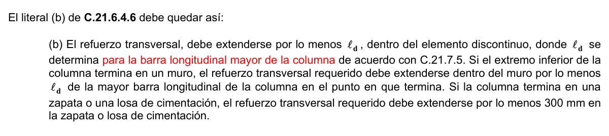

**C.21.6.4.7** — Si el recubrimiento de concreto fuera del refuerzo transversal de confinamiento, especificado en C.21.6.4.1, C.21.6.4.5 y C.21.6.4.6, excede 100 mm, debe colocarse refuerzo transversal adicional. El recubrimiento de concreto sobre el refuerzo transversal adicional no debe exceder de 100 mm con un espaciamiento del refuerzo transversal adicional no superior a 300 mm.

#### C.21.6.5 — Requisitos de resistencia a cortante

**C.21.6.5.1** — Fuerzas de diseño La fuerza de cortante de diseño, $V_{e}$ , se debe determinar considerando las máximas fuerzas que se puedan generar en las caras de los nudos en cada extremo del elemento. Estas fuerzas en el nudo se deben determinar usando las resistencias a flexión máximas probables $M_{pr}$ en cada extremo del elemento, correspondientes al rango de cargas axiales mayoradas, $P_{u}$ , que actúan en él. No es necesario que las fuerzas cortantes en el elemento sean mayores que aquellas determinadas a partir de la resistencia de los nudos, basada en $M_{pr}$ de los elementos transversales que llegan al nudo. En ningún caso $V_{e}$ debe ser menor que el cortante mayorado determinado a partir del análisis de la estructura.

**C.21.6.5.2** — Refuerzo transversal El refuerzo transversal en la longitud $ℓ_{o}$ , identificada en C.21.6.4.1, debe diseñarse para resistir el cortante suponiendo $V_{c}=0$ cuando (a) y (b) ocurran simultáneamente:

(a) El esfuerzo de cortante inducido por sismo, calculado de acuerdo con C.21.6.5.1, representa la mitad o más de la resistencia máxima al cortante requerida dentro de $ℓ_{o}$ .

(b) La fuerza axial de compresión mayorada, $P_{u}$ , incluyendo el efecto sísmico es menor que $A_{g} f_{c}'/20$.

**C.21.7** — Nudos en pórticos especiales resistentes a momento con capacidad especial de disipación de energía (DES)

#### C.21.7.1 — Alcance

Los requisitos de C.21.7 se aplican a los nudos viga-columna de pórticos especiales resistentes a momento que forman parte del sistema de resistencia ante fuerzas sísmicas.

#### C.21.7.2 — Requisitos generales

**C.21.7.2.1** — Las fuerzas en el refuerzo longitudinal de vigas en la cara del nudo deben determinarse suponiendo que la resistencia en el refuerzo de tracción por flexión es $1.25f_{y}$ .

**C.21.7.2.2** — El refuerzo longitudinal de una viga que termine en una columna, debe prolongarse hasta la cara más distante del núcleo confinado de la columna y anclarse, en tracción, de acuerdo con C.21.7.5, y en compresión de acuerdo con el Capítulo C.12.

**C.21.7.2.3** — Donde el refuerzo longitudinal de una viga atraviesa un nudo viga-columna, la dimensión de la columna paralela al refuerzo de la viga no debe ser menor que 20 veces el diámetro de la barra longitudinal de viga de mayor diámetro, para concretos de peso normal. Para concretos livianos, la dimensión no debe ser menor que 26 veces el diámetro de la barra.

#### C.21.7.3 — Refuerzo transversal

**C.21.7.3.1** — El refuerzo transversal del nudo debe satisfacer C.21.6.4.4(a) ó C.21.6.4.4(b) y además debe cumplir con C.21.6.4.2, C.21.6.4.3 y C.21.6.4.7, excepto lo permitido en C.21.7.3.2.

**C.21.7.3.2** — Cuando existan elementos que llegan en los cuatro lados del nudo y el ancho de cada elemento mide por lo menos tres cuartas partes del ancho de la columna, debe disponerse refuerzo transversal igual, por lo menos, a la mitad de la cantidad requerida en C.21.6.4.4(a) ó C.21.6.4.4(b), dentro del $h$ del elemento de menor altura que llegue al nudo. En estos lugares, se permite que el espaciamiento especificado en C.21.6.4.3 se incremente a 150 mm.

**C.21.7.3.3** — Debe disponerse refuerzo transversal que pase a través del nudo para proporcionar confinamiento al refuerzo longitudinal de viga que pasa fuera del núcleo de la columna, que cumpla con los requisitos de espaciamiento de C.21.5.3.2, y los requisitos C.21.5.3.3 y C.21.5.3.6, cuando dicho confinamiento no es suministrado por una viga que llegue al nudo.

#### C.21.7.4 — Resistencia al cortante

**C.21.7.4.1** — $V_{n}$ en el nudo no debe ser mayor que los valores especificadas a continuación, para concreto de peso normal:

Para nudos confinados en las cuatro caras ................................................... $1.7 \sqrt{f_{c} '}A_{j}$ Para nudos confinados en tres caras o en dos caras opuestas .................... $1.2 \sqrt{f_{c} '}A_{j}$ Para otros casos ............................................................................................ $1.0 \sqrt{f_{c} '}A_{j}$ Se considera que un elemento proporciona confinamiento al nudo si al menos las tres cuartas partes de la cara del nudo están cubiertas por el elemento que llega al nudo. Se permite considerar como elementos de confinamiento a las extensiones de las vigas que se extienden al menos una altura total $h$ de la viga más allá de la cara del nudo. Las extensiones de las vigas deben cumplir con C.21.5.1.3, C.21.5.2.1, C.21.5.3.2, C.21.5.3.3 y C.21.5.3.6. Un nudo se considera confinado si tales elementos de confinamiento llegan a todas las caras del nudo.

$A_{j}$ es el área efectiva de la sección transversal dentro del nudo, calculada como el producto de la profundidad del nudo por su ancho efectivo. La profundidad del nudo es la altura total de la sección de la columna, $h$ . El ancho efectivo del nudo debe ser el ancho total de la columna, excepto que cuando la viga llega a una columna más ancha, el ancho efectivo del nudo no debe exceder el menor de (a) y (b):

(a) el ancho de la viga más la altura del nudo,

(b) dos veces la distancia perpendicular más pequeña del eje longitudinal de la vigas al lado de la columna.

<!-- mod:1-decreto-092-2011-144 -->
> **Modificación — Decreto 092 de 2011** · anexo, p. 30
>
> El literal C.21.7.4.1 debe quedar así:
>
> 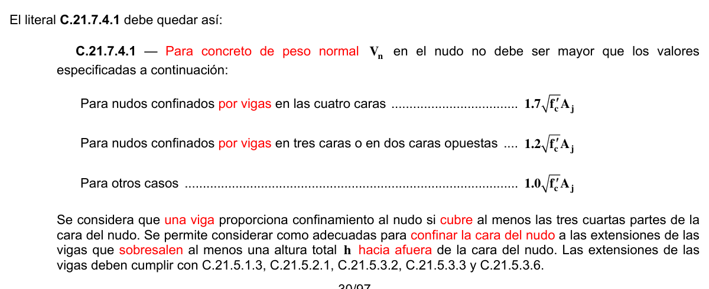

**C.21.7.4.2** — Para concreto con agregado liviano, la resistencia nominal al cortante del nudo no debe exceder de las tres cuartas partes de los límites señalados en C.21.7.4.1.

#### C.21.7.5 — Longitud de desarrollo de barras en tracción.

**C.21.7.5.1** — Para tamaños de barras No. 3 (3/8”) ó 10M (10 mm) a No. 11 (1-3/8”) ó 36M (36 mm), la longitud de desarrollo$ℓ_{dh}$ para una barra con gancho estándar de 90° en concreto de peso normal no debe ser menor que el mayor valor entre $8d_{b}$ , 150 mm, y la longitud requerida por la ecuación (C.21-9):

$$ \ell_{dh} = \dfrac{f_y d_b}{5.4\sqrt{f'_c}} \tag{C.21-9} $$

Para concreto liviano, $ℓ_{dh}$ para una barra con gancho estándar de 90° no debe ser menor que el mayor valor entre $10d_{b}$ , 190 mm, y 1.25 veces la longitud requerida por la ecuación (C.21-9).

El gancho de 90° debe estar colocado dentro del núcleo confinado de una columna o elemento de borde.

**C.21.7.5.2** — Para barras No. 3 (3/8”) ó 10M (10 mm) a No. 11 (1-3/8”) ó 36M (36 mm), $ℓ_{d}$ , la longitud de desarrollo en tracción para una barra recta, no debe ser menor que la mayor de (a) y (b):

(a) 2.5 veces la longitud requerida en C.21.7.5.1 si el espesor de concreto colocado fresco en una sola operación debajo la barra no excede de 300 mm.

(b) 3.25 veces la longitud requerida en C.21.7.5.1 si el espesor de concreto colocado fresco en una sola operación debajo de la barra excede de 300 mm.

**C.21.7.5.3** — Las barras rectas que terminan en un nudo deben pasar a través del núcleo confinado de la columna o elemento de borde. Cualquier porción de $ℓ_{d}$ fuera del núcleo confinado debe incrementarse mediante un factor de 1.6.

**C.21.7.5.4** — Si se usa refuerzo recubierto con epóxico, las longitudes de desarrollo de C.21.7.5.1 a C.21.7.5.3 deben multiplicarse por el factor correspondiente especificado en C.12.2.4 ó C.12.5.2.

### C.21.8 — Pórticos especiales resistentes a momento construidos con concreto

prefabricado con capacidad especial de disipación de energía (DES)

#### C.21.8.1 — Alcance

Los requisitos de C.21.8 se aplican a pórticos especiales resistente a momento construidos usando concreto prefabricado que forma parte del sistema de resistencia ante fuerzas sísmicas.

**C.21.8.2** — Los pórticos especiales resistentes a momento prefabricados con conexiones dúctiles deben cumplir con

(a) y (b) y con todos los requisitos para pórticos especiales resistentes a momento construidos en obra:

(a) $V_{n}$ para conexiones, calculado de acuerdo con C.11.6.4 no debe ser menos de $2V_{e}$ , donde $V_{e}$ se calcula de acuerdo con C.21.5.4.1 ó C.21.6.5.1.

(b) Los empalmes mecánicos del refuerzo de las vigas deben ubicarse a no menos de $h /2$ de la cara del nudo y deben cumplir con los requisitos de C.21.2.6.

**C.21.8.3** — Los pórticos especiales resistentes a momento prefabricados con conexiones fuertes deben cumplir con todos los requisitos para pórticos especiales resistentes a momento construidos en obra, así como también con (a), (b), (c) y (d):

(a) Las disposiciones de 21.5.1.2 deben aplicarse a los segmentos entre las zonas donde se pretende que la fluencia por flexión ocurra debido a los desplazamientos de diseño;

(b) La resistencia de diseño de la conexión fuerte $φS_{n}$ no debe ser menor a $S_{e}$ ;

(c) El refuerzo longitudinal principal debe ser continuo a lo largo de las conexiones y debe desarrollarse fuera, tanto de la conexión fuerte como de la región de la articulación plástica, y

(d) En conexiones columna-columna, $φS_{n}$ no debe ser menor de $1.4S_{e}$ . En las conexiones columna-columna, $φM_{n}$ no debe ser menor de $0.4M_{pr}$ para la columna dentro de la altura del piso, y $φV_{n}$ de la conexión no debe ser menor de $V_{e}$ determinado siguiendo C.21.6.5.1.

**C.21.8.4** — Los pórticos especiales resistentes a momento, construidos usando concreto prefabricado y que no cumplen con los requisitos de C.21.8.2 ó C.21.8.3 deben cumplir con las disposiciones de ACI 374.1 y con los requisitos (a) y (b) siguientes:

(a) Los detalles y materiales empleados en los especímenes de ensayo deben ser representativos de los usados en la estructura, y

(b) El procedimiento de diseño usado para diseñar los especímenes de ensayo debe definir el mecanismo por el cual el pórtico resiste los efectos sísmicos y de gravedad, y debe establecer los valores de aceptación que garanticen ese mecanismo. Las partes del mecanismo que se desvían de las disposiciones del Reglamento NSR- 10 deben estar contempladas en los especímenes de ensayo y deben ser ensayadas para determinar los límites superiores de los valores de aceptación.

**C.21.9** — Muros estructurales especiales y vigas de acople con capacidad especial de disipación de energía (DES)

#### C.21.9.1 — Alcance

Los requisitos de C.21.9 se aplican a muros estructurales especiales de concreto reforzado, prefabricados o construidos en obra, y vigas de acople que forman parte del sistema de resistencia ante fuerzas sísmicas.

<!-- mod:1-decreto-092-2011-145 -->
> **Modificación — Decreto 092 de 2011** · anexo, p. 31
>
> El literal C.21.9.1 debe quedar así:
>
> **C.21.9.1** — Alcance Los requisitos de C.21.9 se aplican a muros estructurales especiales de concreto reforzado y todos los componentes de muros especiales incluyendo vigas de acople y machones de muro que forman parte del sistema de resistencia ante fuerzas sísmicas. Los muros estructurales especiales construidos con concreto prefabricado deben cumplir, además con C.21.10.

#### C.21.9.2 — Refuerzo

**C.21.9.2.1** — Las cuantías de refuerzo distribuido en el alma, $ρℓ$ y $ρ_{t}$ , para muros estructurales no deben ser menores que 0.0025, excepto que si $V_{u}$ no excede de $0.083A_{cv}λ\sqrt{f_{c}'}$,$'ρℓ$ y $ρ_{t}$ se pueden reducir a los valores requeridos en 14.3. El espaciamiento del refuerzo en cada dirección en muros estructurales no debe exceder de 450 mm. El refuerzo que contribuye a $V_{n}$ debe ser continuo y debe estar distribuido a través del plano de cortante.

**C.21.9.2.2** — Para edificaciones del Grupo de Uso $I$, como lo define A.2.5.1, hasta de tres pisos y destinadas exclusivamente a vivienda, se permite utilizar las cuantías $ρℓ$ y $ρ_{t}$ requeridas en C.14.3.

**C.21.9.2.3** — Deben emplearse al menos dos capas de refuerzo cuando $V_{u}$ exceda $0.17A_{cv}λ\sqrt{f_{c}'}$.

**C.21.9.2.4** — El refuerzo en muros estructurales debe estar desarrollado o empalmado para $f_{y}$ en tracción, de acuerdo con el Capítulo C.12, excepto que:

(a) Se debe permitir que la altura efectiva del elemento mencionada en 12.10.3 sea $0.8ℓ_{w}$, para muros.

(b) Los requisitos de C.12.11, C.12.12, y C.12.13 pueden ser obviados.

(c) En lugares donde es probable que se produzca la fluencia del refuerzo longitudinal como resultado de los desplazamientos laterales, las longitudes de desarrollo del refuerzo longitudinal debe ser 1.25 veces los valores calculados para $f_{y}$ en tracción.

(d) Los empalmes mecánicos del refuerzo deben cumplir con C.21.1.6 y los empalmes soldados del refuerzo deben cumplir con C.21.1.7.

#### C.21.9.3 — Fuerzas de diseño

$V_{u}$ debe obtenerse del análisis para carga lateral de acuerdo con las combinaciones de mayoración de carga.

#### C.21.9.4 — Resistencia al cortante

**C.21.9.4.1** — $V_{u}$ , de muros estructurales no debe exceder:

$$ V_n = A_{cv} \left(\alpha_c \lambda \sqrt{f'_c} + \rho_t f_y\right) \tag{C.21-10} $$

donde el coeficiente $α_{c}$ es 0.25 para $h_{w}/ℓ_{w}≤1.5$, 0.17 para$h_{w}/ℓ_{w}=2.0$, y varía linealmente entre 0.25 y 0.17 para $h_{w}/ℓ_{w}$ entre 1.5 y 2.0

<!-- mod:3-decreto-945-2017-61 -->
> **Modificación — Decreto 945 de 2017** · anexo, p. 33
>
> En el primer párrafo, la variable $V_u$ se sustituye por $V_n$: «C.21.9.4.1 — $V_n$ de muros estructurales no debe exceder:»

**C.21.9.4.2** — En C.21.9.4.1 el valor de la relación $h_{w}/ℓ_{w}$empleada para determinar $V_{n}$para segmentos de un muro debe ser la mayor entre aquella para todo el muro y aquella para el segmento de muro considerado.

**C.21.9.4.3** — Los muros deben tener refuerzo por cortante distribuido que proporcione resistencia en dos direcciones ortogonales en el plano del muro. Si $h_{w}/ℓ_{w}$no excede de 2.0, la cuantía de refuerzo $ρℓ$ no debe ser menor que la cuantía de refuerzo $ρ_{t}$ .

**C.21.9.4.4** — Para todos los machones que comparten una fuerza lateral común, $V_{n}$ no debe tomarse mayor que $0.66A_{cv}\sqrt{f_{c}'}$, donde $A_{cv}$es el área bruta de concreto definida por el ancho del alma y la longitud de la sección. Para cualquiera de los machones individuales, $V_{n}$no debe suponerse mayor que $0.83A_{cw}\sqrt{f_{c}'}$ donde $A_{cw}$representa el área de la sección transversal de concreto del machón considerado.

<!-- mod:1-decreto-092-2011-146 -->
> **Modificación — Decreto 092 de 2011** · anexo, p. 31
>
> El literal C.21.9.4.4 debe quedar así:
>
> 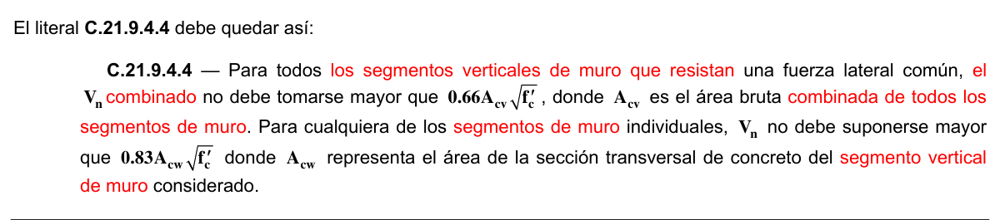

**C.21.9.4.5** — Para segmentos horizontales de muro y vigas de acople, $V_{n}$no debe suponerse mayor que $0.83A_{cw}\sqrt{f_{c}'}$ donde $A_{cw}$representa el área de la sección de concreto del segmento horizontal de muro o viga de acople.

#### C.21.9.5 — Diseño a flexión y carga axial

**C.21.9.5.1** — Los muros estructurales y partes de dichos muros sometidos a una combinación de carga axial y flexión deben diseñarse de acuerdo con C.10.2 y C.10.3, excepto que no se debe aplicar C.10.3.7 ni los requerimientos de deformación no lineal de C.10.2.2. Deben considerarse como efectivos el concreto y el refuerzo longitudinal desarrollado dentro del ancho efectivo del ala, del elemento de borde y del alma del muro. Debe considerarse el efecto de las aberturas.

**C.21.9.5.2** — A menos que se realice un análisis más detallado, el ancho efectivo del ala en secciones con alas debe extenderse desde la cara del alma una distancia igual al menor valor entre la mitad de la distancia al alma de un muro adyacente y el 25% de la altura total del muro.

#### C.21.9.6 — Elementos de borde para muros estructurales especiales

**C.21.9.6.1** — La necesidad de usar elementos especiales de borde en los límites verticales de muros estructurales debe evaluarse de acuerdo con C.21.9.6.2 ó C.21.9.6.3. Deben satisfacerse también los requisitos de C.21.9.6.4 y C.21.9.6.5.

**C.21.9.6.2** — Esta sección se aplica a muros y pilas de muros que son efectivamente continuos desde la base de la estructura hasta la parte superior del muro y son diseñados para tener una única sección crítica para flexión y carga axial. Los muros que no satisfagan estos requisitos deben ser diseñados usando C.21.9.6.3.

(a) Las zonas de compresión deben ser reforzadas con elementos especiales de borde donde:

$$ c \ge \dfrac{\ell_w}{600\,(\delta_u / h_w)} \tag{C.21-11} $$

Donde $c$ en la ecuación (C.21-11) corresponde a la mayor profundidad del eje neutro calculada para la fuerza axial mayorada y resistencia nominal a momento congruente con el desplazamiento de diseño $δ_{u}$ . El cociente $δ_{u}/h_{w}$en la ecuación (C.21-11) no debe tomarse menor que 0.007

(b) Donde se requieran elementos especiales de borde según C.21.9.6.2(a), el refuerzo del elemento especial de borde debe extenderse verticalmente desde la sección crítica por una distancia no menor que la mayor entre $ℓ_{w}$ó $M_{u}/4V_{u}$ .

**C.21.9.6.3** — Los muros estructurales que no sean diseñados de acuerdo con las indicaciones de C.21.9.6.2 deben tener elementos de borde especiales en los bordes y alrededor de las aberturas de los muros estructurales cuando el esfuerzo de compresión máximo de la fibra extrema correspondiente a las fuerzas mayoradas incluyendo los efectos sísmicos $E$ , sobrepase $0.2f_{c}'$ . Los elementos de borde especiales pueden ser descontinuados donde el esfuerzo de compresión calculado sea menor que $0.15f_{c}'$ . Los esfuerzos deben calcularse para las fuerzas mayoradas usando un modelo lineal elástico y las propiedades de la sección bruta. Para muros con alas, debe usarse un ancho de ala efectiva como se define en C.21.9.5.2.

**C.21.9.6.4** — En donde se requieran elementos especiales de borde, de acuerdo con C.21.9.6.2 ó C.21.9.6.3 se debe cumplir con las condiciones (a) hasta (e):

(a) El elemento de borde se debe extender horizontalmente desde la fibra extrema en compresión hasta una distancia no menor que el mayor valor entre $c−0.1ℓ_{w}$ y $c /2$ , donde $c$ corresponde a la mayor profundidad del eje neutro calculada para la fuerza axial mayorada y resistencia nominal a momento consistente con el desplazamiento de diseño $δ_{u}$ .

(b) En las secciones con alas, los elementos de borde deben incluir el ancho efectivo del ala en compresión y se deben extender por lo menos 300 mm dentro del alma.

(c) El refuerzo transversal de los elementos especiales de borde debe cumplir con los requisitos especificados en C.21.6.4.2 a C.21.6.4.4, excepto que no se necesita cumplir con la ecuación (C.21-7) y el límite de espaciamiento del refuerzo transversal de C.21.6.4.3(a) debe ser de al menos un tercio de la dimensión menor del elemento de borde.

(d) El refuerzo transversal de los elementos de borde en la base del muro debe extenderse dentro del apoyo al menos $ℓ_{d}$ , de acuerdo con C.21.9.2.3, del refuerzo longitudinal de mayor diámetro de los elementos especiales de borde, a menos que los elementos especiales de borde terminen en una zapata o losa de cimentación, en donde el refuerzo transversal de los elementos especiales de borde se debe extender, a lo menos, 300 mm dentro de la zapata o losa de cimentación;

(e) El refuerzo horizontal en el alma del muro debe estar anclado para desarrollar $f_{y}$dentro del núcleo confinado del elemento de borde;

<!-- mod:1-decreto-092-2011-147 -->
> **Modificación — Decreto 092 de 2011** · anexo, p. 31
>
> El literal (e) de C.21.9.6.4 debe quedar así:
>
> 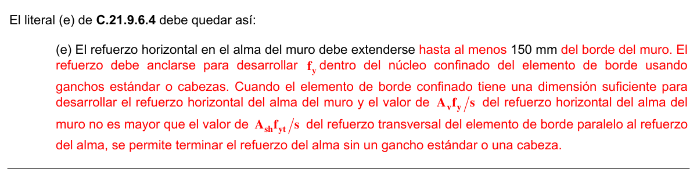

**C.21.9.6.5** — Cuando no se requieren elementos especiales de borde de acuerdo con lo indicado en C.21.9.6.2 ó C.21.9.6.3, se debe cumplir con (a) y (b):

(a) Si la cuantía de refuerzo longitudinal en el borde del muro es mayor que$2.8 /f_{y}$ , el refuerzo transversal de borde debe cumplir con lo indicado en C.21.6.4.2 y C.21.9.6.4(a). El espaciamiento longitudinal máximo del refuerzo transversal en el borde no debe exceder de 200 mm;

(b) Excepto cuando $V_{u}$ en el plano del muro sea menor que $0.083A_{cv}λ\sqrt{f_{c}'}$, el refuerzo transversal que termine en los bordes de muros estructurales sin elementos de borde debe tener un gancho estándar que enganche el refuerzo de borde, o el refuerzo de borde debe estar abrazado con estribos en U que estén empalmados al refuerzo horizontal y tengan su mismo tamaño y espaciamiento.

#### C.21.9.7 — Vigas de acople

**C.21.9.7.1** — Las vigas de acople con $(ℓ_{n}/h)≥4$ deben cumplir con los requisitos indicados en 21.5. No se requiere cumplir los requisitos establecidos en C.21.5.1.3 y C.21.5.1.4 si se puede demostrar mediante análisis que la viga tiene una estabilidad lateral adecuada.

**C.21.9.7.2** — Las vigas de acople con $(ℓ_{n}/h)<2$ y con $V_{u}$ que exceda de $0.33λ\sqrt{f_{c} '}A_{cw}$deben reforzarse con dos grupos de barras que se intersecten diagonalmente, colocadas en forma simétrica respecto al centro de la luz, a menos que se pueda demostrar que la pérdida de rigidez y resistencia de las vigas de acople no debilitará la capacidad de la estructura para soportar carga vertical, o la evacuación de la estructura, o la integridad de los elementos no estructurales y sus conexiones con la estructura.

**C.21.9.7.3** — Se permite que las vigas de acople que no se rigen por C.21.9.7.1 ó C.21.9.7.2 se refuercen con dos grupos de barras que se intersectan diagonalmente colocadas en forma simétrica respecto al centro de la luz o por lo contrario deben cumplir con C.21.5.2 hasta C.21.5.4.

**C.21.9.7.4** — Las vigas de acople reforzadas con dos grupos de barras que se intersectan diagonalmente colocadas en forma simétrica respecto al centro de la luz deben cumplir con (a), (b) y con (c) ó (d). No se aplican los requisitos de C.11.7.

(a) $V_{n}$ se debe determinar por

$$ V_n = 2\,A_{vd} f_y \operatorname{sen}\alpha \le 0.83 \sqrt{f'_c}\,A_{cw} \tag{C.21-12} $$

donde $α$ es el ángulo entre las barras diagonales y el eje longitudinal de la viga de acople.

(b) Cada grupo de barras diagonales consiste en un mínimo de cuatro barras colocadas en dos o más capas. Las barras diagonales deben estar embebidas en el muro no menos de 1.25 veces la longitud de desarrollo para $f_{y}$ en tracción.

(c) Cada grupo de barras diagonales debe estar confinado por refuerzo transversal, con dimensiones exterior a exterior no menor de $b_{w}/2$ en la dirección paralela a $b_{w}$ y $b_{w}/5$ a lo largo de los otros lados, donde $b_{w}$ es el ancho del alma de la viga de acople. El refuerzo transversal debe cumplir con lo establecido en C.21.6.4.2 al C.21.6.4.4, y debe tener un espaciamiento medido en forma paralela a las barras diagonales que cumpla con C.21.6.4.3(c) sin exceder seis veces el diámetro de las barras diagonales, y deben tener un espaciamiento de los ganchos suplementarios o ramas de los ganchos medidos en forma perpendicular a las barras diagonales que no exceda de 350 mm. Con el propósito de efectuar el cálculo de $A_{g}$ para su uso en las ecuaciones (C.10-5) y (C.21-7), se supone el recubrimiento de concreto, como se requiere en C.7.7, en los cuatro costados de cada grupo de barras colocadas diagonalmente. El refuerzo transversal, o su refuerzo transversal alternativo que cumple con los requisitos de espaciamiento y relación de volumen para los refuerzos transversales a lo largo de las diagonales, debe continuar a través de la intersección de las barras diagonales. El refuerzo longitudinal y transversal adicional debe distribuirse alrededor del perímetro de la viga, con el área total en cada dirección no menor de $0.002b_{w} s$ y un espaciamiento que no exceda de 300 mm.

(d) Se debe proporcionar refuerzo transversal para toda la sección transversal de la viga, que cumpla con C.21.6.4.2, C.21.6.4.4 y C.21.6.4.7, con un espaciamiento longitudinal que no exceda al menor valor entre 150 mm y seis veces el diámetro de las barras diagonales, y con un espaciamiento que no exceda de 200 mm en los ganchos suplementarios o ramas de los ganchos, tanto vertical como horizontalmente, en el plano de la sección transversal de la viga. Cada gancho suplementario y cada rama del gancho deben enlazar una barra longitudinal de igual o mayor diámetro. Se permite configurar los ganchos como se especifica en C.21.5.3.6.

#### C.21.9.8 — Juntas de construcción

Todas las juntas de construcción en los muros estructurales deben cumplir con lo indicado en C.6.4 y la superficie de contacto debe hacerse rugosa como se especifica en C.11.6.9.

<!-- mod:1-decreto-092-2011-148 -->
> **Modificación — Decreto 092 de 2011** · anexo, p. 31
>
> Los literales C.21.9.8 y C.21.9.9 se renumeran respectivamente como C.21.9.9 y C.21.9.10, y se introduce un nuevo C.21.9.8 así:
>
> 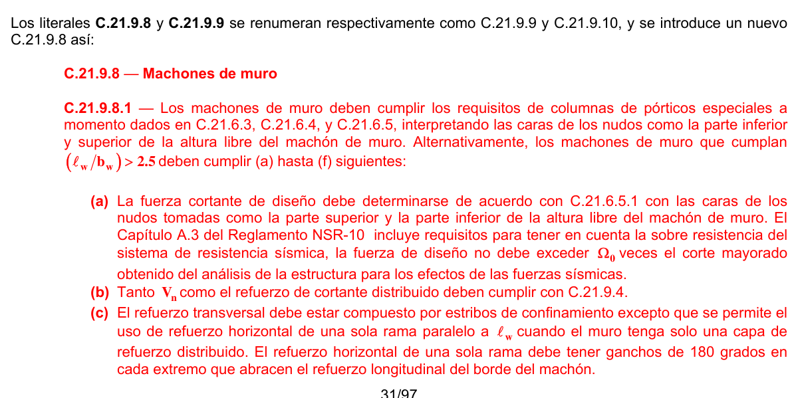
>
> 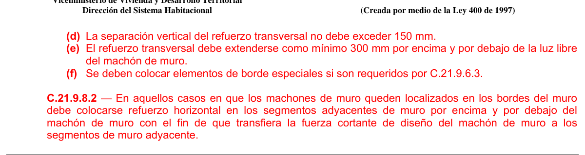

<!-- mod:2-decreto-340-2012-27 -->
> **Modificación — Decreto 340 de 2012** · anexo, p. 7
>
> Las secciones C.21.9.8 – Juntas de construcción y C.21.9.9 – Muros discontinuos, deben renumerarse como C.21.9.9 – Juntas de construcción y C.21.9.10 – Muros discontinuos.

#### C.21.9.9 — Muros discontinuos

Las columnas que soporten muros estructurales discontinuos deben ser reforzadas de acuerdo con lo indicado en C.21.6.4.6.

**C.21.10** — Muros estructurales especiales construidos usando concreto prefabricado con capacidad especial de disipación de energía (DES)

#### C.21.10.1 — Alcance

Los requisitos de C.21.10 se aplican a los muros estructurales especiales construidos usando concreto prefabricado que forma parte del sistema de resistencia ante fuerzas sísmicas.

**C.21.10.2** — Los muros estructurales especiales construidos usando concreto prefabricado deben cumplir con todos los requisitos de C.21.9 para muros estructurales especiales construidos en obra, además de C.21.4.2 y C.21.4.3.

**C.21.10.3** — Se permiten muros estructurales especiales construidos usando concreto prefabricado y tendones postensados y que no cumplen con los requisitos de C.21.10.1 siempre que satisfagan los requisitos del ACI ITG-5.1.

**C.21.11** — Diafragmas y cerchas estructurales asignadas a la capacidad especial de disipación de energía (DES)

<!-- mod:2-decreto-340-2012-28 -->
> **Modificación — Decreto 340 de 2012** · anexo, p. 7
>
> La sección C.21.10.1 debe quedar así:
>
> 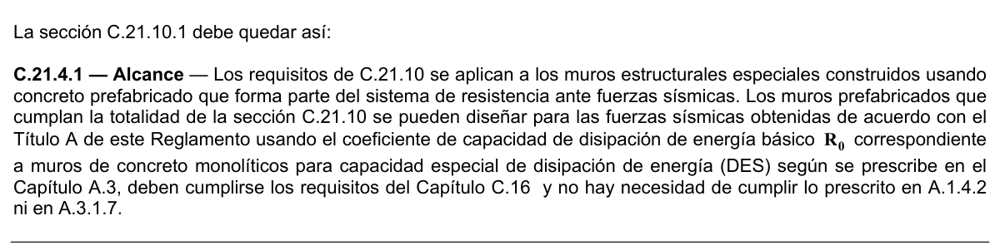

#### C.21.11.1 — Alcance

Las losas de piso y cubierta que actúen como diafragmas estructurales para trasmitir fuerzas inducidas por los movimientos sísmicos en estructuras asignadas a la capacidad de disipación de energía especial (DES), deben diseñarse de acuerdo con lo indicado en esta sección. Esta sección también se aplica a elementos colectores y cerchas que sirven como parte del sistema de resistencia ante fuerzas sísmicas.

#### C.21.11.2 — Fuerzas de diseño

Las fuerzas de diseño sísmico para diafragmas estructurales se deben obtener del Título A del Reglamento NSR-10 usando las disposiciones y las combinaciones de cargas aplicables.

#### C.21.11.3 — Trayectoria de las fuerzas sísmicas

**C.21.11.3.1** — Todos los diafragmas y sus conexiones deben diseñarse y detallarse para que sean capaces de transferir todas las fuerzas a los elementos colectores y a los elementos verticales del sistema de resistencia ante fuerzas sísmicas.

**C.21.11.3.2** — Los elementos de un sistema de diafragma estructural que se encuentra sometido principalmente a fuerzas axiales y que se usa para transferir el cortante o las fuerzas a flexión del diafragma alrededor de las aberturas u otras discontinuidades, debe cumplir con los requisitos para los colectores de C.21.11.7.5 y C.21.11.7.6.

**C.21.11.4** — Afinado de piso (“topping”) compuesto construido en sitio actuando como diafragma Se permite el uso como diafragma de un afinado de piso compuesto construido en sitio sobre un piso o cubierta prefabricados siempre que el afinado de piso se refuerce y la superficie del concreto previamente endurecido sobre la cual se coloca el afinado de piso debe estar limpia, libre de lechada y debe hacerse intencionalmente rugosa.

**C.21.11.5** — Afinado de piso (“topping”) construido en sitio actuando como diafragma Se permite que un afinado de piso no compuesto construido en sitio sobre un piso o cubierta prefabricado sirva como diafragma estructural siempre que el afinado de piso construido en sitio por si mismo este diseñado y detallado para resistir las fuerzas sísmicas de diseño.

#### C.21.11.6 — Espesor mínimo de diafragmas

Las losas de concreto y los afinados de piso compuestos que sirven como diafragmas estructurales usados para transmitir fuerzas sísmicas deben tener un espesor mínimo de 50 mm. Los afinados de piso colocados sobre elementos de piso o cubierta prefabricados, que actúan como diafragmas estructurales y que no dependen de la acción compuesta con los elementos prefabricados para resistir las fuerzas sísmicas de diseño, deben tener un espesor no menor que 65 mm.

#### C.21.11.7 — Refuerzo

**C.21.11.7.1** — La cuantía mínima de refuerzo para los diafragmas estructurales debe estar de acuerdo con lo indicado en C.7.12. Excepto para las losas post-tensadas, el espaciamiento del refuerzo en ambos sentidos no debe exceder de los 450 mm. Cuando se usa refuerzo electrosoldado de alambre como refuerzo distribuido para resistir el cortante en el afinado de piso colocado sobre elementos de piso y cubierta prefabricados, los alambres paralelos a la dirección de los elementos prefabricados deben estar espaciados a no menos de 250 mm. El refuerzo provisto para la resistencia de cortante debe ser continuo y debe estar distribuido uniformemente a través del plano de cortante.

**C.21.11.7.2** — Los tendones adheridos que se usen como refuerzo para resistir fuerzas de los elementos colectores o cortante de diafragmas o tracción por flexión deben diseñarse de forma tal que el esfuerzo debido a las fuerzas sísmicas de diseño no exceda de 420 MPa. Se permite que la precompresión producida por tendones de preesfuerzo no adheridos resista fuerzas de diseño del diafragma si se proporciona una trayectoria para la carga sísmica.

**C.21.11.7.3** — Todo refuerzo usado para resistir fuerzas de los elementos colectores, cortante en el diafragma o tracción por flexión deben ser desarrollados o traslapados para resistir $f_{y}$ en tracción.

**C.21.11.7.4** — Se requieren empalmes tipo 2, cuando se usan empalmes mecánicos para transferir fuerzas entre el diafragma y los elementos verticales del sistema de resistencia ante fuerzas sísmicas.

**C.21.11.7.5** — Los elementos colectores con esfuerzos de compresión que excedan $0.2f_{c}'$ en cualquier sección deben tener refuerzo transversal a lo largo del elemento, como se indica en C.21.9.6.4 (c). Se permite descontinuar el refuerzo transversal especificado en donde el esfuerzo de compresión calculado sea menor que $0.15f_{c}'$ . Donde las fuerzas de diseño hayan sido amplificadas para tomar en cuenta la sobreresistencia de los elementos verticales del sistema de resistencia ante fuerzas sísmicas, el límite de $0.2f_{c}'$ debe ser incrementado a $0.5f_{c}'$ , y el límite de $0.15f_{c}'$ debe ser aumentado a $0.4f_{c}'$ .

**C.21.11.7.6** — El refuerzo longitudinal para los elementos colectores en los empalmes y zonas de anclaje debe cumplir uno de los siguientes requisitos:

(a) Un espaciamiento mínimo centro a centro de tres diámetros de barra longitudinal, pero no menos de 40 mm, y un recubrimiento mínimo de concreto libre de 2.5 diámetros de la barra longitudinal, pero no menor de 50 mm; o

(b) El refuerzo transversal como se requiere en C.11.4.6.3, excepto lo exigido en C.21.11.7.5.

#### C.21.11.8 — Resistencia a flexión

Los diafragmas y porciones de diafragmas deben diseñarse para flexión, de acuerdo a C.10.2 y C.10.3, excepto que no se aplica la distribución no lineal de los requisitos de esfuerzo de C.10.2.2 para vigas de gran altura. Deben considerarse los efectos de las aberturas.

#### C.21.11.9 — Resistencia al cortante

**C.21.11.9.1** — $V_{n}$ en diafragmas estructurales no debe exceder:

$$ V_n = A_{cv} \left(0.17\,\lambda \sqrt{f'_c} + \rho_t f_y\right) \tag{C.21-13} $$

Para diafragmas conformados por afinado de piso construido en sitio y colocado sobre un piso o cubierta prefabricado, $A_{cv}$ se calcula usando el espesor del afinado de piso solamente para los diafragmas formados por afinado de piso no compuesto y por el espesor combinado de los elementos prefabricados y colocados en sitio para los diafragmas de afinado de pisos compuestos. Para los diafragmas formados por afinado de pisos compuestos, el valor de $f_{c}'$ usado para determinar $V_{n}$ no debe exceder el menor del $f_{c}'$ de los elementos prefabricados o el $f_{c}'$ del afinado de piso.

**C.21.11.9.2** — El $V_{n}$ de diafragmas estructurales no debe exceder $0.66A_{cv}\sqrt{f_{c}' }$.

**C.21.11.9.3** — Por encima de las juntas entre elementos prefabricados en diafragmas no compuestos, o con afinado de pisos compuesto, $V_{n}$ no debe exceder

$$ V_n = A_{vf} f_y \mu \tag{C.21-14} $$

donde $A_{vf}$ es el área total del refuerzo para cortante por fricción dentro de la afinado de piso, incluyendo los refuerzos distribuidos y de borde, que esté orientado perpendicularmente a las juntas en el sistema prefabricado y el coeficiente de fricción, $μ$ , es $1.0λ$ , donde $λ$ está dado por C.11.7.4.3. Por lo menos la mitad de $A_{vf}$ debe estar distribuida uniformemente a lo largo de la longitud del plano potencial de cortante. El área de refuerzo de distribución en el afinado de piso debe cumplir con C.7.12.2.1 en cada dirección.

**C.21.11.9.4** — Por encima de las juntas entre elementos prefabricados en diafragmas no compuestos y con afinado de piso compuesto, $V_{n}$ no debe exceder los límites de C.11.6.5 con $A_{c}$ calculado usando solamente el espesor del afinado de piso.

#### C.21.11.10 — Juntas de construcción

Todas las juntas de construcción en los diafragmas deben cumplir con lo indicado en C.6.4 y la superficie de contacto debe hacerse rugosa como se especifica en C.11.6.9.

#### C.21.11.11 — Cerchas estructurales

**C.21.11.11.1** — Los elementos de cerchas estructurales con esfuerzos a compresión que excedan de $0.2f_{c}'$ en cualquier sección deben tener refuerzo transversal a lo largo del elemento, como se requiere en C.21.6.4.2 hasta C.21.6.4.4 y C.21.6.4.7.

**C.21.11.11.2** — Todos los refuerzos continuos en elementos de cerchas estructurales deben estar desarrollados y empalmados para $f_{y}$ en tracción.

**C.21.12** — Cimentaciones de estructuras asignadas a la capacidad especial de disipación de energía (DES)

#### C.21.12.1 — Alcance

**C.21.12.1.1** — Las cimentaciones que resisten fuerzas sísmicas o que transfieran las fuerzas sísmicas entre la estructura y el terreno en estructuras asignadas a la capacidad de disipación de energía especial (DES), deben cumplir con lo indicado en C.21.12 y con los otros requisitos aplicables del Título H y el Capítulo C.15 del Reglamento NSR-10.

**C.21.12.1.2** — Los requisitos indicados en esta sección para pilotes, pilas excavadas, cajones de cimentación y losas sobre el terreno complementan otros criterios de diseño y de construcción aplicables del Título C del Reglamento NSR-10. Véanse C.1.1.6 y C.1.1.7.

<!-- mod:1-decreto-092-2011-149 -->
> **Modificación — Decreto 092 de 2011** · anexo, p. 32
>
> Debe adicionarse la sección C.21.12.1.3 siguiente, la cual fue omitida:
>
> **C.21.12.1.3** — Además de los requisitos dados en C.21.12 deben cumplirse para pilotes y cajones de cimentación los requisitos de C.15.11.

#### C.21.12.2 — Zapatas, losas de cimentación y cabezales de pilotes

**C.21.12.2.1** — El refuerzo longitudinal de las columnas y muros estructurales que resisten las fuerzas inducidas por los efectos sísmicos debe extenderse dentro de la zapata, losa de cimentación o cabezal de pilotes, y debe estar totalmente desarrollado por tracción en la interfaz.

**C.21.12.2.2** — Las columnas que sean diseñadas suponiendo condiciones de empotramiento en la cimentación, deben cumplir con lo indicado en C.21.12.2.1 y, si se requiere de ganchos el refuerzo longitudinal que resiste la flexión debe tener ganchos de 90 grados cerca del fondo de la cimentación, con el extremo libre de las barras orientado hacia el centro de la columna.

**C.21.12.2.3** — Las columnas o elementos de borde de los muros estructurales especiales de concreto reforzado que tengan un borde dentro de una longitud equivalente a la mitad de la profundidad de la zapata deben tener refuerzo transversal de acuerdo con lo indicado en C.21.6.4.2 hasta C.21.6.4.4 colocado bajo la parte superior de la zapata. Este refuerzo debe extenderse dentro de la zapata, losa de cimentación o cabezal de pilotes, y desarrollar en tracción$f_{y}$del refuerzo longitudinal.

**C.21.12.2.4** — Cuando los efectos sísmicos crean fuerzas de levantamiento en los elementos de borde de los muros estructurales especiales de concreto reforzado o en las columnas, se debe proporcionar refuerzo de flexión en la parte superior de la zapata, losa de cimentación o cabezal de pilotes para que resista las combinaciones de carga de diseño, y no puede ser menor que lo requerido en C.10.5.

**C.21.12.2.5** — Para el uso de concreto simple en zapatas y muros de cimentación consúltese C.22.10.

#### C.21.12.3 — Vigas y losas sobre el terreno

**C.21.12.3.1** — Las vigas sobre el terreno diseñadas para actuar como amarres horizontales entre las zapatas o cabezales de pilotes deben tener refuerzo longitudinal continuo que debe desarrollarse dentro o más allá de la columna, o anclarse dentro de la zapata o el cabezal de pilotes en todas las discontinuidades.

**C.21.12.3.2** — Las vigas sobre el terreno diseñadas para actuar como acoples horizontales entre zapatas o cabezales de pilotes deben diseñarse de tal manera que la menor dimensión transversal sea igual o mayor que el espacio libre entre columnas conectadas dividido por 20, pero no necesita ser mayor a 450 mm. Se deben proporcionar estribos cerrados con un espaciamiento que no exceda al menor entre la mitad de la menor dimensión transversal o 300 mm.

**C.21.12.3.3** — Las vigas sobre el terreno y las vigas que sean parte de una losa de cimentación y estén sometidas a flexión por las columnas que son parte del sistema de resistencia ante fuerzas sísmicas deben cumplir con lo indicado en C.21.5.

**C.21.12.3.4** — Las losas sobre el terreno que resisten fuerzas sísmicas provenientes de los muros o columnas que son parte del sistema de resistencia ante fuerzas sísmicas deben diseñarse como diafragmas estructurales de acuerdo con lo indicado en C.21.11. Los planos de diseño deben especificar claramente que la losa sobre el terreno es un diafragma estructural y es parte del sistema de resistencia ante fuerzas sísmicas.

#### C.21.12.4 — Pilotes, pilas y cajones de cimentación

**C.21.12.4.1** — Las especificaciones indicadas en C.21.12.4 se aplican a los pilotes, pilas y cajones de cimentación que soportan estructuras diseñadas para tener resistencia sísmica.

**C.21.12.4.2** — Los pilotes, pilas o cajones de cimentación que resistan cargas de tracción deben tener refuerzo longitudinal continuo a lo largo de la zona que resiste las fuerzas de tracción. El refuerzo longitudinal debe detallarse para transferir las fuerzas de tracción del cabezal de los pilotes a los elementos estructurales soportados.

**C.21.12.4.3** — Cuando las fuerzas de tracción inducidas por los efectos sísmicos sean transferidas, entre el cabezal de pilote o losa de cimentación y un pilote prefabricado, a través de barras de refuerzo colocadas con mortero inyectado o post instaladas en la parte superior del pilote, se debe demostrar mediante ensayos que el sistema de inyección desarrolla al menos $1.25f_{y}$ de la barra.

**C.21.12.4.4** — Los pilotes, pilas o cajones de cimentación deben tener refuerzo transversal de acuerdo con lo indicado en C.21.6.4.2 en las zonas definidas en (a) y (b):

(a) En la parte superior del elemento en por lo menos 5 veces la dimensión transversal del elemento, pero no menos de 1.8 m por debajo de la parte inferior del cabezal del pilote;

(b) Para las partes de los pilotes en suelos que no son capaces de proveer soporte lateral, o están al aire o en agua, a lo largo de toda la longitud del tramo sin soporte más el largo requerido en C.21.12.4.4(a).

**C.21.12.4.5** — Para los pilotes prefabricados de concreto hincados la longitud donde se coloca el refuerzo transversal proporcionado debe ser suficiente como para tener en cuenta las variaciones potenciales de la profundidad a la que llega la punta de los pilotes.

**C.21.12.4.6** — Los pilotes, pilas o cajones de cimentación que soportan edificaciones de uno o dos pisos con muros de carga de aporticamiento ligero, están exentos de los requisitos de refuerzo transversal indicado en C.21.12.4.4 y C.21.12.4.5.

**C.21.12.4.7** — Los cabezales de pilotes que incorporan pilotes inclinados deben diseñarse para resistir la totalidad de la resistencia a compresión de los pilotes inclinados actuando como columnas cortas. Los efectos de esbeltez de los pilotes inclinados se deben considerar dentro de la porción del pilote en suelo que no es capaz de proporcionar soporte lateral, o que queda al aire o en el agua.

**C.21.13** — Elementos que no se designan como parte del sistema de resistencia ante fuerzas sísmicas

<!-- mod:1-decreto-092-2011-151 -->
> **Modificación — Decreto 092 de 2011** · anexo, p. 32
>
> Se introduce un nuevo literal C.21.13.7:
>
> 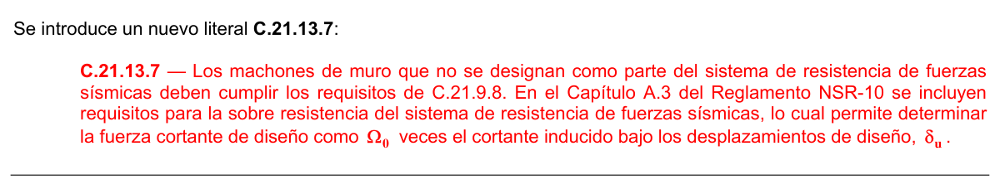

#### C.21.13.1 — Alcance

Los requisitos de C.21.13 no pueden ser empleados en el diseño de edificaciones nuevas y solo pueden ser usados en el diseño de rehabilitaciones sísmicas en cuyo diseño original se utilizó el subterfugio de emplear elementos de pórticos que no se designaron como parte del sistema de resistencia ante fuerzas sísmicas en estructuras asignadas a la capacidad de disipación de energía especial (DES).

**C.21.13.2** — Los elementos estructurales que se supone no contribuyen a la resistencia lateral deben detallarse de acuerdo con lo indicado en C.21.13.3 y C.21.13.4 dependiendo de la magnitud de los momentos inducidos en estos elementos cuando son sometidos al desplazamiento de diseño $δ_{u}$ . Si los efectos de $δ_{u}$ no son explícitamente verificados, se pueden aplicar los requisitos de C.21.13.4. Para losas de dos direcciones sin vigas, las conexiones losa-columna deben cumplir con las disposiciones de C.21.13.6.

<!-- mod:1-decreto-092-2011-150 -->
> **Modificación — Decreto 092 de 2011** · anexo, p. 32
>
> El literal C.21.13.2 debe quedar así:
>
> 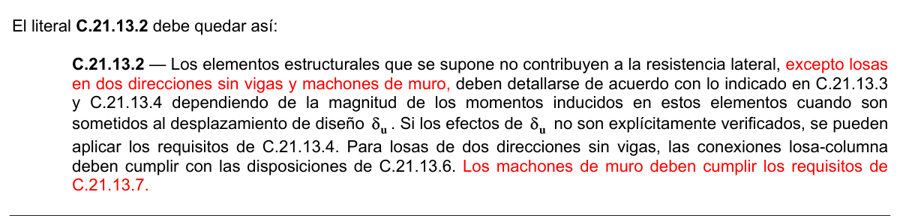

**C.21.13.3** — Cuando los momentos y fuerzas cortantes inducidas por los desplazamientos de diseño $δ_{u}$ combinados con las fuerzas cortantes y momentos gravitacionales mayorados no excedan la resistencia de diseño a cortante y momento del elemento, deben satisfacerse las condiciones de C.21.13.3.1, C.21.13.3.2 y C.21.13.3.3. Para este propósito, debe usarse la combinación de carga para gravedad más crítica entre $(1.2D+1.0L)$ ó $0.9D$ . Se puede reducir el factor de carga para carga viva, $L$ , a 0.5 salvo para garajes, áreas ocupadas como lugares de reunión pública, y todas las áreas donde $L$ sea mayor de 4.8 kN/m2.

**C.21.13.3.1** — Elementos sometidos a una fuerza axial gravitacional mayorada que no exceda $A_{g} f_{c}'/10$deben satisfacer C.21.5.2.1. El espaciamiento de los estribos debe ser menor que $d /2$ a lo largo del elemento.

**C.21.13.3.2** — Los elementos con una fuerza axial gravitacional mayorada mayor que $A_{g} f_{c}'/10$ deben satisfacer C.21.6.3.1, C.21.6.4.2 y C.21.6.5. El espaciamiento longitudinal máximo de los estribos cerrados de confinamiento debe ser $s_{o}$ en toda la longitud de la columna. El espaciamiento $s_{o}$ no debe exceder el menor de que seis diámetros de la barra longitudinal de menor diámetro o 150 mm.

**C.21.13.3.3** — Los elementos con una fuerza axial gravitacional mayorada que exceda de $0.35P_{o}$ deben satisfacer C.21.13.3.2 y C.21.6.4.7. La cantidad de refuerzo transversal suministrado debe ser la mitad del requerido por C.21.6.4.4 sin exceder el espaciamiento $s_{o}$ para la altura total del elemento.

**C.21.13.4** — Si el momento o el cortante inducido por los desplazamientos de diseño, $δ_{u}$ , excede $φM_{n}$ o $φV_{n}$ del elemento, o si los momentos inducidos no se calculan, deben satisfacerse las condiciones de C.21.13.4.1, C.21.13.4.2 y C.21.13.4.3.

**C.21.13.4.1** — Los materiales deben cumplir C.21.1.4.2, C.21.1.4.3, C.21.1.5.2, C.21.1.5.4, y C.21.1.5.5. Los empalmes mecánicos deben satisfacer C.21.1.6 y los empalmes soldados deben satisfacer C.21.1.7.1.

**C.21.13.4.2** — Los elementos con una fuerza axial gravitacional mayorada menor que $A_{g} f_{c}'/10$ deben satisfacer C.21.5.2.1 y C.21.5.4. El espaciamiento de los estribos no debe ser mayor que $d /2$ a lo largo de todo el elemento.

**C.21.13.4.3** — Los elementos con una fuerza axial gravitacional mayorada mayor que $A_{g} f_{c}'/10$ deben satisfacer C.21.6.3, C.21.6.4, C.21.6.5 y C.21.7.3.1.

**C.21.13.5** — Los elementos para pórticos de concreto prefabricado que se supone no contribuyen con la resistencia lateral, incluyendo sus conexiones, deben cumplir con (a), (b) y (c), además de C.21.13.2 a C.21.13.4:

(a) Los estribos especificados en .21.13.3.2 deben colocarse en toda la longitud de la columna, incluyendo la altura de las vigas.

(b) Se debe proporcionar refuerzo para integridad estructural de acuerdo con lo especificado en C.16.5; y

(c) La longitud de apoyo de una viga debe ser al menos 50 mm mayor a la determinada por los cálculos usando los valores para resistencias de aplastamiento de C.10.14.

**C.21.13.6** — Para las conexiones losa-columna de losas en dos direcciones sin vigas, el refuerzo para cortante de la losa que satisface los requisitos de C.11.12.3 y proporciona un $V_{s}$ no menor de $0.29 \sqrt{f_{c} '}b_{o} d$, debe extenderse al menos 4 veces el espesor de la losa desde la cara del apoyo, a menos que se satisfaga (a) ó (b):

(a) Los requisitos de C.11.11.7 usando el cortante de diseño $V_{u}$ y el momento inducido transferido entre la losa y la columna bajo el desplazamiento de diseño;

(b) La deriva de piso de diseño no excede la mayor entre 0.005 y $\left[0.35 - 0.05\,(V_u/\phi V_c)\right]$.

La deriva de piso de diseño debe tomarse como la mayor de las deriva de piso de diseño de los pisos adyacentes, sobre y bajo la conexión losa-columna. $V_{c}$ se encuentra definido en C.11.11.2. $V_{ug}$ es la fuerza cortante mayorada en la sección crítica de la losa para una acción en dos direcciones, calculada para la combinación de carga $1.2D+1.0L+0.2S$.

Se permite reducir el factor de carga de $L$ a 0.5, excepto para estacionamientos, áreas ocupadas como lugares de reunión pública y todas las áreas donde $L$ es mayor de 4.8 kN/m2.

" Notas:

<!-- mod:2-decreto-340-2012-29 -->
> **Modificación — Decreto 340 de 2012** · anexo, p. 7
>
> El literal (b) de C.21.13.6 debe quedar así:
>
> 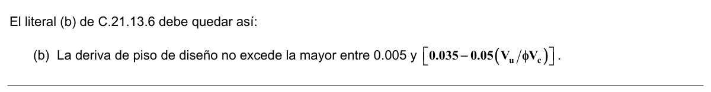

<!-- mod:3-decreto-945-2017-62 -->
> **Modificación — Decreto 945 de 2017** · anexo, p. 33
>
> En el primer párrafo, la referencia a C.11.12.3 se sustituye por C.11.11.3 y C.11.11.5: «C.21.13.6 — Para las conexiones losa-columna de losas en dos direcciones sin vigas, el refuerzo para cortante de la losa que satisface los requisitos de C.11.11.3 y C.11.11.5 y proporciona un $V_s$ no menor de $0.29\sqrt{f'_c}\,b_o d$ debe extenderse al menos 4 veces el espesor de la losa desde la cara del apoyo, a menos que se satisfaga (a) ó (b):»
