# D-1 — Diseño de mampostería estructural por el método de los esfuerzos de trabajo admisibles

## D-1.0 — NOMENCLATURA

$A_{e}$ = área efectiva de la sección transversal del elemento, mm².

$A_{st}$ = área del refuerzo longitudinal del elemento, mm².

$A_{v}$ = área del refuerzo a cortante, mm².

$b$ = ancho efectivo de una sección rectangular, mm.

$b_{w}$ = ancho del alma del elemento, mm.

$d$ = altura efectiva de la sección del elemento, mm.

$E$ = efectos sísmicos reducidos.

$F_{a}$ = esfuerzo admisible de compresión debido a carga axial, MPa.

$F_{b}$ = esfuerzo admisible de compresión debido a flexión, MPa.

$F_{s}$ = esfuerzo admisible en el refuerzo, MPa., o fuerzas sísmicas.

$F_{t}$ = esfuerzo admisible de tracción debida a flexión, MPa.

$F_{v}$ = esfuerzo admisible de cortante, MPa.

$f_{a}$ = esfuerzo causado por la fuerza axial calculado con el área efectiva, MPa.

$f_{b}$ = esfuerzo de compresión causado por la flexión calculado con el área efectiva, MPa.

$f_{m}'$ = resistencia a la compresión de la mampostería, MPa.

$f_{v}$ = esfuerzo cortante solicitado, MPa.

$f_{y}$ = esfuerzo nominal de fluencia del refuerzo, MPa.

$h'$ = altura efectiva del muro o columna, mm.

$j$ = factor del brazo de palanca tracción-compresión, adimensional.

$M$ = momento flector que actúa sobre la sección debida a la carga de servicio.

$P_{a}$ = fuerza axial de compresión admisible, N.

$R$ = coeficiente de capacidad de disipación de energía.

$R_{e}$ = coeficiente utilizado para tener en cuenta los efectos de esbeltez en elementos a compresión.

$s$ = espaciamiento del refuerzo transversal en medida paralela al eje del elemento, mm.

$t$ = espesor efectivo de la sección para evaluar efectos de pandeo, mm. Véase D.5.4.2.

$V$ = fuerza de cortante bajo cargas de servicio, N.

## D-1.1 — ALCANCE

**D-1.1.1** — Se permite diseñar la mampostería estructural por el método de los esfuerzos de trabajo, utilizando las combinaciones de carga descritas en B.2.3, como un procedimiento alterno a los procedimientos de diseño presentados en el Capítulo D.5.

**D-1.1.2** — Se permite el diseño de estructuras de mampostería por el método de los esfuerzos de trabajo descrito en B.2.3.

## D-1.2 — PRINCIPIOS GENERALES

**D-1.2.1** — Puede despreciarse la resistencia a tracción en la mampostería para esfuerzos inducidos por cargas axiales de tracción y por efectos de flexión paralela o perpendicular al plano del muro.

**D-1.2.2** — Para efectos de la aplicación del presente Apéndice se puede considerar una distribución lineal entre admisibles esfuerzos y deformaciones, con los materiales trabajando en el rango elástico.

**D-1.2.3** — Los esfuerzos permisibles para el diseño se deben basar en el valor seleccionado para $f_{m}'$ de acuerdo a D.3.7.

**D-1.2.4** — El diseño estructural de la mampostería debe cumplir los principios de equilibrio y compatibilidad de deformaciones, así como las características mecánicas del material.

**D-1.2.5** — Se pueden emplear para el diseño por la metodología presentada en este Apéndice, los módulos de elasticidad y de cortante prescritos en D.5.2.

## D-1.3 — CARGAS

**D-1.3.1** — Las estructuras de mampostería deben diseñarse para los efectos de las cargas combinadas especificadas en el Título B de este Reglamento. Así mismo en la evaluación de los esfuerzos de diseño, se deben tener en cuenta los efectos de las cargas sobre los desplazamientos.

**D-1.3.2** — Las diferentes solicitaciones que deben ser tenidas en cuenta, se combinan para obtener las fuerzas internas de diseño de la estructura, de acuerdo con los requisitos de B.2.3 del Reglamento. En cada una de las combinaciones de carga requeridas, las solicitaciones se multiplican por el coeficiente de carga prescrito para esa combinación allí. En los efectos causados por el sismo se tiene en cuenta la capacidad de disipación de energía del sistema estructural, lo cual se logra empleando unos efectos sísmicos reducidos, $E$ , obtenidos dividiendo las fuerzas sísmicas de diseño $F_{s}$ , determinadas de acuerdo con los requisitos del Título A del Reglamento, por el coeficiente de capacidad de disipación de energía $R (E=F_{s}/R)$.

**D-1.3.3** — Además de las combinaciones de cargas verticales y horizontales especificadas, se debe capacitar la estructura y sus partes para atender los efectos causados por contracción, expansión, flujo plástico, asentamientos previstos y condiciones ambientales de funcionamiento.

<!-- mod:2-decreto-340-2012-36 -->
> *Texto vigente según el Decreto 340 de 2012 (anexo, p. 8).*

**D-1.3.4** — Cuando en la evaluación de los esfuerzos se hayan incluido las cargas transitorias laterales de viento o sismo, los esfuerzos permisibles se pueden incrementar en un tercio del valor especificado.

## D-1.4 — CARACTERÍSTICAS DIMENSIONALES EFECTIVAS

**D-1.5.1** — Deben cumplirse la totalidad de los requisitos de la sección D.5.4 en el diseño de mampostería por el método de los esfuerzos de trabajo.

## D-1.5 — DISEÑO POR EL MÉTODO DE LOS ESFUERZOS DE TRABAJO ADMISIBLES

### D-1.5.1 — GENERALIDADES

Los esfuerzos máximos calculados en los elementos de estructuras de mampostería bajo cargas de servicio, no deben exceder los valores establecidos en esta sección, utilizando las características dimensionales y en los materiales especificados.

### D-1.5.2 — ESFUERZOS ADMISIBLES PARA COMPRESIÓN AXIAL

Los esfuerzos admisibles de compresión axial $(F_{a})$ no deben exceder los valores siguientes:

Muros de mampostería

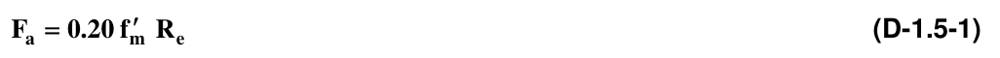

Columnas de mampostería:

No reforzadas admisibles

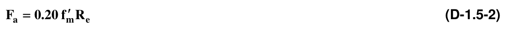

Reforzadas

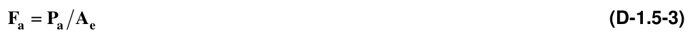

donde:

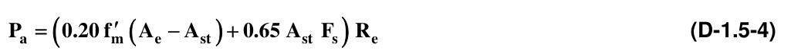

$$ R_e = 1-\left[\dfrac{h'}{42t}\right]^2 \quad \text{para } h'/t \le 30 \qquad R_e = \left[\dfrac{21t}{h'}\right]^2 \quad \text{para } h'/t > 30 \tag{D-1.5-5} $$

### D-1.5.3 — ESFUERZOS ADMISIBLES PARA COMPRESIÓN POR FLEXIÓN

El valor para el esfuerzo máximo admisible de trabajo para compresión por flexión $(F_{b})$ se debe tomar como $0.33f_{m}'$ , pero no puede ser mayor que 14 MPa.

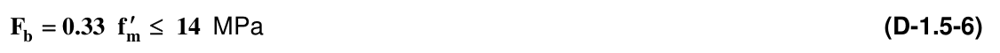

MPa

### D-1.5.4 — ESFUERZOS ADMISIBLES PARA TRACCIÓN POR FLEXIÓN EN LA MAMPOSTERÍA NO REFORZADA

— La tracción desarrollada en las juntas de mortero por flexión en muros con aparejo trabado, no puede exceder los valores indicados en la tabla D-1.5-1. Cuando el mortero contenga cemento de mampostería, dichos valores deben reducirse en un 50%.

**D-1.5.4.1** — No se permite suponer resistencia a la tracción en las juntas, para esfuerzos producidos por cargas axiales de tracción (no producidos por efectos de flexión).

**D-1.5.4.2** — Los valores prescritos en la presente sección no son aplicables a elementos sin carga axial, como vigas y dinteles.

**Tabla D-1.5-1**

Esfuerzos admisibles para tracción por flexión de la mampostería con aparejo trabado $F_{t}$ (MPa)

| Dirección de los esfuerzos de tracción por flexión y tipo de mampostería. | Morteros de cemento pórtland y cal |  | Morteros de cemento para mampostería |  |
|---|---|---|---|---|
|  | H, M, ó S | N | H, M, ó S | N |
| Perpendicular a las juntas horizontales |  |  |  |  |
| - Unidades Macizas | 0.28 | 0.21 | 0.17 | 0.10 |
| - Unidades de perforación vertical(1) |  |  |  |  |
| - Sin rellenar | 0.17 | 0.13 | 0.10 | 0.06 |
| - Rellenas con morteros de inyección | 0.45 | 0.43 | 0.42 | 0.40 |
| Perpendicular a la junta vertical |  |  |  |  |
| - Unidades Macizas | 0.55 | 0.41 | 0.33 | 0.21 |
| - Unidades de perforación vertical |  |  |  |  |
| - Sin rellenar | 0.35 | 0.26 | 0.21 | 0.13 |
| - Rellenas y parcialmente rellenas con morteros de inyección | 0.55 | 0.41 | 0.33 | 0.21 |

1. Para mampostería parcialmente inyectada, los esfuerzos admisibles deberán ser determinados por interpolación lineal de los valores dados para las unidades de perforación vertical sin rellenar y las rellenas con mortero de relleno basada en la cantidad (porcentaje) relleno con mortero de relleno.

admisibles

### D-1.5.5 — ESFUERZOS COMBINADOS

ECUACIÓN FUNDAMENTAL — Cuando se combinen esfuerzos de compresión por carga axial y por flexión, se debe utilizar un procedimiento apropiado basado en los principios de la mecánica de sólidos. En su defecto se pueden verificar los esfuerzos por medio de la siguiente ecuación:

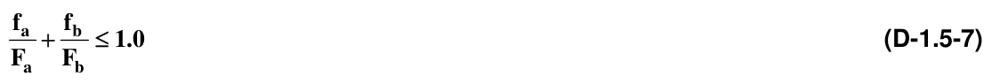

### D-1.5.6 — ESFUERZOS ADMISIBLES DE CORTANTE PARA VIGAS

Para el método de esfuerzos admisibles en el cálculo de cortante en elementos a flexión (vigas), se deben emplear los siguientes valores:

Esfuerzo cortante solicitado:

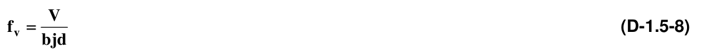

En donde $j$ se puede tomar como 0.8 en caso de no realizar un análisis de compatibilidad de deformaciones. Para miembros con secciones en $T$ o $I$ , se debe reemplazar $b$ por $b_{w}$ .

Esfuerzo cortante admisible para elementos sin refuerzo para cortante

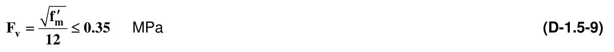

MPa Si se exceden los valores especificados, el refuerzo debe tomar todo el cortante y se debe espaciar a distancias no mayores que $d /2$ . En este caso no se debe exceder el siguiente límite:

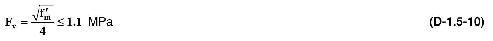

MPa

### D-1.5.7 — ESFUERZOS ADMISIBLES PARA CORTANTE EN MUROS

Para el método de esfuerzos admisibles, en el cálculo del cortante en muros de mampostería, se deben emplear los siguientes valores:

Esfuerzo cortante solicitado:

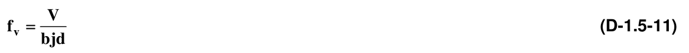

En donde $j$ se puede tomar como 0.8 en caso de no realizar un análisis de compatibilidad de deformaciones.

Para miembros con secciones en $T$ o $I$ , se debe reemplazar $b$ por $b_{w}$ .

(a) Esfuerzo cortante admisible en muros de mampostería no reforzada:

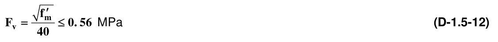

MPa El esfuerzo admisible $F_{v}$ puede ser incrementado en $0.2f_{am}$, donde $f_{am}$ es el esfuerzo de compresión debido a carga muerta solamente.

(b) Esfuerzo cortante admisible en muros de mampostería con refuerzo:

La mampostería toma todo el cortante admisibles

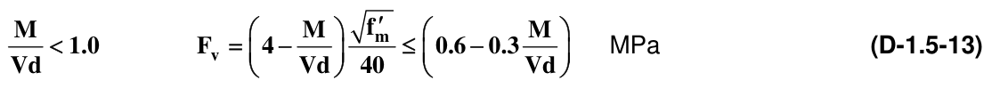

MPa

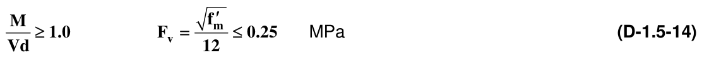

MPa El refuerzo toma todo el cortante

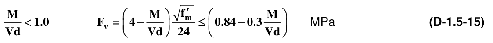

MPa

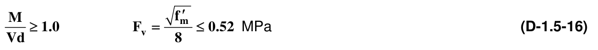

MPa

**D-1.5.8** — La cantidad de refuerzo transversal requerido se debe calcular mediante la siguiente expresión:

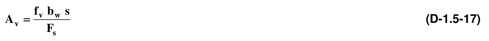

Donde $s$ es el espaciamiento del refuerzo al corte, el cual no debe exceder 1.20 m ni $d /2 , b_{w}$ es el ancho efectivo del alma de la sección, $F_{s}$ es el esfuerzo admisible en el refuerzo a cortante en MPa, $f_{v}$ es el esfuerzo cortante de diseño en MPa y $A_{v}$ es el área del refuerzo a cortante en mm².

**D-1.5.8.1** — El refuerzo transversal de cortante debe colocarse en piezas especiales tipo viga, ubicadas máximo cada 1.20 m. y a distancias no mayores a $d /2$ . Dentro del área de refuerzo transversal de cortante no debe incluirse el refuerzo colocados en las juntas de mortero de la mampostería, el cual solo cumple funciones de disminución de la fisuración.

### D-1.5.9 — SECCIÓN CRÍTICA PARA CORTANTE

La sección crítica de diseño a cortante debe localizarse teniendo en cuenta las condiciones de apoyo, aplicación de cargas y las condiciones particulares de funcionamiento del elemento.

### D-1.5.10 — ESFUERZOS ADMISIBLES EN EL REFUERZO

Se tomarán los siguientes valores para los esfuerzos máximos en el refuerzo $(F_{s})$:

(a) Esfuerzos de tracción, por flexión o por cortante Barras corrugadas

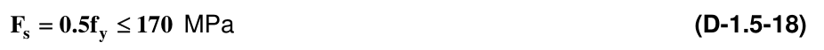

MPa Barras lisas

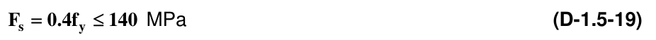

MPa Alambres

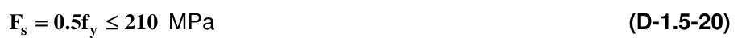

MPa

(b) Esfuerzos de compresión En columnas admisibles

MPa En elementos sometidos a flexión, la resistencia del acero de refuerzo a la compresión debe despreciarse a menos que el refuerzo vertical sea provisto de refuerzo transversal como se indica en el artículo D.4.2.

Barras corrugadas

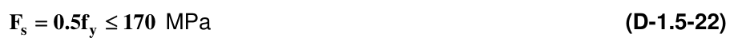

MPa Barras lisas

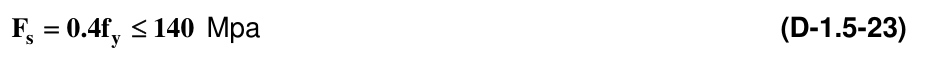

Mpa █
