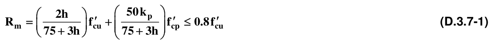
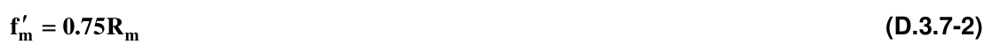
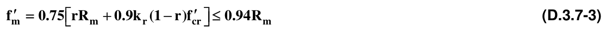

# D.3 — Calidad de los materiales en la mampostería estructural

### D.3.0 — NOMENCLATURA

$f_{m}'$ = resistencia nominal a la compresión de la mampostería, MPa

$f_{cr}'$ = resistencia a la compresión del mortero de relleno, MPa

$f_{cre}'$= resistencia especificada a la compresión del mortero de recubrimiento ó revoque, MPa.

$f_{cu}'$ = resistencia especificada a la compresión de la unidad de mampostería medida sobre área neta, MPa

$f_{cp}'$ = resistencia especificada a la compresión del mortero de pega, MPa

$h$ = altura de la unidad de mampostería, en mm, para ser empleada en la ecuación D.3.7-1

$k_{p}$ = factor de corrección por absorción de la unidad, adimensional

$k_{p}=1.4$ para unidades de concreto, $k_{p}=0.8$ para unidades de arcilla o sílico-calcáreas

$k_{r}$ = factor de corrección por absorción de la unidad en la mampostería inyectada.

$k_{r}=0.9$ para unidades de concreto, $k_{r}=0.75$ para unidades de arcilla o sílico-calcáreas

$R_{m}$= parámetro definido por medio de la ecuación D.3.7-1

$r$ = relación entre el área neta y el área bruta de las unidades de mampostería, adimensional

### D.3.1 — ASPECTOS GENERALES

#### D.3.1.1 — REQUISITOS PARA LOS MATERIALES

Los materiales utilizados en las construcciones de mampostería estructural deben cumplir los requisitos de calidad especificados en el presente Capítulo. Este cumplimiento debe comprobarse mediante ensayos realizados sobre muestras representativas.

#### D.3.1.2 — ENSAYOS DE CONTROL DE CALIDAD DE LOS MATERIALES

Los ensayos de los materiales se deben realizar siguiendo los procedimientos establecidos en las normas técnicas colombianas NTC respectivas. A falta de ellas deben seguirse las normas correspondientes de la Sociedad Americana para Ensayos y Materiales, ASTM, mencionadas en el Reglamento. En D.2.3 se indican las normas adoptadas para el presente Título, las cuales hacen parte de él.

### D.3.2 — CEMENTO Y CAL

**D.3.2.1** — El cemento utilizado en la obra debe estar en condiciones apropiadas y debe corresponder en su tipo y clase a aquel sobre el cual se basan las dosificaciones del concreto y los morteros. Deben cumplirse las siguientes normas:

Cemento portland: NTC 121 y NTC 321. Se permite el uso de cementos fabricados bajo las normas ASTM C150 y C595 Cemento para mampostería: NTC 4050 (ASTM C91) Cal viva: NTC 4046 (ASTM C5) Cal hidratada: NTC 4019 (ASTM C270)

### D.3.3 — ACERO DE REFUERZO

**D.3.3.1** — El acero de refuerzo debe cumplir con los mismos requisitos del numeral C.3.5 de este Reglamento y debe ajustarse a las normas de producción y uso mencionadas allí. Al momento de la colocación debe estar limpio en la superficie, sin corrosión y figurado de acuerdo a los planos.

### D.3.4 — MORTERO DE PEGA

#### D.3.4.1 — REQUISITOS GENERALES

Los morteros de pega utilizados en construcciones de mampostería deben cumplir la norma NTC 3329 (ASTM C270) y con lo especificado en la Tabla D.3.4-1. El mortero premezclado para pega de unidades de mampostería debe cumplir con la norma NTC 3356 (ASTM C1142). Los morteros de pega deben tener buena plasticidad, consistencia y ser capaces de retener el agua mínima para la hidratación del cemento y, además, garantizar su adherencia con las unidades de mampostería para desarrollar su acción cementante.

**Tabla D.3.4-1**

Clasificación de los morteros de pega por propiedad o por proporción

| Mortero tipo | Especificación de los morteros por propiedad(1) |  |  | Especificación de los morteros por proporción |  |  |  |  |
|---|---|---|---|---|---|---|---|---|
|  | Resistencia mínima a la Compresión $f_{cp}'$ MPa (2) | Flujo en (%)(3) | Retención Mínima de Agua | Cemento Portland | Cal hidratada (4) | Cemento para Mampostería(7) | Arena/Material Cementante(5) |  |
|  |  |  |  |  |  |  | Mín. | Máx. |
| H | 22.5 | 115-125 | 75% | 1 | 0.25 | no aplica | 2.00 | 2.5 |
| M | 17.5 | 115-125 | 75% | 1 | 0.25 | no aplica | 2.25 | 3.0 |
|  |  |  |  | 1 | no aplica | 1 | 2.25 | 2.5 |
| S | 12.5 | 110-120 | 75% | 1 | 0.25 a 0.50 | no aplica | 2.50 | 3.5 |
|  |  |  |  | 0.5 | no aplica | 1 | 2.50 | 3.0 |
| N(6) | 7.5 | 105-115 | 75% | 1 | 0.50 a 1.25 | no aplica | 3.00 | 4.5 |
|  |  |  |  | 0 | no aplica | 1 | 3.00 | 4.0 |

Notas:

1. Solo para el diseño de mezclas de morteros en laboratorio, con base en los materiales que van a ser utilizados en obra. El control de morteros en obra se debe realizar de acuerdo con la norma NTC 3546 (ASTM C780).

2. Ensayo de resistencia a la compresión a 28 días en cubos de 50 mm de lado

3. Ensayo realizado según NTC 4050 (ASTM C91)

4. Se puede utilizar cal hidratada en polvo tipo N o S.

5. Para este cálculo no se incluye como cementante la cal.

6. El mortero tipo N solo se permite en sistemas con capacidad mínima de disipación de energía en el rango inelástico (DMI)

7. El tipo de cemento para mampostería (M, S o N) será el mismo que el tipo de mortero de pega.

#### D.3.4.2 — DOSIFICACIÓN DEL MORTERO DE PEGA

La dosificación de los componentes de los morteros de pega debe basarse en ensayos previos de laboratorio o en experiencia de campo en obras similares y se clasifican como $H$, $M$, $S$ o $N$ de acuerdo con la dosificación mínima de sus componentes y con la resistencia a la compresión, según la tabla D.3.4-1. La denominación de morteros tipo H, M, S o N es exclusiva para morteros de pega de mampostería y no deberá emplearse para designar otros tipos de morteros. La resistencia a la compresión se mide a los 28 días sobre probetas tomadas en cubos de 50 mm de lado, o en cilindros de 75 mm de diámetro por 150 mm de altura. Los diferentes tipos de mortero deben cumplir con las condiciones mínimas de flujo inicial y retención de agua establecidos en la tabla D.3.4-1. Para cada uno de los tipos de mortero, en la tabla D.3.4-1 se indican dos alternativas de dosificación, una utilizando cemento portland y cal hidratada, y la otra utilizando cemento portland y cemento para mampostería. Puede emplearse cualquiera de las dos alternativas de dosificación, pero no se permiten dosificaciones que empleen simultáneamente cal hidratada y cemento de mampostería.

**D.3.4.2.1** — Probetas cilíndricas — En caso de utilizarse probetas cilíndricas para ensayos de resistencia a compresión, sus resultados deben correlacionarse respecto a los obtenidos en cubos de 50 mm de lado que constituyen la referencia de la dosificación, y deben ensayarse de acuerdo con lo estipulado en la Norma NTC 3546 (ASTM C780).

#### D.3.4.3 — USO DE LA CAL

La cal que se utilice en la preparación del mortero debe ser cal hidratada y se debe verificar que ésta no sea perjudicial a ninguna de las propiedades especificadas.

#### D.3.4.4 — AGREGADOS

Los agregados para el mortero de pega deben cumplir la norma NTC 2240 (ASTM C144) y estar libres de materiales contaminantes o deleznables que puedan deteriorar las propiedades del mortero de pega.

**D.3.4.5** — AGUA - El agua utilizada para el mortero de pega debe estar limpia y libre de cantidades perjudiciales de aceite, ácidos, alcoholes, sales, materias orgánicas u otras substancias que puedan ser dañinas para el mortero o el refuerzo embebido. Se debe cumplir con lo establecido en C.3.4 de este Reglamento.

#### D.3.4.6 — COLORANTES Y ADITIVOS

Los colorantes y aditivos que se utilicen en la preparación del mortero de pega deben someterse a la aprobación previa del supervisor técnico y debe demostrarse mediante realización de ensayos de laboratorio o evidencia confiable de obras similares, que no deterioran ninguna de las propiedades deseables del mortero ni de las unidades de mampostería, ni causan corrosión del refuerzo embebido.

#### D.3.4.7 — PREPARACIÓN EN OBRA

La preparación del mortero de pega con las dosificaciones establecidas previamente, debe hacerse utilizando mezcladoras mecánicas apropiadas en seco o con el agua de amasado suficiente para obtener la plasticidad requerida. Cuando se mezclen los componentes en seco, la adición de agua se debe realizar por el albañil hasta obtener la plasticidad y consistencia requeridas. El tiempo de mezclado debe ser el suficiente para obtener uniformidad sin segregación en la mezcla. La preparación manual sólo se admite para trabajos de obras menores no contempladas en A.1.6.1 de este Reglamento.

**D.3.4.7.1** — Morteros mezclados en seco en obra — Los morteros de pega mezclados en seco en la obra deben usarse antes de que se inicie la hidratación del cemento por contacto con el agua natural de la arena.

En ningún caso se pueden utilizar después de 2 horas y media de haber sido mezclados, excepto los morteros de larga vida.

**D.3.4.7.2** — Morteros premezclados de larga vida — Los morteros premezclados de larga vida, deben utilizarse de acuerdo con las instrucciones y dentro del tiempo especificado por el fabricante. Debe verificarse mediante ensayos que estos morteros no presentan deterioro de sus propiedades al momento de utilizarse.

### D.3.5 — MORTERO DE RELLENO

#### D.3.5.1 — REQUISITOS GENERALES

Los morteros de relleno utilizados en construcciones de mampostería deben cumplir la norma NTC 4048 (ASTM C476). Deben ser de buena consistencia y con fluidez suficiente para penetrar en las celdas de inyección sin segregación.

#### D.3.5.2 — DOSIFICACIÓN

La dosificación de los componentes de los morteros de relleno debe basarse en ensayos previos de laboratorio o con experiencia de campo en obras similares y su clasificación se debe basar en la dosificación mínima de sus componentes indicada en la tabla D.3.5-1. La resistencia, $f_{cr}'$ , debe medirse a los 28 días sobre probetas tomadas en las celdas de las unidades huecas o en prismas de unidades dispuestas convenientemente, con uso de papel permeable que permita la transferencia de agua entre el mortero de relleno y las unidades de mampostería, impidiendo su adherencia. El procedimiento para la toma de muestras y el ensayo debe hacerse de acuerdo a la norma NTC 4043 (ASTM C1019). La resistencia a la compresión también puede medirse a los 28 días sobre probetas tomadas en cilindros de 75 mm de diámetro por 150 mm de altura, y deben ensayarse de acuerdo con lo estipulado en la Norma NTC 3546 (ASTM C780) para los morteros de relleno fino. El mortero de relleno grueso también se puede muestrear y ensayar según lo establecido en C.5.6.3.1 y C.5.6.3.2 de este Reglamento.

**Tabla D.3.5-1**

Clasificación y dosificación por volumen de los morteros de relleno

| Tipo de Mortero | Cemento | Agregados/Cemento |  |  |  |
|---|---|---|---|---|---|
|  |  | Fino |  | Grueso (tamaño < 10 mm) |  |
|  | Portland | Mín. | Máx. | Mín. | Máx. |
| Fino | 1 | 2.25 | 3.5 | - | - |
| Grueso | 1 | 2.25 | 3.0 | 1.0 | 2.0 |

#### D.3.5.3 — VALOR MÁXIMO DE LA RESISTENCIA A LA COMPRESIÓN

La resistencia a la compresión del mortero de relleno medida a los 28 días, $f_{cr}'$ , debe tener un valor máximo de 1.5 veces $f_{m}'$ y un valor mínimo de 1.25 veces $f_{m}'$ , pero en ningún caso la resistencia a la compresión a los 28 días puede ser inferior a 12.5 MPa.

#### D.3.5.4 — USO DE LA CAL

En caso de utilizarse cal, esta debe cumplir la norma NTC 4019 (ASTM C207) con una dosificación máxima del 10% del volumen de cemento.

#### D.3.5.5 — AGREGADOS

Los agregados para el mortero de relleno deben cumplir la norma NTC 4020 (ASTM C404) y estar libres de materiales contaminantes o deleznables que puedan deteriorar las propiedades del mortero de relleno.

#### D.3.5.6 — AGUA Y ADITIVOS

El agua y los aditivos empleados deben cumplir lo establecido en D.3.4.5 y D.3.4.6 en concordancia con C.3.4 y C.3.6 de este Reglamento.

#### D.3.5.7 — MEZCLADO Y TRANSPORTE

La preparación del mortero de relleno debe realizarse utilizando mezcladoras mecánicas apropiadas. El transporte desde el sitio de mezclado hasta el sitio de inyección debe garantizar la conservación de la consistencia y plasticidad de la mezcla.

### D.3.6 — UNIDADES DE MAMPOSTERÍA

#### D.3.6.1 — TIPOS DE UNIDADES DE MAMPOSTERÍA

Las unidades de mampostería que se utilicen en las construcciones de mampostería estructural pueden ser de concreto, cerámica (arcilla cocida), sílico-calcáreas o de piedra. Según el tipo de mampostería estructural y según el tipo de refuerzo, las unidades pueden ser de perforación vertical, de perforación horizontal o sólidas, de acuerdo con la posición normal de la pieza en el muro. Las unidades sólidas son aquellas cuyas cavidades ocupan menos de un 25% del volumen de la pieza.

#### D.3.6.2 — NORMAS DE PRODUCCIÓN Y CALIDAD

Todas las unidades de mampostería utilizadas en el diseño y la construcción de estructuras de mampostería deben cumplir con las siguientes normas:

**D.3.6.2.1** — Unidades de concreto para mampostería

(a) Las unidades (bloque) de perforación vertical portante de concreto para mampostería deben cumplir con la norma NTC 4026 (ASTM C90)

(b) Las unidades portantes de concreto macizas (tolete) para mampostería, deben cumplir con la norma NTC 4026 (ASTM C55)

(c) Las unidades de concreto para mampostería no estructural, deben cumplir con la norma NTC 4076 (ASTM C129)

**D.3.6.2.2** — Unidades de arcilla para mampostería

(a) Las unidades (bloque) de perforación vertical de arcilla para mampostería estructural deben cumplir con la norma NTC 4205-1 (ASTM C34)

(b) Las unidades de arcilla macizas (tolete) para mampostería estructural deben cumplir con la norma NTC 4205-1 (ASTM C62, C652)

(c) Las unidades de arcilla para mampostería no estructural deben cumplir con la norma NTC 4205-2 (ASTM C56, C212, C216).

(d) Las unidades de arcilla de perforación horizontal para mampostería estructural deben cumplir con la norma NTC 4205-1 (ASTM C56, C212).

(e) Las unidades de mampostería de arcilla cocida que se utilicen en fachadas deben cumplir con la norma NTC 4205-3.

**D.3.6.2.3** — Unidades sílico-calcáreas para mampostería — Las unidades sílico-calcáreas para mampostería deben cumplir con la norma NTC 922 (ASTM C73).

#### D.3.6.3 — UNIDADES ESPECIALES

Para la construcción de elementos de mampostería como muros, vigas, etc., son indispensables unidades especiales, las cuales deben cumplir las especificaciones adoptadas para las unidades típicas del mismo material.

#### D.3.6.4 — UNIDADES DE MAMPOSTERÍA DE PERFORACIÓN VERTICAL

Las unidades de mampostería de perforación vertical (bloque) se pueden utilizar en las construcciones de mampostería estructural de todos los tipos clasificados en D.2.1. Pueden ser de concreto, arcilla o sílico-calcáreas. Se establecen, además, para este tipo de unidades los siguientes requisitos:

**D.3.6.4.1** — Dimensiones de las celdas y las paredes — El área de las celdas verticales de la pieza de mampostería en posición normal, no puede ser mayor que el 65% del área de la sección transversal. Las celdas verticales u horizontales continuas en donde se coloque refuerzo no pueden tener una dimensión menor de 50 mm, ni menos de 3000 mm² de área. Las paredes externas e internas no pueden tener un espesor menor que el establecido en la tabla D.3.6-1.

**Tabla D.3.6-1**

Espesores mínimos de paredes en unidades (bloques) de mampostería de perforación vertical (mm)

| Espesor externo | Espesor mínimo de paredes exteriores |  | Espesor mínimo de tabiques transversales |
|---|---|---|---|
| nominal | sin perforaciones verticales secundarias | con perforaciones verticales secundarias | sin perforaciones verticales secundarias |
| 80(1) | 20 | 30 | 20 |
| 100 | 20 | 30 | 20 |
| 120 | 22 | 32 | 20 |
| 150 | 25 | 35 | 25 |
| 200 | 30 | 40 | 25 |
| 250 | 35 | 45 | 30 |
| 300 | 40 | 50 | 30 |

Nota (1): La unidad de 80 mm de espesor externo nominal sólo se permite en muros no estructurales y en las paredes laterales de mampostería de cavidad.

**D.3.6.4.2** — Perforaciones secundarias — Las unidades de perforación vertical en arcilla cocida pueden tener perforaciones secundarias en las paredes, distintas a las celdas principales y paralelas a ellas. Las perforaciones en las paredes no pueden tener una dimensión transversal mayor de 20 mm ni pueden estar a menos de 10 mm del borde de la pared perforada.

#### D.3.6.5 — UNIDADES DE PERFORACIÓN HORIZONTAL

Las unidades de mampostería de perforación horizontal (bloque) sólo se pueden utilizar en los siguientes tipos de estructuras de mampostería clasificados en D.2.1:

mampostería de muros confinados, mampostería de cavidad reforzada y mampostería reforzada externamente.

También se pueden usar combinadas con unidades de perforación vertical, en edificaciones de uno y dos pisos del grupo de uso $I$ para mampostería no reforzada y para mampostería parcialmente reforzada.

#### D.3.6.6 — UNIDADES MACIZAS DE MAMPOSTERÍA

Las unidades macizas de mampostería (tolete) sólo se pueden utilizar en los siguientes tipos de estructuras de mampostería clasificados en D.2.1: mampostería de muros confinados, mampostería de cavidad reforzada y mampostería reforzada externamente. También se pueden utilizar, combinadas con unidades de perforación vertical para mampostería parcialmente reforzada.

### D.3.7 — DETERMINACIÓN DE LA RESISTENCIA DE LA MAMPOSTERÍA A LA COMPRESIÓN

$f_{m}'$

#### D.3.7.1 — DETERMINACIÓN DE $f_{m}'$ PREVIA A LA CONSTRUCCIÓN

El valor especificado para la resistencia a la compresión de la mampostería $f_{m}'$ , se debe determinar de acuerdo con uno de los siguientes procedimientos:

(a) Por medio de registros históricos D.3.7.3.

(b) Por determinación experimental sobre muretes de prueba D.3.7.4.

(c) Por medio de ensayos sobre materiales individuales D.3.7.5

**D.3.7.1.1** — Aplicabilidad de los procedimientos — Los valores de $f_{m}'$ definidos en esta sección que se basan en la calidad de los materiales, solo se pueden utilizar en el diseño previo a la construcción y no para control de calidad.

#### D.3.7.2 — ELABORACIÓN Y ENSAYO DE LOS MURETES

La elaboración y el ensayo de los muretes que se utilicen para la determinación de $f_{m}'$ , deben llevarse a cabo de acuerdo con la norma NTC 3495 (ASTM E447); cumpliendo, además, con los siguientes requisitos:

**D.3.7.2.1** — Requisitos de elaboración de los muretes — Los muretes deben elaborarse con los mismos materiales y bajo las mismas condiciones que se presenten en la estructura. El contenido de humedad de los materiales debe ser el mismo que se tiene en la estructura en el momento de construirse. La calidad de la mano de obra debe ser la misma que se va a utilizar en la construcción. Cuando en la construcción se coloca el mortero de pega solamente en las paredes laterales de las unidades de perforación vertical, los muretes deben elaborarse colocando mortero de pega sólo sobre las paredes laterales y sin mortero de pega en los tabiques transversales, incluyendo los terminales. Véase D.4.5.10.1 (b). Se deben elaborar muretes, tanto, con las celdas vacías, como muretes con las celdas rellenas, cuando especifique mampostería parcial o totalmente inyectada.

**D.3.7.2.2** — Determinación del valor de $f_{m}'$ — El valor de $f_{m}'$ , para una muestra debe ser el promedio obtenido del ensayo de 3 muretes de igual procedencia, pero no debe ser mayor del 125 por ciento del menor valor obtenido en los ensayos.

**D.3.7.2.3** — Área para determinación de los esfuerzos — El valor de cada ensayo se obtiene de dividir la carga última obtenida por el área neta de la mampostería que tiene el murete ensayado.

**D.3.7.2.4** — Dimensiones de los muretes — Los muretes deben tener un mínimo de 300 mm de altura y una relación altura-ancho mayor ó igual a 1.5 y menor ó igual a 5. Los muretes de mampostería de bloque de perforación vertical deben tener al menos el largo de una pieza completa. Los muretes de otros tipos deben tener al menos 100 mm de largo. El ancho y el tipo de construcción deben ser representativos del tipo de mampostería que se va a utilizar en la construcción.

**D.3.7.2.5** — Corrección por esbeltez — El valor de $f_{m}'$ debe corregirse multiplicándolo por el factor de corrección por esbeltez del murete dado en la tabla D.3.7-1.

**Tabla D.3.7-1**

Factor de corrección por esbeltez para $f_{m}'$

| Relación altura/espesor del murete | 1.5 | 2.0 | 2.5 | 3.0 | 4.0 | 5.0 |
|---|---|---|---|---|---|---|
| Factor de corrección | 0.86 | 1.0 | 1.04 | 1.07 | 1.15 | 1.22 |

**D.3.7.2.6** — Curado de los muretes — Los muretes deben guardarse por siete días al aire a una temperatura de 21 grados centígrados, más/menos 5 grados, a una humedad relativa que exceda el 90 por ciento, y posteriormente a las mismas condiciones, pero con una humedad relativa que puede estar entre el 30 y el 50 por ciento, hasta su ensayo a los 28 días de la fabricación. Los muretes que se construyan a pie de obra deben guardarse bajo condiciones que les conserve la humedad por un lapso de 48 a 96 horas y después de este tiempo se pueden llevar al laboratorio.

**D.3.7.2.7** — Refrentado y ensayo — Los muretes deben refrentarse y ensayarse bajo la norma NTC 3495 (ASTM E447).

#### D.3.7.3 — DETERMINACIÓN ESTADÍSTICA DE $f_{m}'$

Cuando existan registros históricos confiables y suficientes de resultados de ensayos de muestras de muretes de construcciones anteriores realizadas con los materiales especificados para la obra, llevadas a cabo con similares procesos técnicos y de supervisión, en caso de que el coeficiente de variación de los resultados sea inferior o igual al 30%, se permite seleccionar el valor de $f_{m}'$ con base en estos registros, según el número de resultados de ensayos registrados y de acuerdo con:

**D.3.7.3.1** — Más de 30 ensayos históricos — Cuando el número de resultados de ensayos de muestras registradas, sea superior o igual a 30, se puede seleccionar $f_{m}'$ como el 75% del valor promedio de los resultados del registro.

**D.3.7.3.2** — Entre 10 y 30 ensayos históricos — Cuando el número de resultados de ensayos de muestras registradas sea de 10 a 30, se puede seleccionar $f_{m}'$ como el 70% del valor promedio de los resultados del registro.

**D.3.7.3.3** — Menos de 10 ensayos históricos — Cuando el número de pruebas registradas, con tres o más muretes por prueba, sea inferior a 10, no se pueden utilizar los registros históricos para la selección de $f_{m}'$ .

#### D.3.7.4 — DETERMINACIÓN EXPERIMENTAL DE $f_{m}'$

La resistencia especificada a la compresión de la mampostería $f_{m}'$ , se puede determinar experimentalmente para los mismos materiales que se van a emplear, realizando ensayos sobre muretes preliminares a la obra, de acuerdo con lo indicado en el numeral D.3.7.2, exceptuando el número de muretes por muestra, los cuales deben ser los indicados a continuación:

**D.3.7.4.1** — Más de 30 ensayos previos a la obra — Cuando el número de muretes ensayados sea superior o igual a 30, $f_{m}'$ se puede tomar como el 85% del valor promedio de los ensayos realizados.

**D.3.7.4.2** — Entre de 10 y 30 ensayos previos a la obra — Cuando el número de muretes ensayados sea superior a 10 e inferior a 30, $f_{m}'$ se puede tomar como el 80% del valor promedio de los ensayos.

**D.3.7.4.3** — Menos de 10 ensayos previos a la obra — Cuando el número de muretes ensayados sea inferior a 10 pero no menor de 3, $f_{m}'$ se puede tomar como el 75% del valor promedio de los ensayos.

#### D.3.7.5 — VALOR DE $f_{m}'$ BASADO EN LA CALIDAD DE LOS MATERIALES

Cuando $f_{m}'$ no se seleccione mediante ensayos de muretes preliminares o históricos, su valor puede determinarse con base en una correlación apropiada de la calidad de los materiales empleados. En ausencia de tal correlación, el valor de $f_{m}'$ , se puede determinar mediante la siguiente expresión:

Los valores empleados en la ecuación D.3.7-1 deben indicarse en los planos estructurales y controlarse en la obra de acuerdo con lo establecido en la sección D.3.8, pero esto no exime de la obligación de comprobar el valor de $f_{m}'$ por medio de muretes como lo indica la sección D.3.8.1.4.

**D.3.7.6** — VALOR DE $f_{m}'$ CUANDO LAS CELDAS SE INYECTAN CON MORTERO DE RELLENO, BASADO EN LA CALIDAD DE LOS MATERIALES — En la mampostería de cavidad reforzada o de perforación vertical, inyectada con mortero de relleno, se puede obtener el valor de $f_{m}'$ de la siguiente forma:

### D.3.8 — EVALUACIÓN Y ACEPTACIÓN DE LA MAMPOSTERÍA

#### D.3.8.1 — FRECUENCIA DE MUESTREO Y ENSAYOS

El número de pruebas y su frecuencia deben ser como mínimo los siguientes:

**D.3.8.1.1** — Mortero de pega — Para el mortero de pega debe realizarse por lo menos un ensayo de resistencia a la compresión (promedio de 3 probetas) por cada doscientos (200) metros cuadrados de muro o por cada día de pega. Igualmente se debe verificar con frecuencias semanales las condiciones de plasticidad y retención de agua de los morteros de pega usados en la obra.

**D.3.8.1.2** — Mortero de relleno — Para el mortero de relleno se debe realizar al menos un ensayo de resistencia a la compresión (promedio de 3 probetas) por cada diez (10) metros cúbicos de mortero inyectado o por cada día de inyección.

**D.3.8.1.3** — Unidades de mampostería — Para las unidades de mampostería se deben realizar los ensayos establecidos de absorción inicial, absorción total, estabilidad dimensional y resistencia a la compresión de por lo menos cinco (5) unidades por cada lote de producción hasta de 5000 unidades o menos, y no menos de una unidad por cada doscientos (200) metros cuadrados de muro construido.

**D.3.8.1.4** — Muretes — La resistencia a la compresión de la mampostería, $f_{m}'$ , debe verificarse mediante el ensayo de al menos tres (3) muretes por cada quinientos (500) metros cuadrados de muro o fracción, realizados con los materiales y procedimientos empleados en obra. Para unidades de perforación vertical debe medirse el efecto del mortero de relleno en la resistencia de la mampostería, mediante ensayos adicionales de muretes inyectados con mortero, en la cantidad y frecuencia apropiadas, a juicio del supervisor técnico, de acuerdo con lo establecido en el Título $I$, pero en ningún caso en cantidad inferior al 50% del total de especímenes ensayados. Deben tomarse y ensayarse muretes para todos los tipos de unidades utilizadas.

**D.3.8.1.5** — Acero de refuerzo — La calidad del acero de refuerzo se debe comprobar de acuerdo con los requisitos de C.3.5.10.

#### D.3.8.2 — CRITERIOS DE ACEPTACIÓN Y RECHAZO

Deben aplicarse los siguientes criterios para aceptar la calidad de la mampostería:

**D.3.8.2.1** — Resistencia mínima — La calidad de la mampostería se considera satisfactoria si se cumplen simultáneamente que el promedio de los resultados de resistencia a la compresión de los morteros de pega, morteros de relleno, unidades y muretes es mayor o igual a la resistencia especificada, y ningún valor individual es inferior al 80% de la resistencia especificada.

**D.3.8.2.2** — Medidas correctivas — Si no se cumple uno o varios de los requisitos anteriores deben tomarse de inmediato las medidas necesarias para aumentar el promedio de las subsiguientes evaluaciones de resistencia.

**D.3.8.2.3** — Resultados de resistencia bajos — Si algún resultado individual de resistencia a la compresión de los morteros de pega, morteros de relleno, unidades y muretes es inferior al 80% del valor especificado deben tomarse las medidas necesarias para asegurar que la capacidad de carga de la estructura no se haya comprometido. En caso de confirmarse que la mampostería es de baja resistencia y si los cálculos indican que la capacidad de soportar carga de la estructura se ha reducido significativamente se puede apelar al ensayo de extracción de porciones cortadas de los muros afectados. En tal caso deben tomarse 3 porciones por cada lote afectado. La dimensión mínima de los muretes extraídos debe cumplir con lo especificado en D.3.7.2.4. La resistencia promedio de las porciones cortadas debe ser por lo menos igual al 80% de la resistencia especificada.

**D.3.8.2.4** — Pruebas de carga — Si los criterios de D.3.8.2.3 no se cumplen y si la seguridad estructural permanece en duda, el supervisor técnico puede ordenar que se hagan pruebas de carga como las descritas en el Capítulo C.20 para la parte dudosa de la estructura.

█
