# D.10 — Mampostería de muros confinados

### D.10.0 — NOMENCLATURA

$A_{a}$ = coeficiente de aceleración pico efectiva, véase el Título A.

$A_{ci}$ = área de la sección de la columna de confinamiento $i$ , en mm².

$A_{ct}$ = área total de las columnas de confinamiento del muro, en mm².

$A_{e}$ = área efectiva de la sección de mampostería, en mm².

$A_{m}$= área mínima de los muros del piso, que actúan en la misma dirección en planta. Dentro del área de los muros se incluyen las columnas de confinamiento, en m².

$A_{md}$= área efectiva de mampostería para verificación por aplastamiento, en mm².

$A_{mv}$= área efectiva para determinar esfuerzos cortantes, véase D.5.4.5, en mm².

$A_{p}$ = área del piso en el nivel considerado, en m².

$A_{st}$ = área total del acero de refuerzo longitudinal del elemento de confinamiento, en mm².

$b$ = ancho efectivo de la sección de muro para efectos en el plano del muro, véase D.5.4.4, en mm.

$f_{c}'$ = resistencia a la compresión del concreto de los elementos de confinamiento, en MPa.

$f_{cu}'$ = resistencia a la compresión de la unidad de mampostería, en MPa.

$f_{m}'$ = resistencia a la compresión de la mampostería, en MPa.

$\sqrt{f_{m}'}$ = raíz cuadrada de la resistencia a la compresión de la mampostería, en MPa.

$f_{y}$ = resistencia a la fluencia del acero de refuerzo, MPa.

$h'$ = longitud de la diagonal del paño de muro entre elementos de confinamiento, o altura efectiva del elemento para evaluar efectos de pandeo, en mm.

$h_{p}$ = altura del piso localizado por encima del elemento bajo estudio, medida centro a centro entre vigas de confinamiento, en mm.

$I_{ct}$= momento de inercia de las columnas de confinamiento del muro, con respecto a su centroide, en mm4.

$ℓ_{w}$= longitud horizontal total del muro, medida centro a centro entre columnas de confinamiento de borde, en mm.

$ℓ_{c}$ = distancia horizontal entre columnas de confinamiento, medida centro a centro, para el paño de muro confinado bajo estudio, en mm.

$M_{n}$ = momento resistente nominal del muro.

$M_{u}$ = momento mayorado solicitado de diseño del muro.

$N$ = número de niveles por encima del nivel considerado

$P_{nc}$= fuerza axial resistente nominal en compresión sobre la columna de confinamiento, siempre positiva, en N.

$P_{nd}$= fuerza axial resistente nominal a la compresión de la mampostería sola, en N.

$P_{nt}$= fuerza axial resistente nominal en tracción sobre la columna de confinamiento, siempre negativa, en N.

$P_{u}$ = fuerza axial de diseño solicitada en compresión sobre el muro, en N.

$P_{uc}$= fuerza axial de diseño solicitada en compresión sobre la columna de confinamiento, siempre positiva, en N.

$P_{ud}$= fuerza axial que actúa sobre la biela diagonal del muro, en N.

$P_{ut}$= fuerza axial de diseño solicitada en tracción sobre la columna de confinamiento, siempre negativa, en N.

$R_{e}$ = coeficiente utilizado para tener en cuenta los efectos de esbeltez en elementos a compresión.

$t$ = espesor efectivo del elemento para evaluar efectos de pandeo, mm.

$V_{n}$ = fuerza cortante resistente nominal del muro, en N.

$V_{u}$ = fuerza cortante mayorada solicitada de diseño del muro, en N.

$V_{nc}$= fuerza cortante resistente nominal para una sección de concreto reforzado, calculada de acuerdo con los requisitos del Título C del Reglamento, en N.

$V_{uc}$= fuerza cortante mayorada solicitada de diseño que actúa sobre las columnas de confinamiento cerca a la intersección con la viga de confinamiento, en N.

$x_{i}$ = distancia de la columna de confinamiento $i$ al borde del muro, en mm.

$x$ = distancia al borde del muro del centroide de las áreas de todas las columnas de confinamiento del muro, en mm.

$Δ_{P}$= valor absoluto del incremento de la fuerza axial sobre la columna de confinamiento $i$ , causada por el momento solicitado de diseño, $M_{u}$ , en N.

$φ$ = coeficiente de reducción de resistencia.

### D.10.1 — REQUISITOS GENERALES

#### D.10.1.1 — CLASIFICACIÓN

Se clasifica como mampostería confinada aquélla que se construye utilizando muros de mampostería rodeados con elementos de concreto reforzado, vaciados posteriormente a la ejecución del muro y que actúan monolíticamente con éste.

#### D.10.1.2 — REQUISITOS COMPLEMENTARIOS

Las estructuras en mampostería de muros confinados deben cumplir los requisitos dados en los Capítulos D.1, D.2, D.3, D.4 y D.5 de este Reglamento, con las excepciones que se anotan dentro del presente Capítulo.

### D.10.2 — USOS DE LA MAMPOSTERÍA DE MUROS CONFINADOS

**D.10.2.1** — La mampostería de muros confinados debe cumplir con las limitaciones establecidas en el Capítulo A.3 del presente Reglamento. Este sistema estructural se clasifica, para efectos de diseño sismo resistente, como uno de los sistemas con capacidad moderada de disipación de energía en el rango inelástico (DMO).

### D.10.3 — REQUISITOS PARA LOS MUROS DE MAMPOSTERÍA CONFINADA

#### D.10.3.1 — GENERAL

Los muros estructurales de mampostería confinada deben cumplir los requisitos de esta sección. La resistencia ante todas las cargas se obtiene por medio de los muros estructurales, los cuales deben ser confinados. Para que un muro confinado se considere como muro estructural debe ser continuo desde la cimentación hasta su nivel superior y no puede tener ningún tipo de aberturas. Los muros que no cumplan los requisitos anteriores, se consideran como muros no estructurales y deben cumplir los requisitos del Capítulo A.9.

#### D.10.3.2 — UNIDADES DE MAMPOSTERÍA PERMITIDAS

La mampostería de muros confinados se debe construir utilizando unidades de concreto, de arcilla cocida o sílico-calcáreas. Las unidades de mampostería pueden ser de perforación vertical, de perforación horizontal o macizas y deben cumplir las especificaciones establecidas en D.3.6.

**D.10.3.2.1** — Valores mínimos para la resistencia de las unidades, $f_{cu}'$ — Las unidades de mampostería que se empleen en la construcción de muros de mampostería confinada deben tener al menos las resistencias mínimas que se dan en la tabla D.10.3-1.

**Tabla D.10.3-1**

Resistencia mínima de las unidades para muros de mampostería confinada

| Tipo de unidad | $f_{cu}'$ (MPa) |
|---|---|
| Tolete de arcilla | 15 |
| Bloque de perforación horizontal de arcilla | 3 |
| Bloque de perforación vertical de concreto o de arcilla (sobre área neta) | 5 |

**D.10.3.2.2** — Restricción al uso del bloque de perforación horizontal de arcilla — Sólo se permite el uso del bloque de perforación horizontal de arcilla en edificaciones de uno y dos pisos y en los dos pisos superiores de edificaciones de más de dos pisos, cuando se permita su empleo, éste se limitará a muros donde se cumpla $P_{u}/A_{e}≤0.15f_{m}'$.

#### D.10.3.3 — ESPESOR MÍNIMO DEL MURO

Los muros de mampostería confinada en ningún caso pueden tener una la relación entre la altura libre del muro y su espesor mayor de 25 y deben tener un espesor nominal no menor de 110 mm. En viviendas de uno y dos niveles se pueden utilizar como espesores mínimos los establecidos en la tabla E.3.5-1.

#### D.10.3.4 — ÁREA MÍNIMA DE MUROS CONFINADOS POR NIVEL

El área mínima de muros confinados por nivel en cada dirección principal, esta limitada por la siguiente expresión:

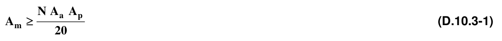

### D.10.4 — REQUISITOS GENERALES PARA LOS ELEMENTOS DE CONFINAMIENTO

#### D.10.4.1 — RESISTENCIA DEL CONCRETO

Tanto las columnas como las vigas de confinamiento se deben construir utilizando concreto cuya resistencia mínima a la compresión debe ser 17.5 MPa medida a los 28 días.

#### D.10.4.2 — COMPATIBILIDAD CON EL TÍTULO C

Las longitudes de desarrollo, las longitudes de empalme por traslapo, y el anclaje, del refuerzo de los elementos de confinamiento son los mismos establecidos en el Título C, con excepción de las dimensiones mínimas y las cantidades de refuerzo mínimas establecidas en el presente Capítulo.

#### D.10.4.3 — REFUERZO INTERIOR EN EL MURO

Todo refuerzo debe ir colocado dentro de las columnas y vigas de confinamiento, no se permite colocar los refuerzos de confinamiento dentro de unidades de perforación vertical. Se exceptúan las vigas de remate de los muros, las cuales se pueden realizar en unidades tipo U, inyectadas con mortero de resistencia a la compresión no menor de 14 MPa.

### D.10.5 — COLUMNAS DE CONFINAMIENTO

#### D.10.5.1 — GENERAL

Se consideran columnas de confinamiento los elementos de concreto reforzado que se colocan en los dos bordes del muro que confinan y en puntos intermedios dentro del muro. Las columnas de confinamiento deben ser continuas desde la cimentación hasta la parte superior del muro y se deben vaciar directamente contra el muro con posterioridad al alzado de los muros estructurales de cada piso.

#### D.10.5.2 — DIMENSIONES MÍNIMAS

Las dimensiones mínimas para los elementos de confinamiento debe ser las siguientes:

**D.10.5.2.1** — Espesor mínimo — El espesor mínimo de los elementos de confinamiento debe ser el mismo del muro confinado.

**D.10.5.2.2** — Área mínima — El área mínima de la sección transversal de los elementos de confinamiento es de 20 000 mm² (200 cm²).

#### D.10.5.3 — UBICACIÓN

Deben colocarse columnas de confinamiento en los siguientes lugares:

(a) En los extremos de todos los muros estructurales.

(b) En las intersecciones con otros muros estructurales.

(c) En lugares intermedios a distancias no mayores de 35 veces el espesor efectivo del muro, 1.5 veces la distancia vertical entre elementos horizontales de confinamiento ó 4 m.

#### D.10.5.4 — REFUERZO MÍNIMO

El refuerzo mínimo de la columna de confinamiento debe ser el siguiente:

(a) Refuerzo longitudinal - No debe ser menor de 3 barras N° 3 (3/8”) ó 10M (10 mm). El área de refuerzo longitudinal debe ser mayor o igual a 0.0075 veces el área de la sección bruta del elemento, pero el refuerzo longitudinal no puede ser menor al requerido para atender los esfuerzos de diseño de acuerdo a D.10.7.

(b) Refuerzo transversal – Debe utilizarse refuerzo transversal consistente en estribos cerrados mínimo de diámetro N° 2 (1/4”) ó 6M (6 mm), espaciados a una separación no mayor de 1.5 veces la menor dimensión del elemento, o 200 mm. En ningún caso, el refuerzo transversal puede ser menos que el requerido para atender los esfuerzos de diseño, de acuerdo con D.10.7.

#### D.10.5.5 — ANCLAJE DEL REFUERZO

El refuerzo vertical de las columnas de confinamiento debe anclarse al sistema de cimentación. Pueden utilizarse barras de empalme ancladas en la cimentación mediante ganchos a 90°.

Estas barras deben sobresalir la longitud de empalme por traslapo desde la cara superior del cimiento. Los empalmes del refuerzo vertical de las columnas de confinamiento deben cumplir los requisitos establecidos en el Capítulo C.12.

En el extremo superior de la columna de confinamiento los refuerzos longitudinales debe anclarse en un elemento de confinamiento transversal a su dirección con un gancho de 90°.

#### D.10.5.6 — REFUERZO TRANSVERSAL DE CONFINAMIENTO

En las zonas de amenaza sísmica alta e intermedia se deben utilizar estribos cerrados de confinamiento mínimo N° 2 (1/4”) ó 6M (6 mm), espaciados a 100 mm y cuyas ramas no pueden estar separadas a distancias mayores de 150 mm. La distancia en cada extremo del elemento, medida a partir del elemento transversal de confinamiento, en la cual se deben colocan los estribos de confinamiento debe ser la mayor entre 450 mm, 3 veces la mayor dimensión de la sección del elemento o la sexta parte de la luz en cuestión.

### D.10.6 — VIGAS DE CONFINAMIENTO

#### D.10.6.1 — GENERAL

Se consideran vigas de confinamiento los elementos de concreto reforzado que se colocan en la parte inferior y superior de muros confinados. Las vigas de amarre se vacían directamente sobre los muros estructurales que confinan. La viga de cimentación se considera como una viga de amarre y debe cumplir los requisitos mínimos de las vigas de amarre.

#### D.10.6.2 — DIMENSIONES MÍNIMAS

Las dimensiones mínimas para las vigas de confinamiento debe ser las siguientes:

**D.10.6.2.1** — Espesor mínimo — El espesor mínimo de las vigas de confinamiento debe ser el mismo del muro confinado.

**D.10.6.2.2** — Área mínima — El área mínima de la sección transversal de los elementos de confinamiento es de 20 000 mm² (200 cm²). En caso de utilizarse una losa de entrepiso maciza de espesor superior o igual a 100 mm, se puede prescindir de las vigas de amarre en la zona ocupada por este tipo de losa, colocando el refuerzo requerido para la viga dentro de la losa. En vigas que requieran enchaparse, el ancho especificado puede reducirse hasta en 75 mm, siempre y cuando se incremente su altura, de tal manera que el área transversal no sea inferior al mínimo.

#### D.10.6.3 — UBICACIÓN

Deben colocarse vigas horizontales de confinamiento en el arranque y en el remate del muro, en los entrepisos y a distancias libres verticales no mayores de 25 veces el espesor del muro. Las vigas deben disponerse formando anillos cerrados en un plano horizontal, entrelazando los muros estructurales en las dos direcciones principales para conformar diafragmas con ayuda del entrepiso ó la cubierta. Deben ubicarse vigas amarres en los siguientes sitios:

(a) A nivel de cimentación — El sistema de cimentación constituye el primer nivel de amarre horizontal.

(b) A nivel del sistema de entrepiso — Las vigas de amarre deben ser parte del sistema de entrepiso.

(c) A nivel del enrase de cubierta — Se presentan dos opciones para la ubicación de las vigas de amarre y la configuración del diafragma:

1. Vigas horizontales al nivel de dinteles más cintas de amarre como remate de las culatas.

2. Vigas de amarre horizontales en los muros sin culatas, combinadas con vigas de amarre inclinadas, configurando los remates de las culatas.

#### D.10.6.4 — REFUERZO MÍNIMO

El refuerzo mínimo de las vigas de amarre debe ser el siguiente:

(a) Refuerzo longitudinal — El refuerzo longitudinal no debe ser inferior a 3 barras N° 3 (3/8”) ó 10M (10 mm), El área de refuerzo longitudinal no puede ser menor a 0.0075 veces el área de la sección bruta del elemento. Para anchos inferiores a 110 mm, y en los casos en que el entrepiso sea una losa maciza, el refuerzo mínimo debe ser dos barras N° 4 (1/2”) ó 12M (12 mm). En ningún caso, el refuerzo longitudinal puede ser menos que el requerido para atender los esfuerzos de diseño, de acuerdo con D.10.7.

(b) Refuerzo transversal — El refuerzo transversal mínimo debe consistir en estribos cerrados N° 2 (1/4”) ó 6M (6 mm), espaciados a distancias no mayores de 200 mm ni de 1.5 veces la menor dimensión del elemento. En ningún caso, el refuerzo transversal puede ser menos que el requerido para atender los esfuerzos de diseño, de acuerdo con D.10.7.

**D.10.6.4.1** — Vigas que continúan fuera del muro confinado — Cuando una viga de amarre continúa fuera del muro confinado, y cumpla funciones de dintel, de apoyo para losa, o como elemento colector dentro del diafragma, la viga debe diseñarse de acuerdo a los requisitos del Título C.

#### D.10.6.5 — ANCLAJE DEL REFUERZO

El refuerzo de las vigas de confinamiento debe anclarse en los extremos terminales con ganchos de 90° dentro de un elemento de confinamiento transversal a su dirección.

#### D.10.6.6 — VIGA DE AMARRE SOBRE LA CIMENTACIÓN

Sobre la cimentación debe colocarse una viga de amarre que cumpla con los requisitos mínimos para vigas de confinamiento dados en esta sección. Cuando la cimentación está construida con elementos de concreto reforzado, éstos se consideran como equivalentes a la viga de amarre y sólo se debe cumplir con las cuantías mínimas, pero en ningún caso, el refuerzo puede ser menos que el requerido para atender los esfuerzos de diseño, de acuerdo con D.10.7.

#### D.10.6.7 — CINTAS DE AMARRE

Se consideran las cintas de amarre como elementos suplementarios a las vigas de amarre, utilizables en antepechos de ventanas, en remates de culatas, en remates de parapetos, etc. Las cintas de amarre deben construirse de tal manera que se garantice el trabajo monolítico con el elemento que remata. El refuerzo longitudinal de las cintas de amarre se debe anclar en los extremos terminales. Indistintamente, se puede utilizar como cinta de amarre cualquiera de los siguientes elementos:

(a) Un elemento de concreto reforzado de altura superior o igual a 100 mm, con ancho igual al espesor del elemento que remata y reforzada mínimo con dos barras longitudinales N° 3 (3/8”) ó 10M (10 mm). El refuerzo transversal debe ser el necesario para mantener en la posición deseada las barras longitudinales.

(b) Un elemento construido con piezas de mampostería tipo U, reforzado longitudinalmente mínimo con dos barras N° 3 (3/8”) ó 10M (10 mm) ó una barra N° 4 (1/2”) ó 12M (12 mm), e inyectado con mortero de inyección de resistencia a la compresión no inferior a 14 MPa.

### D.10.7 — REQUISITOS DE ANÁLISIS Y DISEÑO

#### D.10.7.1 — GENERAL

Las estructuras de mampostería de muros confinados se debe analizar y diseñar de acuerdo a los requisitos de dados en el Capítulo D.5 con las excepciones dadas en el la presente sección. El diseño se debe realizar de acuerdo con el método de diseño por estados límites de resistencia.

#### D.10.7.2 — VALORES DE $φ$

En vez de los valores de $φ$ dados en D.5.1.5, deben emplearse los siguientes:

(a) Carga axial de compresión, con o sin flexión ...............................................................$φ =0.65$

(b) Carga axial de tracción ................................................................................................ $φ =0.85$

(c) Flexión sin carga axial.................................................................................................. $φ =0.85$

(d) Cortante ....................................................................................................................... $φ =0.50$

#### D.10.7.3 — SUPOSICIONES DE DISEÑO

Deben tenerse en cuenta las siguientes suposiciones, en el diseño de muros de mampostería confinada:

(a) Las suposiciones de diseño indicadas en D.5.1.6.

(b) Debe considerarse, en el caso de mampostería de muros confinados, que el muro es un elemento homogéneo que incluye la porción de mampostería y los elementos de confinamiento. Las propiedades mecánicas del muro, como conjunto, se describen a través de las de la mampostería, las cuales, a su vez, deben ser las que se definen en el Capítulo D.5.

(c) Para efectos de aplicar las características dimensionales efectivas indicadas en D.5.4, debe considerarse que los elementos de confinamiento son equivalentes a celdas inyectadas con mortero de relleno, a menos que dentro de los requisitos del presente Capítulo se indique explícitamente algo diferente..

#### D.10.7.4 — DISEÑO PARA CARGA AXIAL DE COMPRESIÓN

El muro, globalmente, debe verificarse para las cargas axiales de compresión, de acuerdo con lo indicado en D.5.5. El área de refuerzo a emplear allí, corresponde a la del acero longitudinal de las columnas de confinamiento. Cuando los procedimientos de diseño requieren que se verifiquen las resistencias axiales de los elementos de confinamiento, pueden emplearse las siguientes resistencias nominales a compresión axial, $P_{nc}$, y tracción axial, respectivamente, $P_{nt}$:

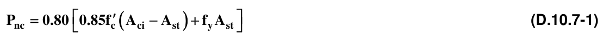

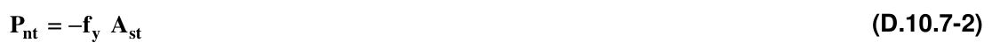

La resistencia nominal a la compresión de la mampostería sola, $P_{nd}$, sin contribución de los elementos de confinamiento, está definida por:

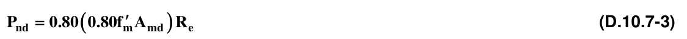

donde $A_{md}$ es el área de la sección de mampostería, y $R_{e}$ se obtiene por medio de:

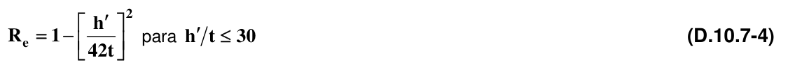

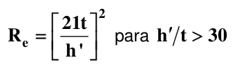

<!-- mod:2-decreto-340-2012-35 -->
> **Modificación — Decreto 340 de 2012** · anexo, p. 7
>
> En D.10.7.4, la ecuación (D.10.7-1) debe quedar así:
>
> $$ P_{nc} = 0.75\left[0.85f'_c\left(A_{ci} - A_{st}\right) + f_y A_{st}\right] \tag{D.10.7-1} $$

#### D.10.7.5 — DISEÑO DEL MURO EN LA DIRECCIÓN PERPENDICULAR A SU PLANO

Los requisitos de esta sección se emplean para el diseño por el método del estado límite de resistencia de muros de mampostería confinada sometidos a cargas horizontales perpendiculares al plano del muro, además de las fuerzas verticales que actúan sobre el muro.

**D.10.7.5.1** — Resistencia a flexo-compresión — La resistencia del muro a flexión producida por fuerzas horizontales perpendiculares a su propio plano, debe evaluarse con base a los siguientes requisitos:

(a) La resistencia a flexo-compresión es contribuida únicamente por las columnas de confinamiento.

(b) Como ancho efectivo, $b$ , debe tomarse únicamente el de las columnas de confinamiento, medido en la dirección del muro.

(c) El diseño se realiza en su totalidad de acuerdo con los requisitos de concreto reforzado del Título C.

(d) La carga axial, $P_{u}$ , que actúa sobre el elemento de confinamiento debe considerarse como el doble de la que se obtiene proporcionalmente a las áreas de mampostería y de columnas de confinamiento, a menos que se realice un análisis más detallado, teniendo en cuenta las relaciones modulares y la posición de las cargas que la inducen.

**D.10.7.5.2** — Resistencia a cortante — La resistencia del muro a cortante producido por fuerzas horizontales perpendiculares a su propio plano, debe evaluarse con base a los requisitos de D.5.7.4.

#### D.10.7.6 — DISEÑO A FLEXO-COMPRESIÓN DEL MURO EN LA DIRECCIÓN PARALELA A SU PLANO

Los requisitos de esta sección se emplean para el diseño a flexo-compresión por el método del estado límite de resistencia, de muros de mampostería confinada sometidos a cargas horizontales paralelas al plano del muro, además de las fuerzas verticales que actúan sobre él. El diseño puede realizarse por uno de los dos procedimientos dados a continuación:

**D.10.7.6.1** — Resistencia a flexo-compresión despreciando la contribución de la mampostería — En este procedimiento se desprecia la contribución de la mampostería a la resistencia a flexo-compresión del muro. Deben calcularse las fuerzas axiales solicitadas máximas, de compresión $P_{uc}$ y de tracción $P_{ut}$ sobre cada una de las columnas de confinamiento, por medio de las ecuaciones D.10.7-5 y D.10.7-6 respectivamente.

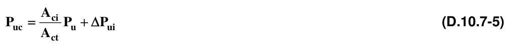

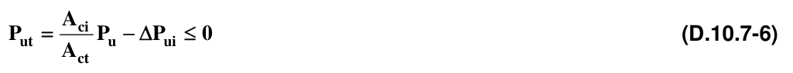

Donde $P_{u}$ y $ΔP_{ui}$ son siempre positivas, y $ΔP_{ui}$ se obtiene por medio de la siguiente ecuación:

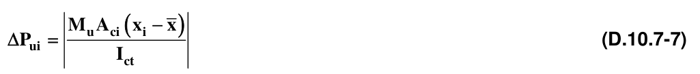

En las ecuaciones anteriores,

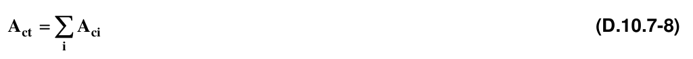

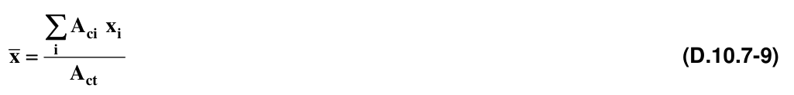

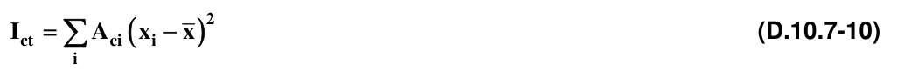

En cada una de las columnas de confinamiento del muro deben cumplirse las condiciones siguientes:

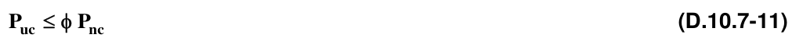

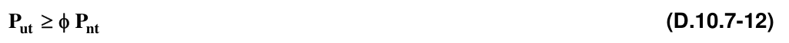

Cuando se trata de un muro confinado que únicamente tiene dos columnas de confinamiento iguales en sus bordes, las ecuaciones (D.10.7-5) a (D.10.7-7) se simplifican a:

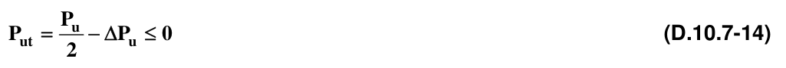

Donde $P_{u}$ y $ΔP_{u}$ son siempre positivas, y $ΔP_{u}$ se obtiene por medio de la siguiente ecuación:

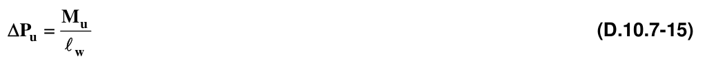

**D.10.7.6.2** — Resistencia a flexo-compresión teniendo en cuenta la contribución de la mampostería – El momento de diseño solicitado, $M_{u}$ , que acompaña la carga axial $P_{u}$ , debe cumplir la condición dada por la ecuación D.10.7-16, para el nivel de carga $P_{u}$ :

$M_{n}$ se obtiene teniendo en cuenta la interacción entre momento y carga axial, de acuerdo con los principios enunciados en D.5.1.6 y en D.10.7.3, los cuales permiten calcular un diagrama de interacción del muro, empleando el coeficiente de reducción de resistencia, $φ$ , apropiado de los dados en D.10.7.2.

#### D.10.7.7 — DISEÑO A CORTANTE DEL MURO EN LA DIRECCIÓN PARALELA A SU PLANO

En la mampostería de muros confinados toda la fuerza cortante sobre el muro debe ser resistida por la mampostería, y se supone que no hay contribución a la resistencia a cortante por parte de los elementos de confinamiento. La resistencia de diseño solicitada, $V_{u}$ , debe cumplir la siguiente condición:

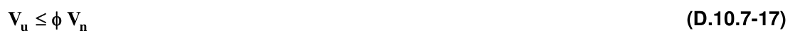

y la resistencia nominal a cortante por tracción diagonal, se obtiene de:

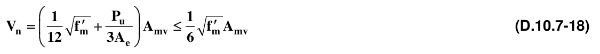

donde $P_{u}$ , en este caso, es la carga axial mayorada que actúa simultáneamente con la máxima fuerza cortante mayorada solicitada, $V_{u}$ , para la cual se realiza el diseño.

#### D.10.7.8 — VERIFICACIÓN POR APLASTAMIENTO DEL ALMA DEL MURO

Debe verificarse que el paño de muro enmarcado por las vigas y columnas de confinamiento, no falle por aplastamiento. Para el efecto se considera una biela de compresión en la diagonal del muro, la cual tiene un ancho efectivo igual a un quinto de la longitud de la diagonal. Debe cumplirse la condición:

La fuerza axial que actúa en la diagonal, $P_{ud}$, se obtiene por medio de:

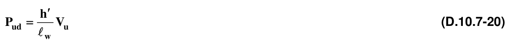

Donde $h'$ es la longitud de la diagonal del paño de muro entre elementos de confinamiento, $ℓ_{w}$ es la longitud total del muro sobre el cual actúa el cortante horizontal de diseño solicitado $V_{u}$ . La resistencia nominal al aplastamiento se obtiene por medio de la ecuación D.10.7-3. Allí hay que emplear una longitud para evaluación de pandeo $h'$ igual a la dimensión de la diagonal del muro en el paño en estudio, y un espesor efectivo para pandeo $t$ , igual al espesor del muro. El área de la biela de compresión $A_{md}$ es igual al ancho efectivo de la biela, $h '/5$, multiplicada por el espesor efectivo del muro, $b$ , para efectos en la dirección paralela al plano del muro, tal como se define en D.5.4.4.2.

#### D.10.7.9 — VERIFICACIÓN A CORTANTE EN LOS ELEMENTOS DE CONFINAMIENTO DEL MURO

Los elementos de confinamiento reciben la fuerza de la biela de compresión en la esquina de intersección entre vigas y columnas de confinamiento, por lo tanto hay necesidad de verificar que están en capacidad de resistir como fuerza cortante aplicada, transversal al eje longitudinal del elemento de confinamiento, al menos una fuerza cortante igual a la mitad de la componente correspondiente de la fuerza de compresión que actúa sobre la biela.

La fuerza cortante actuante, $V_{uc}$, sobre la columna de confinamiento es:

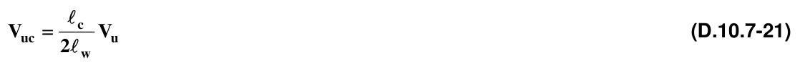

y la fuerza cortante actuante, $V_{uc}$, sobre la viga de confinamiento es:

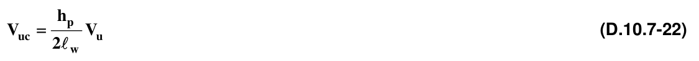

En ambos casos debe cumplirse que:

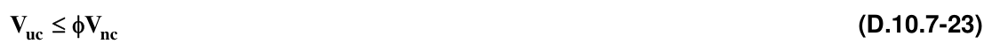

donde $V_{nc}$ para el elemento de confinamiento debe calcularse de acuerdo con los requisitos del Título C del Reglamento, Capítulo C.11.

#### D.10.7.10 — DISEÑO DEL ACERO LONGITUDINAL DE LA VIGA DE CONFINAMIENTO

La componente horizontal de la biela de compresión que actúa en la diagonal del muro debe ser resistida como fuerza de tracción en la viga de confinamiento que llega a la misma esquina del paño del muro donde actúa la biela de compresión. Esta fuerza de tracción es igual a la fuerza cortante que lleva el paño de muro. Por lo tanto:

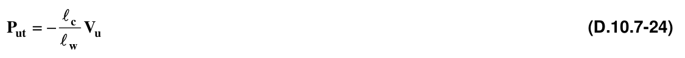

La fuerza axial de tracción sobre la viga de confinamiento debe ser resistida en su totalidad por el acero de refuerzo longitudinal de la viga:

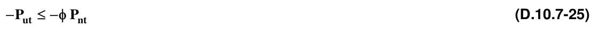

donde $P_{nt}$, se obtiene por medio de la ecuación D.10.7-2.

### D.10.8 — REQUISITOS DE CONSTRUCCIÓN

#### D.10.8.1 — GENERAL

Deben cumplirse los requisitos de construcción dados en el Capítulo D.4 del Reglamento, exceptuando las siguientes secciones: D.4.2 y D.4.5.10, D.4.5.11, D.4.5.12 Y D.4.6. Además deben cumplirse los requisitos adicionales dados a continuación:

#### D.10.8.2 — DETALLES DEL REFUERZO

Todo refuerzo debe estar colocado en elementos de confinamiento. El refuerzo debe cumplir los requisitos dados en el Título C.

#### D.10.8.3 — REQUISITOS COMPLEMENTARIOS PARA LOS ELEMENTOS DE CONFINAMIENTO

Las especificaciones, requisitos, controles y tolerancias de los elementos de confinamiento son los mismos establecidos en el Título C, con excepción de las dimensiones y las cantidades de refuerzo mínimas establecidas en el presente Capítulo.

#### D.10.8.4 — CONSTRUCCIÓN DEL MURO

La ejecución del muro se debe hacer de manera previa al vaciado de las columnas, dejando el espacio especificado para ellas, siguiendo los procedimientos y controles establecidos en el Capítulo D.4 de este título. Se deben cumplir las tolerancias constructivas dadas en la tabla D.4.2-2. El mortero de pega debe cumplir los requisitos de D.3.4.

#### D.10.8.5 — JUNTAS DE CONTROL

En el espacio confinado entre columnas no se permiten juntas de control. Si se requiriesen, éstas deben localizarse entre columnas adyacentes diseñadas para tal propósito.

#### D.10.8.6 — VACIADO DE LAS COLUMNAS DE CONFINAMIENTO

Una vez dispuesto el refuerzo vertical y el refuerzo horizontal de las columnas, se deben colocar los testeros laterales que constituyen la formaleta de las columnas, permitiendo que el concreto vaciado haga contacto con la superficie terminal del muro confinado, la cual debe estar libre de rebabas y de materiales que restrinjan la adherencia entre el concreto y la mampostería. El refuerzo vertical de la columna debe sobresalir de la superficie de enrase la cantidad necesaria para realizar los empalmes por traslapo con la columna superior si la hubiese; el remate del refuerzo vertical se debe anclar en la cara superior de la viga de confinamiento, utilizando ganchos de 90°.

#### D.10.8.7 — VIGAS DE CONFINAMIENTO

Una vez vaciadas las columnas de confinamiento, se debe proceder a realizar el vaciado de la losa o de las vigas de confinamiento que van directamente sobre los muros confinados y en contacto con éstos.

█ Notas
