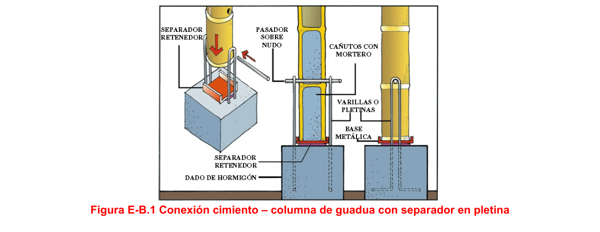
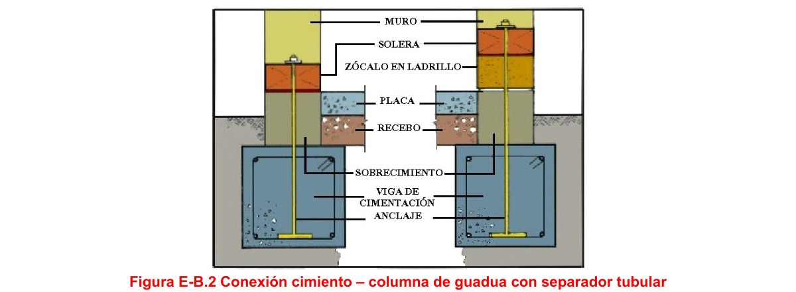
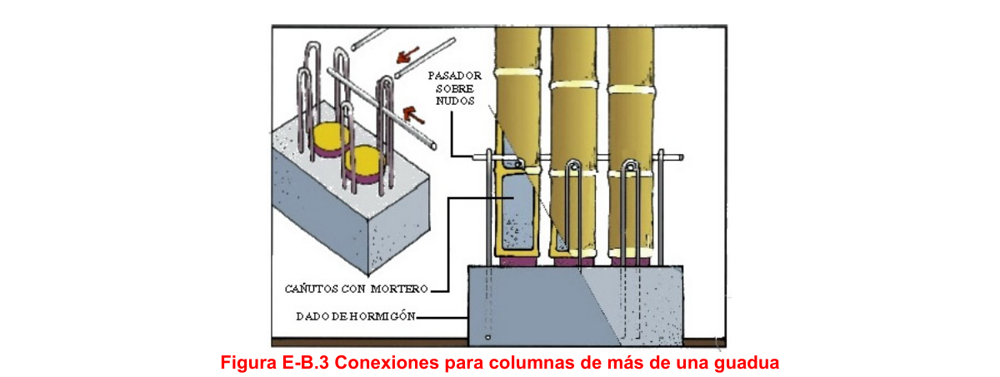
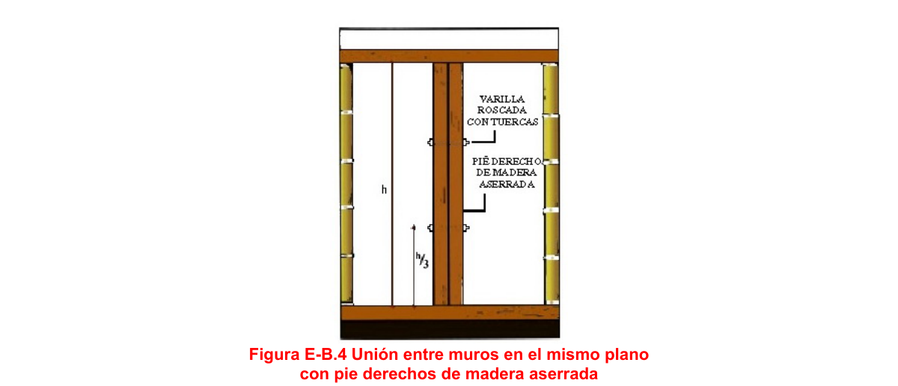
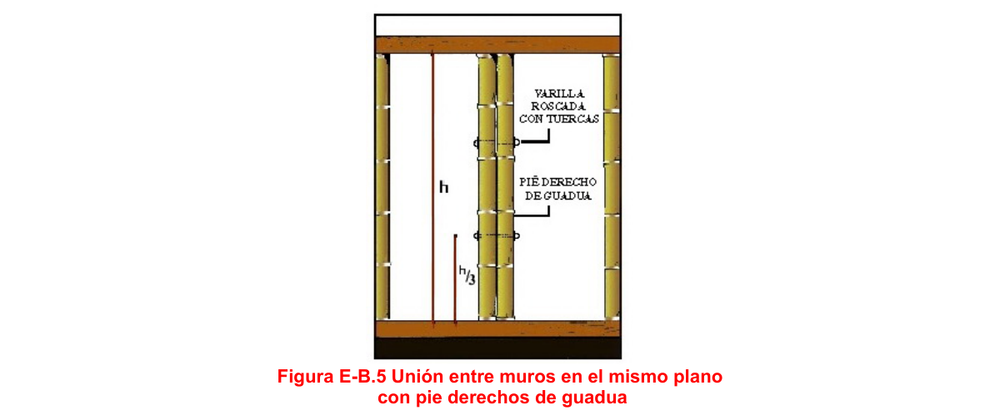
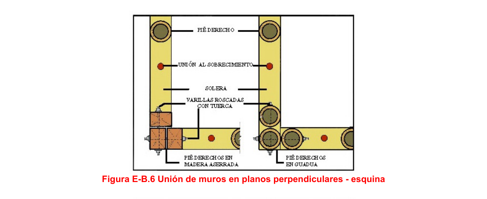
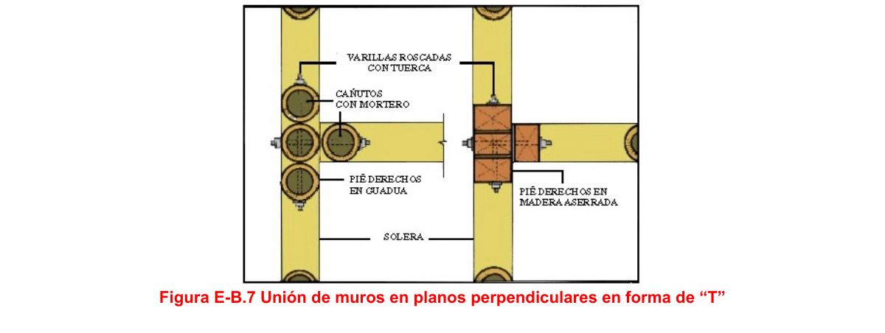
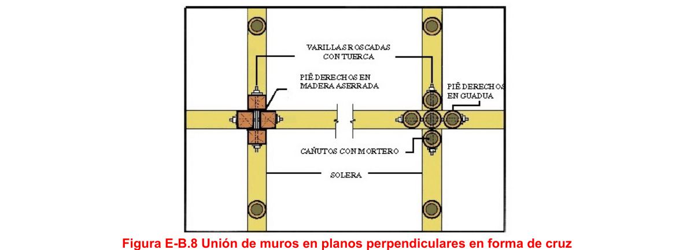

<!-- mod:1-decreto-092-2011-160 -->
> *Apéndice incorporado por el Decreto 092 de 2011 (anexo, p. 34).*

# E-B — ILUSTRACIÓN DE UNIONES

### E-B.1 — ALCANCE

**E-B.1.1** — Se presentan algunas ilustraciones para complementar los numerales E.8.3 a E.8.5

