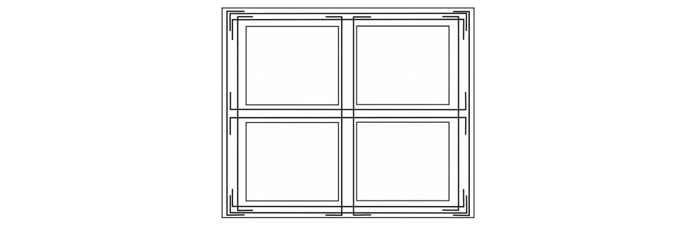
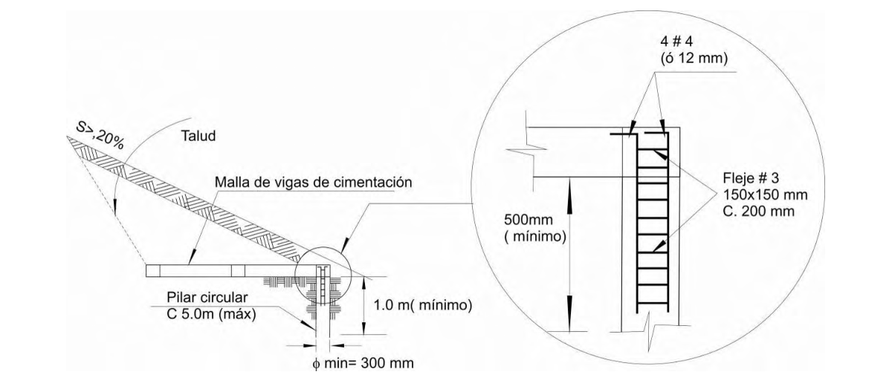

# E.2 — Cimentaciones

### E.2.1 — GENERALIDADES

#### E.2.1.1 — INVESTIGACIÓN MÍNIMA

En todos los casos se deben cumplir los siguientes requisitos mínimos, los cuales deberán quedar consignados en un Memorial de Responsabilidad suscrito por el profesional responsable de la licencia de construcción:

(a) Verificar el comportamiento de casas similares en las zonas aledañas constatando que no se presenten asentamientos diferenciales, agrietamientos, pérdida de verticalidad, compresibilidad excesiva, expansibilidad de intermedia a alta, colapsibilidad, etc., que permita concluir que el comportamiento de las casas similares ha sido el adecuado.

(b) Verificar en inmediaciones del sector a intervenir la ausencia de procesos de remoción en masa, áreas de actividad minera activa, en recuperación o suspendida, erosión, cuerpos de aguas u otros que puedan afectar la estabilidad y funcionalidad de las casas.

(c) Se debe realizar mínimo un apique por cada tres unidades construidas o por cada 300 m2 de construcción, hasta una profundidad mínima de 2.0 m, en el que se constate la calidad razonable del suelo de cimentación.

(d) En los apiques indicados en (c) deberán quedar determinados los espesores de los materiales inconvenientes para el apoyo directo y superficial de la cimentación, como son: descapote, escombros, materia orgánica, etc., los cuales deberán ser retirados durante la construcción.

En caso de que los resultados de la investigación mínima indiquen condiciones inadecuadas para la estabilidad del proyecto, se deberán realizar los estudios geotécnicos indicados en el numeral E.2.1.2.

#### E.2.1.2 — ESTUDIO GEOTÉCNICO

Debe realizarse un estudio geotécnico que cumpla los requisitos del Título H del reglamento en los siguientes casos:

(a) Suelos que presenten inestabilidad lateral.

(b) Suelos con pendientes superiores al 30%.

(c) Suelos con compresibilidad excesiva.

(d) Suelos con expansibilidad de intermedia a alta.

(e) Suelos que presenten colapsibilidad.

(f) Suelos en zonas que presenten procesos de remoción en masa, áreas de actividad minera activa, en recuperación o suspendida, erosión, cuerpos de aguas u otros que puedan afectar la estabilidad y funcionalidad de las casas.

#### E.2.1.3 — LIMPIEZA DEL TERRENO

El terreno debe limpiarse de todo material orgánico y deben realizarse los drenajes necesarios para asegurar una mínima incidencia de la humedad.

#### E.2.1.4 — SISTEMA DE CIMENTACIÓN

La cimentación estará compuesta por un sistema reticular de vigas que configuren anillos aproximadamente rectangulares en planta, como se ilustra en la figura E.2.1-1, y que aseguren la transmisión de las cargas de la superestructura al suelo en forma integral y equilibrada. Debe existir una viga de cimentación para cada muro estructural. Ningún elemento de cimentación puede ser discontinuo.

Figura E.2.1-1 — Sistema reticular de vigas que configuran anillos cerrados y continuos

#### E.2.1.5 — CONFIGURACIÓN EN PLANTA

Si uno de los anillos del sistema de cimentación tiene una relación largo sobre ancho mayor que dos, o si sus dimensiones interiores son mayores de 4,0 m, debe construirse una viga intermedia de cimentación, así no sirva de apoyo a ningún muro, en cuyo caso sus dimensiones mínimas pueden reducirse a 200 mm por 200 mm. La intersección de los elementos de cimentación debe ser monolítica y los refuerzos deben anclarse con ganchos estándar de 90° en la cara exterior del elemento transversal Terminal, como se muestra en la figura E.2.1-2.

Figura E.2.1-2 — Ganchos de anclaje en vigas de cimentación transversales

### E.2.2 — ESTRUCTURACIÓN DE LOS CIMIENTOS

#### E.2.2.1 — GENERAL

Las vigas de cimentación deben tener refuerzo longitudinal superior e inferior y estribos de confinamiento en toda su longitud. Las dimensiones y el refuerzo de los cimientos se presentan en la tabla E.2.2-1:

**Tabla E.2.2-1**

Valores mínimos para dimensiones, resistencia de materiales y refuerzo de cimentaciones

|  | Sistema Estructural | Un piso | Dos Pisos | Resistencia Mínima, $MPa$ |  |
|---|---|---|---|---|---|
| Anchura | Mampostería | 250 mm | 300 mm | $f_{y}$ | $f_{c}$ |
|  | Bahareque | 200 mm | 250 mm |  | 17 |
| Altura | Mampostería | 200 mm | 300 mm |  |  |
|  | Bahareque | 150 mm | 200 mm |  |  |
| Acero Longitudinal Estribos |  | 4 No. 3 (ó 10M) No. 2 a 200 mm | 4 No. 4 (ó 12M) No. 2 a 200 mm | 420 |  |
|  |  |  |  | 240 |  |
| Acero para anclaje de muros | Mampostería | No. 3 | No. 3 | 412 |  |
|  | Bahareque | No. 3 | No. 4 |  |  |

#### E.2.2.2 — CIMIENTOS EXCÉNTRICOS

Los cimientos pueden colocarse excéntricos en los casos en que haya medianería o junta sísmica. Su geometría y refuerzo deben ser iguales a los mínimos especificados en E.2.2.2.

#### E.2.2.3 — CIMENTACIONES SOBRE TERRENO INCLINADO

Cuando la inclinación del terreno exija la ejecución de cortes para la construcción del proyecto y/o sistemas de contención, éstos se deben diseñar atendiendo las disposiciones del Título H y disponiendo los elementos adicionales requeridos para resistir las cargas laterales allí especificadas.

**E.2.2.3.1** — Para pendientes superiores al 20% debe garantizarse la estabilidad en la cimentación, empleando procedimientos tales como pilares en concreto de sección circular, dispuestos en las esquinas del borde inferior de ladera, a distancias no mayores de 5 m entre centros y anclados no menos de 1 m en el suelo natural. La esquina de la malla de cimentación correspondiente a cada pilar se debe anclar mediante 4 barras del N° 4 (1/2”) ó 12M (12 mm) formando una canastilla de 150 mm x 150 mm que debe penetrar en el pilar al menos 500 mm y anclarse en los elementos de la malla de cimentación. La configuración de los pilares y su refuerzo se ilustra en la figura E.2.2-1

Figura E.2.2-1 — Pilares para estabilizar pendientes mayores del 20%

#### E.2.2.4 — SOBRECIMIENTOS

El nivel inferior de las vigas de cimentación deberá estar a una profundidad mínima de 500 mm por debajo del nivel de acabado del primer piso. Debe construirse sobre ellas un sobrecimiento que puede fabricarse con mampostería confinada o con mampostería reforzada, siguiendo los requerimientos del Título D o de los capítulos E.3 y E.4 del Título E, o con concreto, de acuerdo con los requisitos del Título C, que sobresalga, mínimo 80 mm. El sobrecimiento debe anclarse debidamente a la cimentación mediante barras de refuerzo. Los sobrecimientos en mampostería deben rematarse con vigas de amarre que garanticen la conformación de un diafragma en el nivel del contrapiso, estructuradas de acuerdo con lo establecido en el numeral E.4.4. De allí en adelante, se construye el entrepiso del primer piso útil.

**E.2.2.4.1** — Cuando el terreno es inclinado, con una pendiente mayor al 5 %, el sobrecimiento se debe construir con altura constante en los muros paralelos a las curvas de nivel y una altura variable o escalonada en los muros perpendiculares a las curvas de nivel. No deben construirse vigas de cimentación que tengan superficies inclinadas en contacto con el suelo.

**E.2.2.4.2** — Cuando la profundidad del estrato de suelo competente es mayor de 700 mm, puede reducirse la altura del sobrecimiento, colocando la viga de cimentación sobre un relleno de concreto ciclópeo. Este relleno debe tener una anchura mínima de 300 mm y una altura mínima de 200 mm. Para la elaboración del concreto ciclópeo debe utilizarse material pétreo con tamaño máximo igual a la mitad de la anchura del relleno pero sin exceder 250 mm. El volumen ocupado por este agregado no debe ser superior al 40 % del volumen total del relleno ciclópeo. El resto del volumen debe llenarse con concreto de la misma o mejor calidad del concreto de las vigas de cimentación.

**E.2.2.5** — La losa de contrapiso debe aislarse lateralmente del sobrecimiento sobre el que se apoyan los muros, no debe conectarse estructuralmente con la estructura de cimentación y en ningún caso debe considerarse como parte integral de la cimentación.

### E.2.3 — INSTALACIONES HIDROSANITARIAS

**E.2.3.1** — Las instalaciones hidrosanitarias deben colocarse por encima de la malla estructural de cimentación, a través del sobrecimiento o por debajo de la malla de cimentación, caso en el cual la distancia vertical entre el fondo de la malla y el borde superior de la tubería debe ser mayor de 100 mm. La intersección entre los elementos de la malla de cimentación y la zanja de la instalación se debe rellenar con un concreto pobre. En ningún caso pueden empotrarse las instalaciones hidrosanitarias en las vigas de cimentación.

### E.2.4 — ESPECIFICACIONES ESPECIALES

#### E.2.4.1 — JUNTAS

La cimentación debe contener juntas a distancias no mayores de 30 m, a menos que un estudio geotécnico completo realizado de acuerdo con las especificaciones del Título H, resulte en distancias diferentes.

#### E.2.4.2 — MUROS DIVISORIOS NO ESTRUCTURALES

Los muros divisorios no estructurales deben apoyarse sobre cimentaciones similares a las de los muros estructurales, excepto que pueden tener las dimensiones especificadas para edificaciones de un piso, independientemente del número de pisos de la construcción.

n
