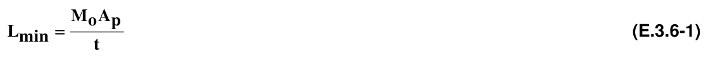
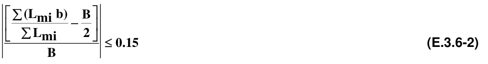

# E.3 — Mampostería confinada

### E.3.1 — GENERALIDADES

#### E.3.1.1 — SEGÚN SU FUNCIÓN

Los muros de las casas de uno y dos pisos, en mampostería confinada, contempladas dentro del alcance del presente Título del Reglamento, se clasifican en dos grandes grupos:

**E.3.1.1.1** — Muros confinados estructurales — Se consideran muros estructurales aquellos que resisten las fuerzas horizontales causadas por el sismo, o el viento, además de soportar las cargas verticales, muertas y vivas, en el caso de que constituyan soporte del entrepiso y/o cubierta

**E.3.1.1.2** — Muros no estructurales — Son aquellos muros que cumplen la función de separar espacios dentro de la casa y que no soportan ninguna carga adicional a su peso propio.

#### E.3.1.2 — MUROS CONFINADOS ESTRUCTURALES

Sólo se consideran como muros estructurales, en un nivel determinado, aquellos que presentan continuidad vertical desde la cimentación hasta el diafragma superior del nivel considerado, que no tienen ningún tipo de aberturas, y que están confinados.

#### E.3.1.3 — AMARRE DE LOS MUROS NO ESTRUCTURALES

Los muros no estructurales, interiores o de fachada, deben amarrarse o trabarse con los muros perpendiculares a su plano y los diafragmas.

#### E.3.1.4 — PERDIDA DE SECCIÓN

Cuando un muro estructural pierda en algún punto más del 50 por ciento de su sección debido a una bajante o a algún otro elemento perteneciente a las instalaciones interiores, debe considerarse que el muro se ha fraccionado en dos muros, los cuales deben analizarse y diseñarse como elementos independientes, confinando cada uno de ellos independientemente.

### E.3.2 — UNIDADES DE MAMPOSTERÍA

**E.3.2.1** — Las unidades de mampostería que se utilicen en las casas de uno y dos pisos pueden ser de concreto, de arcilla cocida o de silical. Las unidades de mampostería pueden ser de perforación vertical, de perforación horizontal ó macizas y deben cumplir las especificaciones establecidas en las normas NTC expedidas por el Instituto Colombiano de Normas Técnicas y Certificación, ICONTEC, que se relacionan a continuación:

**E.3.2.1.1** — Unidades de concreto

(a) Las unidades (bloque) de perforación vertical portante de concreto deben cumplir con la norma NTC 4026 (ASTM C90)

(b) Las unidades portantes de concreto macizas (tolete), deben cumplir con la norma NTC 4026 (ASTM C55)

(c) Las unidades de concreto de resistencia clase baja, deben cumplir con la norma NTC 4076 (ASTM C129)

**E.3.2.1.2** — Unidades de arcilla

(a) Las unidades (bloque) de perforación vertical de arcilla deben cumplir con la norma NTC 4205 (ASTM C34)

(b) Las unidades de arcilla macizas (tolete) deben cumplir con la norma NTC 4205 (ASTM C62, C652)

(c) Las unidades de arcilla de resistencia clase baja, deben cumplir con la norma NTC 4205 (ASTM C56, C212, C216).

**E.3.2.1.3** — Unidades sílico-calcáreas — Las unidades sílico-calcáreas deben cumplir con la norma NTC 922 (ASTM C73).

### E.3.3 — MORTERO DE PEGA

**E.3.3.1** — Los morteros de pega utilizados en construcciones de uno y dos pisos deben tener buena plasticidad y consistencia y deben garantizar la retención del agua mínima para la hidratación del cemento. Su función principal es la de adherir las unidades de mampostería y para ello se deben establecer dosificaciones apropiadas que garanticen su calidad. Su resistencia mínima a la compresión a los 28 días debe ser 7.5 MPa (75 kgf/cm2), medida en cilindros de 75 mm de diámetro por 150 mm de altura. Su dosificación entre material cementante (cemento y cal) respecto a la arena cernida por malla No. 8, no puede ser inferior a 1:4 en volumen.

### E.3.4 — ABERTURAS EN LOS MUROS

**E.3.4.1** — Las aberturas en los muros deben ser pequeñas, bien espaciadas y no pueden estar ubicadas en las esquinas. El área de los vanos de un muro no debe ser mayor al 35% del área total del muro.

#### E.3.4.2 — DISTANCIA MÍNIMA ENTRE ABERTURAS

Entre las aberturas de un mismo muro debe existir una distancia suficiente. La distancia mínima entre aberturas debe ser mayor a 500 mm. Y en ningún caso debe ser menor que la mitad de la dimensión mínima de la abertura.

#### E.3.4.3 — REFUERZO DE LAS ABERTURAS

Se deben reforzar los vanos con vigas y columnas de concreto reforzado alrededor de los mismos y la longitud total en planta de los vanos debe ser menor que la mitad de la longitud total en planta del muro

**E.3.4.3.1** — No se deben dejar aberturas continuas en la parte superior del muro, cerca de las columnas de confinamiento, por que se puede presentar el efecto de columna corta.

### E.3.5 — ESPESOR DE MUROS

#### E.3.5.1 — DEBIDO A LA ALTURA LIBRE

Para muros estructurales la distancia libre vertical entre diafragmas no puede exceder 25 veces el espesor efectivo del muro. En el caso de cubiertas que constituyan diafragmas inclinados, la medida vertical puede tomarse como la distancia libre entre el diafragma inferior de entrepiso o de cimentación y la altura media del diafragma; y cuando haya vigas de amarre a la altura de dintel, la distancia vertical puede tomarse hasta este nivel, verificando tanto la distancia por debajo del dintel como la distancia hasta el punto más alto de la culata de remate, la cual debe tener una cinta de amarre en su remate.

#### E.3.5.2 — DEBIDO A LONGITUD LIBRE HORIZONTAL

Para los muros estructurales la distancia libre horizontal no puede exceder 35 veces el espesor efectivo del muro. Se debe tomar como distancia libre horizontal la existente entre columnas de amarre o entre muros transversales trabados con el muro bajo consideración.

#### E.3.5.3 — ESPESOR MÍNIMO DE MUROS ESTRUCTURALES CONFINADOS

En ningún caso, el espesor nominal de los muros estructurales de carga puede ser inferior al establecido en la tabla E.3.5-1. Estos espesores mínimos nominales pueden disminuirse solo cuando se realiza el diseño completo de la edificación de acuerdo con los requisitos del Título A y del Título D de este Reglamento.

**Tabla E.3.5-1**

Espesores mínimos nominales para muros estructurales en casas de uno y dos pisos (mm)

| Zona de Amenaza Sísmica | Número de niveles de construcción |  |  |
|---|---|---|---|
|  | Un Piso | Dos Pisos |  |
|  |  | 1° Nivel | 2° Nivel |
| Alta Intermedia Baja | 110 | 110 | 100 |
|  | 100 | 110 | 95 |
|  | 95 | 110 | 95 |

Nota: Para estos espesores mínimos nominales no se deben tener en cuenta los pañetes y acabados

### E.3.6 — LONGITUD DE MUROS CONFINADOS

#### E.3.6.1 — GENERAL

Para poder garantizar que la edificación tenga capacidad de disipación de energía en el rango inelástico, debe proveerse una longitud mínima de muros confinados en cada una de las direcciones principales en planta. Los muros confinados pueden ser muros de carga o muros transversales de rigidez.

#### E.3.6.2 — LOCALIZACIÓN

Para poder garantizar que el comportamiento individual y de conjunto sea adecuado, los muros confinados deben ubicarse buscando la mejor simetría y la mayor rigidez torsional de la edificación. Esto se logra disponiendo muros confinados simétricos lo más cerca posible a la periferia.

#### E.3.6.3 — CANTIDAD DE MUROS EN CADA DIRECCIÓN

Para proveer un reparto uniforme de la responsabilidad de resistir las fuerzas sísmicas en el rango inelástico, los muros confinados que se dispongan en cada una de las direcciones principales deben tener longitudes similares. Las longitudes de aquellos muros confinados que estén en un mismo plano vertical, no deben sumar más de la mitad de la longitud total de muros confinados en esa dirección.

#### E.3.6.4 — LONGITUD MÍNIMA DE MUROS CONFINADOS

La longitud de muros confinados requerida en cada una de las direcciones principales de la edificación, en metros, no puede ser menor que la que se obtiene por medio de la ecuación E.3.6-1

donde:

$Lmin$ = longitud mínima de muros estructurales en cada dirección (m)

$Mo$ = coeficiente que se lee en la tabla E.3.6-1

$t$ = espesor efectivo de muros estructurales en el nivel considerado (mm)

$Ap$ = se considera en m2 como sigue:

(a) Igual al área de la cubierta en construcciones de un piso con cubierta en losa de concreto.

(b) Igual al área de cubierta para muros del segundo nivel en construcciones de dos pisos, cuando la cubierta es una losa de concreto.

(c) Igual al área de cubierta más el área de entrepiso para muros de primer nivel en construcciones de dos pisos con cubierta consistente en una losa de concreto.

(d) Cuando se emplee una cubierta liviana, los valores del área determinados para cubiertas de losa de concreto según (a), (b), o (c), pueden multiplicarse por 2/3.

**Tabla E.3.6-1**

Coeficiente $Mo$ para longitud mínima de muros estructurales confinados *

| Zona de Amenaza Sísmica | Valores $Aa$ | Valores $Mo$ |
|---|---|---|
| Alta | 0.40 | 33.0 |
|  | 0.35 | 30.0 |
|  | 0.30 | 25.0 |
|  | 0.25 | 21.0 |
| Intermedia | 0.20 | 17.0 |
|  | 0.15 | 13.0 |
| Baja | 0.10 | 8.0 |
|  | 0.05 | 4.0 |

(*) Los valores de $Aa$ dependen de la zona sísmica en donde se construye el proyecto. Para ello consultar el mapa de la figura A.2.3.2 y la tabla A.2.3-2.

#### E.3.6.5 — MUROS QUE SE TIENEN EN CUENTA PARA CUMPLIR LA LONGITUD MÍNIMA

Para efectos de contabilizar la longitud de muros confinados en cada dirección principal, sólo deben tenerse en cuenta aquellos muros que están confinados, que son continuos desde la cimentación hasta la cubierta, y que no tienen ninguna abertura entre columnas de confinamiento.

#### E.3.6.6 — DISTRIBUCIÓN SIMÉTRICA DE MUROS

Los muros deben estar distribuidos de manera aproximadamente simétrica. Por lo tanto, debe cumplirse con la ecuación E.3.6-2, tomada en su valor absoluto:

En donde:

$Lmi$ = longitud de cada muro (en m) en la dirección $i$ .

$b$ = la distancia perpendicular (en m) desde cada muro en la dirección i, hasta un extremo del rectángulo menor que contiene el área de la cubierta o entrepiso (véase figura E.3.6-1).

$B$ = longitud del lado (en m), perpendicular a la dirección $i$ , del rectángulo menor que contiene el área de la cubierta o entrepiso.

$A_{P}$ Rectángulo menor que

$A_{p}$ = Planta de contiene el área de la edificación cubierta o entrepiso Figura E.3.6-1 — Descripción del rectángulo menor que contiene el área de la cubierta o entrepiso

#### E.3.6.7 — VERIFICACIÓN DE LA RESISTENCIA DE MUROS

En los casos en los cuales no se cumplan los requisitos expresados en E.3.6.4, deberá aumentarse la longitud total de muros en cada dirección, en cada nivel, a menos que se demuestre, por medio de un procedimiento de análisis estructural, basado en los Títulos A y D del presente Reglamento, que una longitud de muros inferior a la especificada por la ecuación E.3.6-1, es suficiente para resistir las cargas horizontales calculadas.

#### E.3.6.8 — VERIFICACIÓN DE LA ASIMETRÍA DE MUROS EN PLANTA

En los casos en los cuales no se cumplan los requisitos expresados en E.3.6.6, debe hacerse de nuevo la distribución de los muros en planta hasta lograr cumplir con la ecuación E.3.6-2. Sí en este proceso se reduce la longitud total de muros en cualquier dirección y cualquiera de los niveles, debe verificarse de nuevo el cumplimiento con la ecuación E.3.6-1, de acuerdo con lo estipulado en E.3.6.5.

█
