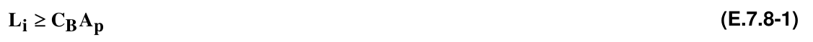
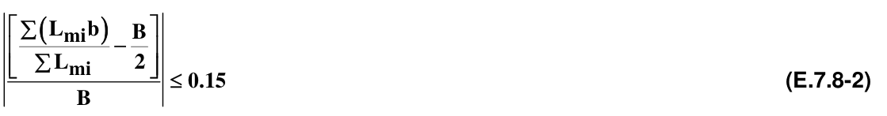
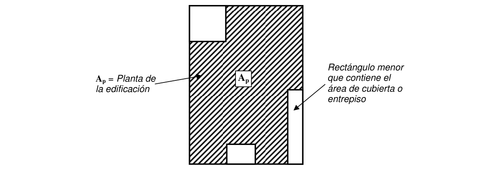

# E.7 — Bahareque encementado

### E.7.1 — INTRODUCCIÓN

**E.7.1.1** — El presente capítulo contiene los requisitos mínimos necesarios para otorgar a las casas de bahareque encementado, con uno y dos pisos, un grado de sismo resistencia tal que minimice la posibilidad de que la construcción colapse durante eventos sísmicos fuertes de baja probabilidad de ocurrencia, que sufra daños estructurales mínimos durante eventos sísmicos moderados y que no sufra daños estructurales durante eventos sísmicos leves de alta probabilidad de ocurrencia.

**E.7.1.2** — El presente documento no sustituye la intervención y la competencia profesional de los Ingenieros y Arquitectos, cuya responsabilidad y participación en el diseño y construcción de edificaciones se reglamenta en el Título VI de la Ley 400 de 1997.

### E.7.2 — ALCANCE

**E.7.2.1** — En este capítulo se dan los requisitos mínimos que se deben seguir en el diseño y construcción de viviendas de uno y dos pisos, realizadas en bahareque encementado, que pertenecen al grupo de uso $I,$ tal como lo define A.2.5.1.4 y dentro de las limitaciones establecidas en A.1.3.11, es decir, construcciones de uno y dos pisos que formen parte de programas de máximo 15 viviendas y menos de 3000 m2 de área construida.

<!-- mod:3-decreto-945-2017-68 -->
> *Texto vigente según el Decreto 945 de 2017 (anexo, p. 34).*

**E.7.2.2** — Para el diseño y construcción de programas de vivienda de una y dos pisos con 5 o más unidades, o que tengan o superen los dos mil metros cuadrados (2.000 m²) de área construida en conjunto, se requiere la realización de estudios completos de análisis y diseño estructural de acuerdo con el siguiente derrotero:

(a) Estudios geotécnicos de acuerdo con el Título H

(b) Cimentaciones en concreto de acuerdo con el Título C

(c) Sobre cimentaciones en concreto de acuerdo con el Título C.

(d) Sobre cimentaciones en mampostería de acuerdo con el Título D.

(e) Análisis estructural de acuerdo con las previsiones de diseño sismo resistente del Título A, los requerimientos para cálculo de cargas del Título B, y los requisitos de análisis del Apéndice E-A

(f) Diseño y construcción de entrepisos y cubiertas de madera, de acuerdo con los requisitos para diseño y construcción del Título G.

(g) Diseño y construcción de los componentes en bahareque en cementado, no reglamentados por lo anterior, se llevará a cabo con base en lo establecido en el presente capítulo.

### E.7.3 — GENERALIDADES

#### E.7.3.1 — DEFINICIÓN

El bahareque encementado es un sistema estructural de muros que se basa en la fabricación de paredes construidas con un esqueleto de guadua, o guadua y madera, cubierto con un revoque de mortero de cemento aplicado sobre malla de alambre, clavada en esterilla de guadua que, a su vez, se clava sobre el esqueleto del muro.

#### E.7.3.2 — CONSTITUCIÓN

El bahareque encementado es un sistema constituido por dos partes principales: el entramado y el recubrimiento. Ambas partes se combinan para conformar un material compuesto.

**E.7.3.2.1** — Entramado — El entramado está constituido por dos soleras o elementos horizontales, inferior y superior, y pie-derechos o elementos verticales, conectados entre sí con clavos o tornillos. El marco del entramado, es decir las soleras y el pie-derechos exteriores, pueden construirse con guadua o con madera aserrada. El resto del entramado se construye con guadua. Puede contener diagonales.

**E.7.3.2.2** — Recubrimiento — El recubrimiento se fabrica con mortero de cemento aplicado sobre malla de alambre, tal como se especifica en E.7.4.5. La malla debe estar clavada sobre esterilla de guadua, o sobre un entablado. La esterilla debe ir anclada a los pié-derechos mediante clavos y alambre dulce trenzado entre los clavos.

### E.7.4 — MATERIALES

#### E.7.4.1 — GUADUA

**E.7.4.1.1** — El material predominante de este sistema constructivo es la guadua, cuya mejor calidad se consigue en plantas en estado maduro, es decir, mayores de 4 años. No puede utilizarse guadua con más del 20% de contenido de humedad ni por debajo del 10%. En todo caso, el contenido de humedad debe estar cercano a la humedad de equilibrio ambiental para madera, tal como se define en la Figura 2.3, del numeral “2.2.1. Influencia del secado sobre los Elementos de Madera”, del Manual de diseño para maderas del Grupo Andino.

**E.7.4.1.2** — La guadua debe inmunizarse para evitar el ataque de insectos xilófagos. El inmunizado no constituye protección contra otros efectos ambientales, de manera que la guadua no puede exponerse al sol ni al agua, en ninguna parte de la edificación, pues la acción de los rayos ultravioletas produce resecamiento, fisuración, decoloración y pérdida de brillo, y los cambios de humedad pueden causar pudrición.

#### E.7.4.2 — MADERA Y COMPLEMENTARIOS

**E.7.4.2.1** — La calidad de la madera aserrada y de los elementos metálicos de unión deberá regirse por G.1.3 de este Reglamento.

**E.7.4.2.2** — La clasificación mecánica de las maderas usadas en muros, entrepisos y cubiertas deberá corresponder, como mínimo, al grupo ES6, según G.1.3.5 del presente Reglamento.

#### E.7.4.3 — MORTERO

**E.7.4.3.1** — La calidad del mortero de cemento para el revoque de muros y para el relleno de cañutos se regirá por D.3.4. La clasificación mínima requerida será la correspondiente al mortero tipo N, con una proporción en volumen de máximo 4 partes de arena por una parte de cementante.

**E.7.4.3.2** — Las calidades del cemento y de la cal, en caso de agregarse ésta, son las indicadas en el aparte D.3.2 del Reglamento.

#### E.7.4.4 — CONCRETO Y ACERO DE REFUERZO

**E.7.4.4.1** — Las calidades del concreto y de las armaduras para cimentaciones, de las vigas de amarre y de los elementos de confinamiento de mampostería, donde sean aplicables, se regirán por lo establecido en el capítulo C.3.

#### E.7.4.5 — MALLAS DE REFUERZO DEL REVOQUE

**E.7.4.5.1** — Podrán usarse los siguientes tipos:

(a) Malla de alambre trenzado con diámetro máximo de 1,25 mm (BWG calibre 18), de abertura hexagonal no mayor a 25,4 mm.

(b) Malla de alambre electrosoldado con diámetro máximo de 1,25 mm (BWG calibre 18), de abertura cuadrada no mayor a 25,4 mm.

(c) Malla de revoque de lámina metálica expandida, sin vena estructural.

(d) Malla de revoque de lámina metálica expandida, con vena estructural.

**E.7.4.5.2** — El uso de las mallas listadas en el numeral anterior no exime del uso de esterilla de guadua o entablado de madera, a menos que se demuestre, por medio de pruebas experimentales, que el comportamiento del material resultante es, cuando menos, equivalente al material con la esterilla o el entablado, al tenor de lo dispuesto en los artículos 13º y 14º de la Ley 400 de 1997.

### E.7.5 — CLASIFICACIÓN DE MUROS

Los muros de una casa de uno o dos pisos de bahareque encementado, dentro del alcance del presente Capítulo, se clasifican en tres tipos.

#### E.7.5.1 — MUROS ESTRUCTURALES CON DIAGONALES

Son muros, o segmentos de muros, estructurales, compuestos por solera inferior, solera superior (o carrera), pie-derechos, elementos inclinados y recubrimiento con base en mortero de cemento, colocado sobre malla de alambre, clavada sobre esterilla de guadua o entablado de madera. Estos muros reciben cargas verticales y resisten fuerzas horizontales de sismo o viento. Los muros estructurales con diagonales deben colocarse en las esquinas de la construcción y en los extremos de cada conjunto de muros estructurales.

#### E.7.5.2 — MUROS ESTRUCTURALES SIN DIAGONALES

Son muros, o segmentos de muros, estructurales, compuestos por solera inferior, solera superior (o carrera), pie-derechos y recubrimiento con mortero de cemento, colocado sobre malla de alambre, clavada sobre esterilla de guadua y que carecen de elementos inclinados. Deben utilizarse únicamente para resistir cargas verticales. No deben constituirse en segmentos de los extremos de muros.

**E.7.5.3** — Tanto los muros estructurales con diagonales como los que no tienen diagonales deben construirse apoyados sobre vigas de cimentación o en sobrecimientos, a su vez apoyados sobre vigas de cimentación. Los muros estructurales deben tener continuidad desde la cimentación hasta el diafragma superior con el cual están conectados.

#### E.7.5.4 — MUROS NO ESTRUCTURALES

Los muros que no soportan cargas diferentes a las de su propio peso se conocen con el nombre de muros no estructurales. Estos muros no tienen otra función que la de separar espacios dentro de la vivienda. Los muros no estructurales interiores deben conectarse con el diafragma superior por medio de una conexión que restrinja su volcamiento, pero que impida la transmisión de cortante o carga vertical entre la cubierta o el entrepiso y el muro no estructural. Los muros no estructurales no necesitan ser continuos y no requieren estar anclados al sistema de cimentación.

### E.7.6 — COMPOSICIÓN DE MUROS

**E.7.6.1** — Los muros de bahareque encementado deben componerse de un entramado de guaduas o de guaduas y madera, constituido por elementos horizontales llamados soleras (la solera superior también se llama carrera), elementos verticales llamados pie-derechos y recubrimiento de mortero de cemento. Las guaduas no deben tener un diámetro inferior a 80 mm. El espaciamiento horizontal entre pié-derechos no debe ser inferior a 300 mm ni superior a 600 mm, entre ejes.

**E.7.6.2** — El recubrimiento de mortero debe aplicarse sobre una malla de alambre delgado (diámetro no superior a 1,25 mm), que a su vez se clava sobre esterilla de guadua, de acuerdo con lo especificado en E.7.4.5.

**E.7.6.3** — La sección de las soleras tendrán un ancho mínimo igual al diámetro de las guaduas usadas como pie- derechos y una altura no menor de 100 mm. Es preferible construir las soleras, inferior y superior de cada muro en madera aserrada, ya que sus uniones permiten mayor rigidez y son menos susceptibles al aplastamiento que los elementos de guadua.

**E.7.6.4** — Los muros de bahareque encementado podrán tener recubrimiento por ambos lados. Si no es posible, la longitud efectiva del muro con recubrimiento por un solo lado debe considerarse como la mitad de su longitud total real, para efectos de los requerimientos especificados en E.7.8.1 y E.7.8.2.

### E.7.7 — DIAFRAGMAS

**E.7.7.1** — Las soleras deben conformar conjuntamente con los entrepisos y la estructura de la cubierta un diafragma que traslade las cargas horizontales a los muros estructurales. Deben proveerse uniones o vínculos entre los muros y los diafragmas, como se indica en el numeral E.8.3 del presente Título.

**E.7.7.2** — Deben colocarse tirantes y cuadrantes en el nivel de solera superior de cada piso, para garantizar el efecto de diafragma. Los cuadrantes bastan cuando los espacios rectangulares entre muros no superan relaciones de 1,5 sobre 1 entre lado mayor y lado menor. Para relaciones mayores, deben colocarse tirantes que dividan los espacios rectangulares en espacios con relaciones menores de 1,5 sobre 1.

**E.7.7.3** — Los diafragmas deben existir en los niveles de cimentación, de entrepisos y de cubierta.

### E.7.8 — LONGITUD DE MUROS EN CADA DIRECCIÓN

Para proveer un reparto uniforme de la responsabilidad para resistir las fuerzas sísmicas en el intervalo inelástico, los muros estructurales que se dispongan en cada una de las direcciones principales deben cumplir con las siguientes condiciones:

#### E.7.8.1 — LONGITUD MÍNIMA

La longitud de muros en cada dirección debe satisfacer la ecuación E.7.8-1

En donde:

$L_{i}$ = longitud mínima total de muros continuos (en m), sin aberturas, en la dirección $i$

$C_{B}$= coeficiente (en m-1), especificado en la tabla E.7.8-1, en función de la aceleración espectral $A_{a}$ para el sitio donde se realice la construcción, de acuerdo con A.2.3.

$A_{p}$= área de la cubierta (en m2), para viviendas de un piso, o para los muros del segundo piso en viviendas de dos pisos. (Puede sustituirse por $2 /3A_{p}$ si se utilizan materiales livianos para la cubierta, tales como fibrocemento o láminas metálicas, sin base de mortero).

= área del entrepiso más área de la cubierta (en m2), para los muros del primer piso en viviendas de dos pisos

**Tabla E.7.8-1**

Valores del coeficiente de densidad de muros de bahareque encementado, $C_{B}$

| Amenaza Sísmica | $A_{a}$ | $C_{B}$ |
|---|---|---|
| Alta | 0,40 | 0.32 |
|  | 0.35 | 0,28 |
|  | 0.30 | 0.24 |
|  | 0.25 | 0.20 |
| Intermedia | 0.20 | 0.16 |
|  | 0.15 | 0.16 |
| Baja | 0.10 | 0.16 |
|  | 0.05 | 0.16 |

#### E.7.8.2 — DISTRIBUCIÓN SIMÉTRICA DE MUROS

Los muros deben estar distribuidos de manera aproximadamente simétrica. Por lo tanto, debe cumplirse con la ecuación E.7.8-2, tomada en su valor absoluto:

En donde:

$L_{mi}=$ longitud de cada muro (en m) en la dirección $i$ .

$b =$ la distancia perpendicular (en m) desde cada muro en la dirección $i$ , hasta un extremo del rectángulo menor que contiene el área de la cubierta o entrepiso (Véase figura E.7.8 -1).

$B =$ longitud del lado (en m), perpendicular a la dirección $i$ , del rectángulo menor que contiene el área de la cubierta o entrepiso.

Figura E.7.8-1 — Descripción del rectángulo menor que contiene el área de la cubierta o entrepiso

#### E.7.8.3 — VERIFICACIÓN DE LA RESISTENCIA DE MUROS

En los casos en los cuales no se cumplan los requisitos expresados en E.7.8.1, deberá aumentarse la longitud total de muros en cada dirección, en cada nivel, a menos que se demuestre, por medio de un procedimiento de análisis estructural, como el contenido en Apéndice E.A de este Capítulo, que una longitud de muros inferior a la especificada por la ecuación E.7.8-1, es suficiente para resistir las cargas horizontales calculadas.

#### E.7.8.4 — VERIFICACIÓN DE LA ASIMETRÍA DE MUROS EN PLANTA

En los casos en los cuales no se cumplan los requisitos expresados en E.7.8.2, debe hacerse de nuevo la distribución de los muros en planta hasta lograr cumplir con la ecuación E.7.8-2. Sí en este proceso se reduce la longitud total de muros en cualquier dirección y cualquiera de los niveles, debe verificarse de nuevo el cumplimiento con la ecuación E.7.8-1, de acuerdo con lo estipulado en E.7.8.3.

#### E.7.8.5 — ENCHAPES PARA MUROS

Deben evitarse los enchapes pesados en fachadas. En baños, debe enchaparse completamente la zona húmeda, para lo cual se recomienda colocar el enchape pegado con mortero impermeable. Todo enchape de fachada debe estar adecuadamente fijado para evitar que se desprenda durante los sismos.

### E.7.9 — COLUMNAS DE GUADUA

Las columnas son elementos estructurales proporcionados para resistir cargas verticales, en forma aislada o en combinación con los muros estructurales. Las columnas no deben considerarse componentes del sistema de resistencia sísmica en viviendas en bahareque encementado.

### E.7.10 — UBICACIÓN Y DISEÑO DE COLUMNAS

**E.7.10.1** — Las columnas se localizarán en puntos de la edificación donde la magnitud o la posición de las cargas verticales transmitidas por cubiertas o entrepisos excedan la capacidad de los muros estructurales, o donde no se disponga de ellos, como es el caso de galerías abiertas, corredores y aleros.

**E.7.10.2** — Si las columnas se construyen en guadua, debe evitarse la acción directa del sol y del agua. Necesariamente deben aislarse del piso por medio de un dado en concreto o en mampostería y una unión, como se indica en el numeral E.8.5.2 de este Título.

**E.7.10.3** — El número de guaduas requeridas para cada columna se debe estimar con base en la tabla E.7.10-1.

**Tabla E.7.10-1**

Carga admisible en Columnas de guadua (kN)*

| Altura (m) | Número de guaduas |  |  |  |
|---|---|---|---|---|
|  | 1 | 2 | 3 | 4 |
| 1.0 | 43.1 | 86.2 | 129.3 | 172.4 |
| 1.5 | 38.6 | 77.2 | 115.8 | 154.4 |
| 2.0 | 28.7 | 57.4 | 86.1 | 114.8 |
| 2.5 | 18.4 | 36.8 | 55.2 | 73.6 |
| 3.0 | 12.8 | 25.6 | 38.3 | 51.1 |
| 3.5 | 9.4 | 18.8 | 28.2 | 37.6 |
| 4.0 | 7.2 | 14.4 | 21.6 | 28. |

* Para guaduas de más de 100 mm de diámetro y 10 mm de espesor de pared

**E.7.10.4** — Si se requiere más de una guadua para formar la columna éstas deben conectarse entre sí con zunchos con espaciamientos que no excedan un tercio de la altura de la columna.

**E.7.10.5** — Si las columnas se construyen en madera, deben diseñarse de acuerdo con el Título G.

**E.7.10.6** — Si las columnas se construyen en acero, deben diseñarse de acuerdo con el Título F.

**E.7.10.7** — Si las columnas se construyen en concreto, deben diseñarse de acuerdo con el Título C.

**E.7.10.8** — Si las columnas se construyen en mampostería, deben diseñarse de acuerdo con el Título D.

### E.7.11 — AMARRES Y CONTINUIDAD DE COLUMNAS

**E.7.11.1** — Las columnas deben conectarse entre sí y con los muros estructurales vecinos. Además, las columnas deben conectarse con el diafragma que soportan con una unión articulada, que no transmita tensiones de flexión.

█
