# F.2 — Estructuras de acero con perfiles laminados, armados y tubulares estructurales

### F.2.1 — PROVISIONES GENERALES

Este numeral establece el alcance del Capítulo F.2, enumera los códigos, especificaciones y estándares usados como referencia y proporciona requisitos para los materiales y los documentos contractuales.

Se incluyen las siguientes secciones:

F.2.1.1 — Alcance F.2.1.2 — Definiciones F.2.1.3 — Nomenclatura F.2.1.4 — Especificaciones, Códigos y Estándares de Referencia F.2.1.5 — Materiales F.2.1.6 — Planos y Especificaciones del Diseño Estructural

#### F.2.1.1 — ALCANCE

El Capítulo F.2 es aplicable al diseño de estructuras conformadas por elementos de acero estructural en cuya fabricación se utilicen perfiles laminados, perfiles armados o perfiles tubulares estructurales (PTE), incluyendo sistemas donde el acero y el concreto actúen como una sección compuesta.

Este Capítulo establece criterios para el diseño, la fabricación y el montaje de edificios y otras construcciones de acero estructural, donde la denominación “otras construcciones” comprende aquellas estructuras diseñadas, fabricadas y montadas de forma semejante a los edificios y conformadas por similares elementos resistentes a cargas verticales y laterales.

Cuando se presenten condiciones que no estén cubiertas por este Capítulo, se permitirá que los diseños se basen en pruebas o análisis basados en criterios alternos, sujetos a la aprobación de la Comisión Asesora Permanente para el Régimen de Construcciones Sismo Resistentes.

Para el diseño de miembros estructurales formados en frío distintos de los perfiles tubulares estructurales (PTE), con elementos de espesor no mayor que 25.4 mm, se debe aplicar el Capítulo F.4 del presente Reglamento.

**F.2.1.1.1** — Provisiones Sísmicas — Para el diseño de los sistemas de resistencia a cargas sísmicas de las estructuras cubiertas por el alcance de este Capítulo se deberán aplicar las provisiones del Capítulo F.3.

No se permite aplicar las provisiones del numeral F.2.15 “Diseño con Análisis Inelástico” al diseño sísmico de edificios y otras construcciones de acero.

<!-- mod:1-decreto-092-2011-161 -->
> **Modificación — Decreto 092 de 2011** · anexo, p. 37
>
> El tercer parágrafo de F.2.1.1 debe quedar así:
>
> Cuando se presenten condiciones que no estén cubiertas por este Capítulo, se permitirá que los diseños se basen en pruebas o análisis basados en criterios alternos, bajo la responsabilidad del diseñador, y cumpliendo lo requerido por la Ley 400 de 1997 para estas situaciones.

#### F.2.1.2 — DEFINICIONES

Acción compuesta — Condición en la cual elementos y miembros de acero y de concreto atienden como una unidad la distribución de las fuerzas internas.

Acción del campo tensionado — Comportamiento de un panel solicitado por cortante, donde se desarrollan fuerzas diagonales de tensión en el alma y fuerzas de compresión en los rigidizadores transversales, de manera similar a las fuerzas en una armadura Pratt.

Acero estructural — Elementos de acero según se definen en la sección 2.1 del Código de Prácticas Estándar para Estructuras Metálicas, Norma Técnica Colombiana ICONTEC Acero resistente a la corrosión atmosférica — Acero de alta resistencia y baja aleación que, con las precauciones adecuadas, puede usarse en condiciones atmosféricas normales (no marinas) sin que se requiera aplicación de pintura de protección.

Adherencia directa — En una sección compuesta, mecanismo de transmisión de la carga entre el acero y el concreto por adherencia.

Agarre de un perno — Espesor de los materiales a través de los cuales pasa el perno.

Análisis elástico — Análisis estructural que se basa en la suposición de que la estructura recupera su geometría original una vez se remueven las cargas aplicadas.

Análisis de primer orden — Análisis estructural en el que las condiciones de equilibrio se formulan sobre la estructura no deformada, esto es, se desprecian los efectos de segundo orden.

Análisis de segundo orden — Análisis estructural en el cual las condiciones de equilibrio se formulan sobre la estructura en su configuración deformada, de manera que se tienen en cuenta efectos de segundo orden.

Análisis elástico — Análisis estructural que se basa en la suposición de que la estructura recupera su geometría original una vez se remueven las cargas aplicadas.

Análisis estructural — Determinación de los efectos de las cargas sobre los miembros y las conexiones, con base en los principios de la mecánica estructural.

Análisis inelástico — Análisis estructural que tiene en cuenta el comportamiento inelástico del material, se incluye el análisis plástico.

Análisis plástico — Análisis estructural que se basa en la suposición de un comportamiento rígido-plástico, es decir, supone que sobre toda la estructura se satisface el equilibrio y el esfuerzo es igual o inferior al esfuerzo de fluencia.

Ancho efectivo — Ancho reducido de un elemento plano, sobre el cual se asume una distribución uniforme de esfuerzos tal que su efecto en el comportamiento del miembro estructural sea equivalente al que produce la distribución real, no uniforme, de esfuerzos en el elemento real.

Ancho plano — Para un perfil tubular estructural (PTE) rectangular, ancho nominal de una cara menos dos veces el radio exterior de la esquina. Cuando no se conoce este radio, puede tomarse como ancho plano el valor del ancho total menos tres veces el espesor de la pared.

Ancho promedio de la nervadura — Promedio entre los anchos máximo y mínimo de la nervadura de concreto en un sistema de tablero metálico.

Aplastamiento — En una conexión pernada, estado límite para la transmisión de carga por presión entre el vástago del perno y la cara de la perforación.

Aplastamiento (fluencia local por compresión) — Estado límite de fluencia local a compresión debida a la acción de un miembro que se apoya sobre la sección transversal o la superficie de otro miembro.

Aplastamiento de la pared lateral — Estado límite basado en la resistencia al aplastamiento de las caras laterales de un miembro principal en una conexión de PTE.

Aplastamiento del concreto — Estado límite de falla a compresión en el concreto cuando éste alcanza la deformación última.

Apoyo tipo balancín — Apoyo con una superficie curva sobre el cual puede balancearse el miembro soportado.

Apoyo tipo rodillo — Barra redonda de acero que al rodar permite el desplazamiento del miembro que se apoya sobre ella.

Apriete ajustado — En una junta pernada, apriete que se obtiene con unos pocos golpes de una llave de impacto o con el esfuerzo máximo de un operario usando una llave común, de manera que las partes conectadas queden en contacto firme.

Área neta — Área bruta reducida para tener en cuenta el material removido.

Área neta efectiva — Área neta modificada por el efecto de rezago de cortante.

Arriostramiento contra la torsión — Arriostramiento que restringe la torsión de una viga o columna.

Arriostramiento lateral — Riostras diagonales, muros de cortante u otros sistemas equivalentes que proporcionan estabilidad lateral en su plano.

Arrugamiento de la pared lateral — Estado límite de arrugamiento de las caras laterales de un miembro principal en una conexión de PTE.

Arrugamiento del alma — Estado límite consistente en la falla local de la lámina del alma en la zona de aplicación de una carga o reacción concentrada.

Barra de ojo — Miembro a tensión de espesor uniforme, conectado con un pasador que atraviesa una cabeza forjada o cortada con llama y de ancho mayor que el del cuerpo del miembro. Sus dimensiones deben ser tales que la resistencia sea aproximadamente igual en el cuerpo y en la cabeza.

Barrera contra incendio — Elemento constructivo formado por materiales resistentes al fuego y ensayado de acuerdo con la norma ASTM E119 u otro ensayo de resistencia al fuego aprobado para demostrar su conformidad con este Reglamento.

Borde del filete — Para una soldadura de filete, línea donde se unen la cara del filete y el metal base. Para un perfil laminado, línea de tangencia de un filete.

Calificación de resistencia al fuego — Es el periodo de tiempo durante el cual un elemento, componente o sistema de la edificación mantiene su capacidad de contener un incendio o continúa cumpliendo con su función estructural, determinado por medio de ensayos o métodos basados en ensayos.

Calza — Lámina usada para rellenar espacios en las conexiones o apoyos.

Capacidad rotacional — Relación entre la máxima rotación inelástica alcanzada y la rotación elástica idealizada para la condición de iniciación de la fluencia.

Capitel de concreto — Sección de concreto sólido en un sistema compuesto de piso con tablero metálico, la cual se forma cuando este tablero se interrumpe a lado y lado de la viga.

Carga — Fuerza u otra acción que resulta del peso de los materiales de construcción, de los ocupantes y sus pertenencias, o de efectos ambientales, movimientos diferenciales o cambios dimensionales restringidos.

Carga de diseño — Carga que se aplica sobre la estructura, obtenida con base en una combinación de cargas apropiada.

Carga de punzonamiento — En una conexión en PTE, componente de la fuerza de un miembro ramal en dirección perpendicular al miembro principal.

Carga ficticia — Bajo el Método de Análisis Directo, carga virtual que se aplica en el análisis estructural para tener en cuenta efectos desestabilizadores que no se están considerando de otra manera en el diseño.

Carga gravitacional — Carga que actúa en dirección de la gravedad, tal como las cargas vivas o las cargas muertas.

Carga lateral — Una carga, tal como la producida por un sismo o viento, que actúa en dirección lateral.

Carga mayorada — Producto de una carga nominal por el factor de carga correspondiente.

Cargas nominales — son las cargas especificadas en los numerales B.3 a B.6 de este Reglamento. Las cargas muertas, vivas y de viento que se dan en el Título B son cargas nominales, es decir, no han sido multiplicadas por los coeficientes de carga.

Cerramiento — Conjunto de elementos de recubrimiento exterior de una estructura.

Coeficiente amplificador — Valor que multiplica los resultados de un análisis de primer orden para tener en cuenta los efectos de segundo orden.

Coeficiente de carga — Coeficiente que refleja las desviaciones de las cargas reales con respecto a las cargas nominales, las imprecisiones en los análisis que se efectúan para obtener los efectos que ellas producen, y la probabilidad de que más de una carga ocurra con su máximo valor simultáneamente.

Coeficiente de reducción de resistencia — Coeficiente que tiene en cuenta las desviaciones inevitables de la resistencia real con respecto a la resistencia nominal del elemento, así como el tipo de falla y sus consecuencias.

Columna — Miembro estructural cuya función primaria es la de resistir cargas axiales.

Columna compuesta tipo perfil relleno — Columna de construcción compuesta consistente en un perfil de sección tubular relleno de concreto estructural.

Columna compuesta tipo perfil revestido — Columna de construcción compuesta consistente en una sección de concreto estructural con uno o más perfiles de acero embebidos en ella.

Columna dependiente — Columna diseñada para soportar cargas gravitacionales únicamente, es decir, sus conexiones no están previstas para proveer resistencia a cargas laterales.

Compartimentación — Encierro de espacios en un edificio con elementos que tengan una resistencia al fuego específica.

Componente estructural — Miembro, conector, soldadura o elemento de conexión.

Concentración de esfuerzos — Condición de esfuerzos localizados, de magnitud considerablemente superior al promedio (aún en secciones transversales de espesor uniforme cargadas uniformemente), generada por cambios bruscos en la geometría o por cargas concentradas.

Conector — Denominación general para referirse a pernos, remaches y otros dispositivos de conexión.

Conector — En un miembro de construcción compuesta, es un espigo con cabeza, perno, canal, platina u otro perfil soldado al perfil de acero y embebido en el concreto, para transmitir fuerzas entre los dos materiales.

Conexión — Combinación de elementos de conexión, conectores y partes de los miembros conectados que intervienen en la transmisión de fuerzas entre dos o más miembros.

Conexión a momento — Conexión que transmite momentos flectores entre los miembros conectados.

Conexión a momento parcialmente restringida — Conexión que transfiere momento, sin que sea despreciable la rotación entre los elementos conectados.

Conexión a momento totalmente restringida — Conexión capaz de transferir momento con una rotación despreciable entre los miembros conectados.

Conexión con separación — En armaduras en PTE, conexión donde los miembros ramales se conectan sobre la cara del miembro principal quedando una separación entre ellos.

Conexión de deslizamiento crítico — Conexión pernada que ha sido diseñada para evitar el desplazamiento relativo entre las partes conectadas, a través de la fricción que se genera en la superficie de contacto bajo la acción de la fuerza de apriete de los pernos.

Conexión en cruz — Para PTE, conexión en la cual las fuerzas de los miembros ramales u otros elementos conectados transversales al miembro principal están equilibradas básicamente por fuerzas en miembros ramales u otros elementos que se conectan sobre la cara opuesta del miembro principal.

Conexión en $K$ — Para PTE, conexión en la cual las fuerzas de los miembros ramales o elementos conectados transversales al miembro principal están equilibradas básicamente por fuerzas en otros miembros ramales o elementos conectados sobre la misma cara del miembro principal.

Conexión en $T$ — Para PTE, conexión en la cual el miembro ramal o elemento conectado es perpendicular al miembro principal y las fuerzas transversales al miembro principal se equilibran básicamente por fuerzas de cortante en este último.

Conexión en $Y$ — Para PTE, conexión en la cual el miembro ramal o elemento conectado no es perpendicular al miembro principal y las fuerzas transversales al miembro principal se equilibran básicamente por fuerzas de cortante en este último.

Conexión simple — Conexión en la cual el momento que se transmite entre los miembros conectados es despreciable.

Conexión tipo aplastamiento — Conexión pernada en la cual las fuerzas de cortante se transmiten por aplastamiento del perno contra los elementos de conexión.

Conexión traslapada — Para armaduras en PTE, una conexión en la cual los miembros ramales se traslapan en su intersección.

Construcción restringida — Vigas individuales y sistemas de piso y techo de un edificio, para los cuales la estructura circundante o de soporte es capaz de resistir expansiones térmicas considerables en el rango de temperaturas elevadas esperadas.

Construcción no restringida — Vigas individuales y sistemas de piso y techo de un edificio que se pueden considerar sin restricción a la rotación y la expansión térmica en el rango de temperaturas elevadas esperadas.

Contraflecha — Curvatura que se introduce en una viga o armadura para compensar las deflexiones previstas por acción de las cargas.

Corte por fusión — Corte con gas, plasma o láser.

Cubreplaca — Platina que se suelda o conecta con pernos a la aleta de un miembro para aumentar el área de su sección transversal, su módulo de sección o su momento de inercia.

Curvatura simple — Característica de la silueta deformada de una viga que no presenta puntos de inflexión a lo largo de la luz.

DCCR (Diseño con coeficientes de carga y de resistencia) — Método por el cual los elementos estructurales se diseñan de manera que su resistencia de diseño sea igual o superior a la resistencia requerida obtenida bajo la acción de las combinaciones con cargas mayoradas.

Deriva — Deflexión lateral de una estructura.

Deslizamiento — En una conexión pernada, estado límite de desplazamiento relativo entre partes conectadas que ocurre antes de que se alcance la resistencia de diseño de la conexión.

Destijere — Corte ejecutado en un miembro estructural para remover una aleta y acomodarse a la forma de un miembro que lo intercepta.

Diafragma — Cubierta, entrepiso u otro tipo de membrana o sistema de arriostramiento que transfiere cargas aplicadas en su plano al sistema de resistencia para cargas laterales.

Dimensión nominal — Dimensión teórica, como las que aparecen en las tablas de propiedades de las secciones.

Diseño por desempeño — Enfoque de diseño estructural basado en una definición previa de los objetivos de desempeño, un análisis ingenieril y una evaluación cuantitativa de alternativas frente a dichos objetivos de diseño, utilizando herramientas de ingeniería, metodologías y criterios de desempeño aceptados.

Diseño prescriptivo — Método de diseño basado en la demostración del cumplimiento de los criterios generales establecidos por una norma.

Distribución no uniforme de la carga — Para una conexión en PTE, condición en la cual la carga no se distribuye a través de las secciones transversales de los elementos conectados de una manera que se pueda determinar directamente.

Doble curvatura — Condición de deformación de una viga con uno o más puntos de inflexión sobre la luz.

Efecto de las cargas — Fuerzas, esfuerzos y deformaciones que se producen en un componente estructural por efecto de la aplicación de las cargas.

Efecto de palanca — Amplificación de la fuerza de tensión en un perno causada por la acción de palanca entre el punto de aplicación de la carga, el perno y la reacción sobre el elemento conectado.

Efecto $P −δ$ — Efecto de segundo orden que tiene en cuenta la acción de las cargas sobre la geometría deformada a lo largo de un miembro.

Efecto $P −Δ$ — Efecto de segundo orden que tiene en cuenta la acción de las cargas sobre los nudos en su posición desplazada.

Efectos de longitud — Consideraciones asociadas a la reducción de la resistencia de un miembro como resultado de su longitud no soportada.

Efectos de segundo orden — Efectos que producen las cargas al actuar sobre la estructura en su configuración deformada, tales como los efectos $P −Δ$ y $P −δ$ .

Eje geométrico — Eje paralelo a la aleta o al alma de un perfil.

Eje mayor — Eje centroidal asociado a la inercia máxima en una sección transversal.

Eje menor — Eje centroidal asociado a la inercia mínima en una sección transversal.

Elemento no atiesado — Elemento plano a compresión que, a lo largo de uno de sus bordes paralelos a la dirección del esfuerzo, carece de elementos fuera de su plano que actúen como atiesadores.

Elemento atiesado — Elemento plano a compresión que, a lo largo de sus dos bordes paralelos a la dirección del esfuerzo, cuenta con elementos fuera de su plano que actúan como atiesadores.

Empalme — Conexión entre dos elementos estructurales que se empatan en sus extremos para conformar un elemento de mayor longitud.

Empozamiento de agua — Acumulación de agua debida únicamente a la deflexión de la estructura de un techo plano.

Ensayos no destructivos — Procedimientos de inspección en los cuales no hay destrucción de material ni se afecta la integridad de ningún material o componente.

Escamas de laminación — Recubrimiento superficial de óxido que se forma en el acero por el proceso de laminado en caliente.

Esfuerzo — Fuerza por unidad de área, debida a fuerzas axiales, de momento, cortante o torsión.

Esfuerzo de diseño — Valor del esfuerzo asociado a la resistencia de diseño.

Esfuerzo de fluencia — Concepto aplicable tanto a materiales que tienen un punto de fluencia bien definido, como a aquéllos que no lo tienen; en este último caso corresponde al valor del esfuerzo para el cual se alcanza una desviación límite especificada con respecto al comportamiento proporcional entre esfuerzos y deformaciones.

Esfuerzo de fluencia mínimo especificado — Límite inferior especificado para el esfuerzo de fluencia de un material.

Espesor de diseño de la pared — Para PTE, espesor que se usa en el cálculo de las propiedades de la sección transversal.

Esquina entrante — En un destijere de viga o en un agujero de acceso para soldadura, corte en un punto de cambio abrupto de dirección, donde la superficie expuesta es cóncava.

Estado límite — Condición más allá de la cual una estructura o uno de sus componentes deja de ser adecuada para cumplir su función (estado límite de servicio) o alcanza su capacidad última de carga (estado límite de resistencia).

Estado límite de resistencia — Condición límite que afecta la seguridad de la estructura al alcanzarse la capacidad última de carga.

Estado límite de servicio — Condición límite en la cual se afecta la capacidad de la estructura para mantener la funcionalidad, el aspecto, la facilidad para el mantenimiento, la durabilidad y la comodidad de sus ocupantes.

Excentricidad del nudo — Para una conexión en una armadura en PTE, distancia perpendicular del punto de intersección de las líneas de trabajo de los miembros ramales al eje centroidal del miembro principal.

Extremo no aporticado — Un extremo de un miembro cuya rotación no está restringida por rigidizadores o elementos de conexión.

Factor de longitud efectiva "$K$" — Relación entre la longitud efectiva de pandeo y la longitud no arriostrada de un miembro.

Falla por distorsión — Estado límite para una conexión de PTE en una armadura, caracterizado por que la sección transversal de un miembro principal en PTE rectangular adquiere una forma romboidal.

Fatiga — Estado límite de iniciación y avance de una grieta como resultado de la aplicación repetida de cargas vivas.

Flexión local — Estado límite consistente en la deformación apreciable de una aleta bajo la acción de una carga concentrada de tensión.

Fluencia — Estado límite de deformación inelástica que ocurre cuando se alcanza el esfuerzo de fluencia del material.

Fluencia (momento de fluencia) — Condición de fluencia en la fibra extrema de la sección transversal de un miembro, que ocurre cuando el momento flector alcanza el valor del momento de fluencia.

Plastificación (momento plástico) — Condición de fluencia en todas las fibras de la sección transversal de un miembro, que ocurre cuando el momento flector alcanza el valor del momento plástico.

Fluencia a tensión — Fluencia que ocurre bajo la acción de esfuerzos de tensión.

Fluencia a torsión — Fluencia que ocurre por efecto de esfuerzos de torsión.

Fluencia local — Fluencia que ocurre en una zona localizada de un elemento.

Fluencia por cortante — Fluencia producida por esfuerzos de cortante.

Fluencia por cortante (punzonamiento) — En una conexión de PTE, estado límite basado en la resistencia a cortante fuera del plano de la pared del miembro principal sobre la cual se conectan los miembros ramales.

Flujo de calor — Energía radiante por unidad de área.

Fuerza concentrada simple — Fuerza de tensión o de compresión aplicada perpendicularmente a la aleta de un miembro.

Fuerzas concentradas dobles — Dos fuerzas de igual magnitud y sentido contrario que forman un par sobre el mismo lado de un miembro cargado.

Fuerza cortante horizontal — Fuerza que actúa entre las superficies del acero y del concreto en una viga compuesta.

Gramil — Distancia transversal a líneas de centros de perforaciones.

Ignición — Transición rápida a un estado que involucra a toda la superficie en un incendio de materiales combustibles en un recinto.

Incendio — Fuego destructivo que se manifiesta por algunas de las siguientes características: luz, llama, calor o humo.

Incendio de diseño — Conjunto de condiciones que definen el desarrollo de un incendio y la difusión de productos de combustión a través de un edificio o una parte de él.

Inestabilidad en el plano — Estado límite para una viga-columna que se flexiona alrededor de su eje mayor y cuenta con un sistema de arriostramiento lateral que restringe el pandeo lateral o lateral-torsional.

Junta — Zona en la cual se conectan dos o más extremos, superficies o bordes de elementos. Se caracteriza por el tipo de conector o soldadura usado y por el método de transferencia de la fuerza.

Junta pretensionada — Junta con pernos de alta resistencia que se aprietan hasta llegar a la pretensión mínima especificada.

Junta traslapada — Junta entre dos elementos de conexión que se traslapan.

Longitud no arriostrada — Distancia entre dos secciones sucesivas en las cuales se provee arriostramiento para un miembro, medida entre los centroides de los miembros de arriostramiento.

Mecanismo — Sistema estructural que incluye rótulas reales o plásticas en número y disposición tales que le permiten adoptar distintas formas articuladas bajo la consideración de miembros rígidos.

Metal de aporte — Metal que se adiciona al ejecutar una junta soldada.

Metal de la soldadura — Zona de una soldadura que se fundió completamente en el proceso de su ejecución; contiene componentes del metal de aporte y del metal base.

Método de análisis directo — Método de diseño para estabilidad que tiene en cuenta los efectos de los esfuerzos residuales y de la desviación inicial de la verticalidad en un pórtico, mediante la reducción de la rigidez y la aplicación de cargas ficticias en un análisis de segundo orden.

Método de compatibilidad de deformaciones — En una sección compuesta, método para determinar los esfuerzos considerando para cada material su respectiva relación esfuerzo-deformación y su localización con respecto al eje neutro de la sección transversal.

Método del giro de la tuerca — Procedimiento de instalación de pernos de alta resistencia, en el cual la carga de pretensión especificada se obtiene aplicando, a partir de la condición de apriete ajustado, un giro de una magnitud determinada a la parte del conector que se rota.

Método plástico de distribución de esfuerzos — Para miembros de sección compuesta, método por el cual los esfuerzos se determinan suponiendo un comportamiento completamente plástico del perfil de acero y el concreto en la sección transversal.

Miembro estructural de acero formado en frío — Perfil fabricado por doblado en prensa o por formado en un tren de rodillos, a partir de tiras de lámina cortadas de rollos o planchas. En ambos casos el proceso de doblez se ejecuta a temperatura ambiente, esto es, sin aplicación de calor.

Miembro principal — Para conexiones en PTE, es una columna, una cuerda de una armadura, u otro elemento en PTE, al cual se conectan miembros ramales u otros elementos.

Miembro ramal — Para conexiones en PTE, miembro que se conecta a un miembro principal.

Miembros o perfiles armados — Miembros o perfiles fabricados a partir de elementos estructurales de acero que se conectan con pernos o se sueldan entre sí.

Módulo de sección efectivo — Módulo de sección reducido para tener en cuenta el pandeo de elementos esbeltos a compresión.

Momento de fluencia — Para un miembro solicitado por flexión, el valor del momento para el cual se alcanza el esfuerzo de fluencia en la fibra extrema Momento plástico — Momento resistente que teóricamente se desarrolla en una sección transversal con todas sus fibras en fluencia.

Muro de cortante — Muro que, en su propio plano, provee al sistema estructural estabilidad y resistencia a cargas laterales.

Pandeo — Estado límite de cambio súbito en la geometría de una estructura, o de alguno de sus componentes, bajo una condición de carga crítica.

Pandeo del alma — Estado límite de inestabilidad lateral del alma.

Pandeo del alma por compresión — Estado límite de pandeo del alma fuera del plano bajo esfuerzos de compresión debidos a una carga de compresión concentrada.

Pandeo fuera del plano — Estado límite de una viga columna flexionada alrededor de su eje mayor y sujeta a pandeo lateral o pandeo lateral torsional en un tramo sin arriostramiento lateral.

Pandeo lateral del alma — Para vigas con cargas concentradas, estado límite de pandeo lateral de la aleta a tensión opuesta al punto de aplicación de una carga de compresión concentrada.

Pandeo lateral-torsional — Modo de pandeo de un miembro solicitado por flexión en el cual ocurren simultáneamente un desplazamiento normal al plano de flexión y una torsión alrededor del centro de cortante de la sección transversal.

Pandeo local — Estado límite consistente en el pandeo de un elemento de una sección transversal cuando es solicitado por compresión.

Pandeo por cortante — Modo de pandeo por el cual un elemento en lámina, tal como el alma de una viga, se deforma bajo cortante puro aplicado en el plano de la lámina.

Pandeo por flexión — Modo de pandeo por el cual un miembro a compresión se deflecta lateralmente sin que haya torsión ni cambio en la forma de la sección transversal.

Pandeo por flexo-torsión — Modo de pandeo por el cual un miembro a compresión se flexiona y torsiona simultáneamente sin que haya cambio en la forma de la sección transversal.

Pandeo torsional — Modo de pandeo en el cual un miembro a compresión se torsiona alrededor de un eje que pasa por su centro de cortante.

Panel extremo — Panel del alma que solamente a uno de sus lados tiene un panel adyacente.

Paso — Espaciamiento longitudinal centro a centro de dos perforaciones consecutivas. Espaciamiento centro a centro entre filetes de rosca a lo largo de un perno.

Peralte nominal de la nervadura — Dimensión del tablero metálico tomada a exteriores de sus elementos superior e inferior Perfil tubular estructural (PTE) — Sección hueca de acero estructural, de forma cuadrada, rectangular o circular, producida de conformidad con una especificación para productos tubulares.

Placa de enchape — Placa de refuerzo adosada al alma de una viga o columna para aumentar su resistencia a cargas concentradas.

Plastificación — en una conexión en PTE, estado límite asociado a un mecanismo de flexión fuera del plano que ocurre sobre la cara del miembro principal a la cual se conecta un miembro ramal.

Platina de diafragma — Platina con rigidez y resistencia a cortante en su plano, que se usa para transferir fuerzas a los elementos de soporte.

Platina de relleno — Platina que se usa como suplemento del espesor de un elemento.

Porcentaje de alargamiento — Medida de la ductilidad, determinado como la relación entre el alargamiento máximo y la longitud original en un ensayo a tensión.

Pórtico arriostrado — Armadura vertical que proporciona estabilidad y resistencia frente a cargas laterales al sistema estructural del cual forma parte.

Pórtico para cargas gravitacionales — Porción de la estructura que no forma parte del sistema de resistencia a cargas laterales.

Pórtico resistente a momento — Sistema de pórtico que provee estabilidad y resistencia a cargas laterales básicamente a través de fuerzas internas de cortante y de flexión en los miembros y conexiones.

Presilla — Platina que se conecta rígidamente a dos componentes paralelos de una columna o viga ensamblada y está diseñada para transmitir cortante entre tales componentes.

Protección activa — Materiales y sistemas de construcción que se activan con el fuego para mitigar los efectos adversos o dar aviso a las personas de manera que tomen alguna acción que mitigue dichos efectos.

Protección pasiva — Materiales y sistemas de construcción que tienen la propiedad de resistir los efectos del fuego sin requerir mecanismos externos de activación.

Prueba de impacto de Charpy con ranura en V — Ensayo dinámico normalizado para medir la tenacidad de ranura de una probeta.

Punto de fluencia — Para un material, valor del esfuerzo a partir del cual la deformación continúa aumentando sin que se incremente el valor del esfuerzo.

Raíz de la junta soldada — Zona de una junta donde los elementos a soldar están más próximos uno al otro.

Rango de esfuerzos — Diferencia entre los esfuerzos máximo y mínimo producidos por la repetida aplicación y remoción de cargas vivas de servicio. Donde se presente inversión de esfuerzos, se toma como la suma numérica de los esfuerzos máximos de tensión y compresión.

Rango de esfuerzos de diseño — Máximo valor permisible del rango de esfuerzos para efectos de diseño por fatiga.

Refuerzo con soldadura de filete — Soldadura de filete que se usa para reforzar una soldadura acanalada.

Refuerzo desarrollado adecuadamente — Barras de refuerzo detalladas para que fluyan de manera dúctil antes de que ocurra el aplastamiento del concreto. Las barras que cumplan con las disposiciones del Título C de este Reglamento en lo referente a longitudes de desarrollo, separación y recubrimientos se considerarán desarrolladas adecuadamente.

Refuerzo transversal — En una sección compuesta, refuerzo de acero en forma de estribos cerrados o malla cuya función es confinar al concreto que rodea al perfil de acero revestido.

Remate en esquina — Prolongación de una soldadura de filete dando vuelta a una esquina en el mismo plano.

Resistencia a la rotura — En una conexión, resistencia limitada por rotura a tensión o a cortante.

Resistencia a tensión de un miembro — Fuerza máxima de tensión que un miembro es capaz de resistir.

Resistencia a tensión del material — Máximo esfuerzo de tensión que el material es capaz de resistir.

Resistencia a tensión mínima especificada — Límite inferior especificado para la resistencia a tensión de un material.

Resistencia al fuego — Propiedad de los sistemas que les permite prevenir o retardar el paso excesivo de calor, gases calientes o llamas bajo condiciones de uso y seguir cumpliendo la función requerida.

Resistencia al pandeo — Resistencia nominal para los estados límites de pandeo o inestabilidad.

Resistencia de diseño — Resultado de multiplicar la resistencia nominal, $R_{n}$ , por el coeficiente de reducción de resistencia $φ$ correspondiente.

Resistencia de un conector — Estado límite en el cual un conector alcanza su resistencia, gobernada por el aplastamiento del conector contra el concreto de la losa o por la resistencia a tensión del material del conector.

Resistencia nominal — Resistencia de una estructura o componente para atender los efectos de las cargas, calculada de acuerdo con este Capítulo, antes de multiplicar por el coeficiente de reducción de resistencia.

Resistencia postpandeo — Carga o fuerza que puede ser resistida por un elemento, miembro o estructura después de ocurrido el pandeo inicial.

Resistencia requerida — Fuerzas y esfuerzos que actúan sobre un componente estructural, obtenidas de un análisis estructural para las combinaciones de cargas aplicables.

Resistencia requerida al fuego — Medida del lapso durante el cual un material o sistema continúa mostrando resistencia contra el fuego.

Rigidez — Resistencia de un miembro o estructura a ser deformado, medida por la relación entre la fuerza (o momento) aplicada y el correspondiente desplazamiento (o rotación).

Rigidez a la distorsión del alma — Rigidez del alma para flexión fuera de su plano.

Rigidizador de apoyo ajustado — Rigidizador que coincide con un apoyo o carga concentrada y se ajusta estrechamente contra una o ambas aletas de la viga de manera que la carga se transmite por aplastamiento.

Rigidizador diagonal — Rigidizador del alma en la zona de panel de la columna, orientado diagonalmente con respecto a las aletas, sobre uno o ambos lados del alma.

Rigidizador transversal — Rigidizador del alma, conectado a ella y orientado perpendicularmente a las aletas.

Rigidizador — Elemento estructural, usualmente un ángulo o una platina, que se incorpora a un miembro para distribuir carga, transferir cortante o prevenir pandeo.

Riostra diagonal — En un pórtico arriostrado, miembro estructural inclinado que está solicitado básicamente por carga axial.

Riostra nodal — Riostra que impide el desplazamiento lateral o el giro sin depender de otros elementos de arriostramiento a puntos adyacentes. (Ver riostra relativa) Riostra relativa — Riostra que controla el desplazamiento relativo entre dos puntos adyacentes de arriostramiento a lo largo de una viga o columna, o el desplazamiento lateral relativo entre dos pisos de un pórtico (ver riostra nodal).

Rótula plástica — Zona en fluencia que se forma en una sección de un miembro estructural cuando se alcanza el momento plástico, de manera que, para cargas adicionales, se considera que tal sección actúa como una rótula.

Rotura a tensión — Estado límite de rotura debida a esfuerzos de tensión.

Rotura por cortante — Estado límite de rotura debida a esfuerzos de cortante.

Rotura por desgarramiento en bloque — En una conexión, estado límite que involucra rotura por tensión a lo largo de una(s) línea(s) de esfuerzos y fluencia o rotura por cortante a lo largo de otra(s) línea(s) de esfuerzos.

Rotura por tensión y cortante — Para un perno, el estado límite de rotura debida a la acción simultánea de fuerzas de tensión y de cortante.

Sección compacta — Sección que es capaz de desarrollar totalmente una distribución plástica de esfuerzos y posee una capacidad rotacional aproximadamente igual a 3.0 antes de que ocurra el pandeo local.

Sección con elementos esbeltos — Sección transversal que incluye elementos en lámina de esbeltez suficientemente grande para que ocurra pandeo local en el rango elástico.

Sección no compacta — Sección cuyos elementos a compresión pueden alcanzar el esfuerzo de fluencia antes de que ocurra un pandeo local, sin que alcance a desarrollar una capacidad rotacional de 3.0.

Sistema combinado — Estructura que comprende dos o más sistemas diferentes de resistencia a cargas laterales.

Sistema de arriostramiento vertical — Sistema de muros de cortante, pórticos arriostrados, o ambos, que se extiende sobre uno a varios pisos de un edificio.

Sistema estructural — Ensamble de componentes portantes conectados entre sí de manera que actúan de manera interdependiente.

Sistema resistente a cargas laterales — Sistema estructural diseñado para resistir las cargas laterales y proporcionar estabilidad a la estructura como un todo.

Socavación — Surco o cavidad relativamente suave en la superficie de una soldadura, originado en una deformación plástica o en la remoción de material.

Soldadura acanalada — Soldadura aplicada en un surco generado entre los elementos conectados. Véase AWS D1.1.

Soldadura acanalada de penetración completa — Soldadura acanalada en la cual el metal de la soldadura se extiende a través de todo el espesor de la junta, excepto bajo las consideraciones especiales permitidas en conexiones de PTE.

Soldadura acanalada de penetración parcial — Soldadura acanalada en la cual la penetración es intencionalmente menor que el espesor total del elemento conectado.

Soldadura acanalada en media V convexa — Soldadura en un surco formado por la superficie curva de un miembro y una superficie plana a la cual se conecta.

Soldadura acanalada en V convexa — Soldadura en un surco formado entre las superficies curvas de dos miembros.

Soldadura de filete — Soldadura de sección generalmente triangular que une dos superficies que se interceptan o traslapan.

Soldadura de ranura — Soldadura que conecta dos elementos que se traslapan depositando el metal de aporte en un agujero alargado o ranura efectuado en uno de ellos.

Soldadura de tapón — Soldadura que conecta dos elementos que se traslapan depositando el metal de aporte en una perforación circular efectuada en uno de ellos.

Superficie cepillada — Superficie que ha sido maquinada para obtener una superficie plana y lisa.

Superficie de contacto — Superficie de contacto de los elementos de conexión que transmiten una fuerza cortante.

Tablero metálico — En construcción compuesta, lámina formada en frío con un perfil adecuado para funcionar como formaleta permanente del concreto.

Temperaturas elevadas — Condiciones de calentamiento que experimentan la estructura o los elementos de una edificación como resultado de un incendio, las cuales son mayores que las condiciones ambientales normales.

Tenacidad de ranura del material — Capacidad del material para absorber energía a una temperatura determinada, obtenida con la prueba de impacto de Charpy con ranura en V.

Transferencia de calor por convección — Transferencia de energía térmica desde un punto de mayor temperatura a un punto de menor temperatura a través del movimiento de un medio.

Velocidad de transferencia de calor — Velocidad a la que se genera energía térmica en un material en combustión.

Viga — Elemento estructural solicitado básicamente por momentos flectores.

Viga-columna — Elemento estructural solicitado simultáneamente por fuerzas axiales y momentos flectores.

Zona de panel — Región del alma delimitada por las extensiones de las aletas de la viga y de la columna en una conexión viga a columna.

<!-- mod:1-decreto-092-2011-162 -->
> **Modificación — Decreto 092 de 2011** · anexo, p. 37
>
> La definición de «Acero estructural» debe quedar así:
>
> *Acero estructural* — Elementos de acero según se definen en la sección 2.1 del Código de Prácticas Estándar para Estructuras de Acero, Norma Técnica Colombiana ICONTEC.

#### F.2.1.3 — NOMENCLATURA

$A_{BM}$= área de la sección transversal del metal base, mm²

$A_{b}$ = para ángulos dobles distanciados con conectores soldados, área del conector, mm2

$A_{b}$ = área nominal, antes de roscar, de un perno o parte roscada mm2

$A_{bi}$= área de la sección transversal del ramal que traslapa en una conexión traslapada, mm2

$A_{bj}$= área de la sección transversal del ramal traslapado, mm2

$A_{c}$ = área del concreto, mm2

$A_{c}$ = para una losa de concreto, el área de la sección de comprendida dentro del ancho efectivo, mm2

$A_{e}$ = área neta efectiva, mm2

$A_{e}$ = sumatoria de las áreas efectivas de los elementos de la sección transversal, calculadas con base en los anchos efectivos reducidos, $b_{e}$ , mm2

$A_{fc}$ = área de la aleta a compresión, mm2

$A_{fg}$= área bruta de la aleta a tensión, mm2

$A_{fn}$= área neta de la aleta a tensión, mm2

$A_{ft}$ = área de la aleta a tensión, mm2

$A_{g}$ = área bruta del miembro, mm2

$A_{g}$ = área bruta de una sección compuesta, mm2

$A_{gv}$= área bruta sometida a cortante, mm2

$A_{i}$ = para ángulos dobles distanciados con conectores soldados, área de un ángulo, mm2

$A_{n}$ = área neta de un miembro, mm2

$A_{n}$ = área de los elementos conectados directamente

$A_{nt}$= área neta sometida a tensión, mm2

$A_{nv}$= área neta sometida a cortante, mm2

$A_{pb}$= área de apoyo en proyección, mm2

$A_{s}$ = área de la sección transversal de un perfil de acero, mm2

$A_{sc}$= área de la sección transversal de un conector de acero tipo espigo con cabeza, mm2

$A_{cp}$= área de la sección transversal de un conector de acero tipo perno, mm2

$A_{sf}$= área de cortante para la trayectoria de la falla, mm2

$A_{sr}$= área de las barras de refuerzo continuo, mm2

$A_{sr}$= área del acero de refuerzo longitudinal desarrollado adecuadamente dentro del ancho efectivo de la losa de concreto, mm2

$A_{t}$ = área neta a tensión, mm2

$A_{w}$ = área del alma, producto del peralte de una sección por el espesor del alma, $dt_{w}$, mm2

$A_{we}$= área efectiva de una soldadura, mm²

$A_{wei}$= área efectiva en el plano de la garganta para el elemento "$i$" de una soldadura, mm2

$A_{1}$ = área de concreto sobre la cual se aplica una carga, mm²

$A_{1}$ = área de acero que se apoya concéntricamente sobre una base de concreto, mm²

$A_{2}$ = área máxima de una zona de la superficie de apoyo geométricamente similar y concéntrica con el área cargada, mm²

$B$ = ancho total de un miembro en PTE rectangular, medido perpendicularmente al plano de la conexión, mm

$B$ = ancho total de una sección rectangular, medido en la cara sobre la que se transfiere la carga, mm

$B_{b}$ = ancho total de un ramal en PTE rectangular, medido a 90° del plano de la conexión, mm

$B_{bi}$= ancho total del ramal que traslapa, mm

$B_{bj}$= ancho total del ramal traslapado, mm

$B_{p}$ = ancho de una platina, medido a 90° del plano de la conexión, mm

$B_{1}$ , $B_{2}$ = coeficientes usados para determinar $M_{u}$ , con base en los resultados de un análisis de primer orden, cuando se tiene una combinación de flexión y fuerza axial. $B_{1}$ tiene en cuenta los efectos $P −δ$ y $B_{2}$ tiene en cuenta los efectos $P −Δ$ .

$C$ = constante torsional de un PTE

$C_{b}$ = factor de modificación para pandeo lateral-torsional, aplicable cuando no es uniforme el diagrama de momentos sobre el segmento de viga comprendido entre dos puntos arriostrados

$C_{d}$ = coeficiente que relaciona la rigidez de un arriostramiento relativo con la curvatura de la viga

$C_{f}$ = constante de la tabla F.2.17.1, para la categoría de esfuerzos en consideración

$C_{m}$= coeficiente asociado a una condición sin traslación lateral del pórtico

$C_{p}$ = para análisis de empozamiento, coeficiente de flexibilidad para miembros principales en una cubierta plana

$C_{r}$ = constante para pandeo lateral del alma

$C_{s}$ = coeficiente de flexibilidad de empozamiento para miembros principales en una cubierta plana

$C_{v}$ = coeficiente de cortante en el alma

$C_{w}$ = constante de alabeo, mm6

$C_{1}$ = coeficiente para calcular la rigidez efectiva de un miembro compuesto tipo perfil revestido a compresión

$C_{3}$ = coeficiente para calcular la rigidez efectiva de un miembro compuesto tipo perfil relleno a compresión

$D$ = carga muerta nominal

$D$ = diámetro exterior de un PTE circular, mm

$D_{b}$ = diámetro exterior de un ramal en PTE circular, mm

$D_{u}$ = para conexiones de deslizamiento crítico, un factor que refleja la relación entre el valor promedio de la tensión en los pernos instalados y la pretensión mínima especificada para ellos

$E$ = módulo de elasticidad del acero = 200.000 MPa

$E_{c}$ = módulo de elasticidad del concreto = $0.043w^{1.5}_{c}\sqrt{f_{c}' }$, MPa

$E_{c(T)}$= módulo de elasticidad del concreto a temperaturas elevadas, MPa

$E_{s}$ = módulo de elasticidad del acero = 200.000 MPa

$E_{(T)}$= módulo de elasticidad del acero a temperaturas elevadas, MPa

$EI_{eff}$= rigidez efectiva de una sección compuesta, N·mm2

$F_{ca}$ = resistencia de diseño a esfuerzos axiales en el punto en consideración, MPa

$F_{cbw}$, $F_{cbz}$ = resistencia de diseño a esfuerzos de flexión en el punto en consideración, MPa

$F_{cr}$ = esfuerzo crítico, MPa

$F_{cr}$ = esfuerzo crítico de pandeo lateral torsional para la sección, determinado analíticamente, MPa

$F_{cry}$= esfuerzo crítico de pandeo por flexión alrededor del eje "$y$" , MPa

$F_{crz}$= esfuerzo crítico para pandeo por torsión, MPa

$F_{EXX}$= resistencia de clasificación del metal de aporte, MPa

$F_{e}$ = esfuerzo de pandeo elástico, MPa

$F_{e(T)}$= esfuerzo de pandeo elástico a temperaturas elevadas, MPa

$F_{ex}$ = esfuerzo de pandeo elástico por flexión alrededor del eje mayor, MPa

$F_{ey}$ = esfuerzo de pandeo elástico por flexión alrededor del eje de simetría, MPa

$F_{ey}$ = esfuerzo de pandeo elástico por flexión alrededor del eje menor, MPa

$F_{ez}$ = esfuerzo de pandeo elástico por torsión, MPa.F.2.5.4

$F_{in}$ = resistencia nominal de adherencia por unidad de área, 0.40 MPa

$F_{L}$ = valor del esfuerzo de flexión en la aleta a compresión que se usa para determinar la resistencia nominal para los estados límites de pandeo local de la aleta y pandeo lateral torsional, MPa

$F_{n}$ = resistencia nominal por unidad de área, MPa

$F_{n}$ = resistencia nominal a tensión por unidad de área, $F_{nt}$ , o a cortante por unidad de área, $F_{nv}$, dada en la tabla F.2.10.3-2, MPa

$F_{nBM}$= resistencia nominal del metal base por unidad de área, MPa

$F_{nt}$ = resistencia nominal a tensión por unidad de área, de la tabla F.2.10.3-2, MPa

$F_{nt}'$ = resistencia nominal a tensión por unidad de área, modificada para incluir los efectos del esfuerzo cortante, MPa

$F_{nv}$= resistencia nominal a cortante por unidad de área, de la tabla F.2.10.3-2, MPa

$F_{nw}$= resistencia nominal del metal de la soldadura por unidad de área, MPa

$F_{nw}$= resistencia nominal del metal de la soldadura por unidad de área, sin incremento por efectos de direccionalidad, MPa

$F_{nwi}$= resistencia nominal por unidad de área en el i-ésimo elemento de la soldadura, MPa

$F_{nwix}$= componente "$x$" de la resistencia nominal $F_{nwi}$, MPa

$F_{nwiy}$= componente "$y$" de la resistencia nominal $F_{nwi}$, MPa

$F_{p(T)}$= límite de proporcionalidad a temperaturas elevadas, MPa

$F_{SR}$= rango de esfuerzos de diseño, MPa

$F_{TH}$= umbral del rango de esfuerzos, rango máximo de esfuerzos para el cual se admite una vida útil indefinida. Véase la tabla F.2.16.1, MPa

$F_{u}$ = resistencia a tensión mínima especificada, MPa

$F_{u(T)}$= resistencia a tensión mínima especificada del acero a temperaturas elevadas, MPa

$F_{y}$ = esfuerzo de fluencia mínimo especificado, MPa. En el Capítulo F.2, "esfuerzo de fluencia" denota bien sea el punto de fluencia mínimo especificado (para aquellos aceros que tienen un punto de fluencia) o la resistencia mínima de fluencia especificada (para los aceros que no tienen un punto de fluencia)

$F_{yb}$= esfuerzo de fluencia mínimo especificado del material del ramal en PTE, MPa.

$F_{ybi}$= esfuerzo de fluencia mínimo especificado del material del ramal que traslapa, MPa

$F_{ybj}$= esfuerzo de fluencia mínimo especificado del material del ramal traslapado, MPa

$F_{yf}$= esfuerzo de fluencia mínimo especificado para la aleta, MPa

$F_{yp}$= esfuerzo de fluencia mínimo especificado de la platina, MPa

$F_{ysr}$= esfuerzo de fluencia mínimo especificado para las barras de refuerzo, MPa

$F_{yst}$= esfuerzo de fluencia mínimo especificado del material del rigidizador, MPa

$F_{y(T)}$= esfuerzo de fluencia mínimo especificado para el acero a temperaturas elevadas, MPa

$F_{yw}$= esfuerzo de fluencia mínimo especificado para el alma, MPa

$G$ = módulo de elasticidad a cortante del acero = 77200 MPa

$G$ = para efectos de estudio del empozamiento únicamente, carga nominal debida al agua de lluvia o granizo, sin incluir la contribución del empozamiento mismo, MPa

$G$ = carga nominal de granizo

$H$ = cortante de piso, en dirección de la traslación considerada, que resulta de las cargas laterales usadas para calcular $Δ_{H}$, N

$H$ = peralte de un miembro en PTE rectangular, medido en el plano de la conexión, mm

$H_{b}$ = peralte de un ramal en PTE rectangular, medido en el plano de la conexión, mm

$H_{bi}$= peralte del ramal que traslapa, mm

$I$ = momento de inercia alrededor del eje de flexión, mm4

$I_{b}$ = para ángulos dobles distanciados con conectores soldados, momento de inercia del conector asociado a la flexión en el plano de los dos ángulos conectados, mm4

$I_{c}$ = momento de inercia de la sección de concreto tomado sobre el eje neutro elástico de la sección compuesta, mm4

$I_{d}$ = momento de inercia (por metro) del tablero metálico que se apoya sobre los miembros secundarios, mm4

$I_{p}$ = momento de inercia de los miembros principales, mm4

$I_{s}$ = momento de inercia de los miembros secundarios, mm4

$I_{s}$ = momento de inercia del perfil de acero con respecto al eje neutro elástico de la sección compuesta, mm4

$I_{sr}$= momento de inercia de las barras de refuerzo con respecto al eje neutro elástico de la sección compuesta, mm4

$I_{st}$ = momento de inercia de los rigidizadores transversales, calculado sobre un eje por el centro del alma para rigidizadores en pares, o sobre un eje por la línea de contacto con el alma para rigidizadores sencillos, mm4

$I_{st1}$= mínimo momento de inercia requerido de los rigidizadores transversales para desarrollar la resistencia del alma al pandeo por cortante de acuerdo con el numeral F.2.7.2.2, mm4

$I_{st2}$= mínimo momento de inercia requerido de los rigidizadores transversales para desarrollar la resistencia del alma al pandeo por cortante más la resistencia por acción del campo tensionado,$V_{r}=V_{c2}$, mm4

$I_{x}$, $I_{y}$ = momentos de inercia alrededor de los ejes principales, mm4

$I_{y}$ = momento de inercia para flexión por fuera del plano, mm4

$I_{yc}$= momento de inercia de la aleta a compresión alrededor del eje "$y$" , mm4

$I_{z}$ = momento de inercia para el eje principal menor, mm4

$J$ = constante torsional, mm4

$K$ = factor de longitud efectiva

$K_{x}$ = factor de longitud efectiva para pandeo flexional alrededor del eje "$x$"

$K_{y}$ = factor de longitud efectiva para pandeo flexional alrededor del eje "$y$"

$K_{z}$ = factor de longitud efectiva para pandeo por torsión

$K_{l}$ = factor de longitud efectiva en el plano de flexión, calculado suponiendo que no existe traslación lateral; debe tomarse como 1.0 a menos que un análisis indique que se puede usar un menor valor

$L$ = factor de piso, mm

$L$ = longitud de un miembro, mm

$L$ = carga viva nominal

$L$ = longitud no arriostrada de un miembro en el plano en que se considera el pandeo, mm

$L$ = longitud de un vano, mm

$L$ = longitud de un miembro medida entre los puntos de trabajo sobre el eje del miembro principal de la armadura, mm

$L_{b}$ = longitud no arriostrada, comprendida entre dos puntos que están arriostrados ya sea contra el desplazamiento lateral de la aleta a compresión o contra la torsión de la sección transversal, mm

$L_{b}$ = para ángulos dobles distanciados con conectores soldados, longitud del conector medida entre los centroides de los ángulos, mm

$L_{b}$ = mayor distancia sin arriostramiento lateral para cualquiera de las aletas en el punto de aplicación de la carga, mm

$L_{t}$ = distancia libre, en la dirección de la fuerza, entre el borde de la perforación considerada y el borde de la perforación adyacente o el borde del material, mm

$L_{m}$= máxima longitud sin arriostramiento lateral para la cual se puede considerar la redistribución de momentos en vigas de acuerdo con el numeral F.2.2.3.7

$L_{p}$ = máxima longitud sin arriostramiento lateral para cual se puede alcanzar el estado límite de plastificación (momento plástico) bajo la condición de momento uniforme, mm

$L_{p}$ = longitud de los miembros principales, m

$L_{pd}$= máxima longitud no arriostrada lateralmente para cual se puede realizar un análisis plástico, mm

$L_{r}$ = máxima longitud sin arriostramiento lateral para la cual se alcanza el estado límite de pandeo lateral torsional en el rango inelástico, mm

$L_{s}$ = longitud de los miembros secundarios, m

$L_{v}$ = distancia entre los puntos de fuerza cortante máxima y cortante cero, mm

$M_{A}$ = valor absoluto del momento a un cuarto de la longitud del segmento comprendido entre puntos arriostrados, N·mm

$M_{B}$ = valor absoluto del momento en el punto medio del segmento comprendido entre puntos arriostrados, N·mm

$M_{C}$ = valor absoluto del momento a los tres cuartos de la longitud del segmento comprendido entre puntos arriostrados, N·mm

$M_{cx}$ , $M_{cy}$ = resistencia de diseño a flexión calculada de acuerdo con el numeral F.2.6, N·mm

$M_{cx}$ = resistencia de diseño a flexión sobre el eje mayor para el estado límite de pandeo lateral torsional, determinada de acuerdo con el numeral F.2.6 usando $C_{b}=1.0$, N·mm

$M_{cx}$ = resistencia de diseño a flexión sobre el eje mayor para el estado límite de rotura de la aleta a tensión, N·mm

$M_{e}$ = momento de pandeo lateral-torsional elástico, N·mm

$M_{lt}$ = momento asociado con el desplazamiento lateral del pórtico solamente, obtenido de un análisis de primer orden, N·mm

$M_{max}$= valor absoluto del momento máximo en el segmento comprendido entre puntos arriostrados, N·mm

$M_{mid}$= momento en el punto medio de la longitud no arriostrada, N·mm

$M_{n}$ = resistencia nominal a flexión, N·mm

$M_{nt}$= momento obtenido de un análisis de primer orden suponiendo que no ocurre traslación lateral del pórtico, N·mm

$M_{p}$ = momento plástico, N·mm

$M_{p}$ = momento correspondiente a una distribución plástica de esfuerzos sobre la sección transversal compuesta, N·mm

$M_{r}$ = resistencia requerida a flexión, N·mm

$M_{r}$ = resistencia requerida a flexión por un análisis de segundo orden, N·mm

$M_{rb}$= restricción a momento que el arriostramiento debe ser capaz de proporcionar, N·mm

$M_{r ip} −$= resistencia requerida a flexión en el plano para un ramal en PTS, N·mm

$M_{r op} −$= resistencia requerida a flexión fuera del plano para un ramal en PTS, N·mm

$M_{rx}$= resistencia requerida a flexión en una sección que contiene perforaciones; positivo cuando la aleta en consideración está a tensión, negativo cuando está a compresión, N·mm

$M_{u}$ = resistencia requerida a flexión, N·mm

$M_{y}$ = momento correspondiente a la fluencia de la fibra extrema, sin considerar los esfuerzos residuales, para cada eje de flexión, N·mm

$M_{yc}$= momento correspondiente a la fluencia de la fibra extrema a compresión, N·mm

$M_{yt}$ = momento correspondiente a la fluencia de la fibra extrema a tensión, N·mm

$M_{l}'$ = momento efectivo en el extremo de la longitud no soportada opuesto a $M_{2}$ , N·mm

$M_{l}$ = momento extremo de menor magnitud sobre la longitud no arriostrada en el plano de flexión bajo consideración, N·mm

$M_{2}$ = momento extremo de mayor magnitud sobre la longitud no arriostrada en el plano de flexión bajo consideración, N·mm

$N_{i}$ = carga lateral adicional, N

$N_{i}$ = carga lateral ficticia aplicada en el nivel $i$ , N

$O_{v}$ = relación de traslapo en una conexión

$P_{e}$ = carga crítica de pandeo elástico calculada de acuerdo con el numeral F.2.3 o el numeral F.2.21, N

$P_{ev}$ = carga crítica de pandeo elástico para pandeo alrededor del eje débil, N

$P_{el}$ = carga crítica de pandeo elástico del miembro en el plano de flexión, N

$P_{lt}$ = fuerza axial obtenida de un análisis de primer orden, asociada al desplazamiento lateral del pórtico únicamente, N

$P_{mf}$= para un piso, carga vertical total en las columnas que forman parte de los pórticos resistentes a momento en la dirección de traslación que se considera, N

$P_{n}$ = resistencia nominal a fuerza axial, N

$P_{n}$ = resistencia nominal a compresión, N

$P_{nt}$ = fuerza axial obtenida de un análisis de primer orden, restringiendo los desplazamientos laterales, N

$P_{p}$ = resistencia nominal para cargas apoyadas directamente sobre el concreto, N

$P_{r}$ = carga externa aplicada que se requiere transferir entre el acero y el concreto en un miembro de sección compuesta, N

$P_{rb}$= resistencia requerida del arriostramiento, N

$P_{ro}$ = para construcción con PTE, resistencia requerida a carga axial para un miembro principal en una conexión, del lado de la conexión donde se presenta el menor esfuerzo de compresión, N

$P_{u}$ = resistencia requerida a carga axial en el miembro principal para construcción con PTE, N

$P_{u}$ = resistencia requerida a compresión, N

$P_{y}$ = resistencia de un miembro a la fluencia bajo carga axial, N

$Q$ = factor total de reducción para una sección que tiene elementos esbeltos solicitados por compresión

$Q_{a}$ = factor de reducción para una sección, asociado a elementos atiesados esbeltos

$Q_{ct}$ = resistencia de diseño a tensión, N

$Q_{cv}$= resistencia de diseño a cortante, N

$Q_{f}$ = parámetro de interacción de esfuerzos en un miembro principal en PTS

$Q_{n}$ = resistencia nominal de un conector tipo espigo con cabeza o tipo canal, N

$Q_{nt}$= resistencia nominal a tensión de un conector tipo espigo con cabeza, N

$Q_{nv}$= resistencia nominal a cortante de un conector tipo espigo con cabeza, N

$Q_{rt}$ = resistencia requerida a tensión, N

$Q_{rv}$= resistencia requerida a cortante, N

$Q_{s}$ = factor de reducción para una sección, asociado a elementos no atiesados esbeltos

$R$ = coeficiente de modificación de la respuesta sísmica

$R$ = radio de la superficie en una junta, mm

$R_{FIL}$= factor de reducción para juntas donde se use únicamente un par de soldaduras transversales de filete

$R_{g}$ = coeficiente que tiene en cuenta el efecto de grupo para conectores

$R_{M}$= coeficiente que tiene en cuenta la influencia de los efectos $P −Δ$ sobre los efectos $P −δ$

$R_{m}$= parámetro de monosimetría de la sección transversal

$R_{n}$ = resistencia nominal, especificada en los numerales F.2.2 a F.2.11

$R_{n}$ = resistencia nominal para el estado límite de deslizamiento, N

$R_{nw1}$= resistencia nominal total de las soldaduras de filete cargadas longitudinalmente, determinada de acuerdo con la tabla F.2.10.2-5, N

$R_{nwt}$= resistencia nominal total de las soldaduras de filete cargadas transversalmente, determinada de acuerdo con la tabla F.2.10.2-5 sin aplicar la alternativa del numeral F.2.10.2.4(a), N

$R_{nx}$= componente horizontal de la resistencia nominal de un grupo de soldaduras, N

$R_{ny}$= componente vertical de la resistencia nominal de un grupo de soldaduras, N

$R_{p}$ = factor que tiene en cuenta el efecto de la posición para un conector

$R_{pc}$= factor de plastificación del alma

$R_{pg}$= factor de reducción de la resistencia a flexión

$R_{PJP}$= factor de reducción para soldaduras acanaladas de penetración parcial, reforzadas o no reforzadas, transversales a la dirección del esfuerzo

$R_{pt}$= factor de plastificación del alma correspondiente al estado límite de fluencia de la aleta a tensión

$R_{u}$ = resistencia requerida

$S$ = módulo de sección elástico, mm3

$S$ = espaciamiento de los miembros secundarios, m

$S_{c}$ = módulo de sección elástico para el borde en compresión, relativo al eje de flexión, mm3

$S_{e}$ = módulo de sección efectivo para el eje mayor, mm3

$S_{ip}$= módulo de sección elástico efectivo de las soldaduras para flexión en el plano, mm3

$S_{min}$= menor módulo de sección elástico relativo al eje de flexión, mm3

$S_{op}$= módulo de sección elástico efectivo de las soldaduras para flexión fuera del plano, mm3

$S_{xt}$= módulo de sección elástico referido a la aleta a tensión, mm³

$S_{xc}$= módulo de sección elástico referido a la aleta a compresión, mm³

$S_{x}$ = módulo de sección elástico alrededor del eje $x$ , mm3

$S_{y}$ = módulo de sección elástico alrededor del eje $y$ . Para una canal, el módulo de sección mínimo, mm3

$T$ = fuerzas y deformaciones nominales debidas al incendio de diseño

$T_{b}$ = tensión mínima del perno dada en las tablas F.2.10.3-1 y F.2.10.3-1M, kN

$T_{n}$ = resistencia nominal a torsión, N·mm

$T_{r}$ = resistencia requerida a torsión, N·mm

$T_{u}$ = fuerza de tensión debida a combinaciones de cargas mayoradas, kN

$U$ = factor de reducción por rezago de cortante

$U$ = relación de utilización

$U_{bs}$= coeficiente de reducción usado en el cálculo de la resistencia a la rotura por desgarramiento en bloque

$U_{p}$ = índice de esfuerzo por empozamiento para miembros principales

$U_{s}$ = índice de esfuerzo por empozamiento para miembros secundarios

$V_{c}$ = resistencia de diseño a cortante, N

$V_{cl}$ = la menor entre las resistencias de diseño a cortante en los paneles del alma adyacentes, con $V_{n}$ definido en el numeral F.2.7.2.1, N

$V_{c2}$ = la menor entre las resistencias de diseño a cortante en los paneles del alma adyacentes, con $V_{n}$ definido en el numeral F.2.7.3.2, N

$V_{n}$ = resistencia nominal a cortante, N

$V_{r}$ = la mayor entre las resistencias requeridas a cortante en los paneles adyacentes, N

$V_{r}$ = resistencia requerida a cortante, N

$V_{r}'$ = fuerza cortante que deben transferir los conectores, N

$Y_{i}$ = carga gravitacional aplicada al nivel $i$ en la combinación de carga correspondiente, N

$Z$ = módulo de sección plástico sobre el eje de flexión, mm3

$Z_{b}$ = módulo de sección plástico del ramal en PTS respecto al eje de flexión, mm3

$Z_{x}$ = módulo de sección plástico alrededor del eje $x$ , mm3

$Z_{y}$ = módulo de sección plástico alrededor del eje $y$ , mm3

$a$ = distancia libre entre rigidizadores transversales, mm

$a$ = distancia entre conectores en un miembro ensamblado, mm

$a$ = distancia más corta entre el borde del agujero del pasador y el borde del miembro, medida paralelamente a la dirección de la fuerza, mm

$a$ = la mitad de la longitud de la cara de la raíz no soldada, medida en dirección del espesor de la platina a tensión, mm.

$a_{w}$ = relación entre el doble del área de la zona del alma que trabaja a compresión cuando se aplica únicamente un momento flector alrededor del eje mayor y el área de los componentes de la aleta a compresión

$a'$ = longitud de soldadura a lo largo de ambos bordes del extremo de la cubreplaca a la viga, mm

$b$ = ancho de la aleta a compresión, mm

$b$ = para aletas de secciones en $I$ , la mitad del ancho total de la aleta, $b_{f}$ ; para aletas de canales, el ancho nominal total de la aleta, mm

$b$ = ancho total de la mayor aleta de un ángulo, mm

$b$ = ancho de un elemento atiesado o no atiesado a compresión, mm

$b$ = ancho de la aleta que resiste la fuerza cortante, mm

$b_{cf}$= ancho de la aleta de una columna, mm

$b_{e}$ = ancho efectivo reducido para un elemento, mm

$b_{e}$ = para miembros a tensión conectados con pasadores, la distancia efectiva al borde para calcular la resistencia a rotura, mm

$b_{eoi}$= ancho efectivo de la cara del ramal en PTS que se suelda directamente al miembro principal, mm

$b_{eov}$= ancho efectivo de la cara del ramal en PTS que traslapa soldada al ramal traslapado, mm

$b_{f}$ = ancho de la aleta, mm

$b_{fc}$ = ancho de la aleta a compresión, mm

$b_{ft}$ = ancho de la aleta a tensión, mm

$b_{l}$ = longitud de la aleta mayor de un perfil angular, mm

$b_{s}$ = longitud de la aleta menor de un perfil angular, mm

$b_{s}$ = ancho de un rigidizador, para rigidizadores colocados a un lado del alma solamente, mm

$d$ = diámetro nominal de un perno, mm

$d$ = peralte de una sección, mm

$d$ = peralte nominal de una sección en $T$ , mm

$d$ = peralte de una barra rectangular, mm

$d$ = ancho de un pasador, mm

$d_{b}$ = peralte de una viga, mm

$d_{b}$ = diámetro nominal de un perno en la parte sin rosca, mm

$d_{c}$ = peralte de una columna, mm

$e$ = excentricidad en una conexión de una armadura, positiva alejándose de los ramales, mm

$e_{mid,ht}$= distancia entre el borde del vástago de un conector tipo espigo con cabeza y el alma del tablero metálico, tomada a la mitad de la profundidad de la nervadura y en dirección de la fuerza ejercida por el conector (es decir, en dirección al momento máximo para una viga simplemente apoyada), mm

$f_{c}'$ = resistencia a compresión mínima especificada para el concreto, MPa

$f_{o}$ = esfuerzo producido por la combinación de carga $D+G$ (carga muerta nominal + carga nominal por lluvia o granizo, sin incluir el efecto del empozamiento), MPa

$f_{ra}$= resistencia requerida a esfuerzos axiales en el punto en consideración, MPa

$f_{rbw}$, $f_{rbz}$ = resistencia requerida a esfuerzos de flexión en un punto específico de la sección transversal, MPa

$f_{cm}'$ = resistencia a compresión para el concreto a temperaturas elevadas, MPa

$f_{v}$ = resistencia requerida a cortante por unidad de área, MPa

$g$ = espaciamiento transversal centro a centro entre las líneas de gramil, mm

$g$ = separación entre ramales, medida sobre la cara del miembro principal en una conexión en $K$ con separación, sin tener en cuenta las soldaduras, mm

$h$ = ancho de un elemento a compresión, mm

$h$ = factor de un elemento a cortante, mm

$h_{c}$ = para perfiles laminados, dos veces la distancia desde el centro de gravedad de la sección hasta la cara interior de la aleta a compresión menos el filete o radio de la esquina; para perfiles armados, dos veces la distancia desde el centro de gravedad de la sección hasta la línea más próxima de conectores o hasta la cara interior de la aleta a compresión cuando se usan soldaduras, mm

$h_{o}$ = distancia entre centroides de aletas, mm

$h_{p}$ = dos veces la distancia desde el eje neutro plástico hasta la línea más próxima de conectores en la aleta a compresión o hasta la cara interior de la aleta a compresión cuando se usa soldadura, mm

$h_{r}$ = factor nominal de la nervadura, mm

$k$ = distancia desde la cara exterior de la aleta hasta el pie del filete sobre el alma, mm

$k_{c}$ = coeficiente para elementos no atiesados esbeltos, mm

$k_{sc}$= coeficiente para tensión y cortante combinados en una conexión de deslizamiento crítico

$k_{v}$ = coeficiente de pandeo del alma a cortante

$l$ = longitud de la conexión en dirección de la carga, mm

$l_{b}$ = longitud de apoyo, mm

$l_{c}$ = longitud de un conector en canal, mm

$l_{e}$ = longitud efectiva total de soldaduras acanaladas y de filete a PTE rectangulares, para efectos de cálculo de la resistencia de la soldadura, mm

$l_{ov}$ = longitud del traslapo entre dos ramales, proyectados hasta la cara de conexión sobre el miembro principal, medida sobre esta cara, mm

$l_{p}$ = longitud proyectada del ramal que traslapa sobre la cuerda, mm

$n$ = para ángulos dobles distanciados con conectores soldados, factor de forma para deformaciones por cortante

$n$ = número de puntos con arriostramiento nodal dentro de la luz

$n_{b}$ = número de pernos que soportan la tensión aplicada

$n_{s}$ = número de planos sobre los cuales se debe vencer la fricción para que se produzca el deslizamiento en la conexión

$n_{SR}$= número de ciclos de carga durante la vida útil

$p$ = paso, mm por rosca

$p_{i}$ = relación entre la deformación del elemento $i$ y su deformación bajo el esfuerzo máximo

$r$ = radio de giro asociado al modo de pandeo considerado, mm

$r_{cr}$ = distancia desde el centro instantáneo de rotación hasta el elemento de soldadura con la mínima relación $Δ_{u}/r_{i}$, mm

$r_{i}$ = radio mínimo de giro de un componente individual de un miembro ensamblado, mm

$r_{i}$ = distancia desde el centro instantáneo de rotación hasta el $i$ -ésimo elemento de soldadura, mm

$r_{o}$ = radio polar de giro alrededor del centro de cortante, mm

$r_{t}$ = radio de giro efectivo para pandeo lateral, calculado como el radio de giro alrededor del eje "$y$" de los componentes de la aleta a compresión por flexión más un tercio de la zona del alma que trabaja a compresión cuando se aplica únicamente un momento flector alrededor del eje mayor, mm

$r_{ts}$ = radio efectivo de giro usado en el cálculo de $L_{r}$ para el estado límite de pandeo lateral-torsional bajo flexión sobre el eje mayor, en perfiles en $I$ de sección compacta y simetría doble y en perfiles en canal de sección compacta

$r_{x}$ = radio de giro alrededor del eje "$x$"

$r_{x}$ = radio de giro alrededor del eje geométrico paralelo a la aleta conectada, mm

$r_{y}$ = radio de giro alrededor del eje "$y$" , mm

$r_{z}$ = radio de giro para el eje principal menor de un perfil angular, mm

$s$ = espaciamiento longitudinal centro a centro (paso) de dos perforaciones consecutivas, mm

$t$ = espesor de un elemento, mm

$t$ = espesor de pared, mm

$t$ = espesor de la aleta de un perfil angular, mm

$t$ = ancho de la barra rectangular (paralelo al eje de flexión), mm

$t$ = espesor del material conectado, mm

$t$ = espesor de la platina, mm

$t$ = espesor de diseño de la pared para perfiles tubulares estructurales (PTE), igual a 0.93 veces el espesor nominal para tubería fabricada por el proceso de soldadura por resistencia eléctrica, e igual al espesor nominal cuando se usa el proceso de arco sumergido, mm

$t$ = espesor total de las platinas de relleno, mm

$t_{b}$ = espesor de diseño de la pared de un ramal en PTE, mm

$t_{bi}$= espesor del ramal que traslapa, mm

$t_{bj}$= espesor del ramal traslapado, mm

$t_{cf}$= espesor de la aleta de una columna, mm

$t_{f}$ = espesor de la aleta, mm

$t_{f}$ = para el estado límite de flexión local en la aleta, espesor de la aleta cargada, mm

$t_{f}$ = espesor de la aleta de un conector en canal, mm

$t_{fc}$= espesor de la aleta a compresión, mm

$t_{p}$ = espesor de una platina, mm

$t_{p}$ = espesor de una platina a tensión, mm

$t_{st}$ = espesor de un rigidizador del alma, mm

$t_{w}$= espesor del alma, mm

$t_{w}$= mínima garganta efectiva de la soldadura alrededor de un ramal o platina, mm

$t_{w}$= espesor del alma de un conector en canal, mm

$w$ = ancho de una cubreplaca, mm

$w$ = tamaño de un filete, mm

$w$ = subíndice relativo a flexión alrededor del eje principal mayor

$w$ = ancho de una platina, mm

$w$ = tamaño de un filete de refuerzo o de contorno, en dirección del espesor de una platina a tensión, mm

$w_{c}$ = peso del concreto por unidad de volumen $(1500≤w_{c}≤2500)$ kg/m3

$w_{r}$ = ancho promedio del capitel o nervadura de concreto, mm

$x$ = subíndice relativo a flexión alrededor del eje mayor

$x_{i}$ = componente "$x$" de $r_{i}$ , mm

$x_{o}$ ,$y_{o}$ = coordenadas del centro de cortante medidas desde el centroide, mm

$x$ = excentricidad de la conexión, mm

$y$ = subíndice relativo a flexión alrededor del eje menor

$y_{i}$ = componente "$y$" de $r_{i}$ , mm

$z$ = subíndice relativo a flexión alrededor del eje principal menor

$α$ = relación de separación para miembros ensamblados a compresión $h /2r_{ib}$

$β$ = factor de reducción para soldaduras longitudinales de filete

$β$ = relación de anchos; relación del diámetro del ramal al diámetro del miembro principal para PTE circulares; relación del ancho total del ramal al ancho total del miembro principal para PTE rectangulares

$β_{T}$ = rigidez total del arriostramiento, N·mm/radian

$β_{br}$= rigidez requerida del arriostramiento, N/mm

$β_{eff}$= relación de anchos efectiva; la suma de los perímetros de los dos ramales en una conexión en $K$ dividida entre ocho veces el ancho del miembro principal

$β_{eop}$= parámetro de punzonamiento exterior efectivo

$β_{sec}$= rigidez a la distorsión del alma, incluyendo el efecto de los rigidizadores transversales, N·mm/radián

$β_{Tb}$= rigidez torsional requerida de un arriostramiento nodal, N·mm/radián

$β_{w}$ = propiedad de la sección para perfiles angulares de aletas desiguales, positivo cuando la aleta a compresión es la aleta corta y negativo cuando la aleta a compresión es la aleta larga

$Δ$ = deriva de piso de primer orden debida a las cargas de diseño, mm

$Δ_{H}$= deriva de piso debida a las cargas laterales, obtenida de un análisis de primer orden, mm

$Δ_{i}$ = deformación de los elementos de soldadura a niveles intermedios de esfuerzos, linealmente proporcional a la deformación crítica con base en la distancia desde el centro instantáneo de rotación, $r_{i}$ , mm

$Δ_{mi}$= deformación de un elemento de soldadura para el esfuerzo máximo, mm

$Δ_{ui}$= deformación de un elemento de soldadura para el esfuerzo último (rotura), que ocurre generalmente en el elemento más distante del centro instantáneo de rotación, mm

$γ$ = relación de esbeltez de la pared del miembro principal; relación entre la mitad del diámetro y el espesor de la pared para un PTE circular; relación entre la mitad del ancho y el espesor de la pared para un PTE rectangular

$ζ$ = relación de separación; relación de la separación entre los ramales de la conexión en $K$ al ancho del miembro principal = $g /B$ para un PTE rectangular

$η$ = parámetro de longitud de carga, aplicable sólo a PTE rectangulares; igual a la relación entre la longitud de contacto del ramal con el miembro principal, en el plano de la conexión, y el ancho del miembro principal

$λ$ = parámetro de esbeltez

$λ_{p}$ = parámetro de esbeltez límite para un elemento compacto

$λ_{pd}$= parámetro de esbeltez límite para diseño plástico

$κ_{pf}$= parámetro de esbeltez límite para una aleta compacta

$λ_{pw}$= parámetro de esbeltez límite para un alma compacta

$λ_{r}$ = parámetro de esbeltez límite para un elemento no compacto

$λ_{rf}$= parámetro de esbeltez límite para una aleta no compacta

$λ_{rw}$= parámetro de esbeltez límite para un alma no compacta

$μ$ = coeficiente promedio de fricción para superficies Clase A o B, según sea aplicable, o el obtenido por ensayos

$φ$ = coeficiente de reducción de resistencia según los numerales F.2.2 a F.2.11

$φ_{B}$ = coeficiente de reducción de resistencia para apoyo sobre concreto

$φ_{b}$ = coeficiente de reducción de resistencia para flexión

$φ_{c}$ = coeficiente de reducción de resistencia para compresión

$φ_{c}$ = coeficiente de reducción de resistencia para columnas de sección compuesta cargadas axialmente

$φ_{s}$ = coeficiente de reducción de resistencia para conectores tipo espigo con cabeza solicitados por tensión

$φ_{sf}$= coeficiente de reducción de resistencia para cortante sobre la trayectoria de falla

$φ_{T}$ = coeficiente de reducción de resistencia para torsión

$φ_{t}$ = coeficiente de reducción de resistencia para tensión

$φ_{v}$ = coeficiente de reducción de resistencia para cortante

$φ_{v}$ = coeficiente de reducción de resistencia para conectores tipo espigo con cabeza solicitados por cortante

$ρ_{sr}$ = cuantía mínima para el refuerzo longitudinal

$ρ_{st}$ = el mayor valor entre$F_{yw}/F_{yst}$ y 1.0

$θ$ = ángulo de aplicación de la carga, medido desde el eje longitudinal de la soldadura, grados

$θ$ = ángulo agudo entre el ramal y el miembro principal, grados

$θ_{i}$ = ángulo de aplicación de la carga, medido desde el eje longitudinal del $i$ -ésimo elemento de la soldadura, grados

$τ_{b}$ = parámetro de reducción de la rigidez a flexión usando el método de análisis directo

#### F.2.1.4 — ESPECIFICACIONES, CÓDIGOS Y ESTANDARES DE REFERENCIA

En este Capítulo se hace referencia a las siguientes especificaciones, códigos y estándares, en adición a los restantes capítulos de este Reglamento:

Instituto Colombiano de Normas Técnicas (ICONTEC) • Código de Prácticas Estándar para Estructuras Metálicas, Norma Técnica Colombiana ICONTEC ASTM Internacional (ASTM) • A6/A6M-09 Especificación estándar de requisitos generales para barras planas, planchas, perfiles y tablestacas laminados de acero estructural.

• A36/A36M-08 Especificación estándar para acero estructural al carbono.

• A53/A53M-07 Especificación estándar para tubos de acero, en negro y galvanizados por inmersión en caliente, soldados o sin costura.

• A193/A193M-08b Especificación estándar para aceros aleados y aceros inoxidables para pernos con condiciones de servicio a temperaturas elevadas o altas presiones y otras aplicaciones especiales.

• A194/A194M-09 Especificación estándar para tuercas en aceros al carbono y aleados, a usarse con pernos sometidos a altas presiones o temperaturas elevadas de servicio, o ambas.

• A216/A216M-08 Especificación estándar para fundiciones de acero al carbono, aptas para soldadura de fusión, para servicio a temperaturas elevadas.

• A242/A242M-04(2009) Especificación estándar para acero estructural de alta resistencia y baja aleación.

• A283/A283M-03(2007) Especificación estándar para planchas de acero al carbono de baja e intermedia resistencia a tensión.

• A307-07b Especificación estándar para pernos y espigos de acero al carbono, con resistencia a tensión de 60000 psi.

• A325-09 Especificación estándar para pernos estructurales de acero, con tratamiento térmico, con resistencia mínima a tensión de 120/105 ksi.

• A325M-09 Especificación estándar para pernos estructurales de acero, con tratamiento térmico, con resistencia mínima a tensión de 830 MPa (versión métrica).

• A354-07a Especificación estándar para pernos, espigos y otros conectores con rosca externa en acero aleado templado y revenido.

• A370-09 Métodos estándar de ensayo y definiciones para ensayos mecánicos de productos en acero.

• A449-07b Especificación estándar para tornillos de cabeza hexagonal, pernos y espigos en acero, tratados térmicamente, con resistencia mínima a tensión de 120/105/90 ksi, para aplicaciones generales.

• A490-08b Especificación estándar para pernos estructurales de aceros aleados tratado térmicamente, con resistencia mínima a tensión de 150 ksi.

• A490M-08 Especificación estándar para pernos de acero de alta resistencia, clases 10.9 y 10.9.3, para conexiones de acero estructural (versión métrica).

• A500/A500M-07 Especificación estándar para tubos estructurales de acero al carbono, en secciones circulares y poligonales, formados en frío y soldados o sin costura.

• A501-07 Especificación estándar para tubos estructurales de acero al carbono, formados en caliente y soldados o sin costura.

• A502-03 Especificación estándar para remaches de acero estructural.

• A514/A514M-05 Especificación estándar para planchas de acero aleado, templado y revenido, de alta resistencia a la fluencia, apto para soldar.

• A529/A529M-05 Especificación estándar para acero al carbono-manganeso de alta resistencia de calidad estructural.

• A563-07a Especificación estándar para tuercas en acero al carbono y acero aleado.

• A563M-07 Especificación estándar para tuercas en acero al carbono y acero aleado (versión métrica).

• A568/A568M-09 Especificación estándar de requisitos generales para lámina de acero al carbono y de acero de alta resistencia y baja aleación, laminado en caliente y laminado en frío.

• A572/A572M-07 Especificación estándar para acero estructural de alta resistencia y baja aleación al colombio- vanadio.

• A588/A588M-05 Especificación estándar para acero estructural de alta resistencia y baja aleación, con resistencia mínima a la fluencia hasta de 50 ksi [345 MPa], resistente a la corrosión atmosférica.

• A606/A606M-09 Especificación estándar para láminas y flejes de acero de alta resistencia y baja aleación, laminados en caliente y laminados en frío, con resistencia mejorada a la corrosión atmosférica.

• A618/A618M-04 Especificación estándar para tubería estructural de alta resistencia y baja aleación, formada en caliente, soldada o sin costura.

• A668/A668M-04 Especificación estándar para piezas forjadas de acero al carbono y acero aleado, para aplicaciones industriales en general.

• A673/A673M-04 Especificación estándar para procedimientos de muestreo para ensayos de impacto en acero estructural.

• A709/A709M-09 Especificación estándar para acero estructural para puentes.

• A751-08 Métodos estándar de ensayo, prácticas y terminología para análisis químico de productos de acero.

• A847/A847M-05 Especificación estándar pera tubería estructural de alta resistencia y baja aleación formada en frío, soldada o sin costura, con resistencia mejorada a la corrosión atmosférica.

• A852/A852M-03(2007) Especificación estándar para planchas de acero estructural de baja aleación, templado y revenido, con resistencia mínima a la fluencia de 70 ksi [485 MPa], en espesores hasta 4 pulgadas [100mm].

• A913/A913M-07 Especificación estándar para perfiles de acero de alta resistencia y baja aleación, de calidad estructural, fabricados por procesos de templado y auto revenido (QST).

• A992/A992M-06a Especificación estándar perfiles estructurales de acero.

• A1011/A1011M-09a Especificación estándar para acero en láminas y flejes, laminado en caliente, al carbono, de calidad estructural, de alta resistencia y baja aleación, y de alta resistencia y baja aleación con maleabilidad mejorada, y de resistencia ultra-alta.

• A1043/A1043M-05 Especificación estándar para acero estructural con baja relación de esfuerzo de fluencia a resistencia a la rotura para uso en edificios.

• E29-08 Práctica estándar para el uso de cifras significativas en datos de ensayos para determinar la conformidad con especificaciones.

• E119-08a Métodos estándar de ensayo para pruebas de incendio para construcciones y materiales de edificios.

• E165-02 Métodos estándar de ensayo para inspección por tintas penetrantesE709-08 Guía estándar para inspección por partículas magnéticas.

• F436-09 Especificación estándar para arandelas de acero endurecidas.

• F436M-09 Especificación estándar para arandelas de acero endurecidas (versión métrica).

• F606-07 Métodos estándar de ensayo para determinar las propiedades mecánicas de conectores con rosca externa o interna, arandelas, indicadores directos de tensión y remaches.

• F606M-07 Métodos estándar de ensayo para determinar las propiedades mecánicas de conectores con rosca externa o interna, arandelas, indicadores directos de tensión y remaches (versión métrica).

• F844-07a Especificación estándar para arandelas planas de acero, no endurecidas, para uso general.

• F959-09 Especificación estándar para indicadores directos de tensión tipo arandela compresible para uso con pernos estructurales.

• F959M-07 Especificación estándar para indicadores directos de tensión tipo arandela compresible para uso con pernos estructurales (versión métrica).

• F1554-07a Especificación estándar para pernos de anclaje de acero con resistencia a la fluencia de 36, 55 y 105 ksi.

La especificación ASTM F1554 es la más comúnmente referenciada para pernos de anclaje. Se deben especificar el grado y la soldabilidad.

• F1852-04 Especificación estándar para sistemas perno/tuerca/arandela con mecanismo de control de tensión, de acero tratado térmicamente con resistencia mínima a tensión de 120/105 ksi • F2280-08 Especificación estándar para sistemas perno/tuerca/arandela con mecanismo de control de tensión, de acero tratado térmicamente con resistencia mínima a tensión de 150 ksi Sociedad Americana De Soldadura (AWS) • AWS A5.1/A5.1M–2004 Especificación para electrodos de acero al carbono para soldadura de arco con electrodo revestido.

• AWS A5.5/A5.5M-2004 Especificación para electrodos de acero de baja aleación para soldadura de arco con electrodo revestido.

• AWS A5.17/A5.17M-1997(R2007) Especificación para electrodos de acero al carbono y fundentes para soldadura de arco sumergido.

• AWS A5.18/A5.18M-2005 Especificación para electrodos y metales de aporte de acero al carbono para soldadura de arco protegida por gas.

• AWS A5.20/A5.20M-2005 Especificación para electrodos de acero al carbono para soldadura de arco con fundente en el núcleo.

• AWS A5.23/A5.23M-2007 Especificación para electrodos de acero de baja aleación y fundentes para soldadura de arco sumergido.

• AWS A5.25/A5.25M-1997(R2009) Especificación para electrodos de acero al carbono, electrodos de acero de baja aleación y fundentes para soldadura tipo electroescoria.

• AWS A5.26/A5.26M-1997(R2009) Especificación para electrodos de acero al carbono y de acero de baja aleación para soldadura de arco protegida por gas.

• AWS A5.28/A5.28M_2005 Especificación para electrodos y metales de aporte de acero de baja aleación para soldadura de arco protegida por gas.

• AWS A5.29/A5.29M-2005 Especificación para electrodos de acero de baja aleación para soldadura de arco con fundente en el núcleo.

• AWS A5.32/A5.32M-1997(R2007) Especificación para gases de protección para soldadura • AWS B5.1-2003 (errata 2007) Especificación para la calificación de inspectores de soldadura.

• AWS D1.1/D1.1M-2008 Código de Soldadura Estructural en Acero (con errata 2009).

• AWS D1.3-2008 Código de Soldadura Estructural – Lámina de Acero Consejo de Investigación de Conexiones Estructurales (RCSC) • Especificación para Juntas Estructurales con Pernos ASTM A325 ó A490, 2009.

<!-- mod:1-decreto-092-2011-163 -->
> **Modificación — Decreto 092 de 2011** · anexo, p. 37
>
> La siguiente referencia bajo «Instituto Colombiano de Normas Técnicas (ICONTEC)» debe modificarse como se indica:
>
> - Código de Prácticas Estándar para Estructuras de Acero, Norma Técnica Colombiana ICONTEC
>
> En el mismo literal F.2.1.4 se debe incluir la siguiente referencia bajo «ASTM International (ASTM)»:
>
> - A769/A769M -05 «Perfiles estructurales electrosoldados de acero al carbono y de alta resistencia»

#### F.2.1.5 — MATERIALES

**F.2.1.5.1** — Acero Estructural — Los informes certificados expedidos por la acería, o los reportes de ensayos realizados por el fabricante o por un laboratorio reconocido, constituirán evidencia suficiente de conformidad del material con una de las especificaciones enumeradas en el numeral F.2.1.5.1.1. Para perfiles, planchas y barras planas estructurales laminados en caliente, tales ensayos se realizarán de acuerdo con los requisitos de la norma ASTM A6; para láminas tales ensayos se realizarán de acuerdo con ASTM A568/A568M; para tuberías las pruebas se deben realizar de acuerdo con los requisitos de los estándares ASTM enumerados arriba que sean aplicables a estos productos.

**F.2.1.5.1.1** — Designaciones ASTM — Los aceros estructurales que cumplan con alguna de las siguientes especificaciones ASTM son aptos para ser usados bajo este Capítulo:

(a) Perfiles estructurales laminados en caliente ASTM A36/A36M ASTM A529/A529M ASTM A572/A572M ASTM A588/A588M ASTM A709/A709M ASTM A913/A913M ASTM A992/A992M ASTM A1043/1043M

(b) Tubería estructural ASTM A500 ASTM A501 ASTM A618/A618M ASTM A847/A847M

(c) Tubería circular ASTM A53/A53M, Gr. B

(d) Planchas ASTM A36/A36M ASTM A242/A242M ASTM A283/A283M ASTM A514/A514M ASTM A529/A529M ASTM A572/A572M ASTM A588/A588M ASTM A709/A709M ASTM A852/A852M ASTM A1011/A1011M ASTM A1043/A1043M

(e) Barras planas ASTM A36/A36M ASTM A529/A529M ASTM A572/A572M ASTM A709/A709M

(f) Láminas ASTM A606/A606M ASTM A1011/A1011M SS, HSLAS y HSLAS-F

**F.2.1.5.1.2** — Acero sin identificar — En la fabricación de miembros o detalles cuya falla no comprometa la resistencia de la estructura, ya sea a nivel local o global, puede usarse acero sin identificar, siempre y cuando no presente defectos inaceptables. Este uso estará sujeto a aprobación por el Supervisor Técnico Independiente.

<!-- mod:3-decreto-945-2017-69 -->
> **Modificación — Decreto 945 de 2017** · anexo, p. 34
>
> En las secciones F.2.1.5.1.2, F.2.14.5.2, F.2.14.5.3, F.2.14.7 (dos veces) y F.5.8.1 (dos veces) se reemplaza «interventor» por «Supervisor Técnico Independiente».

**F.2.1.5.1.3** — Perfiles laminados pesados — Los perfiles ASTM A6/A6M laminados en caliente, con aletas de espesor superior a 51 mm, se consideran perfiles laminados pesados. Cuando se usen perfiles de este tipo como miembros sujetos a esfuerzos primarios (calculados) de tensión (debidos a tensión o flexión), y se empalmen o conecten con soldaduras acanaladas de penetración completa donde la fusión abarca todo el espesor de de las aletas, o de las aletas y el alma, tales perfiles se deben especificar como sigue. Los documentos contractuales exigirán que tales perfiles sean suministrados con un reporte de resultados de la prueba de impacto de conformidad con la norma ASTM A6/A6M, requisito suplementario S30, “Prueba de Impacto de Charpy con ranura en V (CVN) para Perfiles Estructurales – Localización Alterna del Núcleo”. La prueba de impacto deberá satisfacer un valor promedio mínimo de 27 N·m (27 J) de energía absorbida a una temperatura como máximo de +21ºC.

Los anteriores requisitos no se aplican si los empalmes y las conexiones son pernadas. Cuando un perfil laminado pesado se suelda a la superficie de otro perfil usando soldaduras acanaladas, el requerimiento anterior se aplica únicamente al perfil que tiene metal de la soldadura fundido a través de su sección transversal.

En los numerales F.2.10.1.5, F.2.10.1.6, F.2.10.2.6 y F.2.13.2.2 se presentan requisitos adicionales para juntas en perfiles laminados pesados.

**F.2.1.5.1.4** — Perfiles armados pesados — Los perfiles armados a partir de planchas de espesor superior a 51 mm se consideran perfiles armados pesados. Cuando se usen perfiles de este tipo como miembros sujetos a esfuerzos primarios (calculados) de tensión (debidos a tensión o flexión), y se empalmen o conecten con soldaduras acanaladas de penetración completa donde la fusión abarca todo el espesor de de las aletas, o de las aletas y el alma, tales perfiles se deben especificar como sigue. Los documentos contractuales exigirán que el acero sea suministrado con un reporte de los resultados de la prueba de impacto realizada según la norma ASTM A6/A6M, Requisito suplementario S5, “Prueba de Impacto de Charpy con ranura en V”. La prueba de impacto deberá realizarse de acuerdo con la norma ASTM A673/A673M, Frecuencia P, y deberá satisfacer un valor promedio mínimo de 27 N·m (27 J) de energía absorbida a una temperatura como máximo de +21ºC.

Cuando un perfil armado pesado se suelda a la superficie de otro perfil usando soldaduras acanaladas, el requerimiento anterior se aplica únicamente al perfil que tiene metal de la soldadura fundido a través de su sección transversal.

En los numerales F.2.10.1.5, F.2.10.1.6, F.2.10.2.6 y F.2.13.2.2 se presentan requisitos adicionales para juntas en miembros armados pesados.

**F.2.1.5.2** — Fundición y piezas forjadas de acero — El acero fundido deberá cumplir la especificación ASTM A216/A216 M, Gr. WCB, con el requerimiento suplementario S11. Las piezas forjadas deberán ajustarse a la especificación ASTM A668/A668 M. Los reportes de ensayos generados de acuerdo con las especificaciones citadas constituirán suficiente evidencia de conformidad con tales estándares

**F.2.1.5.3** — Pernos, Arandelas y Tuercas — Bajo este Capítulo se aprueba el uso de pernos, arandelas y tuercas que cumplan con alguna de las siguientes especificaciones:

(a) Pernos ASTM A307 ASTM A325 ASTM A325M ASTM A354 ASTM A449 ASTM A490 ASTM A490M ASTM F1852 ASTM F2280

(b) Tuercas ASTM A194/A194M ASTM A563 ASTM A563M

(c) Arandelas ASTM F436 ASTM F436M ASTM F844

(d) Indicadores Directos de Tensión tipo Arandela Compresible ASTM F959 ASTM F959M Los certificados del productor constituirán suficiente evidencia de conformidad con los estándares.

**F.2.1.5.4** — Pernos de anclaje y barras roscadas — Bajo este Capítulo se aprueba el uso pernos de anclaje y varillas roscadas que cumplan con alguna de las siguientes especificaciones:

ASTM A36/A36M ASTM A193/A193M ASTM A354 ASTM A449 ASTM A572/A572M ASTM A588/A588M ASTM F1554 El material ASTM A449 es aceptable para pernos de anclaje y barras roscadas de alta resistencia en cualquier diámetro.

Las roscas de los pernos de anclaje y las barras roscadas deben cumplir con las especificaciones ASME B.18.2.6 “Series Estándar Unificadas” y tendrán tolerancias Clase 2A.

Los certificados del productor constituirán suficiente evidencia de conformidad con los estándares.

**F.2.1.5.5** — Metal de aporte y fundente para soldadura — El metal de aporte y el fundente deberán cumplir alguna de las siguientes especificaciones de la Sociedad Americana de Soldadura (AWS):

AWS A5.1/A5.1M AWS A5.5/A5.5M AWS A5.17/A5.17M AWS A5.18/A5.18M AWS A5.20/A5.20M AWS A5.23/AWS A5.23M AWS A5.25/AWS A5.25M AWS A5.26/AWS A5.26M AWS A5.28/A5.28M AWS A5.29/A5.29M AWS A5.32/A5.32M Los certificados del productor constituirán suficiente evidencia de conformidad con los estándares. Se escogerán metales de aporte y fundentes que sean adecuados para la aplicación prevista.

**F.2.1.5.6** — Conectores tipo espigo — Los conectores tipo espigo con cabeza deberán cumplir los requisitos del Código de Soldadura Estructural en Acero, AWS D1.1/D1.1M.

Los certificados del productor constituirán suficiente evidencia de conformidad con los estándares de la norma AWS D1.1.

#### F.2.1.6 — PLANOS Y ESPECIFICACIONES DEL DISEÑO ESTRUCTURAL

Los planos y especificaciones de diseño deben ajustarse a los requisitos del Código de Prácticas Estándar para Estructuras Metálicas, Norma Técnica Colombiana ICONTEC, excepto por las desviaciones señaladas expresamente en dichos planos y especificaciones de diseño.

Las siguientes son algunas de las especificaciones que el Capítulo F.2, a través de sus provisiones, exige incluir en los planos:

• Numeral F.2.1.5.1.3 Requisitos para tenacidad de la prueba CVN, con localización alterna del núcleo.

• Numeral F.2.1.5.1.4 Requisitos para tenacidad de la prueba CVN • Numeral F.2.10.3.1 Localización de las conexiones que requieren pernos pretensionados

<!-- mod:1-decreto-092-2011-164 -->
> **Modificación — Decreto 092 de 2011** · anexo, p. 37
>
> El primer parágrafo de F.2.1.6 debe quedar así:
>
> **F.2.1.6 — PLANOS Y ESPECIFICACIONES DEL DISEÑO ESTRUCTURAL** — Los planos y especificaciones de diseño deben ajustarse a los requisitos del *Código de Prácticas Estándar para Estructuras de Acero*, Norma Técnica Colombiana ICONTEC, excepto por las desviaciones señaladas expresamente en dichos planos y especificaciones de diseño.

### F.2.2 — REQUISITOS DE DISEÑO

Este numeral contiene requisitos generales para el análisis y diseño de estructuras de acero, aplicables a todos los numerales del Capítulo F.2.

Se incluyen las siguientes secciones:

F.2.2.1 — Provisiones Generales F.2.2.2 — Cargas y Combinaciones de Carga F.2.2.3 — Bases para el Diseño F.2.2.4 — Propiedades de los miembros F.2.2.5 — Fabricación, Montaje y Control de Calidad F.2.2.6 — Evaluación de Estructuras Existentes

#### F.2.2.1 — PROVISIONES GENERALES

El diseño de los miembros y las conexiones debe ser consistente con el comportamiento esperado del sistema estructural y con las suposiciones formuladas en el análisis estructural.

#### F.2.2.2 — CARGAS Y COMBINACIONES DE CARGA

Las cargas y combinaciones de carga serán las aplicables al Diseño para Estados Límites de Resistencia según el Título B del presente Reglamento.

#### F.2.2.3 — BASES PARA EL DISEÑO

**F.2.2.3.1** — Resistencia requerida — La resistencia requerida de cada uno de los miembros y conexiones estructurales se determinará con base en el análisis estructural para las combinaciones de carga apropiadas según el numeral F.2.2.2.

Se permite diseñar con base en un análisis elástico, inelástico o plástico. Las provisiones para análisis inelástico y análisis plástico se establecen en el numeral F.2.15, Diseño con Análisis Inelástico.

**F.2.2.3.2** — Estados límites — El diseño se basará en el principio de que ningún estado límite de resistencia o de servicio será excedido cuando la estructura sea sometida a cada una de las combinaciones de carga aplicables.

**F.2.2.3.3** — Diseño para Estados Límites de Resistencia — Se considera que el diseño satisface los requisitos de este Capítulo cuando la resistencia de diseño de cada componente estructural es mayor o igual que la resistencia requerida calculada de acuerdo con el numeral F.2.2.3.1. Esta condición se traduce en la ecuación F.2.2.3-1:

$$ R_{u}\le \phi R_{n} \tag{F.2.2.3-1} $$

donde:

$R_{u}$ = resistencia requerida

$R_{n}$ = resistencia nominal, según los numerales F.2.2 a F.2.11

$φ$ = coeficiente de reducción de resistencia según los numerales F.2.2 a F.2.11

$φR_{n}$= resistencia de diseño

**F.2.2.3.4** — Diseño para estabilidad — Las condiciones de estabilidad de la estructura y sus elementos se determinarán de acuerdo con los requisitos del numeral F.2.3.

**F.2.2.3.5** — Diseño de conexiones — Los elementos de conexión deben diseñarse de acuerdo con los requisitos de los numerales F.2.10 y F.2.11. Las fuerzas y deformaciones usadas en el diseño deben ser consistentes con el funcionamiento esperado de la conexión y con las suposiciones formuladas en el análisis estructural. Se admiten deformaciones autolimitadas en las conexiones. En sus puntos de apoyo, las vigas y armaduras deberán estar restringidas contra la rotación alrededor de su eje longitudinal, excepto cuando mediante análisis se puede demostrar que dicha restricción no es necesaria.

**F.2.2.3.5.1** — Conexiones simples — Una conexión se considera simple cuando el momento que se transmite a través de ella es despreciable. En el análisis de la estructura puede suponerse que las conexiones simples permiten la rotación relativa sin restricción entre los elementos conectados. Una conexión simple deberá tener suficiente capacidad de rotación para permitir el giro requerido según el análisis estructural.

**F.2.2.3.5.2** — Conexiones a Momento — Se permiten dos tipos de conexiones a momento, $TR$ y $PR$ , definidos a continuación:

**F.2.2.3.5.2.1** — Conexiones a Momento Totalmente Restringidas $(TR)$ — Una conexión a momento Totalmente Restringida $(TR)$ es aquella que transfiere momento con una rotación relativa despreciable entre los miembros conectados. En el análisis de la estructura, esta conexión se puede idealizar considerando que la rotación relativa es nula. Una conexión $TR$ deberá tener resistencia y rigidez suficientes para mantener el ángulo entre los miembros conectados cuando se alcanzan los estados límites de resistencia.

**F.2.2.3.5.2.2** — Conexiones a momento parcialmente restringidas $(PR)$ — Las conexiones a momento Parcialmente Restringidas $(PR)$ transfieren momento, sin que se pueda despreciar la rotación entre los elementos conectados. Al analizar la estructura se deben introducir las características de la respuesta fuerza-deformación de este tipo de conexiones. Las características de esta respuesta deben estar documentadas en la literatura técnica o establecerse de forma analítica o experimental. Los elementos que componen una conexión PR deben tener suficiente resistencia, rigidez y capacidad de deformación cuando se alcanzan los estados límites de resistencia.

**F.2.2.3.6** — Redistribución de momentos en vigas — Las vigas y viguetas conformadas por secciones compactas como se definen en la sección F.2.2.4.1 y que satisfacen los requisitos de longitud no arriostrada de la sección F.2.6.13.5, pueden ser diseñadas para el 90% de los momentos negativos que las cargas gravitacionales producen en los apoyos, calculados mediante un análisis elástico que satisfaga los requisitos del numeral F.2.3, siembre y cuando el momento positivo máximo se incremente en un valor igual al 10% del promedio de los momentos negativos. Esta reducción no se permite para momentos en miembros con un $F_{y}$ superior a 450 MPa, para miembros híbridos, para momentos producidos por cargas en voladizos, para diseños donde se utilicen conexiones a momento parcialmente restringidas, ni para un diseño basado en análisis inelástico de acuerdo con el numeral F.2.15.

La resistencia requerida a carga axial en viga-columnas no debe exceder a $0.15_{φ}F_{y} A_{g}$, donde:

$A_{g}$= área bruta del miembro, mm²

$F_{y}$= esfuerzo de fluencia mínimo especificado, MPa

$φ_{c}$ = coeficiente de reducción de resistencia para compresión = 0.90

<!-- mod:1-decreto-092-2011-165 -->
> **Modificación — Decreto 092 de 2011** · anexo, p. 37
>
> En el primer parágrafo, después de la referencia a F.2.3, debe substituirse la palabra «siembre» por «siempre».
>
> El segundo parágrafo de F.2.2.3.6 debe quedar así:
>
> La resistencia requerida a carga axial en viga-columnas a las cuales se les quiera realizar redistribución de momentos no debe exceder a $0.15\phi_c F_y A_g$,

**F.2.2.3.7** — Diafragmas y colectores — Los diafragmas y colectores se diseñarán para las fuerzas que resultan de la aplicación de las cargas prescritas en el numeral F.2.2.2. El diseño de ajustará a las provisiones de los numerales F.2.3 a F.2.10 según sea aplicable.

**F.2.2.3.8** — Diseño para Condiciones de Servicio — Tanto la estructura en su conjunto como cada uno de sus miembros y conexiones deberán ser verificados para las condiciones de servicio. Los requisitos de desempeño para condiciones de servicio se estipulan en el numeral F.2.12.

**F.2.2.3.9** — Diseño para empozamiento de agua — El sistema de cubierta se verificará a través del análisis estructural para asegurar que su resistencia y estabilidad sean adecuadas bajo condiciones de empozamiento, a menos que la superficie de la cubierta tenga una pendiente del 2% o mayor hacia los puntos de drenaje libre, o que se proporcione un sistema de drenaje adecuado para impedir la acumulación del agua.

En el numeral F.2.16, Empozamiento, se presentan métodos de verificación del empozamiento.

**F.2.2.3.10** — Diseño por Fatiga — La fatiga deberá ser considerada de acuerdo con el numeral F.2.17, Diseño por Fatiga, en los miembros y conexiones sujetos a cargas repetidas. En edificios convencionales no se requiere considerar la fatiga por efectos sísmicos o por efectos de cargas de viento, ni sobre el sistema de resistencia a carga laterales ni sobre los componentes del cerramiento.

**F.2.2.3.11** — Diseño para Condiciones de Incendio — En el numeral F.2.18, Diseño para Condiciones de Incendio, se presentan dos métodos de diseño para esta eventualidad: Métodos Analíticos y Ensayos de Calificación.

**F.2.2.3.12** — Diseño para efectos de la corrosión — Donde la corrosión pueda afectar la resistencia o las condiciones de servicio de una estructura, los componentes estructurales deberán ser diseñados para tolerar dicha corrosión o deberán ser protegidos contra ella.

**F.2.2.3.13** — Anclajes a concreto — El anclaje entre elementos de acero y concreto en acción compuesta deberá ser diseñado de acuerdo con el numeral F.2.9. El diseño de bases de columnas y pernos de anclaje se hará de conformidad con el numeral F.2.10.

#### F.2.2.4 — PROPIEDADES DE LOS MIEMBROS

**F.2.2.4.1** — Clasificación de las secciones para pandeo local — Las secciones solicitadas a compresión se clasifican como secciones sin elementos esbeltos o con elementos esbeltos. Una sección se clasifica como sección sin elementos esbeltos si la relación ancho a espesor no excede el límite $λ_{r}$ de la tabla F.2.2.4-1a en ninguno de sus elementos. Si este límite se excede en alguno de los elementos de la sección, ésta se clasifica como sección con elementos esbeltos.

Las secciones solicitadas a flexión se clasifican como secciones compactas, no compactas o con elementos esbeltos. Una sección se clasifica como compacta si sus aletas se conectan continuamente al alma o las almas y la relación ancho a espesor no excede el límite $λ_{p}$ de la tabla F.2.2.4-1b en ninguno de sus elementos a compresión. Si la relación ancho a espesor excede el límite $λ_{p}$ de la tabla F.2.2.4-1b en alguno de los elementos a compresión, sin que se exceda el límite $λ_{r}$ de la misma tabla en ninguno de ellos, la sección se clasifica como sección no compacta. Si la relación ancho $a$ espesor de algún elemento a compresión excede el límite $λ_{r}$ de la tabla F.2.2.4-1b, se clasifica como una sección con elementos esbeltos.

**F.2.2.4.1.1** — Elementos no atiesados — Para elementos no atiesados, o sea aquellos con un borde libre a lo largo de uno de sus bordes paralelos a la dirección de la fuerza de compresión, el ancho se toma como sigue:

(a) Para aletas de perfiles en $I$ y en $T$ , el ancho $b$ es igual a la mitad del ancho total de la aleta, $b_{f}$

(b) Para aletas de ángulos y aletas de canales y zetas, el ancho $b$ es igual a la dimensión nominal total.

(c) Para platinas, el ancho $b$ es la distancia desde el borde libre hasta la primera hilera de pernos o línea de soldadura

(d) Para el alma de una $T$ , $d$ se toma como el peralte nominal de la sección

<!-- mod:1-decreto-092-2011-166 -->
> **Modificación — Decreto 092 de 2011** · anexo, p. 38
>
> El primer parágrafo de F.2.2.4.1.1 debe quedar así:
>
> **F.2.2.4.1.1** — *Elementos no atiesados* — Para elementos no atiesados, o sea aquellos con un borde libre paralelo a la dirección de la fuerza de compresión, el ancho se toma como sigue:

**F.2.2.4.1.2** — Elementos Atiesados — Para elementos atiesados, o sea aquellos con soporte a lo largo de ambos bordes paralelos a la dirección de la fuerza de compresión, el ancho se toma como sigue:

(a) Para almas de perfiles laminados y perfiles formados, $h$ es la distancia libre entre aletas menos el filete o radio de la esquina en cada aleta; $h_{c}$ es dos veces la distancia entre el centroide de la sección y la cara interna de la aleta a compresión menos el filete o radio de la esquina.

(b) Para almas de perfiles armados, $h$ es la distancia entre líneas adyacentes de conectores o la distancia libre entre las aletas cuando se usa soldadura, y $h_{c}$ es dos veces la distancia desde el centroide de la sección hasta la línea más próxima de conectores en la aleta a compresión o hasta la cara interior de la aleta a compresión cuando se usa soldadura; $h_{p}$ es dos veces la distancia desde el eje neutro plástico hasta la línea más próxima de conectores en la aleta a compresión o hasta la cara interior de la aleta a compresión cuando se usa soldadura.

(c) Para cubreplacas o platinas de diafragma en perfiles armados, el ancho $b$ es la distancia entre líneas adyacentes de conectores o entre líneas de soldadura.

(d) Para las aletas de perfiles tubulares estructurales (PTE) de sección rectangular, el ancho $b$ es la distancia libre entre las almas menos el radio interior de la esquina a cada lado.

Para las almas de los mismos perfiles, $h$ es la distancia libre entre las aletas menos el radio de la esquina a cada lado. Si no se conoce el radio de la esquina, $b$ y $h$ deben tomarse como la dimensión externa correspondiente menos tres veces el espesor. El espesor, $t$ , se toma como el espesor de diseño de la pared, según se indica en el numeral F.2.2.4.2.

(e) Para cubreplacas perforadas, $b$ es la distancia transversal entre las líneas más cercana de conectores, y el área neta de la cubreplaca se toma sobre la perforación de mayor ancho.

Para aletas de perfiles laminados con pendiente en su cara interior, se toma como espesor el valor nominal en el punto medio entre el borde libre y la cara correspondiente del alma.

**Tabla F.2.2.4-1a**

Valores Límite de la Relación Ancho a Espesor para Elementos de Miembros a Compresión Axial (para aplicar en el numeral F.2.5)

| Elementos No Atiesados | Caso | Descripción del Elemento | Relación Ancho a Espesor | Valores límite de la relación ancho/espesor | Ejemplos |
|---|---|---|---|---|---|
|  |  |  |  | $λ_{r}$ (no esbelto/esbelto) |  |
|  | 1 | Aletas de perfiles laminados en $I$ , platinas salientes en perfiles laminados en $I$ , aletas salientes de pares de ángulos en contacto continuo, aletas de canales y aletas de secciones en $T$ | $bt$ | $0.56 \sqrt{E /F_{y}}$ |  |
|  | 2 | Aletas de perfiles armados en $I$ , y platinas o aletas de ángulos salientes en perfiles armados en $I$ | $bt$ | $0.64 \sqrt{k_{c} E /F_{y}}$(a) |  |
|  | 3 | Aletas de ángulos sencillos, aletas de ángulos dobles con separadores, y otros elementos no atiesados no incluidos en los casos 1, 2 y 4 | $bt$ | $0.45 \sqrt{E /F_{y}}$ |  |
|  | 4 | Almas de secciones en $T$ | $dt$ | $0.75 \sqrt{E /F_{y}}$ |  |
|  | 5 | Almas de perfiles en $I$ de simetría doble y almas de canales | $h t_{w}$ | $1.49 \sqrt{E /F_{y}}$ |  |
|  | 6 | Paredes de perfiles tubulares estructurales (PTE) y perfiles en cajón, de sección rectangular y espesor uniforme | $b t$ | $1.40 \sqrt{E /F_{y}}$ |  |
|  | 7 | Cubreplacas de aleta y platinas de diafragma entre líneas de conectores o soldaduras. | $b t$ | $1.40 \sqrt{E /F_{y}}$ |  |

**Tabla F.2.2.4-1a** — (continuación)

Valores Límite de la Relación Ancho a Espesor para Elementos de Miembros a Compresión Axial (para aplicar en el numeral F.2.5)

| Elementos Atiesad | Caso | Descripción del Elemento | Relación Ancho a Espesor | Valores límite de la relación ancho/espesor | Ejemplos |
|---|---|---|---|---|---|
|  |  |  |  | $λ_{r}$ (no esbelto/esbelto) |  |
|  | 8 | Todos los demás elementos atiesados | $b t$ | $1.49 \sqrt{E /F_{y}}$ |  |
|  | 9 | Perfiles tubulares estructurales (PTE) de sección circular | $D t$ | $0.11E / F_{y}$ |  |

<!-- mod:1-decreto-092-2011-167 -->
> **Modificación — Decreto 092 de 2011** · anexo, p. 38
>
> En la primera columna a la izquierda de la Tabla F.2.2.4-1a de los Casos 5, 6 y 7 la celda se encuentra en blanco y debe contener el texto vertical de «Elementos Atiesados». De igual forma en la misma columna en los Casos 8 y 9 donde dice «Elementos Atiesad» debe ser «Elementos Atiesados».

**Tabla F.2.2.4-1b**

Valores Límite de la Relación Ancho a Espesor para Elementos a Compresión en Miembros a Flexión (para aplicar en los numerales F.2.6 y F.2.15)

|  | Caso | Descripción del Elemento | Relación Ancho a Espesor | Valores límite de la relación ancho/espesor |  |  |  | Ejemplos |
|---|---|---|---|---|---|---|---|---|
|  |  |  |  | $λ_{p}$ (compacto/no compacto) |  | $λ_{r}$ (no compacto/Esbelto) |  |  |
| Elementos No Atiesados | 10 | Aletas de perfiles laminados en $I$ , canales y secciones en $T$ | $b t$ | $0.38 \sqrt{E /F_{y}}$ |  | $1.0 \sqrt{E /F_{y}}$ |  |  |
|  | 11 | Aletas de perfiles armados en $I$ , de simetría doble o simple | $b t$ | $0.38 \sqrt{E /F_{y}}$ |  | $0.95 \sqrt{k_{c} E /F_{L}}$ (a) (b) |  |  |
|  | 12 | Aletas de ángulos sencillos | $b t$ | $0.54 \sqrt{E /F_{y}}$ |  | $0.91 \sqrt{E /F_{y}}$ |  |  |
|  | 13 | Aletas de todo tipo de perfiles en $I$ y canales en flexión sobre su eje menor | $b t$ | $0.38 \sqrt{E /F_{y}}$ |  | $1.0 \sqrt{E /F_{y}}$ |  |  |
| Elementos Atiesados | 14 | Almas de secciones en $T$ | $d t$ | $0.84 \sqrt{F_{y}}$ | $E$ $0.84 \sqrt{F_{y}}$ |  | $E$ $1.03 \sqrt{F_{y}}$ |  |
|  | 15 | Almas de perfiles en $I$ de simetría doble y canales | $ht_{w}$ | $3.76 \sqrt{E /F_{y}}$ |  | $5.70 \sqrt{E /F_{y}}$ |  |  |
|  | 16 | Almas de perfiles en $I$ de simetría simple(c) $\frac{M_{p}}{M_{y}}$ |  |  |  |  |  |  |

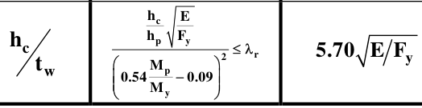

**Tabla F.2.2.4-1b** — (continuación)

Valores Límite de la Relación Ancho a Espesor para Elementos a Compresión en Miembros a Flexión (para aplicar en los numerales F.2.6 y F.2.15)

|  | Caso | Descripción del Elemento | Relación Ancho a Espesor | Valores límite de la relación ancho/espesor |  | Ejemplos |
|---|---|---|---|---|---|---|
| Elementos Atiesados | 17 | Aletas de perfiles tubulares estructurales (PTE) y perfiles en cajón, de sección rectangular y espesor uniforme | $b t$ | $1.12 \sqrt{E /F_{y}}$ | $1.40 \sqrt{E /F_{y}}$ |  |
|  | 18 | Cubreplacas de aleta y platinas de diafragma entre líneas de conectores o soldaduras | $b t$ | $1.12 \sqrt{E /F_{y}}$ | $1.40 \sqrt{E /F_{y}}$ |  |
|  | 19 | Almas de perfiles tubulares estructurales (PTE) y perfiles en cajón, de sección rectangular | $b t$ | $2.42 \sqrt{E /F_{y}}$ | $5.70 \sqrt{E /F_{y}}$ |  |
|  | 20 | Perfiles tubulares estructurales (PTE) de sección circular | $Dt$ | $0.07E /F_{y}$ | $0.31E /F_{y}$ |  |
| Para las tablas F.2.2.4.1a y F.2.2.4.1b: (a) $k_{c}=4$ pero no se tomará menor que 0.35 ni mayor que 0.76 (véanse los casos 2 y 4) $\sqrt{h /t_{w}}$ (b) $F_{L}=0.7F_{y}$ para flexión sobre el eje de menor inercia, flexión sobre el eje de mayor inercia en perfiles en $I$ armados de alma esbelta, y flexión sobre el eje de mayor inercia en perfiles en $I$ armados de alma compacta o no compacta con $\frac{S_{xt}}{S_{xc}}≥0.7$; $F_{L}=F_{y}(S_{xt}/S_{xc})≥0.5F_{y}$ para flexión sobre el eje de mayor inercia en perfiles en $I$ armados de alma compacta o no compacta con $\frac{S_{xt}}{S_{xc}}<0.7$ (véase el caso 11) (c) $M_{y}$: momento de fluencia determinado con el módulo elástico mínimo de la sección (N-mm) $M_{p}$: momento plástico de la sección (N-mm) $E$ : módulo de elasticidad del acero (MPa) $F_{y}$ : resistencia mínima especificada a la fluencia (MPa) |  |  |  |  |  |  |

<!-- mod:1-decreto-092-2011-168 -->
> **Modificación — Decreto 092 de 2011** · anexo, p. 38
>
> En la primera columna a la izquierda de la Tabla F.2.2.4-1b en los casos 10 a 14 debe decir en el texto vertical «Elementos no Atiesados» y en los casos 15 y 16 «Elementos Atiesados». En la celda de la cuarta columna del Caso 19 donde dice $b/t$ debe ser $h/t$. En las notas al final de la Tabla en el literal (a) donde dice (véanse los casos 2 y 4) debe ser (véanse los casos 2 y 11).

**F.2.2.4.2** — Espesor de Diseño de la Pared para Perfiles Tubulares Estructurales (PTE) — En los cálculos que involucren el espesor de la pared de un PTE, debe usarse un espesor de diseño, $t$ , igual a 0.93 veces el espesor nominal de la pared si el PTE fue fabricado con soldadura por resistencia eléctrica (ERW), e igual al espesor nominal de la pared si el PTE fue fabricado con soldadura por arco sumergido (SAW).

En la producción de los tubos ASTM A500 y ASTM A53 Grado B se utiliza el proceso ERW. Los tubos calidad ASTM A53 Grado B pueden diseñarse usando las provisiones de este Capítulo para PTE circulares. El proceso de soldadura SAW se aplica en la producción de tubos con secciones transversales de dimensiones mayores que las permitidas por la norma ASTM A500.

**F.2.2.4.3** — Determinación del área bruta y el área neta

**F.2.2.4.3.1** — Área bruta — El área bruta, $A_{g}$ , de un miembro es el área total de la sección transversal.

**F.2.2.4.3.2** — Área neta — El área neta, $A_{n}$ , de un miembro es la suma de los productos del espesor por el ancho neto de cada uno de los elementos que componen su sección transversal, calculado teniendo en cuenta las siguientes consideraciones:

Al calcular el área neta de los elementos solicitados por tensión y por cortante, el ancho de una perforación debe tomarse 1.6 mm más grande que la dimensión nominal de la perforación.

Para una cadena de perforaciones que se extienda sobre una línea en diagonal o en zigzag a través de un elemento, el ancho neto del elemento se obtendrá deduciendo del ancho total la suma de los diámetros o de las dimensiones de las ranuras (véase el numeral F.2.10.3.2) de todas las perforaciones en la cadena y sumando, por cada cambio de gramil en la cadena, la cantidad $s^{2}/4g$ .

donde:

$s$ = espaciamiento longitudinal centro a centro (paso) de dos perforaciones consecutivas, mm

$g$ = espaciamiento transversal centro a centro entre las líneas de gramil, mm Para perfiles angulares, la separación entre las líneas de gramil adyacentes sobre una y otra aleta se tomará igual a la suma de los gramiles a lado y lado de la arista menos el espesor del perfil.

Para un perfil tubular estructural (PTE) ranurado, soldado a una platina de conexión, el área neta, $A_{n}$ , es igual al área bruta menos el producto del espesor del perfil por el ancho total de material removido para formar la ranura.

Al calcular el área neta a través de soldaduras de tapón o de ranura, no se considerará ningún aporte del metal de la soldadura al área neta.

Para miembros sin perforaciones, el área neta, $A_{n}$ , se toma igual al área bruta, $A_{g}$ .

Para platinas de empalme con perforaciones, el valor de $A_{n}$ está limitado a un máximo de $0.85A_{g}$ según el numeral F.2.10.4.1(b) .

#### F.2.2.5 — FABRICACIÓN, MONTAJE Y CONTROL DE CALIDAD

Los planos de taller, la fabricación, la pintura en planta y el montaje deben cumplir los requisitos estipulados en el numeral F.2.13, Fabricación y Montaje. El control de calidad y el aseguramiento de la calidad deben ajustarse a lo estipulado en el numeral F.2.14, Control de Calidad y Aseguramiento de la Calidad.

#### F.2.2.6 — EVALUACIÓN DE ESTRUCTURAS EXISTENTES

Los requisitos para la evaluación de estructuras existentes se presentan en el numeral F.2.19, Evaluación de Estructuras Existentes.

### F.2.3 — DISEÑO POR ESTABILIDAD

Este numeral presenta los requisitos para el diseño de estructuras por estabilidad. El enfoque que aquí se presenta es el del método de análisis directo; en el numeral F.2.21 se presentan métodos alternativos Se incluyen las siguientes secciones:

F.2.3.1 — Requisitos Generales para el Diseño por Estabilidad F.2.3.2 — Cálculo de la Resistencia Requerida F.2.3.3 — Cálculo de la Resistencia Disponible

#### F.2.3.1 — REQUISITOS PARA EL DISEÑO POR ESTABILIDAD

Se debe asegurar la estabilidad para la estructura como un todo y para cada uno de sus elementos. El análisis deberá considerar los efectos que sobre la estabilidad de la estructura y sus elementos tiene cada uno de los siguientes factores: (1) las deformaciones por flexión, cortante y carga axial en los miembros, y cualesquier otras deformaciones que contribuyan a los desplazamientos de la estructura; (2) los efectos de segundo orden (incluyendo los efectos $P −Δ$ y $P −δ$ ); (3) las imperfecciones geométricas; (4) la reducción de la rigidez de los miembros por efectos de comportamiento inelástico; y (5) las incertidumbres en la rigidez y la resistencia. Todos los efectos dependientes de las cargas deberán ser calculados para las combinaciones de cargas mayoradas.

Se permite cualquier método racional de diseño por estabilidad que considere todos los factores enumerados arriba; incluyendo los métodos que se describen en los numerales F.2.3.1.1 y F.2.3.1.2.

Para estructuras diseñadas con base en un análisis inelástico, se deben satisfacer las provisiones del numeral F.2.15.

**F.2.3.1.1** — Método de Análisis Directo — El método de diseño por análisis directo, que consiste en el cálculo de las resistencias requeridas de acuerdo con el numeral F.2.3.2 y el cálculo de las resistencias de diseño de acuerdo con el numeral F.2.3.3, se considera válido para todo tipo de estructuras.

**F.2.3.1.2** — Métodos Alternos — El método de la longitud efectiva y el método de análisis de primer orden, que se presentan en el numeral F.2.21, son válidos como métodos alternos en lugar del método de análisis directo para estructuras que satisfagan las limitaciones que en dicho numeral se establecen.

#### F.2.3.2 — CALCULO DE LAS RESISTENCIAS REQUERIDAS

Para el método de diseño por análisis directo, las resistencias requeridas de los componentes de la estructura se determinarán a partir de un análisis realizado de acuerdo con el numeral F.2.3.2.1. Este análisis deberá incluir la consideración de imperfecciones iniciales de acuerdo con el numeral F.2.3.2.2 y ajustes de la rigidez de acuerdo con el numeral F.2.3.2.3.

**F.2.3.2.1** — Requisitos Generales del Análisis — El análisis de la estructura deberá ajustarse a los siguientes requerimientos:

(1) El análisis tendrá en cuenta deformaciones por flexión, cortante y carga axial en los miembros, y cualesquier otras deformaciones en los componentes y conexiones que puedan contribuir a los desplazamientos de la estructura. El análisis incorporará las reducciones aplicables en todas las rigideces que se considere contribuyan a la estabilidad de la estructura, según se especifica en el numeral F.2.3.2.3.

(2) Se ejecutará un análisis de segundo orden que considere tanto los efectos $P −Δ$ como los efectos $P −δ$ , excepto que se permite despreciar los efectos $P −δ$ en la respuesta de la estructura cuando se satisfacen las siguientes condiciones: (a) La estructura soporta las cargas de gravedad principalmente a través de columnas, muros y pórticos verticales; (b) la relación entre la máxima deriva del análisis de segundo orden y la máxima deriva del análisis de primer orden (ambas obtenidas usando cargas mayoradas, con las rigideces ajustadas según se especifica en el numeral F.2.2.3) es menor o igual que 1.7 para todos los pisos; y (c) no más de un tercio del total de las cargas de gravedad sobre la estructura está soportado por columnas que forman parte de pórticos resistentes a momento en la dirección de desplazamiento en consideración. Es necesario considerar en todos los casos los efectos $P −δ$ para la evaluación de los miembros individuales bajo solicitaciones de compresión y flexión.

Se permite un análisis de segundo orden con efectos $P −Δ$ únicamente (o sea despreciando los efectos $P −δ$ en la respuesta de la estructura) bajo las condiciones enumeradas. El requerimiento de considerar los efectos $P −δ$ al evaluar los miembros individuales puede ser satisfecho mediante la aplicación del factor $B_{1}$ definido en el numeral F.2.22.

Se permite el uso del método aproximado de análisis de segundo orden que se presenta en el numeral F.2.22 como método alterno en lugar de un análisis riguroso de segundo orden.

(3) El análisis considerará todas las cargas de gravedad y otras cargas aplicadas que tengan influencia en la estabilidad de la estructura.

Es importante incluir en el análisis todas las cargas de gravedad, incluyendo las cargas que actúan sobre columnas dependientes y sobre otros elementos que no forman parte del sistema de resistencia a cargas laterales.

(4) El análisis de segundo orden se ejecutará para las combinaciones de cargas mayoradas.

<!-- mod:1-decreto-092-2011-170 -->
> **Modificación — Decreto 092 de 2011** · anexo, p. 38
>
> En el numeral (2) de F.2.3.2.1 la referencia que se hace a F.2.2.3 debe ser a F.2.3.2.3.

**F.2.3.2.2** — Consideración de las Imperfecciones Iniciales — El efecto de las imperfecciones iniciales en la estructura se tendrá en cuenta ya sea introduciendo directamente dichas imperfecciones en el modelo para el análisis según se especifica en el numeral F.2.3.2.2.1 o aplicando cargas ficticias según se especifica en la sección F.2.3.2.2.2.

Las imperfecciones que se consideran en este numeral son aquellas relativas a los puntos de intersección de miembros. En estructuras de edificios típicas, la imperfección más importante de este tipo es el desplome de las columnas. En este numeral no se trata la desviación de la rectitud inicial de los miembros individuales; ella se tiene en cuenta en las provisiones de diseño para miembros a compresión del numeral F.2.5 y no necesita ser considerada explícitamente en el análisis siempre y cuando esté dentro de los límites definidos en el Código de Prácticas Estándar para Estructuras Metálicas (ICONTEC).

**F.2.3.2.2.1** — Modelado Directo de las Imperfecciones — En todos los casos, es permisible incorporar el efecto de las imperfecciones iniciales a través de la inclusión directa de dichas imperfecciones en el análisis. La estructura se analizará con los puntos de intersección de los miembros desplazados de sus posiciones nominales. La magnitud de los desplazamientos iniciales será la máxima considerada en el diseño; el patrón de los desplazamientos iniciales será tal que produzca el máximo efecto desestabilizador.

Al modelar las imperfecciones se deben considerar desplazamientos iniciales que correspondan a una silueta deformada similar a la producida por las cargas aplicadas y a las siluetas asociadas a los modos de pandeo previstos. La magnitud de dichos desplazamientos iniciales se debe basar en las tolerancias de construcción, según se especifica en el Código de Prácticas Estándar para Estructuras Metálicas (ICONTEC), o en las magnitudes reales de las imperfecciones cuando sean conocidas.

En el análisis de estructuras que soportan las cargas de gravedad principalmente a través de columnas, muros y pórticos verticales, donde la relación entre la máxima deriva del análisis de segundo orden y la máxima deriva del análisis de primer orden (ambas obtenidas usando cargas mayoradas, con las rigideces ajustadas según se especifica en el numeral F.2.3.2.3) es igual o menor que 1.7 para todos los pisos, se permite incluir las imperfecciones iniciales únicamente en el análisis de las combinaciones que incluyen exclusivamente cargas de gravedad y no incluirlas en el análisis de las combinaciones que incluyen cargas laterales aplicadas.

<!-- mod:1-decreto-092-2011-172 -->
> **Modificación — Decreto 092 de 2011** · anexo, p. 38
>
> El final del segundo parágrafo de F.2.3.2.2.1 debe quedar así:
>
> *... se especifica en el Código de Prácticas Estándar para Estructuras de Acero (ICONTEC), o en las magnitudes reales de las imperfecciones cuando sean conocidas.).*

**F.2.3.2.2.2** — Uso de Cargas Ficticias para Representar las Imperfecciones — Para estructuras que soportan las cargas de gravedad principalmente a través de columnas, muros y pórticos verticales, se permite usar cargas ficticias para representar los efectos de las imperfecciones iniciales, de acuerdo con los requisitos de esta sección. Las cargas ficticias se aplicarán a un modelo basado en la geometría nominal de la estructura.

El concepto de carga ficticia es aplicable a todo tipo de estructuras, pero los requisitos específicos de los numerales F.2.3.2.2.2(1) a F.2.3.2.2.2(4) son aplicables únicamente a estructuras de las características particulares descritas arriba.

(1) Las cargas ficticias se aplicarán como cargas laterales en todos los niveles, en adición a otras cargas laterales cuando las haya. Estas cargas se aplicarán en todas las condiciones de carga, excepto como se indica en el punto (4) abajo. La magnitud de la carga ficticia será:

$$ N_{i}=0.002Y_{i} \tag{F.2.3.2-1} $$

donde:

$N_{i}$ = carga lateral ficticia aplicada en el nivel $i$ , N

$Y_{i}$ = carga gravitacional aplicada en el nivel $i$ para el caso de carga en consideración, N Las cargas ficticias pueden generar cortantes ficticios adicionales en la base de la estructura, usualmente de magnitud pequeña. Los valores correctos de las reacciones horizontales en las fundaciones pueden obtenerse aplicando en la base de la estructura una fuerza horizontal adicional, de igual magnitud y sentido contrario a la suma de todas las cargas ficticias aplicadas, y distribuida entre los elementos que resisten las cargas verticales en proporción a las cargas de gravedad soportadas por dichos elementos. Las cargas ficticias pueden igualmente generar efectos de volcamiento adicionales, que en este caso no son ficticios.

(2) En cualquier nivel, la carga virtual, $N_{i}$ , se distribuirá de la misma manera que las cargas de gravedad en dicho nivel. Las cargas ficticias se aplicarán en la dirección en que produzcan el máximo efecto desestabilizador.

Para la mayoría de las estructuras de edificios, el requisito relativo a la dirección de aplicación de las cargas ficticias se puede satisfacer como sigue:

• para las combinaciones de cargas que no incluyan cargas laterales, considerar dos direcciones ortogonales alternativas, y para cada una de estas direcciones considerar la acción de las cargas ficticias en uno y otro sentido, tomando simultáneamente la misma dirección y sentido en todos los niveles; • para combinaciones de carga que incluyan cargas laterales, aplicar todas las cargas ficticias en la dirección de la resultante de todas las cargas laterales en la combinación respectiva.

(3) El coeficiente usado en la expresión de la carga virtual, fórmula F.2.3.2-1, igual a 0.002, se basa en la suposición de que existe un desplome inicial de 1/500 en cada nivel.

Cuando de manera justificada se pueda suponer un desplome más pequeño, el coeficiente de carga ficticia se puede ajustar proporcionalmente.

El valor de 1/500 corresponde al máximo desplome de una columna permitido por el Código de Prácticas Estándar para Estructuras Metálicas, ICONTEC. En algunos casos pueden controlar otras tolerancias especificadas, como las relativas a la posición de las columnas en planta, y pueden requerirse tolerancias más estrechas en la verticalidad de las columnas.

(4) En estructuras donde la relación entre la máxima deriva del análisis de segundo orden y la máxima deriva del análisis de primer orden (ambas obtenidas usando cargas mayoradas, con las rigideces ajustadas según se especifica en el numeral F.2.2.3) es igual o menor que 1.7 para todos los pisos, se permite aplicar las cargas ficticias, $N_{i}$ , para las combinaciones de cargas gravitacionales únicamente, y no aplicarlas en combinación con otras cargas laterales.

<!-- mod:1-decreto-092-2011-171 -->
> **Modificación — Decreto 092 de 2011** · anexo, p. 38
>
> Deben hacerse las dos siguientes correcciones en el segundo parágrafo de F.2.3.2.2 (resaltadas en el anexo: «la localización de» y «de Acero»):
>
> *Las imperfecciones que se consideran en este numeral son aquellas relativas a la localización de los puntos de intersección de miembros. ... ... definidos en el Código de Prácticas Estándar para Estructuras de Acero (ICONTEC).*

<!-- mod:1-decreto-092-2011-173 -->
> **Modificación — Decreto 092 de 2011** · anexo, p. 38
>
> El primer parágrafo del numeral (2) de F.2.3.2.2.2 debe quedar así:
>
> (2) En cualquier nivel, la carga ficticia, $N_i$, se distribuirá de la misma manera que las cargas de gravedad en dicho nivel. Las cargas ficticias se aplicarán en la dirección en que produzcan el máximo efecto desestabilizador.
>
> El primer parágrafo del numeral (3) de F.2.3.2.2.2 debe quedar así:
>
> (3) El coeficiente usado en la expresión de la carga ficticia, fórmula F.2.3.2-1, igual a 0.002, se basa en la suposición de que existe un desplome inicial de 1/500 en cada nivel. Cuando de manera justificada se pueda suponer un desplome más pequeño, el coeficiente de carga ficticia se puede ajustar proporcionalmente.
>
> El segundo parágrafo del numeral (3) de F.2.3.2.2.2 debe quedar así:
>
> *El valor de 1/500 corresponde al máximo desplome de una columna permitido por el Código de Prácticas Estándar para Estructuras de Acero, ICONTEC. En algunos casos pueden controlar otras tolerancias especificadas, como las relativas a la posición de las columnas en planta, y pueden requerirse tolerancias más estrechas en la verticalidad de las columnas.*
>
> El numeral (4) de F.2.3.2.2.2 debe quedar así:
>
> (4) En estructuras donde la relación entre la máxima deriva del análisis de segundo orden y la máxima deriva del análisis de primer orden (ambas obtenidas usando cargas mayoradas, con las rigideces ajustadas según se especifica en el numeral F.2.3.2.3) es igual o menor que 1.7 para todos los pisos, se permite aplicar las cargas ficticias, $N_i$, para las combinaciones de cargas gravitacionales únicamente, y no aplicarlas en combinación con otras cargas laterales.

**F.2.3.2.3** — Reducción de la Rigidez — En el análisis de la estructura para obtener las resistencias requeridas de los componentes se usarán rigideces reducidas, como sigue:

(1) Se aplicará un factor de 0,8 a los valores de todos los parámetros de rigidez que se considere contribuyan a la estabilidad de la estructura. Es aceptable extender la aplicación de este factor de reducción a todos los parámetros de rigidez de la estructura.

El aplicar la reducción de la rigidez a unos miembros y no aplicarla a otros puede, en algunos casos, resultar en una distorsión artificial de la estructura bajo carga y llevar a una redistribución no deseada de las fuerzas. Esto puede evitarse mediante la aplicación de la reducción a todos los miembros, incluyendo aquéllos que no contribuyen a la estabilidad de la estructura.

(2) Un factor adicional, $τ_{b}$ , se aplicará a la rigidez flexional de todos los miembros cuyas rigideces flexionales se considere contribuyan a la estabilidad de la estructura.

(a) Cuando $P_{u}/P_{y}≤0.5$

$$ \tau _{b}=1.0 \tag{F.2.3.2-2a} $$

(b) Cuando $P_{u}/P_{y}>0.5$

$$ \tau _{b}=4\left[P_{u}/P_{y}(1-P_{u}/P_{y})\right] \tag{F.2.3.2-2b} $$

donde:

$F_{cr}$ = resistencia requerida a compresión axial, N

$P_{y}=AF_{y}$, resistencia a la fluencia del miembro, N Tomadas conjuntamente, las condiciones (1) y (2) requieren usar en el análisis $0.8τ_{b}$ veces la rigidez flexional elástica nominal, y $0.8$ veces las otras rigideces elásticas nominales, para los miembros estructurales de acero.

(3) En estructuras en las cuales sea aplicable el numeral F.2.3.2.2.2, en lugar de usar$τ_{b}<1.0$ donde se tenga $P_{u}/P_{y}>0.5$, se permite usar $τ_{b}=1.0$ para todos los miembros, $T_{b}<1.0$ cuando $α_{P}/P_{y}>0.5$siempre y cuando se aplique en todos los niveles una carga ficticia igual a $0.00lY_{i}$ , con $Y_{i}$ como se define en el numeral F.2.3.2.2.2(1), y con la dirección especificada en la sección F.2.3.2.2.2(2), en todas las combinaciones de cargas. Estas cargas ficticias se aplicarán en adición a aquéllas usadas para tener en cuenta las imperfecciones iniciales y no estarán sujetas a lo estipulado en el numeral F.2.3.2.2.2(4).

(4) Donde se considere que algunos componentes en materiales distintos de acero estructural contribuyen a la estabilidad de la estructura y las respectivas secciones de este Reglamento requieran una mayor reducción en la rigidez para dichos materiales, deberán aplicarse tales reducciones de rigidez a esos componentes.

<!-- mod:1-decreto-092-2011-169 -->
> **Modificación — Decreto 092 de 2011** · anexo, p. 38
>
> El título de F.2.3.2 debe quedar así, dejando el resto igual:
>
> **F.2.3.2 — CÁLCULO DE LAS RESISTENCIAS REQUERIDAS** — Para el método de diseño por análisis directo, las resistencias requeridas de los componentes ...

<!-- mod:1-decreto-092-2011-174 -->
> **Modificación — Decreto 092 de 2011** · anexo, p. 39
>
> En el literal (b) del numeral (2) de F.2.3.2.3 debe corregirse la ecuación (F.2.3.2-2b) y donde se definen las variables, así:
>
> $$ \tau_b = 4\left(P_u/P_y\right)\left[1-\left(P_u/P_y\right)\right] \tag{F.2.3.2-2b} $$
>
> donde:
>
> $P_u$ = resistencia requerida a compresión axial, N
>
> $P_y$ = $AF_y$, resistencia a la fluencia del miembro, N
>
> En el numeral (3) de F.2.3.2.3 debe suprimirse el texto que dice «, $\tau_b < 1.0$ cuando $\alpha P_r/P_y > 0.5$».

#### F.2.3.2 — CALCULO DE LAS RESISTENCIAS DE DISEÑO

Para el método de diseño por análisis directo, las resistencias de diseño de los miembros y conexiones se calcularán de acuerdo con las provisiones de los numerales F.2.4, F.2.5, F.2.6, F.2.7, F.2.8, F.2.9, F.2.10 y F.2.11, según sean aplicables, sin otras consideraciones por estabilidad global de la estructura, El factor de longitud efectiva, K, se tomará igual a 1.0 para todos los miembros, excepto cuando a través de un análisis racional se pueda justificar un valor menor.

Cuando se tienen elementos diseñados para funcionar como riostras que determinan la longitud no arriostrada de vigas y columnas, el sistema de arriostramiento que ellos conforman debe tener rigidez y resistencia suficientes para controlar el desplazamiento del miembro en los puntos de arriostramiento.

Los métodos para satisfacer los requerimientos del arriostramiento se presentan en el numeral F.2.20, Arriostramiento para Vigas y Columnas. Los requisitos del numeral F.2.20 no son aplicables a elementos de arriostramiento que se incluyen en el análisis global de la estructura como parte del sistema de resistencia a cargas laterales.

<!-- mod:1-decreto-092-2011-175 -->
> **Modificación — Decreto 092 de 2011** · anexo, p. 39
>
> El literal F.2.3.2 figura repetido. La segunda ocurrencia debe corregirse como de F.2.3.3 y el título debe quedar así:
>
> **F.2.3.3 — CÁLCULO DE LAS RESISTENCIAS DE DISEÑO** — Para el método de diseño por análisis directo, las resistencias de diseño de los...

### F.2.4 — DISEÑO DE MIEMBROS A TENSIÓN

Este numeral se aplica a miembros solicitados por tensión axial causada por fuerzas estáticas que actúan a lo largo del eje centroidal.

Se incluyen las siguientes secciones:

F.2.4.1 — Límites de Esbeltez F.2.4.2 — Resistencia de diseño a tensión F.2.4.3 — Área Neta Efectiva F.2.4.4 — Miembros Armados F.2.4.5 — Miembros Conectados con Pasadores F.2.4.6 — Barras de Ojo Para casos no incluidos en este numeral, se aplican los siguientes numerales:

• F.2.2.3.10 Miembros solicitados por cargas de fatiga • F.2.8 Miembros solicitados por tensión axial y flexión combinadas.

• F.2.10.3 Barras roscadas • F.2.10.4.1 Elementos de conexión solicitados por tensión • F.2.10.4.3 Resistencia al desgarramiento en bloque en conexiones de extremo de miembros solicitados por tensión

#### F.2.4.1 — LÍMITES DE ESBELTEZ

No se establece un límite máximo para la relación de esbeltez de miembros a tensión.

Para miembros cuyo diseño se basa en solicitaciones a tensión, la relación de esbeltez preferiblemente no debe exceder de 300. Esta recomendación no se aplica a varillas o pendolones a tensión.

#### F.2.4.2 — RESISTENCIA DE DISEÑO A TENSIÓN

La resistencia de diseño para miembros solicitados por tensión, $φ_{t}P_{n}$, se tomará como el menor valor entre los obtenidos para los estados límites de fluencia por tensión sobre el área bruta y rotura por tensión sobre el área neta.

(a) Para fluencia por tensión sobre el área bruta:

$$ \begin{gathered}P_{n}=F_{y}A_{g} \\ \phi _{t}=0.90\end{gathered} \tag{F.2.4.2-1} $$

(b) Para rotura por tensión sobre el área neta:

$$ \begin{gathered}P_{u}=F_{u}A_{e} \\ \phi _{t}=0.75\end{gathered} \tag{F.2.4.2-2} $$

donde:

$A_{e}$ = área neta efectiva, mm2

$A_{g}$ = área bruta del miembro, mm2

$F_{y}$ = esfuerzo de fluencia mínimo especificado para el tipo de acero usado, MPa

$F_{u}$ = resistencia a tensión mínima especificada para el tipo de acero usado, MPa Para miembros sin perforaciones conectados completamente por soldaduras, el área neta efectiva para la fórmula F.2.4.2-2 se tomará según el numeral F.2.4.3. Al aplicar la misma fórmula para miembros que incluyen perforaciones y se conectan en sus extremos mediante soldaduras, y en conexiones con soldaduras de tapón o de ranura, se tomará el área neta efectiva a través de las perforaciones.

#### F.2.4.3 — AREA NETA EFECTIVA

El área bruta, $A_{g}$ , y el área neta, $A_{n}$ , de un miembro a tensión se determinarán según se especifica en el numeral F.2.2.4.3.

El área neta efectiva de un miembro a tensión se calcula como sigue:

$$ A_{e}=A_{n}U \tag{F.2.4.3-1} $$

donde el factor de reducción por rezago de cortante, $U$ , se calcula como se muestra en la tabla F.2.4.3-1.

Para secciones abiertas tales como W, M, S, C, HP, WT, ST o similares y ángulos sencillos o dobles, no se requiere tomar un valor de $U$ , el factor por rezago de cortante, menor que la relación entre el área bruta de los elementos conectados y el área bruta de la sección. Esta provisión no se aplica a secciones cerradas, tales como perfiles tubulares estructurales (PTE) ni a platinas.

Para platinas de empalme con perforaciones, el valor de $A_{n}$ está limitado a un máximo de $0.85A_{g}$ según el numeral F.2.10.4.1(b).

**Tabla F.2.4.3-1**

Factores por Rezago de Cortante para Conexiones en Miembros a Tensión

| Caso | Descripción del elemento |  | Factor por rezago de cortante $U$ | Ejemplos |
|---|---|---|---|---|
| 1 | Todos los miembros a tensión donde la carga se transmita directamente a cada uno de los elementos de la sección transversal mediante pernos o soldaduras (excepto para los casos 4, 5 y 6) |  | $U=1.0$ |  |
| 2 | Todos los miembros a tensión, excepto platinas y PTE, donde la carga de tensión se transmita a algunos pero no a todos los elementos de la sección transversal mediante pernos o soldaduras longitudinales, o por una combinación de soldaduras longitudinales y transversales (para perfiles W, M, S , HP y perfiles laminados similares se puede aplicar alternativamente el caso 7. Para ángulos se puede aplicar el caso 8). |  | $U=1−xℓ$ |  |
| 3 | Todos los miembros a tensión donde la fuerza se transmita mediante soldaduras transversales únicamente a algunos pero no a todos los elementos de la sección transversal |  | $U=1.0$ y $A_{n}$ = área de los elementos conectados directamente |  |
| 4 | Platinas donde la fuerza de tensión se transmita mediante soldaduras longitudinales únicamente. |  | $ℓ≥wU=1.0$ $2w>ℓ≥1.5wU=0.87$ $1.5w>ℓ≥wU=0.75$ |  |
| 5 | PTE circulares con platina de conexión única y concéntrica |  | $ℓ≥1.3DU=1.0$ $D≤ℓ<1.3DU=1−xℓ$ $x=Dπ$ |  |
| 6 | PTE rectangulares | con platina de conexión única y concéntrica | $ℓ≥H$ $x=B^{2}+2BHU=1−xℓ$ $4 (B+H)$ |  |
|  |  | con dos platinas de conexión laterales | $ℓ≥H$ $U=1−xℓ$ $x=B^{2}$ $4 (B+H)$ |  |
| 7 | Perfiles W, M, S , HP o perfiles laminados similares, y perfiles T derivados de ellos (se permite calcular U según el caso 2 y tomar el mayor valor) | conexión por las aletas, con 3 ó más pernos por línea en dirección de la carga | $b_{f}≥2 /3dU=0.90$ $b_{f}<2 /3dU=0.85$ |  |
|  |  | conexión por el alma, con 4 o más pernos por línea en dirección de la carga | $U=0.70$ |  |

**Tabla F.2.4.3-1** — (continuación)

Factores por Rezago de Cortante para Conexiones en Miembros a Tensión

| Caso | Descripción del elemento |  | Factor por rezago de cortante $U$ | Ejemplos |
|---|---|---|---|---|
| 8 | Ángulos simples (se permite calcular U según el caso 2 y tomar el mayor valor) | Con 4 ó más pernos por línea en dirección de la carga | $U=0.80$ |  |
|  |  | Con 3 pernos por línea en dirección de la carga (para menos de 3 pernos por línea en dirección de la carga usar el caso 2) | $U=0.60$ |  |
| $l$ = longitud de la conexión, mm $w$ = ancho de la platina, mm $x$ = excentricidad de la conexión, mm $B$ = ancho total de un miembro en PTE rectangular, medido perpendicularmente al plano de la conexión, mm $H$ = peralte de un miembro en PTE rectangular, medido en el plano de la conexión, mm |  |  |  |  |

<!-- mod:1-decreto-092-2011-176 -->
> **Modificación — Decreto 092 de 2011** · anexo, p. 39
>
> En la Tabla F.2.4.3-1 deben hacerse los siguientes cambios:
>
> - En la fila de la Tabla correspondiente al Caso 4, en la tercera columna, en la primera línea de la celda, donde dice «$\ell \geq w \quad U = 1.0$», debe ser «$\ell \geq 2w \quad U = 1.0$».
> - En la celda de la fila de la Tabla correspondiente al Caso 5, en la cuarta columna, debe colocarse la siguiente figura:
>
> 

#### F.2.4.4 — MIEMBROS ARMADOS

Cuando se usan una platina y un perfil, o dos platinas, en contacto continuo, el espaciamiento longitudinal de los conectores entre los dos elementos debe cumplir con las limitaciones dadas en el numeral F.2.10.3.5.

Se pueden utilizar tanto cubreplacas perforadas como presillas sin diagonales en las caras abiertas de miembros armados solicitados por tensión. Las presillas deben tener una longitud no inferior a 2/3 de la distancia entre las líneas de soldaduras o de pernos que las conectan a los componentes del miembro. El espesor de dichas presillas no será inferior a 1/50 de la distancia entre dichas líneas. El espaciamiento longitudinal de soldaduras intermitentes o pernos en las presillas no debe exceder de 150 mm Preferiblemente, el espaciamiento longitudinal de los conectores debe ser tal que la relación de esbeltez de cualquier componente entre uno y otro conector no sea superior a 300.

#### F.2.4.5 — MIEMBROS CONECTADOS CON PASADORES

**F.2.4.5.1** — Resistencia a tensión — La resistencia de diseño a tensión, $φ_{t}P_{n}$, para los miembros conectados con pasadores, será el menor valor entre los obtenidos para los estados límites de rotura por tensión, rotura por cortante, aplastamiento y fluencia.

(a) Para rotura por tensión sobre el área neta efectiva:

$$ \begin{gathered}P_{n}=2tb_{e}F_{u} \\ \phi _{t}=0.75\end{gathered} \tag{F.2.4.5-1} $$

(b) Para rotura por cortante sobre el área efectiva:

$$ \begin{gathered}P_{n}=0.60F_{u}A_{sf} \\ \phi _{sf}=0.75\end{gathered} \tag{F.2.4.5-2} $$

donde:

$A_{sf}=2t (a_{+}d /2)$ , área sobre la trayectoria de la falla a cortante, mm2

$a$ = distancia más corta entre el borde del agujero del pasador y el borde del miembro, medida paralelamente a la dirección de la fuerza, mm

$b_{e}$ = $2t+16$, mm, pero no mayor que la distancia real entre el borde del agujero y el borde de la pieza, medida en dirección normal a la fuerza aplicada

$d$ = diámetro del pasador, mm

$t$ = espesor de la platina, mm

(c) Para aplastamiento sobre el área proyectada del pasador, véase el numeral F.2.10.7

(d) Para fluencia sobre la sección total, véase el numeral F.2.4.2(a).

**F.2.4.5.2** — Requisitos dimensionales — El agujero del pasador debe localizarse, sobre la dirección normal a la fuerza aplicada, en posición equidistante entre los bordes del miembro. Cuando se espere que el pasador permita el movimiento relativo entre las partes conectadas baja la acción de la carga total, el diámetro de la perforación no debe exceder en más de 1 mm al diámetro del pasador.

La platina debe tener, a la altura del agujero del pasador, un ancho no menor que $2b_{e}+d$ y debe extenderse más allá del extremo de contacto del agujero, en dirección paralela al eje del miembro, en una longitud “a” no menor que $1.33b_{e}$ .

Las esquinas más allá del agujero del pasador pueden cortarse a 45º con respecto al eje del miembro, siempre que el área neta mas allá de la perforación del pasador, sobre un plano perpendicular al corte, no sea menor que la requerida mas allá de la perforación del pasador en dirección paralela al eje del miembro.

#### F.2.4.6 — BARRAS DE OJO

**F.2.4.6.1** — Resistencia a tensión — La resistencia de diseño a tensión para barras de ojo se debe determinar de acuerdo con el numeral F.2.4.2, tomando $A_{g}$ como el área de la sección transversal del cuerpo de la barra.

Para efectos de cálculo, el ancho del cuerpo de la barra de ojo no se tomará mayor que ocho veces su espesor.

**F.2.4.6.2** — Requisitos dimensionales — Las barras de ojo deben ser de espesor uniforme, sin refuerzo en los huecos de pasador, y tener cabeza circular de periferia concéntrica con el agujero del pasador.

El radio de la transición entre la cabeza circular y el cuerpo de la barra de ojo no debe ser menor que el diámetro de la cabeza El diámetro del pasador no debe ser menor que 7/8 del ancho del cuerpo de la barra de ojo, y el diámetro del agujero del pasador no debe exceder en más de 1 mm al diámetro del pasador.

Para aceros con $F_{y}$ superior a 485 MPa, el diámetro del agujero no debe exceder de cinco veces el espesor de la platina y el ancho del cuerpo de la barra de ojo se debe reducir proporcionalmente Se permite un espesor de menos de 13 mm sólo si se proporcionan tuercas externas que permitan apretar las platinas del pasador y las platinas de relleno de manera que queden en contacto firme. El ancho entre el borde del agujero y el borde de la platina, medido perpendicularmente a la dirección de la carga aplicada, debe ser mayor que 2/3 del ancho del cuerpo de la barra de ojo, pero para efectos de cálculo se tomará como máximo los ¾ de dicho ancho del cuerpo de la barra de ojo.

<!-- mod:1-decreto-092-2011-177 -->
> **Modificación — Decreto 092 de 2011** · anexo, p. 39
>
> La última frase de F.2.4.6.2 debe quedar así:
>
> ... El ancho entre el borde del agujero y el borde de la platina, medido perpendicularmente a la dirección de la carga aplicada, debe ser mayor que 2/3 del ancho del cuerpo de la barra de ojo, pero para efectos de cálculo se tomará como máximo igual a los 3/4 de dicho ancho del cuerpo de la barra de ojo.

### F.2.5 — DISEÑO DE MIEMBROS A COMPRESIÓN

Este numeral se aplica a miembros solicitados por compresión axial a través del eje centroidal.

Se incluyen las siguientes secciones:

F.2.5.1 — Provisiones Generales F.2.5.2 — Longitud Efectiva F.2.5.3 — Pandeo por Flexión de Miembros sin Elementos Esbeltos F.2.5.4 — Pandeo por Torsión y Pandeo por Flexo-Torsión de Miembros sin Elementos Esbeltos F.2.5.5 — Miembros en Ángulo Sencillo a Compresión F.2.5.6 — Miembros Armados F.2.5.7 — Miembros con Elementos Esbeltos Para casos no incluidos en este numeral, se aplican los siguientes numerales:

• F.2.8.1 a F.2.8.3: Miembros solicitados por compresión axial y flexión combinadas.

• F.2.8.4: Miembros solicitados por compresión axial y torsión.

• F.2.10.4.4: Resistencia de diseño a compresión de elementos de conexión • F.2.9.2: Miembros de sección compuesta cargados axialmente

#### F.2.5.1 — PROVISIONES GENERALES

La resistencia de diseño a compresión se tomará igual a $φ_{c}P_{n}$, donde:

$φ_{c} =0.90$ y $P_{n}$ , la resistencia nominal a compresión, será el menor entre los valores obtenidos para los estados límites de pandeo por flexión, pandeo por torsión y pandeo por flexo-torsión La tabla F.2.5.1-1 que se presenta a continuación sirve como guía para identificar los numerales aplicables a distintos tipos de secciones:

**Tabla F.2.5.1-1**

Selección de los numerales aplicables para el diseño a Compresión

| Sección Transversal | Sin Elementos Esbeltos |  | Con Elementos Esbeltos |  |
|---|---|---|---|---|
|  | Numeral Aplicable | Estados límites | Numeral Aplicable | Estados límites |
|  | F.2.5.3 F.2.5.4 | PF PT | F.2.5.7 | PL PF PT |
|  | F.2.5.3 F.2.5.4 | PF PFT | F.2.5.7 | PL PF PFT |
|  | F.2.5.3 | PF | F.2.5.7 | PL PF |
|  | F.2.5.3 | PF | F.2.5.7 | PL PF |
|  | F.2.5.3 F.2.5.4 | PF PFT | F.2.5.7 | PL PF PFT |
|  | F.2.5.6 F.2.5.3 F.2.5.4 | PF PFT | F.2.5.6 F.2.5.7 | PL PF PFT |
|  | F.2.5.5 |  | F.2.5.5 |  |

**Tabla F.2.5.1-1** — (continuación)

Selección de los numerales aplicables para el diseño a Compresión

| Sección Transversal | Sin Elementos Esbeltos |  | Con Elementos Esbeltos |  |
|---|---|---|---|---|
|  | Numeral Aplicable | Estados límites | Numeral Aplicable | Estados límites |
|  | F.2.5.3 | PF | N.A. | N.A. |
| Formas no simétricas distintas de ángulos sencillos | F.2.5.4 | PFT | F.2.5.7 | PL PFT |

Nomenclatura:

PF = Pandeo por Flexión PT = Pandeo por Torsión PFT = Pandeo por Flexo-Torsión PL = Pandeo local

#### F.2.5.2 — LONGITUD EFECTIVA

El factor de longitud efectiva, $K$ , para el cálculo de la esbeltez de la columna, $KL /r$ , se determinará con base en el numeral F.2.3, o en el numeral F.2.21, con:

$L$ = longitud no arriostrada del miembro en el plano en que se considera el pandeo, mm

$r$ = radio de giro asociado al modo de pandeo considerado, mm Preferiblemente, la relación de esbeltez, $KL /r$ , para miembros diseñados por compresión no debe exceder de 200.

#### F.2.5.3 — PANDEO POR FLEXIÓN DE MIEMBROS SIN ELEMENTOS ESBELTOS

Este numeral se aplica a miembros a compresión sin elementos esbeltos según las definiciones dadas en el numeral F.2.2.4.1 para elementos bajo esfuerzos uniformes de compresión.

Cuando la longitud no arriostrada contra la torsión es mayor que la longitud no arriostrada contra la flexión, el numeral F.2.5.4 puede controlar el diseño de columnas de aletas anchas y otras secciones similares.

La resistencia nominal a compresión, $P_{n}$ , para el estado límite de pandeo por flexión, se tomará igual a:

$$ P_{n}=F_{cr}A_{g} \tag{F.2.5.3-1} $$

donde el esfuerzo de pandeo por flexión, $F_{cr}$ , se calcula como sigue:

(a) Cuando $\frac{KL}{r}≤4.71\sqrt{F_{y}E}$ ó $(F_{e}≥0.44F_{y})$

$$ F_{cr}=\left[0.658^{F_{y}/F_{e}}\right]F_{y} \tag{F.2.5.3-2} $$

(b) Cuando $\frac{KL}{r}>4.71\sqrt{F_{y}E}$ ó $(F_{e}<0.44F_{y})$

$$ F_{cr}=0.877F_{e} \tag{F.2.5.3-3} $$

donde:

$F_{e}$ = esfuerzo crítico de pandeo elástico calculado según la fórmula F.2.5.3-4, el numeral F.2.21.2.3(b), o mediante un análisis de pandeo elástico, según sea aplicable, MPa.

$$ F_{e}=\dfrac{\pi ^{2}E}{(KL/r)^{2}} \tag{F.2.5.3-4} $$

Las dos fórmulas para el cálculo de los límites de aplicabilidad de los casos F.2.5.3(a) y F.2.5.3(b), una basada en $KL /r$ y la otra basada en $F_{e}$ , producen el mismo resultado.

#### F.2.5.4 — PANDEO POR TORSIÓN Y PANDEO POR FLEXO-TORSIÓN DE MIEMBROS SIN ELEMENTOS

ESBELTOS — Este numeral se aplica a miembros de simetría simple y miembros no simétricos, y a algunos miembros de simetría doble como aquellos en forma de cruz o columnas armadas, sin elementos esbeltos según las definiciones del numeral F.2.2.4.1 para elementos bajo esfuerzos uniformes de compresión. En el caso de ángulos sencillos, deberán aplicarse estos requisitos cuando $b /t>20$.

La resistencia nominal a compresión, $P_{n}$ , para los estados límites de pandeo por flexo-torsión y pandeo por torsión, se determinará como sigue:

$$ P_{n}=F_{cr}A_{g} \tag{F.2.5.4-1} $$

con el esfuerzo crítico, $F_{cr}$ , calculado como sigue:

(a) Para miembros a compresión en ángulos dobles dispuestos en $T$ con una separación tal que la constante de alabeo $C_{w}$ es despreciable, y secciones en $T$ :

$$ F_{cr}=\left(\dfrac{F_{cry}+F_{crz}}{2H}\right)\left[1-\sqrt{1-\dfrac{4F_{cry}F_{crz}H}{(F_{cry}+F_{crz})^{2}}}\right] \tag{F.2.5.4-2} $$

donde $F_{cry}$ se toma como el $F_{cr}$ de la fórmula F.2.5.3-2 ó la F.2.5.3-3, para pandeo por flexión alrededor de eje de simetría “y”, con $KL /r=KL /r_{y}$para secciones en $T ,$ y con $KL /r=(KL /r)m$ según el numeral F.2.5.6 para ángulos dobles dispuestos en $T$ , y

$$ F_{crz}=\dfrac{GJ}{A_{g}\bar{r}_{o}^{2}} \tag{F.2.5.4-3} $$

(b) Para todos los demás casos, $F_{cr}$ se determinará según la fórmula F.2.5.3-2 ó la F.2.5.3-3, usando el esfuerzo de pandeo elástico por torsión o por flexo-torsión, $F_{e}$ , calculado como sigue:

(i) para miembros con simetría doble:

$$ F_{e}=\left[\dfrac{\pi ^{2}EC_{w}}{(K_{z}L)^{2}}+GJ\right]\dfrac{1}{I_{x}+I_{y}} \tag{F.2.5.4-4} $$

(ii) Para miembros de simetría simple donde "$y$" es el eje de simetría, incluidos ángulos dobles distanciados de manera que la constante de alabeo $C_{w}$ no es despreciable:

$$ F_{e}=\left(\dfrac{F_{ey}+F_{ez}}{2H}\right)\left[1-\sqrt{1-\dfrac{4F_{ey}F_{ez}H}{(F_{ey}+F_{ez})^{2}}}\right] \tag{F.2.5.4-5} $$

(iii) Para miembros no simétricos, $F_{e}$ , es la menor de las raíces de la siguiente ecuación cúbica:

$$ (F_{e}-F_{ex})(F_{e}-F_{ey})(F_{e}-F_{ez})-F_{e}^{2}(F_{e}-F_{ey})\left(\dfrac{x_{o}}{\bar{r}_{o}}\right)^{2}-F_{e}^{2}(F_{e}-F_{ex})\left(\dfrac{y_{o}}{\bar{r}_{o}}\right)^{2}=0 \tag{F.2.5.4-6} $$

donde:

$A_{g}$ = area bruta del miembro, mm2

$C_{w}$ = constante de alabeo, mm6

$$ F_{ex}=\dfrac{\pi ^{2}E}{(KL/r)_{x}^{2}} \tag{F.2.5.4-7} $$

$$ F_{ey}=\dfrac{\pi ^{2}E}{(KL/r)_{y}^{2}} \tag{F.2.5.4-8} $$

$$ F_{ez}=\left(\dfrac{\pi ^{2}EC_{w}}{(KL)_{z}^{2}}+GJ\right)\dfrac{1}{A_{g}\bar{r}_{o}^{2}} \tag{F.2.5.4-9} $$

$G$ = módulo de elasticidad a cortante del acero = 77200 MPa

$$ H=1-\dfrac{x_{o}^{2}+y_{o}^{2}}{\bar{r}_{o}^{2}} \tag{F.2.5.4-10} $$

$I_{x}$ , $I_{y}$ = momentos de inercia alrededor de los ejes principales, mm4

$J$ = constante torsional, mm4

$K_{x}$= factor de longitud efectiva para pandeo por flexión sobre el eje x

$K_{y}$= factor de longitud efectiva para pandeo por flexión sobre el eje y

$K_{z}$ = factor de longitud efectiva para pandeo por torsión

$x_{o}$ , $y_{o}$ = coordenadas del centro de cortante medidas desde el centroide, mm

$r_{o}$ = radio polar de giro alrededor del centro de corte, mm

$$ \bar{r}_{o}^{2}=x_{o}^{2}+y_{o}^{2}+\dfrac{I_{x}+I_{y}}{A_{g}} \tag{F.2.5.4-11} $$

$r_{x}$ = rdio de giro alrededor del eje “x”, mm

$r_{y}$ = radio de giro alrededor del eje “y”, mm Para secciones en $I$ con simetría doble, $C_{w}$ puede tomarse como $I_{y} h_{o}^{2}/4$ , donde $h_{o}$ es la distancia entre los centroides de las aletas.

La tabla F.2.5.4-1 se suministra como guía para la aplicación de las fórmulas F.2.5.4-2 a F.2.5.4-6.

**Tabla F.2.5.4-1**

Selección de las fórmulas aplicables para Pandeo por Torsión y Pandeo por Flexo-Torsión

| Tipo de Sección Transversal | Caso de sección F.2.5.4 | Fórmula a aplicar |
|---|---|---|
| Ángulos dobles dispuestos en $T$ con $C_{w}$ despreciable y secciones en $T$ | (a) | F.2.5.4-2 y F.2.5.4-3 |
| Todas las secciones con simetría doble; secciones en $Z$ | (b)(i) | F.2.5.4-4 |
| Secciones de simetría simple, excepto ángulos dobles dispuestos en $T$ con $C_{w}$ despreciable y secciones en $T$ | (b)(ii) | F.2.5.4-5 |
| Perfiles asimétricos | (b)(iii) | F.2.5.4-6 |

<!-- mod:1-decreto-092-2011-179 -->
> **Modificación — Decreto 092 de 2011** · anexo, p. 40
>
> En la definición de términos después de la ecuación (F.2.5.4-11), donde se define $r_x$ la palabra «rdio» debe substituirse por «radio».

#### F.2.5.5 — MIEMBROS EN ÁNGULO SENCILLO A COMPRESIÓN

La resistencia nominal a compresión, $P_{n}$ , de miembros en perfil angular sencillo cargados axialmente se determinará de acuerdo con el numeral F.2.5.3 o el numeral F.2.5.7, según corresponda. Para perfiles angulares sencillos con $b / t>20$ se debe aplicar además el numeral F.2.5.4.

Se pueden despreciar los efectos de la excentricidad de la carga en un perfil angular, y evaluarlos como miembros cargados axialmente, dadas las siguientes condiciones:

(1) las fuerzas de compresión se aplican a través de la misma aleta en ambos extremos del miembro; (2) los miembros se conectan por soldaduras o como mínimo por dos pernos en cada extremo; y (3) no se aplican cargas transversales intermedias.

y usando una relación de esbeltez efectiva, $Kl /r$ , calculada como se describe en los literales (a) y (b) a continuación:

(i) Para ángulos de aletas iguales, o ángulos de aletas desiguales conectados por su aleta mayor, que se utilicen como miembros individuales o como miembros del diagonalado de una armadura plana en la cual los miembros adyacentes del diagonalado se conecten por la misma cara de la platina de conexión o del miembro principal:

Cuando $\frac{L}{r_{x}} ≤80$:

$$ \dfrac{KL}{r}=72+0.75\dfrac{L}{r_{x}} \tag{F.2.5.5-1} $$

Cuando $\frac{L}{r_{x}} >80$:

$$ \dfrac{KL}{r}=32+1.25\dfrac{L}{r_{x}} \tag{F.2.5.5-2} $$

La fórmula F.2.5.5-2 es válida para $KL /r$ menor o igual que 200.

Para ángulos de aletas desiguales con una relación de anchos de aletas inferior a 1,7 que se conecten por la aleta menor, el valor $KL /r$ de las fórmulas F.2.5.5-1 y F.2.5.5-2 debe ser incrementado sumándole $4\left[(b_l/b_s)^2-1\right]$, sin que en ningún caso $KL /r$ del miembro se tome menor que $0.95L /r_{z}$ .

(ii) Para ángulos de aletas iguales, o ángulos de aletas desiguales conectados por su aleta mayor, que se utilicen como miembros del diagonalado de armaduras en cajón o armaduras espaciales en las cuales los miembros adyacentes del diagonalado se conecten por la misma cara de la platina de conexión o del miembro principal:

Cuando $\frac{L}{r_{x}} ≤75$

$$ \dfrac{KL}{r}=60+0.8\dfrac{L}{r_{x}} \tag{F.2.5.5-3} $$

Cuando $\frac{L}{r_{x}} >75$

$$ \dfrac{KL}{r}=45+\dfrac{L}{r_{x}} \tag{F.2.5.5-4} $$

La fórmula F.2.5.5-4 es válida para $KL /r$ menor o igual que 200.

Para ángulos de aletas desiguales con una relación de anchos de aletas inferior a 1,7 y conectados por la aleta menor, el valor $KL /r$ de las fórmulas F.2.5.5-3 y F.2.5.5-4 debe ser incrementado sumándole $6\left[(b_l/b_s)^2-1\right]$, sin que en ningún caso $KL /r$ del miembro se tome menor que $0.82L /r_{z}$ , donde:

$L$ = longitud del miembro medida entre los puntos de trabajo sobre el eje del miembro principal de la armadura, mm

$b_{l}$ = aleta mayor del perfil angular, mm

$b_{s}$ = aleta menor del perfil angular, mm

$r_{x}$ = radio de giro alrededor del eje geométrico paralelo a la aleta conectada, mm

$r_{z}$ = radio de giro para el eje principal menor, mm Los miembros en perfil angular sencillo con condiciones en los extremos distintas de las descritas en los numerales F.2.5.5(a) y F.2.5.5(b), con una relación de anchos de aletas superior a 1,7, o con aplicación de cargas transversales, deben ser evaluados para la combinación de carga axial y flexión de acuerdo con los requisitos del numeral F.2.8.

<!-- mod:1-decreto-092-2011-180 -->
> **Modificación — Decreto 092 de 2011** · anexo, p. 40
>
> La nomenclatura de las subsecciones que se designan como (i) e (ii) debe substituirse por (a) y (b), respectivamente.

#### F.2.5.6 — MIEMBROS ARMADOS

**F.2.5.6.1** — Resistencia de diseño a compresión — Esta sección se aplica a miembros ensamblados compuestos por dos o más perfiles que pueden (a) estar conectados entre sí con pernos o soldaduras, o (b) conformar una sección con por lo menos un lado abierto, sobre el cual los perfiles se interconectan por cubreplacas perforadas o por diagonalado y presillas, Las conexiones de extremo deberán ser soldadas o conectadas por medio de pernos pretensionados con superficies de contacto Clase A o Clase B.

En los extremos de un miembro ensamblado a compresión es aceptable usar conexiones pernadas, con los pernos diseñados a aplastamiento para la carga total a compresión; sin embargo, los pernos deben ser pretensionados aun cuando las condiciones de servicio no requieran una conexión de deslizamiento crítico.

La resistencia nominal a compresión de miembros armados compuestos por dos o más perfiles conectados entre sí mediante pernos o soldaduras, se calculará de acuerdo con los numerales F.2.5.3, F.2.5.4 o F.2.5.7, aplicando la siguiente modificación. Si el modo de pandeo genera en los perfiles individuales deformaciones que producen fuerzas cortantes en los elementos que los conectan, $KL /r$ se reemplazará por $(KL /r)m$ determinada como sigue, cuando no se efectúe un análisis más exacto:

(a) Para conectores intermedios con pernos en condición de apriete ajustado:

$$ \left(\dfrac{KL}{r}\right)_{m}=\sqrt{\left(\dfrac{KL}{r}\right)_{0}^{2}+\left(\dfrac{a}{r_{i}}\right)^{2}} \tag{F.2.5.6-1} $$

(b) Para conectores intermedios soldados o con pernos pretensionados, sin incluir ángulos dobles distanciados:

$$ \left(\dfrac{KL}{r}\right)_{m}=\sqrt{\left(\dfrac{KL}{r}\right)_{0}^{2}+0.82\dfrac{\alpha ^{2}}{(1+\alpha ^{2})}\left(\dfrac{a}{r_{ib}}\right)^{2}} \tag{F.2.5.6-2} $$

(c) Para ángulos dobles distanciados con conectores soldados:

$$ \left(\dfrac{KL}{r}\right)_{m}=\sqrt{\left(\dfrac{KL}{r}\right)_{0}^{2}+\dfrac{\alpha ^{2}}{(1+\alpha ^{2})}\left[0.82\left(\dfrac{a}{r_{ib}}\right)^{2}+1.65\dfrac{A_{i}aL_{b}}{I_{b}}+51.32\dfrac{anA_{i}}{L_{b}A_{b}}\right]} \tag{F.2.5.6-3} $$

donde:

$(KL /r)m$ = ebeltez modificada para el miembro armado

$(KL /r)o$ = esbeltez del miembro armado, tratado como una unidad en la dirección de pandeo considerada

$a$ = distancia entre conectores, mm

$r_{i}$ = radio mínimo de giro de un componente individual, mm

$r_{ib}$ = radio de giro de un componente individual relativo a su eje centroidal paralelo al eje de pandeo del miembro, mm

$α$ = relación de separación $=h /2r_{ib}$

$h$ = distancia entre los centroides de los componentes individuales, medida perpendicularmente al eje de pandeo del miembro, mm

$A_{i}$ = área de un ángulo, mm2

$L_{b}$ = longitud del conector medida entre los centroides de los ángulos, mm

$I_{b}$ = inercia del conector asociada a la flexión en el plano de los dos ángulos conectados, mm4

$n$ = factor de forma para deformaciones por cortante = 3.33 para conectores en perfil angular = 1.2 para conectores de sección rectangular = 1.11 para conectores circulares

$A_{b}$ = área del conector, mm2

**F.2.5.6.2** — Requisitos dimensionales — Los componentes individuales de miembros a compresión compuestos por dos o más perfiles deberán conectarse entre sí a intervalos “a” tales que la relación de esbeltez efectiva $Ka /r_{i}$ de cada uno de los componentes, tomada entre conectores, no exceda las ¾ partes de la relación de esbeltez que controla para el miembro armado. Se debe utilizar el menor radio de giro, $r_{i}$ , para calcular la relación de esbeltez de cada componente.

Las conexiones en los extremos deben ser soldadas o con pernos pretensionados, y las superficies de contacto deberán ser Clase A o Clase B, sin que esta condición excluya la posibilidad de diseñar la conexión pernada de extremo con base en que los pernos trabajen a aplastamiento.

En un extremo de un miembro armado solicitado por compresión que se apoye sobre una placa de base o una superficie cepillada, todos los componentes en contacto uno con otro deberán conectarse entre sí por soldaduras que tengan una longitud no menor que el ancho máximo del miembro, o por pernos sobre una distancia igual a 1½ veces el ancho máximo del miembro y espaciados longitudinalmente a cuatro diámetros como máximo.

A lo largo del tramo comprendido entre las conexiones de extremo requeridas arriba para un miembro armado solicitado por compresión, el espaciamiento longitudinal entre las soldaduras intermitentes o los pernos debe ser apropiado para proveer la transferencia de las fuerzas calculadas. Los límites para el espaciamiento longitudinal de conectores entre elementos en contacto continuo, ya sean una platina y un perfil o dos platinas, se definen en el numeral F.2.10.3.5. Cuando se tengan platinas sobrepuestas como parte de un miembro armado solicitado por compresión y se usen como conectores soldaduras intermitentes a lo largo de los bordes, o pernos sobre todas las líneas de gramil en cada sección, el espaciamiento máximo no debe exceder de $0.75 \sqrt{E /F_{y}}$ veces el espesor de la platina sobrepuesta más delgada, ni 305 mm. Cuando los pernos están dispuestos en forma alternada, el espaciamiento máximo sobre cada línea de gramil no debe exceder $1.12 \sqrt{E /F_{y}}$ veces el espesor de la platina sobrepuesta más delgada ni 460 mm.

Los lados abiertos de miembros armados solicitados por compresión, compuestos por platinas o perfiles, estarán provistos de cubreplacas continuas perforadas con una sucesión de agujeros de acceso. Se puede contar con que el ancho no soportado de tales cubreplacas a la altura de los agujeros de acceso, según se define en el numeral F.2.2.4.1, contribuya a la resistencia de diseño del miembro, siempre y cuando se cumplan los siguientes requisitos:

(1) La relación ancho-espesor debe cumplir con las limitaciones del numeral F.2.2.41.

Es conservador tomar el límite del Caso 7 de la tabla F.2.2.4-1a con el ancho, b, tomado como la distancia transversal entre las líneas de conectores más próximas. El área neta de la cubreplaca se toma donde se encuentra el agujero más ancho. En lugar de este enfoque, el límite en la relación ancho/espesor puede ser obtenido mediante análisis.

(2) La relación entre la longitud (en la dirección del esfuerzo) y el ancho del agujero no debe exceder de 2.0.

(3) La distancia libre entre agujeros en la dirección del esfuerzo no debe ser menor que la distancia transversal entre las líneas más próximas de pernos o soldaduras de conexión.

(4) El radio mínimo en cualquier punto de la periferia de los agujeros deber ser de 38 mm.

Como alternativa para las cubreplacas perforadas se permite el uso de una celosía, disponiendo presillas en los extremos y en puntos intermedios donde la celosía se interrumpa. Las presillas estarán tan cerca de los extremos como sea posible. En miembros principales solicitados por esfuerzos calculados, las presillas de los extremos tendrán una longitud no menor que la distancia entre las líneas de pernos o soldaduras que las conectan a los componentes del miembro. Las presillas intermedias tendrán una longitud no menor que la mitad de esta distancia. El espesor de las presillas no debe ser menor que 1/50 de la distancia entre las líneas de soldadura o de pernos que las conectan a los componentes de los miembros. En construcción soldada, la longitud total de soldadura sobre cada línea de conexión de una presilla no debe ser menor que 1/3 la longitud de la presilla. En construcción pernada, el espaciamiento entre pernos en las presillas, medido en la dirección del esfuerzo, no debe ser mayor que 6 diámetros, con un mínimo de 3 pernos de conexión entre la presilla y cada componente.

Los elementos de la celosía, incluyendo platinas, ángulos, canales u otros perfiles que la conformen, deberán espaciarse de tal forma que la relación $L /r$ del componente incluido entre los puntos de conexión no exceda las tres cuartas partes de la esbeltez que rige el diseño del miembro como un todo. La celosía se diseñará para que suministre una resistencia a fuerza cortante, en dirección normal al eje del miembro, igual al 2% de la resistencia de diseño a compresión del miembro. La relación $L /r$ de las barras de la celosía no excederá de 140 en sistemas sencillos, ni de 200 en celosías dobles. Las barras de celosías dobles se conectarán en sus intersecciones. Para las barras de celosía solicitadas por compresión, $L$ puede tomarse como la longitud sin soporte entre los conectores o soldaduras que las unen a los componentes del miembro armado en el caso de una celosía sencilla, y como el 70% de dicha longitud en el caso de una celosía doble.

La inclinación de las barras de celosía con respecto al eje del miembro será, preferiblemente, no inferior a 60° para celosía sencilla y a 45° para celosías dobles. Siempre que la distancia entre las líneas de soldadura o de conectores en los componentes sea superior a 380 mm, será preferible utilizar celosías dobles o perfiles angulares.

Para requisitos adicionales del espaciamiento, véase el numeral F.2.10.3.5

<!-- mod:1-decreto-092-2011-181 -->
> **Modificación — Decreto 092 de 2011** · anexo, p. 40
>
> En el numeral (1) de F.2.5.6.2 la referencia a F.2.2.41 debe ser a F.2.2.4.1.

#### F.2.5.7 — MIEMBROS CON ELEMENTOS ESBELTOS

Este numeral se aplica a miembros a compresión cuya sección incluye elementos esbeltos, según las definiciones del numeral F.2.2.4.1 para elementos bajo esfuerzos uniformes de compresión.

La resistencia nominal a compresión, $P_{n}$ , se determinará con base en los estados límites de pandeo por flexión, pandeo por torsión y pandeo por flexo-torsión, como el producto:

$$ P_{n}=F_{cr}A_{g} \tag{F.2.5.7-1} $$

donde $F_{cr}$ se calcula como sigue:

(a) Cuando $\frac{Kl}{r}≤4.71\sqrt{QF_{y}E}$ ó $(F_{e}≥0.44QF_{y})$

$$ F_{cr}=Q\left[0.658^{QF_{y}/F_{e}}\right]F_{y} \tag{F.2.5.7-2} $$

(b) Cuando $\frac{KL}{r}>4.71E$ ó $(F_{e}<0.44QF_{y} )$ $\sqrt{QF_{y}}$

$$ F_{cr}=0.877F_{e} \tag{F.2.5.7-3} $$

donde:

$F_{e}$ = esfuerzo crítico de pandeo elástico calculado usando las fórmulas F.2.5.3-4 y F.2.5.4-4 para miembros de doble simetría, las fórmulas F.2.5.3-4 y F.2.5.4-5 para miembros de simetría simple, y la ecuación F.2.5.4-6 para miembros no simétricos, excepto para ángulos sencillos con $b / t>20$ donde $F_{e}$ se calcula usando la fórmula F.2.5.3-4, MPa.

$Q$ = 1,0 para miembros con secciones no esbeltas, según las definiciones del numeral F.2.2.4.1 para elementos bajo esfuerzos de compresión uniforme.

= $Q_{s} Q_{a}$ para miembros con secciones esbeltas, según las definiciones de F.2.2.4.1 para elementos bajo esfuerzos de compresión uniforme.

Para secciones transversales donde la condición de “esbeltos” ocurre solamente en elementos no atiesados,

$Q=Q_{s}(Q_{a}=1.0)$. Para secciones transversales donde la condición de “esbeltos” ocurre solamente en elementos atiesados, $Q=Q_{a}(Q_{s}=1.0)$. Para secciones transversales donde la condición de “esbeltos” ocurre tanto en elementos no atiesados como en elementos atiesados, $Q_{=}Q_{s} Q_{a}$. Para secciones transversales que contienen varios elementos no atiesados esbeltos, es conservador tomar para $Q_{s}$ el menor valor, correspondiente al elemento más esbelto.

**F.2.5.7.1** — Elementos no atiesados esbeltos, $Q_{s}$ — El factor de reducción para elementos no atiesados esbeltos, $Q_{s}$ , se define como sigue:

(a) Para aletas, ángulos o platinas que sobresalen de columnas u otros miembros en perfiles laminados a compresión:

(i) Cuando $\frac{b}{t}≤0.56E$ $\sqrt{F_{y}}$

$$ Q_{s}=1.0 \tag{F.2.5.7-4} $$

(ii) Cuando $0.56 \sqrt{E /F_{y}}<\frac{b}{t}<1.03 \sqrt{E F_{y}}$

$$ Q_{s}=1.415-0.74\left(\dfrac{b}{t}\right)\sqrt{\dfrac{F_{y}}{E}} \tag{F.2.5.7-5} $$

(iii) Cuando $\frac{b}{t} ≥1.03 \sqrt{E F_{y}}$

$$ Q_{s}=\dfrac{0.69E}{F_{y}(b/t)^{2}} \tag{F.2.5.7-6} $$

(b) Para aletas, ángulos o platinas que sobresalen de columnas u otros miembros armados sometidos a compresión:

$Ek_{c}$ Cuando $\frac{b}{t}≤0.64$ $\sqrt{F_{y}}$

$$ Q_{s}=1.0 \tag{F.2.5.7-7} $$

$Ek_{c}Ek_{c}$ Cuando $0.64<\frac{b}{t}≤1.17$ $\sqrt{F_{y}}\sqrt{F_{y}}$

$$ Q_{s}=1.415-0.65\left(\dfrac{b}{t}\right)\sqrt{\dfrac{F_{y}}{Ek_{c}}} \tag{F.2.5.7-8} $$

$Ek_{c}$ Cuando $\frac{b}{t}>1.17$ $\sqrt{F_{y}}$

$$ Q_{s}=\dfrac{0.90Ek_{c}}{F_{y}(b/t)^{2}} \tag{F.2.5.7-9} $$

donde:

$k_{c}=4$, pero no se tomará menor que 0.35 ni mayor que 0.76 $\sqrt{h /t_{w}}$

(c) Para ángulos sencillos

| $≤0.45$ | $E$ |
|---|---|
|  | $\sqrt{F_{y}}$ |

Cuando $\frac{b}{t}$

$$ Q_{s}=1.0 \tag{F.2.5.7-10} $$

Cuando $0.45 \sqrt{E /F_{y}}<b /t≤0.91 \sqrt{E /F_{y}}$

$$ Q_{s}=1.34-0.76\left(\dfrac{b}{t}\sqrt{\dfrac{F_{y}}{E}}\right) \tag{F.2.5.7-11} $$

Cuando $b /t>0.91 \sqrt{E /F_{y}}$

$$ Q_{s}=\dfrac{0.53E}{F_{y}(b/t)^{2}} \tag{F.2.5.7-12} $$

donde:

$b$ = ancho total de la mayor aleta del ángulo, (mm)

(d) Para almas de secciones en $T$ :

Cuando $\frac{d}{t}≤0.75E$ $\sqrt{F_{y}}$

$$ Q_{s}=1.0 \tag{F.2.5.7-13} $$

Cuando $0.75E≤d t<1.03E$ $\sqrt{F_{y}}\sqrt{F_{y}}$

$$ Q_{s}=1.908-1.22\left(\dfrac{d}{t}\right)\sqrt{\dfrac{F_{y}}{E}} \tag{F.2.5.7-14} $$

Cuando $d t>1.03 \sqrt{F_{y}E}$

$$ Q_{s}=\dfrac{0.69E}{F_{y}(d/t)^{2}} \tag{F.2.5.7-15} $$

donde:

$b$ = ancho del elemento a compresión no atiesado, según se define en el numeral F.2.2.4, mm

$d$ = peralte nominal de la T, mm

$t$ = espesor del elemento, mm

**F.2.5.7.2** — Elementos atiesados esbeltos, $Q_{a}$ — El factor de reducción para una sección con elementos atiesados esbeltos, $Q_{a}$ , se define como sigue:

$$ Q_{a}=\dfrac{A_{e}}{A} \tag{F.2.5.7-16} $$

donde:

$A$ = área total de la sección transversal del miembro, mm2

$A_{e}$ = sumatoria de las áreas efectivas de los elementos de la sección transversal, calculadas con base en los anchos efectivos reducidos, $b_{e}$ , mm2 El ancho efectivo reducido para un elemento, $b_{e}$ , se calcula como sigue:

(a) Para elementos esbeltos bajo esfuerzo de compresión uniforme, con $b /t_{≥}1.49 \sqrt{E /f}$, excepto aletas de secciones cuadradas o rectangulares de espesor uniforme:

$$ b_{e}=1.92t\sqrt{\dfrac{E}{f}}\left[1-\dfrac{0.34}{(b/t)}\sqrt{\dfrac{E}{f}}\right]\le b \tag{F.2.5.7-17} $$

donde:

$f$ = $F_{cr}$ calculado con base en $Q=1.0$.

(b) Para aletas de secciones cuadradas o rectangulares con elementos esbeltos de espesor uniforme donde $b /t_{≥}1.40 \sqrt{E /f}$:

$$ b_{e}=1.92t\sqrt{\dfrac{E}{f}}\left[1-\dfrac{0.38}{(b/t)}\sqrt{\dfrac{E}{f}}\right]\le b \tag{F.2.5.7-18} $$

donde:

$f=P_{n}/A_{eff}$ En lugar de calcular $f=P_{n}/A_{eff}$, lo cual requiere un proceso iterativo, se puede de manera conservadora tomar $f$ igual a $F_{y}$ .

(c) Para secciones circulares cargadas axialmente, cuando $0.11\frac{E}{F_{y}}<\frac{D}{t}<0.45\frac{E}{F_{y}}$:

$$ Q=Q_{a}=\dfrac{0.038E}{F_{y}(D/t)}+\dfrac{2}{3} \tag{F.2.5.7-19} $$

donde:

$D$ = diámetro exterior, mm

$t$ = espesor de pared, mm

<!-- mod:1-decreto-092-2011-178 -->
> **Modificación — Decreto 092 de 2011** · anexo, p. 40
>
> Donde se indica «*Para casos no incluidos en este numeral, se aplican los siguientes numerales:*» la enumeración que sigue debe corregirse así:
>
> - F.2.8.1 a F.2.8.2: Miembros solicitados por compresión axial y flexión combinadas.
> - F.2.8.3: Miembros solicitados por compresión axial y torsión.
> - F.2.10.4.4: Resistencia de diseño a compresión de elementos de conexión
> - F.2.9.2: Miembros de sección compuesta cargados axialmente

<!-- mod:1-decreto-092-2011-182 -->
> **Modificación — Decreto 092 de 2011** · anexo, p. 40
>
> En el texto donde se define el término $F_e$ después de la ecuación (F.2.5.7-3) la relación $b/t > 20$ debe ser $b/t \leq 20$.

<!-- mod:1-decreto-092-2011-183 -->
> **Modificación — Decreto 092 de 2011** · anexo, p. 40
>
> El primer párrafo del literal (b) de F.2.5.7.2 debe quedar así:
>
> (b) Para elementos de secciones cuadradas o rectangulares con elementos esbeltos de espesor uniforme donde...
>
> La ecuación (F.2.5.7-16) debe quedar así:
>
> $$ Q_a = \frac{A_e}{A_g} \tag{F.2.5.7-16} $$
>
> donde:
>
> $A_g$ = área total de la sección transversal del miembro, mm²
>
> $A_e$ = sumatoria de las áreas efectivas de los elementos de la sección transversal, calculadas con base en los anchos efectivos reducidos, $b_e$, mm²
>
> En el literal (b) de F.2.5.7.2 donde dice «... para aletas de secciones...» debe ser «... para paredes de secciones...» y después de la ecuación (F.2.5.7-18) donde se definen las variables deben hacerse las siguientes correcciones:
>
> donde:
>
> $f = P_n/A_e$
>
> *En lugar de calcular $f = P_n/A_e$, lo cual requiere un proceso iterativo, se puede de manera conservadora tomar $f$ igual a $F_y$.*

### F.2.6 — DISEÑO DE MIEMBROS A FLEXION

Este numeral se aplica a miembros solicitados por flexión simple con respecto a uno de sus ejes principales. Esta condición se da cuando las cargas actúan en un plano que es paralelo a uno de los ejes principales y dicho plano pasa por el centro de corte de la sección o, alternativamente, cuando el miembro está restringido contra la torsión en los puntos de aplicación de las cargas y en los apoyos.

Se incluyen las siguientes secciones:

F.2.6.1 — Provisiones Generales F.2.6.2 — Miembros de Sección Compacta en $I$ con Simetría Doble y Canales, Solicitados por Flexión Alrededor de su Eje Mayor F.2.6.3 — Miembros de Sección en $I$ con Simetría Doble, con Alma Compacta y Aletas no Compactas o Esbeltas, Solicitados por Flexión Alrededor de su Eje Mayor F.2.6.4 — Otros Miembros de Sección en $I$ con Alma Compacta o No Compacta, Solicitados por Flexión Alrededor de su Eje Mayor F.2.6.5 — Miembros de Sección en $I$ con Simetría Doble o Simple, con Alma Esbelta, Solicitados por Flexión Alrededor de su Eje Mayor F.2.6.6 — Miembros de Sección en $I$ y Canales Solicitados por Flexión Alrededor de su Eje Menor F.2.6.7 — Perfiles Tubulares Estructurales (PTE) Cuadrados o Rectangulares y Miembros de Sección en Cajón F.2.6.8 — Perfiles Tubulares Estructurales (PTE) Circulares F.2.6.9 — Secciones en $T$ y Ángulos Dobles Cargados en el Plano de Simetría F.2.6.10 — Perfiles Angulares Sencillos F.2.6.11 — Barras Rectangulares y Barras Circulares F.2.6.12 — Secciones No Simétricas F.2.6.13 — Dimensionamiento de Vigas Para casos no incluidos en este numeral, se aplican los siguientes numerales:

• F.2.8.1, F.2.8.3 — Miembros solicitados por flexión biaxial o por fuerzas axiales y de flexión combinadas.

• F.2.8.4 — Miembros solicitados por flexión y torsión.

• F.2.17 — Miembros sujetos a fatiga • F.2.7 — Provisiones de diseño para cortante.

La tabla F.2.6-1 sirve como guía para determinar el numeral apropiado a ser aplicado para cada caso.

**Tabla F.2.6-1**

Selección de los numerales aplicables para el diseño a Flexión

| Numeral Aplicable | Sección Transversal | Esbeltez de la aleta | Esbeltez del alma | Estados límites |
|---|---|---|---|---|
| F.2.6.2 |  | C | C | F, PLT |
| F.2.6.3 |  | NC, E | C | PLT, PLA |
| F.2.6.4 |  | C, NC, E | NC | F, PLT, PLA, FAT |

**Tabla F.2.6-1** — (continuación)

Selección de los numerales aplicables para el diseño a Flexión

| Numeral Aplicable | Sección Transversal | Esbeltez de la aleta | Esbeltez del alma | Estados límites |
|---|---|---|---|---|
| F.2.6.5 |  | C, NC, E | E | F, PLT, PLA, FAT |
| F.2.6.6 |  | C, NC, E | N/A | F, PLA |
| F.2.6.7 |  | C, NC, E | C, NC | F, PLA, PLa |
| F.2.6.8 |  | N/A | N/A | F, PL |
| F.2.6.9 |  | C, NC, E | N/A | F, PLT, PLA |
| F.2.6.10 |  | N/A | N/A | F, PLT, PLAL |
| F.2.6.11 |  | N/A | N/A | F, PLT |
| F.2.6.12 | Formas no simétricas | N/A | N/A | Todos los estados limites |
| Nomenclatura: F= Fluencia, PLT= Pandeo lateral-torsional, PLA= Pandeo local de la aleta, PLa= Pandeo local del alma, FAT= Fluencia de la aleta a tensión, PLAL= Pandeo local de la aleta de un perfil angular, PL= Pandeo local, C = Compacta, NC = No compacta, E= Esbelta. |  |  |  |  |

#### F.2.6.1 — PROVISIONES GENERALES

La resistencia de diseño a la flexión será igual a $φ_{b}M_{n}$, donde para todas las provisiones de este numeral:

(1) El factor se reducción de resistencia será:

$φ_{b} =0.90$ y la resistencia nominal a la flexión, $M_{n}$ , se determinará de acuerdo con los numerales F.2.6.2 a F.2.6.13.

(2) Se parte de la premisa de que los puntos de apoyo de las vigas están restringidos contra la rotación alrededor de su eje longitudinal.

(3) Las expresiones básicas de la resistencia nominal corresponden a una condición de momentos uniformes sobre la longitud sin soporte lateral. Para tener en cuenta condiciones de momentos no uniformes sobre esta longitud, se introduce el factor Cb:

$C_{b}$ = factor de modificación para pandeo lateral-torsional, aplicable cuando sobre el segmento de viga comprendido entre dos puntos arriostrados se tiene un diagrama de momentos no uniforme:

$$ C_{b}=\dfrac{12.5M_{\max }}{2.5M_{\max }+3M_{A}+4M_{B}+3M_{C}}R_{m}\le 3.00 \tag{F.2.6.1-1} $$

donde:

$M_{max}$= valor absoluto del momento máximo en el segmento comprendido entre puntos arriostrados, N·mm

$M_{A}$ = valor absoluto del momento a un cuarto de la longitud del segmento comprendido entre puntos arriostrados, N. mm

$M_{B}$ = valor absoluto del momento en el punto medio del segmento comprendido entre puntos arriostrados, N. mm

$M_{C}$ = valor absoluto del momento a los tres cuartos de la longitud del segmento comprendido entre puntos arriostrados, N. mm

$R_{m}$= parámetro de monosimetría de la sección transversal = 1.0 para miembros de doble simetría = 1.0 para miembros de simetría simple flexionados en curvatura simple = $0.5+2 (I_{yc}/I_{y})2$ para miembros de simetría simple flexionados en curvatura doble

$I_{y}$ = momento de inercia alrededor del eje principal "$y$" , mm4

$I_{yc}$= momento de inercia de la aleta a compresión, o de la aleta más pequeña cuando la curvatura es doble, alrededor del eje "$y$" , mm4 En general se permite suponer conservadoramente un valor de $C_{b}=1.0$. En voladizos con el extremo libre sin arriostrar, $C_{b}=1.0$.

Para miembros de simetría doble sin cargas transversales entre los puntos arriostrados, la fórmula F.2.6.1-1 resulta en un valor de 1.0 para momentos de extremo de igual magnitud y sentido contrario (diagrama de momentos uniforme), de 2.27 para momentos de extremo de igual magnitud y sentido (doble curvatura) y de 1.67 cuando el momento es nulo en uno de los extremos.

(4) En miembros de simetría simple flexionados en curvatura doble, se deberá evaluar la resistencia al pandeo lateral-torsional para ambas aletas. La resistencia de diseño a la flexión deberá ser mayor o igual que la máxima solicitación a flexión que produzca esfuerzos de compresión en la aleta bajo consideración.

#### F.2.6.2 — MIEMBROS DE SECCIÓN COMPACTA EN $I$ CON SIMETRÍA DOBLE Y CANALES, SOLICITADOS

POR FLEXIÓN ALREDEDOR DE SU EJE MAYOR — Este numeral se aplica a miembros de sección en $I$ de simetría doble y canales flexionados alrededor de su eje mayor, con alma compacta y aletas compactas según se definen en el numeral F.2.2.4.

La resistencia nominal a la flexión, $M_{n}$ , se tomará como el menor entre los valores obtenidos para los estados límites de plastificación de la sección (momento plástico) y pandeo lateral-torsional.

**F.2.6.2.1** — Plastificación de la sección (momento plástico)

$$ M_{n}=M_{p}=F_{y}Z_{x} \tag{F.2.6.2-1} $$

donde:

$F_{y}$ = esfuerzo de fluencia mínimo especificado para el tipo de acero usado, MPa

$Z_{x}$ = modulo plástico de la sección alrededor del eje x, mm3

**F.2.6.2.2** — Pandeo lateral-torsional

(a) Cuando $L_{b}≤L_{p}$, no se aplica el estado límite de pandeo lateral-torsional

(b) Cuando $L_{p}<L_{b}≤L_{r}$

$$ M_{n}=C_{b}\left[M_{p}-(M_{p}-0.70F_{y}S_{x})\left(\dfrac{L_{b}-L_{p}}{L_{r}-L_{p}}\right)\right]\le M_{p} \tag{F.2.6.2-2} $$

(c) Cuando $L_{b}>L_{r}$

$$ M_{n}=F_{cr}S_{x}\le M_{p} \tag{F.2.6.2-3} $$

donde:

$L_{b}$ = longitud comprendida entre dos puntos que están arriostrados ya sea contra el desplazamiento lateral de la aleta a compresión o contra la torsión de la sección transversal, mm

$$ F_{cr}=\dfrac{C_{b}\pi ^{2}E}{(L_{b}/r_{ts})^{2}}\sqrt{1+0.078\dfrac{Jc}{S_{x}h_{o}}\left(\dfrac{L_{b}}{r_{ts}}\right)^{2}} \tag{F.2.6.2-4} $$

donde:

$E$ = modulo de elasticidad del acero =200.000 MPa

$J$ = constante torsional, mm4

$S_{x}$ = módulo elástico de sección alrededor del eje x, mm3

$h_{o}$= distancia entre centroides de aletas, mm El término radical de la fórmula F.2.6.2-4 puede tomarse conservadoramente igual a 1.0.

Los límites de longitud $L_{p}$ y $L_{r}$ se calculan como sigue:

$$ L_{p}=1.76r_{y}\sqrt{\dfrac{E}{Fy}} \tag{F.2.6.2-5} $$

$$ L_{r}=1.95r_{ts}\dfrac{E}{0.7F_{y}}\sqrt{\dfrac{Jc}{S_{x}h_{o}}+\sqrt{\left(\dfrac{Jc}{S_{x}h_{o}}\right)^{2}+6.76\left(\dfrac{0.7F_{y}}{E}\right)^{2}}} \tag{F.2.6.2-6} $$

donde:

$$ r_{ts}^{2}=\dfrac{\sqrt{I_{y}C_{w}}}{S_{x}} \tag{F.2.6.2-7} $$

y el factor c se determina como sigue:

(a) Para perfiles en $I$ de doble simetría:

$$ c=1 \tag{F.2.6.2-8a} $$

(b) Para canales:

$$ c=\dfrac{h_{o}}{2}\sqrt{\dfrac{I_{y}}{C_{w}}} \tag{F.2.6.2-8b} $$

Para secciones en $I$ de simetría doble, con aletas rectangulares, $C_{w}=\frac{I_{y}h_{o}^{2}}{4}$y así la fórmula F.2.6.2-7 se convierte en:

$I_{y} h_{o}$

$r_{ts}^{2}=$ $2S_{x}$ $r_{ts}$ puede aproximarse de manera conservadora al radio de giro de la sección conformada por la aleta a compresión más un sexto del alma:

$$ r_{ts}=\dfrac{b_{f}}{\sqrt{12\left(1+\dfrac{ht_{w}}{6b_{f}t_{f}}\right)}} $$

<!-- mod:1-decreto-092-2011-185 -->
> **Modificación — Decreto 092 de 2011** · anexo, p. 41
>
> La ecuación (F.2.6.2-5) debe quedar así:
>
> $$ L_p = 1.76\,r_y\sqrt{\frac{E}{F_y}} \tag{F.2.6.2-5} $$

#### F.2.6.3 — MIEMBROS DE SECCIÓN EN $I$ CON SIMETRÍA DOBLE, CON ALMA COMPACTA Y ALETAS NO

COMPACTAS O ESBELTAS, SOLICITADOS POR FLEXIÓN ALREDEDOR DE SU EJE MAYOR — Este numeral se aplica a miembros de sección en $I$ con simetría doble, solicitados por flexión alrededor de su eje mayor, con alma compacta y aletas no compactas o esbeltas, según las definiciones del numeral F.2.2.4.1 para flexión.

La resistencia nominal a la flexión, $M_{n}$ , será el menor entre los valores obtenidos para los estados límites de pandeo lateral-torsional y pandeo local de la aleta a compresión.

**F.2.6.3.1** — Pandeo lateral-torsional — Para pandeo lateral-torsional se deben aplicar las provisiones del numeral F.2.6.2.2.

**F.2.6.3.2** — Pandeo local de la aleta a compresión

(a) Para secciones con aletas no compactas

$$ M_{n}=\left[M_{p}-(M_{p}-0.7F_{y}S_{x})\left(\dfrac{\lambda -\lambda _{pf}}{\lambda _{rf}-\lambda _{pf}}\right)\right] \tag{F.2.6.3-1} $$

(b) Para secciones con aletas esbeltas.

$$ M_{n}=\dfrac{0.9Ek_{c}S_{x}}{\lambda ^{2}} \tag{F.2.6.3-2} $$

donde:

$b_{f}$

$λ =$ $2t_{f}$

$λ_{pf}$ = $λ_{p}$ , límite de esbeltez para una aleta compacta, tabla F.2.2.4-1b

$λ_{rf}$ = $λ_{r}$ , límite de esbeltez para una aleta no compacta, tabla F.2.2.4-1b $4$

$k_{c}$= , pero no se tomará menor que 0.35 ni mayor que 0.76 $\sqrt{h /t_{w}}$

$h$ = distancia definida en el numeral F.2.2.4.1.2, mm

#### F.2.6.4 — OTROS MIEMBROS DE SECCIÓN EN $I$ CON ALMA COMPACTA O NO COMPACTA , SOLICITADOS

POR FLEXIÓN ALREDEDOR DE SU EJE MAYOR — Este numeral se aplica a: (a) miembros de sección en $I$ de simetría doble con alma no compacta, solicitados por flexión alrededor de su eje mayor; y (b) miembros de sección en $I$ de simetría simple, con alma compacta o no compacta según se define en el numeral F.2.2.4 y conectada a las aletas por sus líneas medias, solicitados por flexión alrededor de su eje mayor.

Los miembros de sección en $I$ a los cuales es aplicable esta sección pueden diseñarse conservadoramente usando el numeral F.2.6.5.

La resistencia nominal a la flexión, $M_{n}$ , se tomará como el menor valor entre los obtenidos para los estados límites de fluencia en la aleta a compresión, pandeo lateral-torsional, pandeo local en la aleta a compresión y fluencia en la aleta a tensión.

**F.2.6.4.1** — Fluencia en la aleta a compresión

$$ M_{n}=R_{pc}M_{yc}=R_{pc}F_{y}S_{xc} \tag{F.2.6.4-1} $$

**F.2.6.4.2** — Pandeo lateral-torsional

(a) Cuando $L_{b}≤L_{p}$, no se aplica el estado límite de pandeo lateral-torsional.

(b) Cuando $L_{p}<L_{b}≤L_{r}$

$$ M_{n}=C_{b}\left[R_{pc}M_{yc}-(R_{pc}M_{yc}-F_{L}S_{xc})\left(\dfrac{L_{b}-L_{p}}{L_{r}-L_{p}}\right)\right]\le R_{pc}M_{yc} \tag{F.2.6.4-2} $$

(c) Cuando $L_{b}>L_{r}$

$$ M_{n}=F_{cr}S_{xc}\le R_{pc}M_{yc} \tag{F.2.6.4-3} $$

donde:

$$ M_{yc}=F_{y}S_{xc} \tag{F.2.6.4-4} $$

$$ F_{cr}=\dfrac{C_{b}\pi ^{2}E}{(L_{b}/r_{t})^{2}}\sqrt{1+0.078\dfrac{J}{S_{xc}h_{o}}\left(\dfrac{L_{b}}{r_{t}}\right)^{2}} \tag{F.2.6.4-5} $$

Para $I_{yc}/I_{y}≤0.23$, $J$ se tomará igual a cero.

donde:

$I_{yc}$ = momento de inercia de la aleta a compresión con respecto al eje y, mm4 El esfuerzo $F_{L}$ se determina como sigue:

Para $S_{xt}/S_{xc}≥0.7$

$$ F_{L}=0.7F_{y} \tag{F.2.6.4-6a} $$

Para $S_{xt}/S_{xc}<0.7$

$$ F_{L}=F_{y}\dfrac{S_{xt}}{S_{xc}}\ge 0.5F_{y} \tag{F.2.6.4-6b} $$

El límite de la longitud no arriostrada para el estado límite de fluencia en la aleta a compresión, $L_{p}$ , es:

$$ L_{p}=1.1r_{t}\sqrt{\dfrac{E}{F_{y}}} \tag{F.2.6.4-7} $$

El límite de la longitud no arriostrada para el estado límite de pandeo lateral-torsional en el rango inelástico, $L_{r}$ , es:

$$ L_{r}=1.95r_{t}\dfrac{E}{F_{L}}\sqrt{\dfrac{J}{S_{xc}h_{o}}+\sqrt{\left(\dfrac{J}{S_{xc}h_{o}}\right)^{2}+6.76\left(\dfrac{F_{L}}{E}\right)^{2}}} \tag{F.2.6.4-8} $$

El factor de plastificación del alma, $R_{pc}$, se calcula como sigue:

Cuando $I_{yc}/I_{y}>0.23$:

Para $\frac{h_{c}}{t_{w}}≤λ_{pw}$

$$ R_{pc}=\dfrac{M_{p}}{M_{yc}} \tag{F.2.6.4-9a} $$

Para $\frac{h_{c}}{t_{w}}> λ_{pw}$

$$ R_{pc}=\left[\dfrac{M_{p}}{M_{yc}}-\left(\dfrac{M_{p}}{M_{yc}}-1\right)\left(\dfrac{\lambda -\lambda _{pw}}{\lambda _{rw}-\lambda _{pw}}\right)\right]\le \dfrac{M_{p}}{M_{yc}} \tag{F.2.6.4-9b} $$

Cuando $I_{yc}/I_{y}≤0.23$:

$R_{pc}=1.0$ donde:

$M_{p}=Z_{x} F_{y}≤1.6S_{xc} F_{y}$

$S_{xc}$, $S_{xt}$ = modulo elástico de la sección referido a las aletas a tensión y a compresión, respectivamente, mm³

$λ =h_{c}/t_{w}$

$λ_{pw}= λ_{p}$ = límite de esbeltez para un alma compacta, tabla F.2.2.4-1b

$λ_{rw}= λ_{r}$ = límite de esbeltez para un alma no compacta, tabla F.2.2.4-1b

$h_{c}$ = para perfiles laminados, dos veces la distancia entre el centroide de la sección y la cara interna de la aleta a compresión menos el filete o radio de la esquina; para perfiles armados, dos veces la distancia desde el centroide de la sección hasta la línea más próxima de pernos en la aleta a compresión, o hasta la cara interior de la aleta a compresión cuando se usa soldadura, mm.

El radio de giro efectivo para pandeo lateral-torsional, $r_{t}$ , se calcula como sigue:

(i) Para secciones en $I$ con su aleta a compresión de sección rectangular:

$$ r_{t}=\dfrac{b_{fc}}{\sqrt{12\left(\dfrac{h_{o}}{d}+\dfrac{1}{6}a_{w}\dfrac{h^{2}}{h_{o}d}\right)}} \tag{F.2.6.4-10} $$

donde:

$$ a_{w}=\dfrac{h_{c}t_{w}}{b_{fc}t_{fc}} \tag{F.2.6.4-11} $$

$b_{fc}$ = ancho de la aleta a compresión, mm

$t_{fc}$= espesor de la aleta a compresión, mm (ii) Para secciones en $I$ con canales o cubreplacas sobrepuestas a la aleta a compresión:

$r_{t}$ = radio de giro alrededor del eje “y” de los componentes de la aleta a compresión por flexión más un tercio de la zona del alma que trabaja a compresión cuando se aplica únicamente un momento flector alrededor del eje mayor, mm

$a_{w}$ = relación entre el doble del área de la zona del alma que trabaja a compresión cuando se aplica únicamente un momento flector alrededor del eje mayor y el área de los componentes de la aleta a compresión.

Para secciones en $I$ con la aleta a compresión rectangular, $r_{t}$ puede aproximarse de manera conservadora como el radio de giro de la sección conformada por la aleta a compresión más un tercio de la zona del alma a compresión, esto es:

$$ r_{t}=\dfrac{b_{fc}}{\sqrt{12\left(1+\dfrac{1}{6}a_{w}\right)}} $$

<!-- mod:1-decreto-092-2011-186 -->
> **Modificación — Decreto 092 de 2011** · anexo, p. 41
>
> En la línea anterior a la ecuación (F.2.6.4-7) donde dice «...estado límite de fluencia en la aleta a compresión...» debe ser «... estado límite de plastificación de la sección...»

**F.2.6.4.3** — Pandeo local de la aleta a compresión

(a) Para secciones con aletas compactas, no se aplica el estado límite de pandeo local.

(b) Para secciones con aletas no compactas

$$ M_{n}=\left[R_{pc}M_{yc}-(R_{pc}M_{yc}-F_{L}S_{xc})\left(\dfrac{\lambda -\lambda _{pf}}{\lambda _{rf}-\lambda _{pf}}\right)\right] \tag{F.2.6.4-12} $$

(c) Para secciones con aletas esbeltas

$$ M_{n}=\dfrac{0.90Ek_{c}S_{xc}}{\lambda ^{2}} \tag{F.2.6.4-13} $$

donde:

$F_{L}$ , se define en las fórmulas F.2.6.4-6a y F.2.6.4-6b $R_{pc}$, es el factor de plastificación de alma, determinado por las fórmulas F.2.6.4-9

$k_{c}=4$, pero no se tomará menor que 0.35 ni mayor que 0.76 $\sqrt{h /t_{w}}$ $b_{fc}$

$λ =$ $2t_{fc}$

$λ_{pf}= λ_{p}$ , límite de esbeltez para aletas compactas, tabla B.4-1

$λ_{rf}= λ_{r}$ , límite de esbeltez para aletas no compactas, tabla B.4-1

**F.2.6.4.4** — Fluencia de la aleta a tensión

(a) Para $S_{xt}≥S_{xc}$, no se aplica el estado límite de fluencia de la aleta a tensión

(b) Para $S_{xt}<S_{xc}$

$$ M_{n}=R_{pt}M_{yt} \tag{F.2.6.4-14} $$

donde:

$M_{yt}=F_{y} S_{xt}$ El factor de plastificación del alma correspondiente al estado límite de fluencia de la aleta a tensión, $R_{pt}$, se calcula como sigue:

(i) Para $h_{c}/t_{w}≤λ_{pw}$

$$ R_{pt}=\dfrac{M_{p}}{M_{yt}} \tag{F.2.6.4-15a} $$

(ii) Para $h_{c}/t_{w}> λ_{pw}$

$$ R_{pt}=\left[\dfrac{M_{p}}{M_{yt}}-\left(\dfrac{M_{p}}{M_{yt}}-1\right)\left(\dfrac{\lambda -\lambda _{pw}}{\lambda _{rw}-\lambda _{pw}}\right)\right]\le \dfrac{M_{p}}{M_{yt}} \tag{F.2.6.4-15b} $$

donde:

$λ =h_{c}/t_{w}$

$λ_{pw}= λ_{p}$ , límite de esbeltez para un alma compacta, definido en la tabla B.4-1b

$λ_{rw}= λ_{r}$ , límite de esbeltez para un alma no compacta, definido en la tabla B.4-1b

#### F.2.6.5 — MIEMBROS DE SECCIÓN EN $I$ CON SIMETRÍA DOBLE O SIMPLE, CON ALMA ESBELTA,

SOLICITADOS POR FLEXIÓN ALREDEDOR DE SU EJE MAYOR — Este numeral se aplica a miembros de sección en $I$ de simetría doble o simetría simple, con alma esbelta según se define en el numeral F.2.2.4.1 y conectada a las aletas por sus líneas medias, solicitados por flexión alrededor de su eje mayor.

La resistencia nominal a la flexión, $M_{n}$ , se tomará como el menor valor entre los obtenidos para los estados límites de fluencia de la aleta a compresión, pandeo lateral-torsional, pandeo local de la aleta a compresión y fluencia de la aleta a tensión.

**F.2.6.5.1** — Fluencia de la aleta a compresión

$$ M_{n}=R_{pg}F_{y}S_{xc} \tag{F.2.6.5-1} $$

**F.2.6.5.2** — Pandeo lateral-torsional

$$ M_{n}=R_{pg}F_{cr}S_{xc} \tag{F.2.6.5-2} $$

(a) Para $L_{b}≤L_{p}$, no se aplica el estado límite de pandeo lateral-torsional.

(b) Para $L_{p}<L_{b}≤L_{r}$

$$ F_{cr}=C_{b}\left[F_{y}-(0.3F_{y})\left(\dfrac{L_{b}-L_{p}}{L_{r}-L_{p}}\right)\right]\le F_{y} \tag{F.2.6.5-3} $$

(c) Para $L_{b}>L_{r}$

$$ F_{cr}=\dfrac{C_{b}\pi ^{2}E}{(L_{b}/r_{t})^{2}}\le F_{y} \tag{F.2.6.5-4} $$

donde:

$L_{p}$ se calcula según la fórmula F.2.6.4-7

$$ L_{r}=\pi r_{t}\sqrt{\dfrac{E}{0.7F_{y}}} \tag{F.2.6.5-5} $$

$$ R_{pg}=1-\dfrac{a_{w}}{1200+300a_{w}}\left(\dfrac{h_{c}}{t_{w}}-5.7\sqrt{\dfrac{E}{F_{y}}}\right)\le 1.0 \tag{F.2.6.5-6} $$

(factor de reducción de la resistencia a flexión) $a_{w}$ se define por la fórmula F.2.6.4-11 pero no debe exceder de 10, y $r_{t}$ es el radio de giro efectivo para pandeo lateral según se define en el numeral F.2.6.4.

**F.2.6.5.3** — Pandeo local de la aleta a compresión

$$ M_{n}=R_{pg}F_{cr}S_{xc} \tag{F.2.6.5-7} $$

(a) Para secciones con aletas compactas no se aplica el estado límite de pandeo local de la aleta a compresión

(b) Para secciones con aletas no compactas

$$ F_{cr}=\left[F_{y}-(0.3F_{y})\left(\dfrac{\lambda -\lambda _{pf}}{\lambda _{rf}-\lambda _{pf}}\right)\right] \tag{F.2.6.5-8} $$

(c) Para secciones con aletas esbeltas

$$ F_{cr}=\dfrac{0.9Ek_{c}}{(b_{f}/2t_{f})^{2}} \tag{F.2.6.5-9} $$

donde:

$k_{c}=4$, pero no se tomará menor que 0.35 ni mayor que 0.76 $\sqrt{h /t_{w}}$ $b_{fc}$

$λ =$ $2t_{fc}$

$λ_{pf}= λ_{p}$ , límite de esbeltez para aletas compactas, tabla F.2.2.4-1b

$λ_{rf}= λ_{r}$ , límite de esbeltez para aletas no compactas, tabla F.2.2.4-1b

**F.2.6.5.4** — Fluencia de la aleta a tensión

(a) Para $S_{xt}≥S_{xc}$, no se aplica el estado límite de fluencia en la aleta a tensión.

(b) Para $S_{xt}<S_{xc}$,

$$ M_{n}=F_{y}S_{xt} \tag{F.2.6.5-10} $$

#### F.2.6.6 — MIEMBROS DE SECCIÓN EN $I$ Y CANALES SOLICITADOS POR FLEXIÓN ALREDEDOR DE SU EJE

MENOR — Este numeral se aplica a miembros de sección en $I$ y canales solicitados por flexión alrededor de su eje menor.

La resistencia nominal a la flexión, $M_{n}$ , se tomará como el menor valor entre los obtenidos para los estados límites de plastificación de la sección (momento plástico) y pandeo local de la aleta.

**F.2.6.6.1** — Plastificación de la sección (momento plástico)

$$ M_{n}=M_{p}=F_{y}Z_{y}\le 1.6F_{y}S_{y} \tag{F.2.6.6-1} $$

**F.2.6.6.2** — Pandeo local de la aleta

(a) Para secciones con aletas compactas no se aplica el estado límite de pandeo local de la aleta a compresión

(b) Para secciones con aletas no compactas

$$ M_{n}=\left[M_{p}-(M_{p}-0.7F_{y}S_{y})\left(\dfrac{\lambda -\lambda _{pf}}{\lambda _{rf}-\lambda _{pf}}\right)\right] \tag{F.2.6.6-2} $$

(c) Para secciones con aletas esbeltas

$$ M_{n}=F_{cr}S_{y} \tag{F.2.6.6-3} $$

donde:

$$ F_{cr}=\dfrac{0.69E}{(b_{f}/t_{f})^{2}} \tag{F.2.6.6-4} $$

$λ =b /t_{f}$

$λ_{pf}= λ_{p}$ , límite de esbeltez para aletas compactas, tabla F.2.2.4-1b

$λ_{rf}=E$, límite de esbeltez para almas no compactas, tabla F.2.2.4-1b $\sqrt{F_{y}}$

$b$ = para aletas de perfiles en $I$ , la mitad del ancho total de la aleta, $b_{f}$ ; para aletas de canales, el ancho total de la aleta, mm

$t_{f}$ = espesor de la aleta, mm

$S_{y}$ = módulo de sección elástico respecto al eje y, mm3. Para una canal se tomará como el módulo de sección mínimo.

<!-- mod:1-decreto-092-2011-187 -->
> **Modificación — Decreto 092 de 2011** · anexo, p. 41
>
> La ecuación (F.2.6.6-4) debe quedar como se indica a continuación y además se debe corregir la definición de la variable $\lambda_{rf}$:
>
> $$ F_{cr} = \frac{0.69E}{\left(b/t_f\right)^2} \tag{F.2.6.6-4} $$
>
> y
>
> $\lambda_{rf} = \sqrt{\dfrac{E}{F_y}}$, límite de esbeltez para aletas no compactas, Tabla F.2.2.4-1b

#### F.2.6.7 — PERFILES TUBULARES ESTRUCTURALES (PTE) CUADRADOS O RECTANGULARES Y MIEMBROS

DE SECCIÓN EN CAJÓN — Este numeral se aplica a PTE cuadrados o rectangulares, y miembros de sección en cajón de simetría doble, solicitados por flexión sobre cualquiera de sus ejes, con almas compactas o no compactas y aletas compactas, no compactas o esbeltas según se define en el numeral F.2.2.4.

La resistencia nominal a la flexión, $M_{n}$ , será el menor valor entre los obtenidos para los estados límites de plastificación de la sección (momento plástico), pandeo local de la aleta y pandeo local del alma bajo flexión pura.

Para PTE rectangulares de gran longitud, solicitados por flexión alrededor del eje mayor, puede alcanzarse el estado límite de pandeo lateral torsional, sin embargo, no se suministra aquí una fórmula para la resistencia correspondiente a este estado límite teniendo en cuenta que será generalmente la deflexión de la viga la que controle para estos casos.

**F.2.6.7.1** — Plastificación de la sección (momento plástico)

$$ M_{n}=M_{p}=F_{y}Z \tag{F.2.6.7-1} $$

donde:

$Z$ = Módulo de sección plástico sobre el eje de flexión, mm3

**F.2.6.7.2** — Pandeo local de la aleta

(a) Para secciones compactas, no se aplica el estado límite de pandeo local de la aleta.

(b) Para secciones con aletas no compactas

$$ M_{n}=M_{p}-(M_{p}-F_{y}S)\left(3.57\dfrac{b}{t}\sqrt{\dfrac{F_{y}}{E}}-4.0\right)\le M_{p} \tag{F.2.6.7-2} $$

(c) Para secciones con aletas esbeltas

$$ M_{n}=F_{y}S_{e} \tag{F.2.6.7-3} $$

donde:

$S_{e}$ es el módulo de sección efectivo, calculado con el ancho efectivo de la aleta a compresión igual a:

$$ b_{e}=1.92t_{f}\sqrt{\dfrac{E}{F_{y}}}\left[1-\dfrac{0.38}{b/t_{f}}\sqrt{\dfrac{E}{F_{y}}}\right]\le b \tag{F.2.6.7-4} $$

<!-- mod:1-decreto-092-2011-188 -->
> **Modificación — Decreto 092 de 2011** · anexo, p. 41
>
> La ecuación (F.2.6.7-2) se debe corregir así:
>
> $$ M_n = M_p - \left(M_p - F_yS\right)\left(3.57\,\frac{b}{t_f}\sqrt{\frac{F_y}{E}} - 4.0\right) \leq M_p \tag{F.2.6.7-2} $$

**F.2.6.7.3** — Pandeo local en el alma

(a) Para secciones compactas, no se aplica el estado límite de pandeo local del alma.

(b) Para secciones con almas no compactas

$$ M_{n}=M_{p}-(M_{p}-F_{y}S_{x})\left(0.305\dfrac{h}{t_{w}}\sqrt{\dfrac{F_{y}}{E}}-0.738\right)\le M_{p} \tag{F.2.6.7-5} $$

#### F.2.6.8 — PERFILES TUBULARES ESTRUCTURALES CIRCULARES

Este numeral se aplica a PTE circulares con relaciones de $D /t$ menores que $0.45E /F_{y}$ .

La resistencia nominal a la flexión, $M_{n}$ , se tomará como el menor valor entre los obtenidos para los estados límites de plastificación de la sección (momento plástico) y pandeo local.

**F.2.6.8.1** — Plastificación de la sección (momento plástico)

$$ M_{n}=M_{p}=F_{y}Z \tag{F.2.6.8-1} $$

**F.2.6.8.2** — Pandeo local

(a) Para secciones compactas no se aplica el estado límite de pandeo local

(b) Para secciones no compactas:

$$ M_{n}=\left(\dfrac{0.021E}{D/t}+F_{y}\right)S \tag{F.2.6.8-2} $$

(c) Para secciones con paredes esbeltas:

$$ M_{n}=F_{cr}S \tag{F.2.6.8-3} $$

donde:

$$ F_{cr}=\dfrac{0.33E}{D/t} \tag{F.2.6.8-4} $$

$S$ = módulo de sección elástico, mm3

$D$ = diámetro exterior, mm

$t$ = espesor de la pared, mm

#### F.2.6.9 — SECCIONES EN $T$ Y ÁNGULOS DOBLES CARGADOS EN EL PLANO DE SIMETRÍA

Este numeral se aplica a secciones en $T$ y ángulos dobles cargados en el plano de simetría.

La resistencia nominal a la flexión, $M_{n}$ , se tomará como el menor valor entre los obtenidos para los estados límites de plastificación de la sección (momento plástico), pandeo lateral-torsional y pandeo local de la aleta.$F_{nv}$.

**F.2.6.9.1** — Plastificación de la sección (momento plástico)

$$ M_{n}=M_{p} \tag{F.2.6.9-1} $$

donde:

$$ M_{p}=F_{y}Z_{x}\le 1.6M_{y}\quad \text{cuando el alma está a tensión} \tag{F.2.6.9-2} $$

$$ M_{p}=F_{y}Z_{x}\le M_{y}\quad \text{cuando el alma está a compresión} \tag{F.2.6.9-3} $$

**F.2.6.9.2** — Pandeo lateral-torsional

$$ M_{n}=M_{cr}=\dfrac{\pi \sqrt{EI_{y}GJ}}{L_{b}}\left[B+\sqrt{1+B^{2}}\right] \tag{F.2.6.9-4} $$

donde:

$$ B=\pm 2.3\left(\dfrac{d}{L_{b}}\right)\sqrt{\dfrac{I_{y}}{J}} \tag{F.2.6.9-5} $$

$B$ es positivo cuando el alma está a tensión y negativo cuando el alma está a compresión. Si la fibra extrema del alma está sometida a compresión en algún punto sobre la longitud no arriostrada, se usará el valor negativo de $B$ .

**F.2.6.9.3** — Pandeo local de aletas en secciones en $T$

(a) Para secciones con aletas compactas solicitadas a compresión por flexión, no se aplica el estado límite de pandeo local en la aleta.

(b) Para secciones con aletas no compactas solicitada a compresión por flexión,

$$ M_{n}=\left[M_{p}-(M_{p}-0.7F_{y}S_{xc})\left(\dfrac{\lambda -\lambda _{pf}}{\lambda _{rf}-\lambda _{pf}}\right)\right]\le 1.6M_{y} \tag{F.2.6.9-6} $$

(c) Para secciones con aletas esbeltas solicitadas a compresión por flexión,

$$ M_{n}=\dfrac{0.7ES_{xc}}{(b_{f}/2t_{f})^{2}} \tag{F.2.6.9-7} $$

donde:

$S_{xc}$ = es el módulo de sección elástico referido a la aleta a compresión, mm3 $b_{f}$

$λ =$ $2t_{f}$

$λ_{pf}= λ_{p}$ límite de esbeltez para aletas compactas, tabla F.2.2.4-1b

$λ_{rf}= λ_{r}$ límite de esbeltez para almas no compactas, tabla F.2.2.4-1b Para ángulos dobles en los que las aletas perpendiculares al eje de simetría están solicitadas por compresión, la resistencia nominal $M_{n}$ para pandeo local se debe determinar usando las provisiones del numeral F.2.6.10.3, con el $b /t$ de dichas aletas y tomando el numeral F.2.6.10-1 como límite superior.

<!-- mod:1-decreto-092-2011-190 -->
> **Modificación — Decreto 092 de 2011** · anexo, p. 41
>
> En la última línea de F.2.6.9.3 donde dice «...y tomando el numeral F.2.6.10-1 como límite superior.» debe ser «... y tomando la ecuación F.2.6.10-1 como límite superior.».

**F.2.6.9.4** — Pandeo local del alma de secciones en $T$ solicitadas a compresión por flexión

$$ M_{n}=F_{cr}S_{x} \tag{F.2.6.9-8} $$

donde $S_{x}$ es el módulo de sección elástico y el esfuerzo crítico, $F_{cr}$ , se determina como sigue:

Para $\frac{d}{t_{w}}≤0.84E$ $\sqrt{F_{y}}$

$$ F_{cr}=F_{y} \tag{F.2.6.9-9} $$

Para $0.84E<\frac{d}{tw}≤1.03E$ $\sqrt{F_{y}}\sqrt{F_{y}}$

$$ F_{cr}=\left[2.55-1.84\dfrac{d}{t_{w}}\sqrt{\dfrac{F_{y}}{E}}\right]F_{y} \tag{F.2.6.9-10} $$

Para $\frac{d}{t_{w}}>1.03E$ $\sqrt{F_{y}}$

$$ F_{cr}=\dfrac{0.69E}{(d/t_{w})^{2}} \tag{F.2.6.9-11} $$

Para ángulos dobles en los que las aletas que conforman el alma están solicitadas por compresión, la resistencia nominal $M_{n}$ para pandeo local se debe determinar usando las provisiones del numeral F.2.6.10.3, con el $b /t$ de dichas aletas y tomando la fórmula F.2.6.10-1 como límite superior.

<!-- mod:1-decreto-092-2011-189 -->
> **Modificación — Decreto 092 de 2011** · anexo, p. 41
>
> La ecuación (F.2.6.9-3) debe quedar así:
>
> $M_n \leq M_y$, cuando el alma está en compresión (F.2.6.9-3)

#### F.2.6.10 — PERFILES ANGULARES SENCILLOS

Este numeral se aplica a perfiles angulares sencillos con o sin restricción lateral continua sobre su longitud.

Los perfiles angulares sencillos con restricción continua contra el pandeo lateral-torsional a lo largo de su longitud se podrán diseñar con base en la flexión alrededor de los ejes geométricos (x, y). Los perfiles angulares sencillos que no cuenten con dicha restricción se deberán diseñar usando las provisiones para flexión sobre los ejes principales excepto cuando se permita usar los requisitos de flexión alrededor de un eje geométrico.

Cuando el momento resultante tenga componentes sobre ambos ejes principales, exista o no una carga axial, o cuando el momento actúe sobre un eje principal en combinación con una carga axial, la relación de esfuerzos combinados se determinará aplicando las provisiones del numeral F.2.8.2.

Para diseño con respecto a los ejes geométricos, se deben usar las propiedades calculadas para los ejes “x” y “y” del ángulo, con direcciones paralela y perpendicular a las aletas. Para diseño con respecto a los ejes principales, se deben usar las propiedades de la sección calculadas para los ejes principales mayor y menor del ángulo.

La resistencia nominal a la flexión, $M_{n}$ , se tomará como el menor entre los valores obtenidos para los estados límites de plastificación de la sección (momento plástico), pandeo lateral-torsional y pandeo local en las aletas del perfil angular.

Para flexión sobre el eje menor, se aplican únicamente los estados límites de plastificación de la sección (momento plástico) y pandeo local de la aleta.

**F.2.6.10.1** — Plastificación de la sección (momento plástico)

$$ M_{n}=1.5M_{y} \tag{F.2.6.10-1} $$

donde:

$M_{y}$ = momento de fluencia alrededor del eje de flexión, N·mm.

**F.2.6.10.2** — Pandeo lateral-torsional — Para perfiles angulares sencillos sin restricción continua contra el pandeo lateral-torsional a lo largo de su longitud:

(a) Para $M_{e}≤M_{y}$

$$ M_{n}=\left(0.92-\dfrac{0.17M_{e}}{M_{y}}\right)M_{e} \tag{F.2.6.10-2} $$

(b) Para $M_{e}>M_{y}$

$$ M_{n}=\left(1.92-1.17\sqrt{\dfrac{M_{y}}{M_{e}}}\right)M_{y}\le 1.5M_{y} \tag{F.2.6.10-3} $$

donde:

$M_{e}$ , el momento de pandeo lateral-torsional elástico, se calcula como sigue:

(i) Para flexión sobre el eje principal mayor de un perfil angular de aletas iguales:

$$ M_{e}=\dfrac{0.46Eb^{2}t^{2}C_{b}}{L} \tag{F.2.6.10-4} $$

(ii) Para flexión alrededor del eje principal mayor de un perfil angular de aletas desiguales:

$$ M_{e}=\dfrac{4.9EI_{z}C_{b}}{L^{2}}\left(\sqrt{\beta _{w}^{2}+0.052\left(\dfrac{Lt}{r_{z}}\right)^{2}}+\beta _{w}\right) \tag{F.2.6.10-5} $$

donde:

$C_{b}$ = se calcula usando la fórmula F.2.6.1-1 con un valor máximo de 1,5.

$L$ = longitud sin arriostramiento lateral de un miembro, mm

$I_{z}$ = momento de inercia para el eje principal menor, mm4

$r_{z}$ = radio de giro para el eje principal menor, mm

$t$ = espesor de la aleta del perfil angular, mm

$β_{w}$ = propiedad de la sección para perfiles angulares de aletas desiguales, positivo para la aleta corta a compresión y negativo para la aleta larga a compresión. Si la aleta larga está a compresión en cualquier punto a lo largo de la longitud no arriostrada del miembro, se debe usar el valor negativo de $β_{w}$ .

La fórmula para $β_{w}$ y los valores comúnmente usados se presentan en los comentarios de la norma ANSI/AISC 360.

(iii) Para flexión alrededor de uno de los ejes geométricos en un perfil angular de aletas iguales, sin que actúe una carga axial:

Sin restricción contra el pandeo lateral-torsional:

(a) Con compresión máxima en el borde de la aleta

$$ M_{e}=\dfrac{0.66Eb^{4}tC_{b}}{L^{2}}\left(\sqrt{1+0.78\left(\dfrac{Lt}{b^{2}}\right)^{2}}-1\right) \tag{F.2.6.10-6a} $$

(b) Con tensión máxima en el borde de la aleta

$$ M_{e}=\dfrac{0.66Eb^{4}tC_{b}}{L^{2}}\left(\sqrt{1+0.78\left(\dfrac{Lt}{b^{2}}\right)^{2}}+1\right) \tag{F.2.6.10-6b} $$

$M_{y}$ se tomará igual a 0.80 veces el momento de fluencia calculado usando el módulo de sección elástico para el eje geométrico $M_{n}$ puede tomarse igual a $M_{y}$ para perfiles angulares sencillos que tengan el borde de su aleta vertical a compresión y una relación luz/aleta menor o igual que

$$ \dfrac{1.64E}{F_{y}}\sqrt{\left(\dfrac{t}{b}\right)^{2}-1.4\dfrac{F_{y}}{E}} $$

.

Con restricción contra el pandeo lateral-torsional en el punto de momento máximo únicamente:

$M_{e}$ se tomará como 1,25 veces el $M_{e}$ calculado usando la fórmula F.2.6.10-4a ó la F.2.6.10-4b.

$M_{y}$ se tomará igual al momento de fluencia calculado usando el módulo de sección elástico para el eje geométrico.

**F.2.6.10.3** — Pandeo local de la aleta — El estado límite de pandeo local se aplica cuando el borde de la aleta está a compresión.

(a) Para secciones compactas no se aplica el estado límite de pandeo local de la aleta

(b) Para secciones con aletas no compactas

$$ M_{n}=F_{y}S_{c}\left(2.43-1.72\left(\dfrac{b}{t}\right)\sqrt{\dfrac{E}{F_{y}}}\right) \tag{F.2.6.10-7} $$

(c) Para secciones con aletas esbeltas

$$ M_{n}=F_{cr}S_{c} \tag{F.2.6.10-8} $$

donde:

$$ F_{cr}=\dfrac{0.71E}{(b/t)^{2}} \tag{F.2.6.10-9} $$

$b$ = ancho de la aleta a compresión, mm

$S_{c}$ = módulo de sección elástico para el borde a compresión, relativo al eje de flexión, mm3.

Para flexión sobre uno de los ejes geométricos de un ángulo de aletas iguales sin restricción contra el pandeo lateral-torsional, $S_{c}$ se debe tomar como 0.80 veces el módulo de sección para el eje geométrico.

#### F.2.6.11 — BARRAS RECTANGULARES Y BARRAS CIRCULARES

Este numeral se aplica a barras rectangulares solicitadas por flexión alrededor de cualquiera de sus ejes geométricos y a barras circulares.

La resistencia nominal a la flexión, $M_{n}$ , será el menor valor entre los obtenidos para los estados límites de plastificación de la sección (momento plástico) y pandeo lateral-torsional.

**F.2.6.11.1** — Plastificación de la sección (momento plástico) — Para barras rectangulares con $L_{b} d /t^{2}≤0.08E /F_{y}$, solicitadas por flexión alrededor de su eje mayor, barras rectangulares solicitadas por flexión alrededor de su eje menor y barras circulares:

$$ M_{n}=M_{p}=F_{y}Z\le 1.60M_{y} \tag{F.2.6.11-1} $$

**F.2.6.11.2** — Pandeo lateral-torsional

(a) Para barras rectangulares con $\frac{0.08E}{F_{y}}<\frac{L_{b}d}{t^{2}}≤\frac{1.9E}{F_{y}}$ solicitadas por flexión alrededor de su eje mayor:

$$ M_{n}=C_{b}\left[1.52-0.274\left(\dfrac{L_{b}d}{t^{2}}\right)\dfrac{F_{y}}{E}\right]M_{y}\le M_{p} \tag{F.2.6.11-2} $$

(b) Para barras rectangulares con $\frac{L_{b}d}{t^{2}}>\frac{1.9E}{F_{y}}$ solicitadas por flexión alrededor de su eje mayor:

$$ M_{n}=F_{cr}S_{x}\le M_{p} \tag{F.2.6.11-3} $$

donde:

$$ F_{cr}=\dfrac{1.9EC_{b}}{\dfrac{L_{b}d}{t^{2}}} \tag{F.2.6.11-4} $$

$t$ = ancho de la barra rectangular (dimensión paralela al eje de flexión), mm

$d$ = peralte de la barra rectangular, mm

$L_{b}$ = longitud entre puntos que están arriostrados contra desplazamiento lateral de la zona a compresión, o arriostrados contra torsión de la sección transversal, mm

(c) Para barras rectangulares solicitadas por flexión alrededor de su eje menor y barras circulares, no se requiere considerar el estado límite de pandeo lateral-torsional.

#### F.2.6.12 — SECCIONES NO SIMETRICAS

Este numeral se aplica a todos los perfiles no simétricos, excepto los ángulos sencillos.

La resistencia nominal a la flexión, $M_{n}$ , será el menor valor entre los obtenidos para los estados límites de fluencia (momento de fluencia), pandeo lateral-torsional y pandeo local, siendo:

$$ M_{n}=F_{n}S_{\min } \tag{F.2.6.12-1} $$

donde:

$S_{min}$= mínimo módulo de sección elástico para el eje de flexión considerado, mm3

**F.2.6.12.1** — Fluencia (momento de fluencia)

$$ F_{n}=F_{y} \tag{F.2.6.12-2} $$

**F.2.6.12.2** — Pandeo lateral-torsional

$$ F_{n}=F_{cr}\le F_{y} \tag{F.2.6.12-3} $$

donde:

$F_{cr}$ = esfuerzo de pandeo lateral-torsional determinado analíticamente, MPa Para el caso de miembros con sección en $Z$ , se recomienda tomar $F_{cr}$ como el 50% del $F_{cr}$ de una sección en canal que tenga aletas y alma de las mismas dimensiones.

**F.2.6.12.3** — Pandeo local

$$ F_{n}=F_{cr}\le F_{y} \tag{F.2.6.12-4} $$

donde:

$F_{cr}$ = esfuerzo de pandeo local determinado analíticamente, MPa

#### F.2.6.13 — DIMENSIONAMIENTO DE VIGAS

**F.2.6.13.1** — Reducción de la resistencia para miembros con agujeros en la aleta a tensión — Este numeral se aplica a perfiles laminados o armados y a vigas con cubreplacas, que tengan perforaciones y sean dimensionados con base en la resistencia a la flexión de la sección bruta.

Además de los estados límites especificados en otras secciones de este numeral, la evaluación de la resistencia nominal a la flexión, $M_{n}$ , considerará el estado límite de rotura por tensión de la aleta a tensión.

(a) Para $F_{u} A_{fn}≥Y_{t} F_{y} A_{fg}$, no se aplica el estado límite de rotura por tensión

(b) Para $F_{u} A_{fn}<Y_{t} F_{y} A_{fg}$, la resistencia nominal a la flexión, $M_{n}$ , en una sección que contenga agujeros en la aleta a tensión, no se tomará mayor que:

$$ M_{n}=\dfrac{F_{u}A_{fn}}{A_{fg}}S_{x} \tag{F.2.6.13-1} $$

donde:

$A_{fg}$ = área bruta de la aleta a tensión, calculada de acuerdo con los requisitos del numeral F.2.2.4.3.1, mm2

$A_{fn}$ = área neta de la aleta a tensión, calculada de acuerdo con los requisitos del numeral F.2.2.4.3.2, mm2

$Y_{t}$ = 1,0 para $F_{y}/F_{u}≤0.8$ = 1.1 en caso contrario

**F.2.6.13.2** — Límites para el dimensionamiento de miembros de sección en $I$ — Los miembros de sección en $I$ de simetría simple deberán satisfacer el siguiente límite:

$$ 0.10\le \dfrac{I_{yc}}{I_{y}}\le 0.90 \tag{F.2.6.13-2} $$

Los miembros de sección en $I$ con almas esbeltas deberán satisfacer además los siguientes límites:

(a) Para $a /h≤1.5$

$$ \left(\dfrac{h}{t_{w}}\right)_{\max }=12.0\sqrt{\dfrac{E}{F_{y}}} \tag{F.2.6.13-3} $$

(b) Para $a /h>1.5$

$$ \left(\dfrac{h}{t_{w}}\right)_{\max }=\dfrac{0.40E}{F_{y}} \tag{F.2.6.13-4} $$

donde:

$a$ = distancia libre entre rigidizadores transversales, mm En vigas no rigidizadas, $h /t_{w}$ no debe exceder de 260. La relación del área del alma al área de la aleta a compresión no debe exceder de 10.

**F.2.6.13.3** — Cubreplacas — El espesor y el ancho de las aletas de vigas soldadas pueden variarse mediante el empalme de una serie de platinas o mediante el uso de cubreplacas.

El área total de la sección transversal de las cubreplacas en vigas armadas con pernos no deberá exceder el 70 % del área total de la aleta.

Los pernos de alta resistencia o las soldaduras que conectan la aleta al alma, o la cubreplaca a la aleta, se diseñarán para resistir la fuerza cortante horizontal total que resulta de las fuerzas de flexión en la viga. La distribución longitudinal de estos pernos o soldaduras intermitentes se hará en proporción a la intensidad de la fuerza cortante, sin que su espaciamiento en dicho sentido exceda el máximo permitido para miembros a compresión o tensión en los numerales F.2.5.6 o F.2.4.4 respectivamente. Los pernos o soldaduras que conectan la aleta al alma se diseñarán además para que puedan transmitir a esta última cualquier carga aplicada directamente a la aleta, a menos que se tomen medidas para transmitir dichas cargas por apoyo directo.

Las cubreplacas de longitud parcial se extenderán más allá del punto donde teóricamente dejan de requerirse, y la porción extendida se conectará a la viga con pernos de alta resistencia en una conexión de deslizamiento crítico, o con soldaduras de filete. Esta conexión deberá ser adecuada, con la resistencia de diseño aplicable según los numerales F.2.10.2.2, F.2.10.3.8 o F.2.2.3.10, para desarrollar la porción de la resistencia a la flexión de la viga que le corresponde a la cubreplaca en el punto teórico de suspensión.

En cubreplacas soldadas, las soldaduras que conectan el tramo final de la cubreplaca a la viga serán continuas sobre ambos bordes de la cubreplaca en una longitud $a'$ , definida más adelante, y deberán ser adecuadas para desarrollar la porción de la resistencia de diseño de la viga que corresponde a la cubreplaca a esa distancia $a'$ medida desde su extremo.

(a) Cuando se tiene una soldadura continua a través del extremo de la placa, de tamaño mayor o igual que ¾ de su espesor:

$$ a'=w \tag{F.2.6.13-5} $$

donde:

$w$ = ancho de la cubreplaca, mm

(b) Cuando se tiene una soldadura continua a través del extremo de la placa, de tamaño menor que ¾ de su espesor:

$$ a'=1.5w \tag{F.2.6.13-6} $$

(c) Cuando no hay soldadura transversal en el extremo de la placa:

$$ a'=2w \tag{F.2.6.13-7} $$

**F.2.6.13.4** — Vigas armadas — Siempre que dos o más vigas o canales se usen una al lado de la otra para formar un miembro a flexión, ellas se deben conectar entre sí de acuerdo con el numeral F.2.5.6.2. En presencia de cargas concentradas que se transfieran de una viga a la otra, o se distribuyan entre ellas, se usarán diafragmas soldados o conectados con pernos a dichas vigas y con rigidez suficiente para distribuir la carga.

**F.2.6.13.5** — Longitud no soportada para redistribución de momentos — Para la redistribución de momentos en vigas de acuerdo con el numeral F.2.2.3.7, la longitud no arriostrada, $L_{b}$ , de la aleta a compresión en la zona adyacente al punto donde actúa el momento que se redistribuye no debe exceder del valor $L_{m}$ calculado como sigue:

(a) Para miembros de sección en $I$ , de simetría simple o doble, con la aleta a compresión mayor o igual que la aleta a tensión, cargados en el plano del alma:

$$ L_{m}=\left[0.12+0.076\left(\dfrac{M_{1}}{M_{2}}\right)\right]\left(\dfrac{E}{F_{y}}\right)r_{y} \tag{F.2.6.13-8} $$

donde:

$F_{y}$ = esfuerzo mínimo de fluencia especificado para la aleta a compresión, MPa

$M_{1}$ = menor momento de extremo para la longitud no arriostrada de la viga, N·mm

$M_{2}$ = mayor momento de extremo para la longitud no arriostrada de la viga, N·mm

$r_{y}$ = radio de giro respecto al eje $y$ , mm $(M_{1}/M_{2})$es positivo cuando los momentos producen doble curvatura y negativo para curvatura simple.

(b) Para barras rectangulares sólidas y vigas cajón simétricas solicitadas por flexión sobre su eje mayor:

$$ L_{m}=\left[0.17+0.10\left(\dfrac{M_{1}}{M_{2}}\right)\right]\left(\dfrac{E}{F_{y}}\right)r_{y}\ge 0.10\left(\dfrac{E}{F_{y}}\right)r_{y} $$

(F.2. 6.13-9) No hay límite para $L_{b}$ en miembros con sección transversal circular o rectangular ni para una viga de cualquier sección transversal sometida a flexión alrededor de su eje débil.

<!-- mod:1-decreto-092-2011-184 -->
> **Modificación — Decreto 092 de 2011** · anexo, p. 41
>
> En la enumeración después del texto «*Para casos no incluidos en este numeral, se aplican los siguientes numerales:*» deben corregirse:
>
> F.2.8.1, F.2.8.2 — Miembros solicitados por flexión...
>
> F.2.8.3 — Miembros solicitados por flexión y torsión

<!-- mod:1-decreto-092-2011-191 -->
> **Modificación — Decreto 092 de 2011** · anexo, p. 41
>
> En el primer párrafo de F.2.6.13.5 la referencia a F.2.2.3.7 debe ser a F.2.2.3.6. En el literal (a) de F.2.6.13.5 donde dice «... de simetría simple o doble, con la aleta a compresión...» debe ser «... de simetría doble, o de simetría simple con la aleta a compresión...». En el último párrafo de F.2.6.13.5 donde dice «... circular o rectangular ni para una viga...» debe ser «...circular o cuadrada ni para una viga...».

### F.2.7 — DISEÑO DE ELEMENTOS POR CORTANTE

Este numeral se aplica al diseño del alma para miembros de simetría doble o simple sujetos a cortante en el plano del alma, al diseño a cortante de ángulos sencillos y perfiles tubulares estructurales (PTE), y al diseño para cortante en la dirección débil en perfiles de simetría doble o simple.

Se incluyen las siguientes secciones:

F.2.7.1 — Provisiones Generales F.2.7.2 — Miembros con Almas Rigidizadas o no Rigidizadas F.2.7.3 — Acción del Campo Tensionado F.2.7.4 — Ángulos Sencillos F.2.7.5 — Perfiles Tubulares Estructurales (PTE) de Sección Rectangular y Miembros en Cajón F.2.7.6 — Perfiles Tubulares Estructurales (PTE) Circulares F.2.7.7 — Cortante en el Eje Débil para Perfiles de Simetría Doble o Simple F.2.7.8 — Vigas con Aberturas en el Alma Para condiciones no incluidas en este numeral, véanse los siguientes numerales:

• F.2.8.3.3 Secciones no simétricas • F.2.10.4.2 Resistencia a cortante de elementos de conexión • F.2.10.10.6 Cortante en la zona de panel del alma

#### F.2.7.1 — PROVISIONES GENERALES

Se presentan a continuación dos métodos para el cálculo de la resistencia a cortante. El método presentado en el numeral F.2.7.2 no utiliza la resistencia postpandeo del miembro (acción del campo tensionado). El método presentado en el numeral F.2.7.3 utiliza la acción del campo tensionado.

La resistencia de diseño a cortante será $φ_{v}V_{n}$, donde para todas las provisiones del numeral F.2.7, excepto el numeral F.2.7.2.1a, se tomará:

$φ_{v} =0.90$

#### F.2.7.2 — MIEMBROS CON ALMAS RIGIDIZADAS O NO RIGIDIZADAS

**F.2.7.2.1** — Resistencia nominal a cortante — Este numeral se aplica a las almas de miembros de simetría doble o simple y a canales solicitados por cortante en el plano del alma.

La resistencia nominal a cortante, $V_{n}$ , de almas rigidizadas o no rigidizadas, para los estados límites de fluencia por cortante y pandeo por cortante, se tomará igual a:

$$ V_{n}=0.60F_{y}A_{w}C_{v} \tag{F.2.7.2-1} $$

(a) Para almas de miembros en perfiles laminados de sección en $I$ con $h /t_{w}≤2.24 \sqrt{E /F_{y}}$:

$φ_{v}=1.00$ y

$$ C_{v}=1.0 \tag{F.2.7.2-2} $$

(b) Para almas de todos los otros perfiles de simetría doble o simple y de canales, sin incluir los perfiles tubulares estructurales (PTE) de sección circular, el coeficiente de cortante del alma, $C_{v}$ , se determina como sigue:

i) Para $ht_{w}≤1.10\sqrt{k_{v} E}$

$$ C_{v}=1.00 \tag{F.2.7.2-3} $$

ii) Para $1.10\sqrt{k_{v} EF_{y}}<ht_{w}≤1.37\sqrt{k_{v} EF_{y}}$

$$ C_{v}=\dfrac{1.10\sqrt{k_{v}E/F_{y}}}{h/t_{w}} \tag{F.2.7.2-4} $$

iii) Para $ht_{w}>1.37\sqrt{k_{v} EF_{y}}$

$$ C_{v}=\dfrac{1.51k_{v}E}{\left(h/t_{w}\right)^{2}F_{y}} \tag{F.2.7.2-5} $$

donde:

$A_{w}$ = área del alma, producto del peralte de la sección por el espesor del alma, $dt_{w}$, mm2

$h$ = para perfiles laminados, la distancia libre entre aletas menos el filete o radio en la unión alma-aleta, mm = para perfiles armados con soldadura, la distancia libre entre aletas, mm = para perfiles armados con pernos, la distancia entre líneas de conectores, mm = para secciones en $T$ , el peralte, mm

$t_{w}$ = espesor del alma, mm.

El coeficiente de pandeo del alma, $k_{v}$ , se determina como sigue:

(i) Para almas sin rigidizadores transversales y con $h /t_{w}<260$:

$k_{v}=5$ excepto para almas de perfiles en $T$ en cuyo caso $k_{v}=1.2$.

(ii) Para almas con rigidizadores transversales:

$$ k_{v}=5+\dfrac{5}{(a/h)^{2}} \tag{F.2.7.2-6} $$

$$ k_{v}=5\text{ cuando }a/h>3.0\text{ ó }a/h>\left[\dfrac{260}{(h/t_{w})}\right]^{2} $$

donde:

$a$ = distancia libre entre rigidizadores transversales, mm

**F.2.7.2.2** — Rigidizadores transversales — No se requieren rigidizadores transversales cuando $h /t_{w}≤2.46 \sqrt{E /F_{y}}$, o cuando la resistencia requerida a cortante es menor o igual que la resistencia de diseño a cortante calculada de acuerdo con el numeral F.2.7.2.1 para $k_{v}=5$.

Los rigidizadores transversales empleados para desarrollar en el alma la resistencia de diseño a cortante, tal como se requiere en el numeral F.2.7.2.1, deberán cumplir la siguiente condición:

$$ I_{st}\ge bt_{w}^{3}j \tag{F.2.7.2-7} $$

donde:

$I_{st}$ = momento de inercia del rigidizador transversal con respecto a un eje ubicado en el plano medio del alma para el caso de un par de rigidizadores, y con respecto a la cara en contacto con el alma para el caso de rigidizadores simples.

$b$ = la menor entre las dimensiones a y h y:

$$ j=\dfrac{2.5}{(a/h)^{2}}-2\ge 0.50 \tag{F.2.7.2-8} $$

Los rigidizadores transversales se pueden interrumpir antes de llegar a la aleta a tensión siempre y cuando no deban transmitir una carga concentrada o una reacción. La soldadura que conecta un rigidizador transversal al alma deberá terminar a una distancia, desde del borde cercano de la soldadura que une el alma y la aleta, no menor que cuatro veces ni mayor que seis veces el espesor del alma. Cuando se usan rigidizadores simples, y la aleta a compresión consiste en una platina rectangular, aquellos deberán conectarse a dicha aleta para resistir cualquier tendencia al levantamiento debida a torsión en la aleta.

Cuando se usen pernos para conectar los rigidizadores al alma de la viga, ellos deberán espaciarse a no más de 305 mm centro a centro. Si se usan soldaduras de filete intermitentes, la distancia libre entre soldaduras deberá ser menor o igual que 16 veces el espesor del alma, sin exceder de 250 mm

#### F.2.7.3 — ACCIÓN DEL CAMPO TENSIONADO

**F.2.7.3.1** — Limitaciones para el uso de la Acción del Campo Tensionado — Se permite contar con la acción del campo tensionado para miembros con aletas cuando el tablero del alma está soportado en sus cuatro lados por aletas o rigidizadores. No se permite contar con esta acción en los siguientes casos:

(a) tableros extremos en miembros con rigidizadores transversales;

$$ \begin{aligned}&a/h>3\text{ ó }a/h>\left[\dfrac{260}{(h/t_{w})}\right]^{2};\ &2A_{w}/(A_{fc}+A_{ft})>2.5;\ &h/b_{fc}\text{ ó }h/b_{ft}>6.0\end{aligned} $$

(b) miembros con $a /h/\frac{260}{(h/t_{w})}$;

(c) miembros con

(d) miembros con donde:

$A_{fc}$ = área de la aleta a compresión, mm2

$A_{ft}$ = área de la aleta a tensión, mm2

$b_{fc}$ = ancho de la aleta a compresión, mm

$b_{ft}$= ancho de la aleta a tensión, mm En estos casos la resistencia nominal a cortante, $V_{n}$ , se determinará de acuerdo con las provisiones del numeral F.2.7.2.

**F.2.7.3.2** — Resistencia nominal a cortante con Acción del Campo Tensionado — Cuando, según el numeral F.2.7.3.1, se permite considerar la acción del campo tensionado, la resistencia nominal a cortante con acción del campo tensionado, $V_{n}$ , para el estado límite de fluencia por tensión, será:

(a) Para $h /t_{w}≤1.10 \sqrt{k_{v} E / F_{y}}$

$$ V_{n}=0.60F_{y}A_{w} \tag{F.2.7.3-1} $$

(b) Para $h /t_{w}>1.10 \sqrt{k_{v} E / F_{y}}$

$$ V_{n}=0.60F_{y}A_{w}\left(C_{v}+\dfrac{1-C_{v}}{1.15\sqrt{1+(a/h)^{2}}}\right) \tag{F.2.7.3-2} $$

donde $k_{v}$ y $C_{v}$ son los definidos en el numeral F.2.7.2.1

**F.2.7.3.3** — Rigidizadores transversales — Los rigidizadores transversales sujetos a la acción del campo tensionado deberán cumplir los requisitos del numeral F.2.7.2.2, además de las siguientes limitaciones:

$$ (b/t)_{st}\le 0.56\sqrt{\dfrac{E}{F_{yst}}} \tag{F.2.7.3-3} $$

$$ I_{st}\ge I_{st1}+(I_{st2}-I_{st1})\left[\dfrac{V_{r}-V_{c1}}{V_{c2}-V_{c1}}\right] \tag{F.2.7.3-4} $$

donde:

$(b /t)st$ = relación ancho espesor del rigidizador

$F_{yst}$= esfuerzo de fluencia mínimo especificado del material del rigidizador, MPa

$I_{st}$ = momento de inercia del rigidizador transversal con respecto a un eje ubicado en el plano medio del alma para el caso de un par de rigidizadores, y con respecto a la cara en contacto con el alma para el caso de rigidizadores simples, mm4.

$I_{st1}$= mínimo momento de inercia requerido en el rigidizador transversal para desarrollar la resistencia del alma al pandeo por cortante según el numeral F.2.7.2.2, mm4.

$I_{st2}$= mínimo momento de inercia requerido en el rigidizador transversal para desarrollar la resistencia al pandeo por cortante en el alma más la resistencia asociada a la acción del campo tensionado,

$V_{r}=V_{c2}$, mm4.

$$ =\dfrac{h^{4}\rho _{st}^{1.3}}{40}\left(\dfrac{F_{yw}}{E}\right)^{1.5} \tag{F.2.7.3-5} $$

$V_{r}$ = la mayor entre las resistencias requeridas a cortante en los paneles del alma adyacentes al rigidizador, N

$V_{c1}$= la menor entre las resistencias disponibles a cortante en los paneles del alma adyacentes al rigidizador, con $V_{n}$ calculada según el numeral F.2.7.2.1, N.

$V_{c2}$= la menor entre las resistencias disponibles a cortante en los paneles del alma adyacentes al rigidizador, con $V_{n}$ calculada según el numeral F.2.7.3.2, N.

$ρ_{st}$ = $F_{yw}/ F_{yst}≥1.0$

$F_{yw}$= esfuerzo de fluencia mínimo especificado para el material del alma, MPa.

<!-- mod:1-decreto-092-2011-192 -->
> **Modificación — Decreto 092 de 2011** · anexo, p. 41
>
> La ecuación (F.2.7.3-4) debe quedar así:
>
> $$ I_{st} \geq I_{st1} + \left(I_{st2} - I_{st1}\right)\left[\frac{V_u - \phi_v V_{c1}}{\phi_v V_{n2} - \phi_v V_{n1}}\right] \tag{F.2.7.3-4} $$
>
> y
>
> $I_{st2}$ = mínimo momento de inercia requerido en el rigidizador transversal para desarrollar la resistencia al pandeo por cortante en el alma más la resistencia asociada a la acción del campo tensionado, $V_u = \phi_v V_{n2}$, mm⁴.
>
> $V_u$ = la mayor entre las resistencias requeridas a cortante en los paneles del alma adyacentes al rigidizador, N
>
> $\phi_v V_{n1}$ = la menor entre las resistencias de diseño a cortante en los paneles del alma adyacentes al rigidizador, con $V_n$ calculada según el numeral F.2.7.2.1, N.
>
> $\phi_v V_{n2}$ = la menor entre las resistencias de diseño a cortante en los paneles del alma adyacentes al rigidizador, con $V_n$ calculada según el numeral F.2.7.3.2, N.

#### F.2.7.4 — ANGULOS SENCILLOS

La resistencia nominal a cortante, $V_{n}$ , de la aleta de un ángulo sencillo, se debe determinar usando la fórmula F.2.7.2-1 y el numeral F.2.7.2.1(b) con $A_{w}=bt$, donde:

$b$ = ancho de la aleta que resiste la fuerza cortante, mm

$t$ = espesor de la aleta del ángulo, mm

$h / t_{w}$= $b /t$

$k_{v}$ = 1.2

#### F.2.7.5 — PERFILES TUBULARES ESTRUCTURALES (PTE) DE SECCIÓN RECTANGULAR Y MIEMBROS EN

CAJÓN — La resistencia nominal a cortante, $V_{n}$ , de PTE de sección rectangular y miembros en cajón, se debe determinar usando las provisiones del numeral F.2.7.2.1 con $A_{w}=2ht$, donde:

$h$ = ancho de la cara que resiste la fuerza cortante, tomado como la distancia libre entre las aletas menos el radio interior de la esquina en cada extremo, mm

$t$ = espesor de diseño de la pared, igual a 0.93 veces el espesor nominal de la pared si el PTE fue fabricado con soldadura por resistencia eléctrica (ERW), e igual al espesor nominal de la pared si el PTE fue fabricado con soldadura por arco sumergido (SAW), mm

$t_{w}$= t

$k_{v}$ = 5 Si no se conoce el radio de la esquina, $h$ se tomará como la dimensión exterior correspondiente menos 3 veces el espesor.

#### F.2.7.6 — PERFILES TUBULARES ESTRUCTURALES (PTE) CIRCULARES

La resistencia nominal a cortante, $V_{n}$ , de PTE circulares, para los estados límites de fluencia por cortante y pandeo por cortante, se tomará igual a:

$$ V_{n}=F_{cr}A_{g}/2 \tag{F.2.7.6-1} $$

donde:

$F_{cr}$ es el mayor entre los siguientes valores:

$$ F_{cr}=\dfrac{1.60E}{\sqrt{\dfrac{L_{v}}{D}}\left(\dfrac{D}{t}\right)^{5/4}} \tag{F.2.7.6-2a} $$

y

$$ F_{cr}=\dfrac{0.78E}{(D/t)^{3/2}} \tag{F.2.7.6-2b} $$

sin exceder de $0.60F_{y}$ .

$A_{g}$ = área bruta (total) de la sección transversal del miembro, mm2

$D$ = diámetro exterior, mm

$L_{v}$ = distancia entre los puntos de fuerza cortante máxima y cortante cero, mm

$t$ = espesor de diseño de la pared para PTE, igual a 0.93 veces el espesor nominal para tubería fabricada por el proceso de soldadura por resistencia eléctrica, e igual al espesor nominal cuando se usa el proceso de arco sumergido, mm Las fórmulas para el pandeo por cortante, F.2.7.6-2a y F.2.7.6-2b, controlan para relaciones $D /t$ mayores que 100, aceros de alta resistencia, y longitudes considerables. Para secciones estándar, el cálculo de la resistencia a cortante estará usualmente controlado por el estado límite de fluencia por cortante.

#### F.2.7.7 — CORTANTE SOBRE EL EJE DEBIL PARA PERFILES DE SIMETRIA DOBLE O SIMPLE

Para perfiles de simetría doble o simple cargados en el eje débil, sin torsión, la resistencia nominal a cortante, $V_{n}$ , se debe determinar para cada uno de los elementos que resisten la fuerza cortante usando la fórmula F.2.7.2-1 y el numeral F.2.7.2.1(b) con $A_{w}=b_{f} t_{f}$, $ht_{w}=bt_{f}$ y $k_{v}=1.2$, donde:

$b$ = para aletas de miembros de sección en $I$ , la mitad del ancho total de la aleta, $b_{f}$ ; para aletas de canales, la dimensión nominal total de la aleta, mm Para todos los perfiles $W$ , $S$ , $M$ y $HP$ según la norma ASTM A6, $C_{v}=1.00$ cuando $F_{y}≤345$ MPa.

#### F.2.7.8 — VIGAS CON ABERTURAS EN EL ALMA

Se debe determinar el efecto de todas las aberturas en el alma sobre la resistencia nominal a cortante de las vigas de acero o de construcción compuesta. Cuando la resistencia requerida exceda a la resistencia de diseño en una sección de un miembro donde existe una abertura, se proveerá el refuerzo necesario para suplir la deficiencia.

### F.2.8 — DISEÑO DE MIEMBROS SOLICITADOS POR FUERZAS COMBINADAS Y POR

TORSION Este numeral se aplica a miembros solicitados por carga axial y por flexión con respecto a uno o ambos ejes, con o sin torsión, y a miembros solicitados únicamente por torsión.

Se incluyen las siguientes secciones:

F.2.8.1 — Miembros con Simetría Doble o Simple Solicitados por Flexión y Fuerza Axial F.2.8.2 — Miembros Asimétricos y Otros Miembros Solicitados por Flexión y Fuerza Axial F.2.8.3 — Miembros Solicitados por Torsión o por una Combinación de Torsión, Flexión, Cortante o Fuerza Axial F.2.8.4 — Rotura de Aletas con Perforaciones bajo Fuerzas de Tensión Para miembros de construcción compuesta, véase el numeral F.2.9.

#### F.2.8.1 — MIEMBROS CON SIMETRÍA DOBLE O SIMPLE SOLICITADOS POR FLEXION Y FUERZA AXIAL

**F.2.8.1.1** — Miembros con simetría doble o simple solicitados por flexión y compresión — La interacción de la flexión y la compresión en miembros con simetría doble, y en miembros con simetría simple que satisfagan la relación $0.1≤(I_{yc}/I_{y})≤0.9$, restringidos de manera que la flexión se produzca alrededor de los ejes geométricos ("$x$" o "$y$"), estará limitada por las ecuaciones F.2.8.1-1a y F.2.8.1-1b, donde $I_{yc}$ es el momento de inercia de la aleta a compresión con respecto al eje "$y$", mm4.

Se permite usar el numeral F.2.8.2 en lugar de las provisiones de este numeral

(a) Para $\frac{P_{u}}{φP_{n}} ≥0.2$

$$ \dfrac{P_{u}}{\phi P_{n}}+\dfrac{8}{9}\left(\dfrac{M_{ux}}{\phi _{b}M_{nx}}+\dfrac{M_{uy}}{\phi _{b}M_{ny}}\right)\le 1.0 \tag{F.2.8.1-1a} $$

(b) Para$\frac{P_{u}}{φP_{n}} <0.2$

$$ \dfrac{P_{u}}{2\phi P_{n}}+\left(\dfrac{M_{ux}}{\phi _{b}M_{nx}}+\dfrac{M_{uy}}{\phi _{b}M_{ny}}\right)\le 1.0 \tag{F.2.8.1-1b} $$

donde:

$P_{u}$ = resistencia requerida a compresión, N

$φP_{n}$= $φ_{c}P_{n}$resistencia de diseño a compresión, determinada de acuerdo con el numeral F.2.5, N

$M_{u}$ = resistencia requerida a flexión, N·mm

$φ_{b}M_{n}$ = resistencia de diseño a la flexión determinada de acuerdo con el numeral F.2.6, N·mm

$x$ = subíndice relativo a flexión alrededor del eje mayor

$y$ = subíndice relativo a flexión alrededor del eje menor

$φ_{c}$ = coeficiente de reducción de resistencia para compresión = 0.90

$φ_{b}$ = coeficiente de reducción de resistencia para flexión = 0.90

**F.2.8.1.2** — Miembros con simetría doble o simple solicitados por Flexión y Tensión — La interacción de la flexión y la tensión en miembros con simetría doble o simple, restringidos de manera que la flexión se produzca alrededor de los ejes geométricos ("$x$" o "$y$"), estará limitada por las ecuaciones F.2.8.1-1a y F.2.8.1-1b, tomando:

$P_{u}$ = resistencia requerida a tensión, N

$φP_{n}$= $φ_{t}P_{n}$ = resistencia de diseño a tensión, determinada de acuerdo con el numeral F.2.4, N

$M_{u}$ = resistencia requerida a flexión, N·mm

$φ_{b}M_{n}$ = resistencia de diseño a la flexión, determinada de acuerdo con el numeral F.2.6, N·mm

$φ_{t}$ = coeficiente de reducción de resistencia para tensión (véase el numeral F.2.4.2)

$φ_{b}$ = coeficiente de reducción de resistencia para flexión = 0.90 $P_{u}$ Para miembros con simetría doble, el coeficiente $C_{b}$ del numeral F.2.6 puede multiplicarse por $\sqrt{1+}$ $P_{ey}$ cuando se tiene una fuerza de tensión axial actuando concurrentemente con la flexión, donde:

$π^{2}EI_{y}$

$P_{ey}=$ $L^{2}_{b}$ Se permite usar un análisis más detallado de la interacción de la flexión y la tensión en lugar de las ecuaciones F.2.8.1-1a y F.2.8.1-1b.

**F.2.8.1.3** — Miembros en perfiles laminados de simetría doble y sección compacta, solicitados por compresión y por flexión alrededor de un eje — Para miembros en perfiles laminados de simetría doble y sección compacta, con $(KL_{z}) ≤(KL_{y})$, solicitados por flexión y compresión, donde el momento flector actúa básicamente sobre el eje mayor $(M_{uy}/ φM_{ny}<0.05)$ se pueden considerar separadamente los dos estados límites independientes (inestabilidad en el plano y pandeo fuera del plano o pandeo lateral-torsional), como se indica a continuación, en lugar de usar el enfoque combinado presentado en el numeral F.2.8.1.1:

(a) Para el estado límite de inestabilidad en el plano, se usarán las ecuaciones F.2.8.1-1 con $φP_{n}$, $M_{ux}$ y $φ_{b}M_{nx}$ calculados en el plano de la flexión.

(b) Para el estado límite de pandeo fuera del plano y pandeo lateral-torsional:

$$ \dfrac{P_{u}}{\phi _{c}P_{ny}}\left(1.5-0.5\dfrac{P_{u}}{\phi _{c}P_{ny}}\right)+\left(\dfrac{M_{ux}}{C_{b}\phi _{b}M_{nx}}\right)^{2}\le 1.0 \tag{F.2.8.1-2} $$

donde:

$φ_{c}P_{ny}$= resistencia de diseño a compresión para pandeo fuera del plano de flexión, N

$C_{b}$ = coeficiente de modificación para el estado límite de pandeo lateral-torsional, calculado según el numeral F.2.6.1

$M_{cx}$= resistencia de diseño para el estado límite de pandeo lateral torsional, con flexión sobre el eje mayor, determinada de acuerdo con el Numeral F.2.6 y usando $C_{b}=1.0$, N·mm Para miembros con momentos significativos sobre ambos ejes ($M_{uy}/φ_{M}≥0.05$), deben aplicarse las provisiones del numeral F.2.8.1.1.

En la ecuación F.2.8.1-2, $C_{b}φM_{nx}$ puede ser mayor que $φ_{b}M_{px}$. La condición de plastificación de la sección de la viga columna está controlada por las ecuaciones F.2.8.1-1.

<!-- mod:1-decreto-092-2011-193 -->
> **Modificación — Decreto 092 de 2011** · anexo, p. 42
>
> Donde se definen las variables después de la ecuación (F.2.8.1-2) donde dice «$M_{cx} =$» debe ser «$\phi_b M_{nx} =$». Además, la expresión $\left(M_{uy}/\phi M_{uy} \geq 0.05\right)$ en el penúltimo parágrafo debe ser $\left(M_{uy}/\phi_b M_{ny} \geq 0.05\right)$.

#### F.2.8.2 — MIEMBROS ASIMÉTRICOS Y OTROS MIEMBROS SOLICITADOS POR FLEXIÓN Y FUERZA AXIAL

Este numeral se refiere a la interacción de esfuerzos axiales y de flexión para secciones no cubiertas en el numeral F.2.8.1. Se permite usar las provisiones de este numeral en lugar de las provisiones del numeral F.2.8.1 para cualquier sección transversal.

Se debe satisfacer la siguiente relación:

$$ \left|\dfrac{f_{ra}}{F_{ca}}+\dfrac{f_{rbw}}{F_{cbw}}+\dfrac{f_{rbz}}{F_{cbz}}\right|\le 1.0 \tag{F.2.8.2-1} $$

donde:

$f_{ra}$= resistencia requerida (esfuerzo axial debido a las cargas mayoradas aplicadas) en el punto en consideración, MPa

$F_{ca}$= $φ_{c}F_{cr}$ o $φ_{t}F_{t}$ = resistencia de diseño a carga axial en el punto en consideración, expresada en términos de esfuerzos, determinada de acuerdo con el numeral F.2.5 para compresión y con el numeral F.2.4.2 para tensión, MPa

$f_{rbw}$, $f_{rbz}$= resistencia requerida (esfuerzos de flexión debidos a las cargas mayoradas aplicadas) en un punto específico de la sección transversal, MPa

$F_{cbw}$, $F_{cbz}$ = $φ_{b}M_{n}/S$ = resistencia de diseño a flexión en el punto en consideración, expresada en términos de esfuerzos, determinada de acuerdo con el numeral F.2.6, MPa. Se debe usar el módulo de sección correspondiente a la ubicación específica en la sección transversal y considerar el signo del esfuerzo.

$w$ = subíndice relativo a flexión alrededor del eje mayor

$z$ = subíndice relativo a flexión alrededor del eje menor

$φ_{c}$= coeficiente de reducción de resistencia para compresión = 0.90

$φ_{t}$ = coeficiente de reducción de resistencia para tensión (numeral F.2.4.2)

$φ_{b}$= coeficiente de reducción de resistencia para flexión =0.90 La ecuación F.2.8.2-1 debe ser evaluada usando los ejes principales de flexión y considerando el sentido de los esfuerzos de flexión para los puntos críticos de la sección transversal. Los términos asociados a la flexión se suman o restan al término asociado a la carga axial según corresponda. Cuando la fuerza axial es de compresión, se deben incluir los efectos de segundo orden de acuerdo con las provisiones del Numeral F.2.3.

Se permite usar un análisis más detallado de la interacción de la flexión y la tensión en lugar de la ecuación F.2.8.2-1.

<!-- mod:1-decreto-092-2011-194 -->
> **Modificación — Decreto 092 de 2011** · anexo, p. 42
>
> La ecuación F.2.8.2-1 debe quedar así:
>
> $$ \left|\frac{f_{ua}}{\phi F_{na}} + \frac{f_{ubw}}{\phi F_{nbw}} + \frac{f_{ubz}}{\phi F_{nbz}}\right| \leq 1.0 \tag{F.2.8.2-1} $$

#### F.2.8.3 — MIEMBROS SOLICITADOS POR TORSIÓN O POR UNA COMBINACIÓN DE TORSIÓN, FLEXIÓN,

CORTANTE O FUERZA AXIAL.

**F.2.8.3.1** — Resistencia a la Torsión de Perfiles Tubulares Estructurales (PTE) Rectangulares y Circulares — La resistencia de diseño a la torsión, $φ_{T}T_{n}$, para PTE rectangulares y circulares, se determinará con base en:

$φ_{T}=0.90$ y la resistencia nominal a la torsión calculada como:

$$ T_{n}=F_{cr}C \tag{F.2.8.3-1} $$

para los estados límites de fluencia por torsión y pandeo por torsión, donde:

$C$ es la constante torsional para el PTE y el esfuerzo crítico$F_{cr}$ se determina como sigue:

(a) Para un PTE circular, $F_{cr}$ será el mayor valor entre

$$ F_{cr}=\dfrac{1.23E}{\sqrt{\dfrac{L}{D}}\left(\dfrac{D}{t}\right)^{5/4}} \tag{F.2.8.3-2a} $$

y

$$ F_{cr}=\dfrac{0.60E}{(D/t)^{3/2}} \tag{F.2.8.3-2b} $$

pero no debe tomarse mayor que $0.6F_{y} ,$ donde:

$L$ = longitud del elemento, mm

$D$ = diámetro exterior, mm

(b) Para un PTE rectangular:

(i) Para $h /t≤2.45\sqrt{E /F_{y}}$

$$ F_{cr}=0.6F_{y} \tag{F.2.8.3-3} $$

(ii) Para $2.45 \sqrt{E /F_{y}}<h /t≤3.07 \sqrt{E /F_{y}}$

$$ F_{cr}=0.6F_{y}(2.45\sqrt{E/F_{y}})/(h/t) \tag{F.2.8.3-4} $$

(iii) Para $3.07 \sqrt{E /F_{y}}<h /t≤260$

$$ F_{cr}=0.458\pi ^{2}E/(h/t)^{2} \tag{F.2.8.3-5} $$

donde:

$ht$ = = ancho plano del lado mayor, según se define en el numeral F.2.2.4.1b(d), mm espesor de diseño de la pared, según se define en el numeral F.2.2.4.2, mm La constante de cortante torsional, $C$ , puede tomarse conservadoramente como sigue:

$2$ Para un PTE circular: $C=\frac{π(D−t)t}{2}$ Para un PTE rectangular: $C=2 (B−t)(H−t )t−4.5 (4−π) t^{3}$.

<!-- mod:1-decreto-092-2011-195 -->
> **Modificación — Decreto 092 de 2011** · anexo, p. 42
>
> La definición de términos de la ecuación F.2.8.3-5 debe quedar así:
>
> $h$ = ancho plano del lado mayor, según se define en el numeral F.2.2.4.1,2(d), mm
>
> $t$ = espesor de diseño de la pared, según se define en el numeral F.2.2.4.2, mm

**F.2.8.3.2** — Perfiles Tubulares Estructurales (PTE) solicitados por una combinación de torsión, cortante, flexión y fuerza axial — Cuando la resistencia requerida a torsión, $T_{u}$ , sea menor o igual que el 20% de la resistencia de diseño a torsión, $φ_{T}T_{n}$, la interacción de torsión, cortante, flexión o fuerza axial para un PTE se determinará según el numeral F.2.8.1 y se despreciarán los efectos torsionales. Cuando $T_{u}$ exceda el 20% de $φ_{T}T_{n}$, la interacción de torsión, cortante, flexión y fuerza axial, en el punto en consideración, estará limitada por:

$$ \left(\dfrac{P_{u}}{\phi P_{n}}+\dfrac{M_{u}}{\phi _{b}M_{n}}\right)+\left(\dfrac{V_{u}}{\phi _{v}V_{n}}+\dfrac{T_{u}}{\phi _{T}T_{n}}\right)^{2}\le 1.0 \tag{F.2.8.3-6} $$

donde:

$P_{u}$ = resistencia requerida a carga axial, N

$φP_{n}$= resistencia de diseño a tensión o a compresión, de acuerdo con los numerales F.2.4 y F.2.5, N

$M_{u}$ = resistencia requerida a flexión, N·mm

$φ_{b}M_{n}$ = resistencia de diseño a flexión de acuerdo con el numeral F.2.6, N·mm

$V_{u}$ = resistencia requerida a cortante, N

$φ_{v}V_{n}$ = resistencia de diseño a cortante de acuerdo con el numeral F.2.7, N

$T_{u}$ = resistencia requerida a torsión, N·mm

$φ_{T}T_{n}$ = resistencia de diseño a torsión de acuerdo con el numeral F.2.8.3.1, N·mm

**F.2.8.3.3** — Resistencia de miembros distintos de Perfiles Tubulares Estructurales (PTE) solicitados por Torsión y por Fuerzas Combinadas — La resistencia de diseño a la torsión, $φ_{T}T_{n}$, para miembros distintos de los PTE será el menor entre los valores obtenidos para los estados límites de fluencia bajo esfuerzos normales, fluencia por cortante bajo esfuerzos cortantes, y pandeo, usando:

$φ_{T}=0.90$ y con base en los siguientes esfuerzos de diseño:

(a) Para el estado límite de fluencia bajo esfuerzos normales

$$ F_{n}=F_{y} \tag{F.2.8.3-7} $$

(b) Para el estado límite de fluencia por cortante bajo esfuerzos cortantes

$$ F_{n}=0.6F_{y} \tag{F.2.8.3-8} $$

(c) Para el estado límite de pandeo

$$ F_{n}=F_{cr} \tag{F.2.8.3-9} $$

donde:

$F_{cr}$ = esfuerzo de pandeo para la sección determinado mediante análisis, MPa.

Se permite algún grado de fluencia local restringida en la vecindad de zonas que permanezcan elásticas.

#### F.2.8.4 — ROTURA DE ALETAS CON PERFORACIONES BAJO ESFUERZOS DE TENSIÓN

Donde se tengan perforaciones en una aleta bajo esfuerzos de tensión por la combinación de carga axial y flexión sobre el eje mayor, la resistencia a la rotura por tensión en la aleta estará limitada por la ecuación F.2.8.4-1. Cada aleta solicitada por tensión bajo carga axial y flexión deberá ser verificada separadamente.

$$ \dfrac{P_{u}}{\phi _{t}P_{n}}+\dfrac{M_{ux}}{\phi _{b}M_{nx}}\le 1.0 \tag{F.2.8.4-1} $$

donde:

$P_{u}$ = resistencia requerida a carga axial para el miembro en la sección donde se encuentran las perforaciones, positiva para tensión, negativa para compresión, N

$φ_{t}P_{n}$= resistencia de diseño a carga axial para el estado límite de rotura a tensión por el área neta en la sección donde se encuentran las perforaciones, determinada de acuerdo con el numeral F.2.4.2(b), N

$M_{ux}$= resistencia requerida a la flexión en la sección donde se encuentran las perforaciones, positiva para tensión en la aleta bajo consideración, negativa para compresión, N·mm

$φ_{b}M_{nx}$ = resistencia de diseño a flexión sobre el eje $x$ para el estado límite de rotura por tensión de la aleta, determinada de acuerdo con el numeral F.2.6.13.1. Cuando no sea aplicable el estado límite de rotura a tensión por flexión, se debe tomar como resistencia nominal, $M_{n,,}$ el momento plástico, $M_{p}$ , calculado sin tener en cuenta las perforaciones, N·mm.

$φ_{t}$ = coeficiente de reducción de resistencia para rotura a tensión = 0.75

$φ_{b}$= coeficiente de reducción de resistencia para flexión =0.90

### F.2.9 — DISEÑO DE MIEMBROS DE SECCION COMPUESTA

Este numeral se aplica a miembros compuestos, conformadas por perfiles laminados, perfiles armados o perfiles tubulares estructurales (PTE) que actúan conjuntamente con una sección de concreto estructural, y a vigas de acero que soportan una losa de concreto reforzado estando las vigas y la losa interconectadas de tal forma que actúan en conjunto para resistir la flexión. Se incluyen vigas compuestas simplemente apoyadas o continuas con conectores y vigas tipo perfil relleno o revestido de concreto, construidas con o sin apuntalamiento temporal.

Se incluyen las siguientes secciones:

F.2.9.1 — Provisiones Generales F.2.9.2 — Fuerza Axial F.2.9.3 — Flexión F.2.9.4 — Cortante F.2.9.5 — Combinación de Fuerza Axial y Flexión F.2.9.6 — Transferencia de Fuerzas F.2.9.7 — Diafragmas Compuestos y Vigas Colectoras F.2.9.8 — Conectores de Acero F.2.9.9 — Casos Especiales

#### F.2.9.1 — PROVISIONES GENERALES

Para determinar los efectos de las cargas en los miembros y conexiones de una estructura que incluya miembros compuestos, se deben considerar las secciones efectivas al momento de aplicación de cada incremento de carga.

**F.2.9.1.1** — Concreto y Acero de Refuerzo — Las propiedades de los materiales, el diseño y el detallado relativos al concreto y al acero de refuerzo que forman parte de la construcción compuesta deberán cumplir con las especificaciones de diseño correspondientes del Título C del presente Reglamento, con las siguientes excepciones y limitaciones:

(a) Se excluyen completamente los numerales C.7.8.2 y C.10.13 y el Capítulo C.21 del presente Reglamento.

(b) Las limitaciones para los materiales del concreto y el acero de refuerzo longitudinal serán las especificadas en el numeral F.2.9.1.3.

(c) Las limitaciones para el refuerzo transversal serán las especificadas en el numeral F.2.9.2.1.1(2), en adición a las establecidas en el Título C del presente Reglamento.

(d) La cuantía mínima de refuerzo longitudinal para miembros compuestos tipo perfil revestido será la especificada en la sección F.2.9.2.1.1(3).

Se pretende que el concreto y el acero de refuerzo que forman parte de los miembros de sección compuesta sean detallados aplicando las provisiones para construcción no compuesta del Título C del presente Reglamento, modificadas como se indica en el presente Capítulo F.2.

<!-- mod:1-decreto-092-2011-196 -->
> **Modificación — Decreto 092 de 2011** · anexo, p. 42
>
> En el literal (c) de F.2.9.1.1, donde dice «... en el numeral F.2.9.2.1.1(2)» debe decir «... en el numeral F.2.9.2.1.1(b)».

**F.2.9.1.2** — Resistencia Nominal de Secciones Compuestas — Para determinar la resistencia nominal de las secciones compuestas, se debe usar el método plástico de distribución de esfuerzos o el método de compatibilidad de deformaciones, como se presentan a continuación.

Al determinar la resistencia nominal de los miembros compuestos se despreciará la resistencia del concreto a tensión.

Para miembros tipo perfil relleno a compresión deberán tenerse en cuenta los efectos de pandeo local según se establece en el numeral F.2.9.1.4. No se requiere la consideración de los efectos de pandeo local para miembros tipo perfil revestido.

**F.2.9.1.2.1** — Método Plástico de Distribución de Esfuerzos — Para el método plástico de distribución de esfuerzos, la resistencia nominal se calculará suponiendo que los componentes de acero han alcanzado un esfuerzo igual a $F_{y}$ bien sea a tensión o a compresión, y que los componentes de concreto bajo esfuerzos de compresión debidos a solicitaciones de carga axial o flexión han alcanzado un esfuerzo de $0.85f_{c}'$ . Para perfiles tubulares estructurales (PTE) circulares rellenos de concreto, el efecto del confinamiento permite usar un esfuerzo de $0.95f_{c}'$ en los componentes de concreto bajo esfuerzos de compresión debidos a solicitaciones de carga axial o flexión.

**F.2.9.1.2.2** — Método de Compatibilidad de Deformaciones — Para este método se supondrá una distribución lineal de deformaciones a través de la sección, con una deformación unitaria máxima de 0.003 mm/mm en el concreto a compresión. Las relaciones esfuerzo-deformación unitaria para el acero y el concreto se obtendrán a partir de ensayos o de resultados publicados para materiales similares.

Para secciones irregulares y en aquellos casos en los que el acero no presente un comportamiento elasto-plástico, la resistencia nominal se debe determinar usando el Método de la Compatibilidad de Deformaciones. En el Título C del presente Reglamento y en la Guía de Diseño No. 6 del AISC se presentan las directrices generales para aplicar el método de compatibilidad de deformaciones a columnas tipo perfil revestido de concreto solicitadas por carga axial, flexión o una combinación de ambas.

**F.2.9.1.3** — Limitaciones del Material — El concreto y las barras de refuerzo que se utilicen en los sistemas compuestos estarán sujetos a las siguientes limitaciones, excepto cuando mediante ensayos o análisis se justifique otro criterio:

(1) Para efectos de cálculo de la resistencia de diseño, se tomará para el concreto una resistencia de diseño a compresión, $f_{c}'$ , no menor que 21 MPa ni mayor que 70 MPa si se trata de concreto de peso normal y no menor que 21 MPa ni mayor que 42 MPa para concreto aligerado.

Se pueden usar mayores valores de la resistencia del concreto para los cálculos de rigidez, pero no se puede contar con ellos para los cálculos de resistencia a menos que los resultados se justifiquen mediante pruebas o análisis.

(2) Al calcular la resistencia de una columna compuesta, los esfuerzos de fluencia mínimos especificados para el acero estructural y para las barras de refuerzo no deben tomarse mayores que 525 MPa.

**F.2.9.1.4** — Clasificación de Secciones Compuestas Tipo perfil relleno para Pandeo Local — Para efectos de diseño a compresión, las secciones compuestas tipo perfil relleno se clasifican como compactas, no compactas o con elementos esbeltos. Una sección compuesta tipo perfil relleno se clasifica como compacta si la relación ancho a espesor no excede el límite $λ_{p}$ de la tabla F.2.9.1-1a en ninguno de sus elementos de acero a compresión. Si la relación ancho a espesor excede el límite $λ_{p}$ de la tabla F.2.9.1-1a en alguno de los elementos de acero a compresión, sin que se exceda el límite $λ_{r}$ de la misma tabla en ninguno de ellos, la sección compuesta se clasifica como no compacta. Si la relación ancho a espesor de algún elemento de acero a compresión excede el límite $λ_{r}$ de la tabla F.2.9.1-1a, la sección se clasifica como una sección con elementos esbeltos. Los valores de la relación ancho a espesor se limitarán a los máximos especificados en la misma tabla.

Para efectos de diseño a flexión, las secciones compuestas tipo perfil relleno se clasifican como compactas, no compactas o con elementos esbeltos. Una sección compuesta tipo perfil relleno se clasifica como compacta si la relación ancho a espesor no excede el límite $λ_{p}$ de la tabla F.2.9.1-1b en ninguno de sus elementos de acero a compresión. Si la relación ancho a espesor excede el límite $λ_{p}$ de la tabla F.2.9.1-1b en alguno de los elementos de acero a compresión, sin que se exceda el límite $λ_{r}$ de la misma tabla en ninguno de ellos, la sección compuesta se clasifica como no compacta. Si la relación ancho a espesor de algún elemento de acero a compresión excede el límite $λ_{r}$ de la tabla F.2.9.1-1b, la sección compuesta se clasifica como una sección con elementos esbeltos. Los valores de la relación ancho a espesor se limitarán a los máximos especificados en la misma tabla.

Las definiciones del ancho ($b$ o $D$ ) y el espesor $( t)$ para PTE rectangulares y circulares se presentan en las tablas F.2.2.4.1a y F.2.2.4.1b.

**Tabla F.2.9.1-1a**

Valores Límite de la Relación Ancho a Espesor para Elementos de Acero a Compresión en Miembros de Construcción Compuesta Solicitados por Carga Axial de Compresión (para aplicar en el numeral F.2.9.2.2)

| Descripción del Elemento | Relación Ancho a Espesor | Valores límite |  |  |
|---|---|---|---|---|
|  |  | $λ_{p}$ (Compacto/No Compacto) | $λ_{r}$ (No Compacto/Esbelto) | Máximo Permitido |
| Paredes de perfiles tubulares estructurales (PTE) y perfiles en cajón, de sección rectangular y espesor uniforme | $bt$ | $2.26 \sqrt{E /F_{y}}$ | $3.0 \sqrt{E /F_{y}}$ | $5.0 \sqrt{E /F_{y}}$ |
| Secciones circulares rellenas | $Dt$ | $0.15E /F_{y}$ | $0.19E /F_{y}$ | $0.31E /F_{y}$ |

**Tabla F.2.9.1-1b**

Valores Límite de la Relación Ancho a Espesor para Elementos de Acero a Compresión en Miembros de Construcción Compuesta Solicitados por Flexión (para aplicar en el numeral F.2.9.3.4)

| Descripción del Elemento | Relación Ancho a Espesor | Valores límite |  |  |
|---|---|---|---|---|
|  |  | $λ_{p}$ (Compacto/No Compacto) | $λ_{r}$ (No Compacto/Esbelto) | Máximo Permitido |
| Aletas de perfiles tubulares estructurales (PTE) y perfiles en cajón, de sección rectangular y espesor uniforme | $bt$ | $2.26 \sqrt{E /F_{y}}$ | $3.0 \sqrt{E /F_{y}}$ | $5.0 \sqrt{E /F_{y}}$ |
| Almas de perfiles tubulares estructurales (PTE) y perfiles en cajón, de sección rectangular y espesor uniforme | $ht$ | $3.0 \sqrt{E /F_{y}}$ | $5.70 \sqrt{E /F_{y}}$ | $5.70 \sqrt{E /F_{y}}$ |
| Secciones circulares rellenas | $Dt$ | $0.09E /F_{y}$ | $0.31E /F_{y}$ | $0.31E /F_{y}$ |

#### F.2.9.2 — FUERZA AXIAL

Este numeral se aplica a dos tipos de miembros compuestos solicitados por fuerza axial: perfiles revestidos de concreto y perfiles rellenos de concreto.

**F.2.9.2.1** — Columnas compuestas tipo perfil revestido

**F.2.9.2.1.1** — Limitaciones — Para que un miembro califique como columna compuesta tipo perfil revestido, se deben cumplir las siguientes limitaciones:

(a) El área de la sección transversal del núcleo del acero debe comprender al menos el 1% de la sección transversal compuesta total.

(b) El revestimiento de concreto del núcleo del acero debe reforzarse con barras longitudinales continuas y estribos o espirales.

Cuando se usen estribos, se suministrarán como mínimo varillas de 9.5 mm de diámetro espaciadas 305 mm a centros, o varillas de 12.7 mm de diámetro o mayores espaciadas a 406 mm a centros. Se permite el uso de alambre corrugado o malla electrosoldada con un área equivalente.

En ningún caso el espaciamiento de los estribos debe ser superior a 0.5 veces la menor dimensión de la columna.

(c) La mínima relación de áreas para el refuerzo longitudinal continuo, $ρ_{sr}$, será de 0.004, donde $ρ_{sr}$ está dado por:

$$ \rho _{sr}=\dfrac{A_{sr}}{A_{g}} \tag{F.2.9.2-1} $$

donde:

$A_{sr}$ = área de las barras de refuerzo continuo, mm2

$A_{g}$ = área bruta de la sección compuesta, mm2 Véanse los numerales C.7.10 y C.10.9.3 del presente Reglamento para provisiones adicionales referentes a los estribos y espirales de refuerzo.

<!-- mod:1-decreto-092-2011-198 -->
> **Modificación — Decreto 092 de 2011** · anexo, p. 42
>
> El encabezamiento de F.2.9.2.1.1, donde dice «Para que un miembro califique como columna compuesta tipo perfil revestido» debe decir: «Para que un miembro califique como miembro compuestos tipo perfil revestido»

**F.2.9.2.1.2** — Resistencia de diseño a compresión — La resistencia de diseño a compresión, $φ_{c}P_{n}$, para miembros compuestos tipo perfil revestido de simetría doble cargados axialmente, se determinará para el estado límite de pandeo por flexión con base en la esbeltez de la columna, tomando:

$φ_{c} =0.75$ y con $P_{n}$ calculado como sigue:

(a) Cuando $P_{e}≥0.44P_{no}$

$$ P_{n}=P_{no}\left[0.658^{(P_{no}/P_{e})}\right] \tag{F.2.9.2-2} $$

(b) Cuando: $P_{e}<0.44P_{no}$

$$ P_{n}=0.877P_{e} \tag{F.2.9.2-3} $$

donde:

$$ P_{no}=A_{s}F_{y}+A_{sr}F_{ysr}+0.85A_{c}f'_{c} \tag{F.2.9.2-4} $$

$$ P_{e}=\pi ^{2}(EI_{eff})/(KL)^{2} \tag{F.2.9.2-5} $$

(carga crítica de pandeo elástico, calculada de acuerdo con el numeral F.2.3 o con el numeral F.2.21 del presente Capítulo) y:

$A_{c}$= área del concreto, mm2

$A_{s}$ = área de la sección de acero, mm2

$A_{sr}$= área de las barras del refuerzo longitudinal continuo, mm2

$E_{c}$= modulo de elasticidad del concreto = $0.043w^{1.5}_{c}\sqrt{f_{c} ' }$, MPa

$EI_{eff}$ = rigidez efectiva de la sección compuesta, N·mm2

$$ EI_{eff}=E_{s}I_{s}+0.5E_{s}I_{sr}+C_{1}E_{c}I_{c} \tag{F.2.9.2-6} $$

donde:

$$ C_{1}=0.1+2\left(\dfrac{A_{s}}{A_{c}+A_{s}}\right)\le 0.3 \tag{F.2.9.2-7} $$

(coeficiente para calcular la rigidez efectiva de un miembro compuesto tipo perfil revestido a compresión)

$E_{s}$ = modulo de elasticidad del acero = 200.000 MPa

$f_{c}'$= resistencia especificada a compresión del concreto, MPa

$F_{y}$ = esfuerzo de fluencia mínimo especificado para la sección de acero, MPa

$F_{ysr}$ = esfuerzo de fluencia mínimo especificado para las barras de refuerzo, MPa

$I_{c}$ = momento de inercia de la sección de concreto con respecto al eje neutro elástico de la sección compuesta, mm4

$I_{s}$ = momento de inercia del perfil de acero con respecto al eje neutro elástico de la sección compuesta, mm4

$I_{sr}$= momento de inercia de las barras de refuerzo con respecto al eje neutro elástico de la sección compuesta, mm4

$K$ = factor de longitud efectiva

$L$ = longitud del miembro sin soporte lateral, mm

$w_{c}$= peso del concreto por unidad de volumen $(1500≤w_{c}≤2500)$ kg/m3 Al calcular la resistencia de diseño a compresión se puede tomar como mínimo la obtenida para la sección de acero sin revestir con base en el numeral F.2.5.

Las fórmulas F.2.9.2-6 y F.2.9.2-10 fueron desarrolladas con base en datos de secciones compuestas de simetría doble. En los Comentarios a la Especificación ANSI/AISC 360 se suministran criterios sobre el efecto de las desviaciones de la simetría al aplicar estas ecuaciones.

**F.2.9.2.1.3** — Resistencia a tensión - La resistencia de diseño a tensión, $φ_{t,P}$, para miembros compuestos tipo perfil revestido, se determinará para el estado límite de fluencia tomando:

$φ_{t} =0.90$ y

$$ P_{n}=A_{s}F_{y}+A_{sr}F_{ysr} \tag{F.2.9.2-8} $$

**F.2.9.2.1.4** — Transferencia de carga — Las cargas aplicadas a los miembros compuestos tipo perfil revestido cargados axialmente se transferirán entre el acero y el concreto de acuerdo con los requerimientos establecidos en el numeral F.2.9.6.

**F.2.9.2.1.5** — Requisitos de Detallado — La separación mínima entre la sección de acero y las varillas de refuerzo longitudinal será de 1.5 veces el diámetro de las varillas, con 38 mm como mínimo.

Si la sección transversal compuesta incluye dos o más perfiles de acero revestidos, éstos deben conectarse entre sí por medio de una celosía, presillas o componentes similares para evitar que ocurra pandeo en los perfiles individuales como resultado de la aplicación de cargas antes de que el concreto haya fraguado.

<!-- mod:1-decreto-092-2011-197 -->
> **Modificación — Decreto 092 de 2011** · anexo, p. 42
>
> El encabezamiento de F.2.9.2.1, donde dice «Columnas compuestas tipo perfil revestido» debe decir: «Miembros compuestos tipo perfil revestido»

**F.2.9.2.2** — Miembros Compuestos Tipo Perfil Relleno

**F.2.9.2.2.1** — Limitaciones — El área de la sección transversal del perfil de acero debe comprender al menos el 1% de la sección transversal compuesta total. Los miembros compuestos tipo perfil relleno deben clasificarse de acuerdo con el numeral F.2.9.1.4 para efectos de pandeo local.

**F.2.9.2.2.2** — Resistencia de diseño a compresión — La resistencia de diseño a compresión, $φ_{c}P_{n}$, para miembros compuestos tipo perfil relleno de simetría doble cargados axialmente se determinará para el estado límite de pandeo por flexión con base en el numeral F.2.9.2.1.2, aplicando las siguientes modificaciones:

Para secciones compactas:

$$ P_{no}=P_{p} \tag{F.2.9.2-9a} $$

donde:

$$ P_{p}=A_{s}F_{y}+C_{2}f'_{c}\left(A_{c}+A_{sr}\dfrac{E_{s}}{E_{c}}\right) \tag{F.2.9.2-9b} $$

$C_{2}=0.85$ para secciones rectangulares y $0.95$ para secciones circulares.

Para secciones no compactas:

$$ P_{no}=P_{p}-\dfrac{P_{p}-P_{y}}{(\lambda _{r}-\lambda _{p})^{2}}(\lambda -\lambda _{p})^{2} \tag{F.2.9.2-9c} $$

donde:

$λ$ , $λ_{p}$ y $λ_{r}$ son las relaciones de esbeltez determinadas según la tabla F.2.9.1.1a, y $P_{p}$ se obtiene de la fórmula F.2.9.2-9b

$$ P_{y}=A_{s}F_{y}+0.7f'_{c}\left(A_{c}+A_{sr}\dfrac{E_{s}}{E_{c}}\right) \tag{F.2.9.2-9d} $$

Para secciones esbeltas:

$$ P_{no}=A_{s}F_{cr}+0.7f'_{c}\left(A_{c}+A_{sr}\dfrac{E_{s}}{E_{c}}\right) \tag{F.2.9.2-9e} $$

donde:

$$ F_{cr}=\dfrac{9E_{s}}{(b/t)^{2}}\quad \text{para secciones rectangulares rellenas} \tag{F.2.9.2-10} $$

$$ F_{cr}=\dfrac{0.72F_{y}}{\left[(D/t)\dfrac{F_{y}}{E_{s}}\right]^{0.2}}\quad \text{para secciones circulares rellenas} \tag{F.2.9.2-11} $$

La rigidez efectiva de la sección compuesta, $EI_{eff}$, se tomará como sigue para todo tipo de secciones:

$$ EI_{eff}=E_{s}I_{s}+E_{s}I_{sr}+C_{3}E_{c}I_{c} \tag{F.2.9.2-12} $$

donde:

$$ C_{3}=0.6+2\left(\dfrac{A_{s}}{A_{c}+A_{s}}\right)\le 0.9 \tag{F.2.9.2-13} $$

(coeficiente para el cálculo de la rigidez efectiva de miembros compuestos tipo perfil relleno a compresión) Puede tomarse como valor mínimo para la resistencia de diseño a compresión el calculado para el miembro de acero sin revestir de acuerdo con el numeral F.2.5.

**F.2.9.2.2.3** — Resistencia a tensión — La resistencia de diseño a tensión, $φ_{t}P_{n}$, para miembros compuestos tipo perfil relleno, se determinará para el estado límite de fluencia tomando:

$φ_{T}=0.90$ y

$$ P_{n}=A_{s}F_{y}+A_{sr}F_{ysr} \tag{F.2.9.2-14} $$

**F.2.9.2.2.4** — Transferencia de carga — Las cargas aplicadas a los miembros compuestos tipo perfil relleno cargados axialmente se transferirán entre el acero y el concreto de acuerdo con los requerimientos establecidos en el numeral F.2.9.6.

#### F.2.9.3 — FLEXIÓN

Este numeral se aplica a tres tipos de miembros compuestos a flexión: vigas compuestas con conectores de acero que pueden ser tipo espigo con cabeza, tipo perno o tipo canal, miembros tipo perfil revestido de concreto, y miembros tipo perfil relleno de concreto.

**F.2.9.3.1** — Generalidades

**F.2.9.3.1.1** — Ancho Efectivo — El ancho efectivo de la losa de concreto será la suma de los anchos efectivos a lado y lado del eje de la viga, cada uno de los cuales no debe exceder:

(a) Un octavo de la luz de la viga, medida entre centros de apoyos;

(b) La mitad de la distancia al eje de la viga adyacente; o

(c) la distancia al borde de la losa de concreto

**F.2.9.3.1.2** — Resistencia durante la Construcción — Cuando no se use apuntalamiento temporal durante la construcción, la sección de acero considerada aisladamente deberá tener la resistencia adecuada para soportar todas las cargas que se apliquen antes de que el concreto alcance el 75% de su resistencia especificada $f_{c}'$ . La resistencia de diseño a la flexión de la sección de acero se determinará de acuerdo con el numeral F.2.6.

**F.2.9.3.2** — Vigas Compuestas con Conectores tipo Espigo con Cabeza, tipo perno o tipo Canal

**F.2.9.3.2.1** — Resistencia a Momento Positivo - La resistencia de diseño a momento positivo, $φ_{b}M_{n}$, se determinará para el estado límite de fluencia con base en:

$φ_{b} =0.90$ y $M_{n}$ calculado como sigue:

(a) Para $ht_{w}≤3.76\sqrt{EF_{y}}$:

$M_{n}$ se determinará a partir de la distribución plástica de esfuerzos en la sección compuesta para el estado límite de plastificación de la sección (momento plástico).

(b) Para $ht_{w}>3.76\sqrt{EF_{y}}$:

$M_{n}$ se determinará mediante la superposición de los esfuerzos elásticos, considerando los efectos del apuntalamiento, para el estado límite de fluencia en la fibra extrema (momento de fluencia)

**F.2.9.3.2.2** — Resistencia a Momento Negativo — La resistencia de diseño a momento negativo, $φ_{b}M_{n}$, se determinará para la sección de acero considerada aisladamente, de acuerdo con los requerimientos del numeral F.2.6.

Alternativamente, la resistencia de diseño a momento negativo podrá determinarse a partir de la distribución plástica de esfuerzos en la sección compuesta, para el estado límite de plastificación de la sección (momento plástico), con:

$φ_{b} =0.90$ dadas las siguientes condiciones:

(a) La viga de acero es compacta y está arriostrada adecuadamente de acuerdo con el numeral F.2.6

(b) Se tienen conectores tipo espigo con cabeza, tipo perno o tipo canal que unen la losa de concreto a la viga de acero en la región de momento negativo

(c) el refuerzo de la losa paralelo a la viga de acero, dentro del ancho efectivo de la losa, está desarrollado adecuadamente.

**F.2.9.3.2.3** — Vigas Compuestas con Losa sobre Tablero Metálico

(a) Generalidades — La resistencia de diseño a la flexión de un sistema compuesto conformado por una losa de concreto vaciada sobre un tablero metálico, con la losa conectada a las vigas de acero, se determinará con ajuste a las disposiciones aplicables de los numerales F.2.9.3.2.1 y F.2.9.3.2.2, cumpliendo los siguientes requerimientos:

• Las nervaduras del tablero metálico no deben tener un peralte mayor que 76 mm.

El ancho promedio de la nervadura de concreto, $w_{r}$ , no deberá ser menor que 50 mm, y para efectos de cálculo no se tomará mayor que el ancho libre mínimo en la parte superior del tablero metálico.

• La losa de concreto se conectará a la viga de acero por medio de conectores tipo espigo con cabeza soldados, de diámetro menor o igual que 19 mm (AWS D1.1).

Los espigos pueden soldarse ya sea a través de la lámina o directamente a la viga de acero. Los espigos, una vez instalados, deberán extenderse por lo menos 38 mm por encima del nivel superior del tablero metálico, y deberán quedar con un recubrimiento en concreto de 13 mm como mínimo por encima de su extremo superior.

• El espesor de la losa por encima del tablero metálico no será menor que 50 mm.

• El tablero metálico estará anclado a todos los miembros de soporte a espacios no superiores a 460 mm. Tal anclaje será proporcionado mediante conectores tipo espigo con cabeza, una combinación de conectores tipo espigo y arandelas con soldaduras de tapón, u otro sistema especificado por el diseñador.

En la figura F.2.9.3-1 se indican algunos de estos límites dimensionales.

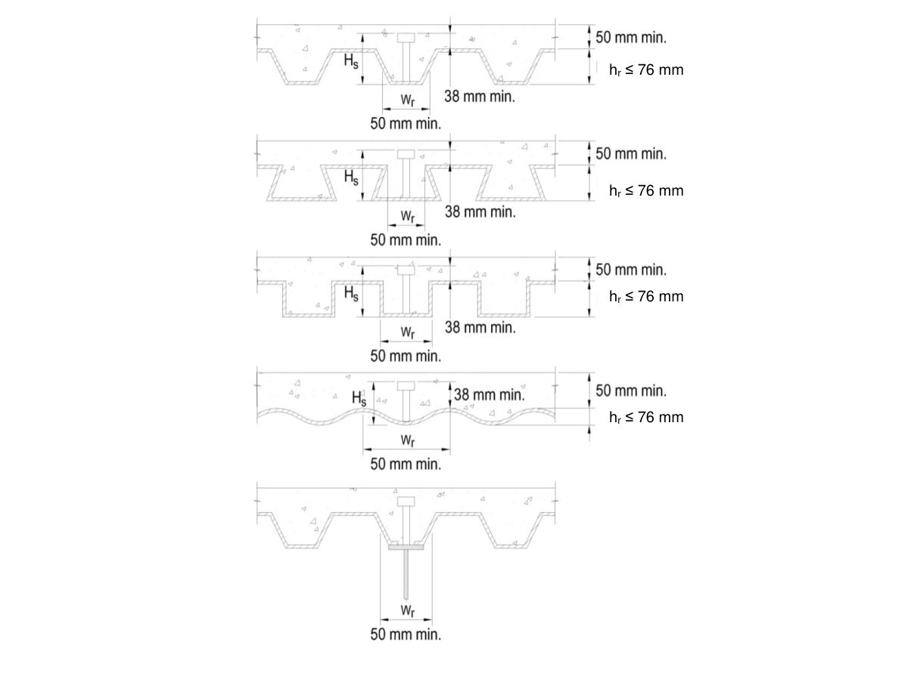

Figura F.2.9.3-1 Límites dimensionales para vigas compuestas con tablero metálico

(b) Nervaduras del Tablero Metálico perpendiculares a la Viga de Acero — Cuando las nervaduras están orientadas perpendicularmente a las vigas de acero, el concreto que queda por debajo del nivel superior del tablero metálico no se tendrá en cuenta al determinar las propiedades de la sección compuesta ni para calcular $A_{c}$ .

(c) Nervaduras del Tablero Metálico Paralelas a la Viga de Acero — El concreto que queda por debajo del nivel superior del tablero de acero puede incluirse al determinar las propiedades de la sección compuesta, y debe incluirse al calcular $A_{c}$ .

Sobre las vigas de soporte, las nervaduras del tablero metálico podrán cortarse longitudinalmente y separarse para formar un capitel de concreto.

Cuando el peralte nominal del tablero metálico sea de 38 mm o mayor, el ancho promedio del capitel o nervadura soportado por la viga, $w_{r}$ , no deberá ser menor que 50 mm por el primer espigo más 4 diámetros de espigo por cada espigo adicional en la hilera transversal.

<!-- mod:1-decreto-092-2011-199 -->
> **Modificación — Decreto 092 de 2011** · anexo, p. 42
>
> El tercer párrafo (segundo de la lista) del literal (a) Generalidades de F.2.9.3.2.3, debe quedar así:
>
> - La losa de concreto se conectará a la viga de acero por medio de conectores tipo espigo con cabeza o tipo perno, soldados, de diámetro menor o igual que 19 mm (AWS D1.1). Los espigos o pernos pueden soldarse ya sea a través de la lámina o directamente a la viga de acero. Los espigos o pernos, una vez instalados, deberán extenderse por lo menos 38 mm por encima del nivel superior del tablero metálico, y deberán quedar con un recubrimiento en concreto de 13 mm como mínimo por encima de su extremo superior.
>
> El quinto parágrafo debe quedar así:
>
> - El tablero metálico estará anclado a todos los miembros de soporte a espacios no superiores a 460 mm. Tal anclaje será proporcionado mediante conectores tipo espigo con cabeza o pernos, una combinación de conectores tipo espigo cono cabeza o pernos y arandelas con soldaduras de tapón, u otro sistema especificado por el diseñador.
>
> El tercer párrafo (segundo de la lista) del literal (c) Generalidades de F.2.9.3.2.3, debe quedar así:
>
> Cuando el peralte nominal del tablero metálico sea de 38 mm o mayor, el ancho promedio del capitel o nervadura soportado por la viga, $w_r$, no deberá ser menor que 50 mm por el primer espigo o perno, más 4 diámetros de espigo o perno, por cada espigo o perno adicional en la hilera transversal.

**F.2.9.3.2.4** — Transferencia de carga entre la Viga de Acero y la Losa de Concreto

**F.2.9.3.2.4.1** — Transferencia de Carga para Momento Positivo — Se supondrá que la totalidad de la fuerza cortante horizontal en la interfase entre la viga de acero y la losa de concreto se transfiere a través de los conectores, excepto para vigas tipo perfil revestido según se definen en el numeral F.2.9.3.3. Para una viga de sección compuesta donde el concreto está sujeto a compresión por flexión, la fuerza cortante horizontal total, $V_{r}'$ , entre el punto de momento positivo máximo y el punto de momento cero se tomará como el menor valor entre los obtenidos para los estados límites de aplastamiento del concreto, fluencia por tensión de la sección de acero y resistencia de los conectores a cortante, calculados como sigue:

(a) Aplastamiento del Concreto

$$ V'_{r}=0.85f'_{c}A_{c} \tag{F.2.9.3-1a} $$

(c) Fluencia de la sección de acero

$$ V'_{r}=F_{y}A_{s} \tag{F.2.9.3-1b} $$

(c) Resistencia de los conectores

$$ V'_{r}=\sum Q_{n} \tag{F.2.9.3-1c} $$

donde:

$A_{c}$= área de la sección de la losa de concreto comprendida dentro del ancho efectivo, mm2

$A_{s}$ = área de la sección transversal del perfil de acero mm2

$∑Q_{n}$ = suma de las resistencias nominales de los conectores entre el punto de momento positivo máximo y el punto de momento cero, N.

**F.2.9.3.2.4.2** — Transferencia de Carga para Momento Negativo — En vigas compuestas continuas donde se considera que el acero de refuerzo longitudinal actúa conjuntamente con la viga de acero en las regiones de momento negativo, la fuerza cortante horizontal total entre el punto de momento negativo máximo y el punto de momento cero no debe ser mayor que el menor entre los valores de la resistencia de diseño correspondientes a los siguientes estados límites:

(a) Fluencia a tensión del refuerzo de la losa.

$$ V'_{r}=A_{sr}F_{ysr} \tag{F.2.9.3-2a} $$

donde:

$A_{sr}$= área del acero de refuerzo longitudinal desarrollado adecuadamente dentro del ancho efectivo de la losa de concreto, mm2

$F_{ysr}$= esfuerzo de fluencia mínimo especificado para el acero de refuerzo, MPa.

(b) Resistencia al corte de los conectores tipo espigo con cabeza o tipo canal

$$ V'_{r}=\sum Q_{n} \tag{F.2.9.3-2b} $$

<!-- mod:1-decreto-092-2011-200 -->
> **Modificación — Decreto 092 de 2011** · anexo, p. 43
>
> El texto del literal (b) de F.2.9.3.2.4.2 debe quedar así:
>
> (b) Resistencia al corte de los conectores tipo espigo con cabeza, tipo perno, o tipo canal

**F.2.9.3.3** — Miembros compuestos tipo perfil revestido — La resistencia de diseño a flexión de miembros tipo perfil revestido en concreto, $φ_{b}M_{n}$, se determinará con base en:

$φ_{b} =0.90$ y $M_{n}$ calculado usando uno de los siguientes métodos:

(a) La superposición de esfuerzos elásticos en la sección compuesta, considerando los efectos del apuntalamiento, para el estado límite de fluencia en la fibra extrema (momento de fluencia).

(b) La distribución plástica de esfuerzos en la sección de acero, tomada aisladamente, para el estado límite de plastificación de la sección (momento plástico).

(c) La distribución plástica de esfuerzos sobre la sección compuesta, o el método de compatibilidad de deformaciones, para el estado límite de plastificación (momento plástico) de la sección compuesta, siempre y cuando se usen conectores de acero.

**F.2.9.3.4** — Miembros compuestos tipo perfil relleno

**F.2.9.3.4.1** — Limitaciones — Los miembros compuestos tipo perfil relleno se clasificarán para efectos de pandeo local de acuerdo con el numeral F.2.9.1.4.

**F.2.9.3.4.2** — Resistencia a Flexión — La resistencia de diseño a flexión de un miembro compuesto tipo perfil relleno, $φ_{b}M_{n}$, se determinará con base en:

$φ_{b} =0.90$ y $M_{n}$ calculado como sigue:

(a) Para secciones compactas:

$$ M_{n}=M_{p} \tag{F.2.9.3-3a} $$

donde:

$M_{p}$ = momento correspondiente a la distribución plástica de esfuerzos sobre la sección transversal compuesta, N·mm.

(b) Para secciones no compactas:

$$ M_{n}=M_{p}-\left[M_{p}-M_{y}\right](\lambda -\lambda _{p})(\lambda _{r}-\lambda _{p}) \tag{F.2.9.3-3b} $$

donde:

$λ$ , $λ_{p}$ y $λ_{r}$ son las relaciones de esbeltez obtenidas de la tabla F.2.9.1-1b

$M_{y}$ = momento de fluencia, correspondiente a la fluencia de la aleta a tensión y al inicio de la fluencia en la aleta a compresión, N·mm. La capacidad al inicio de la fluencia se calculará suponiendo una distribución lineal y elástica de los esfuerzos, limitando el máximo esfuerzo de compresión en el concreto a $0.7f_{c}'$ y el máximo esfuerzo en el acero a $F_{y}$ .

(c) Para secciones esbeltas, $M_{n}$ se obtendrá como el momento para el cual se inicia la fluencia. El esfuerzo en la aleta a compresión estará limitado al valor del esfuerzo de pandeo local, $F_{cr}$ , determinado usando las ecuaciones F.2.9.2-10 y F.2.9.2-11. La distribución de esfuerzos en el concreto será lineal y elástica, con el esfuerzo máximo de compresión limitado a $0.7f_{c}'$ .

<!-- mod:1-decreto-092-2011-201 -->
> **Modificación — Decreto 092 de 2011** · anexo, p. 43
>
> La ecuación (F.2.9.3-3b) debe quedar así:
>
> $$ M_n = M_p - \left[M_p - M_y\right]\left(\lambda - \lambda_p\right)/\left(\lambda_r - \lambda_p\right) \tag{F.2.9.3-3b} $$

#### F.2.9.4 — CORTANTE

**F.2.9.4.1** — Miembros compuestos tipo perfil relleno o revestido — La resistencia de diseño se determinará con base en uno de los siguientes criterios:

(a) La resistencia de diseño a cortante de la sección de acero tomada aisladamente, según se especifica en el numeral F.2.7.

(b) La resistencia de diseño a cortante de la sección de concreto reforzado (concreto más acero de refuerzo) tomada aisladamente, según se especifica en el Título C de este Reglamento, usando un factor combinado de resistencia, $φ_{v}$ , igual a 0.75.

(c) La resistencia nominal a cortante de la sección de acero según se especifica en el numeral F.2.7 más la resistencia nominal del acero de refuerzo calculada según se especifica en el Título C de este Reglamento, multiplicadas por un factor combinado de resistencia, $φ_{v}$ , igual a 0.75.

<!-- mod:1-decreto-092-2011-202 -->
> **Modificación — Decreto 092 de 2011** · anexo, p. 43
>
> Los literales (b) y (c) deben decir:
>
> (b) La resistencia de diseño a cortante de la sección de concreto reforzado (concreto más acero de refuerzo) tomada aisladamente, según se especifica en el Título C de este Reglamento, usando un coeficiente de reducción de resistencia, $\phi_v$, igual a 0.75.
>
> (c) La resistencia nominal a cortante de la sección de acero según se especifica en el numeral F.2.7 más la resistencia nominal del acero de refuerzo calculada según se especifica en el Título C de este Reglamento, multiplicadas por un coeficiente de reducción de resistencia, $\phi_v$, igual a 0.75.

<!-- mod:1-decreto-092-2011-203 -->
> *Texto vigente según el Decreto 092 de 2011 (anexo, p. 43).*

**F.2.9.4.2** — *Vigas Compuestas con Losa sobre Tablero Metálico* — La resistencia de diseño a cortante de vigas compuestas con conectores de acero tipo espigo con cabeza, tipo perno o tipo canal se determinará con base en las propiedades de la sección de acero tomada aisladamente, de acuerdo con el numeral F.2.7.

#### F.2.9.5 — COMBINACION DE FUERZA AXIAL Y FLEXION

Debe considerarse la interacción entre las fuerzas axiales y de flexión en miembros compuestos para efectos del análisis de la estabilidad según se requiere en el numeral F.2.3. La resistencia de diseño a compresión, $φ_{c}P_{n}$, y la resistencia de diseño a la flexión, $φ_{b}M_{n}$, se determinarán según se define en los numerales F.2.9.2 y F.2.9.3, respectivamente. Para tener en cuenta los efectos de longitud en la resistencia del miembro a carga axial, la resistencia nominal se obtendrá de acuerdo con el numeral F.2.9.2.

Para miembros compuestos tipo perfil revestido o perfil relleno con secciones compactas, la interacción entre la fuerza axial y la flexión se evaluará con base en las ecuaciones de interacción del numeral F.2.8.1.1 o mediante uno de los métodos definidos en el numeral F.2.9.1.2.

Para miembros compuestos tipo perfil relleno con secciones no compactas o esbeltas, la interacción entre la fuerza axial y la flexión se evaluará con base en las ecuaciones de interacción del numeral F.2.8.1.1.

En los Comentarios a la Especificación ANSI/AISC 360 se presentan métodos para determinar la capacidad de viga- columnas de sección compuesta.

#### F.2.9.6 — TRANSFERENCIA DE FUERZAS

**F.2.9.6.1** — Requisitos Generales — Cuando se apliquen fuerzas externas a un miembro compuesto tipo perfil revestido o perfil relleno cargado axialmente, la introducción de tales fuerzas al miembro y la transferencia de cortantes longitudinales a través del miembro se evaluarán de acuerdo con los requisitos de asignación de la fuerza que se presentan en este numeral.

La resistencia de diseño para los mecanismos de transferencia de cargas aplicables, $φR_{n}$, determinada de acuerdo con el numeral F.2.9.6.3, deberá ser igual o superior a la fuerza cortante longitudinal que se requiera transferir, $V_{r}'$ , determinada de acuerdo con el numeral F.2.9.6.2.

<!-- mod:1-decreto-092-2011-204 -->
> **Modificación — Decreto 092 de 2011** · anexo, p. 43
>
> En el segundo parágrafo la variable que figura como $V_r'$ debe ser $V_u'$.

**F.2.9.6.2** — Asignación de la fuerza — La fuerza se asignará con base en la distribución de la fuerza externa, de acuerdo con los siguientes requerimientos:

Las provisiones para la resistencia al aplastamiento bajo la aplicación de fuerzas externas se establecen en el numeral F.2.10.8. Para miembros compuestos tipo perfil relleno, el término $\sqrt{A_{2}/A_{1}}$ de la fórmula F.2.10.8-2 puede tomarse igual a 2.0, teniendo en cuenta el efecto del confinamiento.

**F.2.9.6.2.1** — Fuerza externa aplicada a la sección de acero — Cuando la fuerza externa se aplica en su totalidad a la sección de acero, la fuerza que requiere ser transferida al concreto, $V_{r}'$ , se determinará como sigue:

$$ V'_{r}=P_{r}\left(1-\dfrac{A_{s}F_{y}}{P_{no}}\right) \tag{F.2.9.6-1} $$

donde:

$P_{r}$= fuerza externa aplicada al miembro compuesto, N

$P_{no}$ = resistencia nominal a carga axial, sin considerar los efectos de longitud, calculada según la fórmula F.2.9.2-4 para miembros compuestos tipo perfil revestido, y según la fórmula F.2.9.2-9a para miembros compuestos tipo perfil relleno, N

<!-- mod:1-decreto-092-2011-205 -->
> **Modificación — Decreto 092 de 2011** · anexo, p. 43
>
> En el literal F.2.9.6.2.1 y en el lado izquierdo de la ecuación F.2.9.6-1 la variable que figura como $V_r'$ debe ser $V_u'$. Además en este mismo literal, en el lado derecho de la ecuación F.2.9.6-1 y en la definición de términos, la variable que figura como $P_r$ debe ser $P_u$.

**F.2.9.6.2.2** — Fuerza externa aplicada al concreto — Cuando la fuerza externa se aplica en su totalidad al revestimiento o relleno de concreto, la fuerza que se debe transferir al acero, $V_{r}'$ , se determina como sigue:

$$ V'_{r}=P_{r}(A_{s}F_{y}/P_{no}) \tag{F.2.9.6-2} $$

<!-- mod:1-decreto-092-2011-206 -->
> **Modificación — Decreto 092 de 2011** · anexo, p. 44
>
> En el literal F.2.9.6.2.2 y en el lado izquierdo de la ecuación F.2.9.6-2 la variable que figura como $V_r'$ debe ser $V_u'$. Además en este mismo literal, en el lado derecho de la ecuación F.2.9.6-2 la variable que figura como $P_r$ debe ser $P_u$.

**F.2.9.6.2.3** — Fuerza externa aplicada simultáneamente al acero y al concreto — Cuando la fuerza externa se aplica simultáneamente a la sección de acero y al revestimiento o relleno de concreto, $V_{r}'$ se determinará como la fuerza requerida para establecer el equilibrio en la sección transversal.

Un método aceptable para determinar la fuerza de cortante longitudinal requerida para establecer el equilibrio en la sección transversal se presenta en los Comentarios a la Especificación ANSI/AISC 360.

<!-- mod:1-decreto-092-2011-207 -->
> **Modificación — Decreto 092 de 2011** · anexo, p. 44
>
> En el primer parágrafo del literal F.2.9.6.2.3 la variable que figura como $V_r'$ debe ser $V_u'$.

**F.2.9.6.3** — Mecanismos de transferencia de fuerzas — La resistencia nominal, $R_{n}$ , suministrada por los mecanismos de adherencia directa, conectores y apoyo directo se determinará de acuerdo con esta sección.

Se permite el uso del mecanismo de transferencia de fuerzas que suministre la mayor resistencia nominal, perno no se permite la superposición de los distintos mecanismos.

Para miembros compuestos tipo perfil revestido no se permite el uso del mecanismo de transferencia de fuerzas por adherencia directa.

**F.2.9.6.3.1** — Apoyo Directo — Cuando en un miembro compuesto tipo perfil revestido o relleno la fuerza se transfiere por apoyo directo a través de mecanismos internos de apoyo, la resistencia de diseño al aplastamiento del concreto, $φ_{B}R_{n}$, se determinará con base en:

$φ_{B}=0.65$ y

$$ R_{n}=1.7f'_{c}A_{1} \tag{F.2.9.6-3} $$

donde:

$A_{1}$ = área del concreto que recibe la carga, mm2 Un ejemplo de transferencia de fuerzas a través de un mecanismo de apoyos internos es el uso de platinas de acero en el interior de un miembro compuesto tipo perfil relleno.

**F.2.9.6.3.2** — Conexión a cortante — Cuando en un miembro compuesto tipo perfil revestido o relleno la fuerza se transfiere a través de un mecanismo de cortante, la resistencia de diseño a cortante suministrada por los conectores tipo espigo con cabeza, tipo perno o tipo canal, $R_{a}$ , se determinará como sigue:

$$ R_{a}=\sum Q_{cv} \tag{F.2.9.6-4} $$

donde:

$∑Q_{cv}$ = suma de las resistencias de diseño de los conectores de acero tipo espigo con cabeza, tipo perno o tipo canal, determinadas de acuerdo con el numeral F.2.9.8.3, Los conectores considerados deben estar instalados dentro de la “longitud de introducción de la carga” definida en el numeral F.2.9.6.4, N.

<!-- mod:1-decreto-092-2011-208 -->
> **Modificación — Decreto 092 de 2011** · anexo, p. 44
>
> En el primer parágrafo de F.2.9.6.3.2, y en la definición del término $\sum Q_{cv}$ se debe suprimir el texto «, tipo perno».

**F.2.9.6.3.3** — Adherencia Directa — Cuando en un miembro compuesto tipo perfil relleno la fuerza se transfiere a través de adherencia directa, la resistencia de diseño por adherencia entre el acero y el concreto, $φ_{R}$, se obtendrá con base en:

$φ =0.45$ y $R_{n}$ calculado como sigue:

Para secciones de acero rectangulares rellenas de concreto:

$$ R_{n}=B^{2}C_{in}F_{in} \tag{F.2.9.6-5} $$

Para secciones de acero circulares rellenas de concreto:

$$ R_{n}=0.25\pi D^{2}C_{in}F_{in} \tag{F.2.9.6-6} $$

donde:

$C_{in}$ = 2, si el miembro compuesto tipo perfil relleno se extiende solamente a un lado del punto de transferencia de la fuerza.

= 4, si el miembro compuesto tipo perfil relleno se extiende a ambos lados del punto de transferencia de la fuerza.

$R_{n}$ = resistencia nominal por adherencia, N.

$F_{in}$ = esfuerzo nominal de adherencia = 0.40 MPa.

$B$ = ancho total de la sección rectangular de acero a lo largo de la cara sobre la cual se transfiere la fuerza, mm.

$D$ = diámetro del perfil tubular estructural (PTE) circular, mm.

<!-- mod:1-decreto-092-2011-209 -->
> **Modificación — Decreto 092 de 2011** · anexo, p. 44
>
> En el primer parágrafo de F.2.9.6.3, al final, la palabra «perno» debe substituirse por «pero».

**F.2.9.6.4** — Requisitos de Detallado

**F.2.9.6.4.1** — Miembros compuestos tipo perfil revestido — Los conectores de acero utilizados para transferir la fuerza cortante longitudinal deberán quedar distribuidos sobre la “longitud de introducción de la carga”, que no deberá extenderse más allá de dos veces la dimensión transversal mínima del miembro compuesto tipo perfil revestido por encima y por debajo de la zona de transferencia de la carga. Los conectores utilizados para transferir el cortante longitudinal deberán instalarse sobre por los menos dos de las caras del perfil de acero con una disposición aproximadamente simétrica en relación con los ejes del perfil.

El espaciamiento de los conectores de acero, tanto dentro de la “longitud de introducción de la carga” como por fuera de ella, deberá cumplir con lo dispuesto en el numeral F.2.9.8.3.5.

**F.2.9.6.4.2** — Miembros compuestos tipo perfil relleno — Cuando se requieran, los conectores de acero utilizados para transferir la fuerza cortante longitudinal deberán quedar distribuidos sobre la “longitud de introducción de la carga”, que no deberá extenderse más allá de dos veces la dimensión transversal mínima en el caso de un perfil rectangular, o dos veces el diámetro en el caso de un perfil circular, por encima y por debajo de la zona de transferencia de la carga.

El espaciamiento de los conectores de acero dentro de la “longitud de introducción de la carga” deberá cumplir con lo dispuesto en el numeral F.2.9.8.3.5.

#### F.2.9.7 — DIAFRAGMAS Y VIGAS COLECTORAS DE SECCIÓN COMPUESTA

Las losas de diafragma y las vigas colectoras se diseñarán y detallarán para transferir las cargas entre el diafragma, los miembros de borde y miembros colectores del diafragma, y los elementos del sistema de resistencia a cargas laterales.

En los Comentarios a la Especificación ANSI/AISC 360 se presentan guías de diseño para los diafragmas y las vigas colectoras de sección compuesta.

#### F.2.9.8 — CONECTORES DE ACERO

**F.2.9.8.1** — Requisitos Generales — El diámetro de los espigos no será mayor que 2.5 veces el espesor de la aleta de la viga a la cual se sueldan, a menos que estén situados sobre el alma.

El numeral F.2.9.8.2 se aplica a miembros a flexión de sección compuesta en los cuales los conectores de acero están embebidos en una losa de concreto maciza o vaciada sobre un tablero metálico. El numeral F.2.9.8.3 se aplica a todos los otros casos.

<!-- mod:1-decreto-092-2011-210 -->
> **Modificación — Decreto 092 de 2011** · anexo, p. 44
>
> El primer parágrafo de F.2.9.8.1 debe quedar así:
>
> **F.2.9.8.1** — *Requisitos Generales* — El diámetro de los espigos o pernos no será mayor que 2.5 veces el espesor de la aleta de la viga a la cual se sueldan, a menos que estén situados sobre el alma.

**F.2.9.8.2** — Conectores de acero en vigas compuestas — La longitud de los conectores tipo espigo con cabeza o tipo perno, medida desde su base hasta el extremo superior de la cabeza después de instalados, no será inferior a cuatro diámetros del espigo.

**F.2.9.8.2.1** — Resistencia de los conectores de acero tipo espigo con cabeza — La resistencia nominal de un conector de acero tipo espigo con cabeza embebido en una losa de concreto maciza o vaciada sobre un tablero metálico se tomará como:

$$ Q_{n}=0.5A_{sc}\sqrt{f'_{c}E_{c}}\le R_{g}R_{p}A_{sc}F_{u} \tag{F.2.9.8-1} $$

donde:

$A_{sc}$ = área de la sección transversal del conector de espigo, mm²

$f_{c}'$ = resistencia especificada a compresión del concreto, MPa

$E_{c}$ = módulo de elasticidad del concreto = $0.043w^{1.5}_{c}\sqrt{f_{c} ' }$, MPa

$F_{u}$ = resistencia a tensión mínima especificada de los conectores tipo espigo con cabeza, MPa

$R_{g}$= $1.0$ para:

(a) un conector de acero tipo espigo con cabeza soldado en una nervadura del tablero metálico, con las nervaduras orientadas perpendicularmente al perfil de acero;

(b) cualquier número de conectores de acero tipo espigo con cabeza soldados en una hilera directamente al perfil de acero;

(c) cualquier número de conectores de acero tipo espigo con cabeza soldados en una hilera a través del tablero metálico, con las nervaduras paralelas al perfil de acero y la relación entre el ancho promedio y el peralte de la nervadura ≥ 1.5.

$R_{g}$= $0.85$ para:

(a) dos conectores de de acero tipo espigo con cabeza soldados en una nervadura del tablero metálico, con las nervaduras orientadas perpendicularmente al perfil de acero;

(b) un conector de acero tipo espigo con cabeza soldado a través del tablero metálico, con las nervaduras paralelas al perfil de acero y la relación entre el ancho promedio y el peralte de la nervadura <1.5.

$R_{g}$ = $0.70$ para:

para tres o más conectores de acero tipo espigo con cabeza soldados en una nervadura del tablero metálico, con las nervaduras orientadas perpendicularmente al perfil de acero

$R_{g}$= $0.75$ para:

(a) conectores de acero tipo espigo con cabeza soldados directamente al perfil de acero;

(b) conectores de acero tipo espigo con cabeza soldados en una losa compuesta con el tablero metálico orientado perpendicularmente a la viga y $e_{mid} −ht≥50$ mm;

(c) conectores de acero tipo espigo con cabeza embebidos en una losa compuesta con el tablero metálico orientado paralelamente a la viga, soldados a través del tablero metálico, o a través de una lámina usada como ajuste entre el tablero metálico y la aleta de la viga.

$R_{g}$= $0.6$ para conectores de acero tipo espigo con cabeza soldados en una losa compuesta con el tablero metálico orientado perpendicularmente a la viga y $e_{mid} −ht≥50$ mm.

$e_{mid} −ht$ = distancia entre el borde del vástago del espigo y el alma del tablero metálico, tomada a la mitad de la profundidad de la nervadura y en dirección de la fuerza ejercida por el conector (es decir, en dirección al momento máximo para una viga simplemente apoyada), mm

$w_{c}$= peso del concreto por unidad de volumen $(1500≤w_{c}≤2500)$ kg/m3 En la figura F.2.9.8-1 se ilustran los conceptos de $e_{mid} −ht$ y de localización del conector en posición débil y en posición fuerte.

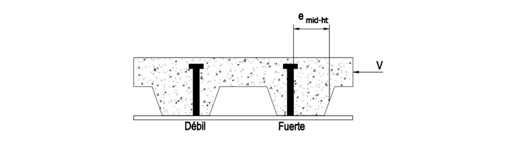

Figura F.2.9.8-1 — Conceptos de $e_{mid} −ht$ y de localización del conector en posición débil y en posición fuerte.

La siguiente tabla presenta los valores de $R_{g}$ y $R_{p}$ para varios casos.

| Condición | $R_{g}$ | $R_{p}$ |
|---|---|---|
| Sin tablero * | 1.0 | 0.75 |
| Tablero metálico orientado paralelamente al perfil de acero $w_{r}/h_{r}≥1.5$ | 1.0 | 0.75 |
| $w_{r}/h_{r}<1.5$ | 0.85** | 0.75 |
| Tablero metálico orientado perpendicularmente al perfil de acero Numero de espigos que ocupan el mismo valle del tablero metálico: 1 | 1.0 | 0.6+ |
| 2 | 0.85 | 0.6+ |
| 3 ó más | 0.7 | 0.6+ |

$h_{r}$ = peralte nominal de la nervadura, mm

$w_{r}$ = ancho promedio de la nervadura o capitel (según se define en el numeral F.2.9.3.2.3), mm ** para un espigo sencillo + este valor puede aumentarse a 0.75 cuando $e_{mid} −ht≥50$ mm

<!-- mod:1-decreto-092-2011-212 -->
> **Modificación — Decreto 092 de 2011** · anexo, p. 44
>
> Donde se definen las variables, la definición de $R_g = 0.75$ debe ser $R_p = 0.75$, en la definición de $R_g = 0.70$, se debe quitar el segundo «para», y la definición de $R_g = 0.6$ debe quedar así:
>
> $R_p$ = 0.6 para conectores de acero tipo espigo con cabeza soldados en una losa compuesta con el tablero metálico orientado perpendicularmente a la viga y $e_{mid-ht} < 50$ mm.

**F.2.9.8.2.2** — Resistencia de los conectores tipo perno — El uso de conectores tipo perno estará limitado a losas macizas de concreto sobre perfiles de acero. La resistencia nominal de un conector tipo perno embebido en una losa de concreto se tomará como:

$$ Q_{n}=0.14A_{cp}\sqrt{f'_{c}E_{c}}\left(\dfrac{S}{d_{cp}}\right)^{0.25}\le A_{cp}F_{u} \tag{F.2.9.8-2} $$

donde:

$d_{cp}$ = diámetro nominal de un conector tipo perno, mm

$A_{cp}$ = área de la sección transversal del conector tipo perno, mm2

$F_{u}$ = resistencia a tensión mínima especificada para los conectores tipo perno, MPa

$S$ = separación longitudinal centro a centro entre los conectores tipo perno, mm

$f_{c}'$= resistencia especificada a compresión del concreto, MPa

$E_{c}$ = módulo de elasticidad del concreto = $0.043w^{1.5}_{c}\sqrt{f_{c}' }$, MPa

$w_{c}$ = peso del concreto por unidad de volumen $(1500≤w_{c}≤2500)$ kg/m3 Los pernos deberán tener como mínimo una resistencia equivalente a la de los pernos SAE J429 Grado 2, y deben soldarse con un filete a todo alrededor de acuerdo con las normas AWS D1.1

**F.2.9.8.2.3** — Resistencia de los conectores de acero tipo canal — La resistencia nominal de un conector tipo canal embebido en una losa maciza de concreto se calculará como sigue:

$$ Q_{n}=0.3(t_{f}+0.5t_{w})l_{c}\sqrt{f'_{c}E_{c}} \tag{F.2.9.8-3} $$

donde:

$l_{c}$ = longitud del conector en canal, mm

$t_{f}$ = espesor de aleta del conector en canal, mm

$t_{w}$ = espesor del alma del conector en canal, mm La resistencia del conector tipo canal debe desarrollarse soldándolo a la aleta de la viga, para una fuerza igual a $Q_{n}$ y considerando la excentricidad.

**F.2.9.8.2.4** — Número requerido de conectores de acero — El número de conectores requeridos entre la sección de máximo momento flector, positivo o negativo, y la sección adyacente de momento cero debe obtenerse dividiendo la fuerza cortante horizontal, determinada según los numerales F.2.9.3.2.4.1 y F.2.9.3.2.4.2, entre la resistencia nominal de un conector, determinada según el numeral F.2.9.8.2.1 o el numeral F.2.9.8.2.2. El número de conectores de acero requeridos entre el punto de aplicación de una carga concentrada y el punto de momento cero más cercano deberá ser suficiente para desarrollar el momento máximo requerido en el punto de aplicación de dicha carga.

<!-- mod:1-decreto-092-2011-213 -->
> **Modificación — Decreto 092 de 2011** · anexo, p. 44
>
> En el tercer parágrafo, donde dice «...según el numeral F.2.9.8.2.1 o el numeral F.2.9.8.2.2. El número...», debe decir: «...según el numeral F.2.9.8.2.1, el numeral F.2.9.8.2.2 o el numeral F.2.9.8.2.3. El número...».

**F.2.9.8.2.5** — Requisitos del Detallado — Los conectores requeridos a cada lado de un punto de máximo momento flector, positivo o negativo, se distribuirán uniformemente entre aquel punto y los puntos adyacentes de momento cero, excepto cuando el diseño indique algo diferente.

Excepto para conectores instalados en las nervaduras de un tablero metálico, los conectores de acero tendrán como mínimo 25 mm de recubrimiento lateral de concreto en dirección perpendicular a la dirección de la fuerza cortante. La distancia mínima desde el centro de un conector hasta un borde libre en dirección de la fuerza cortante será de 200 mm cuando de use concreto de peso normal y de 250 mm cuando se use concreto aligerado. En lugar de usar estos valores, se permite aplicar las provisiones del Apéndice C-D del Título C del presente Reglamento.

El mínimo espaciamiento centro a centro entre conectores tipo espigo será de 6 diámetros a lo largo del eje longitudinal de la viga compuesta, y de 4 diámetros en dirección transversal al eje longitudinal de la viga, excepto en las nervaduras de un tablero metálico orientado perpendicularmente a la viga, en cuyo caso el espaciamiento centro a centro puede reducirse a 4 diámetros en cualquier dirección.

El espaciamiento máximo centro a centro de los conectores de acero no deberá exceder de 8 veces el espesor total de la losa ni de 900 mm.

<!-- mod:1-decreto-092-2011-211 -->
> **Modificación — Decreto 092 de 2011** · anexo, p. 44
>
> El primer parágrafo de F.2.9.8.2 debe quedar así:
>
> **F.2.9.8.2** — *Conectores de acero en vigas compuestas* — La longitud de los conectores tipo espigo con cabeza o tipo perno, medida desde su base hasta el extremo superior de la cabeza después de instalados, no será inferior a cuatro diámetros del espigo o perno.

<!-- mod:1-decreto-092-2011-214 -->
> **Modificación — Decreto 092 de 2011** · anexo, p. 44
>
> En el tercer parágrafo, donde dice «...El mínimo espaciamiento centro a centro entre conectores tipo espigo será...», debe decir: «...El mínimo espaciamiento centro a centro entre conectores tipo espigo o tipo perno será...».

**F.2.9.8.3** — Conectores de acero en componentes de sección compuesta — Este numeral se aplica al diseño de conectores de acero tipo espigo con cabeza y tipo canal en miembros de sección compuesta.

En lugar de las disposiciones que aquí se presentan, se permite aplicar las provisiones del Apéndice C-D del Título C del presente Reglamento.

Las provisiones para el cálculo de la resistencia de los conectores de acero tipo espigo con cabeza que se presentan en este numeral son aplicables a conectores localizados básicamente en la zona de transferencia de carga (conexión) de columnas y viga-columnas, vigas tipo perfil revestido y vigas tipo perfil relleno, y muros de sección compuesta, donde hay una acción compuesta entre el acero y el concreto. Estas provisiones no están orientadas a construcciones híbridas donde el acero y el concreto no trabajan en acción compuesta.

En el numeral F.2.9.8.2 se especifica la resistencia de los conectores de acero embebidos en una losa de concreto sólido o en una losa de concreto sobre tablero metálico, para vigas de sección compuesta.

Los estados límites para el vástago de acero del conector y para el desprendimiento de un bloque de concreto bajo fuerza cortante se tratan directamente en este numeral. Adicionalmente, el espaciamiento y las tolerancias dimensionales que se suministran en estas provisiones previenen la ocurrencia de los estados límites de efecto de palanca en el concreto para conectores solicitados por cortante y de rotura del concreto para conectores cargados a tensión, según se define en las provisiones del Apéndice C-D del Título C del presente Reglamento.

Para concreto de peso normal — los conectores de acero tipo espigo con cabeza solicitados únicamente por cortante tendrán una longitud no menor que cinco veces el diámetro del espigo. Los conectores de acero tipo espigo con cabeza solicitados por tensión o bajo la interacción de fuerzas cortantes y de tensión tendrán una longitud no menor que ocho veces el diámetro del espigo. Para estos efectos, la longitud se mide desde la base del espigo hasta el nivel superior de la cabeza en el espigo instalado, Para concreto aligerado — los conectores de acero tipo espigo con cabeza solicitados únicamente por cortante tendrán una longitud no menor que siete veces el diámetro del espigo. Los conectores de acero tipo espigo con cabeza solicitados por tensión tendrán una longitud no menor que diez veces el diámetro del espigo. Para estos efectos, la longitud se mide desde la base del espigo hasta el nivel superior de la cabeza en el espigo instalado, La resistencia nominal de los conectores de acero tipo espigo con cabeza bajo la interacción de fuerzas cortantes y de tensión en una construcción compuesta con concreto aligerado se determinará de acuerdo con las provisiones del Apéndice C-D del Título C del presente Reglamento.

El diámetro de la cabeza en los conectores de acero tipo espigo con cabeza solicitados por tensión, o bajo la interacción de fuerzas cortantes y de tensión, deberá ser mayor o igual que 1.6 veces el diámetro del vástago.

La siguiente tabla presenta los valores mínimos de la relación $h /d$ para conectores de acero tipo espigo con cabeza, correspondientes a distintas condiciones cubiertas en el Capítulo F.2:

| Condición de Carga | Concreto de Peso Normal | Concreto Aligerado |
|---|---|---|
| Cortante | h/d ≥ 5 | h/d ≥ 7 |
| Tensión | h/d ≥ 8 | h/d ≥ 10 |
| Cortante + Tensión | h/d ≥ 8 | N.A.* |
| $h /d$ = relación entre la longitud del conector tipo espigo con cabeza, medida desde la base del |  |  |

espigo hasta el nivel superior de la cabeza en el perno instalado, y el diámetro del espigo.

* Véanse las provisiones del Apéndice C-D del Título C del presente Reglamento para el cálculo de los efectos de interacción en los conectores embebidos en concreto aligerado.

**F.2.9.8.3.1** — Resistencia a cortante de conectores de acero tipo espigo con cabeza en Componentes de Construcción Compuesta — Cuando la resistencia al desprendimiento de un bloque de concreto bajo fuerza cortante no sea un estado límite aplicable, la resistencia de diseño a cortante de un conector de acero tipo espigo con cabeza, $φ_{v}Q_{nv}$, se calculará tomando:

$φ_{v}=0.65$ y

$$ Q_{nv}=A_{sc}F_{u} \tag{F.2.9.8-4} $$

donde:

$Q_{nv} =$ resistencia nominal a cortante del conector tipo espigo con cabeza, N

$A_{sc} =$ sección transversal del conector tipo espigo con cabeza, mm2

$F_{u} =$ resistencia a tensión mínima especificada, MPa Cuando la resistencia al desprendimiento de un bloque de concreto bajo fuerza cortante sea un estado límite aplicable, la resistencia de diseño a cortante de un conector de acero tipo espigo con cabeza, $φ_{v}Q_{nv}$, se calculará con base en uno de los siguientes métodos:

(a) Cuando el refuerzo de anclaje para el conector de acero se desarrolle de acuerdo con el Capítulo C.12 del Título C del presente Reglamento a ambos lados de la superficie de desprendimiento del concreto, se tomará como resistencia nominal a cortante para el conector, $Q_{nv}$, el mínimo entre la resistencia nominal a cortante del acero, según la fórmula F.2.9.8-3, y la resistencia nominal del refuerzo de anclaje.

(b) Según se especifica en el Apéndice C-D del Título C del presente Reglamento.

Si la resistencia al desprendimiento de un bloque de concreto bajo fuerza cortante es un estado límite aplicable (por ejemplo, cuando el volumen que puede desprenderse no está restringido por una platina, aleta o alma de acero adyacente), la aplicación de las provisiones de este numeral supone la existencia de un refuerzo de anclaje adecuado. Alternativamente, pueden aplicarse las provisiones del Apéndice C-D del Título C del presente Reglamento.

<!-- mod:1-decreto-092-2011-216 -->
> **Modificación — Decreto 092 de 2011** · anexo, p. 45
>
> En el literal (a) de F.2.9.8.3.1 la referencia que se da al final a la ecuación F.2.9.8-3 debe ser a la ecuación F.2.9.8-4.

**F.2.9.8.3.2** — Resistencia a tensión de conectores de acero tipo espigo con cabeza en Componentes de Construcción Compuesta — Cuando la distancia desde el centro de un conector hasta un borde libre del concreto, medida en dirección perpendicular a la altura del conector, sea mayor o igual que 1.5 veces la altura del conector, medida hasta el nivel superior de la cabeza, y el espaciamiento centro a centro entre conectores sea mayor o igual que 3 veces la altura del conector medida hasta el nivel superior de la cabeza, la resistencia de diseño a tensión para un conector de acero tipo espigo con cabeza, $φ_{t}Q_{nt}$, se calculará tomando:

$φ_{t} =0.75$ y

$$ Q_{nt}=A_{sc}F_{u} \tag{F.2.9.8-5} $$

donde:

$Q_{nt}$ = resistencia nominal a tensión del conector, N Cuando la distancia desde el centro de un conector hasta un borde libre del concreto, medida en dirección perpendicular a la altura del conector, sea menor que 1.5 veces la altura del conector, medida hasta el nivel superior de la cabeza, o el espaciamiento centro a centro entre conectores sea menor que 3 veces la altura del conector medida hasta el nivel superior de la cabeza, la resistencia nominal a tensión para un conector de acero tipo espigo con cabeza, $Q_{nt}$, se calculará con base en uno de los siguientes métodos:

(a) Cuando el refuerzo de anclaje para el conector de acero se desarrolle de acuerdo con el Capítulo C.12 del Título C del presente Reglamento a ambos lados de la superficie de desprendimiento del concreto, se tomará como resistencia nominal a tensión para el conector, $Q_{nt}$, el mínimo entre la resistencia nominal a tensión del acero, según la fórmula F.2.9.8-4, y la resistencia nominal del refuerzo de anclaje.

(b) Según se especifica en el Apéndice C-D del Título C del presente Reglamento.

Se recomienda suministrar refuerzo de confinamiento suplementario alrededor del refuerzo de anclaje para los conectores de acero tipo espigo con cabeza solicitados por tensión o por la combinación de cortante y tensión, para evitar efectos de borde o efectos causados por espaciamientos reducidos entre los conectores. Véanse los Comentarios a la Especificación ANSI/AISC 360 y el numeral C- D.5.2.9 del Título C del presente Reglamento para recomendaciones de diseño.

<!-- mod:1-decreto-092-2011-217 -->
> **Modificación — Decreto 092 de 2011** · anexo, p. 45
>
> En el literal (a) de F.2.9.8.3.2 la referencia que se da al final a la ecuación F.2.9.8-4 debe ser a la ecuación F.2.9.8-5.

**F.2.9.8.3.3** — Resistencia de conectores de acero tipo espigo con cabeza a cortante y tensión combinadas en Componentes de Construcción Compuesta — Cuando la resistencia al desprendimiento de un bloque de concreto bajo fuerza cortante no sea un estado límite que controle el diseño, y la distancia desde el centro del conector hasta un borde libre del concreto, medida en dirección perpendicular a la altura del conector, sea mayor o igual que 1.5 veces la altura del conector medida hasta el nivel superior de la cabeza, y el espaciamiento centro a centro entre conectores sea mayor o igual que 3 veces la altura del conector medida hasta el nivel superior de la cabeza, la resistencia nominal para la interacción de cortante y tensión en un conector de acero tipo espigo con cabeza se calculará con base en la siguiente ecuación:

$$ \left[\left(\dfrac{Q_{rt}}{\phi _{t}Q_{nt}}\right)^{5/3}+\left(\dfrac{Q_{rv}}{\phi _{v}Q_{nv}}\right)^{5/3}\right]\le 1.0 \tag{F.2.9.8-6} $$

donde:

$Q_{rt}$ = resistencia requerida a tensión, N

$Q_{nt}$ = resistencia nominal a tensión, calculada según el numeral F.2.9.8.3.2, N

$Q_{rv}$ = resistencia requerida a cortante, N

$Q_{nv}$ = resistencia nominal a cortante, calculada según el numeral F.2.9.8.3.1, N

$φ_{t}$ = factor de resistencia para tensión = 0.75

$φ_{v}$ = factor de resistencia para cortante = 0.65 Cuando la resistencia al desprendimiento de un bloque de concreto bajo fuerza cortante sea un estado límite que controle el diseño, o la distancia desde el centro del conector hasta un borde libre del concreto, medida en dirección perpendicular a la altura del conector, sea menor que 1.5 veces la altura del conector medida hasta el nivel superior de la cabeza, o el espaciamiento centro a centro entre conectores sea menor que 3 veces la altura del conector medida hasta el nivel superior de la cabeza, la resistencia nominal para la interacción de cortante y tensión en un conector de acero tipo espigo con cabeza se calculará con base en uno de los siguientes métodos:

(a) Cuando el refuerzo de anclaje para el conector de acero se desarrolle de acuerdo con el Capítulo C.12 del Título C del presente Reglamento a ambos lados de la superficie de desprendimiento del concreto, aplicar la ecuación F.2.9.8-6 tomando:

• para la resistencia nominal a cortante del conector, $Q_{nv}$, el mínimo entre la resistencia nominal a cortante del acero, según la fórmula F.2.9.8-4, y la resistencia nominal del refuerzo de anclaje , y • para la resistencia nominal a tensión del conector, $Q_{nt}$, el mínimo entre la resistencia nominal a tensión del acero, según la fórmula F.2.9.8-5, y la resistencia nominal del refuerzo de anclaje.

(b) Según se especifica en el Apéndice C-D del Título C del presente Reglamento.

<!-- mod:1-decreto-092-2011-218 -->
> **Modificación — Decreto 092 de 2011** · anexo, p. 45
>
> En el literal F.2.9.8.3.3 y en el lado izquierdo de la ecuación F.2.9.8-6 y en la definición de términos las variables que figuran como $Q_{rt}$ y $Q_{ry}$ debe ser $Q_{ut}$ y $Q_{uy}$ respectivamente.

**F.2.9.8.3.4** — Resistencia a cortante de conectores de acero tipo canal en Componentes de Construcción Compuesta — La resistencia de diseño a cortante para los conectores de acero tipo canal se calculará con base en las provisiones del numeral F.2.9.8.2.3, tomando el factor de resistencia, $φ_{v}$, igual a 0.75.

**F.2.9.8.3.5** — Requisitos de Detallado para Componentes de Construcción Compuesta — Los conectores de acero deberán tener al menos 25 mm de recubrimiento lateral de concreto. El espaciamiento mínimo centro a centro entre conectores de acero tipo espigo con cabeza será de cuatro diámetros en cualquier dirección. El espaciamiento máximo centro a centro entre conectores de acero tipo espigo con cabeza será de 32 veces el diámetro del vástago. El espaciamiento máximo centro a centro entre conectores de acero tipo canal será de 600 mm.

Los requerimientos de detallado que se presentan en este numeral son límites absolutos. Véanse los numerales F.2.9.8.3.2 y F.2.9.8.3.3 para limitaciones adicionales que tienen en cuenta los efectos de borde y de grupo.

<!-- mod:1-decreto-092-2011-215 -->
> **Modificación — Decreto 092 de 2011** · anexo, p. 44
>
> En el quinto parágrafo de F.2.9.8.3, donde dice «...Adicionalmente, el espaciamiento y las tolerancias dimensionales que se suministran en estas provisiones previenen la ocurrencia de los estados límites de efecto de palanca en el concreto para conectores solicitados por cortante y de rotura del concreto...», debe decir: «...Adicionalmente, el espaciamiento y los límites dimensionales que se suministran en estas provisiones previenen la ocurrencia de los estados límites de desprendimiento del concreto por cabeceo del conector para conectores solicitados por cortante y de arrancamiento del concreto..».

#### F.2.9.9 — CASOS ESPECIALES

Cuando la construcción compuesta no se ajuste a los requisitos de los numerales F.2.9.1 a F.2.9.8, la resistencia de los conectores de acero y los detalles de construcción deben ser establecidos mediante ensayos.

### F.2.10 — DISEÑO DE CONEXIONES

Este numeral se aplica a los elementos de conexión, los conectores y los elementos afectados de los miembros conectados no sometidos a cargas de fatiga.

Se incluyen las siguientes secciones:

F.2.10.1 — Requisitos Generales F.2.10.2 — Soldaduras F.2.10.3 — Pernos y Partes Roscadas.

F.2.10.4 — Elementos Afectados de los Miembros Conectados y Elementos de Conexión F.2.10.5 — Platinas de relleno F.2.10.6 — Empalmes F.2.10.7 — Resistencia al Aplastamiento F.2.10.8 — Bases de Columnas y Apoyos sobre Concreto F.2.10.9 — Pernos de Anclaje y Elementos Embebidos F.2.10.10 — Aletas y Almas con Fuerzas Concentradas Para los casos no incluidos en este numeral, aplican los siguientes numerales:

• Numeral F.2.11: Diseño de Conexiones para perfiles tubulares estructurales (PTE) y Miembros en Cajón • Numeral F.2.16: Diseño por Fatiga

#### F.2.10.1 — REQUISITOS GENERALES

**F.2.10.1.1** — Bases de diseño — La resistencia de diseño de las conexiones, $φR_{n}$, se determinará de acuerdo con las provisiones de este numeral y del numeral F.2.2.

La resistencia requerida de las conexiones se determinará con base en un análisis estructural para las cargas de diseño especificadas, consistente con el tipo de construcción especificada, o se tomará como una proporción de la resistencia de diseño de los miembros conectados cuando así se especifique.

Cuando los ejes centroidales de los miembros cargados axialmente que se intersectan no coinciden en un punto, se deben considerar los efectos de la excentricidad.

**F.2.10.1.2** — Conexiones simples — Las conexiones simples de vigas o armaduras se diseñarán como conexiones flexibles y podrán diseñarse para las reacciones de cortante solamente, excepto cuando se indique algo diferente en los documentos de diseño. Las conexiones flexibles deben permitir la rotación de los extremos de las vigas simplemente apoyadas. Con este objeto se permite algún grado de deformación inelástica, mientras sea limitada, en las conexiones.

**F.2.10.1.3** — Conexiones a momento — Las conexiones con restricción al giro en los extremos de vigas y armaduras se diseñarán para las fuerzas que resultan de los efectos combinados de los momentos y cortantes inducidos por la rigidez de las conexiones. Los criterios de comportamiento para las conexiones a momento están dados en el numeral F.2.2.3.5.2.

En los numerales F.2.3 y F.2.21 se presentan los requerimientos del análisis para establecer la resistencia y la rigidez requeridas para el diseño de conexiones.

**F.2.10.1.4** — Elementos a compresión con empalmes por aplastamiento — Los miembros a compresión que dependan del apoyo directo para la transferencia de la carga deberán satisfacer los siguientes requisitos:

(a) Siempre que las columnas descansen sobre placas de base, o tengan un terminado que permita trasmitir las cargas por aplastamiento en los empalmes, deberán proveerse conectores suficientes para mantener todas las partes fuertemente aseguradas en su lugar.

(b) Cuando se tengan miembros a compresión, distintos de columnas, con terminados tales que las cargas se transmitan por aplastamiento, los elementos de empalme y sus conectores deberán disponerse en forma tal que mantengan alineadas todas las partes y se diseñarán para atender una de las dos condiciones que se presentan a continuación. Se permite el uso de la menos severa de las dos condiciones:

(i) una fuerza de tensión axial equivalente al 50% de la resistencia requerida a compresión del miembro; o (ii) el momento y la fuerza cortante que resultan de la aplicación de una carga transversal igual al 2% de la resistencia requerida a compresión para el miembro. La carga transversal se considerará aplicada en el sitio del empalme, sin considerar otras cargas que actúen en el elemento. El miembro se tratará como articulado para efectos de determinar la fuerza cortante y el momento en el empalme.

Todas las juntas a compresión deberán diseñarse además para resistir cualquier fuerza de tensión desarrollada por las combinaciones de carga estipuladas en el numeral F.2.2.2.

**F.2.10.1.5** — Empalmes en secciones pesadas — Cuando se deban transmitir fuerzas de tensión (debidas a la aplicación de tensión o flexión) a través de un empalme en una sección pesada, según se define en los numerales F.2.1.3.1.3 y F.2.1.3.1.4, usando soldaduras acanaladas de penetración completa, se aplicarán los requisitos de tenacidad del material por la prueba de impacto de Charpy con ranura en $V$ según dichos numerales, los detalles de los agujeros de acceso para soldadura según el numeral F.2.10.1.6, los requisitos para los metales de aporte según el numeral F.2.10.2.6 y los requisitos para la preparación e inspección de superficies cortadas por fusión según el numeral F.2.13.2.2 . Los anteriores requisitos no son aplicables a empalmes de elementos en perfiles armados cuando ellos se sueldan antes de ensamblar el perfil.

Cuando se usan soldaduras acanaladas de penetración completa en empalmes de secciones pesadas, se pueden presentar efectos nocivos por la contracción de la soldadura. Los miembros diseñados a compresión que están también sujetos a fuerzas de tracción pueden ser menos susceptibles a daños resultantes de la contracción si se empalman usando soldaduras acanaladas de penetración parcial en las aletas y platinas soldadas con filetes en el alma, o usando pernos en algunos elementos o en la totalidad del empalme.

<!-- mod:1-decreto-092-2011-220 -->
> **Modificación — Decreto 092 de 2011** · anexo, p. 45
>
> Donde dice el «... según se define en los numerales F.2.1.3.1.3 y F.2.1.3.1.4, usando...» debe substituirse por «... según se define en los numerales F.2.1.5.1.3 y F.2.1.5.1.4, usando...».

**F.2.10.1.6** — Agujeros de acceso para soldadura — Todos los agujeros de acceso requeridos para facilitar las operaciones de soldadura deben ser detallados de tal forma que provean el espacio suficiente para instalar una platina de respaldo cuando se requiera. El agujero debe tener una longitud, medida desde el talón de la preparación de la soldadura, no menor que 1½ veces el espesor del material en el cual se hace el agujero, ni menor que 38 mm. La altura del agujero de acceso será como mínimo igual al el espesor del material donde se abre el agujero de acceso, $t_{w}$ , pero no debe ser menor que 19 mm ni necesita ser mayor que 50mm.

Para perfiles laminados, o armados antes del corte, el borde del alma debe seguir una línea curva o con pendiente desde la superficie de la aleta hasta la superficie entrante del agujero de acceso. En perfiles laminados en caliente, o armados con soldaduras acanaladas de penetración completa entre el alma y la aleta, todos los destijeres de vigas y agujeros de acceso para soldadura deberán estar libres de entalladuras y esquinas entrantes agudas. Ningún arco de un agujero de acceso para la soldadura deberá tener un radio menor que 10 mm.

En perfiles armados con soldaduras de filete o soldaduras acanaladas de penetración parcial entre el alma y las aletas, todos los destijeres de vigas y agujeros de acceso para la soldadura deberán estar libres de entalladuras y esquinas entrantes agudas. Se permite que los agujeros de acceso terminen perpendicularmente a la aleta, siempre y cuando la soldadura se interrumpa a una distancia, medida desde el borde del agujero de acceso, por lo menos igual al tamaño de la soldadura Para secciones pesadas según se define en F.2.1.3.1.3 y F.2.1.3.1.4, las superficies cortadas por fusión en destijeres de vigas y agujeros de acceso para soldadura deberán pulirse hasta obtener metal brillante y ser inspeccionadas, ya sea por métodos de partículas magnéticas o de tintas penetrantes, antes de depositar las soldaduras del empalme. Cuando una porción curva de una transición en un agujero de acceso o destijere se ha obtenido a partir de un agujero pre-taladrado o aserrado, dicha porción no necesita ser pulida. Los agujeros de acceso y los destijeres de vigas en otros perfiles no necesitan ser pulidos ni requieren tampoco inspección con los métodos de tintas penetrantes o partículas magnéticas.

En la figura tabla F.2.10.1-1 se resumen algunos de estos requisitos.

Alternativa 1 Alternativa 2 Alternativa 3 Perfiles laminados y perfiles armados que se ensamblan antes de cortar el Perfiles armados que se ensamblan agujero de acceso después de cortar el agujero de acceso Nota: se muestran detalles típicos para una junta soldada desde un lado, con platina de respaldo. Se pueden considerar otras alternativas para estos detalles.

1) Ancho mínimo: $1.5t_{w}$ o 38 mm, el que sea mayor.

2) Altura mínima: $1.0t_{w}$ o 19 mm, pero no necesita ser mayor que 50 mm.

3) Radio $R$ mínimo: 10 mm. Las superficies cortadas por fusión en secciones pesadas, definidas en los numerales F.2.1.3.1.3 y F.2.1.3.1.4, deben ser pulidas.

4) La pendiente “a” forma una transición desde el alma hasta la aleta. La pendiente ‘b’ puede ser horizontal.

5) La parte inferior de la aleta superior debe ser contorneada para permitir un completo ajuste donde se vayan a utilizar barras de respaldo.

6) Las soldaduras del alma a las aletas en los miembros armados deben quedar retrasadas a una distancia por lo menos igual al tamaño de la soldadura desde el borde del agujero de acceso.

Figura F.2.10.1-1 — Geometría de los Agujeros de Acceso para Soldadura

<!-- mod:1-decreto-092-2011-221 -->
> **Modificación — Decreto 092 de 2011** · anexo, p. 45
>
> En el cuarto parágrafo, donde dice el «...Para secciones pesadas según se define en los numerales F.2.1.3.1.3 y F.2.1.3.1.4, las superficies...» debe substituirse por «...Para secciones pesadas según se define en los numerales F.2.1.5.1.3 y F.2.1.5.1.4, las superficies...».

**F.2.10.1.7** — Disposición de soldaduras y pernos — Los grupos de soldaduras o pernos que transmitan fuerzas axiales a los extremos de un miembro se dispondrán de manera que el centro de gravedad del grupo coincida con el centro de gravedad del miembro a menos que se tengan en cuenta los esfuerzos producidos por la excentricidad. Lo anterior no es aplicable a las conexiones en los extremos de miembros de ángulo sencillo, ángulos dobles o miembros similares.

**F.2.10.1.8** — Pernos en combinación con soldaduras — Donde se usen pernos en combinación con soldaduras, no se considerará que los dos tipos de conectores compartan la carga, excepto cuando se tengan conexiones a cortante con pernos de alguna de las calidades permitidas por el numeral F.2.1.3.3, instalados en perforaciones estándar o perforaciones de ranura corta transversales a la dirección de la carga, en combinación con soldaduras de filete cargadas longitudinalmente. En tales conexiones, la resistencia de diseño de los pernos no se tomará mayor que el 50 por ciento de su resistencia de diseño en conexiones tipo aplastamiento.

Cuando en una estructura se efectúen modificaciones usando soldadura, los remaches y los pernos de alta resistencia preexistentes, con apriete según los requisitos para conexiones de deslizamiento crítico en el caso de los pernos, pueden utilizarse para atender las cargas presentes en el momento de la modificación y de esta manera la soldadura deberá suministrar solamente la resistencia adicional requerida.

<!-- mod:1-decreto-092-2011-223 -->
> **Modificación — Decreto 092 de 2011** · anexo, p. 45
>
> La referencia que F.2.1.3.3 debe ser a F.2.1.5.3.

**F.2.10.1.9** — Pernos de alta resistencia en combinación con remaches — En conexiones de deslizamiento crítico diseñadas de acuerdo con las estipulaciones del numeral F.2.10.3, se permite considerar que los pernos de alta resistencia comparten las cargas con los remaches, tanto para trabajos nuevos como en modificaciones.

**F.2.10.1.10** — Limitaciones en conexiones soldadas y pernadas — Deben utilizarse juntas con pernos pretensionados o juntas soldadas para las siguientes conexiones:

(a) Empalmes de columnas en todas las estructuras de varios pisos con más de 38 m de altura.

(b) Todas las conexiones de vigas y viguetas a columnas, y todas las conexiones entre vigas y viguetas de las cuales dependa el arriostramiento de las columnas, en estructuras de más de 38 m de altura.

(c) En todas las estructuras que soporten puentes grúas de más de 50 kN de capacidad: empalmes en armaduras de cubierta y conexiones de armaduras a columnas, empalmes de columnas, arriostramientos de columnas, pie-de-amigos y apoyos del puente grúa.

(d) Conexiones para soportar maquinaria en movimiento u otras cargas vivas que produzcan impacto o inversión de esfuerzos.

En otros casos y mientras no exista otra indicación, las conexiones pueden diseñarse usando pernos ASTM A307 o pernos de alta resistencia con apriete ajustado.

<!-- mod:1-decreto-092-2011-222 -->
> **Modificación — Decreto 092 de 2011** · anexo, p. 45
>
> En la nota 3) de la Figura F.2.10.1-1 la referencia a F.2.1.3.1.3 y F.2.1.3.1.4 debe ser a F.2.1.5.1.3 y F.2.1.5.1.4.

#### F.2.10.2 — SOLDADURAS

Se deben cumplir todas las provisiones del Código de Soldadura Estructural de la Sociedad Americana de Soldadura, AWS D1.1, excepto que se aplicarán los siguientes requisitos del Capítulo F.2 en lugar de las secciones del código AWS correspondientes:

- Numeral F.2.10.1.6 en lugar de AWS D1.1 — Sección 5.17.1
- Numeral F.2.10.2.2.1 en lugar de AWS D1.1 — Sección 2.3.2
- Tabla F.2.10.2-2 en lugar de AWS D1.1 — Tabla 2.1
- Tabla F.2.10.2-5 en lugar de AWS D1.1 — Tabla 2.3
- Tabla F.2.17-1 en lugar de AWS D1.1 — Tabla 2.4
- Numerales F.2.2.3.10 y F.2.17 en lugar de AWS D1.1 — Sección 2, Parte C
- Numeral F.2.13.2.2 en lugar de AWS D1.1 — Secciones 5.15.4.3 y 5.15.4.4

**F.2.10.2.1** — Soldaduras acanaladas

**F.2.10.2.1.1** — Área Efectiva — Se tomará como área efectiva de una soldadura acanalada el producto de la longitud de la soldadura por el espesor efectivo de la garganta.

El espesor efectivo de la garganta de una soldadura acanalada de penetración completa será el menor entre los espesores de las partes que se unen.

El espesor efectivo de la garganta de una soldadura acanalada de penetración parcial será el indicado en la tabla F.2.10.2-1.

El espesor efectivo de la garganta para una soldadura acanalada de penetración parcial depende del proceso usado y de la posición en que se ejecuta la soldadura. Los documentos contractuales deben indicar ya sea la garganta efectiva o la resistencia requerida de la soldadura, y el fabricante debe detallar la junta considerando el proceso de soldadura y la posición en que se soldará la junta.

El espesor efectivo de la garganta para soldaduras en media-V convexa o en V convexa que se ajustan al contorno de barras circulares, a dobleces a 90° en perfiles formados en frío o a esquinas redondeadas de perfiles tubulares estructurales (PTE) de sección rectangular, será el indicado en la tabla F.2.10.2-2 cuando se rellena a ras, a menos que por medio de ensayos se demuestre la validez de otros valores. El espesor efectivo de garganta para soldaduras en media-V convexa o en V convexa que no alcanzan el llenado a ras será el dado en la tabla F.2.10.2-2 menos la mayor distancia entre la superficie de la soldadura y una línea a ras a la superficie del metal base, medida perpendicularmente a esta última. Se permite usar valores de los espesores efectivos de garganta mayores que los especificados en la tabla F.2.10.2-2 siempre que el fabricante pueda demostrar, por medio de calificación, que puede obtener consistentemente tales valores. La calificación consiste en tomar secciones de la soldadura, normales a su eje, en la mitad y en los extremos de su longitud. Tal seccionamiento debe efectuarse sobre un número de combinaciones de tamaños de material que sea representativo del intervalo usado en la fabricación.

**F.2.10.2.1.2** — Limitaciones — El espesor efectivo de la garganta de una soldadura acanalada de penetración parcial no deberá ser menor que el tamaño requerido para trasmitir las fuerzas calculadas ni menor que el mínimo según la tabla F.2.10.2-3. El tamaño mínimo de la soldadura está determinado por la más delgada de las dos partes que se unen.

**Tabla F.2.10.2-1**

Espesor Efectivo de la Garganta para Soldaduras Acanaladas de Penetración Parcial

| Proceso de Soldadura | Posición de Soldadura | Tipo de canal (AWS D1.1, Figura 3.3) | Espesor Efectivo de la Garganta |
|---|---|---|---|
| Soldadura de Arco con Electrodo Revestido (SMAW) | Todas | J U V a 60° | Profundidad del canal |
| Soldadura de Arco con Gas (GMAW) Soldadura de Arco con Fundente en el Núcleo (FCAW) |  |  |  |
| Soldadura de Arco Sumergido (SAW) | Plana | J U media-V a 60° V a 60° |  |
| Soldadura de Arco con Gas (GMAW) Soldadura de Arco con Fundente en el Núcleo (FCAW)) | Plana, Horizontal | media-V a 45° |  |
| Soldadura de Arco con Electrodo Revestido (SMAW) | Todas | media-V a 45° | Profundidad del canal menos 3 mm |
| Soldadura de Arco con Gas (GMAW) Soldadura de Arco con Fundente en el Núcleo (FCAW) | Vertical, Sobre Cabeza |  |  |

**Tabla F.2.10.2-2**

Espesor efectivo de garganta para soldaduras en media-V convexa o V convexa

| Proceso de Soldadura | Soldadura en media-V convexa (a) | Soldadura en V convexa |
|---|---|---|
| GMAW y FCAW-G | 5/8R | 3/4R |
| SMAW y FCAW-S | 5/16R | 5/8R |
| SAW | 5/16R | 1/2R |

(a) Para soldaduras en media-V convexa con $R<10$ mm usar únicamente con filete de refuerzo sobre llenado a ras.

Nota General:

$R$ = Radio de la superficie de la junta (se puede suponer como $2t$ para PTE)

**Tabla F.2.10.2-3**

Mínimo espesor efectivo de garganta para soldaduras acanaladas de penetración parcial

| Espesor de la parte más delgada a unir, mm | Mínimo Espesor Efectivo de Garganta(a) , mm |
|---|---|
| Hasta 6.4 inclusive | 3 |
| mayor que 6.4 a 12.7 | 5 |
| mayor que 12.7 a 19.1 | 6 |
| mayor que 19.1 a 38.1 | 8 |
| mayor que 38.1 a 57.2 | 10 |
| mayor que 57.2 a 152.4 | 13 |
| mayor que 152.4 | 16 |

(a) Véase la tabla F.2.10.2-1.

**F.2.10.2.2** — Soldaduras de filete

**F.2.10.2.2.1** — Área Efectiva — El área efectiva de una soldadura de filete será la longitud efectiva multiplicada por la garganta efectiva. La garganta efectiva de una soldadura de filete será la distancia más corta entre la raíz y la cara exterior esquemática del filete. Se permite tomar un mayor valor para la garganta efectiva si, mediante ensayos que combinen las variables del proceso de producción y del procedimiento, se demuestra que de manera consistente se obtiene una penetración más allá de la raíz esquemática del filete.

Para soldaduras de filete en agujeros y ranuras, la longitud efectiva será la longitud del eje de la soldadura medida a lo largo de la línea media del plano de la garganta. Cuando los filetes se superponen, el área efectiva no deberá exceder el área transversal nominal del hueco o ranura en el plano de la superficie de contacto.

**F.2.10.2.2.2** — Limitaciones — El tamaño de una soldadura de filete no deberá ser menor que el tamaño requerido para transmitir las fuerzas calculadas ni menor que el mínimo según la tabla F.2.10.2-4. Estos requisitos no se aplican a soldaduras de filete usadas como refuerzo de soldaduras acanaladas de penetración parcial o completa.

**Tabla F.2.10.2-4**

Tamaño Mínimo de Soldaduras de Filete

| Espesor de la parte más delgada a unir, mm | Tamaño Mínimo de la Soldadura de Filete(a) mm |
|---|---|
| Hasta 6.4 inclusive | 3 |
| mayor que 6.4 a 12.7 | 5 |
| mayor que 12.7 | 6 |
| mayor que 19.1 | 8 |

(a) Dimensión del lado de la soldadura de filete. Debe aplicarse en una sola pasada.

Nota: Véase el numeral F.2.10.2.2.2 para el máximo tamaño de soldaduras de filete.

El tamaño máximo de las soldaduras de filete será:

(a) A lo largo de los bordes de un material con espesor menor que 6 mm: el espesor del material.

(b) A lo largo de los bordes de un material con espesor de 6 mm o más: el espesor del material menos 1.6 mm; excepto cuando la soldadura se haya detallado en los planos para obtener el espesor completo de la garganta. En la soldadura ejecutada, se permite que la distancia entre el borde del metal base y el talón de la soldadura sea menor que 1.6 mm siempre y cuando el tamaño de la soldadura sea claramente verificable.

La longitud de las soldaduras de filete diseñadas con base en su resistencia deberá ser como mínimo igual a cuatro veces su tamaño nominal o, en caso contrario, se considerará que el tamaño de la soldadura no sobrepasa 1/4 de su longitud efectiva. Si se usan solamente soldaduras longitudinales de filete en las conexiones extremas de barras planas solicitadas a tensión, la longitud de cada filete no será inferior a la distancia perpendicular entre ellos. Para considerar el efecto que la longitud de las soldaduras longitudinales de filete usadas en conexiones extremas tiene sobre el área efectiva del miembro conectado, véase el numeral F.2.4.3.

Para soldaduras longitudinales de filete, paralelas a la dirección del esfuerzo, que transmitan la fuerza al extremo de un miembro solicitado por carga axial, con una longitud de soldadura hasta de 100 veces el tamaño del filete, se permite tomar la longitud efectiva igual a la longitud real. Cuando la longitud de dichas soldaduras exceda de 100 veces el tamaño del filete, la longitud efectiva se determinará multiplicando la longitud real por el factor de reducción, $β$ , calculado como sigue:

$$ \beta =1.2-0.002(l/w)\le 1.0 \tag{F.2.10.2-1} $$

donde:

$l$ = longitud real de la soldadura, mm

$w$ = tamaño del filete, mm Cuando la longitud de la soldadura exceda de 300 veces el tamaño del filete, $w$ , la longitud efectiva se tomará igual a $180w$ .

Se pueden utilizar soldaduras de filete intermitentes para transferir los esfuerzos calculados a través de una junta o entre superficies en contacto y para unir componentes de miembros armados. La longitud efectiva de cualquier segmento de soldadura de filete intermitente no será inferior a cuatro veces el tamaño de la soldadura, con un mínimo de 38 mm.

En juntas traslapadas, la mínima longitud del traslapo será igual a cinco veces el espesor de la más delgada entre las partes que se conectan, pero no menor que 25 mm. En juntas traslapadas que unen platinas o barras solicitadas por fuerzas axiales y en las que se utilizan únicamente soldaduras transversales de filete, éstas deberán aplicarse a lo largo de los extremos de ambas partes traslapadas, excepto donde la deflexión de las partes traslapadas esté suficientemente restringida para impedir que la junta se abra bajo la acción de la carga máxima.

En su terminación, las soldaduras de filete pueden interrumpirse antes de los extremos o extenderse a los extremos o lados de las partes que se conectan, excepto cuando aplican las siguientes limitaciones:

(a) Para juntas traslapadas en las cuales una de las partes conectadas se extienda más allá de un borde de otra parte conectada que esté sujeta a esfuerzos de tensión calculados, las soldaduras de filete se interrumpirán a una distancia, medida desde ese borde, no inferior al tamaño del filete.

(b) Para conexiones donde se requiera flexibilidad de los elementos salientes y se usen remates en las esquinas, la longitud de estos remates no debe exceder 4 veces el tamaño nominal de la soldadura ni la mitad del ancho del elemento.

(c) Las soldaduras de filete que unen rigidizadores trasversales a almas de 19.1 mm o menos de espesor en vigas armadas deberán interrumpirse a una distancia entre cuatro y seis veces el espesor del alma, distancia medida desde el borde de la soldadura alma- aleta, excepto donde los extremos de los rigidizadores estén soldados a la aleta.

(d) Las soldaduras de filete localizadas en caras opuestas de un plano común deberán interrumpirse en la esquina común a ambas soldaduras.

La terminación de una soldadura de filete deberá estar localizada a una distancia aproximadamente igual al tamaño de la soldadura desde el borde de la conexión para evitar la generación de muescas en el material base. Sin embargo, la ocurrencia de soldaduras de filete que terminen en el extremo de la junta no requiere de acciones correctivas, excepto en el caso de conexiones de rigidizadores a almas de vigas.

Se pueden utilizar soldaduras de filete en agujeros o ranuras para trasmitir cortante y resistir cargas perpendiculares al plano de contacto en juntas traslapadas, para evitar el pandeo o separación de elementos traslapados y para unir los componentes de miembros armados. Tales filetes pueden traslaparse, sujetos a las estipulaciones del numeral F.2.10.2. Las soldaduras de filete en agujeros o ranuras no han de considerarse como soldaduras de tapón o de ranura.

**F.2.10.2.3** — Soldaduras de tapón y de ranura

**F.2.10.2.3.1** — Área Efectiva — En soldaduras de tapón y de ranura se considera como área efectiva para resistir la fuerza cortante el área nominal del agujero o de la ranura en el plano de la superficie de contacto.

**F.2.10.2.3.2** — Limitaciones — Las soldaduras de tapón y de ranura se pueden usar para trasmitir cortante en juntas traslapadas, para impedir el pandeo o la separación de las partes traslapadas y para unir entre sí los componentes de un miembro armado.

El diámetro del agujero para una soldadura de tapón no será menor que el espesor de la parte que lo contiene más 8 mm, redondeado al milímetro par superior, ni mayor que ese diámetro mínimo más 3 mm o que 2.25 veces el espesor de la soldadura.

La distancia mínima entre centros de soldaduras de tapón será de cuatro veces el diámetro del agujero.

La longitud de la ranura no deberá exceder de 10 veces el espesor de la soldadura. El ancho de la ranura no debe ser menor que el espesor de la parte que la contiene más 8 mm, redondeado al próximo mm par superior, ni mayor que 2.25 veces el espesor de la soldadura. Los extremos de la ranura serán semicirculares o tendrán las esquinas redondeadas, con un radio no menor que el espesor de la parte que la contiene, excepto cuando tales extremos se extiendan hasta el borde del elemento.

La distancia mínima entre líneas de soldaduras de ranura, en sentido transversal a su longitud, será de 4 veces el ancho de la ranura. Sobre cualquier línea, el espaciamiento mínimo en sentido longitudinal entre centros de soldaduras deberá ser de dos veces la longitud de la ranura.

El espesor de las soldaduras de tapón o de ranura en materiales de 16 mm o menos de espesor será igual al espesor del material. En materiales de espesor mayor que 16 mm, el espesor de la soldadura será como mínimo igual a la mitad del espesor del material pero no inferior a 16 mm.

**F.2.10.2.4** — Resistencia de diseño — La resistencia de diseño de una soldadura, $φ_{R}$, será el menor entre los valores obtenidos para la resistencia del material base, determinada de acuerdo con los estados límites de rotura por tensión y rotura por cortante, y para la resistencia del metal de la soldadura, determinada para el estado límite de rotura, con $R_{n}$ calculado como sigue:

Para el metal base:

$$ R_{n}=F_{nBM}A_{BM} \tag{F.2.10.2-2} $$

Para el metal de la soldadura:

$$ R_{n}=F_{nw}A_{we} \tag{F.2.10.2-3} $$

donde:

$F_{nBM}$= resistencia nominal por unidad de área para el metal base, MPa

$F_{nw}$= resistencia nominal por unidad de área para el metal de la soldadura, MPa

$A_{BM}$= área de la sección transversal del metal base, mm²

$A_{we}$= área efectiva de la soldadura, mm² En la tabla F.2.10.2-5 se establecen los valores de $φ$ , $F_{nBM}$ y $F_{nw}$, y las limitaciones aplicables.

**Tabla F.2.10.2-5**

Resistencia de Diseño de Juntas Soldadas, N

| Tipo de Carga y Dirección Relativa al Eje de la Soldadura | Metal en consideración | $φ$ | Resistencia Nominal por unidad de área ($F_{nBM}$ o $F_{nw}$) MPa | Área Efectiva ($A_{BM}$ o $A_{we}$) mm2 | Nivel Requerido de Resistencia del Metal de aporte(a)(b) |
|---|---|---|---|---|---|
| SOLDADURAS ACANALADAS DE PENETRACIÓN COMPLETA |  |  |  |  |  |
| Tensión Normal al eje de la soldadura | La resistencia de la junta es controlada por el metal base |  |  |  | Se debe usar metal de aporte compatible. Para juntas en $T$ y en esquina con respaldo que no se remueve, se requiere metal de aporte que cumpla con tenacidad de ranura. Véase el numeral F.2.10.2.6. |
| Compresión Normal al eje de la soldadura | La resistencia de la junta es controlada por el metal base |  |  |  | Se permite el uso de metal de aporte con un nivel de resistencia igual, o inmediatamente inferior, al del metal de aporte compatible |
| Tensión o Compresión paralela al eje de la soldadura | La tensión o compresión que actúa en las partes conectadas con dirección paralela a la soldadura no requiere ser considerada en el diseño de dicha soldadura |  |  |  | Se permite el uso de metal de aporte con un nivel de resistencia menor o igual que el del metal de aporte compatible. |
| Cortante | La resistencia de la junta es controlada por el metal base |  |  |  | Se debe usar metal de aporte compatible.(c) |

**Tabla F.2.10.2-5** — (continuación)

Resistencia de Diseño de Juntas Soldadas, N

| Tipo de Carga y Dirección Relativa al Eje de la Soldadura | Metal en consideración | $φ$ | Resistencia Nominal por unidad de área ($F_{nBM}$ o $F_{nw}$) MPa | Área Efectiva ($A_{BM}$ o $A_{we}$) mm2 | Nivel Requerido de Resistencia del Metal de aporte(a)(b) |
|---|---|---|---|---|---|
| SOLDADURAS ACANALADAS DE PENETRACIÓN PARCIAL INCLUYENDO SOLDADURAS EN MEDIA-V CONVEXA Y EN V CONVEXA |  |  |  |  |  |
| Tensión Normal al eje de la soldadura | Metal Base | $φ =0.75$ | $F_{u}$ | Véase F.2.10.2.4 | Se permite el uso de metal de aporte con un nivel de resistencia menor o igual que el del metal de aporte compatible. |
|  | Soldadura | $φ =0.80$ | $0.60F_{EXX}$ | Véase F.2.10.2.1.1 |  |
| Compresión: Columnas a Placas de Base y empalmes de columnas diseñados según F.2.10.1.4(a) | No se requiere considerar el esfuerzo de compresión en el diseño de las soldaduras que unen las partes. |  |  |  |  |
| Compresión: Conexiones diseñadas para transmitir cargas por aplastamiento en miembros distintos de columnas, según F.2.10.1.4(b) | Metal Base | $φ =0.90$ | $F_{y}$ | Véase F.2.10.4 |  |
|  | Soldadura | $φ =0.80$ | $0.60F_{EXX}$ | Véase F.2.10.2.1.1 | Se permite el uso de metal de aporte con un nivel de resistencia menor o igual que el del metal de aporte compatible. |
| Compresión: Conexiones no diseñadas para transmitir cargas por aplastamiento | Metal Base | $φ =0.90$ | $F_{y}$ | Véase F.2.10.4 |  |
|  | Soldadura | $φ =0.80$ | $0.90F_{EXX}$ | Véase F.2.10.2.1.1 |  |
| Tensión o Compresión paralela al eje de la soldadura | La tensión o compresión que actúa en las partes conectadas con dirección paralela a la soldadura que las une no requiere ser considerada en el diseño de dicha soldadura |  |  |  |  |
| Cortante | Metal Base | Controlada por F.2.10.4 |  |  |  |
|  | Soldadura | $φ =0.75$ | $0.60F_{EXX}$ | Véase F.2.10.2.1.1 |  |
| SOLDADURAS DE FILETE INCLUYENDO FILETES EN AGUJEROS Y RANURAS Y JUNTAS OBLICUAS EN T |  |  |  |  |  |
| Cortante | Metal Base | Controlada por F.2.10.4 |  |  | Se permite el uso de metal de aporte con un nivel de resistencia menor o igual que el del metal de aporte compatible. |
|  | Soldadura | $φ =0.75$ | $0.60F_{EXX}$ (d) | Véase F.2.10.2.2.1 |  |
| Tensión o Compresión paralela al eje de la soldadura | La tensión o compresión que actúa en las partes conectadas con dirección paralela a la soldadura que las une no requiere ser considerada en el diseño de dicha soldadura |  |  |  |  |
| SOLDADURAS DE TAPÓN Y DE RANURA |  |  |  |  |  |
| Cortante Paralela a la superficie de contacto sobre el área efectiva | Metal Base | Gobernada por F.2.10.4 |  |  | Se permite el uso de metal de aporte con un nivel de resistencia menor o igual que el del metal de aporte compatible. |
|  | Soldadura | $φ =0.75$ | $0.60F_{EXX}$ | Véase F.2.10.2.3.1 |  |

<!-- mod:1-decreto-092-2011-225 -->
> **Modificación — Decreto 092 de 2011** · anexo, p. 45
>
> La celda correspondiente a la quinta columna y la cuarta fila después del título «SOLDADURAS ACANALADAS DE PENETRACIÓN PARCIAL INCLUYENDO SOLDADURAS EN MEDIA-V CONVEXA Y EN V CONVEXA» de la Tabla F.2.10.2-5, donde dice «Véase F.2.10.4», debe ser «Véase F.2.10.2.4».
>
> En la Tabla F.2.10.2-5, En la última columna de la sección bajo el encabezamiento SOLDADURAS ACANALADAS DE PENETRACIÓN PARCIAL INCLUYENDO SOLDADURAS EN MEDIA-V CONVEXA Y EN V CONVEXA, el texto «Se permite el uso de metal de aporte con un nivel de resistencia menor o igual que el del metal de aporte compatible» debe abarcar todos los casos. Eliminar la línea horizontal de separación y la repetición del texto.
>
> En la primera fila de la sección bajo el encabezamiento SOLDADURAS DE TAPÓN Y DE RANURA de la Tabla F.2.10.2-5, donde dice «Gobernada por F.2.10.4» debe decir «Controlada por F.2.10.4»

(a) Para metal de aporte compatible véase AWS D1.1, Sección 3.3.

(b) Se permite metal de aporte con el nivel de resistencia inmediatamente superior al de la soldadura compatible.

(c) Para soldaduras acanaladas que transfieran fuerzas de cortante entre el alma y las aletas de miembros armados, o en aplicaciones donde una restricción significativa sea crítica, puede usarse metal de aporte con un nivel de resistencia menor que el compatible. En estas aplicaciones, el detallado y el diseño de la soldadura se harán tomando el espesor del material como garganta efectiva, $φ =0.80$ y $0.60F_{EXX}$ como resistencia nominal.

(d) Alternativamente, se permite aplicar las provisiones de F.2.10.2.4(a) siempre y cuando se considere la compatibilidad de deformaciones de los distintos elementos de la soldadura. Los numerales F.2.10.2.4 (b) y (c) se presentan como aplicaciones especiales de F.2.10.2.4(a) que proveen la compatibilidad de deformaciones.

Alternativamente, la resistencia de diseño para soldaduras de filete, $φR_{n}$, puede determinarse con base en:

$φ =0.75$ y $R_{n}$ calculado como sigue:

(a) Para un grupo de soldaduras, todas en una línea o todas paralelas, cargado en su propio plano a través de su centro de gravedad

$$ R_{n}=F_{nw}A_{we} \tag{F.2.10.2-4} $$

donde:

$$ F_{nw}=0.60F_{EXX}(1.0+0.50\operatorname{sen}^{1.5}\theta ) \tag{F.2.10.2-5} $$

y

$F_{EXX}$= número de clasificación del electrodo, correspondiente a la resistencia mínima especificada, MPa

$θ$ = ángulo de aplicación de la carga, medido desde el eje longitudinal de la soldadura

(b) Para los elementos de un grupo de soldaduras analizado aplicando un método de centro instantáneo de rotación, los componentes de la resistencia nominal, $R_{nx}$ y $R_{ny}$, y la capacidad nominal a momento, $M_{n}$ , se pueden determinar como sigue:

$$ R_{nx}=\sum F_{nwix}A_{wei}\qquad R_{ny}=\sum F_{nwiy}A_{wei} \tag{F.2.10.2-6} $$

$$ M_{n}=\sum \left[F_{nwiy}A_{wei}(x_{i})-F_{nwix}A_{wei}(y_{i})\right] \tag{F.2.10.2-7} $$

donde:

$A_{wei}$= área efectiva en el plano de la garganta para el elemento "$i$" de una soldadura, mm2

$$ F_{nwi}=0.60F_{EXX}(1.0+0.50\operatorname{sen}^{1.5}\theta )f(p_{i}) \tag{F.2.10.2-8} $$

$$ f(p_{i})=\left[p_{i}(1.9-0.9p_{i})\right]^{0.3} \tag{F.2.10.2-9} $$

$F_{nwi}$= esfuerzo nominal en el i-ésimo elemento, MPa

$F_{nwix}$= componente en "$x$" del esfuerzo $F_{nwi}$

$F_{nwiy}$= componente en "$y$" del esfuerzo $F_{nwi}$

$p_{i}= \frac{Δ_{i}}{Δ_{mi}}$, relación entre la deformación de un elemento $i$ y su deformación bajo el esfuerzo máximo

$r_{cr}$ = distancia desde el centro instantáneo de rotación hasta el elemento de soldadura con la mínima relación $Δ_{ui}/r_{i}$, mm

$r_{i}$ = distancia desde el centro instantáneo de rotación hasta el i-ésimo elemento de soldadura, mm

$x_{i}$ = componente x de $r_{i}$

$y_{i}$ = componente y de $r_{i}$

$Δ_{i}$ = deformación de los elementos de soldadura a niveles intermedios de esfuerzos, linealmente proporcional a la deformación crítica con base en la distancia desde el centro instantáneo de rotación, $r_{i}$ , mm = $r_{i}Δ_{ui}/r_{cr}$

$Δ_{mi}$= $0.209(θ_{i} +2)−0.32w$, deformación del elemento de soldadura para el esfuerzo máximo, mm

$Δ_{ui}$= $1.087(θ_{i} +6)−0.65w≤0.17w$, deformación del elemento de soldadura para el esfuerzo último (rotura), que ocurre generalmente en el elemento más distante del centro instantáneo de rotación, mm

$θ_{i}$ = ángulo de la carga medido desde el eje longitudinal del i-ésimo elemento de soldadura, grados.

(c) Para grupos de soldaduras de filete cargados concéntricamente y consistentes en elementos con el mismo tamaño de soldadura orientados tanto longitudinal como transversalmente en relación con la dirección de aplicación de la carga, la resistencia combinada del grupo de soldaduras de filete , $R_{n}$, se determinará como el mayor valor entre:

$$ R_{n}=R_{nw1}+R_{nwt} \tag{F.2.10.2-10a} $$

y

$$ R_{n}=0.85R_{nw1}+1.5R_{nwt} \tag{F.2.10.2-10b} $$

donde:

$R_{nw1}$= resistencia nominal total de las soldaduras de filete cargadas longitudinalmente, determinada de acuerdo con la tabla F.2.10.2-5, N

$R_{nwt}$= resistencia nominal total de las soldaduras de filete cargadas transversalmente, determinada de acuerdo con la tabla F.2.10.2-5 sin aplicar la alternativa del numeral F.2.10.2.4(a), N

<!-- mod:1-decreto-092-2011-224 -->
> **Modificación — Decreto 092 de 2011** · anexo, p. 45
>
> En el literal (a) de F.2.10.2.4 donde dice «... Para un grupo de soldaduras, todas en una línea o todas paralelas...», debe decir «... Para un grupo de soldaduras con el mismo tamaño de filete, todas en una línea o todas paralelas...» y al final de la definición de la variable $\theta$ debe agregarse «... , grados». Además la ecuación F.2.10.2-8 debe quedar así:
>
> $$ F_{nwi} = 0.60F_{EXX}\left(1.0 + 0.50\,\text{sen}^{1.5}\,\theta_i\right)f\left(p_i\right) \tag{F.2.10.2-8} $$

**F.2.10.2.5** — Combinación de soldaduras — Si dos o más de los tipos generales de soldaduras (acanalada, de filete, de tapón, de ranura) se combinan en una misma junta, la resistencia de diseño de cada una se calcula separadamente con relación al eje del grupo para determinar la resistencia del grupo.

**F.2.10.2.6** — Requisitos para la selección de los electrodos — La selección de los electrodos a usarse en soldaduras acanaladas de penetración completa solicitadas por tensión normal al área efectiva debe ajustarse a los requisitos para metales de aporte compatibles dados en el Código de la Sociedad Americana de Soldadura, AWS D1.1.

En la tabla F.2.10.2-6 se presenta un extracto de la tabla 3.1 del código de la AWS. Para una lista completa de metales base y metales de aporte compatibles véase AWS D1.1. En todos los casos deberá verificarse si se aplican otras restricciones.

**Tabla F.2.10.2-6**

Casos Básicos de Tabla 3.1 de AWS D1.1

| Metal Base |  | Metal de aporte compatible |
|---|---|---|
| A36 t ≤ 19.1 mm |  | Electrodos 60 & 70 ksi |
| A36 t > 19.1 mm | SMAW: E7015, E7016, E7018, E7028 Otros procesos: Electrodos 70 ksi |  |
| A572 (Gr. 50 & 55) |  |  |
| A913 (Gr. 50) |  |  |
| A588* |  |  |
| A992 |  |  |
| A1011 |  |  |
| A1018 |  |  |
| A913 (Gr. 60 & 65) |  | Electrodos 80 ksi |
| *Para situaciones donde se requiera resistencia a la corrosión y color similar al metal base véase |  |  |
| AWS D1.1, Sección 3.7.3 |  |  |
| Notas: |  |  |
| (a) Los electrodos deberán satisfacer los requerimientos de AWS A5.1, A5.5, A5.17, A5.18, |  |  |
| A5.20, A5.23, A5.28 y A5.29. |  |  |
| (b) En juntas con metales base de diferentes resistencias usar ya sea un metal de aporte |  |  |
| compatible con el metal base de mayor resistencia o un metal de aporte compatible con el |  |  |
| metal base de menor resistencia y que produzca un bajo depósito de hidrogeno. |  |  |

Se debe usar un metal de aporte con una tenacidad de 27 J a 4ºC según la prueba de impacto de Charpy con ranura en V en las siguientes juntas soldadas:

(a) Juntas en $T$ y de esquina con soldaduras acanaladas de penetración completa usando platina de respaldo que no se remueve, sujetas a tensión normal al área efectiva, a menos que las juntas estén diseñadas usando la resistencia nominal y el coeficiente de reducción de resistencia correspondientes a una soldadura de penetración parcial.

(b) Empalmes con soldaduras acanaladas de penetración completa sometidos a tensión normal al área efectiva en secciones pesadas como se definen en F.2.1.5.1.3 y F.2.1.5.1.4.

El Certificado de Conformidad del productor de la soldadura será suficiente evidencia del cumplimiento de este requisito.

<!-- mod:1-decreto-092-2011-226 -->
> **Modificación — Decreto 092 de 2011** · anexo, p. 45
>
> Donde dice «Se debe usar un metal de aporte con una tenacidad de 27 J a 4°C según...» debe decir «Se debe usar un metal de aporte con una tenacidad mínima de 27 J a 4°C según...».

**F.2.10.2.7** — Metal de la soldadura Mixto — Cuando se requiere un índice de tenacidad de la prueba de impacto de Charpy con ranura en V, todos los consumibles para el metal de la soldadura, las soldaduras de punto, las pasadas de raíz y las pasadas subsiguientes depositadas en la junta deberán ser compatibles para garantizar la tenacidad del metal de la soldadura mixto que resulta.

#### F.2.10.3 — PERNOS Y PARTES ROSCADAS.

**F.2.10.3.1** — Pernos de alta resistencia — El uso de pernos de alta resistencia se ajustará a los requisitos de la Especificación para Juntas Estructurales con Pernos ASTM A325 o A490 del Consejo de Investigación de Conexiones Estructurales, en adelante referenciadas como las especificaciones RCSC, excepto donde el numeral F.2.10 defina otros requisitos. Para los efectos del Capítulo F.2, los pernos de alta resistencia se agrupan según la resistencia del material como sigue:

Grupo A – ASTM A325, A325M, F1852, A354 Grado BC y A449 Grupo B – ASTM 490, A490M, F2280 y A354 Grado BD Cuando se ensamble la estructura, todas las superficies de las juntas, incluyendo aquellas adyacentes a las arandelas, deberán estar libres de escamas, excepto por escamas de laminación no protuberantes.

Se permite instalar los pernos con apriete ajustado cuando se utilizan en:

(a) Conexiones tipo aplastamiento, excepto lo dispuesto en F.2.5.6 o F.2.10.1.10

(b) Conexiones bajo cargas de tensión, o de cortante y tensión combinadas, para pernos del grupo A únicamente, cuando no se esperen condiciones de aflojamiento o fatiga debidos a vibraciones o a fluctuaciones de carga.

La condición de apriete ajustado se define como el apriete requerido para que las partes conectadas queden en contacto firme. Los pernos que hayan de ser llevados a un nivel de apriete distinto de la condición de apriete ajustado deberán quedar claramente identificados en los planos de diseño y de montaje.

Todos los pernos de alta resistencia que se especifiquen en los planos para usarse en juntas pretensionadas o de deslizamiento crítico deberán apretarse hasta obtener una tensión no menor que la indicada en las Tablas F.2.10.3-1 y F.2.10.3-1M. La instalación deberá realizarse por alguno de los siguientes métodos:

método del giro de la tuerca, indicadores directos de tensión, llave calibrada, o pernos de diseño alterno.

No existen requisitos específicos para valores mínimos o máximos de la tensión en pernos a instalarse con ajuste justo. Se permite el uso de pernos pretensionados tales como los F1852 o los F2280 excepto cuando los planos de diseño lo prohíban.

**Tabla F.2.10.3-1**

Mínima Tensión de Instalación de los Pernos, kilonewtons* Pernos con diámetro en pulgadas

| Tamaño del perno mm (pulgadas) | Grupo A Pernos ASTM A325, ASTM F1852 | Grupo B Pernos ASTM A490, ASTM F2280 |
|---|---|---|
| 12.7 (1/2") | 53 | 67 |
| 15.9 (5/8”) | 84 | 107 |
| 19.1 (3/4”) | 125 | 156 |
| 22.2 (7/8”) | 173 | 218 |
| 25.4 (1”) | 227 | 285 |
| 28.6 (1 1/8”) | 249 | 356 |
| 31.8 (1 ¼”) | 316 | 454 |
| 34.9 (1 3/8”) | 378 | 538 |
| 38.1 (1 ½”) | 458 | 658 |

* Igual a 0.70 veces la resistencia mínima a tensión de los pernos, redondeada al kN más cercano, como se establece en las especificaciones ASTM para pernos A325 y A490 con roscas UNC.

**Tabla F.2.10.3-1** — M

Mínima Tensión de Instalación de los Pernos, kilonewtons* Pernos con diámetro en milímetros

| Tamaño del Perno, mm | Grupo A Pernos ASTM A325 | Grupo B Pernos ASTM A490 |
|---|---|---|
| M16 | 91 | 114 |
| M20 | 142 | 179 |
| M22 | 176 | 221 |
| M24 | 205 | 257 |
| M27 | 267 | 334 |
| M30 | 326 | 408 |
| M36 | 475 | 595 |

* Igual a 0.70 veces la resistencia mínima a tensión de los pernos, redondeada al kN más cercano, como se establece en las especificaciones ASTM para pernos A325 y A490 con roscas UNC.

Cuando, en el marco de las especificaciones del Consejo de Investigación en Conexión Estructurales (RCSC), y debido a las condiciones aplicables a longitudes que exceden 12 veces el diámetro o a diámetros que exceden 38mm, no se puedan satisfacer los requerimientos para los pernos, se permite el uso de pernos o varillas roscadas que se ajusten a los materiales de los grupos A o B siempre y cuando se cumplan las provisiones para varillas roscadas que se presentan en la Tabla F.2.10.3-2.

Cuando se usan pernos o varillas roscadas ASTM A354 Gr. BC, A354 Gr. BD o A449 en conexiones de deslizamiento crítico, la geometría del perno, incluyendo características como el paso de la rosca, la longitud de la rosca y las dimensiones de la cabeza y la(s) tuerca(s), será igual (o proporcional si el diámetro es mayor), a la requerida por el Consejo de Investigación de Conexiones Estructurales (RCSC). La instalación deberá cumplir con todos los requisitos de las especificaciones del RCSC, con las modificaciones que, para proveer la pretensión de diseño, se requieran por efecto del incremento en el diámetro o la longitud.

**Tabla F.2.10.3-2**

Resistencia Nominal para Pernos y Piezas Roscadas, MPa

| Descripción de los conectores | Resistencia Nominal a tensión $F_{nt}$ (MPa) | Resistencia Nominal a Cortante en Conexiones Tipo Aplastamiento $F_{nv}$ (MPa)(a) |
|---|---|---|
| Pernos A307 | 310 (b) | 188(b) (c) |
| Pernos Grupo A (tipo A325), con roscas incluidas en los planos de corte | 620 | 372 |
| Pernos Grupo A (tipo A325), cuando las roscas están excluidas de los planos de corte | 620 | 457 |
| Pernos Grupo B (tipo A490), con roscas incluidas en los planos de corte | 780 | 457 |
| Pernos Grupo B (tipo A490), cuando las roscas están excluidas de los planos de corte | 780 | 579 |
| Piezas roscadas que satisfacen los requisitos del numeral F.2.1.3.4, con roscas incluidas en los planos de corte | $0.75F_{u}$ | $0.450F_{u}$ |
| Piezas roscadas que satisfacen los requisitos del numeral F.2.1.3.4, cuando las roscas están excluidas de los planos de corte | $0.75F_{u}$ | $0.563F_{u}$ |

<!-- mod:1-decreto-092-2011-228 -->
> **Modificación — Decreto 092 de 2011** · anexo, p. 46
>
> Donde dice «... los requisitos del numeral F.2.1.3.4...» debe decir «... los requisitos del numeral F.2.1.5.4...».

(a) Para conexiones de extremo que tengan un patrón de perforaciones con una longitud mayor que 965 mm, $F_{nv}$ se reducirá a un 83.3% de los valores tabulados. La longitud del patrón de perforaciones es la máxima distancia paralela a la línea de la fuerza medida sobre la línea de centros de los pernos.

(b) Para pernos A307, los valores tabulados se reducirán en un 1 por ciento por cada 1.6 mm por encima de los 5 diámetros de longitud en el agarre.

(c) Se aceptan roscas en los planos de corte.

**F.2.10.3.2** — Tamaño y condiciones de uso de las Perforaciones — Los tamaños máximos de las perforaciones para pernos se establecen en las tablas F.2.10.3-3 y F.2.10.3-3M, excepto que en el detallado de las bases de las columnas pueden utilizarse perforaciones mayores para acomodar las tolerancias inherentes a la localización de los pernos de anclaje en las cimentaciones de concreto.

En las conexiones entre miembros deben usarse perforaciones estándar o de ranura corta transversal a la dirección de la carga, excepto cuando se apruebe el uso de perforaciones agrandadas, de ranura corta paralela a la carga o de ranura larga. En conexiones de deslizamiento crítico diseñadas con base en perforaciones estándar podrán utilizarse platinas de relleno de ranuras abiertas, con un espesor hasta de 6.4 mm, sin que la resistencia nominal a cortante del conector deba reducirse a la especificada para perforaciones de ranura.

Las perforaciones agrandadas pueden utilizarse en algunas o en todas las capas comprendidas por una conexión de deslizamiento crítico, pero en ningún caso en conexiones tipo aplastamiento. Deberán instalarse arandelas endurecidas sobre las perforaciones agrandadas en las caras exteriores de los empalmes.

Las perforaciones de ranura corta pueden utilizarse en algunas o en todas las capas comprendidas por una conexión de deslizamiento crítico o tipo aplastamiento. En conexiones de deslizamiento crítico se permite el uso de estas perforaciones independientemente de la dirección de la carga, pero en conexiones tipo aplastamiento la dimensión mayor debe ser perpendicular a la dirección de la carga. Se instalarán arandelas sobre las perforaciones de ranura corta en la cara exterior de un empalme; cuando se utilicen pernos de alta resistencia tales arandelas deberán ser endurecidas, de conformidad con la norma ASTM F436.

Cuando se usen pernos del grupo B con diámetros mayores que 25.4 mm en agujeros agrandados o de ranura localizados en caras exteriores, se deberá utilizar una arandela de acero endurecido que cumpla la norma ASTM F436, excepto que su espesor debe ser de 7.9 mm como mínimo, en lugar de una arandela estándar.

Los requisitos para las arandelas se presentan en la Sección 6 de las especificaciones del Consejo de Investigación de Conexiones Estructurales (RCSC).

Las perforaciones de ranura larga pueden utilizarse solamente en una de las partes conectadas en cada superficie de contacto, se trate de una conexión de deslizamiento crítico o de una conexión por aplastamiento.

En conexiones de deslizamiento crítico, se permiten las perforaciones de ranura larga sin importar la dirección de la carga, pero en conexiones tipo aplastamiento la ranura debe ser perpendicular a la dirección de la carga. Cuando se utilicen perforaciones de ranura larga en una platina exterior, se proveerán arandelas de platina o platinas continuas con perforaciones estándar, con un tamaño suficiente para cubrir totalmente la ranura. En conexiones con pernos de alta resistencia, tales arandelas o platinas continuas deberán tener un espesor no inferior a 7.9 mm y ser de un material de grado estructural, pero no necesitan ser endurecidas.

Donde se requieren arandelas endurecidas para usarse con pernos de alta resistencia, dichas arandelas deberán colocarse sobre la superficie exterior de dicha arandela de platina o platina continua.

**Tabla F.2.10.3-3**

Dimensiones Nominales de las Perforaciones Pernos con diámetro en pulgadas

| Diámetro del Perno mm (pulg.) | Dimensiones de las Perforaciones |  |  |  |
|---|---|---|---|---|
|  | Perforación estándar mm | Perforación agrandada mm | Ranura corta (Ancho x largo) mm | Ranura Larga (Ancho x largo) mm |
| 12.7 (1/2”) 15.9 (5/8”) 19.1 (3/4”) 22.2 (7/8”) 25.4 (1”) ≥ 28.6 (≥1 1/8”) | 14.3 17.5 20.6 23.8 27.0 d + 1.6 | 15.9 20.6 23.8 27.0 31.8 d + 7.9 | 14.3 x 17.5 17.5 x 22.2 20.6 x 25.4 23.8 x 28.6 27.0 x 33.3 (d + 1.6) x (d + 9.5) | 14.3 x 31.8 17.5 x 39.7 20.6 x 47.6 23.8 x 55.6 27.0 x 63.5 (d + 1.6) x (2.5 x d) |

<!-- mod:3-decreto-945-2017-70 -->
> **Modificación — Decreto 945 de 2017** · anexo, p. 35
>
> La última fila de la Tabla F.2.10.3-3 queda así: «≥ 28.6 (≥1 1/8”) | d + 1.6 | d + 7.9 | (d + 1.6) x (d + 9.5) | (d + 1.6) x (2.5 x d)».

**Tabla F.2.10.3-3** — M

Dimensiones Nominales de las Perforaciones Pernos con diámetro en mm

| Diámetro del Perno mm | Dimensiones de las Perforaciones |  |  |  |
|---|---|---|---|---|
|  | Perforación estándar mm | Perforación agrandada mm | Ranura corta (Ancho x largo) mm | Ranura Larga (Ancho x largo) mm |
| 16 20 22 24 27 30 ≥36 | 18 22 24 27 30 33 d + 3 | 20 24 28 30 35 38 d + 8 | 18 x 22 22 x 26 24 x 30 27 x 32 30 x 37 33 x 40 (d + 3) x (d + 10) | 18 x 40 22 x 50 24 x 55 27 x 60 30 x 67 33 x 75 (d + 3) x 2.5d |

**F.2.10.3.3** — Espaciamiento mínimo — La distancia entre centros de perforaciones estándar, agrandadas o ranuradas no podrá ser menor que 2 2/3 veces el diámetro nominal del conector, $d$ ; se recomienda usar como mínimo $3d$ .

**F.2.10.3.4** — Distancia mínima al borde — La distancia del centro de una perforación estándar a cualquier borde de la parte conectada, en cualquier dirección, no será inferior al valor aplicable de la tabla F.2.10.3-4 o F.2.10.3-4M ni al requerido en el numeral F.2.10.3.10. La distancia del centro de una perforación agrandada o de ranura a un borde de la parte conectada no será inferior a la requerida para una perforación estándar más el incremento aplicable C2 de la tabla F.2.10.3-5 o F.2.10.3-5M.

Las distancias al borde de las tablas F.2.10.3-4 y F.2.10.3-4M son distancias mínimas basadas en prácticas de fabricación estándar y en tolerancias de fabricación. Deben cumplirse además los requisitos aplicables de los numerales F.2.10.3.10 y F.2.10.4.

**F.2.10.3.5** — Máximos valores del espaciamiento y de la distancia al borde — La distancia máxima del centro de cualquier perno o remache al borde más próximo de las partes en contacto será igual a 12 veces el espesor de la parte conectada en consideración, sin exceder de 150 mm. El espaciamiento longitudinal de conectores entre dos elementos en contacto continuo, en el caso de una platina y un perfil o de dos platinas, será:

(a) Para miembros pintados o miembros sin pintar que no estén sometidos a corrosión, el espaciamiento no será mayor que 24 veces el espesor de la platina más delgada ni de 300 mm.

(b) Para miembros sin pintar de acero resistente a la corrosión atmosférica expuestos a la corrosión, el espaciamiento no será mayor que 14 veces el espesor de la platina más delgada ni de 180 mm.

**Tabla F.2.10.3-4**

Distancia Mínima al Borde(a), del centro de una perforación estándar (b) al borde de la parte conectada Pernos con diámetro en pulgadas

| Diámetro del Perno mm (pulgadas) | Distancia mínima al borde mm |
|---|---|
| 12.7 (½”) 15.9 (5/8”) 19.1 (¾) 22.2 (7/8”) 25.4 (1”) 28.6 (1 1/8”) 31.8 (1 ¼”) mayor que 31.8 (1 ¼”) | 19.1 22.2 25.4 28.6 31.8 38.1 41.3 1.25 x d |

a) Se permiten distancias al borde menores que las dadas en esta tabla si se satisfacen las provisiones aplicables de los numerales F.2.10.3.10 y F.2.10.4, sin embargo no se permiten distancias menores que (1) diámetro del perno sin aprobación del diseñador estructural.

b) Para perforaciones agrandadas o de ranura, véase la tabla F.2.10.3-5.

**Tabla F.2.10.3-4** — M

Distancia Mínima al Borde(a), del centro de una perforación estándar (b) al borde de la parte conectada Pernos con diámetro en milímetros

| Diámetro del Perno mm (pulgadas) | Distancia mínima al borde mm |
|---|---|
| 16 20 22 24 27 30 36 mayor que 36 | 22 26 28 30 34 38 46 1.25 x d |

(a) Se permiten distancias al borde menores que las dadas en esta tabla si se satisfacen las provisiones aplicables de los numerales F.2.10.3.10 y F.2.10.4, sin embargo no se permiten distancias menores que (1) diámetro del perno.

(b) Para perforaciones agrandadas o de ranura, véase la tabla F.2.10.3-5M.

**Tabla F.2.10.3-5**

Valores del Incremento de la distancia al borde $C_{2}$ Pernos con diámetro en pulgadas

| Diámetro Nominal del Conector mm (pulg.) | Perforaciones Agrandadas mm | Perforaciones de ranura |  |  |
|---|---|---|---|---|
|  |  | Ranura Perpendicular al Borde |  | Ranura Paralela al Borde |
|  |  | Ranuras Cortas mm | Ranuras Largas(a) |  |
| ≤22.2 (≤7/8”) | 1.6 | 3.2 | 0.75d | 0 |
| 25.4 (1”) | 3.2 | 3.2 |  |  |
| ≥28.6 (≥1 1/8”) | 3.2 | 4.8 |  |  |

(a) Cuando la longitud de la ranura es menor que el máximo permisible (véase la tabla F.2.10.3-3), se permite reducir el valor de $C_{2}$ en la mitad de la diferencia entre las longitudes máxima y real de la ranura.

**Tabla F.2.10.3-5** — M

Valores del Incremento de la distancia al borde $C_{2}$ Pernos con diámetro en mm

| Diámetro Nominal del Conector (mm) | Perforaciones Agrandadas (mm) | Perforaciones Ranuradas |  |  |
|---|---|---|---|---|
|  |  | Ranura Perpendicular al Borde |  | Ranura Paralela al Borde |
|  |  | Ranuras Cortas (mm) | Ranuras Largas(a) |  |
| ≤22 | 2 | 3 | 0.75d | 0 |
| 24 | 3 | 3 |  |  |
| ≥27 | 3 | 5 |  |  |

(a) Cuando la longitud de la ranura es menor que el máximo permisible (véase la tabla F.2.10.3-3M), se permite reducir el valor de $C_{2}$ en la mitad de la diferencia entre las longitudes máxima y real de la ranura.

**F.2.10.3.6** — Resistencia de diseño a tensión y cortante de pernos y partes roscadas — La resistencia de diseño a tensión o a cortante, $f$ , para pernos de alta resistencia o partes roscadas, con apriete ajustado o pretensionados, se determinará de acuerdo con los estados límites de rotura por tensión y rotura por cortante, con base en:

$φ =0.75$ y

$$ R_{n}=F_{n}A_{b} \tag{F.2.10.3-1} $$

donde:

$F_{n}$ = resistencia nominal a tensión, $F_{nt}$, o a cortante, $F_{nv}$, dada en la tabla F.2.10.3-2, MPa.

$A_{b}$ = área nominal del perno o parte roscada antes de roscar, mm2.

La resistencia requerida a tensión incluirá cualquier tensión que resulte del efecto de palanca producido por la deformación de las partes conectadas.

<!-- mod:1-decreto-092-2011-229 -->
> **Modificación — Decreto 092 de 2011** · anexo, p. 46
>
> Donde dice «... La resistencia de diseño a tensión o cortante, $\phi R_n$, para pernos...» debe decir «...La resistencia de diseño a tensión o cortante, $f$, para pernos..».

**F.2.10.3.7** — Esfuerzos combinados de cortante y tensión en conexiones tipo aplastamiento — La resistencia de diseño a tensión de un perno sometido a una combinación de esfuerzos de tensión y cortante será determinada de acuerdo con los estados límites de rotura por tensión y por cortante, con base en:

$φ =0.75$ y

$$ R_{n}=F'_{nt}A_{b} \tag{F.2.10.3-2} $$

donde:

$F_{nt}'$ = resistencia nominal a tensión por unidad de área, modificada para incluir los efectos del esfuerzo cortante, MPa.

$$ F'_{nt}=1.3F_{nt}-\dfrac{F_{nt}}{\phi F_{nv}}f_{v}\le F_{nt} \tag{F.2.10.3-3} $$

$F_{nt}$= resistencia nominal a tensión por unidad de área de la tabla F.2.10.3-2, MPa.

$F_{nv}$= resistencia nominal a cortante por unidad de área de la tabla F.2.10.3-2, MPa.

$f_{v}$ = resistencia requerida a cortante por unidad de área, MPa.

La resistencia de diseño a cortante por unidad de área de los conectores será mayor o igual que la resistencia requerida a cortante por unidad de área, $f_{v}$.

Cuando la resistencia requerida por unidad de área, $f$ , ya sea en cortante o en tensión, sea menor o igual que el 30 por ciento de la resistencia de diseño por unidad de área correspondiente, no se requerirá verificar los efectos de esfuerzos combinados. La fórmula F.2.10.3-3 puede reescribirse para expresar la resistencia nominal a cortante por unidad de área, $F_{nv}'$ , como una función de la resistencia requerida a tensión por unidad de área, $f_{t}$.

**F.2.10.3.8** — Pernos de alta resistencia en conexiones de deslizamiento crítico — Las conexiones de deslizamiento crítico deben diseñarse para prevenir el deslizamiento y también para los estados límites aplicables a las conexiones tipo aplastamiento. En el caso de pernos que pasen a través de platinas de relleno, todas las superficies que puedan deslizarse deben ser preparadas para lograr la resistencia de diseño al deslizamiento.

La resistencia de diseño para el estado límite de deslizamiento, $φR_{n}$, se determinará con base en el coeficiente de reducción de resistencia, $φ$ , y la resistencia nominal, $R_{n}$ , calculados como sigue.

Para perforaciones estándar o de ranura corta perpendicular a la dirección de la carga:

$φ =1.00$ Para perforaciones agrandadas o de ranura corta paralela a la dirección de la carga:

$φ =0.85$ Para perforaciones de ranura larga:

$φ =0.70$ La resistencia nominal será igual a:

$$ R_{n}=\mu D_{u}h_{f}T_{b}n_{s} \tag{F.2.10.3-4} $$

donde:

$μ$ = coeficiente promedio de fricción para superficies Clase A o B, según sea aplicable, tomado de los casos que se presentan a continuación u obtenido por ensayos:

= 0.30 para superficies Clase A (superficies de acero sin pintar libres de escamas de laminación, superficies tratadas con chorro y revestidas con un recubrimiento Clase A o superficies galvanizadas por inmersión en caliente y procesadas para darles rugosidad) = 0.50 para superficies Clase B (superficies de acero tratadas con chorro sin pintar o superficies tratadas con chorro y revestidas con un recubrimiento clase B)

$D_{u}$ = 1.13; un factor que refleja la relación entre el valor promedio de la tensión en los pernos instalados y la pretensión mínima especificada para ellos, excepto cuando las especificaciones permitan otro valor

$T_{b}$ = tensión mínima del perno dada en las tablas F.2.10.3-1 y F.2.10.3-1M, kN

$h_{f}$ = factor asociado al uso de platinas de relleno, como sigue:

(a) Cuando se añaden pernos para distribuir las cargas en la(s) platina(s) de relleno $h_{f}=1.0$

(b) Cuando no se añaden pernos para distribuir las cargas en la(s) platina(s) de relleno • Para una platina de relleno entre las partes conectadas $h_{f}=1.0$ • Para dos o más platinas de relleno entre las partes conectadas $h_{f}=0.85$

$n_{s}$ = número de planos sobre los cuales debe producirse el deslizamiento para que la conexión deslice.

**F.2.10.3.9** — Esfuerzos combinados de cortante y tensión en conexiones de deslizamiento crítico — Cuando sobre una conexión de deslizamiento crítico actúa una fuerza de tensión que reduce la fuerza neta de apriete, la resistencia de diseño al deslizamiento por perno, calculada según el numeral F.2.10.3.8, se multiplicará por el factor $k_{sc}$, calculado como sigue:

$$ k_{sc}=1-\dfrac{T_{u}}{D_{u}T_{b}n_{b}} \tag{F.2.10.3-5} $$

donde:

$n_{b}$ = número de pernos que soportan la tensión aplicada

$T_{b}$ = mínima tensión de instalación del perno dada en las tablas F.2.10.3-1 o F.2.10.3-1M, kN

$T_{u}$ = fuerza de tensión debida a combinaciones de cargas mayoradas, kN

**F.2.10.3.10** — Resistencia al aplastamiento en las perforaciones con pernos — La resistencia de diseño al aplastamiento en las perforaciones con pernos, $φR_{n}$, se determinará con base en:

$φ =0.75$ y $R_{n}$ calculado como sigue:

(a) Para un perno en una perforación estándar, agrandada o de ranura corta, independientemente de la dirección de aplicación de la carga, o en una perforación de ranura larga con la ranura paralela a la dirección de la fuerza de aplastamiento:

(i) Cuando la deformación alrededor de la perforación del perno, bajo cargas de servicio, es una consideración de diseño:

$$ R_{n}=1.2L_{c}tF_{u}\le 2.4dtF_{u} \tag{F.2.10.3-6a} $$

(ii) Cuando la deformación alrededor de la perforación del perno, bajo cargas de servicio, no es una consideración de diseño:

$$ R_{n}=1.5L_{c}tF_{u}\le 3.0dtF_{u} \tag{F.2.10.3-6b} $$

(b) Para un perno en una perforación de ranura larga con la ranura perpendicular a la dirección de la fuerza:

$$ R_{n}=1.0L_{c}tF_{u}\le 2.0dtF_{u} \tag{F.2.10.3-6c} $$

(c) Para conexiones donde los pernos atraviesan completamente un miembro en cajón sin rigidizar o un PTE, véase el numeral F.2.10.7 y la fórmula F.2.10.7-1, donde:

$d$ = diámetro nominal del perno, mm

$F_{u}$ = resistencia a tensión mínima especificada del material conectado, MPa

$L_{c}$ = distancia libre, en la dirección de la fuerza, entre el borde de la perforación considerada y el borde de la perforación adyacente o el borde del material, mm

$t$ = espesor del material conectado, mm Para una conexión, la resistencia al aplastamiento se tomará como la suma de las resistencias al aplastamiento de los pernos tomados individualmente.

La resistencia por aplastamiento se verificará tanto para conexiones por aplastamiento como para conexiones de deslizamiento crítico. El uso de perforaciones agrandadas y de ranura corta o larga paralela a la dirección de la fuerza está limitado a conexiones de deslizamiento crítico por el numeral F.2.10.3.2.

**F.2.10.3.11** — Pernos especiales — La resistencia nominal de pernos especiales distintos de los presentados en la tabla F.2.10.3-2 deberá ser verificada por ensayos.

**F.2.10.3.12** — Pernos a Tensión — Cuando se tengan pernos u otros conectores solicitados por tensión que se conectan a la pared de una sección en cajón o un PTE sin rigidizar, la resistencia de la pared se determinará mediante un análisis racional.

<!-- mod:1-decreto-092-2011-227 -->
> **Modificación — Decreto 092 de 2011** · anexo, p. 46
>
> Donde dice «No existen requisitos específicos para valores mínimos o máximos de la tensión en pernos a instalarse con ajuste justo. Se permite...» debe decir «No existen requisitos específicos para valores mínimos o máximos de la tensión en pernos a instalarse con apriete ajustado. Se permite...».

#### F.2.10.4 — ELEMENTOS AFECTADOS DE LOS MIEMBROS CONECTADOS Y ELEMENTOS DE CONEXIÓN

Este numeral se aplica a los elementos de los miembros en la zona de la conexión y a los elementos de conexión tales como platinas, cartelas, ángulos y ménsulas.

**F.2.10.4.1** — Resistencia de elementos a Tensión — La resistencia de diseño, $φR_{n}$, de los elementos afectados de los miembros y de los elementos de conexión solicitados por tensión será el menor entre los valores obtenidos para los estados límites de fluencia por tensión y rotura por tensión.

(a) Para fluencia por tensión en elementos de conexión:

$$ \begin{gathered}\phi =0.90 \\ R_{n}=F_{y}A_{g}\end{gathered} \tag{F.2.10.4-1} $$

(b) Para rotura por tensión en elementos de conexión:

$$ \begin{gathered}\phi =0.75 \\ R_{n}=F_{u}A_{e}\end{gathered} \tag{F.2.10.4-2} $$

donde:

$A_{e}$ = área neta efectiva definida en el numeral F.2.4.3, mm2. Para platinas de empalme pernadas,

$A_{e}=A_{n}≤0.85A_{g}$ El área efectiva de la platina de conexión puede estar limitada por la distribución de esfuerzos; este efecto se tiene en cuenta mediante la aplicación de criterios como el de la sección de Withmore.

**F.2.10.4.2** — Resistencia de elementos a cortante — La resistencia de diseño, $φR_{n}$, de los elementos afectados de los miembros y de los elementos de conexión solicitados por cortante será el menor entre los valores obtenidos para los estados límites de fluencia por cortante y rotura por cortante.

(a) Para fluencia por cortante del elemento:

$$ \begin{gathered}\phi =1.00 \\ R_{n}=0.60F_{y}A_{gv}\end{gathered} \tag{F.2.10.4-3} $$

donde:

$A_{gv}$ = área bruta sometida a cortante, mm2

(b) Para rotura por cortante del elemento:

$$ \begin{gathered}\phi =0.75 \\ R_{n}=0.60F_{u}A_{nv}\end{gathered} \tag{F.2.10.4-4} $$

donde:

$A_{nv}$ = área neta sometida a cortante, mm2

**F.2.10.4.3** — Resistencia al desgarramiento en bloque — La resistencia de diseño, $φR_{n}$, para el estado límite de desgarramiento en bloque a lo largo de una o más líneas de falla a cortante y de una línea de falla a tensión en dirección perpendicular, se calculará tomando:

$φ =0.75$ y

$$ R_{n}=0.60F_{u}A_{nv}+U_{bs}F_{u}A_{nt}\le 0.6F_{y}A_{gv}+U_{bs}F_{u}A_{nt} \tag{F.2.10.4-5} $$

donde:

$A_{gv}$= área bruta sometida a cortante, mm2

$A_{nt}$= área neta sometida a tensión, mm2

$A_{nv}$= área neta sometida a cortante, mm2 Cuando el esfuerzo de tensión sea uniforme, se tomará $U_{bs}=1$; en caso contrario se tomará $U_{bs}=0.5$.

**F.2.10.4.4** — Resistencia de elementos a compresión — La resistencia de diseño de elementos de conexión a compresión, $φR_{n}$, para los estados límites de fluencia y pandeo se determinará como sigue:

Para $KL /r≤25$

$$ \begin{gathered}P_{n}=F_{y}A_{g} \\ \phi =0.90\end{gathered} \tag{F.2.10.4-6} $$

Para $KL /r>25$ se aplican los requisitos del numeral F.2.5.

**F.2.10.4.5** — Resistencia de elementos a flexión — La resistencia de diseño de elementos afectados de los miembros será el menor entre los valores obtenidos para los estados límites de fluencia por flexión, pandeo local, pandeo lateral-torsional a flexión y rotura por flexión.

#### F.2.10.5 — PLATINAS DE RELLENO

**F.2.10.5.1** — Platinas de relleno soldadas — Siempre que sea necesario usar platinas de relleno en juntas a través de las cuales se transfiera carga, tales platinas de relleno y las soldaduras de conexión deberán satisfacer los requerimientos de los numerales F.2.10.5.1.1 o F.2.10.5.1.2, según sea aplicable.

**F.2.10.5.1.1** — Platinas de relleno delgadas — No se usarán platinas de relleno de espesor menor que 6.0 mm para transferir esfuerzos. Cuando el espesor de las platinas de relleno sea menor que 6.0 mm, o cuando el espesor de la platina de relleno sea mayor o igual que 6.0 mm pero no sea adecuado para transferir la carga aplicada entre las partes conectadas, la platina de relleno debe quedar a ras con los bordes de la platina de empalme o parte exterior conectada, y el tamaño de la soldadura se incrementará, sobre el tamaño requerido para transmitir la carga, en una magnitud igual al espesor de la platina de relleno.

**F.2.10.5.1.2** — Platinas de relleno gruesas — Cuando el espesor de las platinas de relleno sea adecuado para transferir la carga aplicada entre las partes conectadas, tales platinas deberán extenderse por fuera de la platina de empalme o parte exterior conectada. Las soldaduras que unen la platina de empalme o parte exterior conectada a la platina de relleno deben ser suficientes para transmitir la fuerza a la platina de relleno y el área de esta última que recibe la fuerza aplicada debe ser suficiente para que los esfuerzos no sean excesivos. Las soldaduras que unen la platina de relleno a la parte interior conectada deben ser adecuadas para transmitir la fuerza aplicada.

**F.2.10.5.2** — Platinas de relleno atornilladas — Cuando un perno que transmite carga atraviesa platinas de relleno con un espesor total menor o igual que 6.4 mm, no se requiere reducir la resistencia a cortante. Por el contrario, cuando el espesor total de tales platinas es superior a 6.4 mm, se aplicará uno de los siguientes requerimientos:

$$ \left[1-0.0154(t-6)\right], $$

(a) La resistencia a cortante de los pernos se multiplicará por un factor igual a $\left[1-0.0154(t-6)\right]$, pero no menor que 0.85, donde $t$ es el espesor total en mm de las platinas de relleno;

(b) Las platinas de relleno deberán extenderse más allá del empalme y esta extensión se asegurará con un número de pernos suficiente para distribuir, de manera uniforme sobre la sección transversal combinada del elemento conectado y las platinas de relleno, la fuerza total que actúa en el elemento conectado.

(c) El tamaño de la junta se aumentará para acomodar un número de pernos equivalente al número total requerido en el punto (b); o

(d) La junta se diseñará para prevenir el deslizamiento de acuerdo con el numeral F.2.10.3.8, usando ya sea superficies clase B o clase A, con el apriete controlado mediante el método del giro de la tuerca.

<!-- mod:1-decreto-092-2011-230 -->
> **Modificación — Decreto 092 de 2011** · anexo, p. 46
>
> El título del literal F.2.10.5.3 debe quedar así «**F.2.10.5.2** — *Platinas de relleno con pernos* —».

#### F.2.10.6 — EMPALMES

Los empalmes con soldaduras acanaladas en vigas y vigas armadas de alma llena se diseñarán para desarrollar la resistencia nominal de la más pequeña de las secciones conectadas. Otros tipos de empalmes en secciones transversales de vigas y vigas armadas de alma llena se diseñarán para desarrollar la resistencia requerida por las fuerzas que actúan en el punto del empalme.

#### F.2.10.7 — RESISTENCIA AL APLASTAMIENTO

La resistencia de diseño al aplastamiento de superficies en contacto, $φR_{n}$, se determinará para el estado límite de aplastamiento (fluencia local a compresión) con base en:

$φ =0.75$ y $R_{n}$ , la resistencia nominal al aplastamiento, definida como sigue para los diferentes tipos de apoyo:

(a) Para superficies maquinadas, pasadores en perforaciones rimadas o taladradas y en extremos de rigidizadores de apoyo ajustados:

$$ R_{n}=1.8F_{y}A_{pb} \tag{F.2.10.7-1} $$

donde:

$F_{y}$ = esfuerzo de fluencia mínimo especificado, MPa.

$A_{pb}$= área de apoyo en proyección, mm2.

(b) Para balancines y rodillos:

(ii) Si $d≤635$ mm

$$ R_{n}=1.2(F_{y}-90)l_{b}d/20 \tag{F.2.10.7-2} $$

(iii) Si $d>635$ mm

$$ R_{n}=30.2(F_{y}-90)l_{b}\sqrt{d}/20 \tag{F.2.10.7-3} $$

donde:

$d$ = diámetro del rodillo o balancín, mm

$l_{b}$ = longitud de apoyo, mm

<!-- mod:1-decreto-092-2011-231 -->
> **Modificación — Decreto 092 de 2011** · anexo, p. 46
>
> En el literal (b) de F.2.10.7, los ordinales aparecen como (ii) y (iii), deben ser (i) y (ii).

#### F.2.10.8 — BASES DE COLUMNAS Y APLASTAMIENTO SOBRE CONCRETO

Se deberá proveer la adecuada transmisión de las cargas y momentos de las columnas a las bases y cimentaciones.

La resistencia de diseño al aplastamiento para el estado límite de aplastamiento del concreto, $φ_{c}P_{p}$, se podrá calcular con base en:

$φ =0.65$ y $P_{p}$ , la resistencia nominal al aplastamiento, calculada como sigue:

(a) Sobre un apoyo en concreto cargado en toda su área:

$$ P_{p}=0.85f'_{c}A_{l} \tag{F.2.10.8-1} $$

(b) Sobre un apoyo en concreto cargado sólo en parte de su área:

$$ P_{p}=0.85f'_{c}A_{l}\sqrt{A_{2}/A_{1}}\le 1.7f'_{c}A_{1} \tag{F.2.10.8-2} $$

donde:

$A_{1}$ = área de acero que se apoya concéntricamente sobre una base de concreto, mm²

$A_{2}$ = área máxima de una zona de la superficie de apoyo geométricamente similar y concéntrica con el área cargada, mm²

#### F.2.10.9 — PERNOS DE ANCLAJE Y ELEMENTOS EMBEBIDOS

Los pernos de anclaje se diseñarán para proveer la resistencia requerida a nivel de las bases de las columnas de la estructura, incluyendo las componentes netas de tensión de cualquier momento flector que pueda resultar de las combinaciones de carga estipuladas en el numeral F.2.2.2. Los pernos de anclaje se diseñarán de acuerdo con los requerimientos para partes roscadas de la tabla F.2.10.3-2.

El diseño de las bases de las columnas y de los pernos de anclaje para la transferencia de fuerzas a la fundación de concreto, incluyendo el apoyo sobre los elementos de concreto, deberá satisfacer los requerimientos del Título C del presente Reglamento.

Las fuerzas horizontales en las bases de las columnas podrán ser resistidas por aplastamiento contra elementos de concreto o por fricción entre la placa de base de la columna y la cimentación. Cuando los pernos de anclaje sean diseñados para resistir la fuerza horizontal, el diseño deberá tener en cuenta el tamaño de las perforaciones en la placa de base, las tolerancias de instalación de los pernos y el desplazamiento horizontal de la columna.

En las placas de base se permiten perforaciones circulares o de ranura de mayor tamaño cuando se provee un adecuado apoyo para la tuerca usando arandelas ASTM F844 o arandelas de lámina que actúen como puente sobre la perforación.

#### F.2.10.10 — ALETAS Y ALMAS CON FUERZAS CONCENTRADAS

Este numeral se aplica a fuerzas concentradas simples y dobles aplicadas perpendicularmente a la(s) aleta(s) de perfiles en $I$ de aleta ancha y perfiles armados similares. Una fuerza concentrada simple puede ser de tensión o de compresión. Las fuerzas concentradas dobles consisten en una fuerza de tensión y una de compresión, que forman un par sobre el mismo lado del miembro cargado.

Cuando la resistencia requerida exceda la resistencia de diseño determinada por los estados límites considerados en este numeral, se proporcionarán rigidizadores o placas de enchape dimensionados para atender la diferencia entre la resistencia requerida y la resistencia de diseño para el estado límite aplicable. El diseño de los rigidizadores deberá satisfacer además los requerimientos del numeral F.2.10.10.8. Las placas de enchape deberán igualmente satisfacer los requisitos de diseño del numeral F.2.10.10.9.

Véase el numeral F.2.20.3 para requisitos aplicables en extremos de miembros en voladizo.

En los extremos no aporticados de vigas se requieren rigidizadores transversales de acuerdo con los requisitos del numeral F.2.10.10.7.

**F.2.10.10.1** — Flexión local de las aletas — Este numeral se aplica tanto a fuerzas concentradas simples de tensión como a la componente de tensión de las fuerzas concentradas dobles.

La resistencia de diseño para el estado límite de flexión local de la aleta, $φR_{n}$, se determinará con base en:

$φ =0.90$ y

$$ R_{n}=6.25t_{f}^{2}F_{yf} \tag{F.2.10.10-1} $$

donde:

$F_{yf}$ = esfuerzo de fluencia mínimo especificado para la aleta, MPa

$t_{f}$ = espesor de la aleta cargada, mm Si la longitud de la zona cargada medida a lo ancho de la aleta es menor que $0.15b_{f}$ , donde $b_{f}$ es el ancho de la aleta del miembro, no se necesita verificar la fórmula F.2.10.10-1.

Cuando la fuerza concentrada que se debe soportar está aplicada a una distancia menor que $10t_{f}$ desde el extremo del miembro, $R_{n}$ se debe reducir en un 50%.

Cuando se requiera, se debe proporcionar un par de rigidizadores transversales.

**F.2.10.10.2** — Fluencia local del alma — Este numeral se aplica tanto a fuerzas concentradas simples como a ambas componentes de fuerzas concentradas dobles.

La resistencia de diseño para el estado límite de fluencia local del alma se determinará con base en:

$φ =1.00$ y $R_{n}$ , la resistencia nominal, calculada como sigue:

(a) Cuando la fuerza concentrada que ha de resistirse está aplicada a una distancia, medida desde el extremo del miembro, mayor que el peralte $d$ del miembro,

$$ R_{n}=(5k+l_{b})F_{yw}t_{w} \tag{F.2.10.10-2} $$

(b) Cuando la fuerza concentrada que ha de resistirse está aplicada a una distancia, medida desde el extremo del miembro, menor o igual que el peralte $d$ del miembro,

$$ R_{n}=(2.5k+l_{b})F_{yw}t_{w} \tag{F.2.10.10-3} $$

donde:

$k$ = distancia desde la cara exterior de la aleta hasta el pie del filete sobre el alma, mm

$F_{yw}$= esfuerzo de fluencia mínimo especificado para el alma, MPa.

$l_{b}$ = longitud de apoyo (no inferior a $k$ para reacciones de extremo en vigas), mm

$t_{w}$ = espesor del alma, mm Cuando se requiera, se proveerá un par de rigidizadores transversales o una placa de enchape.

**F.2.10.10.3** — Arrugamiento del alma — Este numeral se aplica tanto a fuerzas concentradas simples de compresión como a la componente de compresión de las fuerzas concentradas dobles.

La resistencia de diseño para el estado límite de arrugamiento local del alma se determinará con base en:

$φ =0.75$ y $R_{n}$ , la resistencia nominal, calculada como sigue:

(a) Cuando la fuerza concentrada de compresión a soportar se aplica a una distancia, medida desde el extremo del miembro, mayor o igual que $d /2$ :

$$ R_{n}=0.80t_{w}^{2}\left[1+3\left(\dfrac{l_{b}}{d}\right)\left(\dfrac{t_{w}}{t_{f}}\right)^{1.5}\right]\sqrt{\dfrac{EF_{yw}t_{f}}{t_{w}}} \tag{F.2.10.10-4} $$

(b) Cuando la fuerza concentrada de compresión a soportar se aplica a una distancia, medida desde el extremo del miembro, menor que $d /2$ :

(i) Si $l_{b}/d≤0.2$

$$ R_{n}=0.40t_{w}^{2}\left[1+3\left(\dfrac{l_{b}}{d}\right)\left(\dfrac{t_{w}}{t_{f}}\right)^{1.5}\right]\sqrt{\dfrac{EF_{yw}t_{f}}{t_{w}}} \tag{F.2.10.10-5a} $$

(ii) Si $l_{b}/d>0.2$

$$ R_{n}=0.40t_{w}^{2}\left[1+\left(\dfrac{4(l_{b})}{d}-0.2\right)\left(\dfrac{t_{w}}{t_{f}}\right)^{1.5}\right]\sqrt{\dfrac{EF_{yw}t_{f}}{t_{w}}} \tag{F.2.10.10-5b} $$

donde:

$d$ = peralte del miembro, mm

$t_{f}$ = espesor de la aleta, mm Cuando se requiera, se proveerán uno o dos rigidizadores trasversales, o una placa de enchape, los cuales deberán extenderse por lo menos hasta la mitad de la profundidad del alma.

**F.2.10.10.4** — Pandeo lateral del alma — Este numeral se aplica únicamente a fuerzas concentradas simples de compresión que actúan sobre miembros en los que, para la sección en la cual se aplica la fuerza concentrada, no está restringido el movimiento lateral relativo entre la aleta a tensión y la aleta a compresión, que recibe la carga.

La resistencia de diseño del alma se determinará con base en:

$φ =0.85$ y $R_{n}$, la resistencia nominal para el estado límite de pandeo lateral del alma, calculada como sigue:

(a) Si la aleta a compresión está restringida contra rotación:

(i) Para $\frac{h/t_{w}}{L_{b}/b_{f}}≤2.3$

$$ R_{n}=\dfrac{C_{r}t_{w}^{3}t_{f}}{h^{2}}\left[1+0.4\left(\dfrac{h/t_{w}}{L_{b}/b_{f}}\right)^{3}\right] \tag{F.2.10.10-6} $$

(ii) Para $\frac{h/t_{w}}{L_{b}/b_{f}}>2.3$, no se aplica el estado límite de pandeo lateral del alma.

Cuando la resistencia requerida del alma excede la resistencia de diseño, $φR_{n}$, se debe proporcionar arriostramiento lateral local a la aleta a tensión, o proveer un par de rigidizadores transversales o una placa de enchape.

(b) Si la aleta a compresión no está restringida contra la rotación:

(i) Para $\frac{h/t_{w}}{L_{b}/b_{f}}≤1.7$

$$ R_{n}=\dfrac{C_{r}t_{w}^{3}t_{f}}{h^{2}}\left[0.4\left(\dfrac{h/t_{w}}{L_{b}/b_{f}}\right)^{3}\right] \tag{F.2.10.10-7} $$

(ii) Para $\frac{h/t_{w}}{l/b_{f}}>1.7$, no se aplica el estado límite de pandeo lateral del alma.

Cuando la resistencia requerida del alma excede la resistencia de diseño, $φR_{n}$, se debe proporcionar arriostramiento lateral local a ambas aletas en el punto de aplicación de la fuerza concentrada.

Las siguientes definiciones se aplican a las fórmulas F.2.10.10-6 y F.2.10.10-7:

$C_{r}$ = $6.62 x 10^{6}$ cuando $M_{u}<M_{y}$ en el punto de aplicación de la carga, MPa.

= $3.31 x 10^{6}$ cuando $M_{u}≥M_{y}$ en el punto de aplicación de la carga, MPa.

$M_{u}$ = resistencia requerida a momento, N·mm

$L_{b}$ = la mayor longitud sin soporte lateral a lo largo de cualquiera de las aletas en el punto de aplicación de la carga, mm

$b_{f}$ = ancho de la aleta, mm

$h$ = distancia libre entre aletas menos el filete o el radio de la transición alma-aleta para perfiles laminados; distancia entre líneas adyacentes de conectores, o distancia libre entre aletas cuando se usa soldadura, para perfiles armados, mm

$t_{f}$ = espesor de la aleta, mm

$t_{w}$ = espesor del alma, mm En el numeral F.2.19 se dan criterios para el diseño de elementos que puedan proveer una restricción adecuada.

<!-- mod:1-decreto-092-2011-232 -->
> **Modificación — Decreto 092 de 2011** · anexo, p. 46
>
> En el primer parágrafo de F.2.10.10.4, donde dice «...entre la aleta a tensión y la aleta a compresión, que recibe la carga.», debe decir «...entre la aleta a tensión y la aleta a compresión.».
>
> En el ordinal (ii) del literal (b) de F.2.10.10.4, el límite que aparece como $\dfrac{h/t_w}{l/b_f}$ debe ser $\dfrac{h/t_w}{L_b/b_f}$.
>
> En el último parágrafo de F.2.10.10.4, donde dice «...En el numeral F.2.19 se dan criterios...», debe decir «...En el numeral F.2.20 se dan criterios».

**F.2.10.10.5** — Pandeo del alma por compresión — Este numeral se aplica a un par de fuerzas de compresión que actúan sobre una y otra aleta en una misma sección de un miembro, sean ellas fuerzas concentradas simples o a las componentes de compresión de un par de fuerzas concentradas dobles.

La resistencia de diseño para el estado límite de pandeo local del alma se determinará tomando:

$φ =0.90$ y

$$ R_{n}=\dfrac{24t_{w}^{3}\sqrt{EF_{yw}}}{h} \tag{F.2.10.10-8} $$

Cuando el par de fuerzas concentradas de compresión a resistir se aplique a una distancia, medida desde el extremo del miembro, menor que $d /2$ , $R_{n}$ se reducirá en un 50%.

Cuando se requiera, se deberá proporcionar uno o dos rigidizadores transversales, o una placa de enchape, los cuales deberán extenderse sobre toda la profundidad del alma.

**F.2.10.10.6** — Cortante en la zona de panel del alma — Este numeral se aplica a fuerzas concentradas dobles que actúan sobre una o ambas aletas de un miembro en la misma localización.

La resistencia de diseño de la zona de panel del alma para el estado límite de fluencia por cortante se determinará con base en:

$φ =0.90$ y $R_{n}$ , la resistencia nominal, calculada como sigue:

(a) Cuando en el análisis no se considera el efecto de la deformación de la zona de panel sobre la estabilidad del marco:

(i) Para $P_{u}≤0.4P_{y}$

$$ R_{n}=0.60F_{y}d_{c}t_{w} \tag{F.2.10.10-9} $$

(ii) Para $P_{u}>0.4P_{y}$

$$ R_{n}=0.60F_{y}d_{c}t_{w}\left(1.4-\dfrac{P_{u}}{P_{y}}\right) \tag{F.2.10.10-10} $$

(b) Cuando en el análisis se considera el efecto la deformación plástica de la zona de panel sobre la estabilidad del marco:

(i) Para $P_{u}≤0.75P_{y}$

$$ R_{n}=0.60F_{y}d_{c}t_{w}\left(1+\dfrac{3b_{cf}t_{cf}^{2}}{d_{b}d_{c}t_{w}}\right) \tag{F.2.10.10-11} $$

(ii) Para $P_{u}>0.75P_{y}$

$$ R_{n}=0.60F_{y}d_{c}t_{w}\left(1+\dfrac{3b_{cf}t_{cf}^{2}}{d_{b}d_{c}t_{w}}\right)\left(1.9-\dfrac{1.2P_{u}}{P_{y}}\right) \tag{F.2.10.10-12} $$

En las fórmulas F.2.10.10-9 a F.2.10.10-12 se aplican las siguientes definiciones:

$A$ = área de la sección transversal de la columna, mm².

$b_{cf}$= ancho de la aleta de la columna, mm

$d_{b}$ = peralte de la viga, mm

$d_{c}$ = peralte de la columna, mm

$F_{y}$ = esfuerzo de fluencia mínimo especificado del alma de la columna, MPa.

$P_{u}$ = resistencia requerida, N.

$P_{y}$ = $F_{y} A$ , resistencia de la columna a la fluencia bajo carga axial, N.

$t_{cf}$= espesor de la aleta de la columna, mm

$t_{w}$ = espesor del alma de la columna, mm Cuando se requiera, se usará(n) placa(s) de enchape o un par de rigidizadores diagonales dentro de los límites de la conexión rígida de dos o más miembros cuyas almas están en el mismo plano.

Véase el numeral F.2.10.10.9 para los requerimientos de diseño de las placas de enchape.

**F.2.10.10.7** — Extremos no aporticados de vigas y viguetas — En los extremos no aporticados de vigas y viguetas que no estén restringidas de otra manera contra la rotación alrededor de su eje longitudinal, se proporcionará un par de rigidizadores transversales que se extiendan sobre toda la profundidad del alma.

**F.2.10.10.8** — Requisitos adicionales para los rigidizadores para cargas concentradas — Los rigidizadores requeridos para resistir fuerzas concentradas de tensión deberán ser diseñados de acuerdo con los requerimientos del numeral F.2.10.4.1 y soldarse a la aleta que recibe la carga y al alma. Las soldaduras a la aleta se dimensionarán para la diferencia entre la resistencia requerida y la resistencia de diseño para el estado límite aplicable. Las soldaduras del rigidizador al alma se dimensionarán para transferir al alma la diferencia algebraica entre las fuerzas de tensión en uno y otro extremo del rigidizador.

Los rigidizadores requeridos para resistir fuerzas concentradas de compresión se diseñarán de acuerdo con lo especificado en el numeral F.2.10.4.4, se soldarán al alma y podrán alternativamente estar en contacto directo con la aleta cargada o soldarse a ella. Las soldaduras a la aleta se dimensionarán para la diferencia entre la resistencia requerida y la resistencia de diseño para el estado límite aplicable. La soldadura al alma se dimensionará para transferir a ella la diferencia algebraica entre las fuerzas de compresión en uno y otro extremo del rigidizador. Para el diseño de los rigidizadores ajustados, donde la carga se transfiere por contacto, véase el numeral F.2.10.7.

Los rigidizadores transversales que se extienden sobre toda la profundidad de una viga laminada en caliente o de una viga armada para atender fuerzas de compresión aplicadas a la(s) aleta(s) se diseñarán como miembros solicitados por compresión axial (columnas) de acuerdo con los requisitos de los numerales F.2.5.6.2 y F.2.10.4.4. Las propiedades de tales columnas se determinarán usando una longitud efectiva de $0.75h$ y considerando una sección transversal compuesta por dos rigidizadores y una franja del alma que tenga un ancho de $25t_{w}$ para rigidizadores interiores o de $12t_{w}$ para rigidizadores en los extremos de la viga.

La soldadura que conecta un rigidizador de apoyo con el alma se dimensionará para transmitir a esta última la diferencia entre las fuerzas de compresión en uno y otro extremo del rigidizador.

Los rigidizadores transversales y diagonales deberán además satisfacer los siguientes criterios:

(a) El ancho de cada rigidizador más la mitad del espesor del alma de la columna no debe ser inferior a un tercio del ancho de la aleta o de la platina de la conexión a momento que transmite la fuerza concentrada.

(b) El espesor de un rigidizador no será menor que la mitad del espesor de la aleta o de la platina de la conexión a momento que transmite la fuerza concentrada, ni menor que el ancho dividido entre 16.

(c) Los rigidizadores transversales deberán extenderse como mínimo sobre la mitad de la profundidad del miembro excepto lo especificado en F.2.10.10.5 y F.2.10.10.7.

**F.2.10.10.9** — Requisitos adicionales para placas de enchape bajo cargas concentradas — Las placas de enchape requeridas por resistencia a compresión deberán ser diseñadas de acuerdo con los requerimientos del numeral F.2.5.

Las placas de enchape requeridas por resistencia a tensión deberán ser diseñadas de acuerdo con los requerimientos del numeral F.2.4.

Las placas de enchape requeridas por resistencia a cortante (véase el numeral F.2.10.10.6) deberán ser diseñadas de acuerdo con los requerimientos del numeral F.2.7.

Además, las placas de enchape deberán cumplir con los siguientes criterios:

(a) Se usarán placas de enchape de espesor y extensión adecuados para suministrar el material adicional que permita igualar o exceder los requisitos de resistencia.

(b) La placa de enchape se soldará de manera que se desarrolle la proporción de la fuerza total que se transmite a ella.

<!-- mod:1-decreto-092-2011-219 -->
> **Modificación — Decreto 092 de 2011** · anexo, p. 45
>
> En el listado de casos no incluidos en este numeral, donde dice el «Numeral F.2.16 Diseño por Fatiga» debe substituirse por «Numeral F.2.17 Diseño por Fatiga».

### F.2.11 — DISEÑO DE CONEXIONES DE PERFILES TUBULARES ESTRUCTURALES (PTE) Y

MIEMBROS EN CAJÓN Este numeral abarca las consideraciones de diseño aplicables a las conexiones para miembros fabricados en Perfiles Tubulares Estructurales (PTE) o de sección en cajón con espesor de pared uniforme.

El diseño de las conexiones controla con frecuencia el dimensionamiento de los miembros en PTE, en particular el espesor de los miembros principales de las armaduras, y debe por lo tanto ser considerado desde el diseño inicial.

Se incluyen las siguientes secciones:

F.2.11.1 — Fuerzas Concentradas sobre PTE F.2.11.2 — Conexiones de PTE a PTE en Armaduras F.2.11.3 — Conexiones a Momento de PTE a PTE F.2.11.4 — Soldaduras a ramales Véase también el numeral F.2.10 para requisitos adicionales para conexiones pernadas a PTE. Para pernos pasantes, véase el numeral F.2.10.3.10(c) Las dimensiones de las conexiones deben estar dentro del rango de aplicabilidad. Se requiere verificar un estado límite solamente cuando la geometría de la conexión o la carga están dentro de los parámetros dados en la descripción del mismo.

La resistencia de diseño de las conexiones, $φR_{n}$, debe ser determinada de acuerdo con las provisiones de este numeral y las provisiones del numeral F.2.2.

En la figura F.2.11-1 se ilustran las definiciones de algunos de los parámetros usados en este numeral.

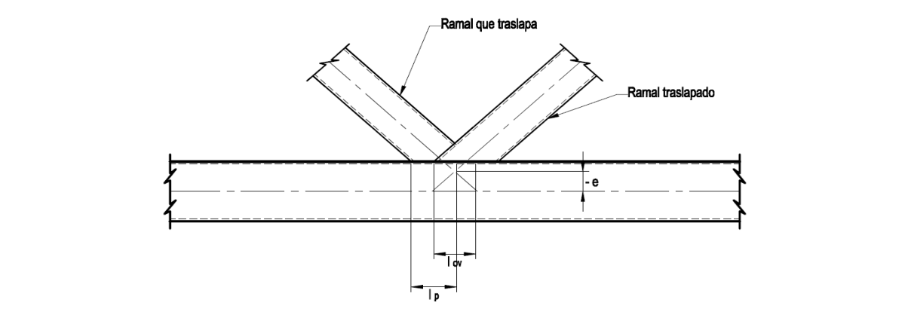

Figura F.2.11-1 — Notación para conexiones en PTE

#### F.2.11.1 — FUERZAS CONCENTRADAS SOBRE PTE

**F.2.11.1.1** — Definiciones de los parámetros

$A_{g}$ = área bruta (total) de la sección transversal del miembro, mm2

$B$ = ancho total del miembro en PTE rectangular, medido a 90 grados del plano de la conexión, mm

$B_{p}$ = ancho de platina, medido a 90 grados del plano de la conexión, mm

$D$ = diámetro exterior de miembro en PTE circular, mm

$F_{y}$ = esfuerzo de fluencia mínimo especificado del material del miembro en PTE, MPa

$F_{yp}$= esfuerzo de fluencia mínimo especificado de la platina, MPa

$F_{u}$ = resistencia a tensión mínima especificada del material del PTE, MPa

$H$ = peralte del miembro en PTE rectangular, medido en el plano de la conexión, mm

$l_{b}$ = longitud de apoyo de la carga, medida paralelamente al eje del miembro en PTE, (o medida a través del ancho del PTE en el caso de tapas de extremo cargadas), mm

$t$ = espesor de diseño de la pared de un miembro en PTE, mm

$t_{p}$ = espesor de la platina, mm

**F.2.11.1.2** — PTE Circulares — La resistencia de diseño de las conexiones con cargas concentradas dentro de los límites de la tabla F.2.11.1-1A se debe tomar como se muestra en la tabla F.2.11.1-1.

**Tabla F.2.11.1-1**

Resistencia de diseño para la conexión de una platina a un PTE circular

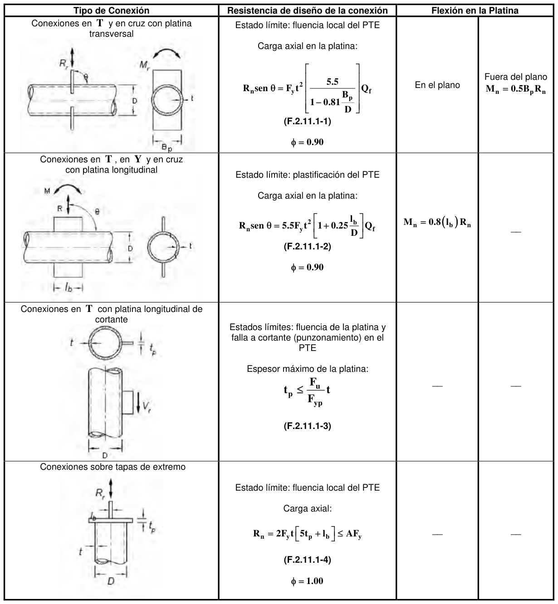

**Tabla F.2.11.1-1** — (continuación)

Resistencia de diseño para la conexión de una platina a un PTE circular

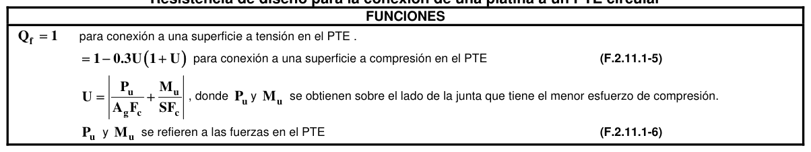

<!-- mod:1-decreto-092-2011-233 -->
> **Modificación — Decreto 092 de 2011** · anexo, p. 46
>
> La celda correspondiente a la segunda fila de la segunda columna de la Tabla F.2.11.1-1 debe quedar así:
>
> | Flexión en la Platina | |
> |---|---|
> | En el plano | Fuera del plano |
> | — | $M_n = 0.5B_pR_n$ |
>
> En la figura de la fila 4, donde dice $V_r$ debe ser $V$.
>
> En la figura de la fila 5, donde dice $R_r$ debe ser $R$.
>
> La ecuación (F.2.11.1-5) debe quedar así: $= 1 - 0.3U(1+U)$

**Tabla F.2.11.1-1** — A

Límites de aplicación de la tabla F.2.11.1-1

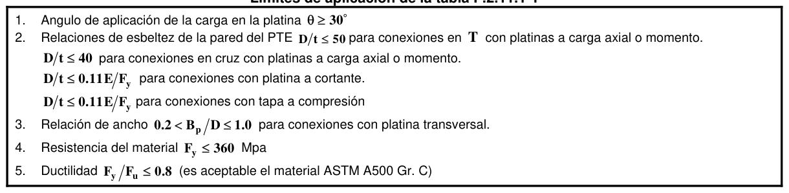

**F.2.11.1.3** — PTE Rectangulares — La resistencia de diseño de las conexiones con cargas concentradas dentro de los límites de la tabla F.2.11.1-2A se debe tomar como el menor valor entre los estados límites aplicables según la tabla F.2.11.1-2.

**Tabla F.2.11.1-2**

Resistencia de diseño para la conexión de una platina a un PTE rectangular

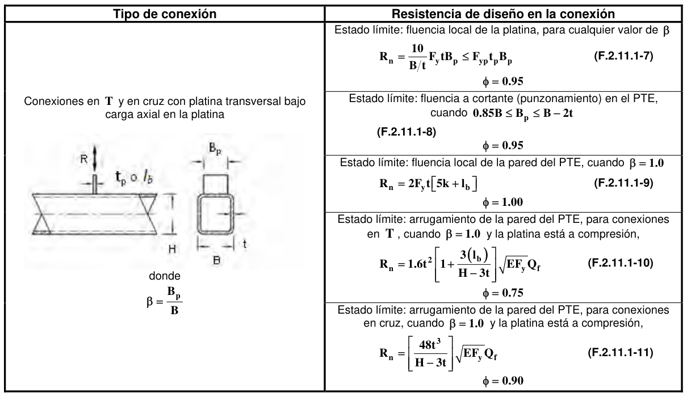

**Tabla F.2.11.1-2** — (continuación)

Resistencia de diseño para la conexión de una platina a un PTE rectangular

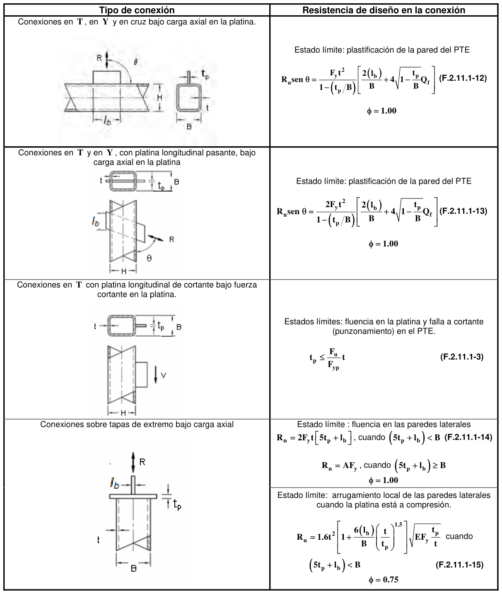

**Tabla F.2.11.1-2** — (continuación)

Resistencia de diseño para la conexión de una platina a un PTE rectangular

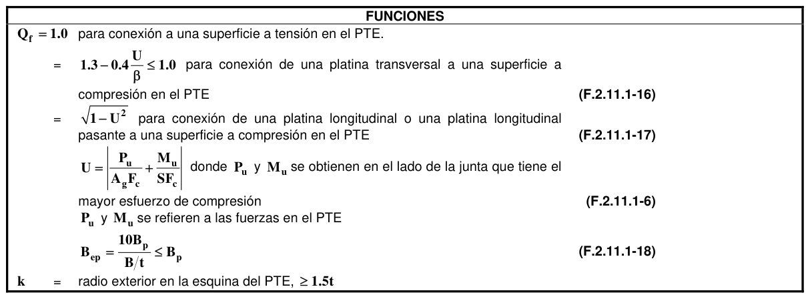

<!-- mod:1-decreto-092-2011-235 -->
> **Modificación — Decreto 092 de 2011** · anexo, p. 46
>
> La celda correspondiente a la segunda fila de la segunda columna de la Tabla F.2.11.1-2 debe quedar así:
>
> Estado límite: fluencia a cortante (punzonamiento) en el PTE, cuando $0.85B \leq B_p \leq B - 2t$
>
> $$ R_n = 0.6F_yt\left[2t_p + 2B_{ep}\right] \tag{F.2.11.1-8} $$
>
> $\phi = 0.95$
>
> En el encabezamiento de la segunda figura, donde dice «Conexiones en $T$, en $Y$ y en cruz, bajo carga axial en la platina.», debe decir «Conexiones en $T$, en $Y$ y en cruz con platina longitudinal, bajo carga axial en la platina.».

**Tabla F.2.11.1-2** — A Límites de aplicación de la tabla F.2.11.1-2

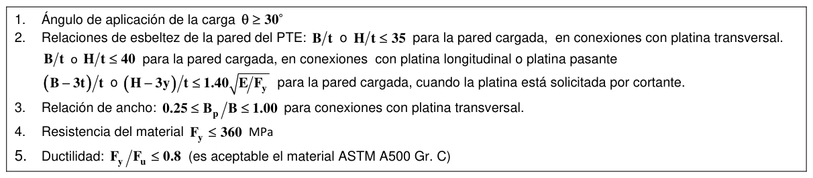

<!-- mod:1-decreto-092-2011-234 -->
> **Modificación — Decreto 092 de 2011** · anexo, p. 46
>
> Donde dice «...para conexiones con tapa a compresión...» debe ser «...para conexiones sobre tapa de extremo a compresión....».
>
> Donde dice , debe ser: .

<!-- mod:1-decreto-092-2011-236 -->
> **Modificación — Decreto 092 de 2011** · anexo, p. 47
>
> Donde dice $\dfrac{H - 3y}{t} \leq 1.40\sqrt{\dfrac{E}{F_y}}$, debe ser: $\dfrac{H - 3t}{t} \leq 1.40\sqrt{\dfrac{E}{F_y}}$.

#### F.2.11.2 — CONEXIONES DE PTE A PTE EN ARMADURAS

Se definen como conexiones de PTE a PTE en armaduras aquellas conexiones conformadas por uno o más ramales que se sueldan directamente a un miembro principal continuo que pasa a través de la conexión. Se clasifican como sigue:

(a) Cuando la carga de punzonamiento $(P_{r} sen θ)$ de un ramal está equilibrada por fuerzas de cortante de viga en el miembro principal, la conexión se clasifica como conexión en $T$ si el ramal es perpendicular al miembro principal, y como conexión en $Y$ en otros casos.

(b) Cuando la carga de punzonamiento $(P_{r} sen θ)$ de un ramal está equilibrada básicamente (dentro de un 20 por ciento de variación) por cargas en otro(s) ramal(es) ubicado(s) sobre el mismo lado de la conexión, ésta se clasifica como una conexión en $k$ . La separación relevante se toma entre los miembros ramales primarios cuyas cargas se equilibran. Se incluye aquí el caso de una conexión en $k$ donde un ramal es perpendicular al miembro principal, denominada usualmente conexión en N.

(c) Cuando la carga de punzonamiento $(P_{r} sen θ)$ se transmite a través del miembro principal y es equilibrada por ramales sobre el lado opuesto, la conexión se clasifica como conexión en cruz.

(d) Cuando a una conexión llegan más de dos ramales primarios, o llegan ramales en más de un plano, la conexión se clasifica como una conexión general o multiplanar.

En la figura F.2.11.2-1 se presentan ejemplos de clasificación de las conexiones.

Figura F.2.11.2-1 — Ejemplos de clasificación de conexiones de PTE a PTE Cuando un ramal transmita una parte de su carga como conexión en $k$ y otra parte a través de mecanismos de conexión en $T$ , en $Y$ o en cruz, la resistencia nominal se determinará en proporción a la participación de cada tipo de conexión sobre el total.

Para los efectos del numeral F.2.11, las líneas de eje de los ramales y miembros principales estarán en un plano común. Para las conexiones de PTE rectangulares se tiene la limitación adicional de que todos los miembros estén orientados con dos paredes paralelas al plano. Para armaduras fabricadas con PTE, con los ramales soldados a los miembros principales, se permiten excentricidades dentro de los límites de aplicabilidad sin que se requiera considerar los momentos resultantes en el diseño de la conexión.

En la figura F.2.11.2-2 se presentan algunos modos típicos de falla para conexiones de PTE a PTE en armaduras.

(a) Plastificación del miembro principal (b) Falla a cortante (punzonamiento) en el miembro principal

(d) Distribución no uniforme de la carga en el ramal a

(c) Distribución no uniforme de la carga en el ramal a tensión compresión

(e) Fluencia a cortante sobre la separación en el miembro

(f) Falla en la pared lateral del miembro principal principal Figura F.2.11.2-2 — Estados límites típicos para conexiones de PTE a PTE en armaduras

**F.2.11.2.1** — Definiciones de los parámetros

$A_{g}$ = área bruta (total) de la sección transversal del miembro, mm2

$B$ = ancho total del miembro principal en PTE rectangular, medido a 90 grados del plano de la conexión, mm

$B_{b}$ = ancho total del ramal en PTE rectangular, medido a 90 grados del plano de la conexión, mm

$D$ = diámetro exterior del miembro principal en PTE circular, mm

$D_{b}$ = diámetro exterior del ramal en PTE circular, mm

$F_{y}$ = esfuerzo de fluencia mínimo especificado para el material del miembro principal en PTE, MPa.

$F_{yb}$= esfuerzo de fluencia mínimo especificado para el material del ramal en PTE, MPa.

$F_{u}$ = resistencia a tensión mínima especificada para el material del PTE, MPa.

$H$ = peralte del miembro principal en PTE rectangular, medido en el plano de la conexión, mm

$H_{b}$ = peralte del ramal en PTE rectangular, medido en el plano de la conexión, mm

$O_{v}$ = $l_{ov}/l_{p} x100$ , %

$e$ = excentricidad en una conexión de armadura, positiva alejándose de los ramales, mm

$g$ = separación entre ramales, medida sobre la cara del miembro principal en una conexión en $K$ , sin considerar las soldaduras, mm

$l_{ov}$= longitud del traslapo entre dos ramales, proyectados hasta la cara de conexión sobre el miembro principal, medida sobre esta cara, mm

$l_{p}$ = longitud proyectada, sobre el miembro principal, del ramal que traslapa, mm

$t$ = espesor de diseño de la pared de un miembro principal en PTE, mm

$t_{b}$ = espesor de diseño de la pared de un ramal en PTE, mm

$β$ = relación de anchos; relación del diámetro del ramal al diámetro del miembro principal = $D_{b}/D$ para PTE circular; relación del ancho total del ramal al ancho total del miembro principal = $B_{b}/B$ para PTE rectangular.

$β_{eff}$= relación de anchos efectiva; igual a la suma de los perímetros de los dos ramales en una conexión en $K$ dividida entre ocho veces el ancho del miembro principal.

$γ$ relación de esbeltez de la pared del miembro principal; relación entre la mitad del diámetro y el espesor de la pared = $D /2t$ para PTE circular; relación entre la mitad del ancho y el espesor de la pared = $B /2t$ para PTE rectangular.

$η$ = parámetro de longitud de carga, aplicable sólo a PTE rectangular; relación entre la longitud de contacto del ramal con el miembro principal, en el plano de la conexión, y el ancho del miembro principal = $l_{b}/B$ , donde $l_{b}=H_{b}/senθ$ .

$θ$ = ángulo agudo entre el ramal y el miembro principal (grados)

$ζ$ = relación de separación; relación de la separación entre los ramales de la conexión en $K$ al ancho del miembro principal = $g /B$ para un PTE rectangular.

**F.2.11.2.2** — PTE Circulares — La resistencia de diseño de las conexiones de PTE a PTE en armaduras que estén dentro de los límites de la tabla F.2.11.2-1A se debe tomar como el menor valor entre los estados límites aplicables que se presentan en la tabla F.2.11.2-1.

**Tabla F.2.11.2-1**

Resistencia de diseño de conexiones tipo armadura entre PTE circulares

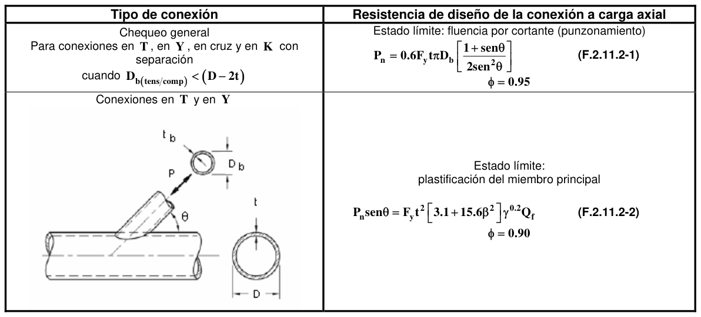

**Tabla F.2.11.2-1** — (continuación)

Resistencia de diseño de conexiones tipo armadura entre PTE circulares

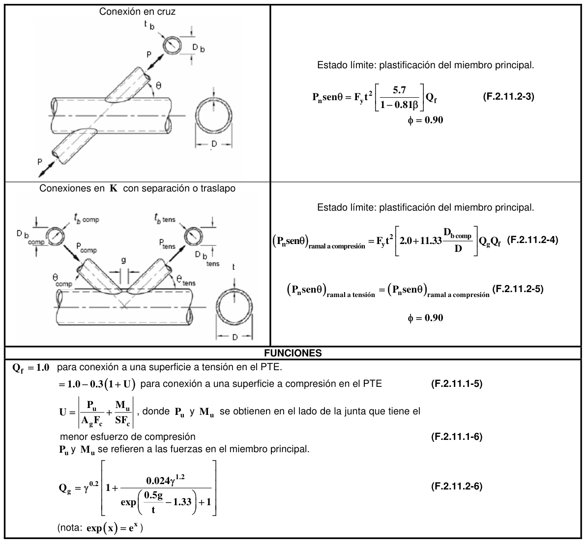

**Tabla F.2.11.2-1** — A

Límites de aplicación de la Tabla F.2.11.2-1

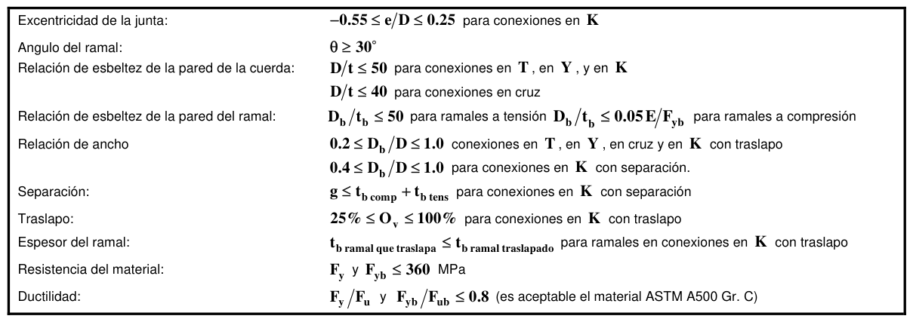

**F.2.11.2.3** — PTE Rectangulares — La resistencia de diseño de las conexiones de PTE a PTE en armaduras que estén dentro de los límites de la tabla F.2.11.2-2A se debe tomar como el menor valor entre los estados límites aplicables que se presentan en la tabla F.2.11.2-2.

**Tabla F.2.11.2-2**

Resistencia de diseño de conexiones tipo armadura entre PTE rectangulares

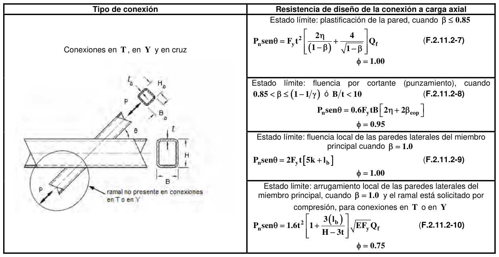

**Tabla F.2.11.2-2** — (continuación)

Resistencia de diseño de conexiones tipo armadura entre PTE rectangulares

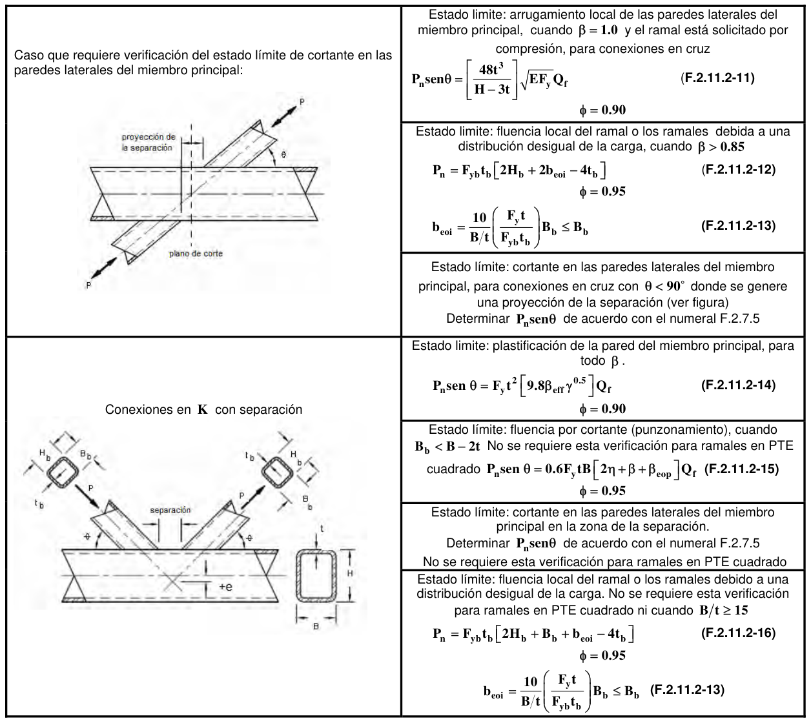

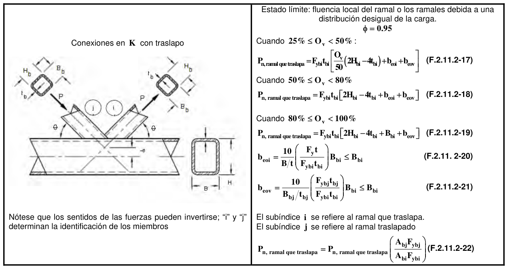

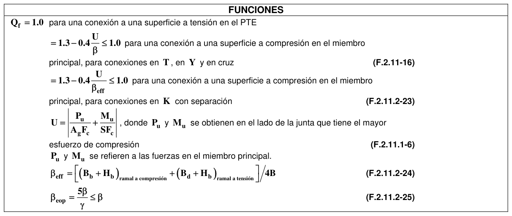

<!-- mod:1-decreto-092-2011-239 -->
> **Modificación — Decreto 092 de 2011** · anexo, p. 47
>
> Para el caso de conexiones en $K$ con separación, donde dice «No se requiere esta verificación para ramales en PTE cuadrado.» debe ser «No se requiere esta verificación para miembros principales en PTE cuadrado.».
>
> Para el caso de conexiones en $K$ con traslapo, en la figura acotar el espesor $t$ en la sección transversal del miembro principal.
>
> En la sección FUNCIONES, la definición de $Q_f$ debe quedar así:
>
> $Q_f = 1.0$ para una conexión a una superficie a tensión en el miembro principal

**Tabla F.2.11.2-2** — A

Límites de aplicación de la tabla F.2.11.2-2

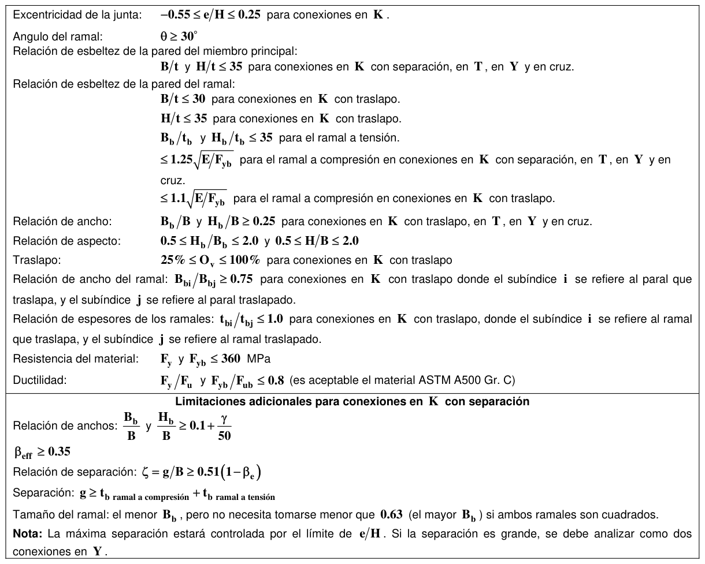

<!-- mod:1-decreto-092-2011-237 -->
> **Modificación — Decreto 092 de 2011** · anexo, p. 47
>
> En los literales (a), (b), y (c) de F.2.11.2, donde dice $\left(P_r\,\text{sen}\,\theta\right)$, debe ser $\left(P_u\,\text{sen}\,\theta\right)$.
>
> En F.2.11.2, en los sitios donde dice «... una conexión en $k$», debe ser «... una conexión en $K$».
>
> En la ecuación F.2.11.2-15, eliminar $Q_f$ del final de la ecuación.
>
> En el lado izquierdo de la ecuación F.2.11.2-22, donde dice $P_{n,\text{ramal que traslapa}}$ debe ser $P_{n,\text{ramal traslapado}}$.
>
> La ecuación F.2.11.2-24, debe quedar así:
>
> $$ \beta_{eff} = \frac{\left[\left(B_b + H_b\right)_{\text{ramal a compresión}} + \left(B_b + H_b\right)_{\text{ramal a tensión}}\right]}{4B} $$

<!-- mod:1-decreto-092-2011-238 -->
> **Modificación — Decreto 092 de 2011** · anexo, p. 47
>
> Donde dice «Relación de esbeltez de la pared de la cuerda», debe ser «Relación de esbeltez de la pared del miembro principal».

<!-- mod:1-decreto-092-2011-240 -->
> **Modificación — Decreto 092 de 2011** · anexo, p. 47
>
> La definición de Relación de separación debe quedar así:
>
> Relación de separación: $\zeta = g/B \geq 0.51\left(1 - \beta_{eff}\right)$

#### F.2.11.3 — CONEXIONES A MOMENTO DE PTE A PTE

Se definen como conexiones a momento de PTE a PTE aquellas conexiones que consisten en uno o dos ramales que están soldados directamente a un miembro principal continuo que pasa a través de la conexión, estando el miembro o los ramales solicitados por momentos flectores.

Una conexión se clasificará:

(a) Como una conexión en $T$ cuando hay un ramal y éste es perpendicular al miembro principal, y como una conexión en $Y$ cuando hay un ramal pero éste no es perpendicular al miembro principal.

(b) Como una conexión en cruz cuando hay un ramal sobre cada uno de los dos lados opuestos del miembro principal.

Para los efectos del numeral F.2.11, los ejes del ramal o de los ramales y del miembro principal deberán estar en un plano común.

**F.2.11.3.1** — Definiciones de los parámetros

$A_{g}$ = área bruta (total) de la sección transversal del miembro, mm2

$B$ = ancho total del miembro principal en PTE rectangular, medido a 90 grados del plano de la conexión, mm

$B_{b}$ = ancho total del ramal en PTE rectangular, medido a 90 grados con respecto al plano de la conexión, mm

$D$ = diámetro exterior del miembro principal en PTE circular, mm

$D_{b}$ = diámetro exterior del ramal en PTE circular, mm

$F_{c}$ = resistencia de diseño por unidad de área, $=F_{y}$, MPa

$F_{y}$ = esfuerzo de fluencia mínimo especificado del miembro principal en PTE, MPa

$F_{yb}$= esfuerzo de fluencia mínimo especificado del ramal en PTE, MPa

$F_{u}$ = resistencia última del miembro en PTE, MPa

$H$ = peralte del miembro principal en PTE rectangular, medido en el plano de la conexión, mm

$H_{b}$ = peralte del ramal en PTE rectangular, medido en el plano de la conexión, mm

$Z_{b}$ = módulo de sección plástico del ramal con respecto al eje de flexión aplicable, mm3

$t$ = espesor de diseño de la pared del miembro principal en PTE, mm

$t_{b}$ = espesor de diseño de la pared del ramal en PTE, mm

$β$ = relación de anchos; relación del diámetro del ramal al diámetro del miembro principal $=D_{b}/D$ para PTE circular; relación del ancho total del ramal al ancho del miembro principal $=B_{b}/B$ para PTE rectangular.

$γ$ = relación de esbeltez de la pared del miembro principal; relación entre la mitad del diámetro y el espesor de la pared $=D /2t$ para PTE circular; relación entre la mitad del ancho y el espesor de la pared $=B /2t$ para PTE rectangular.

$η$ = parámetro de longitud de carga, aplicable sólo a PTE rectangular; relación entre la longitud de contacto del ramal con el miembro principal en el plano de la conexión y el ancho del miembro principal $=l_{b}/B$, donde $l_{b}=H_{b}/senθ$

$θ$ = ángulo agudo entre el ramal y el miembro principal (grados)

<!-- mod:1-decreto-092-2011-242 -->
> **Modificación — Decreto 092 de 2011** · anexo, p. 48
>
> Se debe eliminar la línea donde se define $F_c$.

**F.2.11.3.2** — PTE Circulares — La resistencia de diseño de las conexiones a momento que estén dentro de los límites de la tabla F.2.11.3-1A se debe tomar como el menor entre los valores calculados para los estados límites aplicables que se presentan en la tabla F.2.11.3-1.

**Tabla F.2.11.3-1**

Resistencia de diseño de conexiones a momento entre PTE circulares

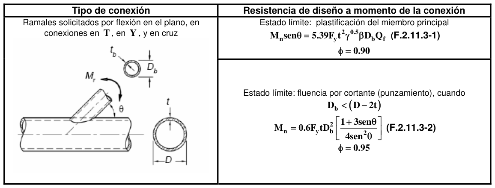

**Tabla F.2.11.3-1** — (continuación)

Resistencia de diseño de conexiones a momento entre PTE circulares

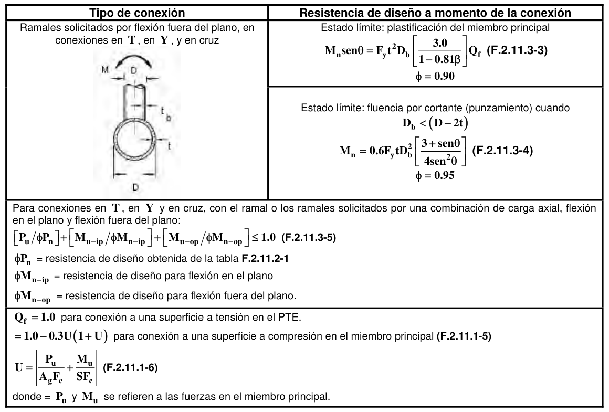

<!-- mod:1-decreto-092-2011-243 -->
> **Modificación — Decreto 092 de 2011** · anexo, p. 48
>
> En las Tablas F.2.11.3-1 y F.2.11.3-2 la ecuación (F.2.11.1-6) debe quedar así:
>
> $$ U = \left[\frac{P_u}{A_gF_y} + \frac{M_u}{SF_y}\right] $$

**Tabla F.2.11.3-1** — A

Límites de aplicación de la tabla F.2.11.3-1

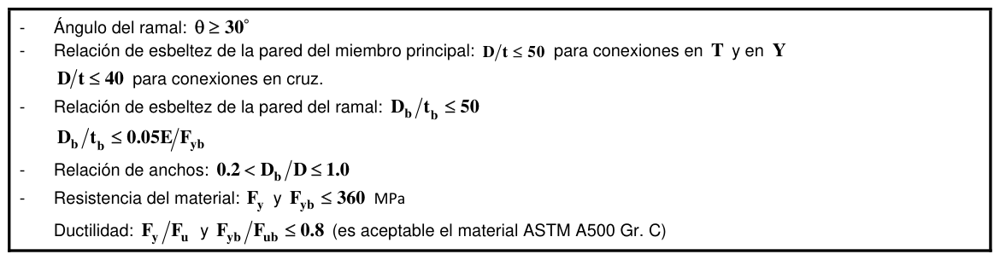

**F.2.11.3.3** — PTE Rectangulares — La resistencia de diseño de las conexiones a momento que estén dentro de los límites de la tabla F.2.11.3-2A se debe tomar como el menor valor entre los estados límites aplicables que se presentan en la tabla F.2.11.3-2.

**Tabla F.2.11.3-2**

Resistencia de diseño de conexiones a momento entre PTE rectangulares

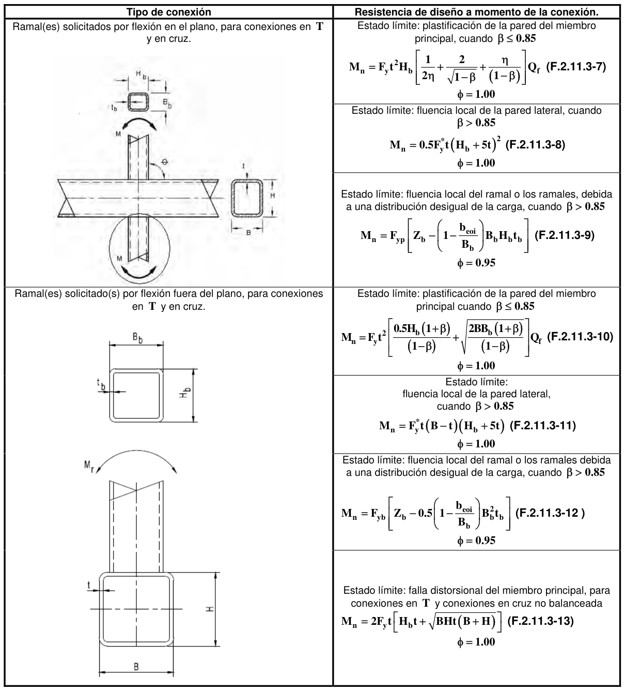

**Tabla F.2.11.3-2** — (continuación)

Resistencia de diseño de conexiones a momento entre PTE rectangulares

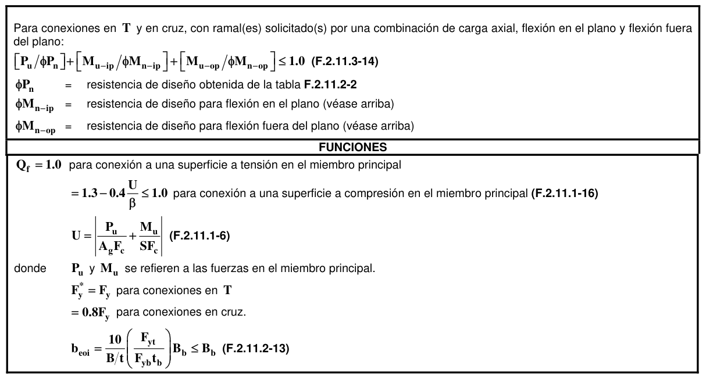

<!-- mod:1-decreto-092-2011-244 -->
> **Modificación — Decreto 092 de 2011** · anexo, p. 48
>
> En las Tablas F.2.11.3-1 y F.2.11.3-2 la ecuación (F.2.11.1-6) debe quedar así:
>
> $$ U = \left[\frac{P_u}{A_gF_y} + \frac{M_u}{SF_y}\right] $$
>
> En la figura, para el caso «Ramal(es) solicitado(s) por flexión fuera del plano, para conexiones en T y en cruz», la variable $M_r$ debe ser $M$.

**Tabla F.2.11.3-2** — A

Límites de aplicación de la tabla F.2.11.3-2

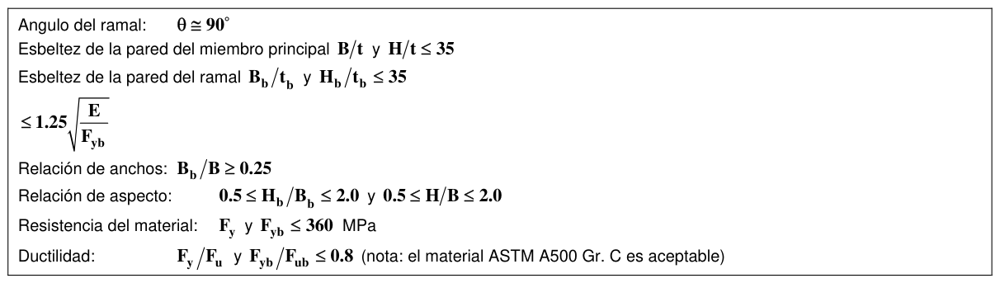

<!-- mod:1-decreto-092-2011-241 -->
> **Modificación — Decreto 092 de 2011** · anexo, p. 47
>
> Donde dice «... estando el miembro o los ramales solicitados por momentos flectores» debe quedar así: «...estando el ramal o los ramales solicitados por momentos flectores».
>
> La ecuación F.2.11.3-12 debe quedar así:
>
> $$ M_n = F_{yb}\left[Z_b - 0.5\left(1 - \frac{b_{eoi}}{B_b}\right)^2 B_b^2t_b\right] $$

#### F.2.11.4 — SOLDADURAS DE LOS RAMALES

Al diseñar las soldaduras a los ramales deberá darse la debida consideración a la condición de no uniformidad en la transferencia de carga a lo largo de la línea de soldadura, debida a las diferencias en las rigideces relativas de las paredes de los PTE en conexiones de PTE a PTE y de platinas transversales a PTE, Este requisito se deberá satisfacer calculando, como se presenta a continuación, la resistencia de diseño de las soldaduras de conexión de los ramales y comparándola con la resistencia requerida:

$$ R_{n}=F_{nw}t_{w}I_{e} \tag{F.2.11.4-1} $$

$$ M_{n-ip}=F_{nw}S_{ip} \tag{F.2.11.4-2} $$

$$ M_{n-op}=F_{nw}S_{op} \tag{F.2.11.4-3} $$

Para considerar los efectos de la interacción, véase la ecuación F.2.11.3-14.

Para soldaduras de filete:

$φ =0.75$ Para soldaduras acanaladas de penetración parcial:

$φ =0.80$ donde:

$F_{nw}$ = resistencia nominal por unidad de área (véase el numeral F.2.10) sin incrementar la resistencia por consideraciones de la dirección de la carga, MPa.

$S_{ip}$ = módulo de sección elástico efectivo de las soldaduras para flexión en el plano (véase la tabla F.2.11.4-1), mm3

$S_{op}$ = módulo de sección elástico efectivo de las soldaduras para flexión fuera del plano (véase la tabla F.2.11.4-1), mm3

$l_{e}$ = longitud efectiva total de las soldaduras acanaladas y de filete a PTE rectangulares para efectos de cálculo de la resistencia de la soldadura, mm

$t_{w}$ = menor valor de la garganta efectiva de la soldadura alrededor del ramal o la platina, mm

**Tabla F.2.11.4-1**

Resistencia de la soldadura en conexiones tipo armadura entre PTE rectangulares

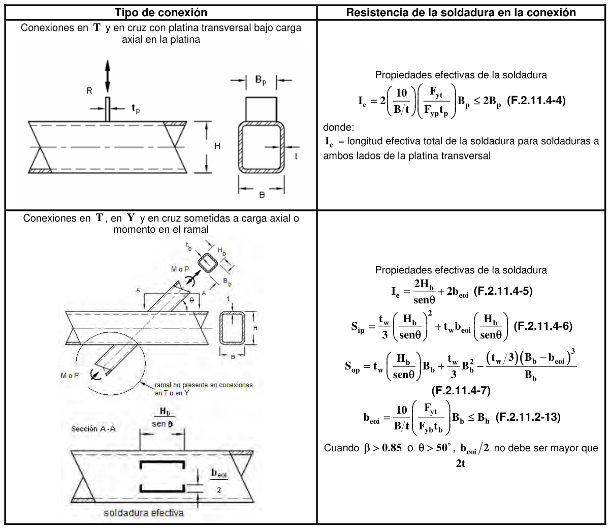

**Tabla F.2.11.4-1** — (continuación)

Resistencia de la soldadura en conexiones tipo armadura entre PTE rectangulares

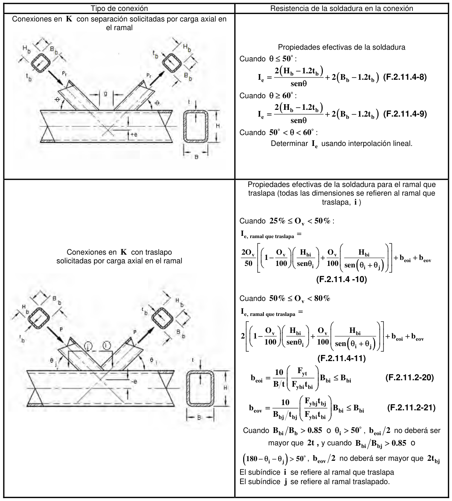

**Tabla F.2.11.4-1** — (continuación)

Resistencia de la soldadura en conexiones tipo armadura entre PTE rectangulares

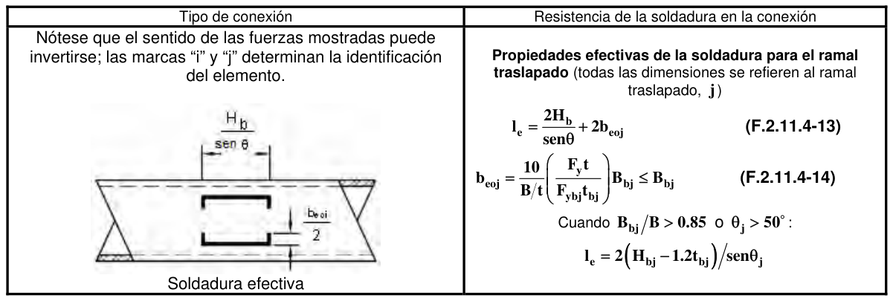

<!-- mod:1-decreto-092-2011-246 -->
> **Modificación — Decreto 092 de 2011** · anexo, p. 48
>
> En la Tabla F.2.11.4-1, ecuación (F.2.11.2-13) donde dice $F_{yt}$ debe ser $tF_y$.
>
> En la Tabla F.2.11.4-1, ecuación (F.2.11.4-11) debe quedar así;
>
> $$ \ell_{e,\,\text{ramal que traslapa}} = 2\left[\left(1 - \frac{O_v}{100}\right)\left(\frac{H_{bi}}{\text{sen}\,\theta_i}\right) + \frac{O_v}{100}\left(\frac{H_{bi}}{\text{sen}\left(\theta_i + \theta_j\right)}\right)\right] + B_{bi} + b_{eov} $$
>
> En la ecuación (F.2.11.2-20) donde dice $F_{yt}$ debe ser $tF_y$.
>
> En la Tabla F.2.11.4-1, en la figura para el caso «Conexiones en K con traslapo solicitadas por carga axial en el ramal», marcar como A-A la sección anotada
>
> En la Tabla F.2.11.4-1, debajo del texto «Nótese que el sentido de las fuerzas mostradas puede invertirse; las marcas "i" y "j" determinan la identificación del elemento.» agregar el texto: «Sección A-A para conexiones en K con traslapo».

<!-- mod:1-decreto-092-2011-247 -->
> **Modificación — Decreto 092 de 2011** · anexo, p. 49
>
> Al final de la última casilla de la segunda columna, agregar: $b_{eoj}/2$ no se tomará mayor que $2t$.

Cuando una conexión en $K$ con traslapo ha sido diseñada de acuerdo con la tabla F.2.11.2.2 y las componentes de las fuerzas de los ramales que actúan en dirección perpendicular al miembro principal están balanceadas en un 80% (es decir, cuando las componentes perpendiculares a la cara del miembro principal no difieren en más de un 20%), puede omitirse la soldadura que queda “oculta” bajo el ramal que traslapa si las otras soldaduras al ramal traslapado son suficientes para desarrollar la capacidad total de este ramal.

Cuando las soldaduras sean suficientes para desarrollar la capacidad total del ramal o de la platina, pueden omitirse las verificaciones requeridas por la tabla F.2.11.4.1 para dichas soldaduras.

El enfoque utilizado en este numeral para disminuir el tamaño de las soldaduras supone el uso de un tamaño de soldadura constante alrededor de todo el perímetro del ramal en PTE, incluyendo todas las áreas “no efectivas”, excepto cuando se permite omitir la soldadura “oculta” bajo el ramal que traslapa. Se debe poner especial atención a las conexiones entre PTE de anchos iguales, o aproximadamente iguales, que combinen soldaduras acanaladas de penetración parcial a lo largo de los bordes que coinciden, con soldaduras de filete que generalmente se usarán a lo ancho de la cara del miembro principal.

<!-- mod:1-decreto-092-2011-245 -->
> **Modificación — Decreto 092 de 2011** · anexo, p. 48
>
> En las ecuaciones F.2.11.4-1, F.2.11.4-4, F.2.11.4-5, F.2.11.4-8, F.2.11.4-9, F.2.11.4-10, y F.2.11.4-11 la variable que figura como $I_e$ tanto en las ecuaciones como en las definiciones de variables, debe substituirse por la letra $\ell$ con el mismo subíndice así; $l_e$ o $\ell_e$ para mayor claridad.

<!-- mod:1-decreto-092-2011-248 -->
> **Modificación — Decreto 092 de 2011** · anexo, p. 49
>
> En la ecuación (F.2.11.4-9) en el lado derecho de la ecuación, donde dice $2\left(B_b - 1.2t_b\right)$ se debe quitar el $2$ y dejar solo la parte entre paréntesis así: $\left(B_b - 1.2t_b\right)$.

### F.2.12 — DISEÑO PARA ESTADOS LÍMITES DE SERVICIO

Este numeral establece los requisitos del diseño para estados límites de servicio.

Se incluyen las siguientes secciones:

F.2.12.1 — Provisiones Generales F.2.12.2 — Contraflecha F.2.12.3 — Deflexiones F.2.12.4 — Deriva F.2.12.5 — Vibración F.2.12.6 — Movimiento Inducido por Viento F.2.12.7 — Expansión y Contracción F.2.12.8 — Deslizamiento en las Conexiones

#### F.2.12.1 — PROVISIONES GENERALES

Las condiciones de servicio garantizan que, bajo uso normal, se preserven la funcionalidad, el aspecto, la facilidad para el mantenimiento y la durabilidad de una edificación, así como la comodidad de sus ocupantes. Los valores límite de la respuesta estructural para asegurar la funcionalidad (por ejemplo, deflexiones máximas, aceleraciones) se adoptarán teniendo en cuenta la función para la cual se destina la estructura. Las condiciones de servicio se evaluarán usando las combinaciones de carga apropiadas para los estados límites de servicio identificados.

#### F.2.12.2 — CONTRAFLECHA

Donde esté previsto el uso de una contraflecha para lograr condiciones apropiadas de posicionamiento y localización de la estructura, su magnitud, dirección y localización deberán quedar especificadas en los planos estructurales.

Las vigas y armaduras detalladas sin que se especifique una contraflecha se fabricarán de tal forma que cualquier contraflecha que resulte después del montaje, causada por el proceso de laminación o el ensamble en el taller, sea hacia arriba.

En general, a las armaduras de 25 o más metros de luz se les dará una contraflecha que contrarreste aproximadamente la deflexión debida a la carga muerta. A los puentes grúas de 23 o más metros de luz se les dará una contraflecha que compense aproximadamente la deflexión causada por la carga muerta más la mitad de la deflexión producida por la carga viva.

#### F.2.12.3 — DEFLEXIONES

Las deflexiones que ocurran en miembros y sistemas estructurales bajo las combinaciones de carga de servicio aplicables no deben menoscabar la funcionalidad de la estructura.

Las condiciones a considerarse incluyen la nivelación de los pisos, la alineación de los miembros estructurales, la integridad de los acabados de la edificación y otros factores que afectan el uso y funcionamiento normales de la estructura. Para los miembros de construcción compuesta, se deben considerar las deflexiones adicionales debidas a la contracción y la expansión del concreto.

#### F.2.12.4 — DERIVA

La deriva de una estructura se evaluará bajo cargas de servicio para garantizar la funcionalidad de la estructura, incluyendo la integridad de particiones interiores y revestimientos exteriores. La deriva calculada bajo combinaciones de carga para resistencia no deberá causar colisión con estructuras adyacentes ni exceder los valores límites especificados por el presente Reglamento para tales derivas.

#### F.2.12.5 — VIBRACIÓN

Se dará la debida consideración a los efectos de la vibración en la comodidad de los ocupantes y en la funcionalidad de la estructura. Las fuentes de la vibración a considerarse incluyen cargas por tráfico de peatones, maquinaria vibratoria y otras identificadas para la estructura.

#### F.2.12.6 — MOVIMIENTO INDUCIDO POR VIENTO

El efecto del movimiento inducido por el viento en una edificación deberá ser considerado en cuanto pueda afectar la comodidad de sus ocupantes.

#### F.2.12.7 — EXPANSIÓN Y CONTRACCIÓN

Deberán considerarse los efectos de la expansión y contracción térmica en una edificación. Los daños en los revestimientos de la edificación pueden permitir la penetración del agua y originar corrosión.

#### F.2.12.8 — DESLIZAMIENTO EN LAS CONEXIONES

Los efectos del deslizamiento en las conexiones pernadas serán considerados en el diseño siempre que tal deslizamiento pueda causar deformaciones que menoscaben la funcionalidad de la estructura. Cuando sea apropiado, la conexión se diseñará para evitar el deslizamiento. Véanse los numerales F.2.10.3.8 y F.2.10.3.9 para el diseño de conexiones de deslizamiento crítico.

Para mayor información sobre el diseño de conexiones de deslizamiento crítico, véanse las “Especificaciones para juntas estructurales usando pernos ASTM A325 o A490” del Consejo de Investigación en Conexión Estructurales (RCSC).

### F.2.13 — FABRICACIÓN, MONTAJE Y CONTROL DE CALIDAD

Este numeral presenta los requisitos que se deben cumplir para los planos de taller, la fabricación, la pintura de taller, el montaje y el control de calidad.

Se incluyen las siguientes secciones:

F.2.13.1 — Planos de Taller y Montaje F.2.13.2 — Fabricación F.2.13.3 — Pintura de Taller F.2.13.4 — Montaje

#### F.2.13.1 — PLANOS DE TALLER Y MONTAJE

Con anterioridad a la fabricación de una estructura se deben preparar planos de taller que suministren la totalidad de la información necesaria para la fabricación de cada uno de los componentes, incluyendo la localización, tipo y dimensiones de las soldaduras y los pernos. Igualmente, los planos de montaje se prepararán con anterioridad al montaje y deberán proporcionar la información necesaria para el montaje de la estructura. Los planos de taller y los de montaje distinguirán claramente entre soldaduras y pernos de taller y de campo e identificarán claramente las conexiones con pernos de alta resistencia que deban ser de deslizamiento crítico o pretensionadas. Los planos de taller y los de montaje deberán ejecutarse teniendo en cuenta la agilidad y economía en la fabricación y el montaje.

#### F.2.13.2 — FABRICACIÓN

**F.2.13.2.1** — Generación de la contraflecha, curvado y enderezado — Se permite la aplicación local de calor o de medios mecánicos para generar o corregir la contraflecha, la curvatura y la rectitud. La temperatura en las áreas sometidas a calentamiento, según mediciones por métodos aprobados, no excederá de 593 ºC para aceros A514/A514M y A852/A852M ni de 649 ºC para otros aceros.

**F.2.13.2.2** — Corte por fusión — Los bordes cortados por fusión deberán satisfacer los requisitos de AWS D1.1, Secciones 5.15.1.2, 5.15.4.3 y 5.15.4.4, excepto que los bordes libres cortados por fusión que no vayan a estar sujetos a fatiga deberán estar libres de socavaciones de fondo redondeado con más de 5 mm de profundidad, y de cualquier muesca en V aguda.

Las socavaciones mayores que 5 mm de profundidad y las muescas que queden después del corte se deberán pulir o reparar con soldadura.

Las esquinas entrantes deberán tener una transición curva. El radio de esta transición no requiere ser mayor que el requerido para el ajuste de la conexión. La superficie que resulta cuando dos cortes libres con llama se encuentran en un punto no se considera una transición curva. Se permiten el uso de una esquina entrante discontinua cuando los materiales a lado y lado de ella estén conectados a una pieza de unión que prevenga la deformación y las concentraciones de esfuerzos asociadas.

Una esquina entrante con un radio de 9.5 mm es adecuada para cargas estáticas. Para piezas que requieren ser ajustadas sin holgura, se considera aceptable el uso de una esquina entrante discontinua si las piezas se conectan cerca a la esquina y por ambos lados de ella. Las ranuras que se corten en perfiles tubulares estructurales (PTE) para insertar platinas pueden ejecutarse con sus extremos semicirculares, o con esquinas redondeadas. Se aceptan extremos en ángulo recto siempre y cuando el borde de la platina se suelde al PTE.

Los destijeres en vigas y los agujeros de acceso de soldadura deberán cumplir con los requisitos geométricos del numeral F.2.10.1.6. Cuando se usen en perfiles que vayan a ser galvanizados, los destijeres de vigas y los agujeros de acceso de soldadura deberán ser pulidos. Para perfiles con un espesor de aleta que no exceda de 51 mm, las superficies cortadas por fusión en destijeres de vigas no tendrán un valor de rugosidad de superficie mayor que 50 μm según lo definido en la norma ASME B46.1. Para destijeres y agujeros de acceso para soldadura en perfiles laminados en caliente ASTM A6/A6M con un espesor de aleta superior a 51 mm, y en perfiles armados soldados con un espesor de material mayor que 51 mm, en los cuales la parte curva se corte por fusión, se aplicará antes del corte una temperatura de precalentamiento no menor que 66 ºC. Las superficies de los agujeros de acceso cortados térmicamente en perfiles laminados en caliente ASTM A6/A6M con un espesor de aleta superior a 51 mm, y en perfiles armados con un espesor de material mayor que 51 mm, serán pulidas.

**F.2.13.2.3** — Cepillado de Bordes — No se requiere el cepillado o pulido de bordes cizallados o cortados por fusión en platinas o perfiles a menos que así se exija específicamente en los documentos del proyecto o esté previsto en la preparación de bordes estipulada para la soldadura.

**F.2.13.2.4** — Construcción Soldada — La técnica de la soldadura, la ejecución, el aspecto y la calidad de la soldadura, así como los métodos a usarse en la corrección de los trabajos no conformes, estarán de acuerdo con AWS D1.1 excepto según las modificaciones anotadas en el numeral F.2.10.2.

**F.2.13.2.5** — Construcción Pernada — Las partes de los miembros que se conectan con pernos deberán estar bien aseguradas con pasadores o pernos y rígidamente unidas durante el ensamble.

El empleo de pasadores de ensamble en las perforaciones durante el montaje no deberá distorsionar el metal ni agrandar las perforaciones. El alineamiento deficiente de las perforaciones será causa de rechazo.

Las perforaciones de los pernos deberán cumplir con las provisiones de las Especificaciones para Juntas Estructurales Usando Pernos ASTM A325 o A490 del RCSC, Sección 3.3, excepto que se permitirán perforaciones cortadas por fusión siempre y cuando el perfil de rugosidad superficial no exceda 25 μm, tal como se define en ASME B46.1. No son aceptables estrías con más de 1.6 mm de profundidad. Se permiten igualmente las perforaciones ejecutadas con chorro de agua.

En los empalmes se permite el uso de platinas de relleno con ranuras, insertadas completamente, con un espesor total de no más de 6 mm, sin que para el diseño de la conexión se requiera modificar la resistencia calculada de conformidad con el tipo de perforaciones. La orientación de tales platinas de relleno es independiente de la dirección de aplicación de la carga.

El uso de pernos de alta resistencia obedecerá a los requisitos de las Especificaciones para Juntas Estructurales Usando Pernos ASTM A325 o A490 del RCSC, excepto por las modificaciones anotadas en el numeral F.2.10.3.

**F.2.13.2.6** — Juntas a Compresión — En juntas a compresión cuya capacidad portante depende total o parcialmente del contacto por aplastamiento, las superficies de contacto de las piezas individualmente fabricadas deberán ser preparadas por cepillado, corte con sierra o por otros medios apropiados.

<!-- mod:1-decreto-092-2011-249 -->
> *Texto vigente según el Decreto 092 de 2011 (anexo, p. 49).*

**F.2.13.2.7** — *Tolerancias Dimensionales* — Las tolerancias dimensionales estarán de acuerdo con el Código de Practicas Estándar para Estructuras de Acero, Norma Técnica Colombiana ICONTEC.

**F.2.13.2.8** — Acabado de Bases de Columnas — Las bases de las columnas y las placas de base deberán tener un acabado de acuerdo con los siguientes requisitos:

(a) Las placas de base de acero con espesor menor o igual que 51 mm podrán utilizarse sin maquinado siempre y cuando se obtenga un contacto satisfactorio en el apoyo. Las placas de base de acero con espesor mayor que 51 mm pero no superior a 102 mm podrán enderezarse por medio de prensas o, cuando no se disponga de éstas, rectificando las superficies de apoyo (excepto según lo especificado en los subpárrafos 2 y 3 de este numeral), para obtener un contacto satisfactorio en el apoyo. Las superficies de contacto en placas de base de acero con espesor mayor que 102 mm deberán ser rectificadas (excepto según lo especificado en los subpárrafos 2 y 3 de este numeral).

(b) No es necesario rectificar las superficies inferiores de las placas de base o de las bases de columnas cuando se usa mortero para obtener una superficie completa de contacto sobre las cimentaciones.

(c) No es necesario rectificar las superficies superiores de las placas de base cuando se proporcionan soldaduras acanaladas de penetración completa entre las columnas y las placas de base.

<!-- mod:1-decreto-092-2011-250 -->
> **Modificación — Decreto 092 de 2011** · anexo, p. 49
>
> En el numeral (1) del literal F.2.13.2.8 donde se hace referencia en el texto entre paréntesis que dice «(excepto según lo especificado en los subpárrafos 2 y 3 de este numeral)» debe quedar ahora en las dos ocurrencias de este texto así: «(excepto lo especificado en los literales (b) y (c) siguientes)».

**F.2.13.2.9** — Agujeros para Pernos de Anclaje — Se permite el corte por fusión de los agujeros para pernos de anclaje de acuerdo con las provisiones del numeral F.2.13.2.2.

**F.2.13.2.10** — Agujeros de Drenaje — Cuando exista el riesgo de que se acumule agua en el interior de miembros en PTE o en cajón, tanto durante la construcción como en servicio, los miembros deberán ser sellados, provistos con un agujero de drenaje en la base, o protegidos con otros medios apropiados.

**F.2.13.2.11** — Requisitos para Miembros Galvanizados — Los miembros y partes a ser galvanizados deberán ser diseñados, detallados y fabricados para garantizar el flujo y el drenaje tanto en los baños de preparación de la superficie como en la inmersión en zinc, así como para evitar la acumulación de presión en partes herméticas.

Véase el documento “Diseño de productos a ser galvanizados por inmersión en caliente después de fabricados”, de la Asociación Americana de Galvanizado, y las normas ASTM A123, A153, A384 y A780 para información útil sobre el diseño y detallado de miembros galvanizados. Véanse en el numeral F.2.13.2.2 los requisitos para destijeres en miembros que vayan a ser galvanizados.

#### F.2.13.3 — PINTURA DE TALLER

**F.2.13.3.1** — Requisitos Generales — La preparación de la superficie y la pintura de taller estarán de acuerdo con las provisiones del Código de Practicas Estándar para Estructuras Metálicas, Norma Técnica Colombiana ICONTEC.

No se requiere la aplicación de pintura de taller a menos que se haya especificado en los documentos del proyecto.

<!-- mod:1-decreto-092-2011-251 -->
> **Modificación — Decreto 092 de 2011** · anexo, p. 49
>
> El primer parágrafo de F.2.13.3.1 debe quedar así:
>
> **F.2.13.3.1** — *Requisitos Generales* — La preparación de la superficie y la pintura de taller estarán de acuerdo con las provisiones del Código de Practicas Estándar para Estructuras de Acero, Norma Técnica Colombiana ICONTEC.

**F.2.13.3.2** — Superficies Inaccesibles — Con excepción de las superficies de contacto, las superficies que sean inaccesibles después del ensamble de taller deberán ser limpiadas y pintadas previamente cuando así lo requieran los documentos de diseño.

**F.2.13.3.3** — Superficies de Contacto — En conexiones tipo aplastamiento se permite la aplicación de pintura sobre las superficies de contacto. Para conexiones de deslizamiento crítico, los requisitos de las superficies de contacto estarán de acuerdo con las Especificaciones para Juntas Estructurales Usando Pernos ASTM A325 o A490 del RCSC, Sección 3.2.2 (b).

**F.2.13.3.4** — Superficies con Acabado por Maquinado — Las superficies con acabado por maquinado deberán ser protegidas por medio de un recubrimiento inhibidor de la corrosión que pueda ser removido antes del montaje, o que tenga características que hagan innecesaria su remoción.

**F.2.13.3.5** — Superficies Adyacentes a Soldaduras de Campo — A menos que se especifique lo contrario en los documentos de diseño, las zonas que estén a menos de 50 mm de cualquier soldadura de campo estarán libres de cualquier material que pueda impedir la correcta ejecución de la soldadura o producir humos inaceptables durante el proceso.

#### F.2.13.4 — MONTAJE

<!-- mod:1-decreto-092-2011-252 -->
> *Texto vigente según el Decreto 092 de 2011 (anexo, p. 49).*

**F.2.13.4.1** — *Alineación de las Bases de las Columnas* — Las bases de las columnas deberán quedar bien niveladas y a la elevación correcta y en pleno contacto con las superficies de concreto o mampostería según se especifica en el Código de Practicas Estándar para Estructuras de Acero, Norma Técnica Colombiana ICONTEC.

**F.2.13.4.2** — Estabilidad y Conexiones — La estructura de acero de los edificios deberá erigirse a plomo y con los alineamientos requeridos dentro de los límites definidos por el Código de Practicas Estándar para Estructuras Metálicas, Norma Técnica Colombiana ICONTEC. A medida que avance el montaje, se deben tomar las medidas necesarias para que la estructura pueda resistir las cargas muertas, de montaje y otras que se esperen durante el periodo de montaje. Se deben colocar arriostramientos temporales, de acuerdo con los requisitos del código citado, siempre que sean necesarios para resistir todas las cargas a que pueda estar sometida la estructura, incluyendo los equipos y las cargas asociadas a su operación. Tales arriostramientos deberán dejarse en su sitio durante el tiempo que sea necesario para garantizar la seguridad de la estructura.

<!-- mod:1-decreto-092-2011-253 -->
> **Modificación — Decreto 092 de 2011** · anexo, p. 49
>
> El inicio del literal F.2.13.4.2 debe quedar así:
>
> **F.2.13.4.2** — *Estabilidad y Conexiones* — La estructura de acero de los edificios deberá erigirse a plomo y con los alineamientos requeridos dentro de los límites definidos por el Código de Practicas Estándar para Estructuras de Acero, Norma Técnica Colombiana ICONTEC. ...

**F.2.13.4.3** — Alineación — No se dará el apriete final a los pernos ni se ejecutarán las soldaduras definitivas hasta tanto las zonas de la estructura comprendidas dentro del área de influencia de la respectiva conexión hayan sido alineadas de manera apropiada.

**F.2.13.4.4** — Ajuste de juntas a compresión en columnas y placas de base — Se aceptará una falta de ajuste en la zona de contacto siempre y cuando la separación no exceda de 1.6 mm, cualquiera que sea el tipo de empalme utilizado (pernado o con soldadura acanalada de penetración parcial). Si la separación excede de 1.6 mm, pero es inferior a 6.4 mm, y si una investigación adecuada muestra que no hay suficiente superficie de contacto, la separación se rellenará con platinas de relleno de acero de espesor constante. Las platinas de relleno podrán ser de acero común, independientemente de la calidad del material principal.

**F.2.13.4.5** — Soldaduras de Campo — Las superficies en las juntas y adyacentes a ellas que se vayan a soldar en campo deberán prepararse de manera adecuada para garantizar la calidad de la soldadura. Esta preparación deberá incluir el tratamiento de la superficie necesario para corregir cualquier daño o contaminación que haya ocurrido con posterioridad a la fabricación.

Las soldaduras de campo sobre elementos embebidos en concreto deberán ejecutarse en tal forma que se eviten dilataciones térmicas excesivas de dichos elementos embebidos, las cuales podrían originar resquebrajamiento o agrietamiento del concreto o inducir esfuerzos excesivos en los anclajes.

**F.2.13.4.6** — Pintura de Campo — La pintura de campo, los retoques de pintura y la limpieza de la estructura deben ejecutarse de acuerdo con las prácticas aceptadas, las cuales se harán constar explícitamente en los documentos de diseño.

### F.2.14 — CONTROL DE CALIDAD Y SUPERVISIÓN TÉCNICA

<!-- mod:1-decreto-092-2011-254 -->
> *Texto vigente según el Decreto 092 de 2011 (anexo, p. 49).*

Este numeral presenta los requisitos mínimos para el control de calidad, la supervisión técnica y la inspección mediante ensayos no destructivos para las estructuras de acero y los elementos de acero de miembros de construcción compuesta para edificios y otras estructuras.

Se incluyen las siguientes secciones:

F.2.14.1 — Alcance 
F.2.14.2 — Programa de Control de Calidad del Fabricante y el Montador 
F.2.14.3 — Documentos del Fabricante y el Montador 
F.2.14.4 — Personal a cargo de la Inspección y los Ensayos No Destructivos 
F.2.14.5 — Requisitos Mínimos para la Inspección de Edificios de Acero Estructural 
F.2.14.6 — Requisitos Mínimos para la Inspección de Construcción Compuesta 
F.2.14.7 — Materiales y Mano de Obra No Conformes

No se incluyen en este numeral el control de calidad ni la supervisión técnica para el refuerzo, los materiales ni el vaciado del concreto para miembros de construcción compuesta. Tampoco se incluyen el control de calidad ni la supervisión técnica para la preparación de superficies ni para los recubrimientos.

#### F.2.14.1 — ALCANCE

Dentro del alcance del numeral F.2.14, el control de calidad estará a cargo del fabricante y el montador, mientras que la supervisión técnica estará a cargo de otros cuando así sea requerido. Los ensayos no destructivos serán ejecutados por la firma responsable de la supervisión técnica, excepto lo permitido en el numeral F.2.14.7.

Los requisitos de control de calidad y supervisión técnica del numeral F.2.14 se consideran adecuados y efectivos para la mayoría de las estructuras de acero, y se recomienda su aplicación. Cuando se requiera el uso de un plan de aseguramiento de calidad, este numeral presenta los requisitos mínimos que se consideran efectivos para proveer resultados satisfactorios en la construcción de estructuras de acero. En algunos casos pueden resultar recomendables inspecciones suplementarias. Adicionalmente, cuando el programa de control de calidad del fabricante o montador haya demostrado su capacidad para ejecutar algunas de las tareas que dicho plan haya asignado al supervisor técnico, se puede considerar una modificación del mismo, sujeto a la aprobación del diseñador estructural.

Bajo el alcance del numeral F.2.14, no se consideran como fabricantes ni como montadores los productores de los materiales según las normas citadas en el numeral F.2.1.3, ni los fabricantes de tableros metálicos.

<!-- mod:1-decreto-092-2011-255 -->
> **Modificación — Decreto 092 de 2011** · anexo, p. 50
>
> El primer párrafo del literal F.2.14 debe quedar así:
>
> **F.2.14.1 — ALCANCE** — Dentro del alcance del numeral F.2.14, el control de calidad estará a cargo del fabricante y el montador, mientras que la supervisión técnica estará a cargo de otros cuando así sea requerido. Los ensayos no destructivos serán ejecutados por la firma responsable de la supervisión técnica.

#### F.2.14.2 — PROGRAMA DE CONTROL DE CALIDAD DEL FABRICANTE Y EL MONTADOR

El fabricante y el montador establecerán y mantendrán procedimientos de control de calidad y realizarán inspecciones para asegurar que su trabajo se ejecute de acuerdo con el Capítulo F.2 de este Reglamento y con los documentos del proyecto.

Los procedimientos de identificación de los materiales deberán cumplir con los requisitos del Código de Prácticas Estándar para Estructuras de Acero, Norma Técnica Colombiana ICONTEC, y deberán ser monitoreados por el inspector de control de calidad del fabricante.

El inspector de control de calidad del fabricante deberá inspeccionar como mínimo los siguientes puntos, según sea aplicable:

(a) Soldaduras de taller, uso de pernos de alta resistencia, y detallado de acuerdo con el numeral F.2.14.5.

(b) Superficies cortadas y con acabado en taller, de acuerdo con el numeral F.2.13.2.

(c) Calentamiento en taller para enderezar, dar contraflecha o curvar, de acuerdo con el numeral F.2.13.2.1.

(d) Tolerancias para fabricación en taller, de acuerdo con el Código de Prácticas Estándar para Estructuras de Acero, Norma Técnica Colombiana ICONTEC.

El inspector de control de calidad del montador deberá inspeccionar como mínimo los siguientes puntos, según sea aplicable:

(a) Soldaduras de campo, uso de pernos de alta resistencia, y detallado de acuerdo con el numeral F.2.14.5.

(b) Localización e instalación de tableros metálicos y conectores tipo espigo con cabeza de acuerdo con el numeral F.2.14.6.

(c) Superficies cortadas en campo, de acuerdo con el numeral F.2.13.2.2.

(d) Calentamiento en taller para enderezar, dar contraflecha o curvar, de acuerdo con el numeral F.2.13.2.1.

(e) Tolerancias para montaje en campo, de acuerdo con el Código de Prácticas Estándar para Estructuras de Acero, Norma Técnica Colombiana ICONTEC.

#### F.2.14.3 — DOCUMENTOS DEL FABRICANTE Y EL MONTADOR

**F.2.14.3.1** — Envío de los documentos — Antes de iniciarse las actividades respectivas, el fabricante o el montador enviará al diseñador estructural o a su delegado los documentos que se enumeran a continuación, de acuerdo con el Código de Prácticas Estándar para Estructuras de Acero, Norma Técnica Colombiana ICONTEC:

(a) Planos de taller, excepto cuando éstos hayan sido suministrados por otros.

(b) Planos de montaje, excepto cuando éstos hayan sido suministrados por otros.

**F.2.14.3.2** — Disponibilidad de los documentos — Los siguientes documentos deberán mantenerse disponibles en formato electrónico o impresos para revisión por parte del diseñador estructural o su delegado, con anterioridad a las actividades de fabricación o montaje, según sea aplicable:

(a) Para los elementos principales de acero estructural, copias de los reportes de ensayos de los materiales de acuerdo con el numeral F.2.1.3.1.

(b) Para las piezas forjadas y de fundición, copias de los reportes de ensayos de los materiales de acuerdo con el numeral F.2.1.3.2.

(c) Para los conectores, copias de los certificados del productor de acuerdo con el numeral F.2.1.3.3.

(d) Para los conectores de los tableros metálicos, copias de las especificaciones del producto o catálogos publicados por el productor. Las especificaciones deberán incluir la descripción del producto, limitaciones de uso y recomendaciones de instalación.

(e) Para pernos de anclaje y barras roscadas, copias de los reportes de ensayos de los materiales de acuerdo con el numeral F.2.1.3.4.

(f) Para los consumibles de soldadura, copias de los certificados del productor de acuerdo con el numeral F.2.1.3.5.

(g) Para los conectores tipo espigo con cabeza, copias de los certificados del productor de acuerdo con el numeral F.2.1.3.6.

(h) Para los metales de aporte y fundentes para las soldaduras, copias de las hojas de especificaciones del producto o catálogos publicados por el productor. Las especificaciones deberán incluir la descripción del producto, limitaciones de uso, parámetros típicos o recomendados para soldar, y condiciones de almacenamiento y exposición, incluyendo el uso de hornos cuando sea aplicable.

(i) Especificaciones de los procedimientos de soldadura (WPS).

(j) Registros de calificación de los procedimientos (PQR) para procedimientos no incluidos entre los precalificados por la norma AWS D1.1/D1.1M, o por la norma AWS D1.3/D1.3M, según sea aplicable.

(k) Registros de calificación de los soldadores (WPQR) y registros de continuidad.

(l) Manual de control de calidad escrito del fabricante o el montador, según sea aplicable, que deberá incluir como mínimo:

(i) Procedimientos de control del material (ii) Procedimientos de inspección (iii) Tratamiento de no conformidades

(m) Calificación de los inspectores de control de calidad del fabricante o el montador, según sea aplicable.

#### F.2.14.4 — PERSONAL A CARGO DE LA INSPECCIÓN Y LOS ENSAYOS NO DESTRUCTIVOS

**F.2.14.4.1** — Calificación de los inspectores de control de calidad — El personal de inspección del control de calidad de la soldadura deberá estar calificado de acuerdo con el programa de control de calidad del fabricante o el montador, según el caso, y de acuerdo con uno de los siguientes requisitos:

(a) Según se define en la norma AWS B5.1, Estándar para la Calificación de Inspectores de Soldadura, o

(b) Según las provisiones de la norma AWS D1.1/D1.1M, artículo 6.1.4, o

(c) Que esté calificado por la Asociación Colombiana de Soldadura y Ensayos no Destructivos, ACOSEND como Inspector de Construcciones soldadas Nivel I El personal de inspección de control de calidad para los pernos deberá estar calificado con base en entrenamiento y experiencia documentados en la inspección de conexiones estructurales pernadas.

<!-- mod:1-decreto-092-2011-256 -->
> **Modificación — Decreto 092 de 2011** · anexo, p. 50
>
> El literal (a) de F.2.14.4.1 debe quedar así:
>
> (a) Según se define en la norma AWS B5.1, Estándar para la Calificación de Inspectores de Soldadura como CWI o superior, o

**F.2.14.4.2** — Calificación de los inspectores de la supervisión técnica — El personal de inspección de la supervisión técnica de la soldadura deberá estar calificado de acuerdo con la práctica documentada de la firma de supervisión técnica, y de acuerdo con uno de los siguientes requisitos:

(a) Según se define en la norma AWS B5.1, Estándar para la Calificación de Inspectores de Soldadura, o

(b) Según las provisiones de la norma AWS D1.1/D1.1M, artículo 6.1.4, o

(c) Que esté calificado por la Asociación Colombiana de Soldadura y Ensayos no Destructivos, ACOSEND, como Inspector de Construcciones soldadas Nivel II El personal de inspección de la supervisión técnica para los pernos deberá estar calificado con base en entrenamiento y experiencia documentados en la inspección de conexiones estructurales pernadas.

<!-- mod:1-decreto-092-2011-257 -->
> **Modificación — Decreto 092 de 2011** · anexo, p. 50
>
> El literal (a) de F.2.14.4.2 debe quedar así:
>
> (a) Según se define en la norma AWS B5.1, Estándar para la Calificación de Inspectores de Soldadura como CWI o superior, o

**F.2.14.4.3** — Calificación del personal para los ensayos no destructivos — El personal a cargo de los ensayos no destructivos, distintos de la inspección visual, deberá estar calificado de acuerdo con la práctica documentada de la firma a la que pertenece, práctica que deberá satisfacer o superar los criterios de la norma AWS D1.1/D1.1M, Código de Soldadura Estructural en Acero, artículo 6.14.6, en adición a uno de los siguientes requisitos:

(a) Práctica Recomendada para la Calificación y Certificación de Personal para Ensayos No Destructivos, SNT-TC-1A, de la Sociedad Americana de Ensayos No Destructivos (ASNT), o

(b) Estándar para la Calificación y Certificación de Personal para Ensayos No Destructivos, ASNT CP-189, o

(c) Que este calificado por la Asociación Colombiana de Soldadura y Ensayos no Destructivos, ACOSEND, como Inspector de Ensayos No Destructivos, nivel II

#### F.2.14.5 — REQUISITOS MINIMOS PARA LA INSPECCION DE EDIFICIOS DE ACERO ESTRUCTURAL

**F.2.14.5.1** — Control de calidad — Las actividades de control de calidad deberán ser ejecutadas por el inspector de control de calidad del fabricante o el montador, según sea aplicable, de acuerdo con los numerales F.2.14.5.5, F.2.14.5.7 y F.2.14.5.8.

Las actividades que se presentan en las tablas F.2.14.5-1 a F.2.14.5-3 y en las tablas F.2.14.5.4 a F.2.14.5-6 bajo el encabezamiento Control de Calidad son aquellas inspecciones que debe ejecutar el inspector de control de calidad para asegurar que el trabajo se realice de acuerdo con los documentos del proyecto.

Para la inspección de control de calidad, los documentos del proyecto aplicables serán los planos de taller y los planos de montaje, y las especificaciones, códigos y estándares referenciados que sean aplicables.

**F.2.14.5.2** — Supervisión técnica — La inspección por parte del supervisor técnico de los elementos fabricados deberá realizarse en la planta del fabricante. El inspector de la supervisión técnica programará su trabajo de tal manera que se minimicen las interrupciones a los trabajos del fabricante.

La inspección del supervisor técnico para la estructura de acero montada se ejecutará en el sitio del proyecto.

El inspector de la supervisión técnica programará su trabajo de tal manera que se minimicen las interrupciones a los trabajos del montador.

El inspector de la supervisión técnica revisará los reportes de ensayos y certificados de los materiales según el listado del numeral F.2.14.3.2 y verificará su ajuste a los documentos del proyecto.

Las actividades de inspección del supervisor técnico estarán a cargo del inspector de la supervisión técnica, de acuerdo con los numerales F.2.14.5.5, F.2.14.5.7 y F.2.14.5.8.

Las actividades que se presentan en las tablas F.2.14.5-1 a F.2.14.5-3 y en las tablas F.2.14.5-4 a F.2.14.5-6 bajo el encabezamiento Supervisión Técnica son aquellas inspecciones que debe ejecutar el supervisor técnico para verificar que el trabajo se realice de acuerdo con los documentos del proyecto.

De manera concurrente con el envío de sus reportes al Supervisor Técnico Independiente o al propietario, la firma de supervisión técnica debe enviar al fabricante y al montador:

• Reportes de inspección • Reportes de ensayos no destructivos

**F.2.14.5.3** — Coordinación de actividades de inspección — Cuando una actividad involucre tanto al inspector de control calidad como al inspector de la supervisión técnica, se permite que ambas partes se coordinen de manera que solamente una de ellas realice tal actividad. Se requiere la aprobación del Supervisor Técnico Independiente o el diseñador estructural cuando sea el inspector de control de calidad quien realice las labores de inspección y el inspector de la supervisión técnica se apoye en ellas.

**F.2.14.5.4** — Inspección de las soldaduras — La observación de las operaciones de soldadura y la inspección visual de soldaduras en proceso o completas constituirán el método básico para confirmar que los materiales, procedimientos y mano de obra estén de conformidad con los documentos del proyecto. Para el acero estructural, aplicarán todas las provisiones de la norma AWS D1.1/D1.1M.

El numeral F.2.10.2 del presente Reglamento contiene excepciones a las disposiciones de la norma AWS D1.1/D1.1M.

Como mínimo, las actividades de inspección de soldadura deben realizarse de acuerdo con las tablas F.2.14.5-1 a F.2.14.5-3. En estas tablas, las tareas de inspección se aplicarán como sigue:

$O$ – Observar de manera aleatoria. Las operaciones no se deben retrasar por estar pendientes estas inspecciones.

$P$ – Practicar estas tareas sobre cada junta soldada o miembro

**Tabla F.2.14.5-1**

Actividades de Inspección Previas a la Soldadura

| Actividades de Inspección previas a la soldadura | Control de Calidad | Supervisión Técnica |
|---|---|---|
| Disponibilidad de los procedimientos de soldadura (WPS) | $P$ | $P$ |
| Disponibilidad de los certificados del productor para los consumibles de soldadura | $P$ | $P$ |
| Identificación del material | $O$ | $O$ |
| Sistema de identificación de los soldadores (trazabilidad) | $O$ | $O$ |
| Ajuste de las soldaduras acanaladas (Incluyendo la geometría) - Preparación de la junta - Dimensiones (alineación, abertura de raíz, cara de la raíz, bisel) - Limpieza (condición de las superficies de acero) - Punteado (calidad y localización de los puntos de soldadura) - Tipo y ajuste de las platinas de respaldo | $O$ | $O$ |
| Configuración y acabado de los agujeros de acceso | $O$ | $O$ |
| Ajuste de las soldaduras de filete - Dimensiones (alineación, separación en la raíz) - Limpieza (condición de las superficies de acero) - Punteado (calidad y localización de los puntos de soldadura) | $O$ | $O$ |
| Revisión de los equipos de soldadura | $O$ | - |

**Tabla F.2.14.5-2**

Actividades de Inspección Durante la Soldadura

| Actividades de Inspección Durante la Soldadura | Control de Calidad | Supervisión Técnica |
|---|---|---|
| Empleo de soldadores calificados | $O$ | $O$ |
| Control y manipulación de los consumibles de soldadura - Empaque - Control de exposición | $O$ | $O$ |
| Control para evitar soldaduras sobre puntos de soldadura agrietados | $O$ | $O$ |
| Condiciones ambientales - Velocidad del viento por debajo del límite - Precipitación y temperatura | $O$ | $O$ |
| Cumplimiento de los procedimientos de soldadura (WPS) - Selección de parámetros en el equipo de soldadura - Velocidad de avance - Uso de los materiales de soldadura seleccionados - Tipo y rata de flujo del gas - Precalentamiento - Mantenimiento de la temperatura entre pases (min/máx) - Posición adecuada | $O$ | $O$ |
| Técnicas de soldadura - Limpieza entre pases y limpieza final - Ajuste a las dimensiones del perfil en cada pase - Cumplimiento de los requerimientos de calidad en cada pase | $O$ | $O$ |

**Tabla F.2.14.5-3**

Actividades de Inspección sobre la Soldadura Terminada

| Actividades de Inspección sobre la Soldadura Terminada | Control de Calidad | Supervisión Técnica |
|---|---|---|
| Limpieza | $O$ | $O$ |
| Tamaño, longitud y localización de las soldaduras | $P$ | $P$ |
| Criterios visuales de aceptación - grietas - fusión soldadura - metal base - perfiles de soldadura - tamaño de la soldadura - socavación - porosidad | $P$ | $P$ |
| Golpes de arco | $P$ | $P$ |
| Soldaduras en la “zona k” (cuando las soldaduras de placas de enchape, platinas de continuidad o rigidizadores involucren la “zona k”, el alma en esta zona debe inspeccionarse visualmente hasta una distancia de 75 mm desde la soldadura para detectar la presencia de grietas) | $P$ | $P$ |
| Remoción de las platinas de respaldo y puntos de soldadura, cuando se requiera | $P$ | $P$ |
| Actividades de reparación | $P$ | $P$ |
| Documentación de la aceptación o rechazo de la junta o miembro | $P$ | $P$ |

**F.2.14.5.5** — Ensayos no destructivos para juntas soldadas

**F.2.14.5.5.1** — Procedimiento — Cuando se requieran, los ensayos por ultrasonido, partículas magnéticas, tintas penetrantes y radiografías serán realizados por la supervisión técnica y de acuerdo con la norma AWS D1.1/D1.1M. Los criterios de aceptación serán los definidos en esta misma norma para estructuras cargadas estáticamente, excepto cuando los planos de diseño o las especificaciones del proyecto indiquen algo distinto.

**F.2.14.5.5.2** — Ensayos no destructivos para juntas acanaladas de penetración completa — Para estructuras del grupo de uso IV de acuerdo a A.2.5.1 y Sistemas de Resistencia Sísmico de cualquier grupo de uso, se deberán ejecutar ensayos por ultrasonido en todas las juntas acanaladas de penetración completa, a tope, en $T$ o en esquina, en materiales de 7.9 mm o más de espesor y que estén solicitadas por cargas de tensión aplicadas transversalmente. Para juntas de las mismas características en estructuras de los grupos de uso II y III que no hagan parte del Sistema de Resistencia Sísmico, dichos ensayos por ultrasonido se ejecutarán solamente sobre el 10% de las juntas. Estos ensayos formarán parte de la supervisión técnica.

No se requiere la ejecución de ensayos no destructivos para las juntas acanaladas de penetración completa en estructuras del grupo de uso I que no hagan parte de Sistema de Resistencia Sísmico.

Tampoco se requieren estos ensayos en juntas acanaladas de penetración completa en materiales de menos de 7.9 mm de espesor, sin importar la categoría de uso de la estructura.

**F.2.14.5.5.3** — Ensayos no destructivos para agujeros de acceso — Las superficies cortadas por fusión en agujeros de acceso deberán ser inspeccionadas por partículas magnéticas o tintas penetrantes, cuando el espesor de la aleta sea superior a 51 mm en perfiles laminados, o el espesor del alma sea superior a 51 mm en perfiles armados. No será aceptable ninguna grieta, independientemente de su tamaño o localización. Estos ensayos formarán parte de la supervisión técnica.

Véase el numeral F.2.13.2.2.

**F.2.14.5.5.4** — Juntas soldadas sujetas a fatiga — Cuando se requiera según la tabla F.2.17-1 del numeral F.2.17, aquellas juntas soldadas para las cuales se requieran ensayos por ultrasonido o radiografías deberán ser inspeccionadas como parte de la supervisión técnica. No se acepta aplicar una reducción al porcentaje de juntas que se ensayan por ultrasonido.

**F.2.14.5.5.5** — Reducción del porcentaje de juntas que se ensayan por ultrasonido — Cuando el diseñador estructural así lo apruebe, se permite una reducción en el porcentaje de juntas que se ensayan por ultrasonido. Cuando el porcentaje básico sea del 100%, se permite reducir a un 25% por cada soldador, siempre y cuando el porcentaje de rechazos, calculado con base en el número de soldaduras en las que se encuentran defectos inaceptables y el número de soldaduras ejecutadas, sea menor que el 5% para dicho soldador. Para este efecto, se deberá tomar una muestra de por lo menos 40 soldaduras completas. Para evaluar el porcentaje de rechazos en soldaduras continuas de más de 1 m de longitud, con una garganta efectiva de 25 mm o menos, cada incremento de 300 mm o fracción se considerará como una soldadura. Para evaluar el porcentaje de rechazos en soldaduras continuas de más de 1 m de longitud, con una garganta efectiva de más de 25 mm, cada incremento de 150 mm o fracción se considerará como una soldadura.

**F.2.14.5.5.6** — Incremento del porcentaje de juntas que se ensayan por ultrasonido — Para estructuras de los grupos de uso II y III, donde el porcentaje básico de ensayos por ultrasonido sea del 10%, el porcentaje básico de ensayos para un soldador se incrementará a un 100% siempre que el porcentaje de rechazos, calculado con base en el número de soldaduras en las que se encuentran defectos inaceptables y el número de soldaduras ejecutadas, sea mayor que el 5% para dicho soldador. Para tal efecto, se deberá haber tomado una muestra de por lo menos 20 soldaduras completas antes de aplicar este incremento. Cuando, después de una muestra de por lo menos 40 soldaduras completas, el porcentaje de rechazos haya descendido a un 5% o menos, se podrá volver a trabajar sobre una base del 10% de juntas ensayadas. Para evaluar el porcentaje de rechazos en soldaduras continuas de más de 1 m de longitud, con una garganta efectiva de 25 mm o menos, cada incremento de 300 mm o fracción se considerará como una soldadura. Para evaluar el porcentaje de rechazos en soldaduras continuas de más de 1 m de longitud, con una garganta efectiva de más de 25 mm, cada incremento de 150 mm o fracción se considerará como una soldadura.

**F.2.14.5.5.7** — Documentación — Todos los ensayos no destructivos ejecutados deberán quedar documentados. Para fabricación en taller, el reporte de ensayos no destructivos deberá identificar las soldaduras inspeccionadas por el número de la pieza y la localización sobre ella. Para trabajos de campo, el reporte de ensayos no destructivos deberá identificar las soldaduras inspeccionadas por su localización en la estructura, el número de la pieza y la localización sobre ella.

Cuando una soldadura sea rechazada con base en un ensayo no destructivo, el respectivo registro deberá indicar la localización del defecto y la razón del rechazo.

**F.2.14.5.6** — Inspección de pernos de alta resistencia — La observación del proceso de suministro e instalación de pernos será el método básico para confirmar que los materiales, procedimientos y mano de obra incorporados en la construcción cumplan con los documentos del proyecto y con las “Especificaciones para juntas estructurales usando pernos de alta resistencia” del Consejo de Investigación de Conexiones Estructurales (RCSC).

(a) Para pernos instalados con apriete ajustado, no se aplican los ensayos de verificación previos a la instalación ni el seguimiento de los procedimientos de instalación indicados en las tablas F.2.14.5-4 y F.2.14.5-5 respectivamente. No se requiere tampoco la presencia de los inspectores de control de calidad y de la supervisión técnica durante la instalación de pernos en juntas con apriete ajustado.

(b) Para juntas pretensionadas y juntas de deslizamiento crítico en las que el instalador esté usando el método del giro de la tuerca con marcas permanentes, indicadores directos de tensión o pernos de tensión controlada, el seguimiento de los procedimientos de instalación será como se indica en la tabla F.2.14.5-5. No se requiere la presencia de los inspectores de control de calidad y ni de la supervisión técnica cuando se usan estos métodos para la instalación de los pernos.

(c) Para juntas pretensionadas y juntas de deslizamiento crítico en las que el instalador esté usando llaves calibradas o el método del giro de la tuerca sin marcas permanentes, el seguimiento de los procedimientos de instalación será como se indica en la tabla F.2.14.5-5. Cuando se usan estos métodos para la instalación de los pernos, se requiere el seguimiento por parte de los inspectores de control de calidad y de la supervisión técnica durante la ejecución de los trabajos.

La inspección del suministro e instalación de los pernos deberá incluir como mínimo lo indicado en las tablas F.2.14.5-4 a F.2.14.5-6. En estas tablas, las tareas de inspección se aplicarán como sigue:

$O$ – Observar de manera aleatoria. Las operaciones no se deben retrasar por estar pendientes estas inspecciones.

$P$ – Practicar estas tareas sobre cada junta pernada.

**Tabla F.2.14.5-4**

Actividades de Inspección Previas a la Instalación de los Pernos

| Actividades de Inspección previas a la instalación de los pernos | Control de Calidad | Aseguramiento de calidad |
|---|---|---|
| Disponibilidad de los certificados del productor de los pernos, tuercas y arandelas | $O$ | $P$ |
| Marcado de los pernos de acuerdo con las normas ASTM | $O$ | $O$ |
| Adecuada selección de los pernos para el detalle de la junta (grado, tipo, longitud adecuada cuando las roscas deben quedar excluidas del plano de corte) | $O$ | $O$ |
| Selección adecuada del procedimiento de instalación para el detalle de la junta | $O$ | $O$ |
| Revisión de los elementos de conexión, incluyendo la adecuada preparación de las superficies de contacto, cuando se requiera | $O$ | $O$ |
| Ensayos de calibración y verificación previos a la instalación, por el personal de instalación, para los conjuntos de pernos y tuercas y los métodos a utilizarse, observados y documentados | $P$ | $O$ |
| Adecuado almacenamiento de los pernos, tuercas, arandelas y otros componentes | $O$ | $O$ |

**Tabla F.2.14.5-5**

Actividades de Inspección Durante la Instalación de los Pernos

| Actividades de Inspección Durante la Instalación de los Pernos | Control de Calidad | Aseguramiento de calidad |
|---|---|---|
| Conjuntos de pernos y tuercas en condiciones adecuadas, instalados en todas las perforaciones y posicionados según se requiere | $O$ | $O$ |
| Junta llevada a la condición de apriete ajustado antes del pretensionado | $O$ | $O$ |
| Restricción de la rotación del componente del conector al que no se aplica giro | $O$ | $O$ |
| Pernos pretensionados de acuerdo con un método aprobado por el RCSC, y avanzando progresivamente desde el punto más rígido hacia los bordes libres | $O$ | $O$ |

**Tabla F.2.14.5-6**

Actividades de Inspección Posteriores a la Instalación de los Pernos

| Actividades de Inspección posteriores a la instalación de los pernos | Control de Calidad | Aseguramiento de calidad |
|---|---|---|
| Reporte de aceptación o rechazo de las juntas pernadas. | $P$ | $P$ |

**F.2.14.5.6** — Otras actividades de inspección — El inspector de control de calidad del fabricante deberá inspeccionar el acero fabricado para verificar su conformidad con los detalles mostrados en los planos de taller, tales como una adecuada aplicación de los detalles de la junta en cada conexión. El inspector de calidad del montador inspeccionará la estructura montada para verificar el cumplimiento de los detalles mostrados en los planos de montaje, tales como riostras, rigidizadores, localización de los miembros y detalles de las conexiones.

El inspector de la supervisión técnica deberá verificar la adecuada instalación de los pernos de anclaje y otros elementos embebidos sobre los cuales se apoye el acero estructural, de manera que se ajusten a los documentos del proyecto. Como mínimo, con anterioridad al vaciado del concreto se deben verificar el diámetro, el material, el tipo y la longitud del perno de anclaje o el elemento embebido.

El inspector de la supervisión técnica debe inspeccionar las piezas fabricadas o la estructura montada, según el caso, para verificar el cumplimiento de los detalles que se muestran en los documentos del proyecto, tales como riostras, rigidizadores, localización de los miembros y detalles de las conexiones.

#### F.2.14.6 — REQUISITOS MINIMOS PARA LA INSPECCION DE CONSTRUCCION COMPUESTA

La inspección del acero estructural y el tablero metálico usados en una construcción compuesta deben cumplir con los requisitos que se establecen en este numeral.

Para soldar conectores de acero tipo espigo con cabeza o según norma de pernos SAE J429 Grado 2, se aplicarán las provisiones de la norma AWS D1.1/D1.1M “Código de Soldadura Estructural – Acero”.

Para la soldadura del tablero metálico, la observación de las operaciones de soldadura y la inspección visual de las soldaduras en proceso y terminadas constituirán el método básico para confirmar que los materiales, procedimientos y la mano de obra están de acuerdo con los documentos del proyecto. Deberán aplicarse todas las provisiones aplicables de la norma AWS D1.3/D1.3M “Código de Soldadura Estructural – Lámina”. La inspección de las soldaduras del tablero metálico deberá incluir la verificación previa de los consumibles de soldadura, las especificaciones de los procedimientos de soldadura y la calificación de los soldadores, la observación de las soldaduras durante su ejecución para confirmar que la instalación se haga de acuerdo con las recomendaciones del productor, y una inspección visual una vez se ha completado la instalación.

En la tabla F.2.14.6-1, las tareas de inspección se aplicarán como sigue:

$O$ – Observar de manera aleatoria. Las operaciones no se deben retrasar por estar pendientes estas inspecciones.

$P$ – Practicar estas tareas sobre cada junta del tablero o conector.

Para aquellas actividades de control de calidad marcadas con la anotación "$O$" en esta tabla, la inspección de control de calidad será realizada por el inspector de control de calidad del montador.

**Tabla F.2.14.6-1**

Actividades de inspección de elementos de acero en construcción compuesta previas al vaciado del concreto

| Actividades de inspección de elementos de acero previas al vaciado del concreto | Control de Calidad | Aseguramiento de calidad |
|---|---|---|
| Colocación e instalación del tablero metálico | $P$ | $P$ |
| Colocación e instalación de los conectores | $P$ | $P$ |
| Reporte de aceptación o rechazo de los elementos de acero | $P$ | $P$ |

#### F.2.14.7 — MATERIALES Y MANO DE OBRA NO CONFORMES

En cualquier etapa del desarrollo de los trabajos se podrán identificar y rechazar materiales o mano de obra no conformes con los documentos del proyecto. Sin embargo, esta provisión no exonera al propietario o al Supervisor Técnico Independiente de su obligación de estar realizando inspecciones programadas y secuenciales a medida que avanzan los trabajos. La existencia de tales materiales o mano de obra no conformes deberá ponerse en conocimiento del fabricante o el montador, según el caso, de manera inmediata.

La corrección de las condiciones de no conformidad en los materiales o la mano de obra deberá contar con la aprobación del diseñador estructural.

De manera concurrente con el envío de sus reportes al Supervisor Técnico Independiente o al propietario, la firma de supervisión técnica debe enviar al fabricante y al montador:

• Reportes de no conformidad • Reportes de reparaciones, reemplazos o aceptación de los ítems no conformes.

### F.2.15 — DISEÑO BASADO EN UN ANÁLISIS INELÁSTICO

En este numeral se trata el diseño basado en un análisis inelástico, considerando la redistribución de las fuerzas y momentos en los miembros y conexiones que ocurre cuando se presenta una fluencia localizada.

Se incluyen las siguientes secciones:

F.2.15.1 — Provisiones generales F.2.15.2 — Requisitos de Ductilidad F.2.15.3 — Requisitos del Análisis

#### F.2.15.1 — PROVISIONES GENERALES

La resistencia de diseño del sistema estructural, de sus miembros y conexiones deberá ser igual o superior a la resistencia requerida determinada a partir del análisis inelástico. Las provisiones del numeral F.2.15 no son aplicables a un diseño sísmico.

El análisis inelástico deberá considerar: (1) las deformaciones por flexión, cortante y carga axial en los miembros, y todas las demás deformaciones en los componentes y conexiones que contribuyan a los desplazamientos de la estructura; (2) los efectos de segundo orden (incluyendo los efectos $P −Δ$ y $P −δ$ ); (3) las imperfecciones geométricas; (4) la reducción de la rigidez que resulta del comportamiento inelástico, incluyendo los efectos de los esfuerzos residuales y la fluencia parcial en la sección transversal; y (5) las incertidumbres en la rigidez y la resistencia del sistema, los miembros y las conexiones.

Los estados límites de resistencia que pueda identificar un análisis inelástico que incorpore todos los requisitos anteriores no están sujetos a las provisiones correspondientes del Capítulo F.2 cuando dicho análisis proporciona un nivel comparable o superior de confiabilidad. Los límites de resistencia que no pueda detectar el análisis inelástico deberán ser evaluados usando las provisiones correspondientes de los numerales F.2.4, F.2.5, F.2.6, F.2.7, F.2.8, F.2.9, F.2.10 y F.2.11.

Las conexiones deberán cumplir con los requisitos del numeral F.2.2.3.5.

Deberá verificarse que los miembros y las conexiones sujetos a deformaciones inelásticas tengan la ductilidad adecuada, de manera consistente con el comportamiento que se espera de la estructura. No se permite la redistribución de fuerzas sobre la base de que un miembro o conexión falle por rotura.

Se permite el uso de cualquier método que se base en un análisis inelástico para dimensionar los miembros y conexiones de manera que se satisfagan estos requisitos generales. Este es el caso de un método de diseño que se base en un análisis inelástico que satisfaga los anteriores requisitos de resistencia, los requisitos de ductilidad del numeral F.2.15.2 y los requisitos de análisis del numeral F.2.15.3.

#### F.2.15.2 — REQUISITOS DE DUCTILIDAD

Los miembros y conexiones que tengan elementos que puedan llegar a la fluencia deben ser dimensionados de tal manera que en cada uno de ellos la totalidad de la demanda de deformación inelástica sea menor o igual que la respectiva capacidad de deformación inelástica. Como alternativa a la demostración explícita de esta condición, se deben satisfacer los siguientes requerimientos para aquellos miembros en los cuales se puedan formar rótulas plásticas:

**F.2.15.2.1** — Materiales — Los miembros en los que se espera que se presenten rótulas plásticas deberán tener un esfuerzo de fluencia mínimo especificado no mayor que 450 MPa.

**F.2.15.2.2** — Sección Transversal — En un punto de un miembro donde se pueda formar una rótula plástica, la sección transversal debe ser de simetría doble y ninguno de sus elementos a compresión debe tener una relación ancho-espesor mayor que $λ_{pd}$, donde $λ_{pd}λ_{pd}$ es igual al $λ_{p}$ definido en la tabla F.2.2.4-1b con las siguientes modificaciones:

(a) Para la relación ancho-espesor $(h /t_{w})$ en el alma de miembros con sección en $I$ , perfiles tubulares estructurales (PTE) rectangulares y secciones en cajón solicitados por flexión y compresión combinadas:

(i) Para $P_{u}/φ_{c}P_{y}≤0.125$

$$ \lambda _{pd}=3.76\sqrt{\dfrac{E}{F_{y}}}\left(1-\dfrac{2.75P_{u}}{\phi _{c}P_{y}}\right) \tag{F.2.15.2-1} $$

(ii) Para $P_{u}/φ_{c}P_{y}>0.125$

$$ \lambda _{pd}=1.12\sqrt{\dfrac{E}{F_{y}}}\left(2.33-\dfrac{P_{u}}{\phi _{c}P_{y}}\right)\ge 1.49\sqrt{\dfrac{E}{F_{y}}} \tag{F.2.15.2-2} $$

donde:

$E$ = módulo de elasticidad del acero =200 000 MPa

$F_{y}$ = esfuerzo mínimo de fluencia especificado para el tipo de acero usado, MPa

$h$ = como se define en la sección F.2.2.4.1, mm

$P_{u}$ = resistencia requerida a compresión, N

$P_{y}$ = resistencia del miembro a la fluencia $=F_{y} A_{g}$, N

$t_{w}$= espesor del alma, mm

$φ_{c}$ = coeficiente de reducción de resistencia para flexión $=0.90$

(b) Para la relación ancho-espesor $(b /t)$ de aletas de secciones en cajón y PTE , cubreplacas en aletas y platinas de diafragma entre líneas de pernos o soldaduras:

$$ \lambda _{pd}=0.94\sqrt{E/F_{y}} \tag{F.2.15.2-3} $$

donde:

$b$ = como se define en la sección F.2.2.4.1, mm

$t$ = como se define en la sección F.2.2.4.1, mm

(c) Para la relación diámetro-espesor $(D /t)$ de PTE circulares a flexión:

$$ \lambda _{pd}=0.045E/F_{y} \tag{F.2.15.2-4} $$

donde:

$D$ = diámetro exterior del PTE circular (mm)

**F.2.15.2.3** — Longitud no arriostrada — Sobre un segmento de un miembro prismático que contenga rótulas plásticas, la longitud sin arriostramiento lateral, $L_{b}$ , no debe ser mayor que $L_{pd}$, calculada como sigue. Para miembros solicitados por flexión únicamente, o por flexión y tensión axial, $L_{b}$ se tomará como la longitud entre puntos arriostrados contra el desplazamiento lateral de la aleta a compresión, o entre puntos arriostrados para impedir la torsión se la sección transversal. Para miembros solicitados por flexión y compresión axial, $L_{b}$ se tomará como la longitud entre puntos arriostrados tanto contra el desplazamiento lateral en dirección del eje menor como contra la torsión de la sección transversal.

(a) Para miembros de sección en $I$ solicitados por flexión sobre el eje mayor:

$$ L_{pd}=\left[0.12-0.076\left(\dfrac{M'_{1}}{M_{2}}\right)\right]\dfrac{E}{F_{y}}r_{y} \tag{F.2.15.2-5} $$

donde:

$r_{y}$ = radio de giro respecto al eje $y$ , mm

(i) Cuando la magnitud del momento flector en cualquier punto a lo largo de la longitud no arriostrada es mayor que $M_{2}$ :

$$ M'_{1}/M_{2}=+1 \tag{F.2.15.2-6a} $$

En caso contrario:

$$ \begin{aligned}&\text{Cuando }M_{mid}>(M_{1}/M_{2})/2\ &M'_{1}=2M_{mid}-M_{2}<M_{2}\end{aligned} \tag{F.2.15.2-6b} $$

(ii) Cuando $M_{mid}>(M_{1}/M_{2}$

$$ \begin{aligned}&\text{Cuando }M_{mid}<(M_{1}/M_{2})/2\ &M'_{1}=M_{1}\end{aligned} \tag{F.2.15.2-6c} $$

(iii) Cuando $M_{mid}<(M_{1}/M_{2}$ donde:

$M_{1}$ = menor momento de extremo para la longitud no arriostrada, N·mm

$M_{2}$ = mayor momento de extremo para la longitud no arriostrada, N·mm. Se toma positivo en todos los casos.

$M_{mid}$ = momento en el punto medio de la longitud no arriostrada, N·mm

$M_{1}'$ = momento efectivo en el extremo opuesto a $M_{2}$ de la longitud no arriostrada, N·mm Los momentos $M_{1}$ y $M_{mid}$ se toman individualmente como positivos cuando causan compresión sobre la misma aleta que $M_{2}$ y como negativos en caso contrario.

(b) Para barras rectangulares sólidas, PTE rectangulares y vigas de sección en cajón solicitados por flexión alrededor de su eje mayor:

$$ L_{pd}=\left[0.17-0.10\left(\dfrac{M'_{1}}{M_{2}}\right)\right]\dfrac{E}{F_{y}}r_{y}\ge 0.10\left(\dfrac{E}{F_{y}}\right)r_{y} \tag{F.2.15.2-7} $$

Para todo tipo de miembros solicitados por compresión axial y que contengan rótulas plásticas, las longitudes sin arriostramiento lateral para los ejes mayor y menor de la sección transversal no debe ser superiores a $4.71r_{x}\sqrt{E /F_{y}}$ y $4.71r_{y}\sqrt{E /F_{y}}$ respectivamente.

En los siguientes casos no se establece un límite para el valor de $L_{pd}$ en miembros que contengan rótulas plásticas:

• Miembros con sección transversal circular o rectangular solicitados solamente por flexión o por flexión y tensión combinadas.

• Miembros solicitados solamente por flexión alrededor de su eje menor, o por una combinación de tensión y flexión alrededor de su eje menor.

• Miembros solicitados únicamente por tensión.

**F.2.15.2.4** — Fuerza axial — Para asegurar una adecuada ductilidad en miembros a compresión que contengan rótulas plásticas, la resistencia requerida a carga axial de compresión debe ser menor o igual que $0.75F_{y} A_{g}$ .

#### F.2.15.3 — REQUISITOS DEL ANÁLISIS

El análisis estructural debe satisfacer los requisitos generales del numeral F.2.15.1. Se permite demostrar el cumplimiento de estos requisitos mediante un análisis de segundo orden que se ajuste a los requerimientos de este numeral.

Como excepción, se permite el uso de un análisis inelástico o plástico de primer orden para vigas continuas no solicitadas por compresión axial, caso en el cual no se aplican los requisitos de los numerales F.2.15.3.2 y F.2.15.3.3.

**F.2.15.3.1** — Propiedades de los Materiales y Criterios de Fluencia — El esfuerzo de fluencia mínimo especificado, $F_{y}$ , y la rigidez de todos los miembros y conexiones deben multiplicarse por un factor de reducción igual a $0.90$ para efectos del análisis, excepto según lo especificado en el numeral F.2.15.3.3.

La influencia de la carga axial, el momento flector sobre el eje mayor y el momento flector sobre el eje menor deberán incluirse en el cálculo de la respuesta inelástica.

La resistencia plástica de la sección transversal del miembro se representará en el análisis ya sea mediante un criterio de fluencia elástico – perfectamente plástico, expresado en términos de la fuerza axial, el momento flector sobre el eje mayor y el momento flector sobre el eje menor, o a través del modelado explícito de la respuesta esfuerzo- deformación del material como elástica – perfectamente plástica.

**F.2.15.3.2** — Imperfecciones Geométricas — El análisis debe incluir los efectos de las imperfecciones geométricas iniciales. Esto se debe hacer modelando explícitamente las imperfecciones según se especifica en el numeral F.2.3.2.2.1 o mediante la aplicación de cargas ficticias equivalentes según se especifica en el numeral F.2.3.2.2.2.

**F.2.15.3.3** — Efectos de los Esfuerzos Residuales y de la Fluencia Parcial — El análisis debe tener en cuenta la influencia de los esfuerzos residuales y de la fluencia parcial. Esto se debe hacer modelando explícitamente estos efectos en el análisis o reduciendo la rigidez de todos los componentes según se especifica en el numeral F.2.3.2.3.

Cuando se apliquen las provisiones del numeral F.2.3.2.3:

(a) En lugar de reducir la rigidez por el factor de $0.90$ especificado en el numeral F.2.15.3.1, el módulo elástico $E$ debe multiplicarse por un factor de $0.80$ , según se especifica en el numeral F.2.3.2.3, y

(b) El criterio de comportamiento elástico – perfectamente plástico, expresado en términos de la fuerza axial, el momento flector sobre el eje mayor y el momento flector sobre el eje menor, debe satisfacer el límite de resistencia de la sección transversal definido por las ecuaciones F.2.8.1-1a y F.2.8.1-1b, tomando

$φ_{c}P_{n}=0.9P_{y}$, $φ_{b}M_{nx}=0.9M_{px}$ y $φ_{b}M_{ny}=0.9M_{py}$.

### F.2.16 — EMPOZAMIENTO

Este numeral proporciona métodos para determinar si un sistema de cubierta tiene la rigidez y la resistencia adecuadas para evitar una falla por empozamiento.

Se incluyen las siguientes secciones:

#### F.2.16.1 — Método Simplificado para diseño por empozamiento.

#### F.2.16.2 — Método Completo para diseño por empozamiento.

#### F.2.16.1 — METODO SIMPLIFICADO PARA DISEÑO POR EMPOZAMIENTO

El sistema de cubierta se considerará estable para empozamiento y no requerirá más revisiones si se cumplen las dos condiciones siguientes:

$$ C_{p}+0.9C_{s}\le 0.25 \tag{F.2.16.1-1} $$

$$ I_{d}\ge 3940S^{4} \tag{F.2.16.1-2} $$

donde:

$504L_{s} L^{4}_{p}$

$C_{p}=$ $I_{p}$ $504SL^{4}_{S}$

$C_{S}=$ $I_{S}$

$L_{p}$ = espaciamiento de las columnas en dirección de las vigas principales (longitud de los miembros principales), m

$L_{S}$ = espaciamiento de las columnas en dirección perpendicular a las vigas principales (longitud de los miembros secundarios), m

$S$ = espaciamiento de los miembros secundarios, m

$I_{p}$ = momento de inercia de los miembros principales, mm4

$I_{s}$ = momento de inercia de los miembros secundarios, mm4

$I_{d}$ = momento de inercia por metro del tablero metálico que se apoya sobre los miembros secundarios, mm4.

Para armaduras y vigas de acero en celosía, el cálculo de los momentos de inercia $I_{p}$ e $I_{s}$ a utilizarse en las anteriores fórmulas deberá incluir los efectos de las deformaciones en el alma del miembro.

Cuando el momento de inercia se calcule únicamente con base en las áreas de los miembros principales de la armadura o la viga en celosía, la reducción en el momento de inercia debida a las deformaciones en el alma se puede tomar con un valor típico del 15%.

Un tablero metálico se considerará como miembro secundario cuando esté soportado directamente por los miembros primarios.

#### F.2.16.2 — METODO COMPLETO PARA DISEÑO POR EMPOZAMIENTO

Cuando se requiera un cálculo más exacto de la rigidez de la cubierta, se pueden utilizar las provisiones que se presentan a continuación en lugar del método del numeral F.2.16.1.

El índice de esfuerzo se define como:

$$ U_{p}=\left(\dfrac{0.8F_{y}-f_{o}}{f_{o}}\right)_{p} $$

$\frac{0.8F_{y}−f_{o}}{f_{o}}$ para miembros principales F.2.16.2-1 y como:

$$ U_{s}=\left(\dfrac{0.8F_{y}-f_{o}}{f_{o}}\right)_{s} $$

$\frac{0.8F_{y}−f_{o}}{f_{o}}$ para miembros secundarios F.2.16.2-2 donde:

$f_{o}$ = esfuerzo producido por la combinación de carga $(D+R)$

$D$ = carga muerta nominal

$R$ = carga nominal debida al agua de lluvia o granizo, sin incluir la contribución del empozamiento, MPa.

En una estructura de cubierta constituida por miembros principales y secundarios, la rigidez combinada será adecuada para prevenir el empozamiento si:

• Para el miembro principal, el valor de la constante de flexibilidad, $C_{p}$ , calculado según el numeral anterior, es menor que el límite superior correspondiente obtenido de la figura F.2.16-1 a partir del índice de esfuerzo del miembro principal, $U_{p}$ , y del coeficiente de flexibilidad de los miembros secundarios, $C_{s}$ , y • Para el miembro secundario, el valor de la constante de flexibilidad, $C_{s}$ , calculado según el numeral anterior, es menor que el límite superior correspondiente obtenido de la figura F.2.16-2 a partir del índice de esfuerzo del miembro secundario, $U_{s}$ , y del coeficiente de flexibilidad de los miembros principales, $C_{p}$ .

Cuando la rigidez combinada no sea suficiente, se deberá aumentar la rigidez de las vigas principales, o de las secundarias, o de ambas, para satisfacer las condiciones requeridas.

Índice de esfuerzo $U^{p}$ Limite superior del coeficiente de flexibilidad $C_{p}$ Figura F.2.16.2-1 - Limite superior del coeficiente de flexibilidad para los miembros principales.

Índice de esfuerzo $U^{s}$ Limite superior del coeficiente de flexibilidad $C_{s}$ Figura F.2.16.2-2 — Limite superior del coeficiente de flexibilidad para los miembros secundarios.

Para una estructura de cubierta consistente en una serie de vigas igualmente espaciadas y apoyadas sobre muros, la rigidez se evaluará considerando las vigas como miembros secundarios apoyados sobre un miembro principal infinitamente rígido. Para este caso se entra a la Figura F.2.16-2 con el índice de esfuerzo calculado, $U_{s}$ . El valor limite de $C_{s}$ está determinado por la intersección de una línea horizontal correspondiente al valor de $U_{s}$ con la curva para $C_{p}=0$.

La deflexión por empozamiento debida al tablero metálico es por lo general una parte muy pequeña de la deflexión total por empozamiento del panel de techo, de manera que usualmente basta con limitar su momento de inercia (por metro de ancho normal a su luz) a $3940l^{4}$ mm4/m, donde $l$ es la luz.

Para una estructura de cubierta consistente en tableros metálicos apoyados en vigas que a su vez se apoyan en columnas, la rigidez se evaluará con base en las Figura F.2.16-1 o F.2.16 -2, tomando $C_{s}$ como la constante de flexibilidad para 1 m de ancho del panel de cubierta $(S=1.0)$.

### F.2.17 — DISEÑO POR FATIGA

Esta sección se aplica a miembros y conexiones sometidas a un alto número de ciclos de carga, en el rango elástico de esfuerzos y con frecuencia y magnitud suficientes para iniciar grietas y falla progresiva en lo que se define como el estado límite de fatiga.

Se incluyen las siguientes secciones:

F.2.17.1 — Generalidades F.2.17.2 — Cálculo de Esfuerzos Máximos y Rangos de Esfuerzos Admisibles F.2.17.3 — Rango de esfuerzos admisibles F.2.17.4 — Pernos y Partes Roscadas F.2.17.5 — Requisitos Especiales de Fabricación y Montaje

#### F.2.17.1 — GENERALIDADES

Esta sección se aplica a esfuerzos calculados para condiciones de servicio. El esfuerzo máximo permitido bajo cargas de servicio (no mayoradas) es de $0.66F_{y}$ .

El rango de esfuerzos se define como la magnitud de la variación de los esfuerzos debida a la aplicación o remoción de la carga viva de servicio. En el caso de inversión de esfuerzos, el rango de esfuerzos se calcula como la suma numérica de los esfuerzos repetidos máximos de tensión y compresión o la suma numérica de los esfuerzos cortantes máximos en sentidos opuestos en el punto de probable iniciación de grietas.

En el caso de soldaduras acanaladas de penetración completa, el rango máximo de esfuerzos admisibles calculado con la fórmula F.2.17.3-1 aplica únicamente a soldaduras que hayan sido inspeccionadas con radiografías o ultrasonido y cuya calidad satisfaga los requisitos del código AWS D1.1.

No se requiere evaluar la resistencia a fatiga en los siguientes casos:

(a) Cuando el rango de esfuerzos por carga viva es menor que el umbral del rango de esfuerzos admisibles, $F_{TH}$. Véase la tabla F.2.17-1.

(b) Para miembros fabricados de perfiles o láminas cuando el número de ciclos de aplicación de la carga viva es menor que 20,000.

(c) Para miembros fabricados de perfiles tubulares estructurales (PTE) en estructuras tipo edificio sujetas a cargas de viento.

La resistencia a carga cíclica determinada en este numeral es aplicable a estructuras expuestas solamente a ambientes corrosivos normales, o con sistemas adecuados de protección a la corrosión, y sujetas a temperaturas que no excedan de 150ºC.

El diseñador estructural deberá suministrar detalles completos de las conexiones, incluyendo tamaños de soldadura, o especificar el número esperado de ciclos de carga y los rangos máximos de momentos, cortantes y cargas axiales en las conexiones.

#### F.2.17.2 — CÁLCULO DE ESFUERZOS MÁXIMOS Y RANGOS DE ESFUERZOS

Los esfuerzos calculados se obtendrán con base en un análisis elástico. Dichos esfuerzos no se amplificarán por factores de concentración de esfuerzos asociados a las discontinuidades geométricas.

Para pernos y barras roscadas sujetos a fuerzas axiales de tensión, los esfuerzos calculados deben incluir los efectos de palanca, si los hubiere. En el caso de cargas axiales combinadas con flexión, los valores máximos para cada tipo de esfuerzo se determinarán teniendo en cuenta las condiciones concurrentes de las cargas aplicadas.

Para miembros de sección transversal simétrica, los pernos y soldaduras deberán distribuirse simétricamente alrededor del eje del miembro, o en caso contrario el rango de esfuerzos totales deberá incluir los esfuerzos debidos a las excentricidades generadas.

Para miembros en perfil angular solicitados por carga axial, en los que el centro de gravedad de las soldaduras de conexión esté localizado entre la línea del centro de gravedad de la sección transversal del ángulo y el centro de la aleta conectada, se pueden ignorar los efectos de la excentricidad. Si el centro de gravedad de las soldaduras de conexión está localizado por fuera de esta zona, los esfuerzos totales, incluidos los debidos a la excentricidad de la junta, deben considerarse en el cálculo del rango de esfuerzos.

#### F.2.17.3 — RANGO DE ESFUERZOS ADMISIBLES

El rango de esfuerzos bajo cargas de servicio debe ser menor o igual que el rango de esfuerzos admisibles calculado como sigue:

(a) Para las categorías de esfuerzos A, B, B’, C, D, E y E’, el rango de esfuerzos admisibles, $F_{SR}$, se determinará por la fórmula:

$$ F_{SR}=\left(\dfrac{C_{f}\,329}{n_{SR}}\right)^{0.333}\ge F_{TH} \tag{F.2.17.3-1} $$

donde:

$F_{SR}$ = rango de esfuerzos admisibles, MPa

$C_{f}$ = constante de la tabla F.2.17-1, para la categoría en consideración

$n_{SR}$ = número de ciclos de carga durante la vida útil.

$F_{TH}$ = umbral del rango de esfuerzos admisibles, rango máximo de esfuerzos para el cual se admite una vida útil indefinida. Véase la tabla F.2.17-1, MPa

(b) Para la categoría de esfuerzos $F$ , el rango de esfuerzos admisibles, $F_{SR}$, se determinará por medio de la fórmula:

$$ F_{SR}=\left(\dfrac{C_{f}\,x\,11\,x\,10^{4}}{n_{SR}}\right)^{0.167}\ge F_{TH} \tag{F.2.17.3-2} $$

(c) Para una platina solicitada por cargas de tensión, conectada en sus extremos mediante detalles en cruz, en $T$ o de esquina, con soldaduras acanaladas de penetración completa, soldaduras acanaladas de penetración parcial, soldaduras de filete, o combinaciones de las anteriores, siendo las soldaduras transversales a la dirección del esfuerzo, el rango de esfuerzos admisibles en la sección transversal de la platina solicitada por tensión, sobre la línea de borde de la soldadura, se determinará como sigue:

(i) Con base en que la grieta se inicie desde el borde de la soldadura en la platina a tensión, el rango de esfuerzos admisibles, $F_{SR}$, se determinará con la fórmula F.2.17.3-3, para la categoría de esfuerzos $C$ , como sigue:

$$ F_{SR}=\left(\dfrac{14.4x10^{11}}{n_{SR}}\right)^{0.333}\ge 68.9 \tag{F.2.17.3-3} $$

(ii) Con base en que la grieta se inicie desde la raíz de la soldadura en la platina a tensión, cuando se usen soldaduras acanaladas de penetración parcial, transversales a la dirección del esfuerzo, con o sin filetes de refuerzo o de contorno, el rango de esfuerzos admisibles, $F_{SR}$, sobre la sección transversal tomada por el borde de la soldadura, se calculará con la fórmula F.2.17.3-4, para la categoría de esfuerzos $C'$ , como sigue:

$$ F_{SR}=R_{PJP}\left(\dfrac{14.4x10^{11}}{n_{SR}}\right)^{0.333} \tag{F.2.17.3-4} $$

donde:

$R_{PJP}$ es el factor de reducción para soldaduras acanaladas de penetración parcial, transversales a la dirección del esfuerzo, reforzadas o no reforzadas, que se calcula como sigue:

$$ R_{PJP}=\left(\dfrac{1.12-1.01(2a/t_{p})+1.24(w/t_{p})}{t_{p}^{0.167}}\right)\le 1.0 $$

Si $R_{PJP}=1$, se debe utilizar la categoría de esfuerzos $C$ .

$2a$ = longitud de la cara de la raíz no soldada, medida en dirección del espesor de la platina a tensión, mm

$w$ = tamaño del filete de refuerzo o de contorno, si lo hay, en la dirección del espesor de la platina a tensión, mm

$t_{p}$ = espesor de la platina a tensión, mm (iii) Con base en el inicio de la grieta desde las raíces de un par de soldaduras transversales de filete en lados opuestos de la platina a tensión, el rango de esfuerzos admisibles, $F_{SR}$, sobre la sección transversal tomada por el borde de la soldaduras, se calculará con la fórmula F.2.17.3-5, para la categoría de esfuerzos $C''$ , como sigue:

$$ F_{SR}=R_{FIL}\left(\dfrac{14.4x10^{11}}{n_{SR}}\right)^{0.333} \tag{F.2.17.3-5} $$

donde:

$R_{FIL}$ es el factor de reducción para juntas donde se use únicamente un par de soldaduras transversales de filete.

$$ R_{FIL}=\left(\dfrac{0.10+1.24(w/t_{p})}{t_{p}^{0.167}}\right)\le 1.0 $$

Si $R_{FIL}=1.0$ se debe utilizar la categoría de esfuerzos $C$ .

#### F.2.17.4 — PERNOS Y PARTES ROSCADAS

El rango de esfuerzos para cargas de servicio estará limitado por el rango de esfuerzos admisibles como sigue:

(a) Para conexiones con conectores mecánicos, cargadas a cortante, el rango de esfuerzos bajo cargas de servicio en el material conectado debe ser menor o igual que el rango de esfuerzos admisibles calculado con la fórmula F.2.17.3-1, donde $A_{sr}$ y $A_{sr}$ deben obtenerse de la sección 2 de la tabla F.2.17-1.

(b) Para pernos de alta resistencia, pernos comunes y pernos de anclaje con roscas laminadas o cortadas, el rango de esfuerzos de tensión sobre el área neta para tensión, debidos a la carga axial y el momento aplicados más el efecto de la acción de palanca, debe ser menor o igual que el rango de esfuerzos admisibles calculado con la fórmula F.2.17.4-1. El factor $A_{sr}$ se tomará como 3.9 x 108 (como para la categoría de esfuerzos E’). El umbral del rango de esfuerzos, $A_{sr}$, se tomará como 48 MPa (como para la categoría de esfuerzos D).

$$ F_{SR}=\left(\dfrac{1.28x10^{11}}{n_{SR}}\right)^{0.333}\ge 48.0 \tag{F.2.17.4-1} $$

El área neta a tensión está dada por la siguiente fórmula:

$$ A_{t}=\dfrac{\pi }{4}(d_{b}-0.9382p)^{2} \tag{F.2.17.4-2} $$

donde:

$p$ = paso de la rosca, mm

$d_{b}$ = diámetro nominal del perno, mm Para juntas en las que se pueda tener algún material distinto de acero entre las piezas incluidas en el agarre, o para juntas no tensionadas según los requisitos de la tabla F.2.10.3-1, se supondrá que todas las cargas axiales y los momentos aplicados a la junta más los efectos de la acción de palanca serán atendidos exclusivamente por los pernos o barras roscadas.

Para juntas en las cuales el material que se agarra se limite a acero, y que sean tensionadas de acuerdo con los requisitos de la tabla F.2.10.3-1, se permite hacer un análisis de las rigideces relativas de las partes conectadas y de los pernos para determinar el rango de esfuerzos de tensión en los pernos pretensionados, bajo la carga axial, el momento y los efectos de la acción de palanca, asociados a las cargas vivas de servicio. Alternativamente el rango de esfuerzos en los pernos puede suponerse igual al esfuerzo que, sobre el área neta a tensión, causaría el 20% de los valores absolutos de la carga axial y el momento asociados a la totalidad de las cargas de servicio, incluyendo carga viva, carga muerta y otras cargas.

**F.2.17.5** — REQUISITOS ESPECIALES DE FABRICACION Y MONTAJE - Se permite dejar sin remover las platinas de respaldo longitudinales. Siempre que se utilicen, estas platinas deben ser continuas. Cuando, en juntas largas, se requiera empatarlas, las platinas de respaldo longitudinales deberán unirse con soldaduras a tope de penetración completa y el refuerzo deberá ser pulido antes del ensamble de la junta.

En juntas transversales sometidas a tensión donde se usen platinas de respaldo, se deberá proceder a removerlas, buscar la raíz y soldar por el respaldo.

En juntas transversales en $T$ y de esquina, de penetración completa, debe añadirse una soldadura de filete de refuerzo, de 6 mm o mayor, en las esquinas entrantes.

En bordes cortados con llama que puedan ser sometidos a ciclos de carga con rangos de esfuerzos de tensión, la rugosidad superficial debe ser menor que 25 micras.

Las esquinas entrantes en cortes, destijeres y agujeros de acceso de soldaduras deberán tener radios mayores o iguales a 10 mm, obtenidos mediante taladrado o por punzonado a un diámetro menor para ser luego rimados, o usando corte térmico para formar el radio de corte. Si la porción con radio se forma mediante corte térmico, la superficie cortada debe ser pulida hasta obtener una superficie de metal brillante.

Para juntas transversales a tope en zonas con esfuerzos de tensión importantes, deben utilizarse platinas de extensión para que la terminación de la soldadura quede por fuera de la junta. Estas platinas de extensión deberán ser removidas y el extremo de la soldadura deberá tener un acabado a ras con el borde del miembro. No se usarán platinas de contención en los extremos.

Véase la sección F.2.10.2.2.2 para los requisitos aplicables a los retornos de extremo en algunas soldaduras de filete sometidas a cargas cíclicas de servicio.

**Tabla F.2.17-1**

Parámetros para Diseño por Fatiga

| Descripción | Categoría de esfuerzos | Constante $A_{1}$ | Umbral $A_{sr}$ MPa | Punto potencial de inicio de grieta |
|---|---|---|---|---|
| SECCION 1- MATERIAL EN ZONAS ALEJADAS DE SOLDADURAS |  |  |  |  |
| 1.1 Metal base, excepto acero resistente a la corrosión atmosférica sin pintar, con acabado de laminación o limpieza superficial. Bordes cortados con llama con un valor de rugosidad superficial de 25 micras o menos, pero sin esquinas entrantes. | A | 250 × 108 | 165 | Alejado de toda soldadura o conexión estructural |

**Tabla F.2.17-1** — (continuación)

Parámetros para Diseño por Fatiga

| Descripción | Categoría de esfuerzos | Constante $A_{1}$ |  | Umbral $A_{sr}$ MPa | Punto potencial de inicio de grieta |
|---|---|---|---|---|---|
| 1.2 Metal base de acero resistente a la corrosión atmosférica sin pintar, con acabado de laminación o limpieza superficial. Bordes cortados con llama con un valor de rugosidad superficial de 25 micras o menos, pero sin esquinas entrantes. | B | 120 × 108 |  | 110 | Alejado de toda soldadura o conexión estructural |
| 1.3 Miembros con perforaciones taladradas o rimadas. Miembros con esquinas entrantes en destijeres, cortes y otras discontinuidades geométricas, ejecutados según los requisitos de F.2.17.5, sin incluir agujeros de acceso de soldadura. | B | 120 × 108 |  | 110 | En cualquier borde externo o en el perímetro de la perforación. |
| 1.1 Perfiles laminados con agujeros de acceso de soldadura que cumplan con los requisitos de las secciones F.2.10.1.6 y F.2.17.5. Miembros con perforaciones taladradas o rimadas para fijación de arriostramientos livianos, donde se tiene una pequeña componente longitudinal de la fuerza en la riostra | C | 44 × 108 |  | 69 | En la esquina del agujero de acceso de soldadura o en cualquier perforación pequeña (puede contener un perno para conexiones menores. |
| SECCION 2 – MATERIAL CONECTADO EN JUNTAS CONECTADAS MECÁNICAMENTE |  |  |  |  |  |
| 2.1 Área bruta del material base en juntas traslapadas conectadas con pernos de alta resistencia, para juntas que cumplan todos los requisitos aplicables a conexiones de deslizamiento crítico. | B |  | 120 × 108 | 110 | A través de la sección bruta cercana a la perforación. |
| 2.2 Metal base en la sección neta de juntas con pernos de alta resistencia diseñadas por aplastamiento, pero fabricadas e instaladas con todos los requisitos aplicables a conexiones de deslizamiento crítico. | B |  | 120 × 108 | 110 | En la sección neta, iniciando a los lados de la perforación. |
| 2.3 Metal base en la sección neta de otras juntas conectadas mecánicamente, sin incluir barras de ojo ni platinas para pasadores. | D |  | 22 × 108 | 48 | En la sección neta, iniciando a los lados de la perforación. |
| 2.1 Metal base en la sección neta de barras de ojo o platinas para pasadores. | E |  | 11 × 108 | 31 | En la sección neta, iniciando a los lados de la perforación. |

**Tabla F.2.17-1** — (continuación)

Diseño por fatiga Ejemplos Ilustrativos

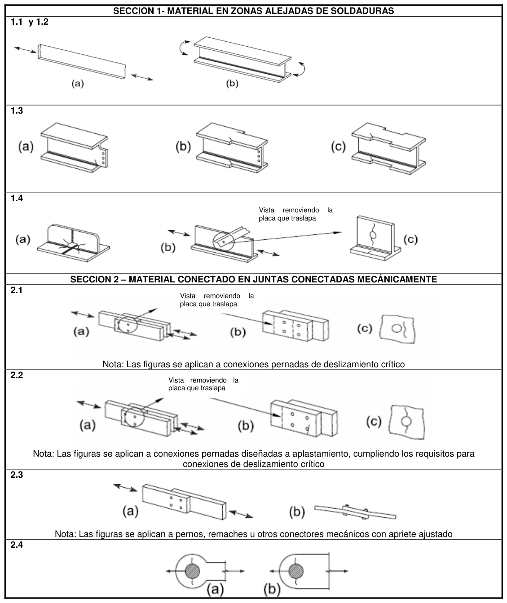

**Tabla F.2.17-1** — (continuación)

Diseño por fatiga

| Descripción | Categoría de esfuerzos | Constante $A_{1}$ | Umbral $A_{sr}$ MPa | Punto potencial de inicio de grieta |
|---|---|---|---|---|
| SECCION 3- JUNTAS SOLDADAS ENTRE COMPONENTES DE MIEMBROS ARMADOS. |  |  |  |  |
| 3.1 Metal base y metal de la soldadura en miembros sin accesorios, armados a partir de platinas o perfiles conectados con soldaduras longitudinales continuas. Estas soldaduras pueden ser soldaduras acanaladas, de penetración completa, buscando la raíz y aplicando cordón de respaldo, o soldaduras de filete. | B | 120 × 108 | 110 | En discontinuidades superficiales o internas en la soldadura, lejos del extremo de la soldadura. |
| 3.2 Metal base y metal de la soldadura en miembros sin accesorios, armados a partir de platinas o perfiles conectados con soldaduras longitudinales continuas, siendo estas soldaduras acanaladas, de penetración completa, con platina de respaldo que no se remueve, o soldaduras acanaladas de penetración parcial. | B’ | 61 × 108 | 83 | En discontinuidades superficiales o internas en las soldaduras, incluyendo las soldaduras de fijación de las platinas de respaldo. |
| 3.3 Metal base y metal de la soldadura en el extremo de las soldaduras longitudinales, sobre agujeros de acceso de soldadura en miembros armados que se empalman. | D | 22 × 108 | 48 | Desde el extremo de la soldadura hacia el alma o las aletas. |
| 3.4 Metal base en los extremos de los segmentos de soldaduras longitudinales intermitentes de filete. | E | 11 × 108 | 31 | En el material conectado al principio y al final de cualquier segmento de soldadura. |
| 3.5 Metal base en los extremos de cubreplacas soldadas de longitud parcial, más estrechas que la aleta, con extremos rectangulares o con reducción del ancho, y con o sin soldaduras transversales en los extremos; y cubreplacas más anchas que la aleta con soldaduras transversales en los extremos. Espesor de aleta ≤ 20 mm | E | 11 × 108 | 31 | En la aleta sobre el borde de la soldadura del extremo, o en la aleta donde termina la soldadura longitudinal, o en el borde de la aleta para cubreplacas anchas. |
| Espesor de aleta > 20 mm | E` | 3.9 × 108 | 18 |  |
| 3.1 Metal base en los extremos de cubreplacas soldadas de longitud parcial, más anchas que la aleta, sin soldaduras transversales en los extremos. | E’ | 3.9 × 108 | 18 | En el borde de la aleta al final de la soldadura de la cubreplaca. |

**Tabla F.2.17-1** — (continuación)

Diseño por fatiga

| Descripción | Categoría de esfuerzos | Constante $A_{1}$ | Umbral $A_{sr}$ MPa | Punto potencial de inicio de grieta |
|---|---|---|---|---|
| SECCION 4- CONEXIONES DE EXTREMO CON SOLDADURAS LONGITUDINALES DE FILETE |  |  |  |  |
| 4.1 Metal base en la unión entre miembros cargados axialmente usando soldaduras longitudinales en los extremos. Las soldaduras deberán localizarse a lado y lado del eje del miembro para tener esfuerzos balanceados en las soldaduras. $t≤12$ mm | E | 11 × 108 | 31 | Iniciando en el extremo de cualquier terminación de soldadura y extendiéndose en el metal base. |
| $t>12$ mm | E’ | 3.9 × 108 | 18 |  |

**Tabla F.2.17-1** — (continuación)

Diseño por fatiga

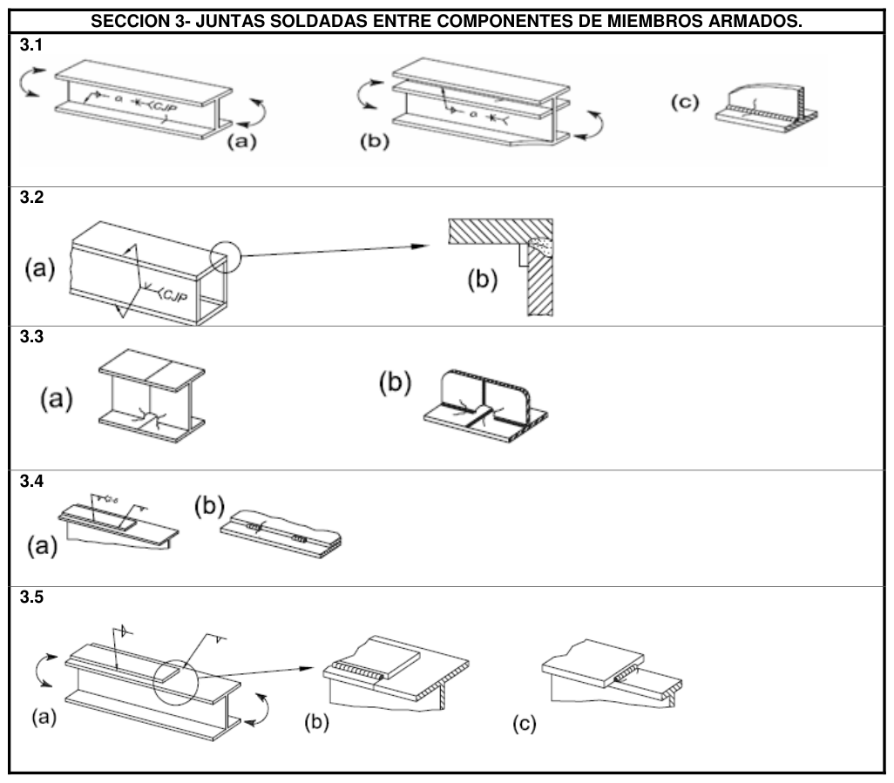

**Tabla F.2.17-1** — (continuación)

Diseño por fatiga

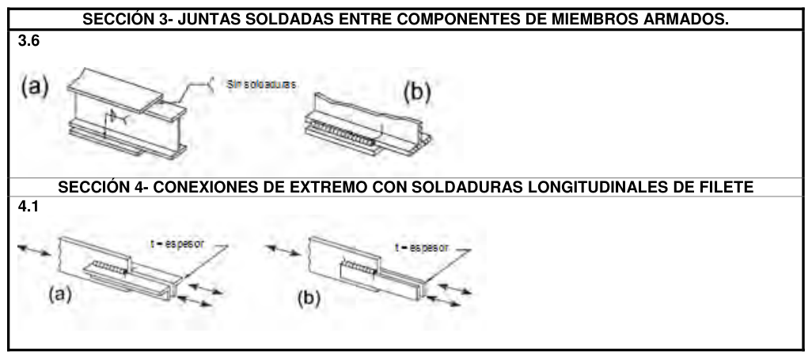

**Tabla F.2.17-1** — (continuación)

Diseño por fatiga

| Descripción | Categoría de esfuerzos | Constante $A_{1}$ | Umbral $A_{sr}$ MPa | Punto potencial de inicio de grieta |
|---|---|---|---|---|
| SECCION 5. JUNTAS SOLDADAS TRANSVERSALES A LA DIRECCION DE LOS ESFUERZOS |  |  |  |  |
| 5.1 Metal base y metal de la soldadura en, o adyacente a, empalmes con soldaduras acanaladas de penetración completa, en perfiles laminados o armados, con las soldaduras pulidas paralelamente a la dirección del esfuerzo. La calidad de la soldadura debe ser verificada por inspección radiográfica o por ultrasonido de acuerdo con los requisitos de la norma AWS D1.1. | B | 120 × 108 | 110 | Desde discontinuidades internas en el metal de la soldadura o a lo largo de la cara de la fusión. |
| 5.2 Metal base y metal de la soldadura en, o adyacente a, empalmes con soldaduras acanaladas de penetración completa, con las soldaduras pulidas paralelamente a la dirección del esfuerzo, con transiciones en el ancho o el espesor con una pendiente no mayor que 1:2.5. La calidad de la soldadura debe ser verificada por inspección radiográfica o por ultrasonido de acuerdo con los requisitos de las secciones 6.12 y 6.13 de la norma AWS D1.1. $F_{y}<620$ MPa | B | 120 × 108 | 110 | Desde discontinuidades internas en el metal de la soldadura o a lo largo de la cara de la fusión o al principio de la transición cuando $C_{f}$ MPa |
| $F_{y}≥620$ MPa | B’ | 61 × 108 | 83 |  |

**Tabla F.2.17-1** — (continuación)

Diseño por fatiga

| Descripción | Categoría de esfuerzos | Constante $A_{1}$ | Umbral $A_{sr}$ MPa | Punto potencial de inicio de grieta |
|---|---|---|---|---|
| 5.3 Metal base con $F_{y}≥620$ MPa y metal de la soldadura en, o adyacente a, empalmes con soldaduras acanaladas de penetración completa, con las soldaduras pulidas paralelamente a la dirección del esfuerzo, en transiciones en el ancho hechas con un radio no menor que 600 mm estando el punto de tangencia en el extremo de la soldadura acanalada. La calidad de la soldadura debe ser verificada por inspección radiográfica o por ultrasonido de acuerdo con los requisitos de las secciones 6.12 y 6.13 de la norma AWS D1.1. | B | 120 × 108 | 110 | Desde discontinuidades internas en el metal de la soldadura o discontinuidades a lo largo de la cara de la fusión. |
| 5.4 Metal base y metal de la soldadura en, o adyacente a, el borde de empalmes y juntas en $T$ o de esquina, de penetración completa, con o sin transiciones en el espesor, con una pendiente no mayor que $1: 2.5$ , cuando no se retira la sobremonta de la soldadura. La calidad de la soldadura debe ser verificada por inspección radiográfica o por ultrasonido de acuerdo con los requisitos de la norma AWS D1.1. | C | 44 × 108 | 69 | Desde discontinuidades superficiales en el borde de la soldadura extendiéndose en el metal base o lo largo de la cara de fusión. |
| 5.5 Metal base y metal de la soldadura en conexiones transversales de extremo en placas solicitadas por tensión, usando juntas a tope, en $T$ o de esquina con soldaduras de penetración parcial, con filetes de refuerzo o de contorno. $F_{SR}$ será el menor entre los rangos de esfuerzos para la grieta por el borde o por la raíz. Grieta que se inicia desde el borde de la soldadura. Grieta que se inicia desde la raíz de la soldadura | C C’ | 44 × 108 Ec. F.2.17.3-4 | 69 No provisto | Iniciando desde la discontinuidad geométrica al borde de la soldadura y extendiéndose en el metal base, o iniciando en la raíz de la soldadura sujeta a tensión y extendiéndose hacia arriba y después hacia afuera a través de la soldadura. |

**Tabla F.2.17-1** — (continuación)

Diseño por fatiga Ejemplos Ilustrativos

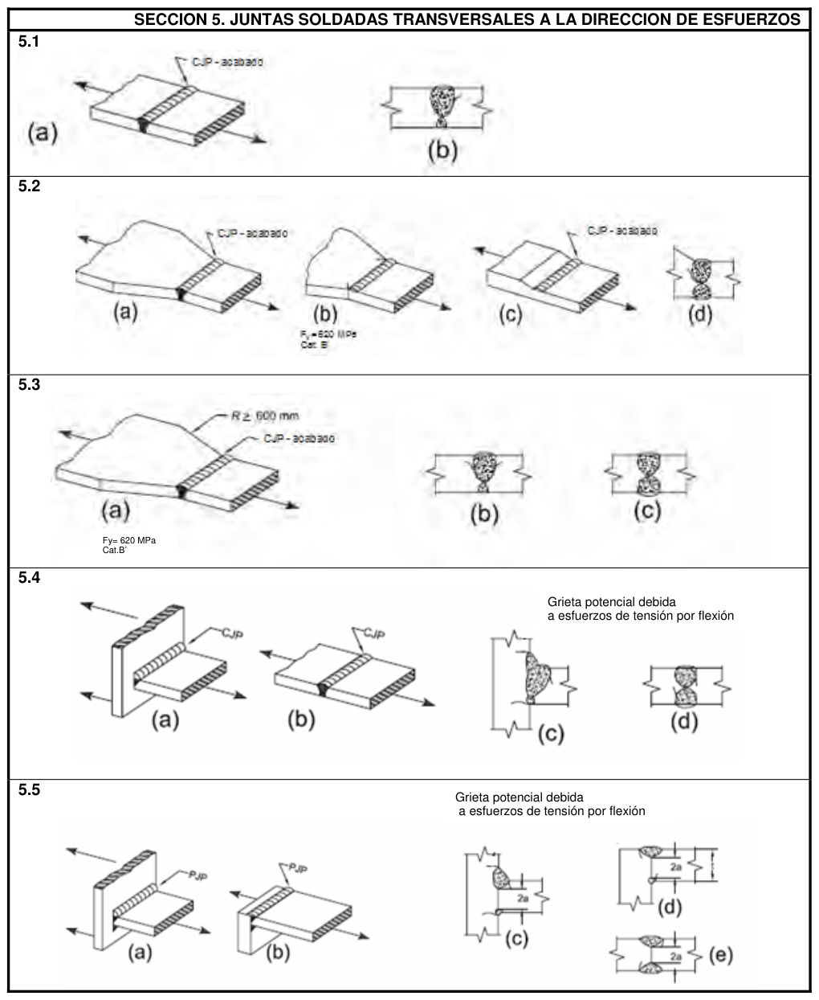

**Tabla F.2.17-1** — (continuación)

Diseño por fatiga

| Descripción | Categoría de esfuerzos | Constante $A_{1}$ | Umbral $A_{sr}$ MPa | Punto potencial de inicio de grieta |  |
|---|---|---|---|---|---|
| SECCIÓN 5. JUNTAS SOLDADAS TRANSVERSALES A LA DIRECCION DE ESFUERZOS (cont.) |  |  |  |  |  |
| 5.6 Metal base y metal de la soldadura en conexiones transversales de extremo de platinas solicitadas por tensión, usando un par de soldaduras de filete sobre lados opuestos de la platina. FSR será el menor entre los rangos de esfuerzos para la grieta por el borde o por la raíz. Grieta que se inicia desde el borde de la soldadura. Grieta que se inicia desde la raíz de la soldadura | C C” | 44 × 108 Ec. F.2.17.3-5 | 69 No provisto | Iniciando desde la discontinuidad geométrica al borde de la soldadura y extendiéndose en el metal base, o iniciando en la raíz de la soldadura sujeta a tensión y extendiéndose sobre la soldadura y después hacia afuera de la soldadura. |  |
| 5.1 Metal base en platinas solicitadas por tensión y en aletas o almas de vigas, sobre el borde de soldaduras transversales de filete adyacentes a rigidizadores transversales soldados. | C | 44 × 108 | 69 | Desde las discontinuidades geométricas al borde del filete y extendiéndose dentro del metal base |  |
| SECCIÓN 6- METAL BASE EN CONEXIONES SOLDADAS TRANVERSALES AL MIEMBRO |  |  |  |  |  |
| 6.1 Metal base en detalles unidos con soldaduras acanaladas de penetración completa, sometidos a carga longitudinal únicamente, cuando el detalle contiene un radio de transición $R$ con un acabado pulido a cero en la soldadura. $R$ ≥ 600 mm | B | 120 × 108 | 110 |  | Cerca al punto de tangencia del radio con el borde del miembro |
| 600 mm > $R$ ≥ 150 mm | C | 44 × 108 | 69 |  |  |
| 150 mm > $R$ ≥ 50 mm | D | 22 × 108 | 48 |  |  |
| 50 mm > $R$ | E | 11 × 108 | 31 |  |  |

**Tabla F.2.17-1** — (continuación)

Diseño por fatiga Ejemplos Ilustrativos

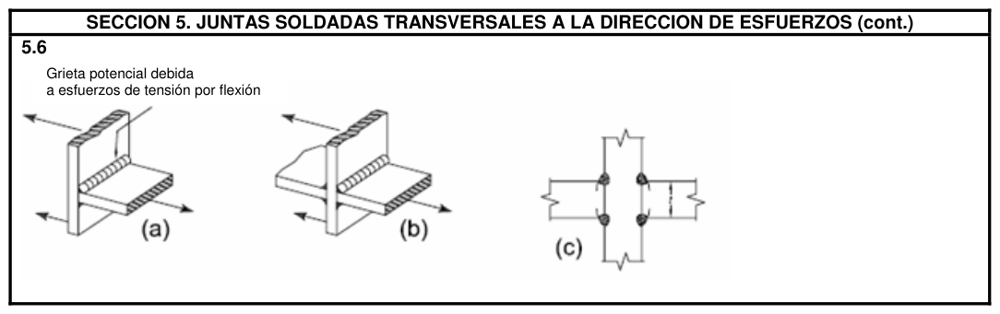

**Tabla F.2.17-1** — (continuación)

Diseño por fatiga Ejemplos Ilustrativos

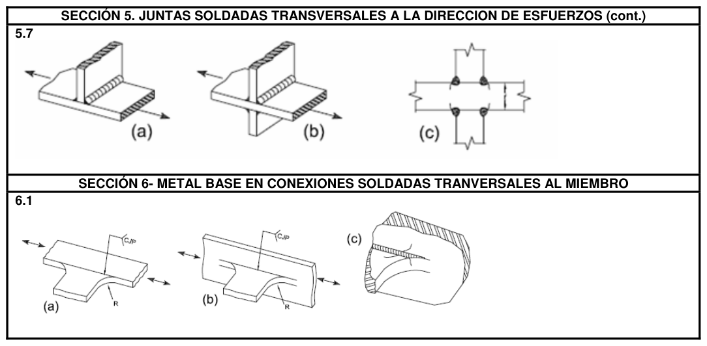

**Tabla F.2.17-1** — (continuación)

Diseño por fatiga

| Descripción | Categoría de esfuerzos | Constante $A_{1}$ | Umbral $A_{sr}$ MPa | Punto potencial de inicio de grieta |
|---|---|---|---|---|
| SECCION 6- METAL BASE EN CONEXIONES SOLDADAS TRANVERSALES AL MIEMBRO (cont.) |  |  |  |  |
| 6.2 Metal base en detalles del mismo espesor unidos por soldaduras acanaladas de penetración completa, sometido a cargas transversales con o sin cargas longitudinales, cuando el detalle contiene un radio de transición $R$ con un acabado pulido a cero en la soldadura. La calidad de la soldadura debe ser verificada por inspección radiográfica o por ultrasonido de acuerdo con los requisitos de la norma AWS D1.1. Cuando se remueve el refuerzo de la soldadura: $R$ ≥ 600 mm | B | 120 × 108 | 110 | Cerca de los puntos de |
| 600 mm > $R$ ≥ 150 mm | C | 44 × 108 | 69 | tangencia del radio o en la |
| 150 mm > $R$ ≥ 50 mm | D | 22 ×108 | 48 | soldadura o en la cara de |
| 50 mm > $R$ Cuando no se remueve el | E | 11 × 108 | 31 | fusión o en el miembro o en el elemento adherido |
| refuerzo de la soldadura: $R$ ≥ 600 mm | C | 44 × 108 | 69 | En el borde de la soldadura, |
| 600 mm > $R$ ≥ 150 mm | C | 44 × 108 | 69 | ya sea a lo largo del borde |
| 150 mm > $R$ ≥ 50 mm | D | 22 × 108 | 48 | del miembro o del elemento |
| 50 mm > $R$ | E | 11 × 108 | 31 | adherido |

**Tabla F.2.17-1** — (continuación)

Diseño por fatiga

| Descripción |  | Categoría de esfuerzos | Constante $A_{1}$ | Umbral $A_{sr}$ MPa | Punto potencial de inicio de grieta |
|---|---|---|---|---|---|
| SECCION 6- METAL BASE EN CONEXIONES SOLDADAS TRANSVERSALES AL MIEMBRO (cont.) |  |  |  |  |  |
| 6.3 Metal base en detalles de distinto espesor unidos por soldaduras acanaladas de penetración completa sometidas a cargas transversales, con o sin cargas longitudinales, cuando el detalle contiene un radio de transición $R$ con un acabado pulido a cero en la soldadura. La calidad de la soldadura debe ser verificada por inspección radiográfica o por ultrasonido de acuerdo con los requisitos de la norma AWS D1.1. Cuando se remueve el refuerzo de la soldadura: $R$ > 50 mm | D |  | 22 × 108 | 48 | Sobre el borde de la soldadura a lo largo del borde del material más |
| $R$ ≤ 50 mm | E |  | 11 × 108 | 31 | delgado En la terminación de la soldadura en radios |
| Cuando no se retira el refuerzo de la soldadura, para cualquier radio: | E |  | 11 × 108 | 31 | pequeños Sobre el borde de la soldadura a lo largo del borde del material más delgado |

**Tabla F.2.17-1** — (continuación)

Diseño por fatiga Ejemplos Ilustrativos

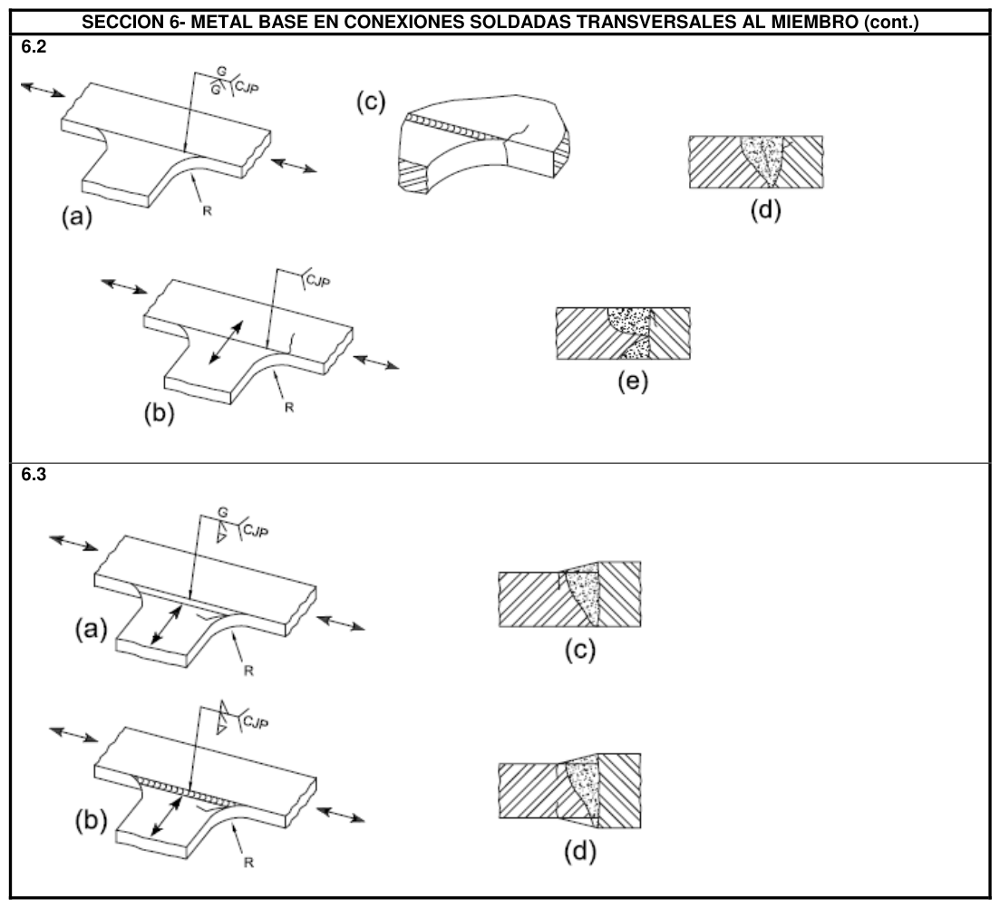

**Tabla F.2.17-1** — (continuación)

Diseño por fatiga

| Descripción | Categoría de esfuerzos | Constante $A_{1}$ | Umbral $A_{sr}$ MPa | Punto potencial de inicio de grieta |
|---|---|---|---|---|
| SECCION 6- METAL BASE EN CONEXIONES SOLDADAS TRANVERSALES AL MIEMBRO (cont.) |  |  |  |  |
| 6.1 Metal base sometido a esfuerzos longitudinales en miembros transversales, con o sin esfuerzos transversales, unidos por soldaduras de filete o soldaduras acanaladas de penetración parcial paralelas a la dirección del esfuerzo, cuando el detalle contiene un radio de transición, $R$ , con un acabado pulido a cero en las soldaduras. $R$ > 50 mm | D | 22 × 108 | 48 | En la terminación de la soldadura o desde el borde de la soldadura y extendiéndose dentro del miembro |
| $R$ ≤ 50 mm | E | 11 × 108 | 31 |  |
| SECCION 7- METAL BASE EN ACCESORIOS CORTOS1 |  |  |  |  |
| 7.1 Metal base sometido a carga longitudinal en accesorios unidos mediante soldaduras de filete paralelas o transversales a la dirección del esfuerzo, sin radio de transición, y con una longitud del detalle en dirección del esfuerzo, a, y un espesor del accesorio, normal a la superficie del miembro, b: a < 50 mm | C | 44 × 108 | 69 | En el miembro al final de la soldadura |
| 50 mm ≤ a ≤ 12b o 100 mm, el que sea menor $a>100$ mm | D | 22 × 108 | 48 |  |
| cuando $b>20$ mm a > 12b o 100 mm, el que sea menor | E | 11 × 108 | 31 |  |
| cuando $b≤20$ mm | E’ | 3.9 × 108 | 18 |  |
| 7.1 Metal base sometido a esfuerzos longitudinales, en accesorios unidos mediante soldaduras de filete o soldaduras acanaladas de penetración parcial, con o sin carga transversal en el accesorio, cuando el detalle contiene un radio de transición $R$ , con un acabado pulido a cero en la soldadura: $R$ > 50 mm | D | 22 × 108 | 48 | En la terminación de la soldadura y extendiéndose al interior del miembro |
| $R$ ≤ 50 mm | E | 11 × 108 | 31 |  |

1 “Accesorio “ se utiliza aquí para definir cualquier detalle de acero soldado a un miembro el cual, por su sola presencia e independientemente de su carga, causa discontinuidades en el flujo de esfuerzos en el miembro y por lo tanto reduce su resistencia a la fatiga.

**Tabla F.2.17-1** — (continuación)

Diseño por fatiga Ejemplos Ilustrativos

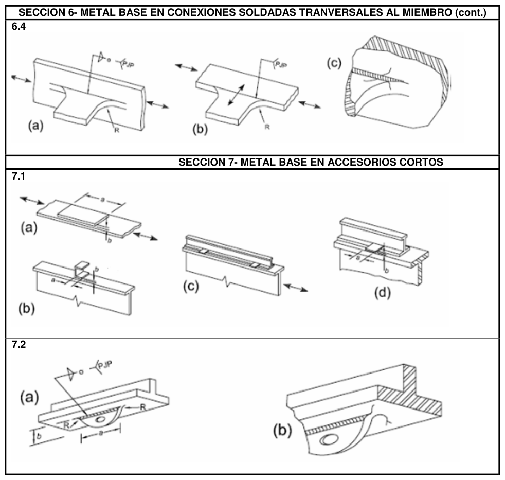

**Tabla F.2.17-1** — (continuación)

Diseño por fatiga

| Descripción | Categoría de esfuerzos | Constante $A_{1}$ | Umbral $A_{sr}$ MPa | Punto potencial de inicio de grieta |
|---|---|---|---|---|
| SECCION 8 - JUNTAS VARIAS |  |  |  |  |
| 8.1 Metal base en conectores tipo espigo unidos por soldaduras de filete o por fusión. | C | 44 × 108 | 69 | Sobre el borde de la soldadura en el metal base |
| 8.2 Esfuerzo cortante en la garganta de soldaduras de filete, continuas o intermitentes, longitudinales o transversales. | F | 150 × 1010 Ec. F.2.17-2 | 55 | En la garganta de la soldadura. |
| 8.3 Metal base en soldaduras de tapón o de ranura. | E | 11 × 108 | 31 | En el extremo de la soldadura en el metal base. |
| 8.4 Esfuerzo cortante en soldaduras de tapón o de ranura. | F | 150 × 1010 Ec. F.2.17-2 | 55 | En la superficie de contacto. |
| 8.5 Pernos de alta resistencia no pretensionados, pernos comunes, varillas de anclaje roscadas y barras colgantes con roscas cortadas o laminadas. Se debe tomar el rango de esfuerzos en el área a tensión debido a la carga viva más los efectos de palanca cuando sea aplicable. | G | 3.9 × 108 | 48 | En la raíz de las roscas y extendiéndose hacia el área a tensión |

**Tabla F.2.17-1** — (continuación)

Diseño por fatiga Ejemplos Ilustrativos

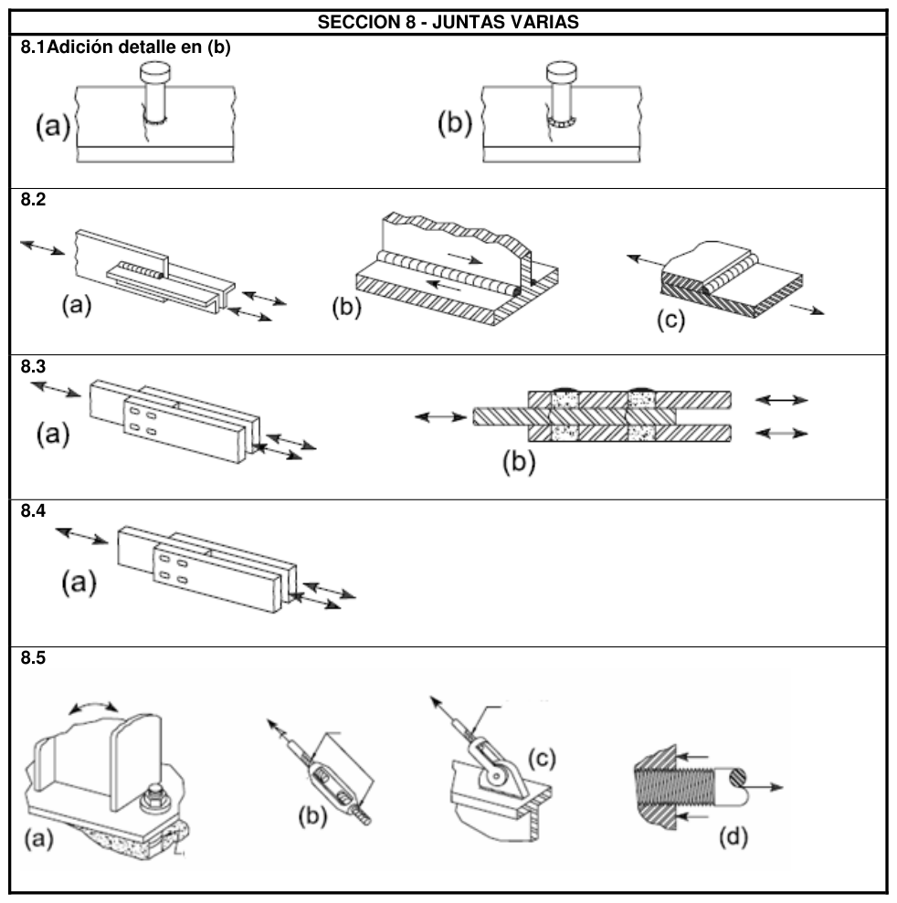

### F.2.18 — DISEÑO PARA CONDICIONES DE INCENDIO

Este Capítulo proporciona criterios para el diseño y evaluación de componentes y sistemas de acero estructural para condiciones de incendio. Se prescriben criterios para determinar la temperatura de diseño, la expansión térmica y la degradación en las propiedades mecánicas de los materiales a temperaturas elevadas, que causan la disminución progresiva en la resistencia y la rigidez de los componentes y sistemas estructurales sometidos a temperaturas elevadas.

Se incluyen las siguientes secciones:

F.2.18.1 — Provisiones generales F.2.18.2 — Diseño estructural para condiciones de incendio por métodos analíticos F.2.18.3 — Diseño por ensayos de calificación

#### F.2.18.1 — PROVISIONES GENERALES

**F.2.18.1.1** — Objetivos de desempeño — Los componentes estructurales del edificio deben diseñarse de tal forma que mantengan su función de soportar las cargas durante el incendio de diseño, al tiempo que satisfagan los otros objetivos de desempeño requeridos para el uso del edificio.

Se aplicarán criterios de deformación siempre que los medios que proporcionan la resistencia al fuego de la estructura, o los criterios de diseño para las barreras contra incendio, dependan de que se limiten las deformaciones de la estructura portante.

Dentro del recinto donde se origina el fuego, las fuerzas y deformaciones asociadas al incendio de diseño no deben generar una brecha en la compartimentación horizontal o vertical.

**F.2.18.1.2** — Diseño por métodos analíticos — Se permite el uso de los métodos de análisis del numeral F.2.18.2 para documentar el comportamiento esperado de una estructura de acero sujeta al incendio de diseño. Los métodos de dicha sección son suficiente evidencia del cumplimiento de los objetivos de desempeño establecidos en F.2.18.1.1.

El diseño estructural para condiciones de incendio con base en el numeral F.2.18.2 deberá ejecutarse de acuerdo con las provisiones del numeral F.2.2.3.3.

**F.2.18.1.3** — Diseño por ensayos de calificación — Se permite usar los métodos de ensayos de calificación de la sección F.2.18.3 para establecer la resistencia al fuego de una estructura de acuerdo con los estándares requeridos por este Reglamento.

**F.2.18.1.4** — Combinaciones de carga y resistencia requerida — La resistencia requerida de una estructura y sus elementos se determinará a partir de la siguiente combinación de cargas gravitacionales:

$$ [0.9\text{ ó }1.2]D+T+0.5L+0.2G \tag{F.2.18-1} $$

donde:

$D$ = carga muerta nominal

$L$ = carga viva nominal

$G$ = carga nominal de granizo

$T$ = fuerzas y deformaciones nominales causadas por el incendio de diseño definido en el numeral F.2.18.2.1 A la anterior combinación de cargas deberá adicionarse una carga ficticia lateral, $N_{i}=0.002Y_{i}$, como se define en el numeral F.2.3.2.2, donde $N_{i}$ es la carga ficticia lateral aplicada a la estructura en el nivel $i$ y $Y_{i}$ es la carga gravitacional aplicada en el nivel $i$ según la combinación F.2.18-1. $D$ , $L$ y $G$ serán las cargas nominales especificadas en el Título B de este Reglamento.

#### F.2.18.2 — DISEÑO ESTRUCTURAL PARA CONDICIONES DE INCENDIO POR METODOS ANALITICOS

Se permite diseñar los miembros, componentes y estructuras de edificios en general para temperaturas elevadas de acuerdo con los requisitos de esta sección.

**F.2.18.2.1** — Incendio de diseño — Se debe definir un incendio de diseño que represente las condiciones de calentamiento para la estructura. Estas condiciones de calentamiento deberán derivarse de los materiales combustibles y de las características del recinto donde se presenta el incendio supuesto. La carga de fuego debe estar basada en el uso definido en el titulo J de este Reglamento. Las condiciones de calentamiento se especificarán ya sea en términos de un flujo de calor o de temperatura en la capa superior de gas generada por el incendio. Deberá determinarse la variación de las condiciones de calentamiento con el tiempo a lo largo del incendio.

Cuando se utilicen los métodos analíticos del numeral F.2.18.2 para demostrar la equivalencia de materiales o métodos alternativos según lo permitido por este Reglamento, el incendio de diseño deberá determinarse de acuerdo con la norma ASTM E119.

**F.2.18.2.1.1** — Incendio concentrado — Cuando la velocidad de transferencia de calor de un incendio es insuficiente para causar la ignición, se debe suponer una exposición a un incendio concentrado. En tales casos, se deben utilizar la composición del combustible, la distribución del mismo, y el área de piso ocupado, para determinar el flujo de calor irradiado a la estructura a partir de la llama y la columna de humo generada.

**F.2.18.2.1.2** — Incendios posteriores a la ignición — Cuando la velocidad de transferencia de calor de un incendio es suficiente para causar la ignición, se debe suponer un incendio posterior a la ignición en el recinto considerado. La determinación de la curva temperatura-tiempo del incendio debe incluir la carga de fuego, las características de ventilación naturales o mecánicas en el espacio, las dimensiones del recinto y las características térmicas de los límites del recinto.

La duración del incendio en un área en particular se determinará considerando la masa total combustible, esto es, la carga de fuego disponible en el recinto. Para el caso de incendios concentrados o incendios posteriores a la ignición, la duración se determinará como la masa total de combustible dividida entre la velocidad de pérdida de masa.

**F.2.18.2.1.3** — Incendios exteriores — Deberá considerarse la exposición de la estructura exterior a llamas proyectadas a través de las ventanas y otras aberturas en los muros, como resultado de un incendio posterior a la ignición en un recinto, en conjunto con la radiación generada por el fuego interior a través de las aberturas. Deberán usarse el perfil y la longitud de la proyección de la llama, junto con la distancia entre la llama y el acero exterior, para determinar el flujo de calor hacia el acero.

Para modelar las características del fuego dentro del recinto deberá utilizarse el método indicado en la sección F.2.18.2.1.2.

**F.2.18.2.1.4** — Sistemas de protección activa — Al especificar el incendio de diseño se deben considerar los efectos de los sistemas de protección activa contra incendio.

Cuando se instalan ventilaciones automáticas para humo y calor en recintos que no tengan rociadores, la temperatura del humo resultante será determinada mediante cálculos.

**F.2.18.2.2** — Temperaturas en sistemas estructurales sometidos a incendio — Las temperaturas causadas por el incendio de diseño en los elementos estructurales, componentes y estructuras en general deberán ser determinadas por un análisis de transferencia de calor.

**Tabla F.2.18.2-1**

Propiedades del acero a temperaturas elevadas

| Temperatura del Acero oC | $k_{E}=E_{(T)}/ E$ $=G_{(T)}/G$ | $k_{p}=F_{p(T)}/ F_{y}$ | $k_{y}=F_{y(T)}/ F_{y}$ | $k_{u}=F_{u(T)}/ F_{y}$ |
|---|---|---|---|---|
| 20 | 1.00 | 1.00 | 1.00 | 1.00 |
| 93 | 1.00 | 1.00 | 1.00 | 1.00 |
| 204 | 0.90 | 0.80 | 1.00 | 1.00 |
| 316 | 0.78 | 0.58 | 1.00 | 1.00 |
| 399 | 0.70 | 0.42 | 1.00 | 1.00 |
| 427 | 0.67 | 0.40 | 0.94 | 0.94 |
| 538 | 0.49 | 0.29 | 0.66 | 0.66 |
| 649 | 0.22 | 0.13 | 0.35 | 0.35 |
| 760 | 0.11 | 0.06 | 0.16 | 0.16 |
| 871 | 0.07 | 0.04 | 0.07 | 0.07 |
| 982 | 0.05 | 0.03 | 0.04 | 0.04 |
| 1093 | 0.02 | 0.01 | 0.02 | 0.02 |
| 1204 | 0.00 | 0.00 | 0.00 | 0.00 |

**F.2.18.2.3** — Resistencia de los materiales a temperaturas elevadas — Las propiedades de los materiales a temperaturas elevadas se determinarán por medio de ensayos. Cuando no se dispone de estos datos, se permite usar las propiedades de los materiales estipuladas en esta sección. Estos datos no aplican para aceros con una resistencia a la fluencia superior a 448MPa o para concretos con una resistencia especificada a compresión mayor que 55 MPa.

**F.2.18.2.3.1** — Dilatación térmica — Los coeficientes de expansión se tomarán como sigue: Expansión térmica de aceros estructurales y de refuerzo — para cálculos a temperaturas por encima de 65ºC, el coeficiente de expansión térmica será de 14X10-6/ºC Expansión térmica de concreto de peso normal — para cálculos a temperaturas por encima de 65ºC, el coeficiente de expansión térmica será 18X10-6/ºC Expansión térmica de concreto aligerado — para cálculos a temperaturas por encima de 65ºC, el coeficiente de expansión térmica será 7.9X10-6/ºC

**F.2.18.2.3.2** — Propiedades mecánicas a temperaturas elevadas — Deberá tenerse en cuenta en el análisis estructural la degradación de la resistencia y rigidez de los elementos, componentes y sistemas estructurales. Se permite utilizar en el análisis estructural los valores de $F_{y(T)}$, $F_{p(T)}$, $F_{u(T)}$, $E_{(T)}$, $G_{(T)}$, $f_{c T,( )}'$, $E_{c(T)}$ y $εcu(T)$ a temperaturas elevadas, expresados como proporción de estas mismas propiedades a temperatura ambiente, supuesta de 20ºC, de acuerdo con las tablas F.2.18.2-1 y F.2.18.2-2. Se permite interpolar entre estos valores.

**Tabla F.2.18.2-2**

Propiedades del concreto a temperaturas elevadas

| Temperatura del Acero oC | $k_{c}=f_{c T,( )}'/ f_{c}'$ |  | $E_{c(T)}/ E_{c}$ | $εcu(T)$ % |
|---|---|---|---|---|
|  | Concreto de peso normal | Concreto aligerado |  | Concreto de peso normal |
| 20 | 1.00 | 1.00 | 1.00 | 0.25 |
| 93 | 0.95 | 1.00 | 0.93 | 0.34 |
| 204 | 0.90 | 1.00 | 0.75 | 0.46 |
| 288 | 0.86 | 1.00 | 0.61 | 0.58 |
| 316 | 0.83 | 0.98 | 0.57 | 0.62 |
| 427 | 0.71 | 0.85 | 0.38 | 0.80 |
| 538 | 0.54 | 0.71 | 0.20 | 1.06 |
| 649 | 0.38 | 0.58 | 0.092 | 1.32 |
| 760 | 0.21 | 0.45 | 0.073 | 1.43 |
| 871 | 0.10 | 0.31 | 0.055 | 1.49 |
| 982 | 0.05 | 0.18 | 0.036 | 1.50 |
| 1093 | 0.01 | 0.05 | 0.018 | 1.50 |
| 1204 | 0.00 | 0.00 | 0.00 | 1.50 |

**F.2.18.2.4** — Requisitos para el diseño estructural

**F.2.18.2.4.1** — Integridad general de la estructura — La estructura deberá proporcionar la resistencia y capacidad de deformación adecuadas para atender los efectos desarrollados durante el incendio cumpliendo con los límites de deformación prescritos. El sistema estructural deberá diseñarse aceptando algún grado de daño local pero permaneciendo estable como un todo.

Se deben suministrar trayectorias de carga continuas que transfieran todas las fuerzas desde la región expuesta hasta el punto final de resistencia. La cimentación se diseñará para resistir las fuerzas y tolerar las deformaciones desarrolladas durante el incendio de diseño.

**F.2.18.2.4.2** — Requisitos de resistencia y límites para las deformaciones — La conformidad del sistema estructural con estos requisitos se demostrará construyendo un modelo matemático de la estructura basado en los principios de la mecánica estructural y evaluando este modelo para las fuerzas internas y deformaciones que se desarrollan en los miembros de la estructura como resultado de las temperaturas del incendio de diseño.

Los miembros individuales deberán resistir las fuerzas cortantes, fuerzas axiales y momentos determinados de acuerdo con estas provisiones.

Las conexiones deberán diseñarse para desarrollar la resistencia de los miembros conectados o las fuerzas indicadas anteriormente. Cuando para suministrar la resistencia al fuego se requieran criterios de deformaciones, éstas no deben superar los límites prescritos.

**F.2.18.2.4.3** — Métodos de análisis

**F.2.18.2.4.3.1** — Métodos de análisis avanzados — Se permite utilizar los métodos de análisis en esta sección para el diseño de todo tipo de las estructuras de acero bajo condiciones de incendio. El incendio de diseño deberá determinarse de acuerdo con el numeral F.2.18.2.1. El análisis incluirá la respuesta térmica y la respuesta mecánica al incendio de diseño.

La respuesta térmica producirá un campo de temperatura en cada elemento estructural como resultado del incendio de diseño e incluirá las propiedades térmicas dependientes de la temperatura para los elementos estructurales y los materiales resistentes al fuego, de acuerdo con la sección F.2.18.2.2.

La respuesta mecánica da como resultado fuerzas y deflexiones en el sistema estructural sometido a la respuesta térmica calculada a partir del incendio de diseño. La respuesta mecánica deberá considerar explícitamente la degradación de la resistencia y la rigidez con el incremento de la temperatura, los efectos de las expansiones térmicas y las grandes deformaciones. Las condiciones de frontera y la restricción en las conexiones deben ser representativas del diseño estructural propuesto. Las propiedades de los materiales serán definidas de acuerdo con la sección F.2.18.2.3.

El análisis resultante deberá considerar todos los estados límites pertinentes, tales como las deflexiones excesivas, fracturas en las conexiones, y pandeo local o global.

**F.2.18.2.4.3.2** — Métodos de análisis simplificados — Se permite el uso de los métodos de análisis presentados en esta sección para la evaluación del desempeño de miembros individuales a temperaturas elevadas durante la exposición al fuego.

Se puede suponer que las restricciones y condiciones de apoyo (fuerzas, momentos y condiciones de frontera) aplicables a temperaturas normales se mantienen inalterables durante la exposición al incendio.

Cuando la temperatura del acero sea inferior a 204°C, las resistencias de diseño de los miembros y conexiones podrán calcularse sin entrar a considerar los efectos de temperatura.

En caso contrario, ellas deberán calcularse según las provisiones de esta sección.

A temperaturas por debajo de los 204°C, no se requiere considerar la degradación de las propiedades del acero para el cálculo de las resistencias de los miembros bajo el método de análisis simplificado, sin embargo, sí se deben tener en cuenta las fuerzas y las deformaciones que resultan de las temperaturas elevadas.

**F.2.18.2.4.3.2.1** — Miembros a tensión — Se permite modelar la respuesta térmica de un elemento a tensión usando una ecuación de transferencia de calor unidimensional, con la entrada de calor correspondiente al incendio de diseño de acuerdo con la sección F.2.18.2.1.

La resistencia de diseño de un miembro a tensión se determinará usando las provisiones de la sección F.2.4, con las propiedades del acero que se estipulan en F.2.18.2.3 y suponiendo una temperatura uniforme en la sección transversal, igual a la temperatura máxima en el acero..

**F.2.18.2.4.3.2.2** — Miembros a compresión — Se permite modelar la respuesta térmica de un elemento a compresión usando una ecuación de transferencia de calor unidimensional, con la entrada de calor correspondiente al incendio de diseño de acuerdo a la sección F.2.18.2.1.

La resistencia de diseño de un miembro a compresión se determinará usando las provisiones de la sección F.2.5, con las propiedades del acero estipuladas en la sección F.2.18.2.3, y usando la fórmula F.2.18.2-1 en lugar de las fórmulas F.2.5.3-2 y F.2.5.3-3 para calcular la resistencia nominal a compresión para el estado límite de pandeo flexional:

$$ F_{cr(T)}=\left[0.42\sqrt{F_{y(T)}/F_{e(T)}}\right]F_{y(T)} \tag{F.2.18.2-1} $$

donde $F_{y(T)}$ es el esfuerzo de fluencia para temperaturas elevadas y $F_{e(T)}$es el esfuerzo crítico de pandeo elástico calculado con la fórmula F.2.5.3-4, usando el módulo elástico a temperaturas elevadas, $E_{(T)}$. Para obtener$F_{y(T)}$ y $E_{(T)}$ deben usarse los coeficientes de la tabla F.2.18.2-1.

**F.2.18.2.4.3.2.3** — Miembros a flexión — Se permite modelar la respuesta térmica de elementos a flexión usando una ecuación de transferencia de calor unidimensional para calcular la temperatura de la aleta inferior y suponer que ésta es constante sobre toda la profundidad del miembro.

La resistencia de diseño de un miembro a flexión se determinará usando las provisiones de la sección F.2.6, con las propiedades del acero estipuladas en la sección F.2.18.2.3 y usando las fórmulas F.2.18.2-2 a F.2.18.2-9 en lugar de las fórmulas F.2.6.2-2 a F.2.6.2-6 para calcular la resistencia nominal a flexión para el estado límite de pandeo lateral-torsional de miembros con simetría doble sin arriostramiento lateral.

(a) Para $L_{b}≤L_{r(T)}$

$$ M_{n(T)}=C_{b}\left[M_{r(T)}+\left[M_{p(T)}-M_{r(T)}(1-L_{b}/L_{r(T)})^{c_{x}}\right]\right] \tag{F.2.18.2-2} $$

(b) Para $L_{b}>L_{r(T)}$

$$ M_{n}(T)=F_{cr(T)}S_{x} \tag{F.2.18.2-3} $$

donde:

$$ F_{cr(T)}=\dfrac{C_{b}\pi ^{2}E_{(T)}}{(L_{b}/r_{ts})^{2}}\sqrt{1+0.078\dfrac{J_{c}}{S_{x}h_{o}}\left(\dfrac{L_{b}}{r_{ts}}\right)^{2}} \tag{F.2.18.2-4} $$

$$ L_{r(T)}=1.95r_{ts}\dfrac{E_{(T)}}{F_{L(T)}}\sqrt{\dfrac{J_{c}}{S_{x}h_{o}}+\sqrt{\left(\dfrac{J_{c}}{S_{x}h_{o}}\right)^{2}+6.76\left(\dfrac{F_{L(T)}}{E_{(T)}}\right)^{2}}} \tag{F.2.18.2-5} $$

$$ M_{r(T)}=S_{x}F_{L(T)} \tag{F.2.18.2-6} $$

$$ F_{L(T)}=F_{y}(k_{p}-0.3k_{y}) \tag{F.2.18.2-7} $$

$$ M_{p(T)}=Z_{x}F_{y(T)} \tag{F.2.18.2-8} $$

$$ c_{x}=0.6+\dfrac{T}{250}\le 3.0\quad (T\text{ en grados centígrados}) \tag{F.2.18.2-9} $$

Las propiedades del material a temperaturas elevadas ($F_{y(T)}$ y $E_{(T)}$) y los coeficientes $k_{p}$ y $k_{y}$ se calculan de acuerdo con la tabla F.2.18.2-1. Los otros términos corresponden a los definidos en el numeral F.2.6.

**F.2.18.2.4.3.2.4** — Miembros de pisos de construcción compuesta — Se permite modelar la respuesta térmica de elementos a flexión que soportan una losa de concreto usando una ecuación de transferencia de calor unidimensional para calcular la temperatura de la aleta inferior. Dicha temperatura se tomará como constante desde la aleta inferior hasta la mitad de la profundidad del alma, decreciendo linealmente en no más de un 25% desde la mitad de la profundidad del alma hasta la aleta superior de la viga.

La resistencia de diseño de un miembro compuesto a flexión se determinará usando las condiciones de la sección F.2.9, con esfuerzos de fluencia en el acero reducidos de manera consistente con la variación de la temperatura.

**F.2.18.2.4.4** — Resistencia de diseño — La resistencia de diseño se determinará de acuerdo con la sección F.2.2.3.3. La resistencia nominal, $R_{n}$ , se calculará usando las propiedades de los materiales estipuladas en la sección F.2.18.2.3, a la temperatura que se desarrolle bajo el incendio de diseño.

#### F.2.18.3 — DISEÑO POR ENSAYOS DE CALIFICACIÓN

**F.2.18.3.1** — Normas de Calificación — Los miembros estructurales y los componentes de un edificio de acero deberán calificarse para una resistencia al fuego de acuerdo con la norma ASTM E119. Se permite demostrar el cumplimiento de estos requisitos usando los procedimientos que para construcción en acero se especifican en la Sección 5 de la norma SEI/ASCE/SFPE 29-05, Métodos Estándar de Cálculo para Protección de las Estructuras contra Incendios.

**F.2.18.3.2** — Construcción restringida — Los sistemas de piso o techo, así como las vigas individuales en edificios, se consideran restringidos cuando la estructura circundante o de y soporte es capaz de resistir las acciones causadas por la expansión térmica en el rango de las temperaturas esperadas.

Las vigas, viguetas y ensambles de acero que soportan losas de concreto y que son soldadas o atornilladas a la estructura principal se deben considerar como construcciones restringidas a la expansión térmica.

**F.2.18.3.3** — Construcción no restringida — Las vigas, viguetas y estructuras portantes de acero que no soportan losas de concreto se considerarán no restringidas a la expansión térmica a menos que estén atornilladas o soldadas a una estructura circundante específicamente diseñada y detallada para resistir las acciones causadas por expansión térmica.

Un miembro de acero de una luz o en la luz extrema de un sistema de luces múltiples, apoyado en muros, se considerará no restringido a menos que el muro haya sido diseñado y detallado para resistir los efectos de la expansión térmica.

### F.2.19 — EVALUACIÓN DE ESTRUCTURAS EXISTENTES

Este numeral se aplica a la evaluación de la resistencia y la rigidez de estructuras existentes bajo cargas de gravedad por medio de análisis estructural, ensayos de carga o la combinación de ambos. Para dicha evaluación, el acero no está limitado a las calidades listadas en la sección F.2.1.5.1. Esta sección no es aplicable para ensayos de carga cuyo objeto sea la evaluación de los efectos de cargas sísmicas o móviles (vibración).

Se incluyen las siguientes secciones:

F.2.19.1 — Provisiones Generales F.2.19.2 — Propiedades del Material F.2.19.3 — Evaluación Mediante Análisis Estructural F.2.19.4 — Evaluación Mediante Ensayos de Carga F.2.19.5 — Informe de Evaluación

#### F.2.19.1 — PROVISIONES GENERALES

Estas provisiones son aplicables cuando se requiera la evaluación de una estructura de acero existente para:

(a) verificar unas condiciones específicas de cargas de diseño

(b) determinar la resistencia de diseño de un miembro o sistema estructural.

Esta evaluación puede realizarse mediante un análisis estructural (F.2.19.3), por ensayos de carga (F.2.19.4), o por una combinación de ambos. Cuando se utilicen ensayos de carga, el ingeniero estructural deberá primero analizar la estructura, planear el ensayo, y escribir un procedimiento para prevenir la ocurrencia de deformaciones permanentes excesivas o el colapso durante el ensayo.

#### F.2.19.2 — PROPIEDADES DEL MATERIAL

**F.2.19.2.1** — Determinación de los ensayos necesarios — El ingeniero estructural determinará qué ensayos específicos se requieren según las secciones F.2.19.2.2 a F.2.19.2.6 y especificará la ubicación de los mismos. Cuando se disponga de información sobre el diseño y la construcción de la edificación se permitirá reducir o eliminar los ensayos requeridos.

**F.2.19.2.2** — Propiedades del material a tensión — Para la evaluación por análisis estructural o ensayos de carga deben considerarse las propiedades a tensión de los miembros. Estas propiedades incluyen el esfuerzo de fluencia, la resistencia a tensión y el porcentaje de alargamiento. Cuando se disponga de certificados de la acería o de reportes de ensayos realizados por el fabricante o por un laboratorio cumpliendo con las normas ASTM A6/A6M o A568/A568M, según sean aplicables, estos documentos serán suficientes para efectos de la evaluación. En caso contrario, se deberá realizar ensayos que cumplan con la norma ASTM A370 a partir de probetas cortadas de los componentes de la estructura.

**F.2.19.2.3** — Composición química — Cuando se prevé la utilización de soldadura para reparar o modificar estructuras existentes, deberá determinarse la composición química del acero para preparar los procedimientos de soldadura. Cuando se disponga de certificados de la acería o de reportes de ensayos realizados por el fabricante o por un laboratorio cumpliendo con las normas ASTM aplicables, estos documentos serán suficientes para efectos de la evaluación. En caso contrario se deberá realizar análisis de acuerdo con la norma ASTM A751 a partir de las probetas utilizadas para los ensayos de resistencia o probetas tomadas en la misma ubicación.

**F.2.19.2.4** — Tenacidad del metal base — Cuando, en un perfil pesado o una placa pesada, según se define en la sección F.2.1.5.1d, se tenga un empalme soldado a tensión que sea crítico para el comportamiento de la estructura, deberá obtenerse la tenacidad de la prueba de impacto de Charpy con ranura en V, de acuerdo con las provisiones de la sección F.2.1.5.1d. Si la tenacidad así obtenida no cumple con los requisitos de dicha sección, el ingeniero estructural determinará si se requiere tomar medidas correctivas.

**F.2.19.2.5** — Metal de la soldadura — Cuando el comportamiento estructural dependa de conexiones soldadas existentes, se tomarán muestras representativas del metal de la soldadura. Las características del metal de la soldadura deberán determinarse mediante análisis químicos y ensayos mecánicos. Se deberán determinar también la magnitud y las eventuales consecuencias de las imperfecciones detectadas. Si no se cumplan los requisitos de AWS D1.1, el ingeniero estructural determinará si se requiere tomar medidas correctivas.

**F.2.19.2.6** — Pernos y remaches — Deberán realizarse una inspección de una muestra representativa de los pernos para clasificarlos. Cuando los pernos no puedan ser identificados apropiadamente de manera visual, se removerán algunas muestras representativas y se las ensayará con el objeto de determinar su resistencia a la tracción de acuerdo con las normas ASTM F606 o ASTM F600M y así clasificarlos adecuadamente.

Alternativamente, podrá suponerse que los pernos sean ASTM A307. Los remaches pueden suponerse de calidad ASTM A502 Grado 1, a menos que mediante documentación o ensayos se pueda establecer un mayor grado.

#### F.2.19.3 — EVALUACIÓN MEDIANTE ANÁLISIS ESTRUCTURAL

**F.2.19.3.1** — Dimensiones — Todas las dimensiones que se requieran para la evaluación, tales como luces, alturas de columnas, espaciamiento de miembros, ubicación de arriostramientos, secciones transversales, espesores y detalles de conexión, se obtendrán a partir de un levantamiento en sitio. Alternativamente, cuando se disponga de de planos estructurales o de fabricación se permitirá partir de ellos para determinar tales dimensiones, previa verificación de los valores críticos.

**F.2.19.3.2** — Evaluación de la resistencia — Las fuerzas en los miembros y las conexiones se determinarán por medio de un análisis estructural adecuado para el tipo de estructura que se evalúa. Los efectos de las cargas se determinarán para las combinaciones de carga especificadas en el Título B de este Reglamento.

La resistencia de diseño de los miembros y las conexiones se determinará a partir de los requisitos de los numerales F.2.2 a F.2.11 de este Capítulo.

**F.2.19.3.3** — Evaluación de las condiciones de servicio — Cuando se requiera, se deberán calcular y reportar las deformaciones bajo carga de servicio.

#### F.2.19.4 — EVALUACIÓN MEDIANTE ENSAYOS DE CARGA

**F.2.19.4.1** — Determinación de la capacidad de carga por ensayos — Para determinar la capacidad de carga de una estructura existente de piso o de cubierta mediante ensayos, se aplicará de manera incremental una carga de prueba de acuerdo con las especificaciones del ingeniero estructural. La estructura deberá inspeccionarse visualmente para detectar signos de sobreesfuerzo o falla inminente para cada incremento de carga. En caso de que se detecten estas u otras condiciones inusuales deben tomarse las medidas apropiadas.

Se tomará como capacidad de la estructura, obtenida del ensayo, la suma de la carga máxima aplicada más la carga muerta en sitio. La capacidad de carga viva de una estructura de piso se determinará igualando dicha capacidad de la estructura obtenida del ensayo a $1.2D+1.6L$, donde $D$ es la carga muerta nominal y $L$ la capacidad nominal de carga viva para la estructura. La capacidad de carga viva nominal de la estructura de piso no se tomará mayor que la calculada mediante la aplicación de los requisitos de este Capítulo. Para estructuras de cubierta, se usarán $L_{r}$ y $G$ , como se definen en el Título B, en lugar de $L$ . Deberán aplicarse combinaciones de carga más severas cuando así se requiera.

Cuando se haya llegado al nivel de cargas de servicio y una vez se haya detectado el inicio del comportamiento inelástico, deberán realizarse ciclos periódicos de descarga, con el objeto de documentar el grado de deformación permanente y la magnitud de las deformaciones inelásticas. Las deformaciones de la estructura, tales como las deflexiones de los miembros, deberán ser monitoreadas en los puntos más críticos durante el ensayo, y ser referenciadas a la posición inicial antes de la carga. Deberá verificarse que, cuando se mantenga durante una hora la carga máxima del ensayo, que la deformación de la estructura no se incremente en más de un 10% por encima de la correspondiente al inicio de dicho periodo. Cuando se considere necesario, se permite repetir la secuencia de carga para demostrar la conformidad con esta condición.

Así mismo, deberán documentarse las deformaciones de la estructura 24 horas después de que la carga de prueba se haya retirado para determinar la magnitud de las deformaciones permanentes. Ya que la magnitud de la deformación permanente aceptable depende de la estructura en consideración, no se establece un límite para las deformaciones permanentes bajo la carga máxima. Cuando no sea posible realizar el ensayo de carga para toda la estructura, deberá seleccionarse una zona que tenga una extensión no menor que un módulo completo y sea representativa de las condiciones más críticas.

**F.2.19.4.2** — Evaluación de las condiciones de servicio — Cuando se realicen ensayos de carga, la estructura debe ser cargada por incrementos hasta alcanzar la carga de servicio. Las deformaciones deben ser monitoreadas por un periodo de una hora. La estructura deberá entonces ser descargada y documentada su deformación.

#### F.2.19.5 — INFORME DE EVALUACIÓN

Cuando se haya completado la evaluación de una estructura existente, el ingeniero estructural debe preparar un informe donde se documente dicha evaluación. El informe debe indicar si la evaluación se realizó mediante un análisis estructural o por ensayos de carga o por una combinación de los dos métodos. Cuando se hayan realizado ensayos, el informe deberá incluir adicionalmente las cargas y combinaciones de cargas utilizadas y las curvas carga-deformación y tiempo-deformación registradas. Toda la información relevante obtenida de los planos estructurales, los certificados de acería y los ensayos complementarios de los materiales deberá igualmente ser reportada. Finalmente, el informe debe indicar si la estructura, incluyendo todos sus miembros y conexiones, es adecuada para resistir los efectos de las cargas.

### F.2.20 — ARRIOSTRAMIENTO DE COLUMNAS Y VIGAS

Esta sección especifica la resistencia y la rigidez mínimas requeridas de los elementos usados como arriostramiento de manera que sean efectivos para generar puntos arriostrados en columnas, vigas y viga-columnas.

Se incluyen las siguientes secciones:

F.2.20.1 — Provisiones generales F.2.20.2 — Arriostramiento de Columnas F.2.20.3 — Arriostramiento de Vigas F.2.20.4 — Arriostramiento de Viga-columnas Los requisitos para la estabilidad de los sistemas estructurales arriostrados se especifican en el numeral F.2.3. Los requerimientos de esta sección se aplican a los elementos de arriostramiento que se utilizan para estabilizar miembros individuales.

#### F.2.20.1 — PROVISIONES GENERALES

Las columnas que estén arriostradas en sus extremos y en puntos intermedios y sean diseñadas de acuerdo con los requerimientos del numeral F.2.20.2 pueden calcularse con base en la longitud no soportada, $L$ , tomada entre los puntos arriostrados, con un factor de longitud efectiva $K=1.0$. Las vigas con puntos arriostrados intermedios que se diseñen de acuerdo con los requerimientos del numeral F.2.20.3 pueden calcularse con base en la longitud no soportada, $L_{b}$ , tomada entre los puntos arriostrados.

Cuando el arriostramiento es perpendicular a los miembros arriostrados, se aplican directamente las fórmulas de las secciones F.2.20.2 y F.2.20.3. Cuando el arriostramiento está orientado a un ángulo con respecto al miembro que se arriostra, la resistencia de la riostra (fuerza o momento) y su rigidez (fuerza por unidad de desplazamiento o momento por unidad de rotación) deberán ajustarse según el ángulo de inclinación. La evaluación de la rigidez proporcionada por una riostra debe considerar las propiedades del miembro y su geometría, así como los efectos de las conexiones y detalles de anclaje.

En el numeral F.2.20 se consideran dos sistemas, arriostramiento relativo y arriostramiento nodal, para columnas y vigas con arriostramiento lateral. Para vigas con arriostramiento torsional, se consideran igualmente dos sistemas, arriostramiento nodal y arriostramiento continuo.

Un arriostramiento relativo controla el movimiento del punto arriostrado con respecto a puntos arriostrados adyacentes. Un arriostramiento nodal controla el movimiento del punto arriostrado sin interacción directa con puntos arriostrados adyacentes. Un arriostramiento continuo consiste en un sistema que se conecta a todo lo largo del miembro, sin embargo, un arriostramiento nodal con un espaciamiento regular sobre el miembro puede ser modelado como un sistema continuo.

La resistencia de diseño y la rigidez de la riostra deberán ser iguales o mayores que las requeridas, a menos que un análisis indique que se pueden utilizar valores menores. Se permite utilizar un análisis de segundo orden que incluya las desviaciones iniciales del miembro para obtener la resistencia y la rigidez de la riostra, en lugar de los requisitos de esta sección.

#### F.2.20.2 — ARRIOSTRAMIENTO DE COLUMNAS

Se permite arriostrar una columna individual en sus extremos y en puntos intermedios a lo largo de su longitud, por medio de sistemas de riostras nodales o relativas.

**F.2.20.2.1** — Arriostramiento Relativo — La resistencia requerida del arriostramiento es:

$$ P_{br}=0.004P_{u} \tag{F.2.20.2-1} $$

La rigidez requerida del arriostramiento es:

$$ \beta _{br}=\dfrac{1}{\phi }\left(\dfrac{2P_{u}}{L_{b}}\right) \tag{F.2.20.2-2} $$

donde:

$φ =0.75$

$L_{b}$ = distancia entre riostras, mm

$P_{u}$ = resistencia requerida a compresión para el miembro arriostrado, N

**F.2.20.2.2** — Arriostramiento Nodal — La resistencia requerida del arriostramiento es

$$ P_{br}=0.01P_{u} \tag{F.2.20.2-3} $$

La rigidez requerida del arriostramiento es

$$ \beta _{br}=\dfrac{1}{\phi }\left(\dfrac{8P_{u}}{L_{b}}\right) \tag{F.2.20.2-4} $$

donde:

$φ =0.75$

$P_{u}$ = resistencia requerida a compresión para el miembro arriostrado, N Estas fórmulas parten de la premisa de que los arriostramientos nodales están espaciados uniformemente a lo largo de la columna.

En la fórmula F.2.20.2-4, $L_{b}$ puede tomarse como mínimo igual a la máxima longitud no soportada efectiva, KL, que podría tener la columna para suministrar la resistencia requerida $P_{u}$ .

#### F.2.20.3 — ARRIOSTRAMIENTO DE VIGAS

Las vigas y armaduras deben estar restringidas contra la rotación alrededor de su eje longitudinal en los puntos de apoyo. Cuando en el diseño se supone la existencia de una sección arriostrada intermedia entre los soportes, se debe suministrar arriostramiento lateral, arriostramiento torsional, o una combinación de los dos, para impedir el desplazamiento relativo entre las aletas superiores e inferiores, es decir, la torsión de la sección. En miembros sometidos a flexión con doble curvatura, el punto de inflexión no se debe considerar como un punto arriostrado excepto cuando físicamente se provea tal arriostramiento.

**F.2.20.3.1** — Arriostramiento Lateral — El arriostramiento deberá conectarse cerca de la aleta a compresión, excepto en los siguientes casos:

(a) En el extremo libre de miembros en voladizo, donde debe colocarse una riostra cerca de la aleta superior (aleta a tensión).

(b) En vigas arriostradas solicitadas por flexión con doble curvatura a lo largo de la longitud que entre las riostras, el arriostramiento lateral más cercano al punto de inflexión debe conectarse a ambas aletas.

**F.2.20.3.1.1** — Arriostramiento Relativo — La resistencia requerida del arriostramiento es:

$$ P_{br}=0.008M_{u}C_{d}/h_{o} \tag{F.2.20.3-1} $$

La rigidez requerida del arriostramiento es:

$$ \beta _{br}=\dfrac{1}{\phi }\left(\dfrac{4M_{u}C_{d}}{L_{b}h_{o}}\right) \tag{F.2.20.3-2} $$

donde:

$φ =0.75$

$h_{o}$= distancia entre los centroides de las aletas, mm

$C_{d}$ = 1.0 excepto en el caso siguiente = 2.0 para el arriostramiento mas cercano al punto de inflexión en una viga bajo flexión con curvatura doble.

$L_{b}$ = distancia entre puntos de arriostramiento, mm

$M_{u}$ = resistencia requerida a la flexión en el miembro que se arriostra, N·mm

**F.2.20.3.1.2** — Arriostramiento Nodal — La resistencia requerida del arriostramiento es:

$$ P_{br}=0.02M_{u}C_{d}/h_{o} \tag{F.2.20.3-3} $$

La rigidez requerida del arriostramiento es:

$$ \beta _{br}=\dfrac{1}{\phi }\left(\dfrac{10M_{u}C_{d}}{L_{b}h_{o}}\right) \tag{F.2.20.3-4} $$

donde:

$φ =0.75$

$M_{u}$ = resistencia requerida a la flexión en el miembro que se arriostra, N·mm En la fórmula F.2.20.3-4, $L_{b}$ puede tomarse como mínimo igual a la máxima longitud no soportada que podría tener la viga para suministrar la resistencia requerida $M_{u}$ .

**F.2.20.3.2** — Arriostramiento torsional — El arriostramiento puede conectarse a cualquier nivel sobre la sección transversal, sin que se requiera instalarlo cerca de la aleta a compresión.

El arriostramiento torsional puede suministrarse mediante una viga con conexiones a momento, un entramado transversal, u otro elemento que actúe como diafragma.

**F.2.20.3.2.1** — Arriostramiento Nodal — La resistencia requerida del arriostramiento es:

$$ M_{br}=\dfrac{0.024M_{u}L}{nC_{b}L_{b}} \tag{F.2.20.3-5} $$

La rigidez requerida del arriostramiento es:

$$ \beta _{Tb}=\dfrac{\beta _{T}}{\left(1-\dfrac{\beta _{T}}{\beta _{sec}}\right)} \tag{F.2.20.3-6} $$

donde:

$$ \beta _{T}=\dfrac{1}{\phi }\left(\dfrac{2.4LM_{u}^{2}}{nEI_{y}C_{b}^{2}}\right) \tag{F.2.20.3-7} $$

$$ \beta _{sec}=\dfrac{3.3E}{h_{o}}\left(\dfrac{1.5h_{o}t_{w}^{3}}{12}+\dfrac{t_{st}b_{s}^{3}}{12}\right) \tag{F.2.20.3-8} $$

donde:

$φ =0.75$

$L$ = longitud de la luz, mm

$n$ = número de puntos con arriostramiento nodal dentro de la luz

$E$ = modulo de elasticidad del acero = 200 000 MPa

$I_{y}$ = momento de inercia para flexión por fuera del plano, mm4

$C_{b}$ = factor de modificación definido en el Capítulo F.2.6

$t_{w}$= espesor del alma de la viga, mm

$t_{st}$= espesor del rigidizador, mm

$b_{s}$ = ancho del rigidizador para rigidizadores colocados solamente a un lado del alma (utilizar el doble para rigidizadores apareados), mm

$β_{T}$ = rigidez de la riostra sin incluir la distorsión del alma, N·mm/radián

$β_{sec}$ = rigidez a la distorsión del alma, incluyendo el efecto de los rigidizadores transversales, N·mm/radián

$M_{u}$ = resistencia requerida a la flexión, N·mm Cuando $β_{sec}< β_{T}$ , el resultado de la fórmula F.2.20.3-6 es negativo, lo que indica que el arriostramiento torsional de la viga no será efectivo debido a la insuficiente rigidez a la distorsión del alma.

Cuando se requieran, los rigidizadores del alma deberán extenderse sobre toda la profundidad del miembro arriostrado y deberán conectarse a la aleta si la riostra torsional está también conectada a la aleta. Alternativamente, se permite interrumpir el rigidizador a una distancia igual a $4t_{w}$ de cualquier aleta de la viga que no esté directamente conectada con la riostra torsional.

**F.2.20.3.2.2** — Arriostramiento torsional continuo — Para arriostramiento continuo, se deben utilizar las fórmulas F.2.20.3-5 y F.2.20.3-6, con las siguientes modificaciones:

(a) $L/n_{=}1.0$;

(b) $L_{b}$ debe tomarse igual a la máxima longitud no soportada que podría tener la viga para suministrar la resistencia requerida $M_{u}$ , y

(c) La rigidez a la distorsión del alma debe tomarse igual a:

$$ \beta _{sec}=\dfrac{3.3Et_{w}^{3}}{12h_{o}} \tag{F.2.20.3-9} $$

#### F.2.20.4 — ARRIOSTRAMIENTO DE VIGA-COLUMNAS

Para viga-columnas, la resistencia requerida y la rigidez para la carga axial deberán obtenerse según se especifica en el numeral F.2.20.2, y la resistencia requerida y la rigidez para flexión deberán obtenerse según se especifica en el numeral F.2.20.3. Los valores así determinados se combinarán como sigue:

(a) Cuando se usa arriostramiento lateral relativo, la resistencia requerida se tomará como la suma de los valores obtenidos usando las fórmulas F.2.20.2-1 y F.2.20.3-1, y la rigidez requerida se tomará como la suma de los valores obtenidos usando las fórmulas F.2.20.2-2 y F.2.20.3-2.

(b) Cuando se usa arriostramiento lateral nodal, la resistencia requerida se tomará como la suma de los valores obtenidos usando las fórmulas F.2.20.2-3 y F.2.20.3-3, y la rigidez requerida se tomará como la suma de los valores obtenidos usando las fórmulas F.2.20.2-4 y F.2.20.3-4. En las fórmulas F.2.20.2-4 y F.2.20.3-4, $L_{b}$ para viga-columnas se tomará igual a la longitud no arriostrada real, y no deben aplicarse las provisiones de los numerales F.2.20.2.2 y F.2.20.3.1.2 que indican tomar $L_{b}$ como mínimo igual a la máxima longitud permitida con base en los valores de $P_{u}$ y $M_{u}$ .

(c) Cuando se suministra arriostramiento torsional para flexión conjuntamente con arriostramiento relativo o nodal para la fuerza axial, la resistencia y la rigidez requeridas deberán ser combinadas o distribuidas de manera tal que sea consistente con la resistencia suministrada por los elementos de los detalles reales del arriostramiento.

### F.2.21 — MÉTODOS ALTERNOS DE DISEÑO POR ESTABILIDAD

Este numeral presenta alternativas al Método de Análisis Directo para el diseño por estabilidad, definido en el numeral F.2.3. Los dos métodos alternos que se presentan son el Método de la Longitud Efectiva y el Método de Análisis de Primer Orden.

Se incluyen las siguientes secciones:

F.2.21.1 — Requisitos Generales de Estabilidad F.2.21.2 — Método de la Longitud Efectiva F.2.21.3 — Método de Análisis de Primer Orden

#### F.2.21.1 — REQUISITOS GENERALES DE ESTABILIDAD

Se aplicarán los requisitos generales del numeral F.2.3.1. Como alternativa al Método de Análisis Directo (definido en los numerales F.2.3.1 y F.2.3.2) para el diseño de las estructuras por estabilidad, se permite diseñar ya sea de acuerdo con el Método de la Longitud Efectiva, especificado en el numeral F.2.21.2, o el Método de Análisis de Primer Orden, especificado en el numeral F.2.21.3, con sujeción a las limitaciones definidas en estos numerales.

#### F.2.21.2 — MÉTODO DE LA LONGITUD EFECTIVA

**F.2.21.2.1** — Limitaciones — El uso del Método de la Longitud Efectiva estará limitado a las siguientes condiciones:

(a) La estructura soporta las cargas de gravedad primariamente a través de columnas, vigas o pórticos nominalmente verticales.

(b) La relación entre las máximas derivas obtenidas del análisis de segundo y las máximas derivas obtenidas del análisis de primer orden (obtenidas ambas para combinaciones de cargas mayoradas) es menor o igual que 1.5 para todos los pisos.

**F.2.21.2.2** — Resistencias Requeridas — La resistencias requeridas de los componentes se obtendrán de un análisis de acuerdo con los requisitos del numeral F.2.3.2.1, excepto que no se aplicará la reducción de la rigidez indicada en el numeral F.2.3.2.1(2), ésto es, se usarán las rigideces nominales de todos los componentes estructurales. Las cargas ficticias se aplicarán en el análisis de acuerdo con el numeral F.2.3.2.2.2.

Teniendo en cuenta que la condición especificada en el numeral F.2.3.2.2.2(4) se cumplirá en todos los casos donde el método de la longitud efectiva sea aplicable, será necesario aplicar las cargas ficticias únicamente a los casos de cargas exclusivamente gravitacionales.

<!-- mod:1-decreto-092-2011-258 -->
> **Modificación — Decreto 092 de 2011** · anexo, p. 50
>
> Donde dice «... en el numeral F.2.3.2.1(2), esto es...» debe ser «... en el numeral F.2.3.2.3(2), esto es...».

**F.2.21.2.3** — Resistencias de Diseño — La resistencias de diseño de los miembros y conexiones se calcularán de acuerdo con las provisiones de los numerales F.2.4, F.2.5, F.2.6, F.2.7, F.2.8, F.2.9, F.2.10 y F.2.11, según sean aplicables, El factor de longitud efectiva para los miembros sujetos a compresión, $K$ , se tomará como se especifica en

(a) o (b) abajo, según sea aplicable.

(a) En sistemas de pórticos arriostrados, muros de cortante, y otros sistemas estructurales donde la estabilidad y la resistencia laterales no dependen de la rigidez flexional de las columnas, el factor de longitud efectiva de los miembros sujetos a compresión, $K$ , se tomará igual a 1.0, a menos que un análisis estructural demuestre que un valor menor es apropiado.

(b) En sistemas de pórticos resistentes a momento y otros sistemas estructurales en los cuales se considere que las rigideces flexionales de las columnas, o de algunas de ellas, contribuyen a la estabilidad lateral y a la resistencia a cargas laterales, el factor de longitud efectiva, $K$ , y el esfuerzo critico de pandeo elástico, $K$ , para aquellas columnas que contribuyen se obtendrá a partir de un análisis de pandeo con desplazamiento lateral de la estructura; si se tienen columnas cuyas rigideces flexionales no se considere que estén contribuyendo a la estabilidad lateral y la resistencia a cargas laterales, se tomará para ellas un valor de $K$ igual a 1.0.

Excepción — se permite usar $K_{=}1$ en el diseño de todas las columnas si la relación entre la máxima deriva de segundo orden y la máxima deriva de primer orden (obtenidas ambas para combinaciones de cargas mayoradas) es menor o igual que 1.1 para todos los pisos.

Cuando se tienen elementos diseñados para funcionar como riostras que determinan la longitud no arriostrada de vigas y columnas, el sistema de arriostramiento que ellos conforman debe tener rigidez y resistencia suficientes para controlar el desplazamiento del miembro en los puntos de arriostramiento.

Los métodos para satisfacer los requerimientos del arriostramiento se presentan en el numeral F.2.20, Arriostramiento para Vigas y Columnas. Los requisitos del numeral F.2.20 no son aplicables a elementos de arriostramiento que se incluyen en el análisis global de la estructura como parte del sistema de resistencia a cargas laterales.

<!-- mod:1-decreto-092-2011-259 -->
> **Modificación — Decreto 092 de 2011** · anexo, p. 50
>
> La última palabra del primer parágrafo de F.2.21.2.3 donde dice «apliacables» debe ser «aplicables». En el literal (b) de F.2.21.2.3 donde dice «... el esfuerzo crítico de pandeo elástico, $K$,...» debe ser «... el esfuerzo crítico de pandeo elástico, $F_e$,...»

#### F.2.21.3 — MÉTODO DE ANALISIS DE PRIMER ORDEN

**F.2.21.3.1** — Limitaciones — El uso del Método de Análisis de Primer Orden estará limitado a las siguientes condiciones:

(a) La estructura soporta las cargas de gravedad primariamente a través de columnas, vigas o pórticos nominalmente verticales.

(b) La relación entre las máximas derivas obtenidas del análisis de segundo orden y las máximas derivas obtenidas del análisis de primer orden (calculadas ambas para combinaciones de cargas mayoradas) es menor o igual que 1.5 para todos los pisos.

La relación entre la deriva de segundo orden y la deriva de primer orden en un piso puede tomarse igual al coeficiente B2, calculado según se especifica en el numeral F.2.22.

(c) Las resistencias requeridas a la compresión de todos los miembros cuyas rigideces flexionales se considere contribuyan a la estabilidad lateral de la estructura satisfacen la siguiente relación:

$$ P_{u}/P_{y}\le 0.5 \tag{F.2.21.3-1} $$

donde:

$P_{u}$ = resistencia requerida a compresión axial, N.

$P_{y}=AF_{y}$, resistencia a la fluencia del miembro, N

**F.2.21.3.2** — Resistencias Requeridas — La resistencias requeridas de los componentes se obtendrán de un análisis de primer orden, con los requisitos adicionales (1) y (2) que se presentan a continuación. El análisis debe considerar las deformaciones de los miembros por flexión, cortante y cargas axiales, y cualesquier otras deformaciones que contribuyan a los desplazamientos de la estructura.

(a) Todas las combinaciones de carga deben incluir una carga lateral adicional, $N_{i}$ , aplicada en combinación con las demás cargas existentes en cada nivel de la estructura:

$$ N_{i}=2.1(\Delta /L)Y_{il}\ge 0.0042Y_{il} \tag{F.2.21.3-2} $$

donde:

$Y_{il}$ = carga gravitacional aplicada al nivel $i$ (cargas mayoradas), N

$\frac{Δ}{L}$ = máxima relación de $Δ$ a $L$ entre todos los pisos en la estructura para la combinación de cargas en consideración

$Δ$ = deriva de piso de primer orden debida a la combinación de cargas mayoradas, mm.

Cuando $Δ$ varíe sobre la planta del piso, se tomará como la deriva promedio ponderada en proporción a las cargas verticales o, alternativamente, como la máxima deriva.

$L$ = altura de piso, mm La carga lateral adicional en cualquier nivel, $N_{i}$ , se distribuirá sobre ese nivel de la misma manera que las cargas gravitacionales. Las cargas laterales adicionales se aplicarán en la dirección en que produzcan el mayor efecto desestabilizador.

Para la mayoría de las estructuras de edificios, el requisito relativo a la dirección de aplicación de las cargas ficticias se puede satisfacer como sigue:

• para las combinaciones de cargas que no incluyan cargas laterales, considerar dos direcciones ortogonales alternativas, y para cada una de estas direcciones considerar la acción de las cargas ficticias en uno y otro sentido, tomando simultáneamente la misma dirección y sentido en todos los niveles; • para combinaciones de carga que incluyan cargas laterales, aplicar todas las cargas ficticias en la dirección de la resultante de todas las cargas laterales en la combinación respectiva.

(b) Se debe tener en cuenta la amplificación de momentos en viga-columnas para la condición sin desplazamiento lateral, mediante la aplicación del amplificador $B_{1}$ del numeral F.2.22 a los momentos totales del miembro.

<!-- mod:1-decreto-092-2011-260 -->
> **Modificación — Decreto 092 de 2011** · anexo, p. 50
>
> La primera frase del literal F.2.21.3.2 debe quedar así:
>
> **F.2.21.3.2** — *Resistencias Requeridas* — La resistencias requeridas de los componentes se obtendrán de un análisis de primer orden, con los requisitos adicionales (a) y (b) que se presentan a continuación. ...

**F.2.21.3.3** — Resistencias de Diseño — La resistencias de diseño de los miembros y conexiones se calcularán de acuerdo con las provisiones de los numerales F.2.4, F.2.5, F.2.6, F.2.7, F.2.8, F.2.9, F.2.10 y F.2.11, según sean aplicables, El factor de longitud efectiva, $K$ , se tomará igual a 1.0 para todos los miembros.

Cuando se tienen elementos diseñados para funcionar como riostras que determinan la longitud no arriostrada de vigas y columnas, el sistema de arriostramiento que ellos conforman debe tener rigidez y resistencia suficientes para controlar el desplazamiento del miembro en los puntos de arriostramiento.

Los métodos para satisfacer los requerimientos del arriostramiento se presentan en el numeral F.2.20, Arriostramiento para Vigas y Columnas. Los requisitos del numeral F.2.20 no son aplicables a elementos de arriostramiento que se incluyen en el análisis global de la estructura como parte del sistema de resistencia a cargas laterales.

### F.2.22 — PROCEDIMIENTO APROXIMADO DE ANALISIS DE SEGUNDO ORDEN

Este numeral presenta, como alternativa a un análisis riguroso de segundo orden, un procedimiento que tiene en cuenta los efectos de segundo orden a través de la amplificación de las resistencias requeridas que se obtienen de un análisis de primer orden.

Se incluyen las siguientes secciones:

F.2.22.1 — Limitaciones F.2.22.2 — Procedimiento de cálculo

#### F.2.22.1 — LIMITACIONES

El uso de este procedimiento se limita a estructuras que soportan cargas gravitacionales principalmente a través de columnas, vigas o pórticos nominalmente verticales, excepto que se permite su aplicación para la determinación de los efectos $P −δ$ para cualquier miembro individual a compresión.

#### F.2.22.2 — PROCEDIMIENTO DE CÁLCULO

La resistencia requerida a flexión de segundo orden, $M_{u}$ , y la resistencia requerida a carga axial de segundo orden, $P_{u}$ , se determinarán como sigue:

$$ M_{u}=B_{1}M_{nt}+B_{2}M_{lt} \tag{F.2.22.2-1a} $$

$$ P_{u}=P_{nt}+B_{2}P_{lt} \tag{F.2.22.2-1b} $$

donde:

$B_{1}$ es un coeficiente amplificador que tiene en cuenta los efectos de segundo orden debidos a desplazamientos intermedios entre nudos $(P −δ )$, calculado para cada miembro sujeto a compresión y flexión, para cada dirección de la flexión, de acuerdo con el numeral F.2.22.2.1. $B_{1}$ se tomará igual a 1.0 para miembros no sujetos a compresión.

$B_{2}$ es un coeficiente amplificador que tiene en cuenta los efectos de segundo orden debidos a desplazamientos de los nudos $(P −Δ )$, calculado para cada piso de la estructura y en cada dirección de desplazamiento lateral del piso de acuerdo con el numeral F.2.22.2.2.

$M_{u}$ = resistencia requerida a flexión por el análisis de segundo orden para la combinación de cargas mayoradas en consideración, N·mm

$M_{nt}$= momento obtenido de un análisis de primer orden para la combinación de cargas mayoradas en consideración, suponiendo que no existe traslación lateral de la estructura, N·mm

$M_{lt}$ = momento asociado con el desplazamiento lateral del pórtico solamente, obtenido de un análisis de primer orden para la combinación de cargas mayoradas en consideración, N·mm

$P_{u}$ = resistencia requerida a carga axial por el análisis de segundo orden para la combinación de cargas mayoradas en consideración, N

$P_{nt}$= fuerza axial obtenida de un análisis de primer orden, para la combinación de cargas mayoradas en consideración y suponiendo que no existe traslación lateral de la estructura, N

$P_{lt}$ = fuerza axial asociada al desplazamiento lateral del pórtico únicamente, obtenida de un análisis de primer orden para la combinación de cargas mayoradas en consideración, N Las fórmulas F.2.22.2-1 son aplicables a todos los miembros en cualquier tipo de estructura. Sin embargo, debe notarse que los valores de $B_{1}$ distintos de 1.0 se aplican solamente a los momentos en viga-columnas; mientras que el coeficiente $B_{2}$ se aplica a los momentos y fuerzas axiales en los componentes del sistema resistente a cargas laterales (incluyendo columnas, vigas, riostras y muros de cortante).

**F.2.22.2.1** — Coeficiente amplificador $B_{1}$ para efectos $(P −δ)$ — El coeficiente amplificador $B_{1}$ se obtendrá para cada miembro sujeto a compresión y para cada dirección de la flexión como sigue:

$$ B_{1}=\dfrac{C_{m}}{1-\dfrac{P_{u}}{P_{e1}}} \tag{F.2.22.2-2} $$

donde:

$C_{m}$ = coeficiente asociado a una condición sin traslación lateral del pórtico, cuyo valor debe tomarse como sigue:

(a) Para viga-columnas sin carga transversal entre puntos de soporte en el plano de flexión,

$$ C_{m}=0.60-0.40(M_{1}/M_{2}) \tag{F.2.22.2-3} $$

donde $M_{1}$ y $M_{2}$ , obtenidos de un análisis de primer orden, son respectivamente los momentos de menor y mayor magnitud en los extremos de la porción del miembro no arriostrada en el plano de flexión bajo consideración. $M_{1}/M_{2}$ es positivo cuando la flexión produce doble curvatura en el miembro, y negativo cuando la curvatura es simple.

(b) Para viga-columnas con carga transversal entre los puntos de soporte, el valor de $C_{m}$ podrá ser determinado mediante análisis o tomarse conservadoramente como 1.0 para todos los casos.

$P_{e1}$ = Carga crítica de pandeo elástico del miembro en el plano de flexión, calculada suponiendo que no hay desplazamiento lateral, N

$$ P_{e1}=\dfrac{\pi ^{2}EI*}{(K_{1}L)^{2}} \tag{F.2.22.2-4} $$

donde:

$EI*$ = rigidez flexional que se debe usar en el análisis ($=0.8_{τ}EI$ para uso con el método de análisis según se define en el numeral F.2.22; $=EI$ para uso con los métodos de la longitud efectiva y de análisis de primer orden.)

$E$ = módulo de elasticidad del acero (200.000 MPa)

$I$ = momento de inercia en el plano de flexión (mm4)

$L$ = altura del piso, (mm)

$K_{1}$ = factor de longitud efectiva en el plano de flexión, calculado suponiendo que no existe traslación lateral de los extremos de los miembros, a tomarse como 1.0 a menos que un análisis indique que se puede usar un menor valor.

Se permite usar el estimativo de primer orden de $P_{u}$ (ésto es, $P_{u}=P_{nt}+P_{lt}$) en la fórmula F.2.22.2-2.

<!-- mod:1-decreto-092-2011-261 -->
> **Modificación — Decreto 092 de 2011** · anexo, p. 50
>
> La ecuación (F.2.22.2-2) debe quedar así:
>
> $$ B_1 = \frac{C_m}{1 - \dfrac{P_u}{P_{e1}}} > 1 \tag{F.2.22.2-2} $$

**F.2.22.2.2** — Coeficiente amplificador $B_{2}$ para efectos $P −Δ$ — El coeficiente amplificador $B_{2}$ se obtendrá para cada piso y para cada dirección de desplazamiento lateral como sigue:

$$ B_{2}=\dfrac{1}{1-\dfrac{\sum P_{piso}}{\sum P_{e\,piso}}} \tag{F.2.22.2-5} $$

donde:

$P_{piso}$ = carga vertical total soportada por el piso (cargas mayoradas), incluyendo las cargas que actúan en las columnas que no forman parte del sistema de resistencia a cargas laterales, N

$Pe piso$= carga crítica de pandeo elástico para el piso en la dirección de desplazamiento en consideración, determinada por un análisis de pandeo con desplazamiento lateral, o calculada como sigue, N:

$$ P_{e\,piso}=R_{M}\dfrac{HL}{\Delta _{H}} \tag{F.2.22.2-6} $$

donde:

$$ R_{M}=1-0.15(P_{mf}/P_{piso}) \tag{F.2.22.2-7} $$

$L$ = altura del piso, (mm)

$P_{mf}$ = carga vertical total en las columnas del piso que forman parte de pórticos resistentes a momento en la dirección de desplazamiento considerada, cuando existen (=0 para sistemas de pórticos arriostrados), N

$Δ_{H}$ = deriva de piso en la dirección de desplazamiento que se considera, producida por las cargas laterales y obtenida de un análisis de primer orden (mm) usando las rigideces aplicables (rigideces reducidas según el numeral F.2.3.2.3 cuando se usa el método directo de análisis). Cuando $Δ_{H}$ varíe sobre la planta de la estructura, se tomará como $Δ_{H}$ la deriva promedio ponderada en proporción a la carga vertical o, alternativamente, la máxima deriva.

$H$ = cortante de piso resultante de las cargas laterales usadas para calcular $Δ_{H}$, N En la fórmula F.2.22.2-6, $H$ y $Δ_{H}$ pueden basarse en cualquier condición de cargas laterales que proporcione un valor representativo de la rigidez lateral de piso, $H /Δ_{H}$.

█ Notas:

con perfiles laminados, armados y tubería estructural

<!-- mod:1-decreto-092-2011-262 -->
> **Modificación — Decreto 092 de 2011** · anexo, p. 50
>
> La ecuación (F.2.22.2-5) debe quedar así:
>
> $$ B_2 = \frac{1}{1 - \dfrac{P_{piso}}{P_{e\,piso}}} \geq 1 \tag{F.2.22.2-5} $$
