# F.4 — Estructuras de acero con perfiles de lámina formada en frío

### F.4.1 — PROVISIONES GENERALES

#### F.4.1.1 — ALCANCE Y DEFINICIONES

**F.4.1.1.1** — Alcance y límites de aplicabilidad — Esta Especificación debe aplicarse al diseño de miembros estructurales de acero de bajo carbono (acero dulce) o de baja aleación, cuya sección ha sido formada en frío, a partir de láminas, rollos, tiras, platinas o barras de espesor menor o igual a 25.4 mm (1 pulgada) y usados para sostener cargas en:

(a) Edificios, en los que el diseño debe hacerse de acuerdo con las especificaciones del método DCCR (Diseño con Coeficientes de Carga y Resistencia) o el método DEA ( Diseño por Esfuerzos Admisibles), donde se indique explícitamente1

(b) Otro tipo de estructuras, distintas de edificios, teniendo en consideración las condiciones generadas por los efectos dinámicos.

**F.4.1.1.2** — Terminología — Los siguientes son los significados de los diferentes términos utilizados a lo largo de esta especificación:

Acero Virgen — Es el material tal y como es recibido del productor de acero o bodega antes de ser formado en frío como un resultado de las operaciones de fabricación.

Aleta de una Sección en Flexión — Es el ancho plano de una aleta incluyendo cualesquier rigidizadores intermedios más las esquinas adyacentes.

Alma — En un miembro sujeto a flexión, es la parte de la sección que está unida a las dos aletas, o que está unido a una sola aleta y que atraviesa el eje neutro.

Análisis Racional de Ingeniería — Análisis basado en una teoría que es apropiada para la situación, en resultados de ensayos disponibles que sean relevantes y en el juicio de una buena ingeniería.

Los factores de resistencia mínimos que deben utilizarse cuando se hace un análisis de este tipo son los siguientes:

Para miembros: $φ =0.80$ Para conexiones: $φ =0.65$ Ancho Efectivo de Diseño — Es el ancho plano de un elemento reducido para propósitos de diseño, también conocido simplemente como el ancho efectivo Ancho Plano — Es el ancho de un elemento excluyendo las esquinas medido a lo largo de su plano.

Área de la Sección Transversal:

Área Efectiva — El área efectiva, $A_{e}$ , es calculada utilizando los anchos efectivos de los elementos componentes en concordancia con la sección F.4.2. El área efectiva será igual al área bruta o al área neta, la que sea aplicable, si los anchos efectivos de todos los elementos componentes, determinados de acuerdo con la sección F.4.2, son iguales a los anchos planos reales.

1 El método de diseño con coeficientes de carga y resistencia, DCCR, será el procedimiento válido de diseño bajo las disposiciones de este Reglamento. Solo se permitirá el método de diseño por esfuerzos admisibles, DEA, en el numeral F.4.7, referente al diseño de Tableros Metálicos para Trabajo en Sección Compuesta.

Área Total — Es el área total o completa, no reducida, $A$ , calculada sin reducir los anchos de los elementos componentes a sus anchos efectivos. Esta puede ser un área bruta no reducida o un área neta no reducida, dependiendo donde sea aplicable.

Área bruta — El área bruta, $A_{g}$ , es aquella donde no se consideran reducciones por huecos, aberturas y cortes.

Área Neta — El área neta, $A_{n}$ , es igual al área bruta menos el área de huecos, aberturas y cortes.

Canal Guía — Un miembro de un entramado que consiste de solo un alma y dos (2) aletas. La altura del alma debe medirse al interior de las aletas.

Cargas de Servicio — Carga bajo la cual se evalúan los límites del Estado de servicio Carga Mayorada — Producto de la carga nominal y el factor de mayoración (factor de carga) Cargas Nominales — Son las magnitudes de las cargas especificadas por este Reglamento aplicable no incluyendo los factores de mayoración.

Conexión — Combinación de elementos estructurales y nudos (o juntas) usada para transmitir las fuerzas entre dos o más miembros.

Correa — Miembro estructural horizontal el cual soporta un tablero de cubierta y está sujeto principalmente a flexión bajo las cargas aplicadas tales como nieve, viento o cargas muertas.

DCCR — Diseño con Coeficientes de Carga y Resistencia — Es un método para dimensionar componentes estructurales (miembros, conectores, elementos de conexión y montajes) tal que la resistencia de diseño iguala o excede la resistencia requerida del componente bajo la acción de las combinaciones de carga para Diseño con Coeficientes de Carga y Resistencia. Este es el método que se utilizará en estas especificaciones.

DEA — Diseño por Esfuerzos Admisibles — Es un método para dimensionar componentes estructurales (miembros, conectores, elementos de conexión y montajes) tal que la resistencia admisible iguala o excede la resistencia requerida del componente bajo la acción de las combinaciones de carga para Diseño por Esfuerzos Admisibles DEA. Este método no se utilizará en estas especificaciones, a menos que se indique lo contrario.

Diafragma — cubierta, entrepiso u otra membrana o sistema de arriostramiento que transfiere fuerzas en la dirección de su propio plano al sistema resistente a fuerzas laterales.

Dintel — Es un miembro horizontal que hace parte de un entramado estructural usado sobre aberturas de piso, cubierta o muro para transferir las cargas alrededor de la abertura a los miembros estructurales de soporte.

Efecto de Carga — Fuerzas, esfuerzos, y deformaciones producidas en un componente estructural debido a las cargas aplicadas Elemento Multirigidizado — Es un elemento rigidizado entre almas, o entre un alma y un borde rigidizado, por medio de rigidizadores intermedios paralelos a la dirección del esfuerzo.

Elementos en Compresión No Rigidizados — Elemento en compresión plano rigidizado en solo un borde paralelo a la dirección del esfuerzo.

Elementos en Compresión Rigidizados o Parcialmente Rigidizados — Elemento en compresión plano (por ejemplo, la aleta plana en compresión de un miembro en flexión o un alma o aleta de un miembro en compresión) en el cual, ambos bordes paralelos a la dirección del esfuerzo están rigidizados por uno u otro de los siguientes elementos: alma, ala, pestaña rigidizadora o labio atiesador, rigidizador intermedio, o similares.

Ensayo de Comportamiento — Ensayo realizado sobre miembros estructurales, conexiones, y montajes donde su comportamiento no puede ser determinado por las provisiones dadas en esta especificación o sus referencias.

Ensayo de Comprobación — Prueba realizada, cuando es requerida, sobre miembros, conexiones y montajes, diseñada de acuerdo a las provisiones del Capítulo F.4 de esta especificación, o sus referencias, con el objeto de comparar el comportamiento real con el calculado.

Esfuerzo — El esfuerzo como es usado en esta especificación significa la fuerza por unidad de área.

Esfuerzo de fluencia — Término genérico para denotar ya sea, el punto de fluencia o la resistencia a fluencia, según sea apropiado para el material Especificación Publicada — Requerimientos para un acero listado por un fabricante, procesador, productor, comercializador, u otro ente, los cuales 1. Están generalmente disponibles para dominio público o bajo requerimiento, 2. Son establecidos antes que el acero sea ordenado, y 3. Especifican al menos, las propiedades mecánicas mínimas, los límites de la composición química y, si es recubierto, las propiedades del recubrimiento.

Espesor — El espesor, $t$ , de cualquier elemento o sección será el del acero base, no incluyendo algún tipo de recubrimiento.

Factor de Mayoración — Factor que toma en cuenta las desviaciones entre la carga real y la carga nominal debido a incertidumbres en el análisis que transforma la carga en un efecto de carga, y la probabilidad de que más de una carga extrema ocurra de manera simultánea.

Factor de Resistencia, $φ$ — Es un factor que toma en cuenta inevitables desviaciones entre la resistencia real y la resistencia nominal además de la manera y consecuencias de la falla.

Factor de Seguridad, $Ω$ — Factor que toma en cuenta las desviaciones entre la resistencia real y la resistencia nominal, desviaciones entra la carga real y la carga nominal, incertidumbres en el análisis que transforma la carga en un efecto de carga, y la manera y consecuencias de la falla. Este factor solo se definirá en aquellas partes donde se utilice el método DEA.

Fatiga — Estado límite de iniciación de la fisura y su crecimiento, resultante de la aplicación repetida de las cargas vivas.

Grado — Es una designación utilizada para el esfuerzo de fluencia mínimo.

Larguero — Miembro estructural horizontal el cual soporta paneles de muro y está sujeto, principalmente, a flexión bajo las cargas horizontales aplicadas, tales como cargas de viento.

Miembro Alma — Es un miembro estructural en una cercha que se conecta al cordón superior e inferior, pero no es un miembro cordón.

Miembro Cordón — Es un miembro estructural que constituye al componente superior o inferior de una cercha.

Miembro Estructural de Acero Formado en Frío — Son secciones fabricadas a partir de presión mecánica sobre piezas planas provenientes de láminas, longitudes cortadas de rollos o platinas, o por formación rolada en frío de rollos o láminas de acero laminado en frío o laminado en caliente. Ambas operaciones de formación son realizadas a temperatura ambiente, lo cual indica que no se introduce calor, como se hace con el proceso de formación en caliente.

Momento de Fluencia — En un miembro sujeto a flexión, es el momento en el cual la fibra más extrema alcanza la primera fluencia.

Muro Cortina — Es un muro que transfiere cargas transversales (fuera de su plano) y es limitado a una carga vertical sobreimpuesta, no incluyendo el peso del material del tablero, no mayor a 1.46 kN/m (100 lb/pie), o una carga vertical sobreimpuesta no mayor a 0.89 kN (200 lb) Muro de Corte — Muro que provee resistencia a cargas laterales en el plano del muro y asimismo estabilidad para el sistema estructural.

Pandeo — Estado límite de cambio repentino en la geometría de una estructura o cualquiera de sus elementos bajo una condición crítica de carga.

Pandeo Distorsional — Es un modo de pandeo que envuelve cambios en la forma de la sección transversal, excluyendo el pandeo local.

Pandeo Flector — Modo de pandeo en el cual un miembro a compresión flexiona lateralmente sin torsión o cambio en la forma de la sección transversal.

Pandeo Flexo-Torsional — Modo de pandeo en el cual un miembro en compresión dobla y se gira sobre su eje (torsional) simultáneamente sin cambio en la forma de la sección transversal.

Pandeo Local — Estado límite del pandeo para un elemento en compresión donde la línea de conexión entre elementos permanece derecha y los ángulos entre elementos no cambian.

Pandeo Lateral Torsional — Modo de pandeo de un miembro en flexión que envuelve deflexión fuera de su plano de flexión ocurriendo simultáneamente con torsión alrededor del centro de cortante de la sección transversal.

Paral — Miembro vertical de un entramado en un sistema de muro ó ensamble.

Paral de Muro Cortina — Miembro en un sistema de muro exterior de acero que transfiere cargas transversales (fuera de su plano) y es limitado por una carga axial sobreimpuesta, exclusiva de los materiales de cerramiento, no mayor a 1460 N/m (100 lb/pie), ó una carga axial puntual sobreimpuesta no mayor a 890 N (200 lb) por paral.

Propiedades del Acero Virgen — Propiedades mecánicas del acero virgen tales como punto de fluencia, resistencia última y elongación.

Punto de Fluencia — El punto de fluencia es el primer esfuerzo en el material en el cual ocurre un incremento en la deformación sin ningún incremento del esfuerzo, tal como es definido por la NTC correspondiente.

Punto de Fluencia Mínimo Especificado — Límite inferior del punto de fluencia en un ensayo especificado para calificar como adecuado un lote de acero, de uso en miembros estructurales de acero formado en frío, diseñado en ese punto de fluencia.

Punto de Panel — Región de conexión entre un miembro alma y un miembro cordón en una cercha.

Punto de Quiebre — Región de conexión entre dos miembros cordones de cercha donde existe un cambio de pendiente, no incluyendo el talón.

Relación Ancho Plano-Espesor — Es el ancho Plano de un elemento medido a lo largo de su plano, dividido por su espesor.

Resistencia a la Fluencia — Esfuerzo en el cual el material exhibe una desviación límite especificada de la proporcionalidad entre el esfuerzo y la deformación como es definido por la NTC correspondiente.

Resistencia Admisible — Es la resistencia nominal divida por el factor de seguridad, $R_{n}/Ω$ . Solo se utilizará en aquellas secciones de este Reglamento donde se indique.

Resistencia de Diseño — Es la resistencia nominal multiplicada por un factor de resistencia, $φ_{R}$.

Resistencia Disponible — Resistencia de diseño o resistencia admisible, según sea el caso Resistencia Nominal — Resistencia de una estructura o componente (sin los factores de resistencia o factores de seguridad aplicados) para soportar los efectos de las cargas, tal como es determinado conforme con lo estipulado en esta especificación.

Resistencia Requerida — Son las fuerzas, esfuerzos y deformaciones actuantes sobre un componente estructural, determinadas ya sea por un análisis estructural, para combinaciones de carga por DEA o DCCR, según sea apropiado, o como se especifica en este Reglamento.

Resistencia Última — Máximo esfuerzo alcanzado por un material en el ensayo de tensión.

Rollo Madre — Es un rollo continuo sin juntas soldadas tal y cual como es manejado por un molino en caliente, molino en frío, una línea de recubrimiento metálico o línea de pintura e identificable por un único número de rollo. Este rollo puede ser cortado o flejado en rollos más pequeños, sin embargo, de estos últimos puede decirse que vienen del mismo Rollo Maestro si, de acuerdo con la trazabilidad, puede determinarse el número del Rollo Original.

Sección Asimétrica — Sección no simétrica alrededor de ningún eje o punto.

Sección de Simetría de Punto — Es una sección simétrica alrededor de un punto (centroide) tal como una sección Z con alas iguales.

Sección de Simetría Doble — Es una sección simétrica alrededor de dos ejes ortogonales que pasan por su centroide.

Sección de Simetría Sencilla — Es una sección simétrica alrededor de sólo un eje que pasa por su centroide.

SS (Structural Steel) — Designación ASTM para ciertos aceros planos destinados a aplicaciones estructurales Subelemento de un Elemento Multirigidizado — Porción de un elemento mutirigidizado entre rigidizadores intermedios adyacentes, entre el alma y un rigidizador intermedio o entre el borde y rigidizador intermedio.

Talón — Región de conexión entre los cordones superior e inferior de una cercha con cordones no paralelos

**F.4.1.1.3** — Unidades — Esta especificación ha sido desarrollada de tal manera que cualquier sistema compatible de unidades pueda ser utilizado, excepto en aquellas situaciones donde se establezca algo diferente de manera explícita. Las unidades de trabajo consideradas en esta sección son las determinadas por el Sistema Internacional SI (fuerza en Newtons, longitud en milímetros y presión o esfuerzo en Megapascales, MPa).

#### F.4.1.2 — MATERIALES

**F.4.1.2.1** — Aceros aplicables — Esta Especificación requiere el uso de acero de calidad estructural según lo definido en las siguientes especificaciones NTC de ICONTEC o ASTM de la Sociedad Americana para Ensayos y Materiales.

NTC 6 (ASTM A1011/A1011M SS Grados 30 (205MPa), 33 (230MPa), 36 (250MPa) Tipos 1 y 2, 40 (275MPa), 45 (310MPa), 50 (340MPa), y 55 (380MPa); HSLAS Clases 1 y 2, Grados 45 (310MPa), 50 (340MPa), 55 (380MPa), 60 (410MPa), 65 (450MPa), y 70 (480MPa); HSLAS-F Grados 50 (340MPa), 60 (410MPa), 70 (480MPa), y 80 (550MPa)) Productos planos laminados en caliente de aceros, al carbono, estructurales, alta resistencia baja aleación y alta resistencia baja aleación con capacidad de deformado – estampado- NTC 1920 ASTM A36/A36M Acero estructural al Carbono.

NTC 1950 (ASTM A242/A242M) Acero estructural de alta resistencia y baja aleación.

NTC 1985 (ASTM A572) Aceros de alta resistencia y baja aleación con colombio y vanadio, de calidad estructural.

NTC 2012 (ASTM A588/A588M) Acero estructural de alta resistencia y baja aleación con esfuerzo mínimo de fluencia de 345MPa y hasta 100mm (4pulg.) de espesor.

NTC 3325 (ASTM A283/A283M) Láminas gruesas de acero al carbono de resistencia a la tensión baja e intermedia.

NTC 4007 (ASTM A529/A529M) Especificaciones para el acero al carbono-manganeso de alta resistencia y calidad estructural.

NTC 4009 (ASTM A606) Láminas y flejes de acero laminados en frío y en caliente de alta resistencia y baja aleación, con resistencia mejorada a la corrosión.

NTC 4011 (ASTM A653/A653M SS Grados 33 (230MPa), 37 (255MPa), 40 (275MPa), y 50 (340MPa) Clase 1 y Clase 3; HSLA tipos A y B, grados 40 (275MPa), 50 (340MPa), 60 (410MPa), 70 (480MPa) y 80 (550MPa)) Productos planos de acero recubiertos con zinc – galvanizados – o recubiertos con aleación hierro zinc – galvano-recocido – mediante procesos de inmersión en caliente.

NTC 4015 (ASTM A792/A792M (Grados 33 (230MPa), 37 (255MPa), 40 (275MPa), y 50 clase 1 (340MPa clase 1)) Productos planos de acero recubiertos con aleación 55% Aluminio-Zinc, mediante el proceso de inmersión en caliente.

NTC 4526 (ASTM A500) Tubería estructural de acero al carbono formada en frío, con y sin costura, redonda y de otras formas.

NTC 5091 (ASTM A1008/A1008M SS Grados 25 (170MPa), 30 (205MPa), 33 (230MPa) Tipos 1 y 2, y 40 (275MPa) Tipos 1 y 2; HSLAS Clases 1 y 2, Grados 45 (310MPa), 50 (340MPa), 55 (380MPa), 60 (410MPa), 65 (450MPa), y 70 (480MPa); HSLAS-F Grados 50 (340MPa), 60 (410MPa), 70 (480MPa), y 80 (550MPa) Productos planos, laminados en frío, de aceros: al carbono, estructurales, de alta resistencia baja aleación y alta resistencia baja aleación con capacidad de deformado -estampado- ASTM A847 Tubos estructurales de alta resistencia y baja aleación formados en frío, soldados y sin costura con mejorada resistencia a la corrosión ambiental.

ASTM A875/A875M (SS Grados 33 (230MPa), 37 (255MPa), 40 (275MPa), y 50 (340MPa) clase 1 y clase 3; HSLAS Tipos A y B, Grados 50 (340MPa), 60 (410MPa), 70 (480MPa) y 80 (550MPa)) Productos planos de acero recubiertos con aleación zinc 5% Aluminio, mediante el proceso de inmersión en caliente.

ASTM A1003/A1003M (ST Grados 50 (340MPa) H, 40 (275MPa) H, 37 (255MPa) H, 33 (230MPa) H) Productos planos de acero, acero al carbono, con recubrimientos metálicos y no metálicos para miembros formados en frío de uso en entramados.

ASTM A1039/A1039M (SS Grados 40 (275MPa), 50 (340MPa), 55 (380), 60 (410MPa), 70 (480MPa) y 80 (550MPa)) Especificaciones estándar para acero en láminas, laminado en caliente, al carbono, comercial y estructural, fabricado mediante el proceso de fundida en rollos mellizos. Espesores del Grado 55 (380) y mayores que no cumplen el requerimiento del 10% de elongación mínima están limitados por la sección F.4.1.2.3.2.

**F.4.1.2.2** — Otros aceros — La lista dada en F.4.1.2.1 no excluye el uso de aceros de hasta 25.4 mm (1 pulgada) de espesor, ordenados o producidos de acuerdo con otras especificaciones, siempre y cuando se cumpla que:

(1) Los aceros deben cumplir con los requisitos mecánicos y químicos de cualquiera de las especificaciones mencionadas anteriormente, u otra especificación publicada.

(2) Las propiedades mecánicas y químicas serán determinadas por el productor, el proveedor, o el vendedor, de acuerdo con las siguientes especificaciones: Para láminas recubiertas, NTC 39402; para acero laminado en caliente, en frío, en rollos y láminas, NTC 73; para placas y barras, ASTM A6/A6M; para secciones estructurales huecas, los ensayos deben realizarse en concordancia con 2 Documento Referencia ASTM A924/A924M for coated sheets.

3 Documento Referencia ASTM A568/A568M for hot-rolled or cold-rolled sheet and strip.

los requerimientos de la NTC 45264 (para acero al carbón) o ASTM A847 (para acero de alta resistencia baja aleación, HSLA) (3) Las propiedades del recubrimiento en los aceros se determinarán por el productor, el proveedor o el vendedor de acuerdo con lo establecido en NTC 3940 (4) El acero debe cumplir los requisitos de la sección F.4.1.2.3.

(5) Si el acero va a ser soldado, su idoneidad para el proceso destinado de soldadura será establecido por el productor, proveedor o vendedor de acuerdo con las especificaciones de AWS D1.1 ó D1.3 (American Welding Society), según sea el caso.

Si la identificación y documentación de la producción del acero no han sido establecidas, entonces adicionalmente a los anteriores cinco puntos, el fabricante del producto de acero formado en frío establecerá (a su proveedor o a quien corresponda) que el esfuerzo de fluencia (punto de fluencia) y la resistencia última de tensión del rollo madre sean, al menos, 10% mayores que la suministrada en la especificación publicada de referencia.

**F.4.1.2.3** — Ductilidad — Los aceros que no están en la lista de F.4.1.2.1 y que se usen para miembros y conexiones estructurales, de acuerdo con la sección F.4.1.2.2, deben cumplir con uno de los siguientes requisitos de ductilidad:

**F.4.1.2.3.1** — La relación entre la resistencia a la tensión y el esfuerzo de fluencia no debe ser menor que 1.08, y la elongación total no debe ser menor que el 10% en una longitud testigo de 50 mm ó 7% en una longitud testigo de 200 mm de la probeta estándar ensayada de acuerdo con la norma ASTM A370. Si estos requisitos no se pueden cumplir, se deben satisfacer los siguientes criterios: 1. la elongación local en una longitud de 12.7 mm a través de la fractura no debe ser menor del 20%, 2. La elongación uniforme en la región externa a la fractura no debe ser menor del 3%. Cuando la ductilidad del material se determina con base en los criterios de elongación local y uniforme, se restringe su uso al diseño de correas5 y largueros de acuerdo con F.4.3.3.1.1(a), F.4.3.3.1.2, F.4.4.6.1.1, F.4.4.6.1.2 y F.4.4.6.2.1. Para correas, largueros y parales de muros-cortina, sujetos a carga axial y a momento flector combinados (sección F.4.3.5), $P_{u}/φ_{c,P}$ no debe ser mayor que 0.15.

**F.4.1.2.3.2** — Los aceros conforme a la norma ASTM A653/A653M SS Grado 80 (550MPa), ASTM A1008/A1008M SS Grado 80 (550MPa), A792/A792M Grado 80 (550MPa), A875/A875M SS Grado 80 (550MPa) y espesores de la norma ASTM A1039 Grado 55 (380MPa), 60 (410MPa), 70 (480MPa) y 80 (550MPa) que no cumplen el requerimiento del 10% de elongación mínima, y otros aceros que no cumplen lo estipulado en el numeral F.4.1.2.3.1 se permitirán para uso en miembros en compresión de secciones cerradas cajón concéntricamente cargados de acuerdo con lo descrito en la Excepción 1, seguidamente, y en configuraciones de almas múltiples tales como cubiertas, cerramientos y tableros de piso tal como se describe en la Excepción 2 descrita en este numeral, siempre y cuando se cumpla que:

(1) El esfuerzo de fluencia, $F_{y}$ , usado para la determinación de la resistencia nominal dada en F.4.2, F.4.3, F.4.4 y F.4.5 se toma como el menor valor entre el 75% del Punto de Fluencia Mínimo Especificado y 410 MPa.

(2) La resistencia última de tensión, $F_{u}$ , utilizada para determinar la resistencia nominal en el numeral F.4.5, es tomada como el menor valor entre el 75% de la resistencia última mínima especificada y 427 MPa.

Alternativamente, se debe demostrar la aplicabilidad de tales aceros para la configuración con almas múltiples por medio de ensayos de carga, de acuerdo con las disposiciones de la sección F.4.6.1. Las resistencias de diseño que se basen en estos ensayos no deben exceder las resistencias disponibles calculadas de acuerdo con los numerales F.4.2 a F.4.8, usando el esfuerzo de fluencia mínimo especificado, $F_{sy}$, y la resistencia última mínima especificada $F_{u}$ .

4 Documento Referencia ASTM A500-03ª for carbon steel 5 Miembros estructurales horizontales que soportan tableros de techo o paneles de cubierta y cargas aplicadas por flexión, principalmente.

Excepción 1 — Para configuraciones con almas múltiples, será permitido el uso de un esfuerzo de fluencia mínimo especificado reducido, $R_{b} F_{sy}$ , para la determinación de la resistencia nominal a flexión (resistencia a momento) en numeral F.4.3.3.1.1(a), para lo cual el factor de reducción, $R_{b}$ debe determinarse como sigue:

(a) Aletas en compresión rigidizadas y parcialmente rigidizadas Para $w /t≤0.067E /F_{sy}$

$R_{b}=1.00$ Para $0.067E /F_{sy}<w /t_{<}0.974E /F_{sy}$

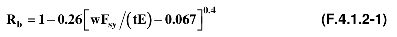

Para $0.974E /F_{sy}≤w /t_{≤}500$

$R_{b}=0.75$

(b) Aletas en compresión no rigidizadas Para $w /t_{≤}0.0173E /F_{sy}$

$R_{b}=1.00$ Para $0.0173E /F_{sy}<w /t_{≤}60$

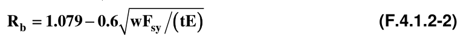

Donde:

$E$ = módulo de elasticidad

$F_{sy}$= punto de fluencia mínimo especificado como se describe en la sección F.4.1.6.1 ≤ 550 MPa

$t$ = espesor de la sección

$w$ = ancho plano de la aleta en compresión La excepción antes expuesta no aplica en tableros de acero para uso en sección compuesta con una losa de concreto debido a que el tablero actúa como un refuerzo en tensión para este caso.

Excepción 2 — Para miembros en compresión, de secciones cerradas tipo cajón, concéntricamente cargados, se permitirá el uso de un esfuerzo de fluencia reducido de $0.9F_{sy}$ , en lugar de $F_{y}$ , en las ecuaciones F.4.3.4-2, F.4.3.4-3 y F.4.3.4-4 para la determinación de la resistencia axial en la sección F.4.3.4. Se usará un radio de giro reducido $(R_{r})( r)$ en la ecuación F.4.3.4-5 cuando el valor de la longitud efectiva $KL$ sea menor a $1.1L_{o}$ , donde $L_{o}$ es dado por la ecuación F.4.1.2-3 y $R_{r}$ es dado por la ecuación F.4.1.2-4.

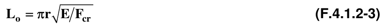

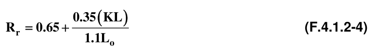

Donde:

$L_{o}$ = longitud en la cual el esfuerzo de pandeo local iguala al esfuerzo de pandeo flector

$r$ = radio de giro de la sección transversal completa no reducida

$F_{cr}$ = esfuerzo crítico mínimo de pandeo para la sección, calculado de acuerdo con la ecuación F.4.2.2-5.

$R_{r}$ = factor de reducción

$KL$ = longitud efectiva

**F.4.1.2.4** — Espesor mínimo entregado — El espesor mínimo de acero sin revestimiento, del producto formado en frío tal como se entrega a la obra no debe ser en ningún punto menor que el 95% del espesor, $t$ , usado en su diseño; sin embargo, los espesores pueden ser menores en los dobleces, tales como esquinas, debido a los efectos del formado en frío.

#### F.4.1.3 — CARGAS

**F.4.1.3.1** — Cargas Nominales — Las cargas nominales serán determinadas de acuerdo con las especificaciones establecidas el Título B de este Reglamento.

#### F.4.1.4 — DISEÑO POR ESFUERZOS ADMISIBLES

**F.4.1.4.1** — Bases del Diseño — Las especificaciones de diseño dadas bajo esta sección del Reglamento están basadas en los principios del Diseño por Esfuerzos Admisibles. No aplicarán los requerimientos de este método en sección alguna de este Reglamento, excepto para tableros metálicos para trabajo en sección compuesta (Sección F.4.7) Las bases del diseño para este Reglamento estarán de acuerdo con lo registrado en la sección F.4.1.5, desarrollada para el método DCCR.

**F.4.1.4.1.1** — Requerimientos para Diseño por Esfuerzos Admisibles — Este método, en el caso que se especifique como el procedimiento de diseño, satisfará los requerimientos de este Reglamento cuando la resistencia admisible de cada componente estructural iguala o excede a la resistencia admisible requerida, determinada con base en las cargas nominales, para todas las combinaciones de carga aplicables.

El diseño bajo este método debe ser hecho de acuerdo con la siguiente ecuación:

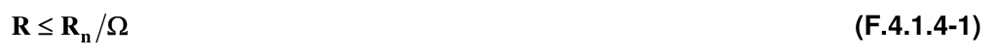

Donde:

$R$ = resistencia Admisible Requerida, usada donde se indique.

$R$ = resistenciaA Nominal Especificada dada en F.4.2 a F.4.8.

$Ω^{n}$ = factor de Seguridad especificado, usado donde se indique.

$R_{n}/Ω$ = esfuerzo de Diseño Admisible, usado donde se indique.

**F.4.1.4.1.2** — Combinaciones de carga para Diseño por Esfuerzos Admisibles — Las combinaciones de carga para el método de Diseño por Esfuerzos Admisibles están estipuladas en el Título B de este Reglamento.

#### F.4.1.5 — DISEÑO CON COEFICIENTES DE CARGA Y RESISTENCIA (DCCR)

**F.4.1.5.1** — Bases del Diseño — Las especificaciones de diseño dadas bajo esta sección del Reglamento están basadas en los principios del Diseño con Coeficientes de Carga y Resistencia (DCCR) Deben aplicar todos los requerimientos de esta sección para el diseño con miembros estructurales formados en frío, excepto donde se especifique lo contrario.

**F.4.1.5.1.1** — Requerimientos para el Diseño con Coeficientes de Carga y Resistencia (DCCR) — El diseño satisfará los requerimientos de este Reglamento cuando la resistencia de diseño de cada componente estructural iguala o excede la resistencia requerida determinada con base en las cargas nominales multiplicadas por los apropiados coeficientes de mayoración de carga, para todas las combinaciones de carga aplicables.

El diseño debe ser realizado de acuerdo con la siguiente ecuación:

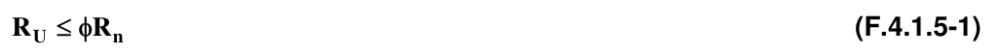

Donde:

$R_{U}$ = resistencia requerida

$R_{n}$ = resistencia nominal especificada en F.4.2 a F.4.8

$φ$ = coeficiente de resistencia especificado en F.4.2 a F.4.8

$φR_{n}$ = resistencia de diseño

**F.4.1.5.1.2** — Coeficientes y combinaciones de carga para DCCR — Los coeficientes de carga y sus combinaciones para el método DCCR están estipulados en el Título B de este Reglamento.

#### F.4.1.6 — INCREMENTO EN EL PUNTO DE FLUENCIA Y LA RESISTENCIA DEBIDO AL TRABAJO DE

FORMADO EN FRÍO

**F.4.1.6.1** — Esfuerzo de Fluencia — El esfuerzo de fluencia usado en el diseño, $F_{y}$ , será un valor no mayor al esfuerzo de fluencia mínimo especificado de los aceros listados en las secciones F.4.1.2.1 ó F.4.1.2.3.2, o el que se establece en F.4.6, o incrementado por efecto del trabajo de formación en frío descrito en la sección F.4.1.6.2.

**F.4.1.6.2** — Incremento en la resistencia debido al trabajo de formado en frío — El incremento en la resistencia debido al trabajo de formación en frío permitirá la sustitución de $F_{ya}$ por $F_{y}$ , donde $F_{ya}$ es el promedio del esfuerzo de fluencia de la sección completa. Tal incremento debe ser limitado a de acuerdo con las secciones F.4.3.2, F.4.3.3.1 (excluyendo la sección F.4.3.3.1.1 (b)), F.4.3.4, F.4.3.5, F.4.4.4 y F.4.4.6.1.

Las limitaciones y métodos utilizados en la determinación de $F_{ya}$ son los siguientes:

(a) Para miembros en compresión cargados axialmente y miembros en flexión para los cuales sus proporciones son tales que la cantidad $ρ$ para la determinación de la resistencia es igual a la unidad (1.00), calculado acorde con la sección F.4.2.2 de este Reglamento para cada uno de los elementos componentes de la sección, el punto de fluencia de diseño, $F_{ya}$, del acero será determinado con base en uno de los siguientes métodos:

(1) Ensayos a tensión de la sección completa (Ver párrafo (a) de la sección F.4.6.3.1) (2) Ensayos sobre columnas cortas (Ver párrafo (b) de la sección F.4.6.3.1) (3) Calculado como sigue:

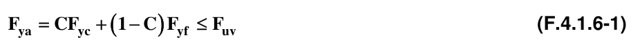

Donde:

$F_{ya}$= esfuerzo de fluencia promedio de la sección completa no reducida para miembros en compresión o de secciones con aletas completas para miembros en flexión

$c$ = relación entre el total del área de las esquinas y el total del área de la sección transversal de la sección completa, para miembros en compresión; o relación entre el total del área de las esquinas de la aleta que controla y el total del área de la aleta que controla, para miembros en flexión.

$F_{yf}$= es la media ponderada del punto de fluencia a tensión de las porciones planas establecidas de acuerdo con la sección F.4.6.3.2 de este Reglamento o el punto de fluencia del acero virgen si no se realizan ensayos.

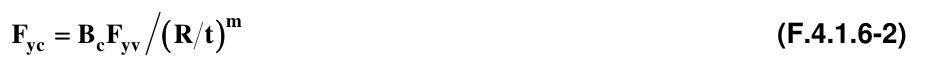

La anterior expresión define el esfuerzo de fluencia a tensión de las esquinas.

Esta ecuación es aplicable solamente cuando $F_{uv}/F_{yv}≥1.2$, $R /t_{≤}7$, y el ángulo incluido es $≤120^{\circ}$

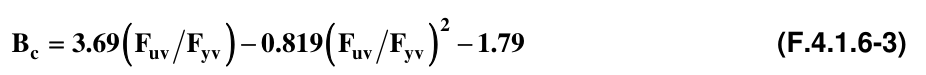

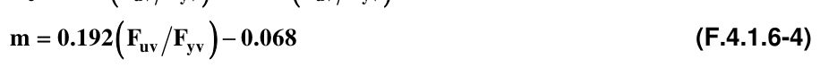

Donde:

$R$ = radio interno de doblez

$t$ = espesor de la sección

$F_{yv}$= esfuerzo de fluencia a tensión del acero virgen especificado en la sección F.4.1.2 de este Reglamento o según como se establece en F.4.6.3.3.

$F_{uv}$= resistencia a tensión del acero virgen especificado por la sección F.4.1.2 o establecido de acuerdo con la sección F.4.6.3.3

(b) Para miembros en tensión axialmente cargados el punto de fluencia del acero será determinado ya sea por el método 1. o el método 3. prescrito en el párrafo a) de esta misma sección.

(c) El efecto de la soldadura sobre las propiedades mecánicas de un miembro será determinado con base en ensayos sobre probetas de sección completa que contengan, dentro de la longitud testigo, el tipo de soldadura que el fabricante se propone utilizar. Se deben tomar las medidas necesarias para considerar tal efecto en el uso estructural del miembro.

#### F.4.1.7 — ESTADO DE SERVICIO DE LA ESTRUCTURA

Una estructura será diseñada para llevar a cabo las funciones requeridas durante su vida esperada. Los estados límite de servicio deben ser escogidos con base en la función destinada para la estructura, y deben ser evaluados usando cargas y combinaciones de carga realistas.

#### F.4.1.8 — DOCUMENTOS DE REFERENCIA

Los siguientes documentos son las referencias y la base de este Reglamento:

American Iron and Steel Institute. (AISI), 1140 Connecticut Avenue, NW, Washington, DC20036:

AISI S100-07, North American Specification for the Design of Cold-Formed Steel Structural Members AISI S200-07, North American Standard for Cold-Formed Steel Framing – General Provisions AISI S210-07, North American Standard for Cold-Formed Steel Framing – Floor and Roof System Design AISI S211-07, North American Standard for Cold-Formed Steel Framing – Wall Stud Design AISI S212-07, North American Standard for Cold-Formed Steel Framing – Header Design AISI S214-07, North American Standard for Cold-Formed Steel Framing – Truss Design AISI S901-02, Rotational-Lateral Stiffness Test Method for Beam-to-Panel Assemblies AISI S902-02, Stub-Column Test Method for Effective Area of Cold-Formed Steel Columns AISI S906-04, Standard Procedures for Panel and Anchor Structural Tests AISI S213-07, North American Standard for Cold-Formed Steel Framing – Lateral Design AISI S908-04, Base Test Method for Purlins Supporting a Standing Seam Roof System American Society of Civil Engineers (Sociedad Americana de Ingenieros Civiles) (ASCE), 1801 Alexander Bell Drive, Reston VA, 20191: ASCE/SEI 7-05, Minimun Design Loads in Buildings and Other Structures American Welding Society (AWS), 550 N.W. LeJeune Road, Miami, Florida 33135:

AWS D1.3-98, Structural Welding Code – Sheet Steel AWS C1.1/C1.1M–2000, Recommended Practices for Resistances Welding American Society of Mechanical Engineers (Sociedad Americana de Ingenieros Mecánicos), ASME B46.1-2000 “Surface Texture, Surface Roughness, Waviness, and Lay” Normas NTC (Normas Técnicas Colombianas) del ICONTEC ó ASTM (American Society for Testing and Materials) según aplique:

NTC 6 (ASTM A1011/A1011M-05a) Productos planos, laminados en caliente de aceros: al carbono, estructurales, alta resistencia baja aleación y alta resistencia baja aleación con capacidad de deformado – estampado – NTC 1920 (ASTM A36/A36M-00a) Acero estructural al Carbono.

NTC 1950 (ASTM A242/A242M-00a) Acero estructural de baja aleación y alta resistencia.

NTC 1985 (ASTM A572/A572M-06) Aceros de calidad estructural de alta resistencia baja aleación Niobio (Columbio) – vanadio NTC 2012 (ASTM A588/A588M-05) Acero estructural de alta resistencia y baja aleación con límite de fluencia mínimo de 345MPa en espesores hasta 100mm NTC 2633 (ASTM A283/A283M-00) Barras y chapas de acero al carbono de media y baja resistencia a la tensión NTC 3353 (ASTM A370-05) Definiciones y métodos para los ensayos mecánicos de productos de acero.

NTC 4007 (ASTM A529/A529M-05) Especificaciones para el acero al carbono-manganeso de alta resistencia y calidad estructural.

NTC 4009 (ASTM A606-04) Láminas y flejes de acero, laminados en frío y en caliente de alta resistencia y baja aleación, con resistencia mejorada a la corrosión.

NTC 4011 (ASTM A653/A653M-06) Productos planos de acero recubiertos con Zinc – galvanizados – o recubiertos con aleación hierro zinc – galvano-recocido – mediante procesos de inmersión en caliente.

NTC 4015 (ASTM A792/A792M-05) Productos planos de acero recubiertos con aleación 55% aluminio-zinc, mediante el proceso de inmersión en caliente.

NTC 4028 (ASTM A490M-04a) Elementos de fijación. Pernos de acero de alta resistencia, clase 10.9 y 10.9.3 para juntas de acero estructurales – sistema métrico – NTC 4029 (ASTM A325M-06) Elementos de fijación. Pernos de alta resistencia destinados a juntas de acero estructurales – sistema métrico – NTC 4031 (ASTM F436M-04) Elementos de fijación. Arandelas de acero templado – sistema métrico NTC 4034 (ASTM A307-00) Elementos de fijación. Especificación para tornillos y pernos de acero al carbono con 490MPa de resistencia a la tensión.

NTC 4035 (ASTM A194/A194M-00b) Especificación para tuercas de acero al carbono y aleado para alta presión y servicios de alta temperatura.

NTC 4479 (ASTM A449-04b) Tornillos y pernos de acero al carbono templados y revenidos.

NTC 4511 (ASTM A563M-04) Especificaciones para tuercas de acero aleado y al carbono – sistema métrico – NTC 4512 (ASTM A354-04) Tornillos, pernos y otros elementos de fijación roscados externamente, templados y revenidos, de aleación de acero.

NTC 4526 (ASTM A500-03a) Tubería estructural de acero al carbono formada en frío, con y sin costura, redonda y de otras formas.

NTC 4701 (ASTM F959-04) Elementos de fijación. Indicadores directos de tensión tipo arandela compresible para uso con elementos de fijación estructurales.

NTC 4965 (ASTM A563-00) Tuercas de acero al carbono y acero aleado.

NTC 5091 (ASTM A1008/A1008M-05b) Productos planos, laminados en frío, de aceros: al carbono, estructurales, alta resistencia baja aleación y alta resistencia baja aleación con capacidad de deformado (estampado) ASTM A325-06 Pernos estructurales de acero, tratados térmicamente, con resistencia última mínima de 835/735ksi ASTM A490-06 Pernos estructurales de acero tratados térmicamente (calor) con mínima resistencia última de 1050MPa.

ASTM A847/A847M-05 Tubos estructurales de alta resistencia y baja aleación formados en frío, soldados y sin costura con mejorada resistencia a la corrosión ambiental ASTM A875/A875M-05 Productos planos de acero recubiertos con aleación zinc 5% Aluminio, mediante el proceso de inmersión en caliente.

ASTM A1003/A1003M-05 Productos planos de acero, acero al carbono, con recubrimientos metálicos y no metálicos para miembros formados en frío de uso en entramados.

ASTM A1039/A1039M-04 Especificaciones estándar para acero en láminas, laminado en caliente, al carbono, comercial y estructural, fabricado mediante el proceso de fundición en rollos mellizos ASTM E1592-01 Método de ensayo estándar para el comportamiento estructural de cubiertas metálicas y sistemas de cerramiento mediante la diferencia estática y uniforme de presión de aire ASTM F436-04 Elementos de fijación. Arandelas de acero templado.

ASTM F844-04 Arandela, aceros y productos planos, no templados de uso general ASTM F959M-05a Elementos de fijación. Indicadores directos de tensión tipo arandela compresible para uso con elementos de fijación estructurales – sistema métrico American Institute of Steel Construction (AISC), 1140 Connecticut Avenue, NW, Washington, DC20036:

ANSI/AISC 360-05, Specification for Structural Steel Buildings Steel Deck Institute. Design Manual for Composite Decks, Form Decks and Roof Decks, publication No 30, 2000 Steel Deck Institute. Composite Deck Design Handbook, March 1997 Steel Deck Institute. Manual of Construction with Steel Deck, 1991

### F.4.2 — ELEMENTOS

#### F.4.2.1 — LÍMITES Y CONSIDERACIONES DIMENSIONALES

**F.4.2.1.1** — Consideraciones para la relación ancho plano-espesor de aletas

**F.4.2.1.1.1** — Relaciones máximas ancho plano-espesor de aletas — Las máximas relaciones admisibles ancho plano-espesor, $w /t$ , sin consideración de rigidizadores intermedios y tomando como $t$ el espesor real del elemento, deben ser las siguientes:

(1) Elemento a compresión rigidizado con solo un borde longitudinal conectado a un elemento alma o aleta y el otro borde rigidizado por:

Labio o pestaña sencilla .........................................................$w /t_{≤}60$ Cualquier otra clase de rigidizador

(i) cuando $I_{s}<I_{a}$.........................................................$w /t_{≤}60$ (ii) cuando $I_{s}≥I_{a}$.........................................................$w /t_{≤}90$ Donde:

$I_{s}$ = momento de inercia real del rigidizador completo alrededor de su propio eje centroidal paralelo al elemento a ser rigidizado.

$I_{a}$ = momento de inercia adecuado del rigidizador, de tal forma que cada elemento componente se comportará como un elemento rigidizado.

(2) Elemento a compresión rigidizado con ambos bordes longitudinales conectados a otros elementos rigidizados……………………………………….....$w /t_{≤}500$ (3) Elemento a compresión no rigidizado……………………. ......$w /t_{≤}60$ Nota: Los elementos en compresión no rigidizados que tengan una relación $w /t$ superior a aproximadamente 30 y los elementos en compresión rigidizados que tengan una relación $w /t$ superior a aproximadamente 250 son susceptibles a desarrollar una deformación perceptible bajo la resistencia total disponible (resistencia multiplicada por un factor), sin afectar la capacidad del miembro a desarrollar la resistencia requerida (efecto de las cargas mayoradas).

Los elementos rigidizados con relaciones $w /t$ mayores que 500 pueden ser usados con una resistencia de diseño adecuada para soportar las cargas requeridas; sin embargo, las deformaciones importantes de tales elementos invalidarán las ecuaciones de diseño especificadas en este Reglamento.

**F.4.2.1.1.2** — Deflexión hacia el interior de la longitud completa de la Aleta — Cuando la aleta de un miembro en flexión es inusualmente ancha, y se desea limitar la máxima curvatura o movimientos de esta hacia el eje neutro, la siguiente ecuación aplica a las aletas en compresión y tensión independiente de si están rigidizadas o no:

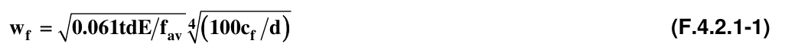

Donde:

$w_{f}$ = ancho de la aleta que se proyecta más allá del alma; o la mitad de la distancia entre almas para vigas en cajón o U.

$t$ = espesor de la aleta

$d$ = altura de la viga

$c_{f}$ = cantidad de desplazamiento por curvatura de la aleta hacia el eje neutro

$f_{av}$ = esfuerzo promedio en el ancho de la aleta no reducido (en el caso que los miembros sean diseñados mediante el procedimiento del ancho efectivo, el esfuerzo promedio es igual al máximo esfuerzo multiplicado por la relación entre el ancho efectivo de diseño y el ancho real)

**F.4.2.1.1.3** — Efectos de variación debido al corte (Luces cortas soportando cargas concentradas) — Cuando la luz de la viga es menor que $30w_{f}$ ($w_{f}$ según se define más adelante) y soporta una carga concentrada o varias cargas espaciadas a una distancia mayor que $2w_{f}$ , el ancho efectivo de diseño de cualquier aleta, bien sea en tensión o en compresión, debe limitarse de acuerdo con la tabla F.4.2.1-1

**Tabla F.4.2.1-1**

Luces cortas y aletas anchas. Máxima relación permisible entre el ancho de diseño efectivo $( b)$ y ancho real $( w)$

| $L /w_{f}$ | Relación $b /w$ | $L /w_{f}$ | Relación $b /w$ |
|---|---|---|---|
| 30 | 1.00 | 14 | 0.82 |
| 25 | 0.96 | 12 | 0.78 |
| 20 | 0.91 | 10 | 0.73 |
| 18 | 0.89 | 8 | 0.67 |
| 16 | 0.86 | 6 | 0.55 |

Donde:

$L$ = luz total para vigas simples; o distancia entre puntos de inflexión para vigas continuas; o el doble de la longitud para vigas en voladizo.

$w_{f}$ = ancho de la aleta que se proyecta más allá del alma para vigas I y secciones similares; o la mitad de la distancia entre almas para secciones cajón o U.

Para las aletas de las vigas I y secciones similares rigidizadas por pestañas o labios en los bordes exteriores, $w_{f}$ debe ser tomado como la suma de la proyección de la aleta más allá del alma y el ancho de la pestaña o labio.

**F.4.2.1.2** — Relación máxima altura-espesor en almas — La relación $h /t$ , de las almas de los miembros en flexión no debe exceder los siguientes límites:

(a) Para almas no reforzadas $(h /t)max=200$

(b) Para almas provistas de rigidizadores de apoyo que satisfagan los requisitos de F.4.3.3.7.1:

(1) Cuando se usen rigidizadores de apoyo solamente $(h /t)max=260$ (2) Cuando se usen rigidizadores de apoyo y rigidizadores intermedios $(h /t)max=300$ Donde:

$h$ = altura de la porción plana del alma, medida a lo largo del plano del alma

$t$ = espesor del alma Cuando el alma conste de dos o más láminas, se debe calcular para cada una la relación $h /t$

#### F.4.2.2 — ANCHOS EFECTIVOS DE ELEMENTOS RIGIDIZADOS

**F.4.2.2.1** — Elementos rigidizados bajo compresión uniforme

(a) Determinación de la resistencia El ancho efectivo,$b$ , se determinará a partir de las siguientes ecuaciones:

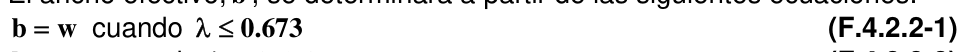

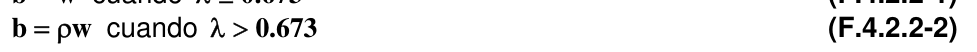

Donde:

$w$ = ancho plano como se muestra en la figura F.4.2.2-1

$ρ$ = factor de reducción local

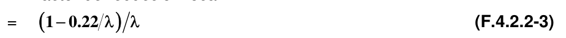

$λ$ es un factor de esbeltez determinado como sigue:

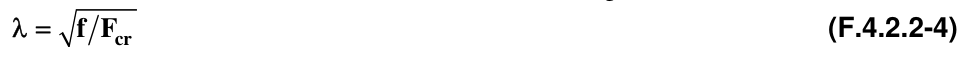

Donde:

$f$ = esfuerzo de compresión en el elemento calculado como sigue:

Para miembros en flexión:

(1) Si se utiliza el procedimiento 1 de la sección F.4.3.3.1.1:

(a) Cuando la fluencia inicial es en compresión en el elemento en consideración, $f=F_{y}$

(b) Cuando la fluencia inicial es en tensión, el esfuerzo de compresión, $f$ , en el elemento en consideración debe ser determinado con base en la sección efectiva para el momento $M_{y}$ (momento que causa la fluencia inicial).

(2) Si se utiliza el procedimiento 2 de la sección F.4.3.3.1.1, $f$ es el esfuerzo en el elemento bajo consideración para el momento $M_{n}$ determinado con base en la sección efectiva.

(3) Si se utiliza la sección F.4.3.3.1.2.1, $f$ es el esfuerzo $F_{c}$ como se describe bajo ese numeral para la determinación del módulo de sección efectiva $S_{c}$ .

Para miembros a compresión $f$ se toma igual al $F_{n}$ , como es determinado en F.4.3.4.

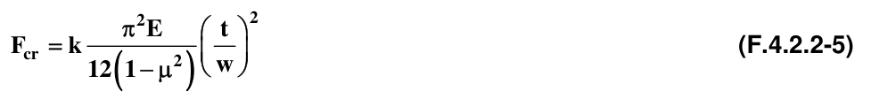

Donde:

$k$ = coeficiente de pandeo de placa = 4 para elementos rigidizados apoyados por un alma en cada borde longitudinal. En las secciones aplicables se dan valores de $k$ para los diferentes tipos de elementos.

$E$ = módulo de elasticidad del acero

$t$ = espesor del elemento rigidizado bajo compresión uniforme.

$μ$ = relación de Poisson del acero

(b) Determinación del Estado de Servicio (deflexiones):

El ancho efectivo, $b_{d}$ , usado para la determinación del estado de servicio de la estructura debe ser calculado como sigue:

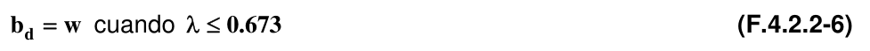

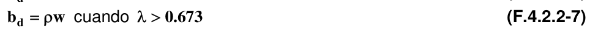

Donde:

$w$ = ancho plano

$ρ$ = coeficiente de reducción determinado por uno de los siguientes procedimientos:

(1) Procedimiento 1.

Se puede obtener un estimativo bajo del ancho efectivo a partir de las ecuaciones F.4.2.2-3 y F.4.2.2-4 donde $f_{d}$ sustituye a $f$ , siendo $f_{d}$ el esfuerzo de compresión en el elemento bajo consideración.

(2) Procedimiento 2.

Para elementos rigidizados soportados por un alma en cada borde longitudinal, se puede obtener un estimativo mejorado del ancho efectivo, calculando $ρ$ así:

$ρ =1.00$ cuando $λ ≤0.673$

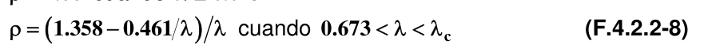

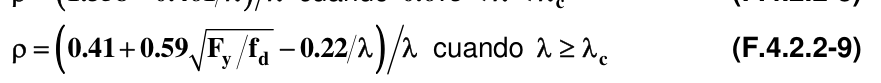

$ρ ≤1.00$ para todos los casos Donde:

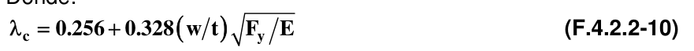

$λ$ está definida por la ecuación F.4.2.2-4, excepto que $f_{d}$ reemplaza a $f$ .

Figura F.4.2.2-1 — Elementos rigidizados

**F.4.2.2.2** — Elementos rigidizados bajo compresión uniforme con huecos circulares y no circulares

(a) Determinación de la resistencia Para huecos circulares:

El ancho efectivo, $b$ , debe determinarse como sigue:

Para $0.50≥d_{h}/w≥0$, y $w /t≤70$ y la distancia entre centros de huecos es $≥0.50w$ y $≥3d_{h}$

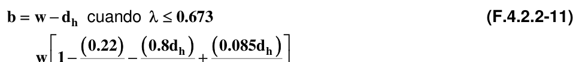

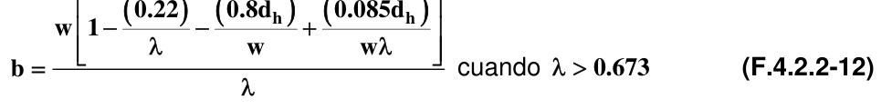

En todos los casos $b≤w−d_{h}$ Donde:

$w$ = ancho plano

$t$ = espesor del elemento

$d_{h}$ = diámetro de huecos $λ$ es definido en la sección F.4.2.2.1 Para huecos no circulares — Se asumirá que un elemento rigidizado bajo compresión uniforme con huecos no circulares consiste de dos franjas no rigidizadas de ancho plano, $c$ , adyacentes a los huecos (ver la figura F.4.2.2-2) El ancho efectivo, $b$ , de cada franja no rigidizada adyacente al hueco se determinará de acuerdo con la sección F.4.2.2.1(a), con la excepción de que el coeficiente de pandeo de placas, $k$ , debe ser tomado como $0.43$ y $w$ como $c$ . Estas especificaciones serán aplicables dentro de los siguientes límites:

(1) Espaciamiento centro a centro de huecos, $s≥610$ mm ($24$ pulgadas) (2) Distancia libre entre el hueco y los extremos, $S_{end}≥254$ mm ($10$ pulgadas) (3) Altura del hueco, $d_{h}≤63.5$ mm ($2.5$ pulgadas) (4) Longitud del hueco, $L_{h}≤114$ mm ($4.5$ pulgadas) (5) Relación entre la altura del hueco, $d_{h}$ , y el ancho entre bordes exteriores, $w_{o}$ , $d_{h}/w_{o}≤0.5$ Alternativamente, se permitirá la determinación del ancho efectivo, $b$ , mediante pruebas en laboratorio sobre columnas cortas de acuerdo con el procedimiento de ensayo AISI S902.

Figura F.4.2.2-2 — Elementos rigidizados bajo compresión uniforme con huecos no circulares

(b) Estado de servicio (deflexiones) — El ancho efectivo, $b_{d}$ usado en la determinación del estado de servicio será igual al $b$ calculado de acuerdo con el procedimiento 1 de la sección F.4.2.2.1(b), excepto que $f_{d}$ remplaza el valor de $f$ , donde $f_{d}$ es el esfuerzo de compresión calculado sobre el elemento en consideración.

**F.4.2.2.3** — Almas y otros elementos rigidizados bajo gradiente de esfuerzo — La siguiente notación es usada en esta sección:

$b_{1}$ = ancho efectivo, dimensión definida en la figura F.4.2.2-3

$b_{2}$ = ancho efectivo, dimensión definida en la figura F.4.2.2-3

$b_{e}$ = ancho efectivo $b$ determinado de acuerdo con la sección F.4.2.2.1 con $f_{1}$ remplazando a $f$ y con $k$ determinado como es definido en esta sección.

$b_{o}$ = ancho de la aleta en compresión entre bordes externos como se define en la figura F.4.2.2-4.

$f_{1}$ , $f_{2}$ = esfuerzos mostrados en la figura F.4.2.2-3 calculados sobre la base de la sección efectiva. Donde $f_{1}$ y $f_{2}$ son esfuerzos en compresión, $f_{1}≥f_{2}$.

$h_{o}$ = altura del alma medida entre bordes exteriores, tal y como se define en la figura F.4.2.2-4.

$k$ = coeficiente de pandeo de placas

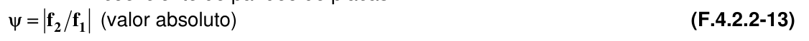

(a) Determinación de la resistencia (1) Para almas bajo gradiente de esfuerzo ( $f_{1}$ en compresión y $f_{2}$ en tensión como se muestra en la figura F.4.2.2-3(a)), los anchos efectivos y el coeficiente de pandeo de placas serán calculados como sigue:

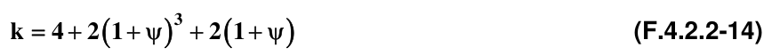

Para $h_{o}/b_{o}≤4$

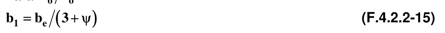

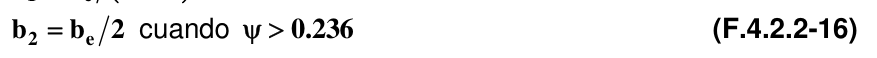

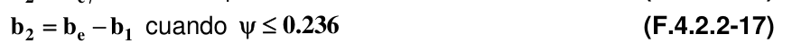

Adicionalmente, $b_{1}+b_{2}$ no excederá la porción en compresión del alma calculada sobre la base de la sección efectiva.

Para $h_{o}/b_{o}>4$

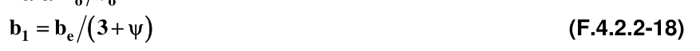

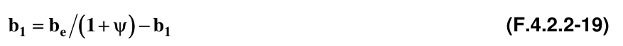

(2) Para otro elemento rigidizado bajo gradiente de esfuerzo ( $f_{1}$ y $f_{2}$en compresión como se muestra en la figura F.4.2.2-3(b))

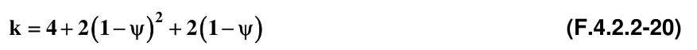

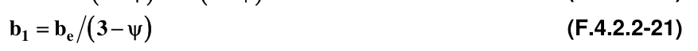

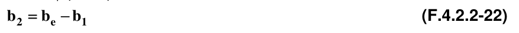

Figura F.4.2.2-3 — Almas y otros elementos rigidizados bajo gradiente de esfuerzo

(b) Determinación del Estado de servicio (deflexiones) — Los anchos efectivos utilizados en la determinación del estado de servicio del miembro serán calculados de acuerdo con la sección F.4.2.2.3(a) excepto que $f_{d1}$ y $f_{d2}$ reemplazan a $f_{1}$ y $f_{2}$, donde $f_{d1}$ y $f_{d2}$ son los esfuerzos calculados $f_{1}$ y $f_{2}$ basados en la sección efectiva hallada con la carga para la cual el estado de servicio es determinado.

Figura F.4.2.2-4 — Dimensiones entre bordes externos de almas y elementos rigidizados bajo gradiente de esfuerzo

**F.4.2.2.4** — Almas de Secciones C con huecos bajo gradiente de Esfuerzo — Las especificaciones de esta parte serán aplicables dentro de los siguientes límites:

(1) $d_{h}/h≤0.7$ (2) $h /t≤200$ (3) Huecos centrados en la mitad de la altura del alma (4) Distancia libre entre huecos $≥457$ mm (5) Huecos no circulares con radio de la esquina $≥2t$ (6) Huecos no circulares con $d_{h}≤64$ mm y $L_{h}≤114$ mm (7) Huecos circulares con diámetro $≤152$ mm (8) $d_{h}>14$ mm Donde:

$d_{h}$ = altura del hueco en el alma

$h$ = altura de la porción plana del alma medida a lo largo del plano del alma

$t$ = espesor del alma

$L_{h}$ = longitud del hueco en el alma

$b_{1}$ , $b_{2}$ = anchos efectivos definidos por la figura F.4.2.2-3

(a) Determinación de la resistencia — Cuando $d_{h}/h<0.38$, los anchos efectivos, $b_{1}$ y $b_{2}$ , serán determinados de acuerdo con la sección F.4.2.2.3(a) asumiendo que no existen huecos en el alma Cuando $d_{h}/h≥0.38$, el ancho efectivo será determinado de acuerdo con la sección F.4.2.3.1(a) asumiendo que la porción en compresión del alma consiste de un elemento no rigidizado adyacente al hueco con $f=f_{1}$ como se muestra en la figura F.4.2.2-3.

(b) Determinación del Estado de servicio (deflexiones) — Los anchos efectivos serán determinados de acuerdo con la sección F.4.2.2.3(b) asumiendo la no existencia de huecos en el alma.

#### F.4.2.3 — ANCHOS EFECTIVOS DE ELEMENTOS NO RIGIDIZADOS

**F.4.2.3.1** — Elementos no rigidizados bajo compresión uniforme

(a) Determinación de la resistencia — El ancho efectivo, $b$ , se determinará de acuerdo con la sección F.4.2.2.1(a), excepto que el coeficiente de pandeo de placa, $k$ , debe ser tomado como $0.43$ y $w$ como se define en la figura F.4.2.3-1.

(b) Determinación del Estado de servicio (deflexiones) — El ancho efectivo, $b_{d}$ , usado en la determinación del estado de servicio del miembro estructural será calculado acorde con el procedimiento 1 de la sección F.4.2.2.1(b), excepto que $f_{d}$ reemplaza a $f$ y $k=0.43$.

Figura F.4.2.3-1 — Elemento no rigidizado bajo compresión uniforme

**F.4.2.3.2** — Elementos no rigidizados y rigidizadores de borde bajo gradiente de esfuerzo — La siguiente notación aplicará a esta sección:

$b$ = ancho efectivo medido desde el borde rigidizado o soportado, determinado de acuerdo con la sección F.4.2.2.1(a), con $f$ igual a $f_{1}$ y con $k$ y $ρ$ determinados de acuerdo al procedimiento presentado en esta sección.

$b_{o}$ = ancho total del elemento no rigidizado del miembro en sección C, tal como se define en la figura F.4.2.3-4

$f_{1}$ , $f_{2}$ = esfuerzos mostrados en las figuras F.4.2.3-2, F.4.2.3-3, y F.4.2.3-4 calculados con base en la sección bruta. Donde tanto $f_{1}$ como $f_{2}$ son esfuerzos de compresión y se tiene que $f_{1}≥f_{2}$.

$h_{o}$ = altura total del miembro no rigidizado en sección C, definido de acuerdo con la figura F.4.2.3-4.

$k$ = coeficiente de pandeo de placa definido en esta sección o, de forma diferente, como se define en la sección F.4.2.2.1(a)

$t$ = espesor del elemento

$w$ = ancho plano del elemento no rigidizado, donde $w /t≤60$

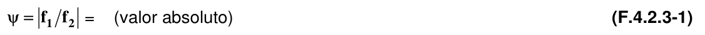

$λ$ = factor de esbeltez definido en la sección F.4.2.2.1(a) con $f=f_{1}$

$ρ$ = factor de reducción tal como se define en esta sección o, de otra forma, como se define en la sección F.4.2.2.1(a)

(a) Determinación de la resistencia — El ancho efectivo, $b$ , de un elemento no rigidizado bajo gradiente de esfuerzo se determinará de acuerdo con la sección F.4.2.2.1(a) con $f$ igual a $f_{1}$ y el coeficiente de pandeo de placa, $k$ , determinado de acuerdo con esta sección, a menos que se indique lo contrario. Para los casos en que $f_{1}$ es en compresión y $f_{2}$ es en tensión, $ρ$ , presente en la sección F.4.2.2.1(a), se determinará de acuerdo con esta sección.

(1) Cuando, tanto $f_{1}$ como $f_{2}$ son esfuerzos de compresión (figura F.4.2.3-2), el coeficiente de pandeo de placa será calculado de acuerdo con cualquiera de las siguientes ecuaciones:

Si el esfuerzo decrece hacia el borde no soportado (libre) (figura F.4.2.3-2(a)):

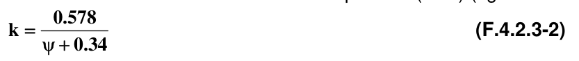

Si el esfuerzo crece hacia el borde no soportado (libre) (figura F.4.2.3-2(b))

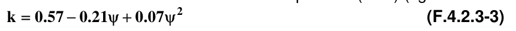

Figura F.4.2.3-2 — Elementos no rigidizado bajo gradiente de esfuerzo, ambos bordes longitudinales en compresión (2) Cuando $f_{1}$ es en compresión y $f_{2}$ en tensión (figura F.4.2.3-3) el factor de reducción y el coeficiente de pandeo de placa será calculado como sigue:

(a) Si el borde no soportado está en compresión (figura F.4.2.3-3(a)):

$ρ =1.0$ cuando $λ ≤0.673 (1+ ψ)$

$+ ψ$ (F.4.2.3-4)

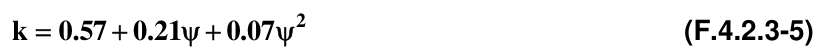

(b) Si el borde soportado está en compresión (figura F.4.2.3-3(b)) Para $ψ <1.0$

$ρ =1.0$ cuando $λ ≤0.673$

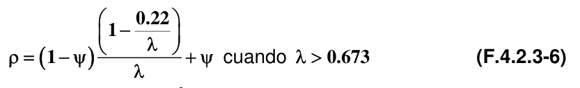

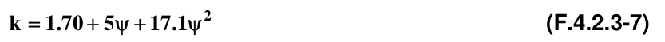

Para $ψ ≥1.0$

$ρ =1.0$ Para la determinación del ancho efectivo, $b$ , de los elementos no rigidizados de un miembro en sección C se permitirá el uso de los dos métodos alternativos siguientes, según sea el caso:

Alternativa 1 para secciones C no rigidizadas: Cuando el borde no soportado (libre) está en compresión y el borde soportado está en tensión (figura F.4.2.3-4(a)):

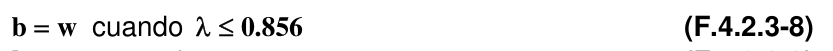

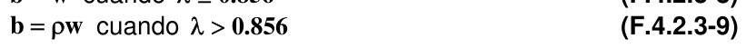

Figura F.4.2.3-3 — Elementos no rigidizados bajo gradiente de esfuerzo, un borde longitudinal en compresión y el otro borde longitudinal en tensión Donde:

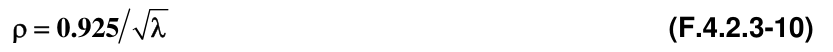

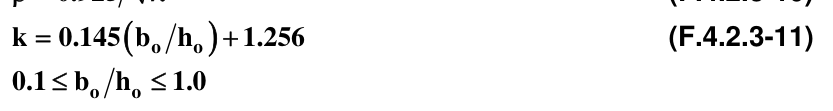

Alternativa 2 para secciones C no rigidizadas: Cuando el borde soportado está en compresión y el borde no soportado está en tensión (figura F.4.2.3-4(b)), el ancho efectivo se determina de acuerdo con la sección F.4.2.2.3.

Figura F.4.2.3-4 — Elementos no rigidizados de secciones C bajo gradiente de esfuerzo para los métodos alternativos En el cálculo de módulo de la sección efectiva $S_{e}$ del numeral F.4.3.3.1.1 ó $S_{c}$ del numeral F.4.3.3.1.2.1 la fibra extrema en compresión en las figuras F.4.2.3-2(b), F.4.2.3-3(a), y F.4.2.3-4(a) debe ser tomada como el borde de la sección efectiva más cercano al extremo no soportado (libre). En el cálculo del módulo de sección efectiva $S_{e}$ del numeral F.4.3.3.1.1, la fibra extrema en tensión en las figuras F.4.2.3-3(b) y F.4.2.3-4(b) será tomada como el borde de la sección efectiva más cerca al extremo no soportado.

(b) Determinación del Estado de servicio (deflexiones) - El ancho efectivo, $b_{d}$ , usado en la determinación del estado de servicio será calculado de acuerdo con la sección F.4.2.3.2(a), excepto que $f_{d1}$ y $f_{d2}$ reemplazan a $f_{1}$ y $f_{2}$, respectivamente, donde $f_{d1}$ y $f_{d2}$ son los esfuerzos $f_{1}$ y $f_{2}$ calculados tal como se muestra en las figuras F.4.2.3-2, F.4.2.3-3 y F.4.2.3-4, basados en el área bruta con la carga para la cual se determina el estado de servicio.

#### F.4.2.4 — ANCHOS EFECTIVOS DE ELEMENTOS BAJO COMPRESIÓN UNIFORME CON UNA PESTAÑA

SIMPLE COMO RIGIDIZADOR DE BORDE — Los anchos efectivos de elementos bajo compresión uniforme con un rigidizador simple de borde serán calculados de acuerdo con (a) mediante determinación de la resistencia y con (b) determinación del estado de servicio.

(a) Determinación de la resistencia Para $w /t_{≤}0.328S$:

$I_{a}=0$ (No se necesita rigidizador de borde)

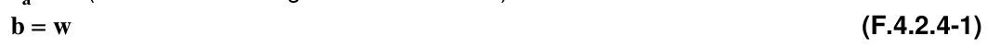

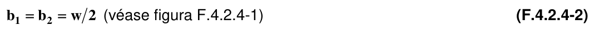

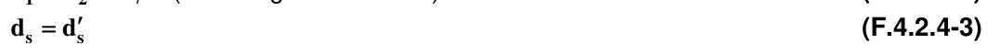

Para $w /t_{>}0.328S$:

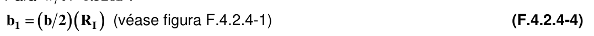

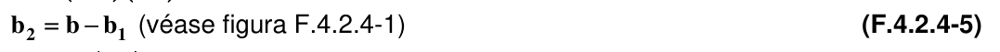

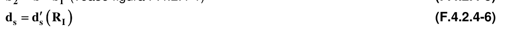

Donde:

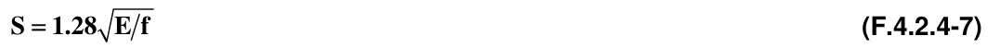

$w$ = dimensión plana definida en la figura F.4.2.4-1

$t$ = espesor de la sección

$I_{a}$ = momento de Inercia adecuado del rigidizador de tal forma que cada elemento componente se comporte como un elemento rigidizado.

$b$ = ancho efectivo de diseño

$b_{1}$ , $b_{2}$ = porciones del ancho efectivo de diseño tal como se definen en la figura F.4.2.4-1

$d_{s}$ = ancho efectivo reducido del rigidizador tal como se define en la figura F.4.2.4-1, y utilizado en el cálculo de todas las propiedades de la sección efectiva

$d_{s}'$ = ancho efectivo del rigidizador calculado de acuerdo con la sección F.4.2.3.2 (véase figura F.4.2.4-1)

Donde:

$I_{s}$ = momento de Inercia de la sección completa del rigidizador alrededor de su propio eje centroidal paralelo al elemento a ser rigidizado. Para rigidizadores de borde, la esquina redondeada entre el rigidizador y el elemento a ser rigidizado no será considerada como parte del rigidizador.

Para la definición de las demás variables remitirse a la figura F.4.2.4-1.

El ancho efectivo, $b$ , en las ecuaciones F.4.2.4-4 y F.4.2.4-5 se calculará de acuerdo con la sección F.4.2.2.1 con el coeficiente de pandeo de placa, $k$ , tal como se define en la tabla F.4.2.4-1 a continuación:

**Tabla F.4.2.4-1**

Determinación del coeficiente de pandeo de placa $( k)$

| Pestaña simple rigidizadora de borde $(140^{o}≥θ ≥40^{o})$ |  |
|---|---|
| $D /w_{≤}0.25$ | $0.25_{<}D /w_{<}0.80$ |

Donde:

Figura F.4.2.4-1 — Elementos con pestaña (labio) simple rigidizadora de borde

(b) Determinación del Estado de servicio (deflexiones) — El ancho efectivo, $b_{d}$ , usado en la determinación del estado de servicio será calculado de acuerdo con la sección F.4.2.4(a) excepto que $f_{d}$ reemplaza a $f$ , donde $f_{d}$ es el esfuerzo de compresión calculado en la sección efectiva con la carga para la cual se determina el estado de servicio.

#### F.4.2.5 — ANCHOS EFECTIVOS DE ELEMENTOS CON RIGIDIZADORES INTERMEDIOS SENCILLOS O

MÚLTIPLES O ELEMENTOS DE BORDE CON RIGIDIZADORES INTERMEDIOS

**F.4.2.5.1** — Anchos efectivos de elementos bajo compresión uniforme con rigidizadores intermedios sencillos o múltiples — La siguiente notación es utilizada en esta sección:

$A_{g}$ = área bruta del elemento, incluyendo rigidizadores.

$A_{s}$ = área bruta del rigidizador

$b_{e}$ = ancho efectivo del elemento, localizado en el centroide del elemento incluyendo rigidizadores, ver figura F.4.2.5-2

$b_{o}$ = ancho plano total del elemento rigidizado, ver figura F.4.2.5-1

$b_{p}$ = ancho plano del subelemento más grande, ver figura F.4.2.5-1

$c_{f}$ = distancia horizontal a partir del borde del elemento al eje (o ejes) del rigidizador (o rigidizadores), ver figura F.4.2.5-1

$F_{cr}$ = esfuerzo de pandeo elástico de la placa

$f$ = esfuerzo de compresión uniforme actuante sobre el elemento plano

$h$ = ancho de elementos adyacentes a elementos rigidizados (ejemplo. La altura del alma en una sección sombrero con rigidizadores intermedios múltiples en la aleta a compresión es igual a $h$ si los elementos adyacentes tienen diferentes anchos, utilizar el más pequeño)

$I_{sp}$= momento de Inercia del rigidizador alrededor del eje de la porción plana del elemento. El radio que conecta al rigidizador con la parte plana puede ser incluido.

$k$ = coeficiente de pandeo de placa del elemento

$k_{d}$ = coeficiente de placa para pandeo distorsional

$k_{loc}$= coeficiente de placa para pandeo local del subelemento

$L_{br}$= longitud no soportada entre puntos de arriostramiento u otras restricciones, las cuales restringen el pandeo distorsional del elemento

$R$ = factor de modificación para el coeficiente distorsional de pandeo de placa

$n$ = número de rigidizadores en el elemento

$t$ = espesor del elemento

$i_{λ}$ = índice para el rigidizador "$i$" = factor de esbeltez

$ρ$ = factor de reducción El ancho efectivo se determinará como sigue:

$ρ =1$ cuando $λ ≤0.673$

Donde:

Donde:

El coeficiente de pandeo de placa, $k$ , se determinará a partir del mínimo entre $Rk_{d}$ y $k_{loc}$, determinado de acuerdo con la sección F.4.2.5.1.1 ó F.4.2.5.1.2, según corresponda.

$R=2$ cuando $b_{o}/h_{<}1$

**F.4.2.5.1.1** — Caso Específico: “n” rigidizadores idénticos igualmente espaciados — Para elementos bajo compresión uniforme con rigidizadores idénticos, múltiples e igualmente espaciados, los coeficientes de pandeo de placa y los anchos efectivos se calcularán como sigue:

a) Determinación de la resistencia

Donde:

Donde:

Si $L_{br}< βb_{o}$ se permitirá utilizar la relación $L_{br}/b_{o}$ en lugar de $β$ para tener en cuenta el incremento en la capacidad debido al arriostramiento.

b) Determinación del Estado de servicio — El ancho efectivo, $b_{d}$ , utilizado en la determinación del estado de servicio se calculará de acuerdo con la sección F.4.2.5.1.1(a), excepto que $f_{d}$ remplaza a $f$ , donde $f_{d}$ es el esfuerzo de compresión calculado sobre el elemento en consideración, basado en la sección efectiva para la carga en la cual se determina el estado de servicio.

**F.4.2.5.1.2** — Caso General: Rigidizadores arbitrarios en número, localización y tamaño — Para elementos rigidizados bajo compresión uniforme con rigidizadores múltiples de tamaño, localización y número arbitrario, los coeficientes de pandeo de placa y anchos efectivos se calcularán como sigue:

a) Determinación de la resistencia

Donde:

Donde:

Si $L_{br}< βb_{o}$ se permitirá utilizar la relación $L_{br}/b_{o}$ en lugar de $β$ para tener en cuenta el incremento en la capacidad debido al arriostramiento.

Figura F.4.2.5-1 — Anchos de placa (secciones planas) y ubicación de rigidizadores

Figura F.4.2.5-2 — Localizaciones de anchos efectivos

b) Determinación del Estado de servicio (deflexiones) — El ancho efectivo, $b_{d}$ , utilizado en la determinación del estado de servicio se calculará de acuerdo con la sección F.4.2.5.1.2(a), excepto que $f_{d}$ reemplaza a $f$ , donde $f_{d}$ es el esfuerzo de compresión calculado sobre el elemento en consideración, basado en la sección efectiva para la carga en la cual se determina el estado de servicio.

**F.4.2.5.2** — Elementos de borde con rigidizadores intermedios

(a) Determinación de la resistencia — Para elementos rigidizados de borde con rigidizadores intermedios, el ancho efectivo, $b_{e}$ , se determinará como sigue:

Si $b_{o}/t_{>}0.328 S$, el elemento es totalmente efectivo y no se requiere reducir el elemento por pandeo local Si $b_{o}/t_{>}0.328 S$, entonces el coeficiente de pandeo de placa, $k$ , se determinará a partir de las especificaciones de la la sección F.4.2.4, pero con $b_{o}$ en lugar de $w$ en todas las expresiones numéricas Si el valor $k$ , calculado a partir de la sección F.4.2.4, es menor a 4.0 $(k<4)$, el rigidizador o rigidizadores intermedios deberán ser ignorados y deben seguirse las especificaciones de la sección F.4.2.4 para el cálculo del ancho efectivo.

Si el valor $k$ , calculado a partir de la sección F.4.2.4, es igual a 4.0 $(k=4)$, el ancho efectivo del elemento rigidizado de borde se calculará de acuerdo con las especificaciones de la sección F.4.2.5.1, con la siguiente excepción:

$R$ calculado de acuerdo con la sección F.4.2.5.1 es menor o igual a 1 Donde:

$b_{o}$ = Ancho plano total del elemento rigidizado de borde Las otras variables son definidas en la sección F.4.2.4 y F.4.2.5.1

(b) Determinación del Estado de servicio (deflexiones) — El ancho efectivo, $b_{d}$ , utilizado en la determinación del estado de servicio se calculará de acuerdo con la sección F.4.2.5.2(a), excepto que $f_{d}$ reemplaza a $f$ , donde $f_{d}$ es el esfuerzo de compresión calculado sobre el elemento en consideración, basado en la sección efectiva para la carga en la que se determina el estado de servicio.

### F.4.3 — MIEMBROS

#### F.4.3.1 — PROPIEDADES DE LA SECCIÓN

Las propiedades de la sección (Área transversal, momento de inercia, módulo de sección, radio de giro, etc) se determinarán de acuerdo con los métodos convencionales del diseño estructural. Estas propiedades se basarán en las secciones transversales totales de los miembros estructurales (o en secciones netas cuando sea aplicable su uso) excepto donde se requiera el uso de una sección transversal reducida o ancho de diseño efectivo.

#### F.4.3.2 — MIEMBROS EN TENSIÓN

Para miembros en tensión cargados axialmente, la resistencia nominal a tensión, $T_{n}$ , será el menor valor obtenido de acuerdo con los estados límite de a), b) ó c).

a) Para fluencia en la sección bruta:

Donde:

$T_{n}$ = resistencia nominal del miembro bajo tensión

$A_{g}$ = área bruta o completa de la sección transversal

$F_{y}$ = esfuerzo de fluencia de diseño como se define en la sección F.4.1.6.1

b) Para rotura en la sección neta lejos de la conexión:

Donde:

$A_{n}$ = área neta de la sección transversal

$F_{u}$ = resistencia a tensión como se especifica en la sección F.4.1.2.1 ó F.4.1.2.3.2

c) Para rotura en la sección neta en la conexión — La resistencia de diseño a tensión también se limitará por las secciones F.4.5.2.7, F.4.5.3, y F.4.5.5 para miembros en tensión cuando se usen conexiones soldadas, conexiones pernadas y conexiones atornilladas.

#### F.4.3.3 — MIEMBROS A FLEXIÓN

**F.4.3.3.1** — Flexión — La resistencia nominal a flexión, $M_{n}$ , será el valor calculado de acuerdo con las secciones F.4.3.3.1.1, F.4.3.3.1.2, F.4.3.3.1.3, F.4.3.3.1.4, F.4.4.6.1.1, F.4.4.6.1.2, y F.4.4.6.2.1, según sea aplicable.

Para miembros en flexión no restringidos lateralmente sujetos a flexión y carga torsional, tales como cargas que no pasan por el centro de cortante de la sección transversal, se deberá aplicar la sección F.4.3.3.6.

**F.4.3.3.1.1** — Resistencia nominal de la sección — La resistencia nominal a flexión, $M_{n}$ , se calculará, bien sea a partir de la base del punto de iniciación de la fluencia en la sección efectiva (Procedimiento 1) o sobre la base de la capacidad de reserva inelástica (Procedimiento 2), según sea aplicable.

Para secciones con aletas a compresión rigidizadas o parcialmente rigidizadas: $φ_{b} =0.95$ Para secciones con aletas a compresión no rigidizadas: $φ_{b} =0.90$

a) Procedimiento 1 — Basado en la iniciación de la fluencia – La resistencia nominal a flexión , $M_{n}$ , para el momento de fluencia efectivo se calculará de acuerdo con la ecuación F.4.3.3-1, como sigue:

Donde:

$S_{e}$ = módulo elástico de la sección efectiva, calculado respecto a la fibra extrema en compresión o tensión al alcanzar $F_{y}$

$F_{y}$ = esfuerzo de fluencia de diseño determinado en la sección F.4.1.6.1

b) Procedimiento 2 — Basado en la capacidad de reserva inelástica. Se permite utilizar la capacidad de reserva inelástica a flexión cuando se cumplen las siguientes condiciones:

(1) El miembro no está sujeto a torsión o a pandeo lateral, torsional o flexo-torsional.

(2) El efecto del trabajo de formación en frío no se incluye en la determinación del esfuerzo de fluencia $F_{y}$ (3) La relación entre la altura de la porción en compresión del alma y su espesor no excede $λ_{1}$ (4) La fuerza de corte no excede $0.6F_{y}$ veces el área del alma (el área es igual a $ht$ para elementos rigidizados ó $wt$ para elementos no rigidizados) (5) El ángulo entre cualquier alma y la vertical no excede 30 grados.

La resistencia nominal a flexión, $M_{n}$ , no debe exceder $1.25S_{e} F_{y}$ determinado de acuerdo con el procedimiento 1 de la sección F.4.3.3.1.1(a) ni el momento que causa la deformación unitaria máxima en compresión igual a $C_{y} e_{y}$ (no se limita la deformación unitaria máxima para la tensión) Donde:

$h$ = altura plana del alma

$t$ = espesor del acero base del elemento

$e_{y}$ = deformación unitaria en la fluencia = $F_{y}/E$

$w$ = ancho plano del elemento

$E$ = módulo de elasticidad

$C_{y}$ = factor de deformación unitaria a compresión determinado como sigue:

(a) Elementos en compresión rigidizados sin rigidizadores intermedios

$C_{y}=3.0$ cuando $w /t ≤λ_{1}$

$C_{y}=1.0$ cuando $w /t ≥λ_{2}$ Donde:

(b) Elementos en compresión no rigidizados Para elementos en compresión no rigidizados, $C_{y}$ , se calculará como sigue:

(i) Elementos en compresión no rigidizados bajo gradiente de esfuerzo causando compresión en un borde longitudinal y tensión en el otro borde longitudinal:

$C_{y}=3.0$ cuando $λ ≤λ_{3}$

cuando $λ_{3} < λ < λ_{4}$

$C_{y}=1.0$ cuando $λ ≥λ_{4}$ Donde:

$ψ$ = Valor definido en la sección F.4.2.3.2 (ii) Elementos en compresión no rigidizados bajo gradiente de esfuerzo que cause compresión en ambos bordes longitudinales

$C_{y}=1$ (iii) Elementos no rigidizados bajo compresión uniforme:

$C_{y}=1$

(c) Elementos en compresión multirigidizados y elementos en compresión con rigidizadores de borde:

$C_{y}=1$ Cuando sea aplicable, se usarán los anchos efectivos de diseño en el cálculo de las propiedades de las secciones. $M_{n}$ debe ser calculado considerando equilibrio de esfuerzos, suponiendo un curva esfuerzo-deformación elasto-plástica, la cual es la misma para tensión y compresión, pequeñas deformaciones y que las secciones permanecen planas durante la flexión. El efecto de la flexión y arrugamiento del alma combinados debe ser revisado de acuerdo con las especificaciones de la sección F.4.3.3.5

**F.4.3.3.1.2** — Resistencia al pandeo lateral torsional — Las especificaciones de esta sección aplicarán a miembros con secciones abiertas como se definen en la sección F.4.3.3.1.2.1 ó con secciones cerradas tipo cajón como se definen en la sección F.4.3.3.1.2.2. El factor de resistencia en estas secciones será:

$φ_{b} =0.90$

**F.4.3.3.1.2.1** — Resistencia al pandeo lateral torsional de miembros de secciones abiertas — La especificaciones de esta sección aplican a miembros en flexión de secciones I, Z, C y otras secciones de simetría sencilla (no se incluyen tableros de almas múltiples, U, miembros de cajones cerrados y miembros curvos o en arco) sujetos a pandeo lateral torsional. Las especificaciones de esta sección no se aplican a aletas en compresión no arriostradas lateralmente de secciones estables lateralmente. Los perfiles C y Z en los que la aleta en tensión está sujeta a un tablero de cerramiento se deberán calcular de acuerdo a la sección F.4.4.6.1.1.

Para segmentos no arriostrados lateralmente de secciones de simetría sencilla, doble y de punto, sujetas a pandeo lateral torsional la resistencia nominal a flexión $M_{n}$ , se calculará como sigue:

Donde:

$S_{c}$ = Módulo elástico de la sección efectiva calculado con respecto a la fibra extrema en compresión sometida a un esfuerzo $F_{c}$ .

$F_{c}$ se determina como sigue:

Para $F_{e}≥2.78F_{y}$ El segmento del miembro no está sujeto a pandeo lateral torsional para momentos menores o iguales a $M_{y}$ . La resistencia de diseño a flexión se determinará conforme a la sección F.4.3.3.1.1(a) Para $2.78F_{y}>F_{e}>0.56F_{y}$

Para $F_{e}≤0.56F_{y}$

Donde:

$F_{y}$ = esfuerzo de fluencia de diseño determinado de acuerdo con la sección F.4.1.6.1

$F_{e}$ = esfuerzo crítico elástico de pandeo lateral torsional calculado de acuerdo con (a) o (b), a continuación:

(a) Para secciones de simetría sencilla, doble y de punto

(i) Para flexión alrededor del eje de simetría:

para secciones de simetría sencilla y doble

Para secciones de simetría de punto

Donde:

Donde:

$M_{max}$= valor absoluto del momento máximo en el segmento no arriostrado

$M_{A}$ = valor absoluto del momento en el cuarto del segmento no arriostrado

$M_{B}$= valor absoluto del momento en el centro del segmento no arriostrado

$M_{C}$= valor absoluto del momento a los tres-cuartos del segmento no arriostrado $C_{b}$ puede ser tomado, de manera conservadora, igual a la unidad para todos los casos. Para voladizos donde el extremo libre no está arriostrado, $C_{b}$ , se tomará igual a la unidad.

$r_{o}$ = radio polar de giro de la sección transversal alrededor del centro de corte

Donde:

$r_{x}$ , $r_{y}$ = radios de giro de la sección transversal alrededor de los ejes centroidales principales

$x_{o}$ = distancia desde el centro de cortante al centroide, medida a lo largo del eje principal $x$ , se toma como negativo.

$A$ = área transversal completa no reducida

$S_{f}$ = módulo elástico de la sección completa no reducida respecto a la fibra extrema en compresión

Donde:

$E$ = módulo de elasticidad del acero

$K_{y}$ = factor de longitud efectiva para flexión alrededor del eje $y$

$L_{y}$ = longitud no arriostrada del miembro para flexión alrededor del eje $y$

Donde:

$G$ = módulo de cortante

$J$ = constante de torsión de Saint-Venant de la sección transversal

$C_{w}$ = constante de alabeo torsional de la sección transversal

$K_{t}$ = factor de longitud efectiva para torsión

$L_{t}$ = longitud no arriostrada del miembro para torsión Para secciones de simetría sencilla el eje $x$ es el eje de simetría orientado de tal forma que el centro de cortante tenga una coordenada $x$ negativa.

Para secciones de simetría de punto, tales como secciones Z, el eje $x$ debe ser el eje centroidal perpendicular al alma.

Alternativamente, $F_{e}$ puede ser calculado usando la ecuación dada en

(b) para secciones I de simetría doble, secciones C de simetría sencilla, o secciones Z de simetría de punto.

(ii) Para secciones de simetría sencilla con flexión alrededor del eje centroidal perpendicular al eje de simetría:

$C_{s}= +1$ para momento que produzca compresión en el lado del centro de corte, medido desde el centroide

$C_{s}= −1$ para momento que produzca tensión en el lado del centro de corte, medido desde el centroide

Donde:

$K_{x}$ = factor de longitud efectiva para flexión alrededor del eje $x$

$L_{x}$ = longitud no arriostrada del miembro para flexión alrededor del eje $x$

Donde:

$M_{1}$ es el momento menor y $M_{2}$ es el momento mayor en los extremos de la longitud no arriostrada en el plano de flexión, y donde $M_{1}/M_{2}$ (relación de momentos en el extremo) es positiva cuando $M_{1}$ y $M_{2}$ tienen el mismo signo (flexión en curvatura doble) y negativa cuando son de signos opuestos (flexión en curvatura sencilla) Cuando el momento flector en cualquier punto dentro de la longitud no arriostrada es más grande que los momentos en ambos extremos de esta longitud, $C_{TF}$ será tomado igual a la unidad.

(b) Para secciones I, secciones C de simetría sencilla, o secciones Z sometidas abajo flexión alrededor del eje centroidal perpendicular al alma (eje x), se permite el uso de las siguientes ecuaciones, para el cálculo de $F_{e}$ , en lugar de las presentadas en el inciso a):

Para secciones $I$ con simetría doble y secciones $C$ de simetría sencilla

Para secciones $Z$ con simetría de punto

Donde:

$d$ = altura de la sección

$I_{yc}$ = momento de inercia de la porción en compresión de la sección, alrededor del eje centroidal paralelo al alma, utilizando la sección completa no reducida.

Los otros términos son definidos en (a)

**F.4.3.3.1.2.2** — Resistencia al pandeo lateral torsional de miembros de secciones cajón cerradas — Para miembros en cajón cerrados, la resistencia nominal a flexión , $M_{n}$ , se determinará como sigue:

Si la longitud no arriostrada lateralmente del miembro es menor o igual a $L_{u}$ , la resistencia nominal a flexión se determinará utilizando la sección F.4.3.3.1.1. $L_{u}$ debe ser calculado como sigue:

Las variables se definen en la sección F.4.3.3.1.2.1.

Si la longitud no arriostrada lateralmente de un miembro es mayor que $L_{u}$ , tal como se calcula en la ecuación anterior, la resistencia nominal a flexión se determinará de acuerdo con la sección F.4.3.3.1.2.1, donde el esfuerzo crítico de pandeo lateral torsional, $F_{e}$ , se calcula como sigue:

Donde:

$J$ = constante torsional de la sección cajón

$I_{y}$ = momento de inercia de la sección completa no reducida alrededor de su eje centroidal paralelo al alma.

Las otras variables se definen en la sección F.4.3.3.1.2.1.

**F.4.3.3.1.3** — Resistencia a flexión de miembros de sección tubular cilíndrica cerrada — Para miembros de sección tubular cilíndrica cerrada que tienen una relación diámetro exterior a espesor de pared, $D /t$ , no mayor a $0.441E /F_{y}$ , la resistencia nominal a flexión $M_{n}$ , se calculará de acuerdo con la ecuación F.4.3.3-24.

Para $D /t≤0.0714 E /F_{y}$

Para $0.0714 E /F_{y}<D /t≤0.318 E /F_{y}$

Para $0.318 E /F_{y}<D /t$ Donde:

$D$ = diámetro externo del tubo cilíndrico

$t$ = espesor

$F_{c}$ = esfuerzo crítico de pandeo flector

$S_{f}$ = módulo elástico de la sección transversal completa no reducida respecto a la fibra extrema en compresión.

Las otras variables se definen en la sección F.4.3.3.1.2.1

**F.4.3.3.1.4** — Resistencia al pandeo distorsional — Las especificaciones de este numeral aplicarán a secciones I, Z, C y otros miembros de sección transversal abierta que emplean aletas en compresión con rigidizadores de borde, con la excepción de miembros que cumplen el criterio de la sección F.4.4.6.1.1, F.4.4.6.1.2 cuando se emplea el factor $R$ de la ecuación F.4.4.6-4, ó sección F.4.4.6.2.1. La resistencia nominal a flexión se calculará de acuerdo con las ecuaciones F.4.3.3-28 ó F.4.3.3-29. .

$φ_{b} =0.90$ Para $λ_{d}≤0.673$

Para $λ_{d}>0.673$

Donde:

Donde:

$S_{fy}$ = módulo elástico de la sección completa no reducida respecto a la fibra extrema en la primera fluencia

Donde:

$S_{f}$ = módulo elástico de la sección completa no reducida respecto a la fibra extrema en compresión

$F_{d}$ = esfuerzo de pandeo elástico distorsional calculado de acuerdo con cualquiera de las secciones F.4.3.3.1.4(a), (b) ó (c)

(a) Disposiciones simplificadas para secciones C y Z no restringidas con pestaña rigidizadora simple — Para secciones C y Z que no tienen restricciones rotacionales en la aleta a compresión y están dentro de los límites dimensionales suministrados en esta sección, se permite el uso de la ecuación F.4.3.3-33 para un cálculo predictivo conservador del esfuerzo de pandeo distorsional, $F_{d}$ . Remitirse a la sección F.4.3.3.1.4(b) ó F.4.3.3.1.4(c) para disposiciones alternativas y para miembros fuera de los límites dimensionales de esta sección.

Se aplicarán los siguientes límites dimensionales:

(1) $50≤h_{o}/t≤200$ (2) $25≤b_{o}/t≤100$ (3) $6.25<D /t≤50$ (4) $45^{o}≤θ <90^{o}$ (5) $2≤h_{o}/b_{o}≤8$ (6) $0.04≤D senθ/b_{o}≤0.5$ Donde:

$h_{o}$ = altura entre bordes externos del alma como se define en la figura F.4.2.2-4

$t$ = espesor del metal base

$b_{o}$ = ancho de bordes externos de la aleta como se define en la figura F.4.2.2-4

$D$ = dimensión entre bordes externos de la pestaña como se define en la figura F.4.2.4-1

$θ$ = ángulo de la pestaña como se define en la figura F.4.2.4-1 El esfuerzo de pandeo distorsional, $F_{d}$ , se calculará como sigue:

Donde:

$β$ = un valor que toma en cuenta el gradiente del momento el cual, conservadoramente, puede tomarse igual a 1.0

Donde:

$L$ = valor mínimo entre $L_{cr}$ y $L_{m}$ Donde:

$L_{m}$= distancia entre puntos de restricción contra el pandeo distorsional (para miembros restringidos en forma continua $L_{m}=L_{cr}$)

$M_{1}$ y $M_{2}$ = son el valor menor y mayor del momento en los extremos, respectivamente, en el segmento no arriostrado $(L_{m})$ de la viga; $M_{1}/M_{2}$ ; es negativo cuando los momentos causan curvatura doble y positiva cuando la flexión causa curvatura sencilla.

$E_{μ}$ = módulo de elasticidad = relación de Poisson

(b) Disposiciones para secciones C y Z o cualquier sección abierta con una aleta en compresión rigidizada que se extiende hacia un lado del alma donde el rigidizador es una pestaña simple o un rigidizador de borde complejo — Se permite la aplicación de estas disposiciones a cualquier sección con un alma sencilla y aleta sencilla rigidizada en el borde bajo compresión, incluyendo aquellas que cumplen los límites geométricos de la sección F.4.3.3.1.4(a). El esfuerzo distorsional de pandeo, $F_{d}$ , debe ser calculado de acuerdo con la ecuación F.4.3.3-37 como sigue:

Donde:

$β$ = un valor que toma en cuenta el gradiente del momento el cual, conservadoramente, puede tomarse igual a 1.0

Donde:

$L$ = valor mínimo entre $L_{cr}$ y $L_{m}$ Donde:

Donde:

$h$ = altura entre bordes externos del alma como se define en la figura F.4.2.2-4

$μ^{o}$ = relación de Poisson

$t$ = espesor del acero base

$I_{xf}$= momento de inercia de la aleta alrededor del eje $x$

$x_{o}$ = distancia en $x$ a partir de la unión aleta-alma al centroide de la aleta

$h_{x}$ = distancia en $x$ a partir del centroide de la aleta hasta el centro de cortante de la aleta

$C_{wf}$ = constante de torsión de alabeo de la aleta

$I_{xyf}$ = producto del momento de inercia de la aleta

$I_{yf}$= momento de inercia de la aleta alrededor del eje $y$ En las anteriores ecuaciones $I_{xf}$, $I_{yf}$, $I_{xyf}$, $C_{wf}$, $x_{o}$ y $h_{x}$ son las propiedades de la aleta en compresión más el rigidizador de borde alrededor de un sistema coordenado $x−y$ localizado en el centroide de la aleta, con el eje $x$ positivo y el eje $y$ positivo medido hacia la derecha y hacia abajo del centroide, respectivamente.

$L_{m}$= distancia entre puntos de restricción contra el pandeo distorsional (para miembros restringidos en forma continua $L_{m}=L_{cr}$)

$M_{1}$ y $M_{2}$ = son el valor menor y mayor del momento en los extremos, respectivamente, en el segmento no arriostrado $(L_{m})$ de la viga; $M_{1}/M_{2}$ es negativo cuando los momentos causan curvatura doble) y positiva cuando la flexión causa curvatura sencilla.

$kφfe$ = rigidez elástica rotacional provista por la aleta a la unión aleta-alma

Donde:

$E$ = módulo de elasticidad del acero

$G$ = módulo de corte

$J_{f}$ = constante de torsión de Saint-Venant de la aleta en compresión, más el rigidizador de borde alrededor de un sistema coordenado $x−y$ localizado en el centroide de la aleta, con el eje $x$ positivo y el eje $y$ positivo medido hacia la derecha y hacia abajo del centroide, respectivamente.

$kφ_{we}$ = rigidez elástica rotacional provista por el alma a la unión aleta-alma

$kφ$ = rigidez rotacional provista por un elemento de restricción (riostra, panel, tablero de cerramiento) a la unión aleta-alma de un miembro (cero si la aleta en compresión no está restringida)

$\tilde{k}_{φfg}$ = rigidez geométrica rotacional (dividida por el esfuerzo $F_{d}$ ) demandada por la aleta a partir de la unión aleta-alma

Donde:

$A_{f}$ = área de la sección transversal de la aleta en compresión más el rigidizador de borde alrededor de un sistema coordenado $x−y$ localizado en el centroide de la aleta, con el eje $x$ positivo y el eje $y$ positivo medido hacia la derecha y hacia abajo del centroide, respectivamente.

$y_{o}$ = distancia en $y$ a partir del la unión aleta-alma hasta el centroide de la aleta

$\tilde{k}_{φwg}$ = rigidez geométrica rotacional (dividida por el esfuerzo $F_{d}$ ) demandada por el alma a partir de la unión aleta-alma

Donde:

$ξ_{web}=(f_{1}−f_{2})/f_{1}$, gradiente de esfuerzo en el alma, donde $f_{1}$ y $f_{2}$ son los esfuerzos en los extremos opuestos del alma, $f_{1}>f_{2}$, compresión es positiva, tensión es negativa, y los esfuerzos se calculan sobre la base de la sección bruta (ej: para la flexión simétrica pura,

$f_{1}= −f_{2}$, $ξ_{web}=2$)

(c) Análisis racional de pandeo elástico - Se permitirá el uso de un análisis racional elástico que considere el pandeo distorsional en lugar de las expresiones dadas en la sección F.4.3.3.1.4(a) ó (b). Aplicará el factor de resistencia de la sección F.4.3.3.1.4.

**F.4.3.3.2** — Cortante

**F.4.3.3.2.1** — Resistencia al corte de almas sin huecos — La resistencia nominal a cortante, $V_{n}$ , se calculará de acuerdo con la ecuación F.4.3.3-44.

(a) Para $h /t≤\sqrt{Ek_{v}/F_{y}}$

(b) Para $\sqrt{Ek_{v}/F_{y}}<h /t≤1.51 \sqrt{Ek_{v}/F_{y}}$

(c) Para $h /t>1.51\sqrt{ Ek_{v}/F_{y}}$

Donde:

$V_{n}$ = resistencia nominal al corte

Donde:

$h$ = altura de la porción plana del alma medida a lo largo de su plano

$t$ = espesor del alma

$F_{v}$ = esfuerzo nominal de corte

$E$ = módulo de elasticidad del acero

$k_{v}$ = coeficiente de pandeo al corte calculado de acuerdo con 1 ó 2 como sigue:

(1) Para almas no reforzadas, $k_{v}=5.34$ (2) Para almas con rigidizadores transversales que satisfacen los requisitos de la sección F.4.3.3.7 Cuando $a /h≤1.0$

Cuando $a /h>1.0$

Donde:

$a$ = longitud del panel de corte para el elemento alma no reforzado = distancia libre entre rigidizadores transversales de elementos alma reforzados

$F_{y}$ = esfuerzo de fluencia de diseño determinado de acuerdo con la sección F.4.1.6.1

$μ$ = relación de Poisson = $0.3$ Cuando el alma consta de dos o más láminas, cada lámina debe considerarse como un elemento separado que soporta su parte correspondiente de cortante.

**F.4.3.3.2.2** — Resistencia al corte de almas de secciones C con huecos — Las disposiciones de este numeral serán aplicables dentro de los siguientes límites:

(1) $d_{h}/h≤0.7$ (2) $h /t≤200$ (3) Huecos centrados en la mitad de la altura del alma (4) Distancia libre entre huecos $≥457$ mm (5) Radio en la esquina $≥2t$ para huecos no circulares.

(6) $d_{h}≤64$ mm y $L_{h}≤114$ mm para huecos no circulares (7) Diámetro $≤152$ mm para huecos circulares (8) $d_{h}>14$ mm Donde:

$d_{h}$ = altura del hueco en el alma

$h$ = altura la porción plana del alma medida a lo largo de su plano

$t$ = espesor del alma

$L_{h}$ = longitud del hueco en el alma Para almas de secciones C con huecos, la resistencia a cortante se calculará de acuerdo con la sección F.4.3.3.2.1, multiplicada por el factor de reducción, $q_{s}$, tal y como se define en este inciso.

Cuando $c /t≥54$

$q_{s}=1.0$ Cuando $5≤c /t<54$

Donde:

**F.4.3.3.3** — Flexión y corte combinados

**F.4.3.3.3.1** — Método de Diseño con Coeficientes de Carga y Resistencia (DCCR) — Para vigas bajo flexión y cortante combinados, la resistencia requerida a flexión $M$ , y la resistencia requerida al corte, $V$ , no deben exceder $φ_{b}M_{n}$ y $φ_{v}V_{n}$, respectivamente.

Para vigas con almas no reforzadas, la resistencia requerida a flexión $M$ , y la resistencia requerida al corte, $V$ , deben también satisfacer la siguiente ecuación de interacción:

Para vigas con rigidizadores transversales en el alma, cuando $M/(φ_{b}M_{nxo})>0.5$ y $V/(φ_{v}V_{n})>0.7$, $M$ y $V$ deben también satisfacer la siguiente ecuación de interacción:

Donde:

$M_{n}$ = resistencia nominal cuando solo se considera flexión

$M$ = resistencia requerida a flexión. $M=M_{u}$

$φ_{b}$ = factor de resistencia para flexión (ver sección F.4.3.3.1.1)

$M_{nxo}$= resistencia nominal a flexión (resistencia a momento) alrededor del eje centroidal $x$ determinado de acuerdo con la sección F.4.3.3.1.1

$V$ = resistencia requerida a cortante $V=V_{u}$

$φ_{v}$ = factor de resistencia para cortante (ver sección F.4.3.3.2)

$V_{n}$ = resistencia nominal cuando se solo se considera cortante

**F.4.3.3.4** — Arrugamiento del alma

**F.4.3.3.4.1** — Resistencia a arrugamiento de almas sin huecos — La resistencia nominal a arrugamiento del alma,$P_{n}$ , se determinará de acuerdo con la ecuación F.4.3.3-56 ó F.4.3.3-57, según sea aplicable. Se usarán los factores de resistencia en las tablas F.4.3.3-1 a F.4.3.3-5 para la determinación de la resistencia de diseño

Donde:

$P_{n}$ = resistencia nominal a arrugamiento del alma

$C$ = coeficiente de la tabla F.4.3.3-1, F.4.3.3-2, F.4.3.3-3, F.4.3.3-4, ó F.4.3.3-5

$t$ = espesor del alma

$F_{y}$ = esfuerzo de fluencia de diseño de acuerdo con la sección F.4.1.6.1

$θ$ = ángulo entre el plano del alma y el plano de la superficie de soporte, $45^{o}≤θ ≤90^{o}$

$C_{R}$ = coeficiente de radio de doblez interno tomado de la tabla F.4.3.3-1, F.4.3.3-2, F.4.3.3-3, F.4.3.3-4, ó F.4.3.3-5

$R$ = radio de doblez interno

$C_{N}$ = coeficiente de longitud de apoyo de la carga tomado de la tabla F.4.3.3-1, F.4.3.3-2, F.4.3.3-3, F.4.3.3-4, ó F.4.3.3-5

$N$ = longitud de apoyo de la carga (mínimo 19 mm)

$C_{h}$ = coeficiente de esbeltez del alma tomado de la tabla F.4.3.3-1, F.4.3.3-2, F.4.3.3-3, F.4.3.3-4, ó F.4.3.3-5

$h$ = dimensión plana del alma, medida en su mismo plano Alternativamente, para la condición de carga de extremo sobre una aleta en una sección C ó Z, la resistencia nominal a arrugamiento del alma, $P_{nc}$, con voladizo sobre un lado, puede calcularse de la siguiente manera, excepto que $P_{nc}$ no debe ser mayor al valor obtenido para la condición de carga interior sobre una aleta:

Donde:

$P_{nc}$ = resistencia nominal a arrugamiento del alma de secciones C y Z con voladizos

Donde:

$L_{o}$ = longitud del voladizo medido desde el borde del apoyo hasta el extremo del miembro

$P_{n}$ = resistencia nominal a arrugamiento del alma con carga de extremo sobre una aleta calculada con la ecuación F.4.3.3-56 y las tablas F.4.3.3-2 y F.4.3.3-3.

El uso de la ecuación F.4.3.3-57 se limita a $0.5≤L_{o}/h≤1.5$ y $h /t≤154$. Para $L_{o}/h$ ó $h /t$ fuera de estos límites $α =1.0$.

Las almas de miembros a flexión con relación $h /t$ mayor a 200 deben ser provistas con los medios adecuados para la transmisión de cargas concentradas o reacciones directamente sobre estas.

$P_{n}$ y $P_{nc}$ representan las resistencias nominales para la carga o reacción de un alma sólida conectada a la aleta superior y la inferior de un perfil. Para perfiles conformados por dos o más almas, $P_{n}$ y $P_{nc}$deberán calcularse para cada alma individual y los resultados se sumarán para obtener la resistencia nominal de la sección completa.

Se utiliza el término carga sobre una aleta o reacción sobre una aleta cuando la distancia entre los bordes de las áreas de aplicación de las cargas concentradas opuestas adyacentes o las reacciones es igual o mayor a $1.5h$ .

Se utiliza el término carga sobre las dos aletas o reacción sobre las dos aletas cuando la distancia entre los bordes de las áreas de aplicación de las cargas concentradas (sobre una placa) opuestas adyacentes a las reacciones es menor a $1.5h$ Se utiliza el término carga de extremo o reacción de extremo cuando la distancia entre el borde del área cargada y el extremo del miembro es igual o menor a $1.5h$ .

Se utiliza el término carga interior o reacción interior cuando la distancia entre el borde del área cargada y el extremo del miembro es mayor a $1.5h$ , excepto cuando se especifique algo diferente.

La tabla F.4.3.3-1 aplica para vigas I constituidas por dos canales conectados espalda con espalda donde $h /t≤200$, $N /t≤210$, $N /h≤1.0$ y $θ =90^{o}$.

**Tabla F.4.3.3-1**

Factores de resistencia y coeficientes para secciones armadas

| Condiciones de Apoyo y Aleta |  | Casos de carga |  | $C$ | $C_{R}$ | $C_{N}$ | $C_{h}$ | $φ_{w}$ | Límites |
|---|---|---|---|---|---|---|---|---|---|
| Sujeta al apoyo | Aletas rigidizadas o parcialmente rigidizadas | Carga sobre una aleta o reacción | Extremo | 10 | 0.14 | 0.28 | 0.001 | 0.75 | $R /t≤5$ |
|  |  |  | Interior | 20.5 | 0.17 | 0.11 | 0.001 | 0.85 | $R /t≤5$ |
| No sujeta | Aletas rigidizadas o parcialmente rigidizadas | Carga sobre una aleta o reacción | Extremo | 10 | 0.14 | 0.28 | 0.001 | 0.75 | $R /t≤5$ |
|  |  |  | Interior | 20.5 | 0.17 | 0.11 | 0.001 | 0.85 | $R /t≤3$ |
|  |  | Carga sobre las dos aletas o reacción | Extremo | 15.5 | 0.09 | 0.08 | 0.04 | 0.75 | $R /t≤3$ |
|  |  |  | Interior | 36 | 0.14 | 0.08 | 0.04 | 0.75 |  |
|  | Aletas no rigidizadas | Carga sobre una aleta o reacción | Extremo | 10 | 0.14 | 0.28 | 0.001 | 0.75 | $R /t≤5$ |
|  |  |  | Interior | 20.5 | 0.17 | 0.11 | 0.001 | 0.85 | $R /t≤3$ |

La tabla F.4.3.3-2 aplica a secciones canal con almas sencillas y miembros en sección C donde $h /t≤200$, $N /t≤210$, $N /h≤2.0$ y $θ =90^{o}$. De acuerdo con esta tabla, para carga interior, o reacción, sobre las dos aletas sujetas al apoyo, la distancia desde el borde del apoyo de la carga al extremo del miembro se extenderá al menos $2.5h$ . Para los casos de aletas no sujetas, la distancia desde el borde del apoyo de la carga al extremo del miembro se extenderá al menos $1.5h$ .

**Tabla F.4.3.3-2**

Factores de resistencia y coeficientes para secciones canal con almas sencillas y secciones C

| Condiciones de Apoyo y Aleta |  | Casos de carga |  | $C$ | $C_{R}$ | $C_{N}$ | $C_{h}$ | $φ_{w}$ | Límites |
|---|---|---|---|---|---|---|---|---|---|
| Sujeta al apoyo | Aletas rigidizadas o parcialmente rigidizadas | Carga sobre una aleta o reacción | Extremo | 4 | 0.14 | 0.35 | 0.02 | 0.85 | $R /t≤9$ |
|  |  |  | Interior | 13 | 0.23 | 0.14 | 0.01 | 0.90 | $R /t≤5$ |
|  |  | Carga sobre las dos aletas o reacción | Extremo | 7.5 | 0.08 | 0.12 | 0.048 | 0.85 | $R /t≤12$ |
|  |  |  | Interior | 20 | 0.10 | 0.08 | 0.031 | 0.85 | $R /t≤12$ |
| No sujeta | Aletas rigidizadas o parcialmente rigidizadas | Carga sobre una aleta o reacción | Extremo | 4 | 0.14 | 0.35 | 0.02 | 0.80 | $R /t≤5$ |
|  |  |  | Interior | 13 | 0.23 | 0.14 | 0.01 | 0.90 |  |
|  |  | Carga sobre las dos aletas o reacción | Extremo | 13 | 0.32 | 0.05 | 0.04 | 0.90 | $R /t≤3$ |
|  |  |  | Interior | 24 | 0.52 | 0.15 | 0.001 | 0.80 |  |
|  | Aletas no rigidizadas | Carga sobre una aleta o reacción | Extremo | 4 | 0.40 | 0.60 | 0.03 | 0.85 | $R /t≤2$ |
|  |  |  | Interior | 13 | 0.32 | 0.10 | 0.01 | 0.85 | $R /t≤1$ |
|  |  | Carga sobre las dos aletas o reacción | Extremo | 2 | 0.11 | 0.37 | 0.01 | 0.75 | $R /t≤1$ |
|  |  |  | Interior | 13 | 0.47 | 0.25 | 0.04 | 0.80 |  |

La tabla F.4.3.3-3 aplica a secciones Z con almas sencillas donde $h /t≤200$, $N /t≤210$, $N /h≤2.0$ y

$θ =90^{o}$. En esta tabla para carga interior, o reacción, sobre las dos aletas sujetas al apoyo, la distancia desde el borde del apoyo de la carga al extremo del miembro se extenderá al menos $2.5h$ .

Para los casos no sujetos, la distancia desde el borde del apoyo de la carga al extremo del miembro se extenderá al menos $1.5h$ .

**Tabla F.4.3.3-3**

Factores de resistencia y coeficientes para secciones $Z$ con almas sencillas

| Condiciones de Apoyo y Aleta |  | Casos de carga |  | $C$ | $C_{R}$ | $C_{N}$ | $C_{h}$ | $φ_{w}$ | Límites |
|---|---|---|---|---|---|---|---|---|---|
| Sujeta al apoyo | Aletas rigidizadas o parcialmente rigidizadas | Carga sobre una aleta o reacción | Extrema | 4 | 0.14 | 0.35 | 0.02 | 0.85 | $R /t≤9$ |
|  |  |  | Interior | 13 | 0.23 | 0.14 | 0.01 | 0.90 | $R /t≤5.5$ |
|  |  | Carga sobre las dos aletas o reacción | Extrema | 9 | 0.05 | 0.16 | 0.052 | 0.85 | $R /t≤12$ |
|  |  |  | Interior | 24 | 0.07 | 0.07 | 0.04 | 0.80 | $R /t≤12$ |
| No sujeta | Aletas rigidizadas o parcialmente rigidizadas | Carga sobre una aleta o reacción | Extrema | 5 | 0.09 | 0.02 | 0.001 | 0.85 | $R /t≤5$ |
|  |  |  | Interior | 13 | 0.23 | 0.14 | 0.01 | 0.90 |  |
|  |  | Carga sobre las dos aletas o reacción | Extrema | 13 | 0.32 | 0.05 | 0.04 | 0.90 | $R /t≤3$ |
|  |  |  | Interior | 24 | 0.52 | 0.15 | 0.001 | 0.80 |  |
|  | Aletas no rigidizadas | Carga sobre una aleta o reacción | Extrema | 4 | 0.40 | 0.60 | 0.03 | 0.85 | $R /t≤2$ |
|  |  |  | Interior | 13 | 0.32 | 0.10 | 0.01 | 0.85 | $R /t≤1$ |
|  |  | Carga sobre las dos aletas o reacción | Extrema | 2 | 0.11 | 0.37 | 0.01 | 0.75 | $R /t≤1$ |
|  |  |  | Interior | 13 | 0.47 | 0.25 | 0.04 | 0.80 |  |

La tabla F.4.3.3-4 aplica a miembros con sección sombrero sencillo donde $h /t≤200$, $N /t≤200$,

$N /h≤2$ y $θ =90^{o}$

**Tabla F.4.3.3-4**

Factores de resistencia y coeficientes para secciones tipo sombrero sencillo

| Condiciones de apoyo | Casos de carga |  | $C$ | $C_{R}$ | $C_{N}$ | $C_{h}$ | $φ_{w}$ | Límites |
|---|---|---|---|---|---|---|---|---|
| Sujeta al apoyo | Carga sobre una aleta o reacción | Extrema | 4 | 0.25 | 0.68 | 0.04 | 0.75 | $R /t≤5$ |
|  |  | Interior | 17 | 0.13 | 0.13 | 0.04 | 0.85 | $R /t≤10$ |
|  | Carga sobre las dos aletas | Extrema | 9 | 0.10 | 0.07 | 0.03 | 0.85 | $R /t≤10$ |
|  |  | Interior | 10 | 0.14 | 0.22 | 0.02 | 0.85 |  |
| No sujeta | Carga sobre una aleta o reacción | Extrema | 4 | 0.25 | 0.68 | 0.04 | 0.75 | $R /t≤4$ |
|  |  | Interior | 17 | 0.13 | 0.13 | 0.04 | 0.85 | $R /t≤4$ |

La tabla F.4.3.3-5 aplica a miembros con secciones tablero de almas múltiples donde $h /t≤200$, $N /t≤210$, $N /h≤3$, y $45^{o}≤θ ≤90^{o}$

**Tabla F.4.3.3-5**

Factores de resistencia y coeficientes para secciones tablero de almas múltiples

| Condiciones de apoyo | Casos de carga |  | $C$ | $C_{R}$ | $C_{N}$ | $C_{h}$ | $φ_{w}$ | Límites |
|---|---|---|---|---|---|---|---|---|
| Sujeta al apoyo | Carga sobre una aleta o reacción | Extrema | 4 | 0.04 | 0.25 | 0.025 | 0.90 | $R /t≤20$ |
|  |  | Interior | 8 | 0.10 | 0.17 | 0.004 | 0.85 | $R /t≤10$ |
|  | Carga sobre las dos aletas | Extrema | 9 | 0.12 | 0.14 | 0.040 | 0.85 | $R /t≤10$ |
|  |  | Interior | 10 | 0.11 | 0.21 | 0.020 | 0.85 |  |
| No sujeta | Carga sobre una aleta o reacción | Extrema | 3 | 0.04 | 0.29 | 0.028 | 0.60 | $R /t≤20$ |
|  |  | Interior | 8 | 0.10 | 0.17 | 0.004 | 0.85 |  |
|  | Carga sobre las dos aletas | Extrema | 6 | 0.16 | 0.15 | 0.050 | 0.90 | $R /t≤5$ |
|  |  | Interior | 17 | 0.10 | 0.10 | 0.046 | 0.90 |  |

**F.4.3.3.4.2** — Resistencia al arrugamiento de almas de secciones $C$ con huecos — Cuando un hueco en el alma queda dentro de la longitud de soporte, debe utilizarse un rigidizador de apoyo.

Para vigas con huecos, la resistencia al arrugamiento debe calcularse utilizando la sección F.4.3.3.4.1, multiplicando el valor obtenido por el factor de reducción, $R_{c}$ , dado en esta sección.

Las especificaciones de esta sección se aplicarán dentro de los siguientes límites:

(1) $d_{h}/h≤0.7$ (2) $h /t≤200$ (3) Huecos centrados en la mitad de la altura del alma (4) Distancia libre entre huecos $≥457$ mm (18 pulgadas) (5) Distancia entre el extremo del miembro y el borde del hueco $≥d$ (6) Radio en la esquina $≥2t$ para huecos no circulares.

(7) $d_{h}≤64$ mm (2.5 pulgadas) y $L_{h}≤114$ mm (4.5 pulgadas) para huecos no circulares (8) Diametro $≤152$ mm (6 pulgadas) para huecos circulares (9) $d_{h}>14$ mm (9/16 pulgada) Donde:

$d_{h}$ = altura del hueco en el alma

$h$ = altura de la porción plana del alma medida a lo largo de su plano

$t$ = espesor del alma

$d$ = altura de la sección transversal

$L_{h}$ = longitud del hueco en el alma Para reacción en el extremo sobre una sola aleta (ecuación F.4.3.3-56 con la tabla F.4.3.3-2), cuando ninguna porción de un hueco en el alma está dentro de la longitud del apoyo, el factor de reducción, $R_{c}$ , se calculará como sigue:

$N≥25$ mm Para reacción interior sobre una sola aleta (ecuación F.4.3.3-56 con la tabla F.4.3.3-2) cuando cualquier porción de un hueco en el alma no está dentro de la longitud del apoyo, el factor de reducción, $R_{c}$ , se calculará como sigue:

$N≥76$ mm (3 pulgadas) Donde:

$x$ = distancia más corta entre el hueco en el alma y el borde del área de aplicación de la carga

$N$ = longitud de apoyo de la carga

**F.4.3.3.5** — Flexión y arrugamiento del alma combinados

**F.4.3.3.5.1** — Método de Diseño con Coeficientes de Carga y Resistencia (DCCR) — Para almas planas no reforzadas de secciones sujetas a la combinación de flexión y carga concentrada o reacción, se diseñará de tal forma que el momento, $M$ , y la carga concentrada o reacción, $P$ , satisfagan las relaciones $M≤φ_{b}M_{nxo}$, y $P≤φ_{w}P_{n}$. Adicionalmente, se deben satisfacer los siguientes requerimientos:

(a) Para secciones con almas sencillas no reforzadas:

Donde $φ =0.90$ Excepción: En los apoyos interiores de luces continuas, la anterior ecuación no es aplicable a tableros metálicos o vigas con dos o más almas sencillas, cuando la parte en compresión de las almas adyacentes estén lateralmente soportadas en la región del momento negativo por elementos continuos o intermitentes conectados a la aleta, chapas rígidas o arriostramiento lateral, y el espaciamiento entre almas adyacentes no exceda 254mm.

(b) Para secciones con almas múltiples no reforzadas tales como vigas tipo I armadas de dos secciones C conectadas espalda con espalda, o secciones similares las cuales proveen un alto grado de restricción al giro del alma (tales como secciones I armadas por dos ángulos soldados a una sección C):

Donde $φ =0.90$

(c) Para dos secciones Z traslapadas sobre el apoyo

Donde $φ =0.90$ La ecuación anterior es válida para secciones dentro de los siguientes límites:

$h /t≤150$ $N /t≤140$ $F_{y}≤483$ MPa $R /t≤5.5$ Deben satisfacerse también las siguientes condiciones:

(1) El extremo final de un miembro debe conectarse al otro por al menos dos tornillos A307 con diámetro de 12.7 mm a través del alma.

(2) La sección combinada en el traslapo se conectará al apoyo por al menos dos tornillos A307 con diámetro de 12.7 mm a través de las aletas.

(3) Las almas de las dos secciones estarán en contacto.

(4) La relación entre el mayor espesor y el menor espesor del conjunto no excederá 1.3.

La siguiente notación es aplicable a este numeral:

$M$ = resistencia requerida a flexión en, o inmediatamente adyacente a, el punto de aplicación de la carga concentrada o reacción $P$ . $M=M_{u}$

$P$ = resistencia requerida para carga concentrada o reacción en presencia del momento flector. $P=P_{u}$

$φ_{b}$ = factor de resistencia para flexión (ver sección F.4.3.3.1.1)

$M_{nxo}$ = resistencia nominal a flexión centroidal alrededor del eje $x$ determinada de acuerdo con la sección F.4.3.3.1.1

$φ_{w}$ = factor de resistencia para arrugamiento del alma (ver sección F.4.3.3.4)

$P_{n}$ = resistencia nominal para carga concentrada o reacción en ausencia de momento flector, determinada de acuerdo con la sección F.4.3.3.4

**F.4.3.3.6** — Cargas de flexión y torsión combinadas — Para miembros bajo flexión no restringidos lateralmente, sujetos a cargas de flexión y torsión simultáneamente, la resistencia disponible a flexión (resistencia a momento multiplicada por un factor) calculada de acuerdo con la sección F.4.3.3.1.1(a) debe ser reducida al ser multiplicada por un factor de reducción, $R$ .

Como se especifica en la ecuación F.4.3.3-64, el factor de reducción, $R$ , será igual a la relación de los esfuerzos normales debido a solo la flexión dividido por los esfuerzos combinados de ambos, flexión y alabeo torsional, en el punto de esfuerzo combinado máximo de la sección transversal.

Los esfuerzos deben calcularse utilizando las propiedades de la sección completa para los esfuerzos torsionales y las propiedades de la sección efectiva para los esfuerzos por flexión. Para secciones C de aletas con bordes rigidizados, si el máximo esfuerzo de compresión combinado ocurre en la unión del alma con la aleta se puede incrementar el factor $R$ en un 15%, pero nunca será mayor a la unidad (1.0).

Las disposiciones de esta sección no aplicarán cuando se utilicen las especificaciones de los numerales F.4.4.6.1.1 y F.4.4.6.1.2

**F.4.3.3.7** — Rigidizadores

**F.4.3.3.7.1** — Rigidizadores de apoyo — Los rigidizadores (transversales) de apoyo, anexos a las almas de vigas en los puntos de cargas concentradas, o reacciones, se diseñarán como miembros en compresión. Las cargas concentradas, o reacciones, se aplicarán directamente en los rigidizadores, o cada rigidizador será ajustado exactamente a la porción plana de la aleta de tal manera que la carga se apoye directamente sobre el extremo de este. Se proveerán los mecanismos para transferencia de cortante entre el rigidizador y el alma, de acuerdo a las especificaciones de F.4.5. Para carga concentrada, o reacciones, la resistencia nominal es igual a $P_{n}$ , donde $P_{n}$ es el valor más pequeño obtenido entre (a) y (b) de este numeral.

$φ_{c} =0.85$

(b) $P_{n}$ = resistencia nominal axial evaluada de acuerdo con la sección F.4.3.4.1(a), con $A_{e}$ reemplazado por $A_{b}$ Donde:

$F_{wy}$ = valor menor de $F_{y}$ para almas de vigas, o $F_{ys}$ para la sección del rigidizador Para rigidizadores de apoyo en soportes interiores o bajo cargas concentradas

Para rigidizadores de apoyo en soportes de extremos

Donde:

$t$ = espesor del acero base del alma de la viga

$A_{s}$ = área de la sección transversal del rigidizador de apoyo Para rigidizadores de apoyo en soportes interiores o bajo cargas concentradas

Para rigidizadores de apoyo en soportes de extremos

Donde:

Donde:

$L_{st}$ = longitud del rigidizador de apoyo La relación $w /t_{s}$ para los elementos rigidizados y no rigidizados de los rigidizadores de apoyo no excederá $1.28 \sqrt{E /F_{ys}}$ y $0.42 \sqrt{E /F_{ys}}$, respectivamente, donde $F_{ys}$ es el esfuerzo de fluencia, y $t_{s}$ es el espesor del rigidizador de acero.

Figura F.4.3.3-1 — Rigidizador de apoyo

**F.4.3.3.7.2** — Rigidizadores de apoyo en miembros en sección $C$ a flexión — Para carga sobre las dos aletas de miembros en sección $C$ bajo flexión, con rigidizadores de apoyo que no cumplan los requerimientos de la sección F.4.3.3.7.1, la resistencia nominal, $P_{n}$ , se determinará de acuerdo con la ecuación F.4.3.3-72.

Donde:

$P_{wc}$ = resistencia nominal a arrugamiento del alma para miembros en sección $C$ a flexión, calculada de acuerdo con la ecuación F.4.3.3-56 para miembros con almas sencillas, en puntos extremos o interiores.

$A_{e}$ = área efectiva del rigidizador de apoyo sujeto a esfuerzos de compresión uniforme, calculada en el esfuerzo de fluencia

$F_{y}$ = esfuerzo de fluencia del acero del rigidizador de apoyo La ecuación F.4.3.3-72 aplica para los siguientes límites:

(1) Se requiere apoyo completo del rigidizador. Si el ancho del apoyo es más angosto que el ancho de rigidizador de tal forma que una de las aletas del rigidizador se considere no apoyada, $P_{n}$ , se reducirá en un 50% (2) Los rigidizadores serán en sección C o canal con una altura mínima del alma de 89 mm y espesor mínimo del acero base de 0.84 mm.

(3) El rigidizador se sujetará al alma del miembro en flexión con un mínimo de 3 tornillos o pernos.

(4) La distancia desde las aletas del miembro a flexión al primer tornillo no será menor a $d /8$ donde $d$ es la altura total del miembro en flexión (5) La longitud del rigidizador no será menor que la altura del miembro en flexión menos 9 mm.

(6) El ancho de apoyo no será menor a 38 mm

**F.4.3.3.7.3** — Rigidizadores de cortante — En aquellas zonas donde se requieran rigidizadores de cortante, el espaciamiento se basará en la resistencia nominal a cortante, $V$ , permitida en la sección

F.4.3.3.2, y la relación $a /h$ no excederá el valor de El momento de inercia real $I_{s}$, de un par de rigidizadores de cortante conectados, o un rigidizador de cortante sencillo, con referencia a un eje en el plano del alma, deberá tener un valor mínimo de:

Donde:

$t$ y $h$ se definen de acuerdo a la sección F.4.2.1.2

$a$ = distancia entre rigidizadores de cortante El área bruta de los rigidizadores de cortante no será menor a:

Donde:

Donde:

$Y=esfuerzo de fluencia del acero del alma$ $esfuerzo de fluencia del acero del rigidizador$

$D=1.0$ para rigidizadores dispuestos en pares

$D=1.8$ para rigidizadores de ángulo sencillo

$D=2.4$ para rigidizadores de placa sencilla

**F.4.3.3.7.4** — Rigidizadores que no cumplen estos requisitos — La resistencia de diseño de miembros con rigidizadores que no cumplen los requisitos de la sección F.4.3.3.7.1, F.4.3.3.7.2 y F.4.3.3.7.3, tales como rigidizadores hechos con acero estampado o laminados, se determinará mediante ensayos de acuerdo con F.4.6 o análisis racional de ingeniería de acuerdo con la sección F.4.1.1.2.

#### F.4.3.4 — MIEMBROS EN COMPRESIÓN CARGADOS CONCÉNTRICAMENTE

La resistencia de diseño a carga axial debe ser el menor valor de los calculados de acuerdo con las secciones F.4.3.4.1, F.4.3.4.2, F.4.4.1.2, F.4.4.6.1.3, y F.4.4.6.1.4, según sea aplicable.

**F.4.3.4.1** — Resistencia nominal por fluencia, pandeo flector, pandeo flexo-torsional y torsional — Esta sección se aplica a miembros cuya resultante de todas las cargas actuantes sobre el miembro es una carga axial que pasa a través del centroide de la sección efectiva calculada para el esfuerzo, $F_{n}$ , definido en esta parte del Reglamento.

(a) La resistencia nominal bajo carga axial $P_{n}$ , se calculará de acuerdo con la ecuación F.4.3.4-1.

Donde:

$A_{e}$ = área efectiva calculada con el esfuerzo $F_{n}$ . Para secciones con huecos circulares, $A_{e}$ debe determinarse de acuerdo con la sección F.4.2.2.2(a), sujeta a las limitaciones de esa sección. Si el número de huecos en la región de longitud efectiva multiplicado por el diámetro del hueco y dividido por la longitud efectiva no excede 0.015, $A_{e}$ se puede determinar ignorando los huecos. Para miembros tubulares cilíndricos cerrados $A_{e}$ , se calculará de acuerdo con las especificaciones de la sección F.4.3.4.1.5.

$F_{n}$ es determinado como sigue:

Donde:

$F_{e}$ = es el valor mínimo del esfuerzo de pandeo flector elástico, de pandeo torsional y de pandeo flexo-torsional determinado de acuerdo con las secciones F.4.3.4.1.1 a la F.4.3.4.1.5.

(b) Las secciones en ángulo cargadas concéntricamente se diseñarán para un momento flector adicional como se especifica en las definiciones de $M_{x}$ y $M_{y}$ (DCCR) en la sección F.4.3.5.2.

**F.4.3.4.1.1** — Secciones no sujetas a pandeo torsional o flexo-torsional – Para secciones de simetría doble, secciones cerradas o cualquier otra sección para la cual se puede demostrar que no está sujeta a pandeo torsional o flexo-torsional, el esfuerzo de pandeo flector elástico, $F_{e}$ , se determinará como sigue:

Donde:

$E$ = módulo de elasticidad del acero

$K$ = factor de longitud efectiva

$L$ = longitud no arriostrada lateralmente del miembro

$r$ = radio de giro de la sección transversal completa no reducida alrededor del eje de pandeo En pórticos donde la estabilidad lateral sea provista por arriostramiento diagonal, muros de cortante, sujeciones a estructuras adyacentes con adecuada estabilidad lateral, o por tableros de pisos, o tableros de cubiertas asegurados horizontalmente por muros o sistemas de riostras paralelos al plano del pórtico, y en cerchas, el factor de longitud efectiva, $K$ , para el miembro en compresión, el cual no depende de su propia rigidez a flexión para la estabilidad lateral del pórtico o cercha, se tomará igual a la unidad, a menos que un análisis muestre que un menor valor pueda ser utilizado. En un pórtico que dependa de su propia rigidez a flexión para la estabilidad lateral, la longitud efectiva,$KL$ , del miembro en compresión se determinará por un método racional y no será menor que la longitud real no arriostrada.

**F.4.3.4.1.2** — Secciones de simetría doble y simetría sencilla sujetas a pandeo torsional o flexo-torsional — Para secciones de simetría sencilla sujetas a pandeo flexo-torsional, $F_{e}$ se tomará como el menor valor de $F_{e}$ calculado de acuerdo a la sección F.4.3.4.1.1 y $F_{e}$ calculado como sigue:

Alternativamente, se puede obtener una estimación conservadora de $F_{e}$ a partir de la siguiente ecuación:

Donde:

$σ_{t}$ y $σ_{ex}$ se definen en la sección F.4.3.3.1.2.1 Para secciones de simetría sencilla, se supone el eje $x$ como eje de simetría.

Para secciones de simetría doble sujetas a pandeo torsional, $F_{e}$ se tomará como el menor valor de $F_{e}$ calculado de acuerdo a la sección F.4.3.4.1.1 y $F_{e} = σ_{t}$ , donde $σ_{t}$ se define en la sección F.4.3.3.1.2.1.

Para secciones de simetría sencilla en ángulo en las cuales el área efectiva $(A_{e})$ para el esfuerzo $F_{y}$ es igual al área completa de la sección transversal no reducida $( A )$, $F_{e}$ se calculará utilizando la ecuación F.4.3.4-5 donde $r$ es el radio de giro mínimo.

**F.4.3.4.1.3** — Secciones de simetría de punto — Para secciones de simetría de punto, $F_{e}$ se tomará como el menor valor entre $σ_{t}$ , como se define en la sección F.4.3.3.1.2.1 y $F_{e}$ como se calcula en la sección F.4.3.4.1.1 utilizando el eje principal menor de la sección.

**F.4.3.4.1.4** — Secciones no simétricas — Para miembros cuyas secciones transversales no poseen ninguna simetría, sea alrededor de un eje o de un punto, $F_{e}$ se determinará por medio de un análisis racional. Alternativamente, a los miembros en compresión con tales secciones transversales se les podrá realizar ensayos de comportamiento de acuerdo con lo especificado en la sección F.4.6.

**F.4.3.4.1.5** — Secciones tubulares cilíndricas cerradas — Para miembros tubulares cilíndricos cerrados que tienen una relación diámetro externo a espesor de pared, $D /t$ , no mayor a $0.441E /F_{y}$ y en los cuales la resultante de todas las cargas y momentos actuantes son equivalentes a una fuerza puntual en la dirección del eje de miembro pasando a través del centroide de la sección, el esfuerzo de pandeo flector, $F_{e}$ , se calculará de acuerdo con la sección F.4.3.4.1.1, y el área efectiva, $A_{e}$ , se calculará como sigue:

Donde:

Donde:

$D$ = diámetro externo del tubo cilíndrico

$F_{y}$ = esfuerzo de fluencia

$t$ = espesor

$E$ = módulo de elasticidad del acero

$A$ = área de la sección transversal completa no reducida

**F.4.3.4.2** — Resistencia al pandeo distorsional — Las especificaciones de este numeral aplicarán a secciones I, Z, C, sombrero, y otros miembros de sección transversal abierta que empleen aletas con rigidizadores de borde, con la excepción de miembros que cumplen el criterio de la sección F.4.4.6.1.2. La resistencia nominal bajo carga axial se calculará de acuerdo con las ecuaciones F.4.3.4-12 y F.4.3.4-13.

$φ_{c} =0.85$ Para $λ_{d}≤0.561$

Para $λ_{d}>0.561$

Donde:

$P_{n}$ = resistencia nominal axial

Donde:

$A_{g}$ = área bruta de la sección transversal

$F_{y}$ = esfuerzo de fluencia

Donde:

$F_{d}$ = Esfuerzo de pandeo distorsional elástico calculado de acuerdo con la sección F.4.3.4.2(a), (b) ó (c)

(a) Disposición simplificada para secciones C y Z no restringidas con pestaña rigidizadora simple — Para secciones C y Z que no tienen restricción rotacional de la aleta, y que están dentro de los límites dimensionales indicados en esta sección, se permite el uso de la ecuación F.4.3.4-17 para un cálculo predictivo conservador del esfuerzo de pandeo distorsional, $F_{d}$ .

Remitirse a la sección F.4.3.4.2(b) ó F.4.3.4.2(c) para opciones alternativas de miembros que están fuera de los límites dimensionales.

Serán aplicables los siguientes límites dimensionales:

(1) $50≤h_{o}/t≤200$ (2) $25≤b_{o}/t≤100$ (3) $6.25≤D /t≤50$ (4) $45^{o}≤θ ≤90^{o}$ (5) $2≤h_{o}/b_{o}≤8$ (6) $0.04≤D senθ/b_{o}≤0.50$ Donde:

$h_{o}$ = altura entre bordes externos del alma como se define en la figura F.4.2.2-4

$b_{o}$ = ancho bordes externos de la aleta como se define en la figura F.4.2.2-4

$D$ = dimensión entre bordes externos de la pestaña como se define en la figura F.4.2.4-1

$t$ = espesor del acero base

$θ$ = ángulo de la pestaña como se define en la figura F.4.2.4-1 El esfuerzo de pandeo distorsional, $F_{d}$ , se calculará como sigue:

Donde:

$α$ = un valor que toma en cuenta el beneficio de una longitud no arriostrada, $L_{m}$, más corta que $L_{cr}$, el cual, conservadoramente puede tomarse igual a 1.0 = $1.0$ para $L_{m}≥L_{cr}$

Donde:

$L_{m}$ = distancia entre puntos de restricción contra el pandeo distorsional (para miembros restringidos en forma continua $L_{cr}=L_{m}$, sin embargo, la restricción puede ser incluida como un resorte rotacional, $kφ$ , de acuerdo a la disposiciones de la sección F.4.3.4.2(b) ó (c)

$E_{μ}$ = módulo de elasticidad del acero = relación de Poisson

(b) Para secciones C y Z, sombrero ó cualquier sección abierta con aletas rigidizadas de igual dimensión donde el rigidizador es una pestaña (labio) simple o un rigidizador de borde complejo — Las disposiciones de esta parte de la norma aplicarán a cualquier sección abierta con aletas rigidizadas de igual dimensión, incluyendo aquellas que cumplen los límites geométricos de la sección F.4.3.4.2(a)

Donde:

$kφ_{fe}$ = rigidez elástica rotacional provista por la aleta a la unión aleta-alma, de acuerdo con la ecuación F.4.3.3-40

$kφ_{we}$= rigidez elástica rotacional provista por el alma a la unión aleta-alma

$kφ$ = rigidez rotacional provista por los elementos de restricción (riostras, panel, tablero de cerramiento) a la unión aleta-alma de un miembro (el valor es cero si el elemento es no restringido) Si la rigidez rotacional provista a las dos aletas es diferente entre sí, se utilizará el valor más pequeño entre los dos.

$\tilde{k}_{φfg}$= rigidez geométrica rotacional (dividida por el esfuerzo $F_{d}$ ) demandada por la aleta a partir de la unión aleta-alma, de acuerdo con la ecuación F.4.3.3-42

$\tilde{k}_{φwg}$= rigidez geométrica rotacional (dividida por el esfuerzo $F_{d}$ ) demandada por el alma a partir de la unión aleta-alma

Donde:

$L$ = valor mínimo entre $L_{cr}$ y $L_{m}$ Donde:

$L_{m}$= distancia entre puntos de restricción contra el pandeo distorsional (para miembros restringidos en forma continua $L_{cr}=L_{m}$) Remitirse a la sección F.4.3.3.1.4(b) para definición de las demás variables en la ecuación F.4.3.4-24.

(c) Análisis racional de pandeo elástico — Se permitirá el uso de un análisis racional elástico que considere el pandeo distorsional en lugar de las expresiones dadas en la sección F.4.3.4.2(a) ó (b). Se aplicará el factor de resistencia de la sección F.4.3.4.2.

#### F.4.3.5 — CARGA AXIAL Y MOMENTO COMBINADOS

**F.4.3.5.1** — Carga axial a tensión y momento combinados

**F.4.3.5.1.1** — Método de Diseño con Coeficientes de Carga y Resistencia (DCCR) — Las resistencias requeridas (tensión y momentos mayorados) $T$ , $M_{x}$ y $M_{y}$ deben satisfacer las siguientes ecuaciones de interacción:

Donde:

$M_{x}$ , $M_{y}$ = resistencias requeridas a flexión con respecto a los ejes centroidales. $M_{x}=M_{ux}$,

$M_{y}=M_{uy}$

$φ_{b}$ = para resistencia a flexión (sección F.4.3.3.1.1), $φ_{b} =0.90$ o $0.95$ . Para vigas no arriostradas lateralmente (sección F.4.3.3.1.2), $φ_{b} =0.90$. Para miembros tubulares cilíndricos cerrados (sección F.4.3.3.1.3), $φ_{b} =0.95$.

Donde:

$S_{ft}$ = módulo de la sección completa no reducida respecto a la fibra extrema a tensión alrededor del eje apropiado

$F_{y}$ = esfuerzo de fluencia de diseño determinado de acuerdo con la sección F.4.1.6.1

$T$ = resistencia requerida a tensión axial, $T=T_{u}$

$φ_{t} =0.95$

$T_{n}$ = resistencia nominal bajo carga axial de acuerdo con la sección F.4.3.2

$M_{nx}$, $M_{ny}$ = resistencias nominales a flexión alrededor de los ejes centroidales de acuerdo con la sección F.4.3.3.1

**F.4.3.5.2** — Carga axial a compresión y momento combinados

**F.4.3.5.2.1** — Método de Diseño con Coeficientes de Carga y Resistencia (DCCR) — Las resistencias requeridas $P$ , $M_{x}$ y $M_{y}$ deben determinarse utilizando un análisis elástico de primer orden y deben satisfacer las siguientes ecuaciones de interacción. Alternativamente, las resistencias requeridas $P$ , $M_{x}$ y $M_{y}$ se determinarán de acuerdo con una análisis de segundo orden6 y deben satisfacer las siguientes ecuaciones de interacción usando los valores para $K_{x}=K_{y}=1.0$,

$α_{x} = α_{y} =1.0$, y $C_{mx}=C_{my}=1.0$. Adicionalmente, cada relación individual en las ecuaciones F.4.3.5- 4 a F.4.3.5-6 no excederá la unidad.

Para secciones ángulo no rigidizadas, de simetría sencilla, con área efectiva no reducida, se permitirá tomar $M_{y}$ como la resistencia requerida a flexión solamente. Para otro tipo de secciones en ángulo o ángulos no rigidizados de simetría sencilla para los cuales el área efectiva $(A_{e})$ en el esfuerzo $F_{y}$ es menor que el área se la sección transversal completa no reducida $( A )$, $M_{y}$ se tomará ya sea como la resistencia requerida a flexión o la resistencia requerida a flexión más $PL /1000$ , el que resulte en un valor mínimo permisible para $P$ .

Cuando $Pφ_{c}P_{n}≤0.15$ se permitirá el uso de la siguiente ecuación en lugar de las dos anteriores:

Donde:

$P$ = resistencia requerida bajo compresión axial. $P=P_{u}$ 6 El análisis de segundo orden estará acorde con las especificaciones del AISI STANDARD. North American Specification (Remitirse a los documentos de referencia en la sección F.4.1.8 de esta norma)

$φ_{c} =0.85$

$P_{n}$ = resistencia nominal axial determinada de acuerdo con la sección F.4.3.4

$M_{x}$ , $M_{y}$ = resistencias requeridas a flexión con respecto a los ejes centroidales de la sección efectiva determinada solo para la resistencia requerida bajo compresión axial.

$M_{x}=M_{ux}$, $M_{y}=M_{uy}$

$φ_{b}$ = factor para resistencia a flexión (sección F.4.3.3.1.1), $φ_{b} =0.90$ o $0.95$ . Para vigas no arriostradas lateralmente (sección F.4.3.3.1.2), $φ_{b} =0.90$. Para miembros tubulares cilíndricos cerrados (sección F.4.3.3.1.3), $φ_{b} =0.95$

$M_{nx}$, $M_{ny}$ = resistencia nominal a flexión alrededor de los ejes centroidales de acuerdo con la sección F.4.3.3.1

Donde:

Donde:

$I_{x}$ = momento de inercia de la sección transversal completa no reducida alrededor del eje $x$

$K_{x}$ = factor de longitud efectiva para pandeo alrededor del eje $x$

$L_{x}$ = longitud no arriostrada para flexión alrededor del eje $x$

$I_{y}$ = momento de inercia de la sección transversal completa no reducida alrededor del eje $y$

$K_{y}$ = factor de longitud efectiva para pandeo alrededor del eje $y$

$L_{y}$ = longitud no arriostrada para flexión alrededor del eje $y$

$P_{no}$= resistencia nominal axial determinada de acuerdo con la sección F.4.3.4 con $F_{n}=F_{y}$

$C_{mx}$, $C_{my}$ = coeficientes cuyos valores se determinarán como sigue:

(a) Para miembros bajo compresión en pórticos sujetos a traslación de los nudos (inclinación lateral)

$C_{m}=0.85$

(b) Para miembros restringidos en compresión en pórticos arriostrados contra la traslación de nudos y no sujetos a carga lateral entre sus apoyos, en plano de la flexión

Donde:

$M_{1}/M_{2}$ es la relación entre el momento menor y el mayor en los extremos del segmento del miembro bajo consideración, el cual no está arriostrado en el plano de la flexión.

$M_{1}/M_{2}$ es positivo cuando el miembro se flexiona en curvatura doble y negativa cuando se flexiona en curvatura simple.

(c) Para miembros en compresión en pórticos arriostrados contra la traslación de nudos en el plano de la carga y sujetos a carga transversal entre sus apoyos, el valor de $C_{m}$ podrá ser determinado por un análisis racional de ingeniería. No obstante, en lugar de tal análisis, se permite utilizar los siguientes valores:

(1) Para miembros cuyos extremos están restringidos, $C_{m}=0.85$ (2) Para miembros cuyos extremos no están restringidos, $C_{m}=1.00$

### F.4.4 — MIEMBROS ARMADOS Y SISTEMAS ESTRUCTURALES

#### F.4.4.1 — SECCIONES ARMADAS

**F.4.4.1.1** — Miembros a flexión compuestos por dos secciones $C$ espalda con espalda — La máxima separación longitudinal entre soldaduras u otros conectores, $s_{max}$, que unen dos secciones C para formar una sección I será:

Donde:

$L$ = luz de la viga

$g$ = distancia vertical entre las dos líneas de conexiones más cercanas a las aletas superior e inferior

$T_{s}$ = resistencia de diseño de la conexión a tensión (véase F.4.5)

$m$ = distancia desde el centro de cortante de una sola sección C al plano medio del alma

$q$ = carga de diseño sobre la viga para espaciamiento de los conectores (Ver adelante los métodos de determinación) La carga, $q$ , se obtendrá dividiendo la magnitud de las cargas concentradas o reacciones mayoradas entre la longitud de apoyo. En vigas diseñadas para una carga uniformemente distribuida, $q$ , se tomará igual a tres veces la carga uniformemente distribuida, basándose en las combinaciones de carga críticas. Si la longitud de apoyo de una carga concentrada o reacción es más pequeña que el espacio entre soldaduras, $s$ , la resistencia de diseño de las soldaduras o conexiones más cercanas a la carga o reacción se calculará como sigue:

Donde:

$P_{s}$ = carga concentrada o reacción basada en las combinaciones de carga crítica.

El máximo espaciamiento permisible de las conexiones, $s_{max}$, dependerá de la intensidad de carga aplicada directamente sobre la conexión. Por lo tanto, si se desea utilizar un espaciamiento uniforme para las conexiones sobre toda la longitud de la viga, este se determinará en el punto de máxima intensidad de carga local. En casos donde este procedimiento resulte en un espaciamiento muy cercano y antieconómico, se permitirá la adopción de cualquiera de los siguientes métodos:

(a) El espaciamiento de la conexión varía a lo largo de la viga de acuerdo con la variación de la intensidad de la carga

(b) Colocación de cubreplacas de refuerzo soldadas a las aletas en los puntos donde se presentan las cargas concentradas. La resistencia a cortante de diseño de las conexiones que unan estas placas a las aletas se usará para el valor de $T_{s}$ y $g$ se tomará como la altura de la viga

**F.4.4.1.2** — Miembros a compresión compuestos por dos secciones en contacto — Para miembros en compresión compuestos de dos secciones en contacto, la resistencia axial de diseño se determinará de acuerdo con la sección F.4.3.4.1(a) con la siguiente modificación: Si el modo de pandeo implica una deformación relativa que produce fuerzas cortantes en los conectores entre secciones individuales, $KL /r$ se reemplaza por $(KL /r)m$ calculado como sigue:

Donde:

$(KL /r)o$ = relación de esbeltez total de la sección completa alrededor del eje del miembro armado a = espaciamiento del sujetador intermedio, punto o cordón de soldadura

$r_{i}$ = radio de giro mínimo del área transversal total no reducida de una sección individual en un miembro armado Remitirse a la sección F.4.3.4.1.1 para definición de los otros símbolos.

Adicionalmente, la resistencia del sujetador y su espaciamiento deben satisfacer lo siguiente:

(1) El espaciamiento del sujetador intermedio, del punto o cordón de soldadura, $a$, está limitado de tal forma que $a /r_{i}$ no excede la mitad de la relación de esbeltez que gobierne del miembro armado.

(2) Los extremos de un miembro en compresión armado estarán conectados por soldadura con longitud no menor que el máximo ancho del miembro o por conectores espaciados longitudinalmente no más de cuatro (4) veces su diámetro sobre una distancia igual a 1.5 veces el ancho máximo del miembro.

(3) Los sujetadores intermedios o soldaduras en cualquier punto de unión del miembro longitudinal serán capaces de transmitir una fuerza en cualquier dirección igual al 2.5% de la resistencia nominal axial del miembro armado.

**F.4.4.1.2.1** — Miembros a compresión en sección cajón compuestos por dos secciones $C$ en contacto — Para miembros en sección cajón, formados a partir de dos secciones $C$ en contacto a través de sus pestañas o labios rigidizadores y unidas por cordones intermitentes de soldadura, se tiene que:

Cuando $a /r_{i}>50$

Cuando $a /r_{i}≤50$

Todas las variables se definen y limitan en la sección F.4.4.1.2.

<!-- mod:3-decreto-945-2017-72 -->
> **Modificación — Decreto 945 de 2017** · anexo, p. 35
>
> En el párrafo final de F.4.4.1.2.1 se suprime la última oración («El valor de $a$ no excederá los 300 mm.») y el párrafo queda así: «Todas las variables se definen y limitan en la sección F.4.4.1.2.»

**F.4.4.1.3** — Espaciamiento de conectores en secciones con cubreplacas — El espaciamiento, $s$ , en la línea del esfuerzo, de soldaduras, remaches o pernos que conectan una cubreplaca, lámina o un rigidizador no integral en compresión a otro elemento no excederá (a), (b) y (c) como sigue:

(a) Al espaciamiento, $s$ , requerido para transmitir el cortante entre las partes conectadas sobre la base de la resistencia de diseño por conexión especificado en cualquier otra parte de este Título.

(b) $1.16t \sqrt{E /f_{c}}$ Donde:

$t$ = espesor de cubreplaca o lámina

$f_{c}$ = esfuerzo de compresión para la carga nominal en la cubreplaca o lámina

(c) Tres veces el ancho plano, $w$ , del elemento más angosto en compresión no rigidizado tributario a las conexiones, pero no tiene que ser menor que $1.11t \sqrt{E /F_{y}}$ si $w /t<0.50 \sqrt{E /F_{y}}$, ó $1.33t \sqrt{E /F_{y}}$ si $w /t≥0.50 \sqrt{E /F_{y}}$, a menos que se requiera un menor espaciamiento en los incisos (a) o (b) especificados anteriormente.

En el caso de soldaduras intermitentes de filete paralelas a la dirección del esfuerzo, el espaciamiento se tomará como la distancia libre entre soldaduras más 12.7 mm. En todos los otros casos, el espaciamiento se tomará como la distancia centro a centro entre las conexiones.

Excepción: Los requerimientos de esta sección no aplican a placas o láminas que actúan solo en función de cubiertas o material para traslape y no se consideren como elementos portantes.

#### F.4.4.2 — SISTEMAS MIXTOS

El diseño de miembros en sistemas mixtos que utilicen componentes de acero formado en frío en conjunto con otros materiales se hará conforme a lo estipulado en este Reglamento y cualquier otra especificación aplicable al otro material.

#### F.4.4.3 — ARRIOSTRAMIENTO LATERAL Y ESTABILIDAD

Las riostras deben diseñarse para restringir la flexión lateral o torsión de una viga o columna cargada, y para evitar el arrugamiento local en los puntos de fijación.

**F.4.4.3.1** — Vigas y columnas simétricas — Las riostras y los sistemas de arriostramiento, incluyendo las conexiones, se diseñarán considerando los requerimientos de resistencia y rigidez.

**F.4.4.3.2** — Vigas en sección $C$ y sección $Z$ — Las siguientes disposiciones de arriostramiento para restringir la torsión en secciones $C$ y secciones $Z$ que se utilicen como vigas cargadas en el plano del alma se aplicarán solamente cuando ninguna aleta esté conectada a un tablero metálico o panel de tal manera que restrinja de manera efectiva la deflexión lateral de la aleta conectada. Cuando sólo la aleta superior esté conectada de esta forma debe remitirse a la sección F.4.4.6.3.1. Cuando ambas aletas están conectadas de manera que efectivamente se restringe la deflexión lateral no es necesario más arriostramiento.

**F.4.4.3.2.1** — Ninguna aleta conectada a un panel que contribuya a la resistencia y estabilidad de la sección $C$ o sección $Z$ — Cada riostra intermedia en las aletas superior e inferior de miembros en sección $C$ o $Z$ se diseñará con una resistencia $P_{L1}$ y $P_{L2}$, donde $P_{L1}$ es la fuerza de riostra requerida sobre la aleta, en el cuadrante con ambos ejes $x$ y $y$ positivos, y $P_{L2}$ es la fuerza de riostra sobre la otra aleta. El eje $x$ será el eje centroidal perpendicular al alma y el eje $y$ el eje centroidal paralelo al alma. Las coordenadas $x$ y $y$ se orientarán de tal forma que una de las aletas esté localizada en el cuadrante donde ambos ejes, $x$ y $y$ , son positivos. Remitirse a la figura F.4.4.3-1 para la esquematización de los sistemas de coordenadas y direcciones positivas de las fuerzas.

(a) Para cargas uniformes

Cuando la carga uniforme, $W$ , actúa a través del plano del alma, entonces $W_{y}=W$:

Donde:

$W_{x}$ , $W_{y}$ = componentes de la carga de diseño $W$ paralelas a los ejes x e y, respectivamente, $W_{x}$ y $W_{y}$ son positivos si apuntan en la dirección positiva de los ejes $x$ y $y$ , respectivamente.

Donde:

$W$ = carga de diseño dentro de una distancia de $0.5a$ a cada lado de la riostra.

$a$ = distancia longitudinal entre ejes de riostras

$K_{' =}0$ para secciones $C$

Donde:

$I_{xy}$= producto de inercia de la sección completa no reducida

$I_{y}$ = momento de inercia de la sección completa no reducida alrededor del eje $x$

$M_{z}= −W_{x} e_{sy}+W_{y} e_{sx}$, momento torsional de $W$ alrededor del centro de cortante Donde:

$e_{sx}$, $e_{sy}$ = excentricidades de las componentes de las cargas medidas desde el centro de cortante en las direcciones $x$ e $y$ , respectivamente.

$d$ = altura de la sección

$m$ = distancia desde el centro de cortante al plano medio del alma de la sección $C$

Figura F.4.4.3-1 — Sistema de coordenadas y direcciones positivas de las fuerzas

(b) Para cargas concentradas,

Cuando una carga de diseño actúa a través del plano del alma, entonces $P_{y}=P$

Donde:

$P_{x}$ , $P_{y}$ = componentes de la carga de diseño $P$ paralelas a los ejes $x$ y $y$ , respectivamente. $P_{x}$ y $P_{y}$ son positivos si apuntan en la dirección positiva de los ejes $x$ y $y$ , respectivamente.

$M_{z}= −P_{x} e_{sy}+P_{y} e_{sx}$, momento torsional de $P$ alrededor del centro de cortante

$P$ = carga concentrada de diseño dentro de una distancia de $0.3a$ sobre cada lado de la riostra, más $1.4 (1−l /a)$ veces cada carga concentrada de diseño localizada más allá de $0.3a$ pero no más allá de $1.0a$ a partir de la riostra. La carga concentrada de diseño es la carga aplicada determinada de acuerdo con la combinación de carga más crítica.

Donde:

$l$ = distancia desde la carga concentrada hasta la riostra Remitirse a la sección F.4.4.3.2.1(a) para definición de las otras variables.

La fuerza de arriostramiento, $P_{L1}$ o $P_{L2}$, es positiva cuando la restricción se requiera para prevenir el movimiento de la aleta correspondiente a la dirección $x$ negativa.

Donde se provean riostras, estas deben estar sujetadas de tal manera que restrinjan efectivamente la sección contra la deflexión lateral de ambas aletas en los extremos y en cualquier punto de arriostramiento intermedio.

Cuando todas las cargas y reacciones sobre una viga se transmiten a través de miembros que ajustan dentro de la sección de forma tal que restrinjan la sección contra la rotación torsional y el desplazamiento lateral, no se requerirán riostras adicionales, excepto aquellas que se requieran por resistencia de acuerdo con la sección F.4.3.3.1.2.1.

**F.4.4.3.3** — Arriostramiento de miembros en compresión axialmente cargados — La resistencia requerida en las riostras para restringir la translación lateral en un punto de arriostramiento para un miembro individual en compresión se calculará como sigue:

La rigidez requerida en la riostra para restringir la translación lateral en un punto de arriostramiento para un miembro individual en compresión se debe calcular como sigue:

Donde:

$P_{br,1}$ = resistencia nominal requerida de la riostra para un miembro sencillo en compresión

$P_{n}$ = resistencia nominal bajo compresión axial de un miembro sencillo

$β_{br,1}$ = rigidez requerida de riostra para un miembro sencillo en compresión

$n$ = número de puntos de arriostramiento intermedio igualmente espaciados

$L_{b}$ = distancia entre riostras sobre un miembro en compresión

#### F.4.4.4 — CONSTRUCCIÓN DE ENTRAMADOS LIVIANOS CON MIEMBROS DE ACERO FORMADO EN FRÍO

El diseño e instalación de miembros estructurales y no estructurales utilizados en aplicaciones de entramados repetitivos en acero formado en frío en los que el espesor mínimo especificado del acero base sea entre 0.455 mm y 2.997 mm estará de acuerdo con F.4.8 de este Reglamento y lo siguiente, según sea aplicable:

(a) Los dinteles, incluyendo miembros dinteles cajón y espalda con espalda, y dinteles tipo L, dobles y sencillos, se diseñarán de acuerdo de acuerdo con la sección F.4.8.4.4 de esta norma.

(b) Las cerchas para entramados de acero formado en frío se diseñarán de acuerdo con la sección F.4.8.4.3 de esta norma.

(c) Los parales de muro se diseñarán de acuerdo con la sección F.4.8.4.2, ya sea sobre la base de un sistema completamente en acero conforme con la sección F.4.4.4.1 ó sobre la base de un diseño arriostrado a paneles de cerramiento conforme a una apropiada teoría, ensayos ó un análisis racional de ingeniería. Se permiten almas con y sin perforaciones. Ambos extremos deben estar conectados para restringir la rotación alrededor del eje longitudinal del paral y el desplazamiento horizontal perpendicular al eje del paral.

(d) Los entramados para sistemas de entrepiso y cubierta en edificios se diseñarán de acuerdo con esta parte del Reglamento.

(e) Los muros de corte para entramados livianos, arriostramiento mediante bandas diagonales (elementos que son parte del muro estructural) y diafragmas para resistir viento, sismo y otras cargas laterales en su propio plano, se diseñaran de acuerdo con AISI S213.

**F.4.4.4.1** — Diseño completamente en acero de ensambles de parales de muro — En los ensambles de parales de muro que utilizan un diseño completamente en acero se despreciará la contribución estructural de los paneles de cerramiento sujetos a estos y deberán cumplir con los requisitos de F.4.3. Para miembros en compresión con perforaciones en el alma circulares y no circulares, las propiedades de la sección efectiva se determinarán de acuerdo con la sección F.4.2.2.2.

#### F.4.4.5 — CONSTRUCCIÓN DE DIAFRAGMAS EN ACERO PARA ENTREPISOS, CUBIERTAS O MUROS

La resistencia nominal al cortante en su propio plano de un diafragma, $S_{n}$ , se establecerá mediante cálculo o ensayos.

Los factores de resistencia para los diafragmas dados en la tabla F.4.4.5-1 se aplicarán a ambos métodos. Si la resistencia nominal al cortante se establece solo por ensayos sin definir todos los umbrales de estados límites, los factores de resistencia se limitarán a los valores dados en la tabla F.4.4.5-1 para las conexiones tipo y los modos de falla relacionados con la conexión. El estado límite multiplicado por un factor más desfavorable controlará el diseño.

Donde se empleen combinaciones de sujetadores dentro de un sistema de diafragma se utilizará el factor más desfavorable.

$φ_{d}$ = como se especifica en la tabla F.4.4.5-1

**Tabla F.4.4.5-1**

Factores de resistencia para diafragmas

| Tipo de carga o combinación | Tipo de conexión | Estado Límite |  |
|---|---|---|---|
|  |  | Relativa a la Conexión | Pandeo del Panel* |
|  |  | $φ_{d}$ | $φ_{d}$ |
| Sismo | Soldada | 0.55 | 0.80 |
|  | Atornillada | 0.65 |  |
| Viento | Soldada | 0.70 |  |
|  | Atornillada |  |  |
| Todas las demás | Soldada | 0.60 |  |
|  | Atornillada | 0.65 |  |

Nota:

*El pandeo del panel es una deformación fuera del plano del elemento y no se relaciona con el pandeo local que se presenta en los sujetadores Para otro tipo de sujetadores mecánicos diferentes a tornillos $φ_{d}$ no será mayor que los valores mostrados en la tabla F.4.4.5-1 para tornillos.

Adicionalmente, los valores de $φ_{d}$ utilizando sujetadores mecánicos diferentes a tornillos deben limitarse a los valores de $φ$ establecidos a través de calibración de la resistencia al cortante de un sujetador individual, a menos que existan los datos suficientes para establecer un efecto de sistema de diafragma acorde con la sección F.4.6.1.1. La calibración de la resistencia al cortante del sujetador incluirá el tipo de material del diafragma. La calibración de las resistencias al cortante de sujetadores individuales estará de acuerdo con la sección F.4.6.1.1. El conjunto para ensayo debe ser tal que el modo de falla evaluado sea representativo del diseño. Debe considerarse el impacto del espesor del material de soporte sobre el modo de falla.

#### F.4.4.6 — SISTEMAS DE MUROS Y CUBIERTAS METÁLICAS

Las disposiciones de la sección F.4.4.6.1 a la sección F.4.4.6.3 aplicarán para sistemas de muro y cubierta metálicos que incluyan correas de acero formado en frío, largueros, paneles de cubierta y muro, o paneles de cubierta tipo junta continua (Standing Seam), según sea aplicable.

**F.4.4.6.1** — Correas, Largueros y otros miembros

**F.4.4.6.1.1** — Miembros en flexión con una aleta completamente sujeta a tableros o a paneles de cerramiento — Esta sección no aplica a una viga continua en la región entre puntos de inflexión adyacentes al soporte o a vigas en voladizo.

La resistencia nominal a flexión, $M_{n}$ , de una sección C ó Z cargada en un plano paralelo al alma, con la aleta a tensión sujeta a un tablero ó panel y con la aleta a compresión no arriostrada lateralmente, se calculará de acuerdo con la ecuación F.4.4.6-1.

Donde $R$ se obtiene de la tabla F.4.4.6-1 para una luz simple con secciones C o Z, y

$R=0.60$ para secciones C en luces continuas

$R=0.70$ para secciones Z en luces continuas

$S_{e}$ y $F_{y}$ = son los valores definidos en la sección F.4.3.3.1.1 El factor de reducción, $R$ , se limitará a sistemas de cubierta y muro que cumplan las siguientes condiciones:

(1) Altura del miembro $≤292$ mm (2) Aletas en el miembro con rigidizadores de borde (3) $60≤altura /espesor≤170$ (4) $2.8≤altura /ancho del ala≤4.5$ (5) $16≤ancho plano /espesor del ala≤43$ (6) Para sistemas de luce continuas, la longitud del traslapo en cada apoyo interior hacia cada lado (distancia del centro del apoyo al final del traslapo) no será menor que $1.5d$ (7) Longitud del vano para el miembro no mayor a $10$ m (8) Ambas aletas están restringidas al movimiento lateral en los apoyos (9) Los paneles de muro o cubierta serán láminas de acero con 340 MPa como esfuerzo mínimo de fluencia y un mínimo de 0.46 mm para el espesor del metal base, con una altura de formación de crestas mínima de 29 mm espaciadas un máximo de 305 mm a centros, y sujetas de tal forma que inhiban de manera efectiva el movimiento relativo entre el panel y la aleta de la correa (10) El aislamiento es una capa en fibra de vidrio de hasta 152 mm de espesor localizada entre el miembro y el panel de una manera compatible con el sujetador usado.

(11) Tipo de sujetador: mínimo tornillos de lámina de metal No.12 autorroscante o autorremachante o remaches de 4.76 mm y arandelas de 12.7 mm de diámetro.

(12) Los sujetadores deben ser tornillos de tipo estructural.

(13) La distancia entre sujetadores no debe ser mayor que 305 mm centro a centro y éstos deben estar localizados cerca del centro de la aleta de la viga y adyacentes a la cresta del panel.

(14) El punto de fluencia de diseño del miembro no debe exceder 410 MPa.

Si alguna de las variables no cumple con los límites establecidos anteriormente, deben realizarse ensayos a escala natural de acuerdo con la sección F.4.6.1, o diseñar utilizando un método racional de análisis. Para sistemas de correas continuos en los cuales las luces de vanos adyacentes varían más del 20%, los valores de $R$ para los vanos adyacentes deben tomarse de la tabla F.4.4.6–1. Se permite la realización de ensayos de acuerdo con la sección F.4.6.1 como procedimiento alternativo al descrito en este numeral.

**Tabla F.4.4.6-1**

Valores de $R$ para secciones C ó Z en luces simples

| Rango de Altura, mm | Perfil | $R$ |
|---|---|---|
| $d≤165$ | C o Z | 0.70 |
| $165 (6.5)<d≤216$ | C o Z | 0.65 |
| $216 (8.5)<d≤292$ | Z | 0.50 |
| $216 (8.5)<d≤292$ | C | 0.40 |

Para miembros en luces simples, $R$ se reducirá debido a los efectos del aislamiento comprimido entre la lámina de acero y el miembro. La reducción debe ser calculada multiplicando $R$ de la tabla F.4.4.6-1 por el siguiente factor de corrección, $r$ :

Donde:

$t_{i}$ = Espesor del aislamiento en fibra de vidrio no comprimido, mm

**F.4.4.6.1.2** — Miembros a flexión con una aleta sujeta a un sistema de cubierta de junta continua (Standing Seam) — La resistencia nominal a flexión, $M_{n}$ , de una sección C o Z, cargada en un plano paralelo al alma que soporte un sistema de cubierta de junta continua en la aleta superior se determinará utilizando un arriostramiento discreto y las especificaciones de la sección F.4.3.3.1.2.1 o podrá calcularse de acuerdo con este numeral.

Donde:

$R$ = Factor de reducción determinado de acuerdo con AISI S9087 $S_{e}$ y $F_{y}$ son definidos en la sección F.4.3.3.1.1

**F.4.4.6.1.3** — Miembros en compresión con una aleta sujeta completamente a un tablero o panel de cerramiento — Las disposiciones aquí dadas son aplicables a secciones C ó Z cargadas concéntricamente a lo largo de su eje longitudinal con solo una aleta sujeta a un tablero o panel de cerramiento con elementos de conexión.

La resistencia nominal bajo carga axial de una sección C ó Z, en una luz simple o continua, se calculará como sigue:

(a) La resistencia nominal en el eje débil se calculará de acuerdo con la ecuación F.4.4.6-5.

Donde:

Donde:

$x$ = para secciones Z es la distancia al conector o elemento de sujeción, medida desde el lado exterior del alma, dividido entre el ancho de la aleta, tal como se muestra en la figura F.4.4.6-1.

= para secciones C, es el ancho de la aleta menos la distancia al sujetador, medido a partir del lado externo del alma, dividido entre el ancho de la aleta, tal como se muestra en la figura F.4.4.6-1.

$α$ = $0.0394$ cuando $t$ , $b$ y $d$ están en milímetros

$t$ = espesor de la sección C o Z, mm

$b$ = ancho de aleta de la sección C o Z, mm

$d$ = altura de la sección C o Z, mm

$A$ = area completa transversal no reducida para secciones C o Z 7 AISI. American Iron and Steel Institute. Remitirse a los documentos de referencia.

$E$ = módulo de elasticidad del acero, $203 000$ Mpa La ecuación F.4.4.6-5 será aplicable a sistemas de cubiertas y muros que cumplan las siguientes condiciones:

(1) $t≤3.22$ mm (2) $152$ mm $≤d≤305$ mm (3) Las aletas son elementos en compresión rigidizados en el borde (4) $70≤d /t≤170$ (5) $2.8≤d /b≤5$ (6) $70≤ancho plano del ala /t≤50$ (7) Ambas aletas están restringidas a movimiento lateral en los apoyos (8) La cubierta metálica o los paneles de muro en acero tendrán conectores o elementos de sujeción espaciados entre centros 305 mm como máximo, con una rigidez lateral-rotacional mínima de $10 300 N/m/m$ (sujeto en la mitad del ancho de la aleta para determinación de la rigidez) como se determina con el procedimiento de ensayo del AISI8 (9) Las secciones C y Z tendrán un punto de fluencia mínimo de 230 MPa (10) La longitud de la luz no excederá 10 m

(b) Para la resistencia nominal en el eje fuerte deben utilizarse las ecuaciones de las secciones F.4.3.4.1 y F.4.3.4.1.1

Figura F.4.4.6-1 — Definición de $x$

**F.4.4.6.1.4** — Miembros en compresión de secciones Z con una aleta sujeta a un sistema de cubierta de junta continua (Standing Seam) — Las disposiciones de este numeral aplican a secciones Z cargadas concéntricamente a lo largo de su eje longitudinal, con una sóla aleta sujeta a paneles de cubierta de junta continua (Standing Seam). Alternativamente, los valores de diseño de un sistema particular podrán tomarse con base en puntos de arriostramiento discreto, o en ensayos de acuerdo con F.4.6.

La resistencia nominal axial de secciones Z, en luces simples o continuas, se calculará de acuerdo con los incisos a) y b)

(a) Para la resistencia de diseño en el eje débil

Donde:

Para $d /t≤90$

$k_{af}=0.36$ 8 Puede obtenerse más información sobre el procedimiento de ensayo en el documento AISI S901.

Para $90<d /t≤130$

Para $d /t>130$

$k_{af}=0.20$

$R$ = factor de reducción determinado de pruebas de carga de succión realizadas acorde con AISI S908

$A$ = áea transversal total no reducida de la sección Z

$d$ = altura de la sección Z

$t$ = espesor de la sección Z Remitirse a la sección F.4.3.3.1.1 para definición de $F_{y}$ .

El uso de la ecuación F.4.4.6-9 se limitará a los sistemas de cubierta que cumplan con las siguientes condiciones:

(1) Espesor de correa, 1.37 mm $≤t≤$ 3.22 mm (2) 152 mm $≤d≤$ 305 mm (3) Las aletas son elementos en compresión rigidizados en el borde (4) $70≤d /t≤170$ (5) $2.8≤d /b<5$ donde $b$ = ancho de aleta de la sección Z (6) $16≤ancho plano del ala /t<50$ (7) Ambas aletas están restringidas a movimiento lateral en los apoyos (8) Esfuerzo de fluencia, $F_{y}≤483$ Mpa

(b) Para la resistencia de diseño alrededor del eje fuerte deben utilizarse las ecuaciones de las secciones F.4.3.4.1 y F.4.3.4.1.1

**F.4.4.6.2** — Sistema de panel de cubierta de junta continua (Standing Seam)

**F.4.4.6.2.1** — Resistencia de sistema de panel de cubierta de junta continua (Standing Seam) — Bajo cargas gravitacionales, la resistencia nominal de los paneles de cubierta de junta continua se determinará de acuerdo con F.4.2 y F.4.3 de este Reglamento o mediante ensayos de acuerdo con el documento AISI S906. Bajo cargas de succión, la resistencia nominal del panel de cubierta de junta continua se determinará de acuerdo con las especificaciones AISI S906. Se deberán realizar ensayos de acuerdo con el documento AISI S906 con las siguientes excepciones:

(1) Se permitirá el procedimiento de ensayo de succión para cubiertas de paneles clase 1 descrito en FM 44719 (2) Se permitirán ensayos existentes conducidos de acuerdo con el procedimiento de ensayo de succión descrito por el CEGS 0741610 y anteriores a esta norma Se permite el uso de los procedimientos de ensayo descritos en la norma ASTM E1592 para las pruebas de carga sobre cubierta. El factor de resistencia, $φ$ , no debe ser mayor a 0.90. Cuando el número de conjuntos para ensayo es menor a 3, se usará un factor de resistencia, $φ$ , de 0.80.

**F.4.4.6.3** — Arriostramiento y anclaje de sistemas de cubierta

**F.4.4.6.3.1** — Anclaje del arriostramiento para sistemas cubierta-correa bajo carga gravitacional con la aleta superior conectada a un tablero metálico — Para sistemas de cubierta con secciones C y Z, con un tablero metálico, o una cubierta de junta continua (Standing Seam) conectados a las aletas superiores y diseñados de acuerdo con las secciones F.4.3.3.1 y F.4.4.6.1, debe suministrarse un dispositivo de anclaje capaz de transferir las fuerzas del diafragma de cubierta 9 Procedimiento de ensayo descrito por Factory Mutual (FM Approvals) 10 Procedimiento de ensayo descrito por the Corps of Engineers of USA al apoyo. Cada dispositivo de anclaje debe diseñarse para resistir una fuerza, $P_{L}$ , determinada por la ecuación F.4.4.6-11 y debe satisfacer los requisitos de rigidez mínima de la ecuación F.4.4.6-17.

Adicionalmente, las correas deben ser restringidas por el tablero metálico de tal forma que los desplazamientos laterales máximos de la aleta superior entre líneas de anclaje lateral, evaluado con las cargas de servicio, no excedan la longitud del vano dividida por 360.

Los dispositivos de anclaje11, o riostras, se localizarán en cada vano de correas y se conectarán al miembro en la aleta superior o cerca de ella. Si los dispositivos de anclaje no están directamente conectados a todas las líneas de correas de cada vano, se suministrarán mecanismos para transmitir las fuerzas desde otra línea de correas a los dispositivos de anclaje. Debe demostrarse que la fuerza requerida, $P_{L}$ , puede transferirse al dispositivo de anclaje a través del tablero de cubierta y su sistema de sujeción. La rigidez lateral del dispositivo de anclaje se determinará mediante análisis o ensayos. Estos análisis o ensayos deben tomar en cuenta los efectos de la flexibilidad del alma de la correa sobre la conexión del dispositivo de anclaje.

Donde:

$P_{Lj}$ = fuerza lateral que debe ser resistida por el dispositivo de anclaje $j −\text{ésimo}$ (es positiva cuando la restricción se requiere para restringir el movimiento de las correas en la dirección hacia arriba de la pendiente de cubierta)

$N_{p}$ = número de líneas de correas en la pendiente de la cubierta

$i$ = índice para cada línea de correas $(i_{=}1,2,...,N_{p})$

$j$ = índice para cada dispositivo de anclaje $(j=1,2,...,N_{a})$ Donde:

$N_{a}$ = número de dispositivos de anclaje a lo largo de una línea de anclajes

$P_{i}$ = fuerza lateral introducida al sistema en la $i−\text{ésima}$ correa

Donde:

$C1$ , $C2$ , $C3$ y $C4$ = Coeficientes presentados en las tablas F.4.4.6-2 a F.4.4.6-4.

$W_{P,i}$= carga total vertical requerida soportada por la $i−\text{ésima}$ correa en un solo vano

Donde:

$w_{i}$ = carga gravitacional distribuida soportada por la $i−\text{ésima}$ correa, por unidad de longitud (determinada a partir de la combinación crítica para diseño)

$I_{xy}$ = producto de inercia de la sección completa no reducida alrededor de ejes centroidales paralelos y perpendiculares al alma de la correa ($I_{xy}=0$ para secciones C)

$L$ = longitud del vano de la correa

$m$ = distancia desde el centro de cortante al plano medio del alma ($m=0$para secciones Z)

$b$ = ancho de la aleta superior de la correa

$t$ = espesor de la correa

$I_{x}$ = momento de inercia de la sección completa no reducida alrededor del eje centroidal perpendicular al alma de la correa

$d$ = altura de la correa 11 En esta parte del Reglamento se utilizará el término “dispositivo de anclaje” en lugar de “riostra”

$α$ = +1 si la aleta superior de la correa señala hacia arriba de la pendiente = -1 si la aleta superior de la correa señala hacia abajo de la pendiente

$θ$ = ángulo entre la vertical y el plano del alma de la correa

$K_{eff}$= rigidez lateral efectiva del $j−\text{ésimo}$ dispositivo de anclaje con respecto a la $i−\text{ésima}$ correa

Donde:

$d_{P}$ = distancia medida a lo largo de la pendiente de cubierta entre la $i−\text{ésima}$ línea de correas y el $j−\text{ésimo}$ dispositivo de anclaje

$K_{a}$ = rigidez lateral del dispositivo de anclaje

$C6$ = coeficiente tomado de las tablas F.4.4.6-2 a F.4.4.6-4

$A_{p}$ = área bruta de la sección transversal del panel de cubierta, por unidad de ancho

$E$ = módulo de elasticidad del acero

$Ktotal_{i}$= rigidez lateral efectiva de todos los elementos que resisten la fuerza $P_{i}$

Donde:

$K_{sys}$= rigidez lateral del sistema de cubierta, despreciando el aporte de los dispositivos de anclaje

Para sistemas con luces múltiples la fuerza $P_{i}$ , calculada de acuerdo con la ecuación F.4.4.6-12 y los coeficientes $C1$ a $C4$ de las tablas F.4.4.6-2 a F.4.4.6-4, en los casos de “línea exterior de pórticos”, “vano de extremo” o “anclaje exterior del vano de extremo”, debe ser mayor al 80% de la fuerza determinada usando los coeficientes $C2$ a $C4$ para todas las otras posiciones del área de cubierta.

Para sistemas con luces múltiples y dispositivos de anclaje en los apoyos, cuándo los dos vanos adyacentes tengan diferentes propiedades de sección o luces diferentes, los valores de $P_{i}$ en la ecuación F.4.4.6-11 y ecuación F.4.4.6-18 deben tomarse como el promedio de los valores encontrados a partir de la ecuación F.4.4.6-12, evaluados separadamente para cada uno de los dos vanos. Los valores de $K_{sys}$ y $K_{eff}$ en las ecuaciones F.4.4.6-11 y F.4.4.6-15 se calcularán usando las ecuaciones F.4.4.6-14 y F.4.4.6-16, con los valores promedios de $L$ , $t$ y $d$ de ambos vanos.

Para sistemas con luces múltiples y dispositivos de anclaje en los tercios o los puntos medios, cuándo los vanos adyacentes tienen diferentes propiedades de sección o luces diferentes al vano en consideración, se debe utilizar el siguiente procedimiento para tener en cuenta la influencia de los vanos adyacentes. Los valores para $P_{i}$ en la ecuación F.4.4.6-11 y la ecuación F.4.4.6-18 deben tomarse como el promedio de los valores encontrados a partir de la ecuación F.4.4.6-12, evaluada separadamente para cada uno de los tres vanos. El valor de $K_{sys}$ en la ecuación F.4.4.6-15 debe calcularse usando la ecuación F.4.4.6-16, con $L$ , $t$ y $d$ tomados como el promedio de los valores en los tres vanos. Los valores de $K_{eff}$ deben calcularse usando la ecuación F.4.4.6-14, con $L$ tomado como la luz del vano bajo consideración. En un vano de extremo, cuando se calculan los valores promedio para $P_{i}$ o se promedian las propiedades para el cálculo de $K_{sys}$, estos deben hallarse mediante la suma del valor proveniente del primer vano interior más dos veces el valor obtenido del vano de extremo y dividiendo el total de la suma por tres.

La rigidez total efectiva en cada correa debe satisfacer la siguiente ecuación:

Donde:

$φ_{b} =0.75$ En lugar de las ecuaciones F.4.4.6-11 a F.4.4.6-16, se permite un análisis alternativo para las fuerzas de restricción lateral. Un análisis de este tipo debe incluir los efectos de primer o segundo orden y tener en cuenta también los efectos de la pendiente de cubierta, torsión resultante debido a cargas aplicadas excéntricas al centro de cortante, torsión resultante de las resistencia lateral suministrada por el cerramiento y cargas aplicadas oblicuamente a los ejes principales. Este análisis alternativo debe incluir también los efectos de la restricción lateral y rotacional suministrada por el tablero sujeto a la aleta superior de los miembros. Debe considerarse la rigidez del dispositivo de anclaje y tomarse en cuenta el efecto de la flexibilidad del alma de la correa sobre la conexión del dispositivo de anclaje.

Cuando las fuerzas de restricción lateral se determinan por medio de un análisis racional, el máximo desplazamiento lateral de la aleta superior de la correa entre líneas de arriostramiento lateral evaluado con las cargas de servicio no excederá la luz del vano dividida por 360. El desplazamiento lateral de la aleta superior de la correa en la línea de restricción, $Δ_{tf}$ se calculará a los niveles de cargas mayoradas para diseño y debe limitarse por:

**Tabla F.4.4.6-2**

Coeficientes para restricciones en los apoyos

|  |  |  | $C_{1}$ | $C_{2}$ | $C_{3}$ | $C_{4}$ | $C_{5}$ | $C_{6}$ |
|---|---|---|---|---|---|---|---|---|
| Luz simple | Sujeto a lo largo de su longitud (TF) |  | 0.5 | 8.2 | 33 | 0.99 | 0.43 | 0.17 |
|  | Cubierta de junta continua (Standing Seam) (SS) |  | 0.5 | 8.3 | 28 | 0.61 | 0.29 | 0.051 |
| Luces múltiples | TF | Línea de pórtico exterior | 0.5 | 14 | 6.9 | 0.94 | 0.073 | 0.085 |
|  |  | Línea de primer pórtico interior | 1.0 | 4.2 | 18 | 0.99 | 2.5 | 0.43 |
|  |  | Todos los demás puntos | 1.0 | 6.8 | 23 | 0.99 | 1.8 | 0.36 |
|  | SS | Línea de pórtico de exterior | 0.5 | 13 | 11 | 0.35 | 2.4 | 0.25 |
|  |  | Línea de primer pórtico interior | 1.0 | 1.7 | 69 | 0.77 | 1.6 | 0.13 |
|  |  | Todos los demás puntos | 1.0 | 4.3 | 55 | 0.71 | 1.4 | 0.17 |

**Tabla F.4.4.6-3**

Coeficientes para restricciones en los puntos medios

|  |  |  | $C_{1}$ | $C_{2}$ | $C_{3}$ | $C_{4}$ | $C_{5}$ | $C_{6}$ |
|---|---|---|---|---|---|---|---|---|
| Luz simple | Sujeto a lo largo de su longitud (TF) |  | 1.0 | 7.6 | 44 | 0.96 | 0.75 | 0.42 |
|  | Cubierta de junta continua (Standing Seam) (SS) |  | 1.0 | 7.5 | 15 | 0.62 | 0.35 | 0.18 |
| Luces múltiples | TF | Vano de extremo | 1.0 | 8.3 | 47 | 0.95 | 3.1 | 0.33 |
|  |  | Primer vano interior | 1.0 | 3.6 | 53 | 0.92 | 3.9 | 0.36 |
|  |  | Todos los demás puntos | 1.0 | 5.4 | 46 | 0.93 | 3.1 | 0.31 |
|  | SS | Vano de extremo | 1.0 | 7.9 | 19 | 0.54 | 2.0 | 0.08 |
|  |  | Primer vano interior | 1.0 | 2.5 | 41 | 0.47 | 2.6 | 0.13 |
|  |  | Todos los demás puntos | 1.0 | 4.1 | 31 | 0.46 | 2.7 | 0.15 |

**Tabla F.4.4.6-4**

Coeficientes para restricciones en los tercios

|  |  |  | $C_{1}$ | $C_{2}$ | $C_{3}$ | $C_{4}$ | $C_{5}$ | $C_{6}$ |
|---|---|---|---|---|---|---|---|---|
| Luz simple | Sujeto a lo largo de su longitud (TF) |  | 0.5 | 7.8 | 42 | 0.98 | 0.39 | 0.40 |
|  | Cubierta de junta continua (Standing Seam) (SS) |  | 0.5 | 7.3 | 21 | 0.73 | 0.19 | 0.18 |
| Luces múltiples | TF | Anclaje exterior de vano de extremo | 0.5 | 15 | 17 | 0.98 | 0.72 | 0.043 |
|  |  | Anclaje interior de vano de extremo y anclaje exterior de primer vano interior | 0.5 | 2.4 | 50 | 0.96 | 0.82 | 0.20 |
|  |  | Todos los demás puntos | 0.5 | 6.1 | 41 | 0.96 | 0.69 | 0.12 |
|  | SS | Anclaje exterior de vano de extremo | 0.5 | 13 | 13 | 0.72 | 0.59 | 0.035 |
|  |  | Anclaje interior de vano de extremo y anclaje exterior de primer vano interior | 0.5 | 0.84 | 56 | 0.64 | 0.20 | 0.14 |
|  |  | Todos los demás puntos | 0.5 | 3.8 | 45 | 0.65 | 0.10 | 0.014 |

**F.4.4.6.3.2** — Arriostramiento lateral y de estabilidad alternativo para sistemas cubierta-correa — Se permite el arriostramiento torsional que evite el giro alrededor del eje longitudinal de un miembro, en combinación con restricciones laterales que eviten el desplazamiento lateral de la aleta superior en la línea del pórtico, en lugar de los requisitos de la sección F.4.4.6.3.1. La riostra torsional debe prevenir la rotación de la sección transversal en el punto de arriostramiento discreto a lo largo de la luz del miembro. La conexión de las riostras debe hacerse en, o cerca de, ambas aletas de secciones abiertas comunes, incluyendo las secciones C y Z. La efectividad de las riostras torsionales en la prevención de la rotación de la sección transversal y la resistencia requerida de las riostras laterales en la línea del pórtico se determinará por medio de un análisis racional de ingeniería ó ensayos. El desplazamiento lateral de la aleta superior de la sección C o Z en la línea del pórtico deberá limitarse a $φd /20$, , calculado para carga mayorada, donde $d$ es la altura del miembro en sección C ó Z, y $φ$ es el factor de resistencia . El desplazamiento lateral entre líneas de pórticos, calculado para carga de servicio, se limita a $L /180$ , donde $L$ es la luz del vano del miembro. Para parejas de correas adyacentes, que se restrinjan contra rotación la una a la otra, no se requiere anclaje externo para el arriostramiento torsional.

$φ =0.75$

### F.4.5 — CONEXIONES Y UNIONES

#### F.4.5.1 — GENERALIDADES

Las conexiones se diseñaran para transmitir la resistencia requerida actuante sobre los miembros conectados, teniendo en cuenta la excentricidad cuando sea aplicable.

#### F.4.5.2 — CONEXIONES SOLDADAS

El siguiente criterio de diseño aplicará a conexiones soldadas utilizadas para miembros estructurales de acero formado en frío en los cuales el espesor de la parte conectada más delgada es 4.76 mm o menos. Para el diseño de conexiones soldadas en las cuales el espesor de la parte conectada más delgada sea mayor a 4.76 mm debe remitirse a las especificaciones establecidas en el numeral F.2. La sección F.4.4.5 aplicará para los casos donde se utilicen diafragmas.

Las soldaduras de arco en las que al menos una de las partes conectadas sea de un espesor de 4.76 mm o menor deben realizarse de acuerdo con las disposiciones AWS D1.31, a menos que se especifique algo diferente en este Reglamento. Los soldadores y procedimientos de soldadura deben estar calificados como se especifica en AWS D1.3.

Estas disposiciones son aplicables a todas las posiciones de soldadura que se listan en la tabla F.4.5.2-1. Las soldaduras por procesos de resistencia deben ser realizadas de conformidad con los procedimientos dados en AWS C1.1 ó AWS C1.3.

**Tabla F.4.5.2-1**

Posiciones para soldar

| Conexión | Posición para soldar |  |  |  |  |  |
|---|---|---|---|---|---|---|
|  | Soldadura de ranura a tope | Punto de soldadura de arco | Cordón de soldadura de arco | Soldadura de filete, de solape o T | Soldadura de ranura abocinada en bisel | Soldadura de ranura abocinada en V |
|  | P | -- | P | P | P | P |
| Lámina a | H | -- | H | H | H | H |
| lámina | V | -- | -- | V | V | V |
|  | S | -- | -- | S | S | S |
| Lámina a | -- | P | P | P | P | -- |
| miembro de | -- | -- | -- | H | H | -- |
| apoyo | -- | -- | -- | V | V | -- |
|  | -- | -- | -- | S | S | -- |

P = Plana, H = Horizontal, V = Vertical, S = Sobrecabeza

**F.4.5.2.1** — Soldaduras acanalada en juntas a tope — La resistencia nominal, $P_{n}$ , de una soldadura acanalada en una junta a tope, por uno o ambos lados, se determinará de acuerdo con los incisos (a) o (b), el que sea aplicable.

(a) Para tensión o compresión normales al área efectiva o paralelas al eje de la soldadura, la resistencia nominal, $P_{n}$ , se calculará de acuerdo con la ecuación F.4.5.2-1:

(b) Para cortante en el área efectiva, la resistencia nominal, $P_{n}$ , será el menor valor calculado de acuerdo con las ecuaciones F.4.5.2-2 y F.4.5.2-3:

Donde:

$P_{n}$ = resistencia nominal de la soldadura acanalada

$L$ = longitud de la soldadura

$t_{e}$ = dimensión de la garganta efectiva de la soldadura acanalada

$F_{y}$ = esfuerzo de fluencia del acero base de más baja resistencia

$F_{xx}$ = resistencia última del electrodo

**F.4.5.2.2** — Soldadura de tapón — Las soldaduras de tapón permitidas por este Reglamento se usarán para soldar láminas a miembros de soporte de espesor mayor o para soldar láminas entre sí, en posición plana.

1 AWS (American Welding Society). AWS D1.3/D1.3M:2008 Structural Welding Code – Sheet Steel Estas soldaduras no pueden realizarse cuando el espesor más delgado a conectar sea mayor de 3.8mm, ni cuando una combinación de láminas exceda dicho espesor.

Se deben utilizar arandelas para soldar, como se muestra en las figuras F.4.5.2-1 y F.4.5.2-2, cuando el espesor de lámina sea menor a 0.711 mm. Las arandelas para soldar deben tener espesores entre 1.27 y 2.03 mm, con una perforación mínima de 9.53 mm de diámetro. Las soldaduras lámina a lámina no requerirán arandelas para soldar.

Las soldaduras de tapón deben especificarse con un diámetro efectivo de área de fusión mínimo, $d_{e}$ , que no puede ser menor a 9.5 mm.

Figura F.4.5.2-1 — Arandela para soldadura típica

Figura F.4.5.2-2 — Soldadura de tapón con arandela

**F.4.5.2.2.1** — Cortante

**F.4.5.2.2.1.1** — Distancia mínima al borde — La distancia medida en la línea de la fuerza, a partir del eje central de una soldadura, al borde más cercano de otra soldadura adyacente o al borde final de la parte conectada hacia la cual se dirige la fuerza, no será menor que el valor $e_{min}$ determinado con las ecuación F.4.5.2-4. Remitirse a las figuras F.4.5.2-3 y F.4.5.2- 4 para distancias al borde de soldaduras de tapón.

Cuando $F_{u}/F_{sy}≥1.08$

$φ =0.70$ Cuando $F_{u}/F_{sy}<1.08$

$φ =0.60$ Donde:

$F_{u}$ = resistencia última de acuerdo con F.4.1.2.1, F.4.1.2.2 ó F.4.1.2.3.2

$t$ = espesor combinado total del acero base (sin incluir recubrimientos) de las láminas involucradas en la transferencia de cortante arriba del plano de máxima transferencia de corte.

$P$ = resistencia a cortante de diseño transmitida por la soldadura. $P=P_{u}$

$F_{sy}$ = esfuerzo de fluencia de acuerdo con la sección F.4.1.2.1, F.4.1.2.2 ó F.4.1.2.3.2 Adicionalmente, la distancia desde el eje de cualquier soldadura hasta el borde extremo o límite del miembro conectado no será menor a $1.5d$ . En ningún caso la distancia libre entre soldaduras y el borde extremo del miembro será menor a $1.0d$ .

Figura F.4.5.2-3 — Distancia al borde para soldaduras de tapón — lámina sencilla

Figura F.4.5.2-4 — Distancia al borde para soldaduras de tapón — doble lámina

**F.4.5.2.2.1.2** — Resistencia a cortante para láminas soldadas a un miembro de soporte de mayor espesor — La resistencia nominal a cortante, $P_{n}$ , de cada soldadura de tapón entre la lámina, ó láminas, y un miembro de apoyo de mayor espesor se determinará el valor más pequeño entre los incisos (a) o (b).

(b) Para $(d_{a}/t)≤0.815 \sqrt{E /F_{u}}$

(c) Para $0.815 \sqrt{E F_{u}}<$

(d) Para $(d_{a}/t)≥1.397 \sqrt{E /F_{u}}$

Donde:

$P_{n}$ = resistencia nominal a cortante de la soldadura de tapón

$d_{e}$ = diámetro efectivo del área de fusión en el plano de la máxima transferencia de cortante

Donde:

$d$ = diámetro visible de la superficie exterior de la soldadura de tapón

$t$ = espesor combinado total del acero base (sin incluir recubrimientos) de las láminas involucradas en la transferencia de cortante arriba del plano de máxima transferencia de corte.

$F_{xx}$ = resistencia última del electrodo

$d_{a}$ = diámetro promedio de la soldadura de tapón en la mitad del espesor $t$ , donde $d_{a}=(d−t)$ para una lámina o para no más de cuatro láminas sobrepuestas sobre el miembro de soporte. Véase las figuras F.4.5.2-5 y F.4.5.2-6 para las definiciones del diámetro.

$E$ = módulo de elasticidad del acero

$F_{u}$ = resistencia última determinada conforme con la sección F.4.1.2.1, F.4.1.2.2 ó F.4.1.2.3.2

Figura F.4.5.2-5 — Soldadura de tapón — Espesor sencillo de lámina

Figura F.4.5.2-6 — Soldadura de tapón — Doble espesor de lámina

**F.4.5.2.2.1.3** — Resistencia a cortante para conexiones lámina a lámina — La resistencia nominal a cortante para cada soldadura entre dos láminas de igual espesor se determinará de acuerdo con la ecuación F.4.5.2-10.

Donde:

$P_{n}$ = resistencia nominal a cortante de la conexión lámina a lámina

$t$ = espesor combinado total del acero base (sin incluir recubrimientos) de las láminas involucradas en la transferencia de cortante arriba del plano de máxima transferencia de corte

$d_{a}$ = diámetro promedio de la soldadura de tapón en la mitad del espesor $t$ . Ver la figura F.4.5.2-7 para definiciones del diámetro = $(d−t)$ Donde:

$d$ = diámetro visible de la superficie exterior de la soldadura de tapón

$d_{e}$ = diámetro efectivo del área de fusión en el plano de máxima transferencia de cortante = $0.7d−1.5t≤0.55d$

$F_{u}$ = resistencia última de la lámina determinada de acuerdo con la sección F.4.1.2.1 ó F.4.1.2.2 Adicionalmente, se deben aplicar los siguientes límites:

(1) $F_{u}≤407$ MPa (59 ksi) (2) $F_{xx}>F_{u}$ (3) 0.70 mm $≤t≤$ 1.60 mm

Figura F.4.5.2-7 — Soldadura de tapón — Lámina a lámina

**F.4.5.2.2.2** — Tensión — La resistencia última nominal a tensión de levantamiento, $P_{n}$ , de cada soldadura de tapón cargada concéntricamente y que conecta láminas y miembros de soporte, se calculará como el menor valor de las ecuaciones F.4.5.2-11 ó F.4.5.2-12.

Para aplicación a tableros metálicos y paneles:

$φ =0.60$ Para otras aplicaciones:

$φ =0.50$ Deben aplicarse los siguientes límites:

$td_{a} F_{u}≤13.34kN$ $e_{min}≥d$ $F_{xx}≥410$ MPa $F_{u}≤565$ MPa (de las láminas conectadas) $F_{xx}>F_{u}$ Remitirse a la sección F.4.5.2.2.1 para la definición de las variables.

Para soldaduras de tapón cargadas excéntricamente sujetas a una carga de tensión de levantamiento, la resistencia última nominal se tomará como el 50% del valor obtenido en las ecuaciones anteriores.

Para conexiones de láminas múltiples, la resistencia se determinará mediante la suma de los espesores de lámina cuando se utilice la ecuación F.4.5.2-12.

La resistencia última nominal en las conexiones soldadas de traslapo lateral, dentro de un sistema de tableros, será el 70% de los anteriores valores.

Cuando se demuestre mediante ensayos que un procedimiento de soldadura proporciona consistentemente un diámetro efectivo mayor, $d_{e}$ , o un diámetro promedio, $d_{a}$ , cuando aplique, se permitirá el uso de este diámetro más grande siempre y cuando se haya seguido el procedimiento de soldadura específico para su realización.

**F.4.5.2.3** — Soldadura de ranura — Las soldaduras de ranura (véase la figura F.4.5.2-8) cubiertas por esta especificación se aplicarán solo a los siguientes tipos de juntas:

(a) Entre lámina y un miembro de apoyo de mayor espesor en posición plana, y

(b) Lámina a lámina en posición plana u horizontal La resistencia nominal a cortante, $P_{n}$ , de una soldadura de ranura se determinará con el menor valor de las ecuaciones F.4.5.2-13 y F.4.5.2-14.

Donde:

$P_{n}$ = resistencia nominal a cortante de la soldadura de ranura

$d_{e}$ = ancho efectivo de la ranura en las superficies fundidas

Donde:

$d$ = ancho de la soldadura de ranura

$L$ = longitud de la soldadura de ranura sin incluir los extremos redondeados (para efectos de cálculo $L$ no excederá $3d$ )

$d_{a}$ = ancho promedio de la soldadura de ranura = $(d−t)$ para una lámina sencilla o láminas dobles

$F_{u}$ , $F_{xx}$ y $t$ = Valores definidos en la sección F.4.5.2.2.1 La mínima distancia al borde se determinará tal como se hace con las soldaduras de tapón de la sección F.4.5.2.2.1. Véase la figura F.4.5.2-9 para detalles.

Figura F.4.5.2-8 — Soldadura de ranura — Lámina a miembro de soporte posición plana

Figura F.4.5.2-9 — Distancias al borde para soldadura de ranura

**F.4.5.2.4** — Soldaduras de filete — Las soldaduras de filete cubiertas por esta especificación aplicarán a la soldadura de juntas en cualquier posición, sea esta lámina a lámina o lámina a un miembro de acero de mayor espesor.

La resistencia nominal a cortante, $P_{n}$ , de una soldadura de filete se determinará de acuerdo con esta sección.

(1) Para carga longitudinal Para $L /t_{<}25$

Para $L /t_{≥}25$

(2) Para carga transversal

Donde:

$t$ = mínimo valor de $t_{1}$ o $t_{2}$, como se muestra en las figuras F.4.5.2-10 y F.4.5.2-11

Figura F.4.5.2-10 — Soldaduras de filete — Junta traslapada

**F.4.5.2.4** — 2 — Soldaduras de filete Junta en T Adicionalmente, para $t>2.54$ mm, la resistencia nominal a cortante determinada de acuerdo con (1) y (2), anteriormente descritos, no excederá el siguiente valor de $P_{n}$ :

Donde:

$P_{n}$ = resistencia nominal de la soldadura de filete

$L$ = longitud de la soldadura de filete

$F_{u}$ y $F_{xx}$ = valores definidos en la sección F.4.5.2.2.1

$t_{w}$= garganta efectiva = $0.707w_{1}$ ó $0.707w_{2}$ , el que sea menor. Se permite una garganta efectiva más grande si mediante ensayos se demuestra que el procedimiento de soldadura que se usará permite producir de manera consistente un valor mayor de $t_{w}$ Donde:

$w_{1}$ y $w_{2}$ = espesor en la base de la soldadura (véase las figuras F.4.5.2-10 y F.4.5.2-11) y

$w_{1}=t_{1}$ en las juntas traslapadas

**F.4.5.2.5** — Soldaduras abocinadas — Las soldaduras abocinadas cubiertas por esta especificación se aplicarán a juntas soldadas en cualquier posición, ya sea lámina a lámina para soldaduras abocinadas en V, lámina a lámina para soldaduras abocinadas en media V o lámina a un miembro de acero de mayor espesor para soldaduras abocinadas en media V.

La resistencia nominal a cortante, $P_{n}$ , de una soldadura abocinada se determinará de acuerdo con esta sección.

(a) Para soldaduras abocinadas en media V cargadas transversalmente (véase la figura F.4.5.2-12)

Figura F.4.5.2-12 — Soldadura abocinada en media V

(b) Para soldaduras abocinadas cargadas longitudinalmente (véase las figuras F.4.5.2-13 a F.4.5.2.5-7) (1) Para $t_{≤}t_{w}<2t$ o si la altura del labio o pestaña, $h$ , es menor que la longitud de soldadura, $L$ :

(2) Para $t_{w}≥2t$ con la altura del labio o pestaña, $h$ , igual o más grande que la longitud de soldadura, $L$ :

Adicionalmente, para $t>2.5$ mm, la resistencia nominal determinada de acuerdo con (a) y (b) no excederá el valor de $P_{n}$ calculado conforme a la ecuación F.4.5.2-23.

Donde:

$P_{n}$ = resistencia nominal de la soldadura abocinada

$t$ = espesor del miembro soldado tal como se define en las figuras F.4.5.2-12 a F.4.5.2-18

$L$ = longitud de la soldadura

$F_{u}$ y $F_{xx}$ = valores que se definen en la sección F.4.5.2.2.1

$h$ = altura de la pestaña o labio

Figura F.4.5.2-13 — Cortante en soldadura abocinada en media V

Figura F.4.5.2-14 — Cortante en soldadura abocinada en V

Figura F.4.5.2-15 — Soldadura abocinada en media V (Llenado a ras de superficie, $w_{1}=R$)

Figura F.4.5.2-16 — Soldadura abocinada en media V (Llenado a ras de superficie, $w_{1}=R$)

Figura F.4.5.2-17 — Soldadura abocinada en media V (No a ras de superficie, $w_{1}>R$)

Figura F.4.5.2-18 — Soldadura abocinada en media V (No a ras de superficie, $w_{1}<R$)

$t_{w}$= garganta efectiva de la soldadura abocinada llenada a ras de la superficie (véase las figuras F.4.5.2-15 y F.4.5.2-16):

= $(5 /16 )R$ para soldadura de ranura abocinada en media V = $(1 /2 )R$ cuando $R≤12.7$ mm para soldadura abocinada en V = $(3 /8 )R$ cuando $R>12.7$ mm para soldadura abocinada en V = garganta efectiva de la soldadura de ranura abocinada no a ras de la superficie:

= $0.707w_{1}$ ó $0.707w_{2}$ , el que sea menor (véase las figuras F.4.5.2-17 y F.4.5.2-18) = se permite una garganta efectiva más grande si mediante ensayos se demuestra que el procedimiento de soldadura que se usará produce de manera consistente un valor mayor de $t_{w}$ Donde:

$R$ = radio de la superficie de doblez exterior

$w_{1}$ y $w_{2}$ = espesor en la base de la soldadura (véase las figuras F.4.5.2-17 y F.4.5.2-18)

**F.4.5.2.6** — Soldaduras electrosoldadas – La resistencia nominal a cortante, $P_{n}$ , de puntos de soldadura por el proceso de resistencia (electrosoldadas) se determinará de acuerdo con esta sección.

$φ =0.65$ Con $t$ en milímetros y $P_{n}$ en kN:

Para $0.25$ mm $≤t<3.6$ mm

Para $3.6$ mm $≤t≤4.6$ mm

Donde:

$P_{n}$ = resistencia nominal de la soldadura por electrosoldado

$t$ = espesor de la lámina exterior más delgada

**F.4.5.2.7** — Rotura en la sección neta de miembros diferentes a láminas planas (Rezago de cortante) — La resistencia nominal a tensión de un miembro soldado se determinará de acuerdo con la sección F.4.3.2.

Para rotura y/o fluencia en la sección neta efectiva de la parte conectada, la resistencia última nominal de tensión, $P_{n}$ , se determinará de acuerdo con la ecuación F.4.5.2-28.

Donde:

$F_{u}$ = resistencia última a tensión de la parte conectada de acuerdo con la sección F.4.1.2.1 ó F.4.1.2.3.2.

$A_{e}$ = $AU$ , área neta efectiva con $U$ definida como sigue:

Cuando la carga se transmite solo por soldaduras transversales:

$A_{=}$ = área de los elementos directamente conectados $U1.0$ Cuando la carga se transmite solo con soldaduras longitudinales o con soldaduras longitudinales en combinación con soldaduras transversales:

$A$ = área bruta del miembro, $A_{g}$

$U_{=}1.0$ para miembros en los que la carga se transmite directamente con todos los elementos de la sección transversal En caso contrario, el coeficiente de reducción $U$ se determinará de acuerdo con los incisos (a) o (b) a continuación:

(a) Para miembros en ángulo

Pero $U≥0.4$

(b) Para miembros en canal

Pero $U≥0.5$ Donde:

$x$ = distancia a partir del plano de corte al centroide de la sección transversal

$L$ = longitud de la conexión

Figura F.4.5.2-19 — Definición de $x$ para secciones con rezago de cortante

#### F.4.5.3 — CONEXIONES PERNADAS

Los requisitos de esta sección son aplicables a conexiones pernadas para miembros estructurales de acero formados en frío en los cuáles el espesor de la parte conectada más delgada sea de 4.76 mm ó menor. Para el diseño de conexiones pernadas en las cuáles el espesor de la parte conectada más delgada sea mayor a 4.76 mm debe remitirse al Capítulo F.2.

Las perforaciones para pernos no excederán los tamaños especificados en la tabla F.4.5.3-1, excepto que se permita el uso de perforaciones de mayor tamaño en placas bases para columnas o sistemas estructurales conectados a muros de concreto.

Siempre se utilizarán las perforaciones estándar en conexiones con pernos, excepto que se permita el uso de perforaciones agrandadas y tipo ranura aprobados por el diseñador. La longitud de las perforaciones tipo ranura debe ser normal a la dirección de la carga. Siempre se deberán instalar arandelas o placas de respaldo por encima de la lámina sobre las perforaciones agrandadas o tipo ranura, a menos que se demuestre un comportamiento adecuado sin estas, mediante ensayos que estén de acuerdo con las especificaciones del numeral F.4.6. Se permite la no aplicación de los anteriores requisitos, respecto a la dirección de la ranura y el uso de arandelas, en los casos en los que se presenten perforaciones en los traslapos de miembros en sección Z, sujeto a las siguientes limitaciones:

(1) Pernos de $12.7$ mm diámetro únicamente (2) El tamaño máximo de perforación tipo ranura es de $14.3$ mm x $22.2$ mm realizado en forma vertical (3) El diámetro máximo de la perforación agrandada es de$15.9$ mm (4) El espesor nominal mínimo del miembro es $1.5$ mm (5) El esfuerzo máximo de fluencia del miembro es $410$ MPa (6) La longitud mínima de traslapo, medida desde el centro del apoyo hasta el final del traslapo, es 1.5 veces la altura del miembro

**Tabla F.4.5.3-1a**

Tamaño máximo de perforaciones para pernos, mm

| Diámetro nominal del perno, $d$ (mm) | Diámetro de la perforación estándar, $d_{h}$ (mm) | Diámetro de la perforación agrandada, $d_{h} (mm)$ | Dimensiones de la perforación tipo ranura corta, mm | Dimensiones de la perforación tipo ranura larga, mm |
|---|---|---|---|---|
| $<12.7$ $≥12.7$ | $d+0.8$ $d+1.6$ | $d+1.6$ $d+3.2$ | $(d+0.8 ) x (d+6.4)$ $(d+1.6 ) x (d+6.4)$ | $(d+0.8 ) x (2.5d)$ $(d+1.6 ) x (2.5d)$ |

Los pernos, tuercas y arandelas deben cumplir con una de las siguientes especificaciones:

NTC 4028 (ASTM A490M) Elementos de fijación. Pernos de acero de alta resistencia, clase 10.9 y 10.9.3 para juntas de acero estructurales – sistema métrico NTC 4029 (ASTM A325M) Elementos de fijación. Pernos de alta resistencia destinados a juntas de acero estructurales – sistema métrico.

NTC 4031 (ASTM F436M) Elementos de fijación. Arandelas de acero templado – sistema métrico NTC 4034 (ASTM A307 (Tipo A) Elementos de fijación. Especificación para tornillos y pernos de acero al carbono, con 60,000PSI de resistencia a la tensión.

NTC 4035 (ASTM A194/A194M) Especificación para tuercas de acero al carbono y aleado para alta presión y servicios del alta temperatura.

NTC 4479 (ASTM A449) Tornillos y pernos de acero al carbono templados y revenidos (para pernos de diámetro inferior a 12.7mm) NTC 4511 (ASTM A563M) Especificaciones para tuercas de acero aleado y al carbono – sistema métrico NTC 4512 (ASTM A354 (Grado BD)) Tornillos, pernos y otros elementos de fijación roscados externamente, templados y revenidos, de acero aleado (para pernos de diámetro inferior a 12.7mm) NTC 4701 (ASTM F959) Elementos de fijación. Indicadores directos de tensión tipo arandela compresible para uso con elementos de fijación estructurales NTC 4965 (ASTM A563) Tuercas de acero al carbono y acero aleado ASTM A325. Especificaciones para pernos estructurales de acero con tratamiento térmico y resistencia a la tensión mínima de 835/735MPa ASTM A490 Pernos estructurales de acero con tratamiento térmico y 1035MPa de resistencia mínima a la tensión ASTM F436. Arandelas de acero templado ASTM F844 Arandelas, acero y productos planos, no templados para uso general ASTM F959M Indicadores directos de tensión tipo arandela compresible para uso con elementos de fijación estructurales – sistema métrico Cuando se utilice alguna norma diferente a las presentadas anteriormente los planos deben indicar claramente el tipo y tamaño de los pernos a ser empleados y la resistencia nominal supuesta en el diseño.

Los pernos se instalarán y ajustarán para conseguir un comportamiento satisfactorio.

**F.4.5.3.1** — Cortante, espaciamiento y distancia al borde — La resistencia nominal a cortante, $P_{n}$ , de la parte conectada cuando es afectada por el espaciamiento y la distancia al borde en la dirección de la fuerza aplicada se calculará de acuerdo con la ecuación F.4.5.3-1.

(a) Cuando $F_{u}/F_{sy}≥1.08$

$φ =0.70$

(b) Cuando $F_{u}/F_{sy}<1.08$

$φ =0.60$ Donde:

$P_{n}$ = resistencia nominal de cada perno

$e$ = distancia medida en la línea de la fuerza a partir del centro de la perforación estándar al borde más cercano de la perforación adyacente o al borde de la parte conectada

$t$ = espesor de la parte conectada más delgada

$F_{u}$ = resistencia última de tensión de la parte conectada tal como se especifica en la sección F.4.1.2.1, F.4.1.2.2 ó F.4.1.2.3.2

$F_{sy}$ = esfuerzo de fluencia de la parte conectada tal como se especifica en la sección F.4.1.2.1, F.4.1.2.2 ó F.4.1.2.3.2 Adicionalmente, la distancia mínima entre centros de perforaciones preverá la suficiente separación para las cabezas de los pernos, tuercas, arandelas y la llave, pero no debe ser menor a 3 veces el diámetro nominal del perno, $d$ . Asimismo, la distancia desde el centro de cualquier perforación estándar al borde del miembro conectado, u otra frontera, no será menor a $1.5d$ .

Para perforaciones agrandadas y perforaciones tipo ranura, la distancia entre bordes de dos perforaciones adyacentes y la distancia medida desde el borde de la perforación al borde del miembro conectado, u otra frontera, en la línea del esfuerzo, no será menor al valor de $e−(d_{h}/2)$, en donde $e$ es la distancia requerida usada en la ecuación F.4.5.3-1, y $d_{h}$ es el diámetro de la perforación estándar definido en la tabla F.4.5.3-1. En ningún caso la distancia libre entre bordes de dos perforaciones adyacentes será menor a $2d$ y la distancia entre el borde de la perforación y el borde extremo del miembro será menor a $d$ .

**F.4.5.3.2** — Rotura en la sección neta — La resistencia última nominal a tensión de un miembro conectado con pernos se determinará de acuerdo con la sección F.4.3.2. Para rotura en la sección neta efectiva de la parte conectada, la resistencia última nominal de tensión, $P_{n}$ , se determinará de acuerdo con las disposiciones de esta sección.

(a) Para conexiones de láminas planas sin un patrón de perforaciones escalonadas

(1) Cuando se instalan dos arandelas, una bajo la cabeza del perno y otra en la tuerca Para un perno sencillo, o una hilera sencilla de pernos perpendicular a la fuerza

Para múltiples pernos en una línea paralela a la fuerza

Para cortante doble:

$φ =0.65$ Para cortante sencillo:

$φ =0.55$ (2) Cuando no se instalan arandelas o se instala solo una bajo la cabeza del perno, o en la tuerca Para un perno sencillo, o una hilera sencilla de pernos perpendicular a la fuerza

Para múltiples pernos en una línea paralela a la fuerza

Donde:

$A_{n}$ = área neta de la parte conectada

$F_{t}$ = esfuerzo nominal de tensión en la lámina plana

$d$ = diámetro nominal del perno

$s$ = ancho de la lámina dividido por el número de perforaciones de pernos en la sección transversal analizada (cuando se evalúa $F_{t}$ )

$F_{u}$ = resistencia última de tensión de la parte conectada tal como se especifica en la sección F.4.1.2.1, F.4.1.2.2 ó F.4.1.2.3.2

(b) Para conexiones de láminas planas con un patrón de perforaciones escalonadas

Donde:

$F_{t}$ = se determina de acuerdo con las ecuaciones F.4.5.3-3 a F.4.5.3-6

$A_{g}$ = área bruta del miembro

$s'$ = espaciamiento longitudinal centro a centro de dos perforaciones consecutivas cualquiera

$g$ = espaciamiento transversal centro a centro entre ejes de pernos

$n_{b}$ = número de perforaciones de pernos en la sección transversal analizada.

$d_{h}$ = diámetro de la perforación estándar Véase la sección F.4.5.3.1 para la definición de $t$

(c) Para conexiones diferentes a láminas planas

Donde:

$A_{e}=A_{n} U$, área neta efectiva con $U$ definido como sigue:

$U=1.0$ para miembros en los que la carga se transmite directamente a todos los elementos de la sección transversal. En caso contrario, el coeficiente de reducción $U$ se determina como sigue:

(1) Para miembros en ángulo con dos o más pernos en la línea de la fuerza

Pero $U≥0.4$ (2) Para miembros en canal con dos o más pernos en la línea de la fuerza

Pero $U≥0.5$ Donde:

$x$ = Distancia desde al plano de corte al centroide de la sección transversal

$L$ = Longitud de la conexión Figura F.4.5.3-1 — Definición de $x$ para secciones con conexiones con pernos

Figura F.4.5.3-2 — Conexiones de láminas planas con perforaciones escalonadas

**F.4.5.3.3** — Aplastamiento — La resistencia nominal por aplastamiento en una conexión con pernos se determinará de acuerdo con las secciones F.4.5.3.3.1 y F.4.5.3.3.2. Para condiciones que no se incluyan, la resistencia de diseño por aplastamiento de las conexiones con pernos debe ser determinada mediante ensayos.

**F.4.5.3.3.1** — Resistencia sin consideración de deformaciones de la perforación — Cuando la deformación alrededor de las perforaciones de los pernos no es una consideración de diseño, la resistencia nominal al aplastamiento, $P_{n}$ , de la lámina conectada por cada perno cargado debe determinarse de acuerdo con la ecuación F.4.5.3-12.

Donde:

$C$ = factor de aplastamiento, determinado de acuerdo con la tabla F.4.5.3-2

$m_{f}$ = factor de modificación para el tipo de conexión por aplastamiento, el cual se determinará de acuerdo con la tabla F.4.5.3-3

$d$ = diámetro nominal del perno

$t$ = espesor de la lámina sin recubrimiento

$F_{u}$ = resistencia última de la lámina tal como se define en la sección F.4.1.2.1 ó F.4.1.2.2

**Tabla F.4.5.3-2**

Factor de aplastamiento $C$

| Espesor de la parte conectada, $t$ , mm | Relación del diámetro del sujetador al espesor del miembro, $d /t$ | $C$ |
|---|---|---|
| $0.61≤t<4.76$ | $d /t_{<}10$ | $3.0$ |
|  | $10_{≤}d /t_{≤}22$ | $4−0.1 (d /t)$ |
|  | $d /t_{>}22$ | $1.8$ |

**Tabla F.4.5.3-3**

Factor de modificación, $m_{f}$ , para conexiones por aplastamiento

| Tipo de Conexión por aplastamiento | $m_{f}$ |
|---|---|
| Cortante sencillo y láminas exteriores de conexión en cortante doble con arandelas bajo la cabeza del perno y la tuerca | 1.00 |
| Cortante sencillo y láminas exteriores de conexión en cortante doble sin arandelas bajo la cabeza del perno y tuerca, o con solo una arandela | 0.75 |
| Lámina interna de conexión en cortante doble con y sin arandelas | 1.33 |

**F.4.5.3.3.2** — Resistencia con consideración de deformaciones de la perforación — Cuando la deformación alrededor de las perforaciones de pernos es una consideración de diseño, la resistencia nominal al aplastamiento, $P_{n}$ , se calculará de acuerdo con la ecuación F.4.5.3-13. Adicionalmente, la resistencia de diseño no debe exceder la resistencia de diseño obtenida de acuerdo con la sección F.4.5.3.3.1.

$α$ = $0.0394$ para el sistema internacional de unidades ($t$ en milímetros) Remitirse a la sección F.4.5.3.3.1 para la definición de las otras variables.

**F.4.5.3.4** — Cortante y tensión en pernos — La resistencia nominal del perno, $P_{n}$ , resultante del cortante, la tensión o una combinación de cortante y tensión, se calculará de acuerdo con lo estipulado en esta sección.

Donde:

$A_{b}$ = área bruta de la sección transversal del perno

$F_{n}$ = la resistencia nominal en MPa se determina de acuerdo con (a) o (b) como sigue:

(a) Cuando los pernos están sujetos solo a cortante o tensión, no combinadas, $F_{n}$ se obtendrá mediante $F_{nv}$ o $F_{nt}$ en la tabla F.4.5.3-4.

Los correspondientes factores de resistencia, $φ$ , se muestran en la tabla F.4.5.3-4 Debe tenerse en cuenta la resistencia al arrancamiento de la lámina conectada a la cabeza del perno, tuerca o arandela, cuando el perno está sometido a tensión. Véase la sección F.4.5.6.2.

(b) Cuando los pernos están sujetos a una combinación de cortante y tensión, $F_{n}$ , se obtiene a partir de $F_{nt}'$ en la siguiente ecuación F.4.5.3-15 como sigue:

Donde:

$F_{nt}'$ = esfuerzo nominal a tensión modificado para incluir los efectos del esfuerzo cortante requerido, MPa

$F_{nt}$ = esfuerzo nominal a tensión de la tabla F.4.5.3-4

$F_{nv}$ = esfuerzo cortante nominal de la tabla F.4.5.3-4

$f_{v}$ = esfuerzo cortante requerido, MPa

$φ$ = factor de resistencia para cortante tomado de la tabla F.4.5.3-4 Adicionalmente, el esfuerzo cortante requerido, $f_{v}$, no excederá el esfuerzo cortante de diseño, $φF_{nv}$, del perno .

**Tabla F.4.5.3-4**

Resistencia nominal a tensión y cortante para pernos

|  | Resistencia última a tensión |  | Resistencia a cortante |  |
|---|---|---|---|---|
|  | Factor de resistencia $φ$ | Esfuerzo nominal $F_{nt}$ , MPa | Factor de resistencia $φ$ | Esfuerzo nominal $F_{nv}$, MPa |
| Pernos A307, Grado A $6.4$ mm $≤d≤12.7$ mm | 0.75 | 279 | 0.65 | 165 |
| Pernos A307, Grado A $d≥12.7$ mm |  | 310 |  | 186 |
| Pernos A325, rosca incluida en los planos de corte |  | 621 |  | 372 |
| Pernos A325, rosca excluida de los planos de corte |  | 621 |  | 496 |
| Pernos A354 Grado BD $6.4$ mm$≤d<12.7$ mm rosca incluida en los planos de corte |  | 696 |  | 407 |
| Pernos A354 Grado BD $6.4$ mm $≤d<12.7$ mm rosca excluida de los planos de corte |  | 696 |  | 621 |
| Pernos A449 $6.4$ mm $≤d<12.7$ mm rosca incluida en los planos de corte |  | 558 |  | 324 |
| Pernos A449 $6.4$ mm $≤d<12.7$ mm rosca excluida de los planos de corte |  | 558 |  | 496 |
| Pernos A490 Rosca incluida en los planos de corte |  | 776 |  | 465 |
| Pernos A490 Rosca excluida de los planos de corte |  | 776 |  | 621 |

En la tabla F.4.5.3-4, la resistencia a cortante aplicará a pernos en perforaciones limitadas por los requisitos de la tabla F.4.5.3-1. Las arandelas y placas de respaldo se instalarán sobre las perforaciones tipo ranura larga y la capacidad de esta conexión se determinará mediante ensayos de carga de acuerdo con el numeral F.4.6.

#### F.4.5.4 — CONEXIONES ATORNILLADAS

Todos los requisitos de esta sección aplicarán a tornillos con $2$ mm $≤d≤6.35$ mm. Los tornillos deben tener una rosca realizada por laminación por corte, con o sin punta auto- perforante. Los tornillos deben instalarse y ajustarse de acuerdo con las recomendaciones del fabricante.

Las resistencias nominales de las conexiones atornilladas también se deben limitar de acuerdo con la sección F.4.3.2.

Para aplicaciones en diafragmas se debe referirá la sección F.4.4.5.

El siguiente factor de resistencia debe utilizarse para determinar la resistencia de diseño.

$φ =0.50$ Alternativamente, se permite el uso de valores de diseño para una aplicación en particular, basados en ensayos, con un factor de resistencia, $φ$ , determinado de acuerdo a las disposiciones del numeral F.4.6.

La siguiente notación aplicará a esta sección:

$d$ = diámetro nominal del tornillo

$d_{h}$ = diámetro de la cabeza del tornillo ó diámetro de la arandela en los tornillos de cabeza hexagonal con arandela integrada

$d_{w}$ = diámetro de la arandela de acero

$d_{w}'$ = diámetro efectivo de resistencia al desgarramiento del material en contacto con la cabeza o arandela

$P_{ns}$ = resistencia nominal a cortante del tornillo

$P_{ss}$ = resistencia nominal a cortante del tornillo suministrada por el fabricante o determinada por ensayos en un laboratorio independiente

$P_{not}$ = resistencia nominal al desgarramiento para cada tornillo

$P_{nov}$ = resistencia nominal al desgarramiento del material en contacto con la cabeza y la arandela, si existe, para cada tornillo

$P_{ts}$ = resistencia nominal a la tensión del tornillo suministrada por el fabricante o determinada por ensayos en un laboratorio independiente

$t_{1}$ = espesor del miembro en contacto con la cabeza del tornillo o arandela

$t_{2}$ = espesor del miembro que no está en contacto con la cabeza del tornillo o arandela

$t_{c}$ = el menor valor entre la profundidad de penetración y el espesor $t_{2}$

$F_{u1}$ = resistencia última del miembro en contacto con la cabeza del tornillo o arandela

$F_{u2}$ = resistencia última del miembro que no está en contacto con la cabeza del tornillo o arandela

**F.4.5.4.1** — Espaciamiento mínimo — La distancia entre centros de tornillos no será menor a $3d$

**F.4.5.4.2** — Distancias mínimas al borde y extremos — La distancia desde el centro de un sujetador al borde de cualquier parte no será menor a $1.5d$ . Si la distancia final es paralela a la fuerza sobre el tornillo, la resistencia nominal a cortante por tornillo, $P_{ns}$, se limitará por la sección F.4.5.4.3.2.

**F.4.5.4.3** — Cortante

**F.4.5.4.3.1** — Conexión a cortante limitada por inclinación y aplastamiento — La resistencia nominal a cortante por tornillo, $P_{ns}$, se determinará de acuerdo con esta sección.

Para $t_{2}/t_{1}≤1.0$, $P_{ns}$ se tomará como el menor valor de:

Para $t_{2}/t_{1}≥2.5$, $P_{ns}$ se tomará como el menor valor de:

Para $1.0<t_{2}/t_{1}<2.5$, $P_{ns}$ se calculará mediante interpolación lineal entre los dos casos presentados anteriormente

**F.4.5.4.3.2** — Conexión a cortante limitada por la distancia al borde de la parte conectada — La resistencia nominal a cortante por tornillo, $P_{ns}$, no excederá la calculada de acuerdo con la ecuación F.4.5.4-6, donde la distancia al borde de la parte conectada es paralela a la línea de la fuerza aplicada.

Donde:

$t$ = espesor de la parte en la cual se mide la distancia al borde

$e$ = distancia medida en la línea de la fuerza a partir del centro de una perforación estándar al borde más cercano de la parte conectada

$F_{u}$ = resistencia última de la parte en la cual se mide la distancia al borde

**F.4.5.4.3.3** — Cortante en tornillos — La resistencia nominal a cortante del tornillo se tomará como $P_{ss}$ .

En lugar de los valores suministrados en la sección F.4.5.4, se permitirá la determinación del factor de resistencia mediante lo dispuesto en la sección F.4.6.1, y debe cumplirse que $φ/1.25≥0.5$

**F.4.5.4.4** — Tensión — Para tornillos que soportan tensión, la cabeza, o arandela, si se utiliza, tendrá un diámetro $d_{h}$ , o $d_{w}$ , no menor a $8$ mm. Las arandelas deben tener como mínimo un espesor de $1.27$ mm.

**F.4.5.4.4.1** — Desgarramiento del tornillo — La resistencia nominal al desgarramiento del tornillo, $P_{not}$, se calculará como sigue:

**F.4.5.4.4.2** — Desgarramiento del material en contacto con la cabeza o la arandela — La resistencia nominal al desgarramiento del material en contacto con la cabeza del tornillo o la arandela, $P_{nov}$, se calculará como sigue:

Donde:

$d_{w}'$ = Diámetro efectivo al desgarramiento del material en contacto con la cabeza o la arandela, determinado de acuerdo con (a), (b) ó (c) como se muestra a continuación:

(a) Para un tornillo con cabeza redonda, cabeza hexagonal (figura F.4.5.4-1(1)), o cabeza hexagonal con arandela integrada (figura F.4.5.4-1(2)) con una arandela de acero macizo e independiente debajo de la cabeza

Donde:

$d_{h}$ = diámetro de la cabeza del tornillo ó diámetro de la arandela en los tornillos de cabeza hexagonal con arandela integrada

$t_{w}$ = espesor de la arandela de acero

$d_{w}$ = diámetro de la arandela de acero

1. Arandela plana de acero debajo de la cabeza 2. Arandela plana de acero debajo de la cabeza de un tornillo hexagonal de un tornillo con arandela integrada

3. Arandela tipo domo (no maciza) debajo de la cabeza del tornillo Figura F.4.5.4-1 — Desgarramiento del material en contacto con la arandela

(b) Para un tornillo con cabeza redonda, cabeza hexagonal, o cabeza hexagonal con arandela integrada sin un arandela independiente debajo de la cabeza

$d_{w}' =d_{h}$ pero no mayor a $12.7$ mm

(c) Para una arandela tipo domo (no maciza e independiente) debajo de la cabeza del tornillo (figura F.4.5.4-1(3)), se permite usar $d_{w}'$ como se calcula en la ecuación F.4.5.4-9, con $d_{h}$ , $t_{w}$ y $t_{1}$ definidos de acuerdo a la figura F.4.5.4-1(3). En la ecuación, $d_{w}'$ no puede exceder $16$ mm. Alternativamente, se permite el cálculo de los valores de diseño de resistencia al desgarramiento del material alrededor de la cabeza para arandelas tipo domo, incluyendo el factor de resistencia, $φ$ , mediante ensayos de acuerdo con F.4.6.

**F.4.5.4.4.3** — Tensión en tornillos — La resistencia nominal a tensión del tornillo se tomará como $P_{ts}$ .

En lugar de los valores suministrados en la sección F.4.5.4, se permitirá la determinación del factor de resistencia mediante lo dispuesto en la sección F.4.6.1, y debe cumplirse que $φ/1.25≥0.5$

**F.4.5.4.5** — Comportamiento combinado entre el Cortante y el desgarramiento del material en contacto con la cabeza o la arandela — Para conexiones atornilladas sujetas a una combinación de fuerzas cortantes y de tensión deben cumplirse los siguientes requisitos:

Adicionalmente, $Q$ y $T$ no deben exceder las correspondientes resistencias de diseño determinadas conforme a las secciones F.4.5.4.3 y F.4.5.4.4, respectivamente.

Donde:

$Q$ = resistencia requerida a cortante de la conexión, $Q=V_{u}$

$T$ = resistencia requerida a tensión de la conexión, $T=T_{u}$

$P_{ns}$ = resistencia nominal a cortante de la conexión

$P_{nov}$ = resistencia nominal al desgarramiento del material en contacto con la cabeza o la arandela de la conexión

Donde:

$d_{w}$ = diámetro más grande de la cabeza del tornillo ó diámetro de la arandela

$φ =0.65$ La ecuación F.4.5.4-10 es válida para conexiones que estén dentro de los siguientes límites:

(1) $0.724$ mm $≤t_{1}≤1.130$ mm (2) Tornillos auto-perforantes No. 12 y No. 14, con y sin arandelas (3) $d_{w}≤19.1$ mm (4) $F_{u1}≤483$ MPa (5) $t_{2}/t_{1}≥2.5$ Para conexiones cargadas excéntricamente que produzcan una fuerza no uniforme de desgarramiento sobre el tornillo, la resistencia nominal al desgarramiento, $P_{nov}$, se debe reducir en un 50%.

#### F.4.5.5 — ROTURA

**F.4.5.5.1** — Rotura a cortante — En conexiones de extremos de vigas donde una o más aletas están recortadas y la falla puede ocurrir a lo largo de un plano a través de los sujetadores, la resistencia nominal a cortante, $V_{n}$ , se debe calcular conforme a la ecuación F.4.5.5-1.

Donde:

$h_{wc}$= altura del alma plana recortada

$n$ = número de perforaciones en el plano crítico

$d_{h}$ = diámetro de la perforación

$F_{u}$ = resistencia última de la parte conectada especificada en la sección F.4.1.2.1 ó F.4.1.2.2

$t$ = espesor del alma recortada

**F.4.5.5.2** — Rotura a tensión — La resistencia de diseño a rotura por tensión a lo largo de un patrón, en los elementos afectados de los miembros conectados, se determinará de acuerdo a la sección F.4.5.2.7 ó F.4.5.3.2 para conexiones soldadas o mediante pernos, respectivamente.

**F.4.5.5.3** — Rotura por bloque de cortante — Cuando el espesor de la parte conectada más delgada sea menor a 4.76 mm, la resistencia nominal de rotura a bloque de cortante, $R_{n}$ , se determinará de acuerdo con lo estipulado en esta sección. Las conexiones en las cuales el espesor de la parte conectada más delgada sea igual o mayor a 4.76 mm se deben calcular conforme al Capítulo F.2 del presente Reglamento.

La resistencia nominal a la ruptura por bloque de cortante, $R_{n}$ , se determinará como el menor valor entre las ecuaciones F.4.5.5-3 y F.4.5.5-4.

Para conexiones pernadas $φ =0.65$ Para conexiones soldadas $φ =0.60$ Donde:

$A_{gv}$= área bruta sometida a cortante

$A_{nv}$= área neta sometida a cortante

$A_{nt}$= área neta sometida a tensión

#### F.4.5.6 — CONEXIONES A OTROS MATERIALES

**F.4.5.6.1** — Apoyo — Deben proveerse los mecanismos necesarios para transferencia de las cargas de apoyo provenientes de componentes en acero cubiertos por esta especificación a los componentes estructurales adyacentes hechos en otros materiales.

**F.4.5.6.2** — Tensión — Debe considerarse el cortante de arrancamiento producido en la lámina de acero por fuerzas de tensión alrededor de la cabeza del sujetador, asimismo el desgarramiento del sujetador resultante de las fuerzas producidas por cargas axiales y momentos flectores transmitidos sobre el sujetador o tornillo, provenientes de varios componentes estructurales adyacentes en el ensamble.

La resistencia nominal a la tensión del sujetador y la resistencia nominal de anclaje de los componentes estructurales adyacentes, debe determinarse por medio de las normas aplicables al producto, sus especificaciones, literatura pertinente o combinación de estas.

**F.4.5.6.3** — Cortante — Deben proveerse los mecanismos necesarios para transferencia de las fuerzas cortantes provenientes de los componentes de acero cubiertos por este Reglamento a los componentes estructurales adyacentes hechos en otros materiales. La resistencia al cortante y al aplastamiento sobre los componentes de acero no excederá aquellos valores permitidos por este Reglamento. No debe ser excedida la resistencia de diseño a cortante en los sujetadores y el otro material. Deben cumplirse los requisitos referentes a los anclajes. Deben seguirse los procedimientos adecuados para el manejo de las fuerzas cortantes en combinación con otras fuerzas.

### F.4.6 — ENSAYOS PARA CASOS ESPECIALES

Los ensayos pueden realizarse por medio de un laboratorio independiente o por un laboratorio de pruebas del fabricante.

Las disposiciones de este capítulo no se deben aplicar a diafragmas de acero formados en frío. Para estos elementos, se debe remitir a las especificaciones de la sección F.4.4.5
