# F.5 — Estructuras de aluminio

### F.5.1 — GENERALIDADES

#### F.5.1.1 — ALCANCE

Este Capítulo establece los requisitos para el diseño de miembros de aluminio de estructuras aporticadas, en celosía y de lámina rigidizada, conformados por elementos extruídos o laminados. Si se usan piezas coladas o forjadas en caliente, éstas deben ser fabricadas y diseñadas de acuerdo con normas apropiadas reconocidas, a juicio del Comisión Asesora Permanente para el Régimen de Construcciones Sismo Resistentes, y en consulta con el fabricante específico. En el presente Capítulo no se empleó el sistema de unidades internacional SI, por lo tanto las fuerzas están en kgf y los esfuerzos en kgf/mm2. En aquellos términos que se emplean en el presente Capítulo, pero cuya definición está en los Capítulos F.1, F.2 o F.3, (en los cuales se emplea el sistema SI), cuando allí se diga N debe interpretarse aquí como kgf, cuando allí se diga MPa debe interpretarse aquí como kgf/mm2, y cuando allí se diga N·mm debe interpretarse aquí como kgf·mm.

Estos requisitos de diseño se dirigen a una gran variedad de aleaciones de aluminio apropiadas para uso estructural y pueden aplicarse a estructuras sujetas a condiciones atmosféricas normales tales como puentes, edificios, torres, vehículos de carretera y sobre rieles, naves marinas, grúas y estructuras sobre cubierta ubicadas mar adentro.

Las prescripciones no cubren aleaciones aeroespaciales, el diseño de detalles de piezas coladas, estructuras de cascarones curvos ni estructuras sujetas a condiciones térmicas o químicas severas. No están dirigidas al diseño de tanques de contención, tuberías, estructuras que se muevan en el aire o embarcaciones, ni para ninguna otra aplicación para la cual existan códigos específicos de diseño, expedidos por entidades de reconocida autoridad.

<!-- mod:1-decreto-092-2011-301 -->
> **Modificación — Decreto 092 de 2011** · anexo, p. 54
>
> En el primer parágrafo de F.5.1.1 la frase después de «...extruídos o laminados. ...» debe quedar así: «... extruídos o laminados. Si se usan piezas coladas o forjadas en caliente, éstas deben ser fabricadas y diseñadas de acuerdo con normas apropiadas reconocidas mundialmente y en consulta con el fabricante específico. ...».
>
> Después del último parágrafo de F.5.1.1 se debe agregar el siguiente parágrafo:
>
> Para aquellos usos de las estructuras de aluminio que no se relacionen con edificaciones o no estén cubiertos por el alcance de la Ley 400 de 1997 o del presente Reglamento NSR-10 el presente Capítulo F.5 constituye tan solo una recomendación idónea, pero carece de fuerza legal en su utilización y aplicación.

#### F.5.1.2 — DEFINICIONES

Para el propósito de este Capítulo, se aplican las siguientes definiciones: Sección transversal compacta — Una sección transversal que puede desarrollar su capacidad plástica total, sujeta a compresión o flexión, sin reducción debida a pandeo local de elementos de pared delgada.

Vida de diseño — Período durante el cual la estructura o componente debe comportarse con seguridad, con una probabilidad aceptable de que no requerirá reparación ni retiro de servicio.

Espectro de diseño — Tabulación del número de ocurrencias de todos los rangos de esfuerzos causados por eventos de carga.

Clase de detalle — Calificación dada a un detalle indicando su nivel de resistencia a la fatiga.

Distancia al borde — Distancia desde el centro de un agujero para un sujetador hasta el borde más próximo del elemento.

Longitud efectiva — Longitud entre puntos de restricción efectiva de un miembro multiplicada por un coeficiente que tiene en cuenta las condiciones en los extremos y la carga.

Carga mayorada — Carga nominal multiplicada por el coeficiente de mayoración de carga pertinente.

Vida mayorada — Es la vida de diseño multiplicada por el coeficiente parcial de vida pertinente.

Resistencia de diseño — Es la resistencia nominal del miembro multiplicada por el coeficiente de reducción pertinente.

Seguridad en la falla — Es la capacidad de la estructura para mantenerse utilizable después del descubrimiento y monitoreo de grietas por fatiga.

Fatiga — Daño por agrietamiento gradual ocurrido a un miembro estructural debido a aplicaciones repetidas de un esfuerzo que es insuficiente para causar la falla por una sola aplicación.

Frontera de fusión — Material afectado por el calor en la zona inmediatamente adyacente al lado de un cordón de soldadura.

Zona afectada por el calor — Zona en la cual hay una reducción en la resistencia del material y que se presenta en la vecindad de las soldaduras en ciertas clases de aleaciones de aluminio.

Carga impuesta — Toda carga en una estructura que no sea carga muerta o de viento.

Inestabilidad — Pérdida de rigidez de una estructura (usualmente súbita) que limita su capacidad de soportar carga y, en ciertos casos, puede causar una falla catastrófica.

Pandeo torsional lateral — Pandeo de una viga acompañado por una combinación de desplazamiento lateral y torcedura.

Restricción lateral — Restricción que limita el movimiento lateral de la aleta a compresión de una viga.

Estado límite — Condición más allá de la cual la estructura es inadecuada para su uso previsto.

Evento de carga — Ciclo de carga definido que, para propósitos de diseño, se supone que se repite un número dado de veces.

Espectro de carga — Tabulación que muestra las frecuencias relativas de eventos de carga de diferentes intensidades sobre una estructura.

Pandeo local — Pandeo de las paredes delgadas de un componente a compresión caracterizado por la formación de ondas o rizamientos a lo largo del miembro.

Gran total de Miner — Gran total de daño por fatiga acumulativo calculado con base en una regla desarrollada por Palmagren y Miner.

Carga nominal — Carga a la cual puede esperarse que una estructura esté sujeta durante su servicio normal.

Elemento saliente — Elemento de una sección, compuesta de elementos planos o curvos, que está soportado a lo largo de un borde longitudinal y libre a lo largo del otro.

Elemento reforzado — Elemento de una sección que está rigidizado por la introducción de un refuerzo longitudinal a lo largo del borde del elemento o dentro de su ancho.

Resistencia — Es la resistencia de un miembro basada en cálculos usando valores máximos aceptables para la resistencia del material.

Vida segura — Diseño contra la fatiga en el que la vida calculada es varias veces más larga que la vida requerida de servicio.

Sección transversal semi-compacta — Sección transversal de una viga en la que el esfuerzo en las fibras extremas está limitado al esfuerzo de prueba del 0.2% debido a que el pandeo local de los elementos a compresión no permitiría el desarrollo de la capacidad total de momento plástico.

Estados límite de servicio — Son aquellos estados límite que cuando son excedidos pueden llevar la estructura a ser inadecuada para el uso propuesto aunque no haya colapso.

Esbeltez — Es la longitud efectiva de un miembro a compresión dividida por su radio de giro.

Elemento rigidizado — Elemento de una sección, compuesta de elementos planos o curvos, que está soportado a lo largo de sus bordes longitudinales.

Ciclo de esfuerzo — Patrón de variación del esfuerzo en un punto. Normalmente tiene la forma de dos media-ondas opuestas.

Historia de esfuerzo — Registro que muestra cómo varía el esfuerzo en un punto durante la carga.

Rango de esfuerzo (1) Es la mayor diferencia algebraica entre los esfuerzos principales que ocurren sobre planos principales apartados no más de 45°, en cualquier ciclo de esfuerzo, sobre una lámina o elemento.

(2) Es la diferencia algebraica o vectorial entre la mayor y la menor suma vectorial de los esfuerzos en cualquier ciclo de esfuerzos sobre una soldadura.

Espectro de esfuerzo — Tabulación del número de ocurrencias de todos los rangos de esfuerzo de diferentes magnitudes durante un evento de carga.

Pandeo torsional — Pandeo de un elemento acompañado de torcedura.

Pandeo flexo-torsional — Pandeo de un elemento acompañado de flexión total y torcedura.

Estados límite últimos — Son aquellos estados límite que cuando son excedidos pueden causar el colapso parcial o total de la estructura.

#### F.5.1.3 — SIMBOLOS PRINCIPALES

$A$ = área. Clasificación de durabilidad

$A_{e}$ = área efectiva de la sección

$A_{v}$ = área efectiva de corte

$a$ = espaciamiento de rigidizadores transversales. Ancho de láminas sin rigidizar

$B$ = ancho total de lámina multi-rigidizada. Clasificación de durabilidad

$B_{RF}$= resistencia de diseño al aplastamiento de un sujetador

$b$ = ancho de elemento plano

$b_{e}$ = ancho efectivo de la lámina del alma (vigas ensambladas)

$C$ = clasificación de durabilidad

$D$ = diámetro de un tubo redondo hasta la parte media de la pared de metal. Altura total del alma hasta la parte externa de las aletas

$d$ = altura del alma entre las aletas. Altura de láminas no rigidizadas

$d_{f}$ = diámetro nominal del sujetador o pasador

$E$ = módulo de elasticidad

$F$ = coeficiente de prueba de fatiga

$F$ = frontera de fusión de la zona afectada por calor

$F_{c}$ = capacidad de agarre por fricción de un perno de alta resistencia debidamente apretado

$f$ = coeficiente de reducción aplicado a $k_{z}$

$f_{oc}$= esfuerzo límite de amplitud constante

$f_{ov}$= esfuerzo límite de amplitud variable

$f_{r}$ = rango de esfuerzos de diseño

$f_{u}$ = esfuerzo último de tensión

$f_{0.2}$= esfuerzo mínimo de prueba del 0.2%

$G$ = módulo de cortante

$g$ = coeficiente de gradiente de esfuerzos

$g_{t}$ = garganta de una soldadura

$g_{e}$ = longitud del lado del cordón de una soldadura

$H$ = coeficiente de alabeo

$h$ = coeficiente de elementos reforzados. Distancia al borde libre

$I_{s}$ = segundo momento del área de la sección completa de un rigidizador efectivo (viga ensamblada)

$I_{SU}$= segundo momento del área de una sub-unidad de lámina (láminas multi-rigidizadas)

$I_{y}$ = segundo momento del área alrededor del eje centroidal

$J$ = constante de torsión

$K$ = coeficiente de longitud efectiva para miembros a compresión

$K_{1}$ = coeficiente para el cálculo de la resistencia de pernos

$K_{2}$ = constante para el criterio de falla por fatiga

$k_{L}$ = coeficiente de pandeo local

$k_{v}$ = coeficiente de reducción de la resistencia longitudinal que se tiene en cuenta para valores de cortante altos

$k_{z}$ = coeficiente de resistencia para el material de la zona afectada por el calor

$k_{z}'$ = coeficiente de resistencia modificado para el material de la zona afectada por el calor

$L$ = longitud entre apoyos

$l$ = longitud efectiva entre apoyos laterales

$l_{e}$ = longitud efectiva de una soldadura a tope

$l_{f}$ = longitud efectiva de una soldadura de filete

$M$ = momento producido por la carga mayorada

$M$ = momento uniforme equivalente

$M_{cr}$= momento uniforme crítico en el rango elástico para pandeo torsional lateral

$M_{f}$ = valor totalmente compacto de $M_{RS}$

$M_{RF}$= valor reducido de $M_{RS}$ para aletas únicamente

$M_{RS}$= resistencia de diseño a momento de una sección en ausencia de cortante

$M_{RSO}$ = resistencia de diseño a momento de una sección, reducida para tener en cuenta el cortante

$M_{RSx}$= resistencia de diseño a momento uniaxial con respecto al eje mayor (teniendo en cuenta el cortante)

$M_{RSy}$ = resistencia de diseño a momento uniaxial con respecto al eje menor (teniendo en cuenta el cortante)

$M_{Rx}$= momento de diseño basado en la resistencia a pandeo torsional lateral

$M_{s}$ = valor semi-compacto de $M_{RS}$

$M_{x}$ = momento uniaxial con respecto al eje mayor

$M _{h}$= momento uniforme equivalente con respecto al eje mayor

$M_{y}$= momento uniaxial con respecto al eje menor

$M_{y}$ = momento uniforme equivalente con respecto al eje menor

$M_{1}$ = momento mayorado máximo

$M_{2}$ = momento mayorado mínimo

$m$ = pendiente inversa de la curva $f_{r}−N$ (fatiga)

$m_{1}$ , $m_{2}$ = coeficientes de pandeo por cortante (vigas ensambladas)

$N$ = número de almas. Ciclos previstos hasta la falla (resistencia a la fatiga)

$n$ = número equivalente de ciclos de un rango de esfuerzo (fatiga). Tiempo en días entre la soldadura y la carga

$P$ = fuerza axial de tensión o compresión debida a la carga mayorada. Protección

$P_{cr}$ = carga crítica elástica para pandeo torsional

$P_{o}$ = carga de prueba para un perno

$P_{p}$ = carga de preesfuerzo

$P_{R}$ = resistencia axial de diseño calculada con base en el pandeo general como columna o en el pandeo torsional

$P_{RB}$= resistencia de diseño de una soldadura a tope

$P_{RF}$= resistencia de diseño de una soldadura de filete

$P_{RFB}$= resistencia de diseño de la zona afectada por el calor adyacente a la frontera de fusión de una soldadura a tope (fuerza de tensión normal directa)

$P_{RFF}$= resistencia de diseño de la zona afectada por el calor adyacente a la frontera de fusión de una soldadura de filete (fuerza de tensión normal directa)

$P_{RG}$= resistencia de diseño de una unión pegada

$P_{RS}$= resistencia axial de diseño (tensión o compresión)

$P_{RTB}$= resistencia de diseño de la zona afectada por el calor adyacente al borde de una soldadura a tope (fuerza de tensión normal directa)

$P_{RTF}$= resistencia de diseño de la zona afectada por el calor adyacente al borde de una soldadura de filete (fuerza de tensión normal directa)

$P_{Rx}$= resistencia axial de diseño para el pandeo general como columna con respecto al eje mayor

$P_{Ry}$= resistencia axial de diseño para el pandeo general como columna con respecto al eje menor

$P_{RZ}$= resistencia de diseño de la zona afectada por el calor bajo carga directa

$p_{a}$ = esfuerzo límite para capacidad local (tensión y compresión)

$p_{az}$= esfuerzo límite directo en la zona afectada por el calor

$p_{f}$ = esfuerzo límite para remaches sólidos y pernos

$p_{o}$ = esfuerzo límite para flexión y fluencia total

$p_{of}$= esfuerzo límite del material de las aletas

$p_{ow}$= esfuerzo límite del material del alma

$p_{s}$ = esfuerzo límite para estabilidad al pandeo total. Esfuerzo de pandeo torsional lateral. Esfuerzo de pandeo para el alma tratada como una columna delgada entre aletas

$p_{t}$ = penetración de la soldadura

$p_{v}$ = esfuerzo límite a cortante

$p_{vz}$= esfuerzo límite a cortante de la zona afectada por el calor

$p_{w}$ = esfuerzo límite del metal de aporte

$p_{w1}$= esfuerzo originado en el borde extremo del alma debido a una fuerza localizada

$p_{w2}$= esfuerzo originado en el punto medio del alma debido a una fuerza localizada

$p_{1}$ = valor en el eje de esfuerzos de $p_{S}$ en los diagramas curvos para miembros a compresión. Valor de $p_{o}$ para la sección totalmente compacta sin soldar

$R$ = radio de curvatura hasta la mitad del metal de un elemento interno curvo

$r_{y}$ = radio de giro respecto al eje menor

$S$ = módulo plástico de la sección bruta sin reducción por zona afectada por el calor, pandeo local o agujeros

$S_{a}$ , $S_{b}$ = acciones de la carga externa producidas por la carga mayorada

$S_{f}$ = módulo plástico de la sección de aleta efectiva (viga ensamblada)

$S_{n}$ = módulo plástico de la sección neta

$S_{ne}$= módulo plástico de la sección neta efectiva

$S_{0}$ = área de la sección transversal del miembro.

$s$ = coeficiente sobre $p_{1}$ para tener en cuenta que un miembro a compresión no cumpla con las tolerancias de rectitud o torcedura

$T$ = límite de la zona afectada por el calor

$t$ = espesor

$t_{A}$ = el menor entre $0.5 (t_{B}+t_{C})$ y $1.5t_{B}$

$t_{B}$ = espesor del elemento más delgado conectado por soldadura

$t_{C}$ = espesor del elemento más grueso conectado por soldadura

$t_{e}$= espesor de garganta efectivo

$t_{f}$ = espesor de aleta

$t_{2}$ = espesor de aleta

$V$ = fuerza cortante producida por la carga mayorada

$V_{RFB}$= resistencia de diseño a cortante de la zona afectada por el calor adyacente a la frontera de fusión de una soldadura a tope

$V_{RFF}$= resistencia de diseño a cortante de la zona afectada por el calor adyacente a la frontera de fusión de una soldadura de filete

$V_{RS}$= resistencia de diseño a fuerza cortante

$V_{RTB}$= resistencia de diseño a cortante de la zona afectada por el calor adyacente al borde de una soldadura a tope

$V_{RTF}$= resistencia de diseño a cortante de la zona afectada por el calor adyacente al borde de una soldadura de filete

$V_{RW}$= valor reducido de $V_{RS}$

$V_{RZ}$= resistencia de diseño a cortante de la zona afectada por el calor

$v_{tf}$ = coeficiente de campo tensional (vigas ensambladas)

$v_{1}$ = coeficiente de pandeo crítico al corte en el rango elástico

$v_{2}$ = coeficiente básico de pandeo al corte considerando campo tensionado

$v_{3}$ = coeficiente de pandeo al corte considerando campo tensionado y contribución de la aleta

$W$ = metal de aporte

$w$ = separación de rigidizadores en una lámina multi-rigidizada

$y$ = distancia desde el centro de una lámina multi-rigidizada hasta el centro del rigidizador más extremo

$y_{c}$ = distancia desde el eje neutro hasta el borde más comprimido

$y_{o}$ = distancia desde el eje neutro hasta el borde menos comprimido, o en tensión

$y_{1}$ = distancia desde el eje neutro hasta las fibras más esforzadas en una viga

$y_{2}$ = distancia desde el eje neutro hasta el elemento de aleta a compresión en una viga

$Z_{e}$ = módulo elástico de la sección efectiva

$Z_{n}$ = módulo elástico de la sección neta

$Z_{ne}$= módulo elástico de la sección neta efectiva

$z$ = distancia que se extiende la zona afectada por el calor desde una soldadura

$z_{o}$ = valor básico de $z$

$α$ = relación entre el esfuerzo cortante en el alma mínimo y el máximo (distribución elástica de esfuerzos) Coeficiente modificador de la extensión de la zona afectada por el calor para tener en cuenta una temperatura elevada

$α_{s}$ = coeficiente para el cálculo de pernos o remaches en corte simple

$β$ = parámetro de esbeltez

$β_{o}$ = valor límite semi-compacto de $β$

$β$ = valor límite totalmente compacto de $β$

$φ^{1}$ = coeficiente de reducción de capacidad

$γ_{c}$ = coeficiente de consecuencias de falla

$γ$ = coeficiente de mayoración de carga

$γ_{L}$ = coeficiente de fatiga

$γ_{mf}$= coeficiente de fatiga del material

$γ_{s}$ = coeficiente para el cálculo de capacidad por fricción

$ε$ = constante $(25 /p_{o})1 /2$

$λ$ = parámetro de esbeltez para pandeo como columna, pandeo torsional y pandeo torsional lateral

$λ_{y}$ = relación de esbeltez de un miembro a compresión respecto a su eje menor

$η$ = coeficiente modificador de la extensión de la zona afectada por el calor para tener en cuenta la acumulación incrementa de calor

$σ_{cr}$= esfuerzo elástico crítico de un elemento con refuerzo

$σ_{cro}$= esfuerzo elástico crítico de un elemento sin refuerzo

$σ_{1}$ = esfuerzo normal en una soldadura bajo carga mayorada

$τ_{1}$ = esfuerzo cortante perpendicular al eje de la soldadura

$τ_{2}$ = esfuerzo cortante paralelo al eje de la soldadura

$μ_{s}$ = coeficiente de deslizamiento

### F.5.2 — PROPIEDADES Y SELECCION DE MATERIALES

#### F.5.2.1 — DENOMINACIÓN DE LOS MATERIALES

La denominación del aluminio forjado y las aleaciones de aluminio usadas para propósitos generales de ingeniería utilizada en esta norma está de acuerdo con el sistema de clasificación internacional de 4 dígitos. En el apéndice F.5.A se dan detalles de este sistema. La tabla F.5.A.1 muestra las denominaciones antiguas y actuales de las normas británicas conjuntamente con los equivalentes más cercanos de la ISO y otras denominaciones extranjeras.

La denominación para piezas coladas está de acuerdo con el sistema usado en la norma inglesa BS 1490 para piezas coladas de aleaciones de aluminio.

La denominación para el temple de la aleación usada en esta norma está, por lo general, de acuerdo con el sistema de denominación de temple "alternativo" NTC 1937 (ISO 2107). En el apéndice F.5.A se dan detalles de este sistema conjuntamente con el sistema anterior aún usado para algunas aleaciones y formas del material.

Para simplificar el texto y evitar confusión, en F.5.4, F.5.5 y F.5.6 no se usan las denominaciones de temple M, TB, TF y TH. Se utilizan las denominaciones equivalentes F, T4, T6 y T8 respectivamente.

#### F.5.2.2 — MATERIALES PERMITIDOS

**F.5.2.2.1** — Extrusiones, láminas delgadas, planchas, tubería extruída, piezas forjadas y piezas coladas

(a) Materiales estándar — Esta parte de las normas cubre el diseño de estructuras fabricadas con una serie de aleaciones de aluminio usadas en las condiciones y temples enumerados en las tablas F.5.2.2-1 y F.5.2.2-2 y comúnmente suministradas con las especificaciones dadas en normas como la BS 8118: Parte 2.

Las aleaciones se clasifican en dos categorías: la primera son las aleaciones que aceptan tratamiento térmico, dadas en la tabla F.5.2.2-1 y descritas en (b), y la segunda son las aleaciones que no aceptan tratamiento térmico, dadas en la tabla F.5.2.2-2 y descritas en (c).

Las piezas coladas deberán ser usadas en estructuras de soporte de cargas únicamente después de que un adecuado procedimiento de prueba y control de calidad de su producción haya sido realizado y aprobado por el ingeniero. Las reglas de diseño de esta norma no se deben aplicar a piezas coladas sin una consulta estrecha con los fabricantes.

Los valores enumerados en las tablas F.5.2.2-1 y F.5.2.2-2 pueden tomarse como valores característicos en cálculos de estructuras sometidas a temperaturas de servicio por debajo de 100ºC.

Para estructuras sometidas a elevadas temperaturas asociadas con el fuego estos valores no son recomendables.

(b) Aleaciones tratadas en caliente — Las siguientes aleaciones derivan su resistencia del tratamiento con calor:

(1) Aleación 6082 — La más común de estas aleaciones es la aleación de resistencia media 6082 $(Al Si1 Mg Mn)$ de durabilidad B (véase F.5.2.4.1), usada generalmente en la condición de totalmente tratada en caliente, esto es, 6082-T6, y empleada en estructuras soldadas y no soldadas.

La selección de esta aleación se basa en una combinación de buenas propiedades físicas con un buen grado de resistencia a la corrosión. Está disponible en la mayoría de las formas: extrusiones sólidas y huecas, planchas, láminas delgadas, tuberías y piezas forjadas. Se debe poner atención en el diseño a la pérdida de resistencia en las uniones soldadas en la zona afectada por el calor.

(2) Aleación 6061 — Es una aleación alternativa para la 6082. La aleación 6061 $(Al$ $Mg1SiCu)$ tiene durabilidad B y propiedades muy similares con una ligera mejoría en la capacidad de dejarse formar y en el acabado de la superficie. Está disponible en formas tubulares extruídas y es usada principalmente en estructuras.

(3) Aleación 6063 — Se prefiere la aleación 6063 $(Al Mg 0.7Si)$ de duración B en aplicaciones donde la resistencia no es de trascendental importancia y se tiene la necesidad de una buena apariencia ya que esta aleación combina una resistencia moderada con buena durabilidad y acabado de superficie. Responde particularmente bien al anodizado y otros procesos de acabado patentados similares. La aleación 6063 tiene una resistencia más baja que la 6082 y, como ésta, presenta pérdida de resistencia en la zona afectada por el calor de las juntas soldadas. Se consigue en extrusiones, tuberías y piezas forjadas. Es particularmente apropiada para secciones extruídas intrincadas y de pared delgada. Se usa principalmente en elementos arquitectónicos tales como paredes cortina y marcos de ventanas.

(4) Aleación 7020 — Otra aleación que es fácilmente soldable (aunque no se restringe a estructuras soldadas) es la aleación de resistencia media de la serie 7***, 7020 $(Al Zn 4.5Mg1)$ de durabilidad C. Tiene mejor resistencia post-soldadura que las de la serie 6*** debido a su propiedad de envejecimiento natural. Este material, como otros de la serie 7***, es, sin embargo, sensible a las condiciones ambientales y su comportamiento satisfactorio depende tanto de tener correctos métodos de manufactura y fabricación como del control de la composición y de las propiedades a tensión. Si el material en la condición T6 se somete a cualquier operación que induzca trabajo en frío como flexión, cizallamiento, punzonamiento, etc., la aleación puede resultar susceptible a corrosión debida al esfuerzo; es esencial, por lo tanto, la colaboración directa entre el ingeniero y el fabricante en cuanto al uso futuro y las condiciones de servicio probables.

Esta aleación está normalmente disponible sólo en formas laminadas y secciones extruídas sólidas y huecas simples. Las piezas forjadas pueden ser algunas veces hechas bajo pedido especial.

(5) Aleación LM25 — La aleación LM25 $(Al Si 7Mg)$ de durabilidad B es una aleación para piezas coladas con buenas características de fundición, resistencia a la corrosión y propiedades mecánicas. Está disponible en cuatro condiciones de tratamiento en caliente en fundiciones con arena y de enfriamiento rápido, es generalmente usada en arquitectura y en instalaciones de manufactura de productos alimenticios.

(c) Aleaciones no tratadas en caliente — Las siguientes aleaciones derivan su resistencia únicamente de endurecimiento por deformación. Son normalmente producidas en formas de láminas delgadas y planchas y, ocasionalmente, en algunas formas extruídas simples.

(1) Aleación 1200 — La aleación 1200 $(Al 99.0)$ de duración A, es aluminio comercialmente puro con alta ductilidad y una muy buena resistencia a la corrosión. Es usada para trabajos arquitectónicos en los que los componentes no están muy esforzados. Sólo está disponible en láminas delgadas.

(2) Aleación 3103 — La aleación 3103 $(Al Mn1)$ de duración A es más resistente y dura que el aluminio comercialmente puro pero tiene la misma alta ductilidad y muy buena resistencia a la corrosión. Es intensamente usada en paneles para edificios y vehículos.

Está disponible en láminas delgadas.

(3) Aleación 3105 — La aleación 3105 $(Al Mn0.5 Mg0.5)$ de durabilidad A está llegando a prevalecer en el mercado de lámina delgada perfilada para edificios debido a sus propiedades superiores a la 3103 en dureza y resistencia. Además tiene una ventaja económica. Las formas disponibles se limitan a láminas delgadas.

(4) Aleación 5083 — La aleación 5083 $(Al Mg4.5 Mn0.7)$ de durabilidad A se usa para estructuras soldadas y en trabajos de blindajes y tanques ya que es fácilmente soldable sin una pérdida significativa de resistencia y tiene alta ductilidad. La resistencia a tensión de la 5083 en las condiciones O y F es más baja que la de la 6082-T6 pero significativamente más alta si la última está soldada. Sin embargo, la exposición prolongada a temperaturas por encima de los 65°C puede resultar en la precipitación de granos frontera de compuestos intermetálicos de magnesio/aluminio que se corroen preferencialmente en algunos ambientes adversos. Este efecto se agrava si la aleación está sujeta a operaciones subsecuentes de trabajo en frío. Está disponible en planchas, láminas delgadas, secciones extruídas singulares, tubería extruída y piezas forjadas.

Además de su fácil soldadura y buenas propiedades de dejarse formar, también tiene muy buena durabilidad especialmente en ambientes marinos.

(5) Aleaciones 5251, 5154A y 5454 — Las aleaciones 5251 $(Al Mg2 )$, 5154A $(Al Mg3.5 ( A))$ y 5454 $(Al Mg3Mn)$ de durabilidad A están disponibles en láminas delgadas, planchas y extrusiones simples. La 5154A y la 5251 también están disponibles como piezas forjadas. Su principal adición es el Magnesio y, como resultado, estas aleaciones son dúctiles en la condición blanda pero se endurecen por trabajo rápidamente. Tienen buena soldabilidad y muy buena resistencia al ataque corrosivo especialmente en atmósfera marina. Por esta razón, son usadas en paneles y en estructuras expuestas a ambientes marinos. La 5154A y la 5454 son más fuertes que la 5251.

La aleación más fuerte de la serie 5***, que ofrece inmunidad contra la corrosión por esfuerzo cuando está expuesta a temperatura elevada, es la 5454. Las aleaciones de la serie 5*** con más del 3% de Mg pueden resultar susceptibles a corrosión debida al esfuerzo cuando se exponen a temperaturas elevadas.

(6) Aleación 5251: en tubería soldada con costura. Las tuberías soldadas con costura se producen a partir de una tira de aleación 5251 $(Al Mg2)$ la que le da una durabilidad B al tubo que a su vez ha incrementado su resistencia por el endurecimiento por trabajo a través de los rodillos de formado y acabado. Sus usos principales son en elementos tales como muebles de jardín, pasamanos y escaleras de mano.

(7) Aleación LM5 — La aleación LM5 $(Al Mg5 Si1)$ de durabilidad A es una aleación de fundición de resistencia media que posee excelentes características de acabado, manteniendo una superficie de gran brillo pero sólo es apropiada para formas simples. Es usada principalmente para fundiciones con arena utilizadas con propósitos arquitectónicos y decorativos y donde se requiere anodizado.

(8) Aleación LM6 — La aleación LM6 $(Al Si12)$ de durabilidad B es otra aleación de fundición de resistencia media que tiene excelentes características de fundición, alta ductilidad y resistencia al impacto. Es apropiada para fundiciones con arena o de enfriamiento rápido y útil para un amplio rango de usos en general, aplicaciones eléctricas y marinas y piezas coladas de complejidad y tamaño por encima del promedio.

**Tabla F.5.2.2-1**

Aleaciones tratadas en caliente

| Aleación | Condición | Producto | Espesor |  | Esfuerzo mínimo de tensión de prueba del 0.2% | Resistencia mínima a tensión | Elongación |  | Pérdida aproximada de | resistencia por | (nota 1)soldadura | Clasificación de durabilidad | Designación ISO más cercana (véase ISO 209-1) |
|---|---|---|---|---|---|---|---|---|---|---|---|---|---|
|  |  |  | Desde | Hasta |  |  | $5.65 (S_{0})1 /2$ | 50 mm |  |  |  |  |  |
|  |  |  | mm | mm | kgf/mm2 | kgf/mm2 | % | % | % |  |  |  |  |
| 6061 | T6 T6 | Extrusiones 1) | - | 150 | 24.0 | 28.0 | 8 | 7 | 50 |  |  | B | $AlMg1SiCu$ |
|  |  | Tubería extruída | - | 6.0 | 24.0 | 29.5 | 7 2) | 7 2) | 50 |  |  |  |  |
|  |  |  | 6.0 | 10 | 25.5 | 29.5 | 9 2) | 9 2) | 50 |  |  |  |  |
| 6063 | T4 | Extrusiones | - | 150 | 7.0 | 13.0 | 16 | 14 | 0 |  |  | B | $AlMg0.7Si$ |
|  | T4 | Tubería extruida | - | 10 | 10.0 | 15.5 | 15 2) | 15 2) | 0 |  |  |  |  |
|  |  | Forjados | - | 150 | 8.5 | 14.0 | 16 | - | 0 |  |  |  |  |
|  | T5 | Extrusiones | - | 25 | 11.0 | 15.0 | 8 | 7 | 25 |  |  |  |  |
|  | T6 | Extrusiones | - | 150 | 16.0 | 18.5 | 8 | 7 | 50 |  |  |  |  |
|  | T6 | Tubería extruida | - | 10 | 18.0 | 20.0 | 8 2) | 8 2) | 50 |  |  |  |  |
|  |  | Forjados | - | 150 | 16.0 | 18.5 | 10 | - | 50 |  |  |  |  |
| 6082 | T4 | Extrusiones | - | 150 | 12.0 | 19.0 | 16 | 14 | 0 |  |  | B | $AlSi1MgMn$ |
|  |  | Lámina | 0.2 | 3.0 | 12.0 | 20.0 | - | 15 | 0 |  |  |  |  |
|  |  | Plancha | 3.0 | 25 | 11.5 | 20.0 | 12 | 15 | 0 |  |  |  |  |
|  | T4 | Tubería extruida | - | 6.0 | 11.5 | 21.5 | 12 2) | 12 2) | 0 |  |  |  |  |
|  |  |  | 6.0 | 10 |  |  | 14 2) | 14 2) |  |  |  |  |  |
|  |  | Forjados | - | 150 | 12.0 | 18.5 | 16 | - | 0 |  |  |  |  |
|  | T6 | Extrusiones | - | 20 | 25.5 | 29.5 | 8 | 7 | 50 |  |  |  |  |
|  |  |  | 20 | 150 | 27.0 | 31.0 | 8 | - | 50 |  |  |  |  |
|  |  | Lámina | 0.2 | 3.0 | 25.5 | 29.5 | - | 8 | 50 |  |  |  |  |
|  |  | Plancha | 3.0 | 25 | 24.0 | 29.5 | 8 | 8 | 50 |  |  |  |  |
|  |  | Tubería extruida | - | 6.0 | 25.5 | 31.0 | 7 2) | 7 2) | 50 |  |  |  |  |
|  |  |  | 6.0 | 10 | 24.0 | 31.0 | 9 2) | 9 2) | 50 |  |  |  |  |
|  |  | Forjados | - | 120 | 25.5 | 29.5 | 8 | - | 50 |  |  |  |  |
| 7020 | T4 | Extrusiones | - | 25 | 19.0 | 30.0 | 10 | 12 | 0 |  |  | C | $AlZn4.5Mg1$ |
|  |  | Lámina y plancha |  | 25 | 17.0 | 28.0 | 10 | 12 | 0 |  |  |  |  |
|  | T6 | Extrusiones | - | 25 | 28.0 | 34.0 | 8 | 10 | 40 |  |  |  |  |
|  |  | Lámina y plancha |  | 25 | 27.0 | 32.0 | 8 | 10 | 40 |  |  |  |  |
| LM25 | TB7 | Fundición con arena | - | - | 8.0 a 11.0 | 16.0 | 2.5 |  | NA |  |  | B | $AlSi7Mg$ |
|  |  | Fundición con enfriamiento rápido | - | - | 9.0 a 11.0 | 23.0 | 5 |  |  |  |  |  |  |
|  | TF | Fundición con arena | - | - | 20.0 a 25.0 | 23.0 | - |  |  |  |  |  |  |
|  |  | Fundición con enfriamiento rápido | - | - | 22.0 a 26.0 | 28.0 | 2 |  |  |  |  |  |  |

NA = no aplicable 1) Extrusiones: barras, tubería redonda y secciones 2) Elongación sobre $5.65 (S_{0})1 /2$ para tubos con paredes de 3 mm o menos y sobre 50 mm para tubos con mayor espesor NOTA 1. Propiedades después de 3 días de envejecimiento natural a 15°C a 25°C para aleaciones de la serie 6*** y 30 días a 15°C a 25°C, o artificialmente envejecida durante 24 h a 120°C, para aleación 7020 (véase F.7.4.4.2(b)).

**Tabla F.5.2.2-2**

Aleaciones no tratadas en caliente

| Aleación | Condición | Producto | Espesor |  | Esf. mínimo de tensión de prueba del 0.2% | Res. mínima a tensión | Elongación |  |  | Pérdida aproximada de | resistencia por soldadura | (F.7.4.4.2) | Clasif. de durabilidad | Designación ISO más cercana (véase ISO 209-1) |
|---|---|---|---|---|---|---|---|---|---|---|---|---|---|---|
|  |  |  | Desde | Hasta |  |  | $5.65 (S_{0})1 /2$ | 50 mm |  |  |  |  |  |  |
|  |  |  | mm | mm | kgf/mm2 | kgf/mm2 | % | % | % |  |  |  |  |  |
| 1200 | H14 | Lámina | 0.2 | 12.5 | 11.5 1) | 10.5 | - | 3 a 6 | 50 |  |  |  | A | $Al99.0$ |
| 3103 | H14 | Lámina | 0.2 | 12.5 | 14.0 1) | 14.0 | - | 3 a 7 | 50 |  |  |  | A | $AlMn1$ |
|  | H18 |  | 0.2 | 3 | 18.5 1) | 17.5 | - | 2 a 4 | 65 |  |  |  |  |  |
| 3105 | H14 | Lámina | 0.2 | 3 | 14.5 | 16.0 | - | 2 a 4 | 75 |  |  |  | A | $AlMn0.5Mg0.5$ |
|  | H16 |  |  |  | 17.0 | 18.5 | - | 1 a 3 | 80 |  |  |  |  |  |
|  | H18 |  |  |  | 19.0 | 21.5 | - | 1 a 2 | 80 |  |  |  |  |  |
| 5083 | O | Extrusiones | - | 150 | 12.5 | 27.5 | 14 | 13 | 0 |  |  |  | A | $AlMn4.5Mn0.7$ |
|  |  | Lámina y plancha | 0.2 | 80 | 12.5 | 27.5 | 14 | 12 a 16 | 0 |  |  |  |  |  |
|  |  | Tubería extruida | - | 10 | 12.5 | 27.5 | 12 3) | 12 3) | 0 |  |  |  |  |  |
|  | F | Extrusiones | - | 150 | 13.0 1) | 28.0 1) | 12 1) | 11 1) | 0 |  |  |  |  |  |
|  |  | Lámina y plancha | 3 | 25 | 17.5 1) | 32.0 1) | - | 18 1) | 0 |  |  |  |  |  |
|  | F | Forjados | - | 150 | 13.0 | 28.0 | 12 | - | 0 |  |  |  |  |  |
|  | H22 | Lámina y plancha | 0.2 | 6 | 23.5 | 31.0 | - | 5 a 10 | 45 |  |  |  |  |  |
|  | H22 | Tubería extruida | - | 10 | 23.5 | 31.0 | 5 3) | 5 3) | 45 |  |  |  |  |  |
| 5154ª | O | Extrusiones | - | 150 | 8.5 | 21.5 | 18 | 16 | 0 |  |  |  | A | $AlMg3.5$ (A) |
|  |  | Lámina y plancha | 0.2 | 6 | 8.5 | 21.5 | - | 12 a 18 | 0 |  |  |  |  |  |
|  |  | Tubería extruida | - | 10 | 8.5 | 21.5 | 16 3) | 16 3) | 0 |  |  |  |  |  |
|  | F | Extrusiones | - | 150 | 10.0 1) | 21.5 1) | 16 1) | 14 1) | 0 |  |  |  |  |  |
|  | F | Forjados | - | 150 | 10.0 | 21.5 | 16 | - | 0 |  |  |  |  |  |
|  | H22 | Lámina y plancha | 0.2 | 6 | 16.5 | 24.5 | - | 5 a 8 | 45 |  |  |  |  |  |
|  | H24 | Lámina y plancha | 0.2 | 6 | 22.5 | 27.5 | - | 4 a 6 | 60 |  |  |  |  |  |
|  | H24 | Tubería extruida | - | 10 | 20.0 | 24.5 | 4 3) | 4 3) | 60 |  |  |  |  |  |
| 5251 | F | Tubería con soldadura de costura | 0.8 | 1.0 | 22.0 | 24.5 | - | 3 | 70 |  |  |  | B | $AlMg2$ |
|  |  |  | 1.2 | 2.0 | 22.0 | 24.5 | - | 5 | 70 |  |  |  |  |  |
|  |  | Forjados | - | 150 | 6.0 | 17.0 | 16 | - | 70 |  |  |  | A |  |
|  | H22 | Lámina y plancha | 0.2 | 6 | 13.0 | 20.0 | - | 4 a 8 | 55 |  |  |  |  |  |
|  | H24 |  | 0.2 | 6 | 17.5 | 22.5 | - | 3 a 5 | 65 |  |  |  |  |  |
| 5454 | O | Extrusiones | - | 150 | 8.5 | 21.5 | 18 | 16 | 0 |  |  |  | A | $AlMg3Mn$ |
|  |  | Lámina y plancha | 0.2 | 6 | 8.0 | 21.5 | - | 12 a 18 | 0 |  |  |  |  |  |
|  | F | Extrusiones | - | 150 | 10.0 | 21.5 | 16 | 14 | 0 |  |  |  |  |  |
|  | H22 | Lámina | 0.2 | 3 | 18.0 | 25.0 | - | 4 a 8 | 55 |  |  |  |  |  |
|  | H24 | Lámina | 0.2 | 3 | 20.0 | 27.0 | - | 3 a 6 | 60 |  |  |  |  |  |
| LM5 | F | Fundición con arena | - | - | 9.0 a 11.0 | 14.0 | 3 |  | NA |  |  |  | A | $AlMg5Si1$ |
|  |  | Fundición con enfriamiento rápido | - | - | 9.0 a 12.0 | 17.0 | 5 |  |  |  |  |  |  |  |
| LM6 | F | Fundición con arena | - | - | 6.0 a 7.0 | 16.0 | 5 |  | NA |  |  |  | B | $AlSi12$ |
|  |  | Fundición con enfriamiento rápido | - | - | 7.0 a 8.0 | 19.0 | 7 |  |  |  |  |  |  |  |

NA = no aplicable 1) Valores típicos 2) Extrusiones: barras, tubería redonda y secciones 3) Elongación sobre $5.65 (S_{0})1 /2$ para tubos con paredes de 3 mm o menos y sobre 50 mm para tubos con mayor espesor

(d) Materiales en otros espesores y aleaciones con otras propiedades estándares y no estándares — Las aleaciones enumeradas en las tablas F.5.2.2-1 y F.5.2.2-2 son algunas veces usadas en otros espesores y en otros temples y condiciones estándares y no estándares. Las propiedades mínimas garantizadas para tales materiales pueden ser usadas si hay acuerdo entre el diseñador y el cliente.

(e) Otras aleaciones — Hay disponibilidad de otras aleaciones que ofrecen resistencias más altas, por ejemplo 2014A, y/o mejores resistencias post-soldadura, por ejemplo 7019, pero estas resistencias pueden ser logradas con el detrimento de otras propiedades. El ingeniero está, por lo tanto, advertido de no usar estas aleaciones sin una cuidadosa consideración y estrecha consulta con un fabricante de buena reputación. Las propiedades a considerar deben incluir durabilidad, soldabilidad, resistencia a la propagación de grietas y comportamiento en servicio. Las aleaciones de la serie 7*** que tienen resistencias de prueba más altas, tales como la 7019, requieren control particular en los procesos de fabricación, por ejemplo, control de micro estructura, esfuerzos residuales y trabajo en frío.

(f) Aleaciones no incluidas en las tablas — Se podrán utilizar aleaciones no incluidas en las tablas F.5.2.2-1 y F.5.2.2-2 siempre y cuando su uso en estructuras esté autorizado en normas expedidas por entidades de reconocida autoridad, a criterio del Comisión Asesora Permanente para el Régimen de Construcciones Sismo Resistentes.

(g) Pernos y remaches — Los materiales de pernos y remaches y su durabilidad se dan en la tabla F.5.2.2-3. Una guía para la selección de los materiales de pernos y remaches se da en F.5.2.4.2(b).

Estos materiales pueden también ser usados para productos especiales para tornillos y remaches incluyendo elementos insertados en la rosca. Para los remaches de mayor diámetro pueden necesitarse formas de cabeza especiales.

**Tabla F.5.2.2-3**

Materiales de pernos y remaches

| Tipo | Material | Proceso | Temple usado | Diámetro | Esfuerzo de prueba del 0.2% | Resistencia última | Durabilidad |
|---|---|---|---|---|---|---|---|
|  |  |  |  | mm | kgf/mm2 | kgf/mm2 |  |
| Pernos y sujetadores roscados patentados | 6082 |  | T6 | menor igual a 6 | 25.5 | 29.5 | B 1) |
|  |  |  |  | 6 a 12 | 27.0 | 31.0 | B 1) |
|  | 6061 |  | T8 | menor o igual a 12 | 24.5 | 31.0 |  |
|  | 5056A 2) |  | H24 | menor o igual a 12 | 24.0 | 31.0 | B 1) |
|  | Acero inoxidable: |  | Véase la norma apropiada |  |  |  |  |
|  | A4 (316S16) 3) |  |  |  |  |  | (nota 1) |
|  | A2 (304S15) 3) |  |  |  |  |  | (nota 1) |
|  | Acero |  |  |  |  |  | (nota 2) |
| Remaches sólidos y remaches ciegos patentados | 5154A | Colocados en frío o en caliente | O u F | menor o igual a 25 |  | 21.5 | A 1) |
|  |  | Colocados en frío | H22 | menor o igual a 25 |  | 24.5 |  |
|  | 6082 | Colocados en frío en temple T4 | T4 | menor o igual a 25 |  | 20.0 | B 1) |
|  |  | Colocados en frío en temple T6 4) | T6 | menor o igual a 25 |  | 29.5 |  |
|  | 5056A 2) | Colocados enfrío o en caliente | O u F | menor o igual a 25 |  | 25.5 | B 1) |
|  |  | Colocados en frío | H22 | menor o igual a 25 |  | 28.0 |  |
|  | Acero inoxidable: | Colocados en frío o en caliente | Véase la norma apropiada |  |  |  |  |
|  | A4 (316S16) |  |  |  |  |  | (nota 1) |
|  | A2 (304S15) |  |  |  |  |  | (nota 1) |
|  | Aleación de níquel y cobre | Colocados en frío(revestido zinc) |  |  |  |  | (nota 1) |
|  | Acero | Colocados en frío |  |  |  |  | (nota 2) |

1) La durabilidad de las aleaciones unidas, si es que ésta es menor.

2) Los pernos y remaches 5056A no se deben usar en ambientes corrosivos o tropicales.

3) Por ejemplo, véase la norma inglesa BS 6105 para pernos de acero inoxidable.

4) Los remaches 6082-T4 se colocan más fácilmente inmediatamente después del tratamiento térmico en solución.

NOTA 1. Véase F.5.2.4.2 (b) NOTA 2. Los pernos de acero deben ser, preferiblemente, galvanizados o sherardizados

(h) Metales de aporte — Los metales de aporte para soldadura de gas inerte de tungsteno (TIG) y soldadura de gas inerte de metal (MIG) se dan en la tabla F.5.2.2-4 con su durabilidad. Una guía para la selección de los metales de aporte se da en la tabla F.5.2.7-1.

**Tabla F.5.2.2-4**

Metales de aporte para soldadura

| Grupo de metal de aporte | Denominación de la aleación |  | Durabilidad |
|---|---|---|---|
| Tipo 1 | BS 1) | ISO 2) | A |
|  | 1080A | $Al99.8$ |  |
|  | 1050A | $Al99.5$ |  |
| Tipo 3 | 3103 | $AlMn1$ | A |
| Tipo 4 | 4043 | $AlSi5$ (A) | B |
|  | 4047A 3) | $AlSi12$ (A) |  |
| Tipo 5 | 5056A | $AlMg5$ | A |
|  | 5356 | $AlMg5Cr$ (A) | A |
|  | 5556A | $AlMg5.2MnCr$ |  |
|  | 5183 | $AlMg4.5Mn$ |  |
| 1) Para composición química véanse las normas pertinentes 2) O equivalente más cercano 3) La 4047A es específicamente usada para evitar el agrietamiento del metal de aporte en una unión que tiene alta dilución y alta restricción. En la mayoría de los casos, es preferible usar la 4043A |  |  |  |

<!-- mod:1-decreto-092-2011-302 -->
> **Modificación — Decreto 092 de 2011** · anexo, p. 54
>
> El literal (f) de F.5.2.2.1 debe decir:
>
> (f) **Aleaciones no incluidas en las tablas** — Se podrán utilizar aleaciones no incluidas en las tablas F.5.2.2-1 y F.5.2.2-2 siempre y cuando su uso en estructuras esté validado en normas expedidas por entidades de reconocida autoridad mundial.

#### F.5.2.3 — PROPIEDADES DE RESISTENCIA, MECANICAS Y FISICAS

**F.5.2.3.1** — Resistencia y propiedades mecánicas — En las tablas F.5.2.2-1 y F.5.2.2-2 se muestra el rango de aleaciones estándares con sus formas disponibles, condiciones de temple y propiedades mecánicas.

Las propiedades mecánicas para los materiales forjados para los temples y condiciones de las aleaciones dadas en las tablas F.5.2.2-1 y F.5.2.2-2 han sido usadas para determinar los esfuerzos límites dados en la tabla F.5.4.2-1. Cuando las aleaciones son soldadas, se da el porcentaje aproximado de reducción de resistencia de la aleación para cada temple. Estas resistencias en la zona afectada por el calor pueden no lograrse hasta después de un período de envejecimiento natural o artificial, (véanse las notas de la tabla F.5.2.2-1). La resistencia del material de pernos y remaches se da en la tabla F.5.2.2-3. Las propiedades mecánicas de las aleaciones varían con la temperatura y, las dadas en las tablas F.5.2.2-1, F.5.2.2-2 y F.5.2.2-3, deben aplicarse para el diseño de estructuras en un rango de temperatura entre -50°C y 70°C, excepto la aleación 5083 (véase F.5.2.2.1(c)). El esfuerzo de prueba del 0.2% y la resistencia a tensión mejoran con temperaturas más bajas pero se reducen a temperaturas más altas. Debe consultarse al fabricante las propiedades por fuera del rango de temperatura dado. Las aleaciones se funden en un intervalo de 550°C a 660°C dependiendo de su composición.

**F.5.2.3.2** — Propiedades físicas — Las propiedades físicas de las aleaciones estándares, aunque varían ligeramente, pueden considerarse constantes y se enumeran en la tabla F.5.2.3-1. En estructuras críticas el ingeniero puede usar el valor exacto obtenido de un reconocido fabricante.

**Tabla F.5.2.3-1**

Propiedades físicas

| Propiedad | Valor |
|---|---|
| Densidad | 2 710 kg/m3 |
| Módulo de elasticidad | 7 000 kgf/mm2 |
| Módulo de rigidez | 2 660 kgf/mm2 |
| Coeficiente de expansión térmica | 23 x10-6 por °C |
| Coeficiente de Poisson | $ν =0.3$ |

#### F.5.2.4 — DURABILIDAD Y PROTECCIÓN CONTRA LA CORROSIÓN

En muchos casos, los materiales estándares enunciados en las tablas F.5.2.2-1 a F.5.2.2-4 se pueden usar con el acabado de la laminadora, como son extruídos o como resultan soldados sin la necesidad de protección de la superficie.

La buena resistencia a la corrosión del aluminio y sus aleaciones es atribuible a la capa de óxido protectora que se forma sobre la superficie del metal inmediatamente se expone al aire. Esta película es normalmente invisible, relativamente inerte y, como se forma naturalmente frente a la exposición al aire o el oxígeno, es autosellante.

En ambientes suaves una superficie de aluminio mantiene su apariencia original por años y no se necesita protección adicional para la mayoría de las aleaciones. En ambientes industriales moderados habrá oscurecimiento y formación de asperezas en la superficie. Cuando la atmósfera se vuelve más agresiva, como en ambientes fuertemente ácidos o alcalinos, el decoloro de la superficie y la formación de asperezas empeoran y se hacen visibles superficies blancas polvosas de óxido. La película de óxido puede ser autosoluble, el metal deja de estar completamente protegido y se necesita protección adicional. Estas condiciones pueden también ocurrir en hendiduras debido a condiciones locales altamente ácidas o alcalinas, pero los agentes que tienen este efecto extremo son relativamente escasos.

En ambientes costeros y marinos, la superficie se pone áspera y adquiere una apariencia gris parecida a piedra. Es necesaria la protección de ciertas aleaciones. Cuando el aluminio está sumergido en agua pueden ser necesarias precauciones especiales.

Cuando ocurre un ataque a la superficie, las curvas corrosión/tiempo del aluminio y las aleaciones de aluminio tienen una forma exponencial y hay una pérdida bastante rápida de reflexividad después de un ligero deterioro por la exposición. Luego de ésto hay muy poco cambio durante períodos muy largos. En exposición atmosférica, la fase inicial puede ser de unos pocos meses o de dos o tres años, seguida por poco o ningún cambio durante períodos de 10, 30 ó aún 80 años. Tal comportamiento es consistente para todas las condiciones de exposición libres externas y para todas las condiciones internas o protegidas, excepto donde se pueda desarrollar extrema acidez o alcalinidad.

Los ambientes tropicales, en general, no son más dañinos para el aluminio que los ambientes templados, aunque ciertas aleaciones se afectan por una larga exposición a altas temperaturas ambientales particularmente en ambiente marino.

**F.5.2.4.1** — Durabilidad de las aleaciones — Las aleaciones enumeradas en las tablas F.5.2.2-1, F.5.2.2-2, F.5.2.2-3 y F.5.2.2-4 se categorizan en tres niveles de durabilidad A, B y C en orden descendente. Estos niveles son usados para determinar la necesidad y grado de protección requerido. En construcciones que emplean más de una aleación, incluyendo metales de relleno en construcción soldada, la protección debe ser acorde con el menor de los niveles de durabilidad.

Cuando se use otra aleación estructural diferente a las enumeradas en las tablas F.5.2.2-1, F.5.2.2-2, F.5.2.2- 3 y F.5.2.2-4 deberán solicitarse los datos adecuados para asignar a la aleación la categoría de durabilidad, así como para justificar su aplicación.

**F.5.2.4.2** — Protección contra la corrosión

(a) Protección contra la corrosión total — La necesidad de protección contra la corrosión total a estructuras construidas con las aleaciones o combinaciones de las aleaciones enumeradas en las tablas F.5.2.2-1, F.5.2.2-2, F.5.2.2-3 y F.5.2.2-4 cuando se exponen a diferentes ambientes se da en la tabla F.5.2.4-1. Los métodos para brindar protección contra la corrosión en estos ambientes están detallados en normas como la BS 8112: Parte 2.

Para seleccionar la columna apropiada de la tabla F.5.2.4-1 para el ambiente atmosférico, debe tenerse en cuenta que pueden existir localidades, dentro de una región, que tengan microclimas bien diferentes de las características ambientales de la región como un todo. Una región designada como rural puede tener ambientes locales que se parecen más a una atmósfera industrial en sitios cercanos y viento abajo de fábricas. Similarmente, un lugar cercano al mar pero cerca de instalaciones costeras puede tener las características de una atmósfera industrial más que de una marina. El ambiente no es necesariamente el mismo para una estructura en el interior de un edificio que en el exterior.

La aparición de la corrosión no depende sólo de la susceptibilidad del material y de las condiciones globales; en la práctica depende mas del periodo de tiempo durante el cual la humedad puede estar presente en conjunción con suciedad atrapada y agentes corrosivos. Las zonas de los elementos, o los detalles estructurales, donde la suciedad se agarra o retiene son más críticos que en aquellas zonas en los que la lluvia, y el viento que empuja la lluvia, limpian la superficie y el secado se produce rápidamente.

Para asignar la necesidad y el grado de protección requerido deberá ser considerada la historia de la vida útil de la estructura. Para estructuras de vida corta pueden resultar aceptable medidas menos severas o ausencia de protección. Cuando se planifica la inspección y el mantenimiento para que muestre el grado de corrosión en un estado incipiente, lo cual permite tomar acciones de corrección, puede permitirse disminuir el grado inicial de protección previsto. Sin embargo, cuando la inspección es impracticable y el grado de corrosión no es de fácil percepción, el grado de protección inicial deberá ser mayor. No obstante el grado de protección deberá ser establecido en conjunto por el ingeniero, el fabricante y, si es necesario un especialista en corrosión.

A causa de estos factores, pueden resultar condiciones localizadas de incrementada severidad. Se deben estudiar las condiciones precisas en el sitio real antes de decidir la columna de ambiente apropiada de la tabla F.5.2.4-1.

Cuando se empleen secciones huecas, se debe considerar la necesidad de proteger la cavidad interna para prevenir la corrosión originada por el ingreso de agentes corrosivos. A causa de la dificultad de pintar tales secciones, los revestimientos de conversión química pueden ser benéficos.

Cuando la cavidad interna se sella efectivamente, la protección interna no es necesaria.

**Tabla F.5.2.4-1**

Protección general contra la corrosión de estructuras de aluminio

| Durabilidad de la aleación | Espesor | Protección necesaria de acuerdo con el ambiente |  |  |  |  |  |  |  |
|---|---|---|---|---|---|---|---|---|---|
|  |  | Atmosférico |  |  |  |  |  | Sumergido |  |
|  | (mm) | Rural | Industrial/urbano |  | Marino |  |  | Agua dulce | Agua salada |
|  |  |  | Moderado | Severo | No industrial | Moderado | Severo |  |  |
| A | Todos | Ninguna | Ninguna | P | Ninguna | Ninguna | P | Ninguna | Ninguna |
| B | Menor de 3 | Ninguna | P | P | P | P | P | P | P |
|  | 3 ó más | Ninguna | Ninguna | P | Ninguna | Ninguna | P | P | P |
| C | Todos | Ninguna | P 1) | P | P | P | P | P 2) | NR |

P Requiere protección P 1) Requiere sólo protección local contra la corrosión en la soldadura y la zona afectada por el calor en ambientes urbanos no industriales.

P 2) No se recomienda la protección si se trata de construcción soldada.

NR No se recomienda la inmersión en agua salada.

(b) Contactos metal-metal incluyendo uniones — Se deben considerar también las superficies de contacto en hendiduras y el contacto con ciertos metales o lavaduras de ciertos metales que pueden causar ataque electroquímico del aluminio. Esta situación se da en las uniones de una estructura. Las superficies de contacto y uniones de aluminio con aluminio u otros metales y las superficies de contacto en uniones empernadas, remachadas, soldadas y conexiones con pernos de alta resistencia a fricción deben tener protección adicional a la requerida en la tabla F.5.2.4-1 tal como se define en la tabla F.5.2.4-2. Los detalles del procedimiento de protección contra la corrosión requerido se dan en normas como la BS 8118: Parte 2.

**Tabla F.5.2.4-2**

Protección adicional de los contactos de metal con metal para combatir la fisuración y los efectos galvánicos

| Metal unido al aluminio | Metal del perno o remache | Protección necesaria de acuerdo con el ambiente |  |  |  |  |  |  |  |  |
|---|---|---|---|---|---|---|---|---|---|---|
|  |  | Atmosférico |  |  |  | Marino |  |  | Sumergido |  |
|  |  | Rural |  | Industrial urbano |  | No industrial | Industrial |  | Agua dulce | Agua Salada |
|  |  | Seco, no contaminad o | Suave | Moderado | Severo |  | Moderad o | Severo |  |  |
| Aluminio | Aluminio | 0 | 0 | 0 | 2 | 2 | 0 | 2 | 0 | 2 |
|  | Acero, Acero aluminizado o galvanizado, acero inoxidable | 1 | 1 | 3 | 4 | 4 | 3 | 4 | 5 | 5 |
| Zinc o acero cubierto con zinc | Aluminio | 0 | 0 | 2 | 2 | 2 | 2 | 2 | 2 | 5 |
|  | Acero, acero aluminizado o galvanizado, acero inoxidable | 1 | 1 | 3 | 4 | 4 | 3 | 4 | 5 | 5 |
| Acero, acero inoxidabl e, hierro colado, plomo | Aluminio | 0 | 0 | 3 | 3 | 3 | 3 | 3 | 5 | 5 |
|  | Acero, acero aluminizado o galvanizado, acero inoxidable | 1 | 1 | 4 | 4 | 4 | 4 | 4 | 5 | 5 |
| Cobre 1) | Aluminio | 0 | NR | NR | NR | NR | NR | NR | NR | NR |
|  | Cobre, aleación de cobre | 0 | 3 | 5 | 5 | 5 | 5 | 5 | 5 | 5 |

1) Las superficies de contacto y uniones de aluminio con cobre o aleaciones de cobre deben evitarse. Si se usan, el aluminio debe ser de durabilidad A o B y los pernos y tuercas deben ser de cobre o de aleación de cobre.

NR No se recomienda usar remaches o pernos de aluminio para unir aluminio y cobre en estos ambientes.

(c) Contacto con otros materiales no metálicos (1) Contacto con concreto, mampostería o yeso — El aluminio en contacto con concreto compacto y denso, mampostería o yeso en un ambiente seco sin polución o en un ambiente suave se debe cubrir con una capa de pintura bituminosa. En un ambiente industrial o marino, la superficie de contacto se debe cubrir con al menos dos capas de pintura bituminosa para trabajo pesado, preferiblemente la superficie del material en contacto debe ser similarmente pintada. El contacto sumergido de aluminio y tales materiales no es aconsejable pero, si es inevitable, se recomienda separar los materiales mediante una masilla apropiada o una capa de impermeabilización para trabajo pesado.

El concreto ligero y productos similares requieren consideración adicional cuando el agua o la humedad ascendente pueden extraer álcalis agresivos del cemento. El agua alcalina puede entonces atacar incluso las superficies de aluminio que no están en contacto directo.

(2) Aluminio embebido en concreto — Antes de embeber el aluminio en concreto, las superficies deben protegerse con al menos dos capas de pintura bituminosa o betún caliente. Las capas deberán extenderse por lo menos 75 mm por encima de la superficie de concreto después de embeber.

Si el concreto contiene cloruros, por ejemplo como aditivos o debido al uso de agregados dragados del mar, se deben aplicar por lo menos dos capas de brea de alquitrán de hulla plastificada y el ensamblaje terminado debe ser repintado localmente con el mismo material para sellar la superficie luego de que el concreto haya fraguado totalmente. Se debe poner atención a los posibles contactos entre el aluminio embebido y el refuerzo de acero.

(3) Contacto con madera — En ambientes industriales, húmedos y marinos, la madera debe ser preparada y pintada adecuadamente.

Algunos preservativos para la madera pueden ser dañinos para el aluminio. Como guía general los siguientes preservativos han sido aprobados como seguros para usar con aluminio sin tomar precauciones especiales:

(a) creosota de alquitrán de hulla

(b) aceite de alquitrán de hulla

(c) naftalenos clorinados

(d) naftanatos de zinc

(e) pentaclorofenol

(f) óxidos orgánicos de estaño

(g) ortofenilfenol Cuando la madera tratada con los siguientes preservativos se usa en situaciones húmedas, la superficie de aluminio en contacto con la madera tratada debe tener una aplicación substancial de sellante:

(a) naftanato de cobre

(b) sales cupro-cromo-arsenicales

(c) compuestos de bórax y ácido bórico No se deben usar otros preservativos en asociación con el aluminio.

El roble, el castaño y el cedro rojo occidental pueden ser nocivos para el aluminio a menos que estén bien maduros.

(4) Contacto con suelos — La superficie del metal en contacto con el suelo debe protegerse con al menos dos capas de pintura bituminosa, betún caliente o brea de alquitrán de hulla plastificada. Se puede usar un vendaje con cintas adicional para impedir el daño mecánico del recubrimiento.

(5) Inmersión en agua — Cuando piezas de aluminio estén sumergidas en agua dulce o agua de mar, incluyendo agua contaminada, el aluminio debe ser preferencialmente de durabilidad A y se deben usar sujetadores de aluminio o acero resistente a la corrosión o usar soldadura. Las tablas F.5.2.4-1 y F.5.2.4-2 dan la protección necesaria para inmersión en agua dulce y de mar.

Adicionalmente el ingeniero debe obtener información competente sobre el contenido de oxígeno, el pH, el contenido químico o metálico, particularmente de cobre, y la cantidad de movimiento del agua. Estos factores pueden afectar el grado de protección requerido.

(6) Contacto con químicos usados en la industria de la construcción — Los fungicidas y repelentes de moho pueden contener compuestos metálicos basados en cobre, mercurio, estaño y plomo que, bajo condiciones de humedad, pueden causar corrosión del aluminio. Los efectos dañinos pueden ser contrarrestados protegiendo las superficies de contacto que pueden estar sujetas a lavaduras o filtraciones de los químicos.

Algunos materiales de limpieza pueden afectar la superficie del aluminio. Cuando tales químicos son usados para limpiar el aluminio u otros materiales en la estructura, se debe poner cuidado para asegurar que sus efectos no serán en detrimento del aluminio. A menudo un enjuague rápido y adecuado con agua es suficiente pero en otros casos se deben tomar medidas temporales para proteger el aluminio del contacto con tales limpiadores.

(7) Contacto con materiales aislantes usados en la industria de la construcción — Productos tales como fibra de vidrio, poliuretano y varios productos de aislamiento pueden contener agentes corrosivos que pueden ser extraídos bajo condiciones de humedad y deteriorar el aluminio. Los materiales aislantes deben ser probados para observar su compatibilidad con el aluminio en condiciones húmedas y salinas. Cuando existan dudas, se debe aplicar un sellante a las superficies de aluminio asociadas.

#### F.5.2.5 — FABRICACIÓN Y CONSTRUCCIÓN

Adicionalmente a los requisitos de fabricación y construcción generales se deberá considerar lo siguiente:

**F.5.2.5.1** — Doblado y formado — Las aleaciones de aluminio están disponibles en un amplio rango de temples que afecta su habilidad para dejarse formar. Cuando se requiera doblar o formar, el ingeniero debe consultar con el fabricante para seleccionar la aleación, temple y cualquier tratamiento térmico subsecuente que pueda ser requerido.

Los tratamientos térmicos y el formado en caliente se deberán efectuar bajo la dirección y supervisión de personal competente. Sin el acuerdo del productor las aleaciones de la serie 7*** no deben ser curvadas o formadas en frió en condición de tratamiento térmico completo debido al riesgo de fisuración por corrosión bajo tensión. Sin embargo se pueden llevar a cabo correcciones menores en la forma de los perfiles o en las distorsiones de soldadura.

**F.5.2.5.2** — Soldadura — La pérdida de resistencia que puede ocurrir en la vecindad de la soldadura en algunas aleaciones debe considerarse en la selección de la aleación o aleaciones a usar en construcción soldada. El ingeniero debe convencerse de que la combinación de materiales base y de aportación es posible para lograr la resistencia y durabilidad requeridas en las condiciones de servicio de la estructura.

Debe ponerse particular atención a la susceptibilidad de las aleaciones 6082, 6063, 6061 y 5251 al agrietamiento durante la solidificación cuando las soldaduras son hechas bajo restricción. Esto puede evitarse usando los metales de aporte y las técnicas de soldadura recomendadas. Así se asegurará una combinación apropiada de metal de aporte en la soldadura real.

**F.5.2.5.3** — Metales de aporte — El alambre de material de aporte usado en la construcción soldada debe ser escogido de acuerdo con la tabla F.5.2.7-1.

#### F.5.2.6 — SELECCION DE MATERIALES

La selección de una aleación o aleaciones para cualquier estructura y su forma particular es determinada por la combinación de varios factores: resistencia, véase F.5.2.3; durabilidad, véase F.5.2.4; propiedades físicas, véase F.5.2.3; soldabilidad, véase F.5.2.5; formabilidad, véase F.5.2.5; y disponibilidad, véase F.5.2.7. Los materiales estándares dados en las tablas F.5.2.2-1 y F.5.2.2-2 se describen en términos de los anteriores factores en F.5.2.2.1(b) y (c).

#### F.5.2.7 — DISPONIBILIDAD

El rango de aleaciones dado en las tablas F.5.2.2-1 y F.5.2.2-2 no está disponible en todas las formas de producto. La tabla F.5.2.7-2 indica las aleaciones que se consiguen en una forma de producto particular y su disponibilidad. Se indican los productos y combinaciones de aleación que no son manufacturadas normalmente pero se consiguen con pedido especial; el diseño con este material sólo debe intentarse después de confirmar su disponibilidad con el encargado del suministro.

**F.5.2.7.1** — Secciones estructurales — Cierto número de secciones estructurales extruídas y algunas otras secciones estructurales están comúnmente disponibles en 6082-T6 ó 6063-T6; pero, en la mayoría de los casos, deberán ser producidas bajo pedido, véase la tabla F.5.2.7-2. La tabla F.5.2.7-3 da el rango de tamaños de secciones más comúnmente disponibles. Otros tamaños pueden ser obtenidos a partir de matrices existentes o nuevas de acuerdo con el fabricante. Cuando las secciones se producen bajo pedido, puede ser requerida una cantidad mínima para la orden. Las secciones nuevas especiales extruídas se hacen normalmente bajo pedido y el bajo costo de las matrices simples brinda gran flexibilidad a su diseño. El ingeniero debe verificar con el fabricante, en una etapa temprana, la forma, espesor, tamaño y posibilidad del diseño de una nueva sección y el tiempo de entrega de la nueva matriz y la sección extruída. Algunas secciones o productos se hacen por trefilado, formado o laminado con rodillos, estas operaciones pueden requerir maquinaria especial.

**Tabla F.5.2.7-1**

Selección de alambres y varillas de metal de aporte para soldadura de gas inerte

| Combinación de metal base 1) |  |  |  |  |  |  |  |  |
|---|---|---|---|---|---|---|---|---|
| Primera parte | Segunda parte |  |  |  |  |  |  |  |
|  | LM5 | LM6 | 3103 |  |  | 6061 | 5154 |  |
| 5083 | Fundiciones | LM5 Fundiciones | 3105 | 1200 | 7020 | 6063 6082 | 5251 5454 | 5083 |
|  | Tipo 5 Tipo 5 Tipo 5 | NR 3) | Tipo 5 Tipo 5 Tipo 5 | Tipo 5 Tipo 5 Tipo 5 | 5556A Tipo 5 5556A | Tipo 5 Tipo 5 Tipo 5 | Tipo 5 Tipo 5 Tipo 5 | 5556A Tipo 5 Tipo 5 |
| 5154A 5251 5454 | Tipo 5 Tipo 5 Tipo 5 | NR 2) | Tipo 5 Tipo 5 Tipo 5 | Tipo 5 Tipo 5 Tipo 5 | Tipo 5 Tipo 5 Tipo 5 | Tipo 5 Tipo 5 Tipo 5 | Tipo 5 Tipo 5 3) Tipo 5 |  |
| 6061 | Tipo 5 | Tipo 4 | Tipo 4 | Tipo 4 | Tipo 5 | Tipo 4/5 |  |  |
| 6063 | Tipo 5 | Tipo 4 | Tipo 4 | Tipo 4 | Tipo 5 | Tipo 4 |  |  |
| 6082 | Tipo 5 | Tipo 4 | Tipo 4 | Tipo 4 | Tipo 5 | Tipo 4 |  |  |
| 7020 | Tipo 5 Tipo 5 Tipo 5 | NR 2) | Tipo 5 Tipo 5 Tipo 5 | Tipo 5 Tipo 5 Tipo 5 | 5556A Tipo 5 Tipo 5 |  |  |  |
| 1200 | Tipo 5 Tipo 5 Tipo 5 | Tipo 4 Tipo 4 Tipo 4 | Tipo 4 Tipo 3/4 Tipo 4 | Tipo 1 4) Tipo 1 Tipo 1) |  |  |  |  |
| 3103 | Tipo 5 Tipo 5 | Tipo 4 Tipo 4 | Tipo 3 4) Tipo 3 |  |  |  |  |  |
| 3105 | Tipo 5 | Tipo 4 | Tipo 3 4) |  |  |  |  |  |
| LM6 LM25 Fundiciones | NR 2) | Tipo 4 Tipo 4 Tipo 4 |  |  |  |  |  |  |
| LM5 Fundiciones | Tipo 5 Tipo 5 Tipo 5 |  |  |  |  |  |  |  |

1) Los metales de aporte para la combinación base a soldar se muestran en una casilla localizada en la intersección de la fila con la columna del metal base. En cada casilla, la primera línea corresponde al metal de aporte que brinda la máxima resistencia, en el caso de aleaciones 6*** y 7020, este valor está por debajo de la resistencia con tratamiento térmico completo del metal base; en la línea media, aparece el metal de aporte que da la máxima resistencia a la corrosión; y en la última línea, se muestra el metal de aporte que no presenta agrietamiento de la soldadura persistente.

2) NR = No recomendado. La soldadura de aleaciones que contienen aproximadamente 2% o más de Mg con metal de aporte de Al-Si (5% a 12% Si) (y viceversa) es desaconsejable ya que se forma suficiente precipitado de Mg2Si en la frontera de fusión como para hacer frágil la unión.

3) El comportamiento frente a la corrosión del metal de aporte es mejor si su aleación tiene un contenido cercano al del metal base y no es marcadamente superior. Esto quiere decir que, para servicio en potencialmente corrosivos, es preferible soldar 5154A con metal de aporte 5154A o soldar 5454 con metal de aporte 5554. Sin embargo, en algunos casos ésto sólo es posible a expensas de la profundidad de la soldadura.

4) Si es esencial tener una resistencia mayor y/o una resistencia al agrietamiento mayor, se puede usar metal de aporte tipo 4.

NOTA. Véase la tabla F.5.2.2-4 para hallar las aleaciones particulares del metal de aporte de cada tipo de aleación.

**Tabla F.5.2.7-2**

Disponibilidad de formas de producto

| Aleación | Planchas | Láminas y tiras | Secciones extruídas |  |  |  | Tubería extruída | Tubería soldada longitudinal- mente | Piezas forjadas | Piezas coladas |
|---|---|---|---|---|---|---|---|---|---|---|
|  | Espesor mayor de 6 mm | Espesor menor o igual a 6 mm | Barras sólidas y formas simples | Secciones complejas y especiales | Tubería extruída redonda y rectangular | Secciones huecas |  |  |  |  |
| 1200 | L | L 1) | S |  |  |  | S |  |  |  |
| 3103 | O | L |  |  |  |  |  |  |  |  |
| 3105 |  | O |  |  |  |  |  |  |  |  |
| 5083 | L | L | S |  |  |  | S |  | O |  |
| 5154A | O | O | S |  |  |  | S |  | O |  |
| 5251 | L | L | S |  |  |  | S | L | O |  |
| 5454 | L | L | S |  |  |  | S |  |  |  |
| 6061 | S | S | O | O | O | O | O |  |  |  |
| 6063 |  |  | L | L | L | O | O |  | O |  |
| 6082 | L 2) | L | L | O | L | O | O |  | O |  |
| 7020 | O | O | S |  | S |  |  |  | S |  |
| LM5 |  |  |  |  |  |  |  |  |  | O |
| LM6 |  |  |  |  |  |  |  |  |  | O |
| LM25 |  |  |  |  |  |  |  |  |  | O |

L Producto estándar fabricado bajo pedido en un rango limitado de tamaños.

O Producto estándar fabricado bajo pedido.

S Producto normalmente no fabricado en esa aleación pero con posibilidades de estar disponible por pedido especial.

Un espacio en blanco indica que el producto no está disponible.

1) Incluye láminas y planchas con indentaciones o resaltes.

2) Incluye plancha indentada.

NOTA. Ciertas propiedades mecánicas se dan en las tablas F.5.2.2-1 y F.5.2.2-2.

**Tabla F.5.2.7-3**

Rango de tamaños de secciones extruídas más comúnmente disponibles

| Tipo de sección | Rango de tamaño mm |
|---|---|
| Ángulos de lados iguales | 30x30 a 120x120 |
| Ángulos de lados desiguales | 50x38 a 140x105 |
| Canales | 60x30 a 240x100 |
| Secciones T | 50x38 a 120x90 |
| Secciones I | 60x30 a 160x80 |
| Ángulos con bulbos iguales | 50x50 a 120x120 |
| Ángulos con bulbos desiguales | 50x37.5 a 140x105 |
| Canales con pestañas | 80x40 a 140x70 |
| Secciones T con bulbos | 90x75 a 180x150 |

**F.5.2.7.2** — Tubería — Los tubos pueden producirse por extrusión, por trefilado o por soldadura de costura. La tubería está disponible, en algunas de estas formas, en un rango limitado de tamaños pero, por lo general, son fabricados bajo pedido, véase la tabla F.5.2.7-2.

**F.5.2.7.3** — Lámina delgada, tiras y planchas — Normalmente, un amplio rango de lámina delgada, tiras y planchas se consigue con facilidad en las aleaciones estándares (véase la tabla F.5.2.7-2). Algunas aleaciones se encuentran disponibles en forma de láminas o planchas con indentaciones o resaltes. Hay un amplio rango de productos estándares laminados para revestimiento y techado, algunos de los cuales se consiguen fácilmente en cantidades moderadas, con el acabado de la laminadora o pintados, pero la mayoría son producidos bajo pedido.

**F.5.2.7.4** — Piezas forjadas — Las piezas forjadas a mano o con matriz se suministran bajo pedido. Las primeras normalmente requieren trabajo adicional para lograr las dimensiones requeridas mientras que las últimas son producidas con las dimensiones definidas. Las matrices para forjado son relativamente costosas y los costos deben incluir al menos la fabricación de una pieza forjada y el corte para revisar el flujo o distribución del grano para probar que la matriz puede ser usada para piezas estructurales forjadas.

**F.5.2.7.5** — Piezas coladas — Se suministran bajo pedido piezas coladas con arena o de enfriamiento rápido. Las piezas coladas con arena se producen con moldes de costo moderado y se usan normalmente para la producción en pequeñas cantidades. Las piezas coladas de enfriamiento rápido se usan generalmente en la producción de cantidades mayores y cuando se necesitan altas tasas de productividad; también son preferidas cuando se requiere buen acabado superficial y buena exactitud en las medidas. El costo de la maquinaria puede ser alto, especialmente para matrices que deben soportar presión.

### F.5.3 — PRINCIPIOS DE DISEÑO

#### F.5.3.1 — DISEÑO PARA ESTADOS LÍMITE

Las estructuras de aluminio se diseñarán considerando los estados límite para los que pueden llegar a ser inapropiadas durante su uso futuro. Se deben considerar siempre los siguientes estados límite:

• Resistencia estática (estado límite último) (véase F.5.3.3) • Deformación (estado límite de servicio) (véase F.5.3.4) • Durabilidad (véase F.5.3.5) En ciertas estructuras es necesario considerar uno o ambos de los siguientes estados:

• Fatiga (véase F.5.3.6) • Vibración (véase F.5.3.7) El diseño se realizará usando la guía dada en F.5.4 a F.5.7 y en los apéndices F.5.B a F.5.J. Sin embargo, se permite verificar un diseño propuesto por medio de ensayos (véase F.5.8).

#### F.5.3.2 — CARGAS

Las estructuras de aluminio se diseñarán para las combinaciones de cargas estipuladas en el Título B.

#### F.5.3.3 — RESISTENCIA ESTATICA

Un componente es aceptable en términos de resistencia estática si se satisface que:

$φR_{n}≥∑γ_{i}Q_{i}$ en donde:

$φ$ = coeficiente de reducción de capacidad, estipulado en la tabla F.5.3.3-1

$γ_{i}$ = coeficiente de mayoración para la carga $i$

$Q_{i}$ = acción sobre la estructura que resulta de la aplicación de la carga $i$

$R_{n}$ = resistencia nominal de un miembro estructural, calculada con base en procedimientos establecido en este Capítulo

**F.5.3.3.1** — Acción-efecto bajo carga mayorada — Esto es la fuerza axial, el momento flector o la fuerza cortante generada en un componente por la aplicación de una carga mayorada y encontrada usando un procedimiento de análisis estructural aceptado. La carga mayorada se encuentra tomando las combinaciones de cargas estipuladas en el Título B y multiplicando cada una por el coeficiente de mayoración, establecido en la tabla F.5.3.2-1.

**F.5.3.3.2** — Resistencia de diseño — La resistencia de diseño se define como el producto de la resistencia nominal por el coeficiente de reducción de capacidad $φ$ . La resistencia nominal es la capacidad del componente en relación con la acción estructural en consideración (carga axial, momento flector, fuerza cortante, etc.), calculada con base en un procedimiento de análisis reconocido en este Capítulo.

El coeficiente de reducción de capacidad $φ$ tiene en cuenta las diferencias entre la resistencia real de un miembro estructural y su resistencia nominal, causadas por variaciones en propiedades del material, tolerancias de fabricación y aproximaciones en el análisis. En estructuras de aluminio se utilizarán los coeficientes de reducción establecidos en la tabla F.5.3.3-1.

**Tabla F.5.3.3-1**

Coeficientes de reducción de capacidad, $φ$

| Tipo de construcción | $φ$ |  |
|---|---|---|
|  | Miembros | Uniones |
| Remachada y empernada | 0.86 | 0.86 |
| Soldada | 0.86 | 0.80 * |
| Pegada | 0.86 | 0.34 |

* Debe usarse 0.70 en procedimientos que no cumplan con las especificaciones para aprobación de ensayos de procedimientos de soldadura tales como la BS4870 Parte 2, soldadura de aluminio y sus aleaciones con procesos TIG o MIG.

En F.5.4, F.5.5 (miembros) y F.5.6 (uniones), se dan las reglas para establecer la resistencia calculada.

#### F.5.3.4 — DEFORMACION

Con fines de aceptación las deflexiones de una estructura de aluminio se calcularán para las cargas de servicio y las combinaciones de carga estipuladas en B.2.3.

**F.5.3.4.1** — Deformación elástica recuperable — Una estructura es aceptable en términos de deformación si su deflexión elástica bajo carga de servicio es menor que la deflexión límite.

El cálculo de la deflexión elástica hará generalmente con base en las propiedades de la sección transversal bruta. Sin embargo, en secciones esbeltas puede ser necesario tomar las propiedades de la sección reducida para tener en cuenta el pandeo local (véase F.5.4).

**Tabla F.5.3.4-1**

Deflexiones límites

| Elemento | Deflexión límite recomendada (véase nota) |
|---|---|
| Voladizos que soportan pisos | L/180 |
| Vigas con acabado de yeso u otro material frágil | L/360 |
| Viguetas y rieles de cubiertas |  |
| (a) carga muerta únicamente | L/200 |
| (b) bajo la peor combinación de carga muerta, impuesta, viento y nieve | L/100 |
| Largueros y travesaños de paredes cortina |  |
| (a) vidrio sencillo | L/175 |
| (b) vidrio doble | L/250 |
| Parte superior de columnas: deflexión horizontal | L/300 |

NOTA L es la longitud entre apoyos.

La deflexión límite debe basarse en criterios racionales de ingeniería y se evaluará para condiciones de servicio con las combinaciones de carga estipuladas en el numeral B.2.3. La tabla F.5.3.4-1 da valores sugeridos para ciertos tipos de estructuras. En la definición de las deflexiones límites debe tenerse en cuenta que el aluminio es tres veces más flexible que el acero y por lo tanto, se debe evitar usar deflexiones límites excesivamente pequeñas.

**F.5.3.4.2** — Deformación inelástica permanente — Por lo general, se puede suponer que los componentes cuya resistencia estática ha sido calculada de acuerdo con F.5.4, no sufrirán deformación permanente significativa bajo la acción de la carga nominal. Esto se puede aplicar a todos los grupos de aleaciones.

**F.5.3.4.3** — Distorsión debida a ensamble frecuente — En ciertas estructuras que tienen que ser armadas y desarmadas frecuentemente, es necesario considerar la posibilidad de cambios en las dimensiones principales del sistema de acople que conducen a la aparición gradual de errores inaceptables en la forma ensamblada.

#### F.5.3.5 — DURABILIDAD

La clasificación de durabilidad de los grupos de aleaciones se da en las tablas F.5.2.2-1 a F.5.2.2-4. Si una estructura se diseña en una aleación durable y se protege adecuadamente de acuerdo con normas como el BS 8118: Parte 2, se estima que se comportará satisfactoriamente. Se deben considerar el grado de exposición y la vida de diseño.

#### F.5.3.6 — FATIGA

**F.5.3.6.1** — Generalidades — Cualquier estructura o componente estructural que esté sometida a variaciones significativas de la carga, debe ser revisada por fatiga. Se deben considerar dos estados límite:

(a) Colapso total

(b) Crecimiento estable de grietas (tolerancia de daño) En ambos casos se supone que actúa el espectro de carga de servicio (no mayorado).

**F.5.3.6.2** — Colapso total — El procedimiento para considerar este estado límite es determinar la vida prevista de acuerdo con F.5.7 y verificar que no sea menor que la vida de diseño. En ciertas circunstancias, el diseñador puede desear incrementar la vida de diseño nominal multiplicando por un coeficiente de vida por fatiga $γ_{L}(>1)$. La selección de $γ_{L}$ puede verse influenciada por lo siguiente:

(a) La posibilidad de que se incremente el crecimiento de grietas durante etapas posteriores de la vida del detalle

(b) La exactitud del espectro de carga supuesto

(c) Si se mantendrán registros de carga durante la vida del detalle

(d) La posibilidad de un cambio de uso de la estructura durante su vida El diseñador puede también desear aplicar un coeficiente de fatiga del material, $γ_{mf}$, para el rango de esfuerzos de diseño dado en la figura F.5.9. El rango de esfuerzos de diseño se dividiría por $γ_{mf}(>1)$ y la selección de $γ_{mf}$ podría estar influenciada por lo siguiente:

(1) El detalle deberá existir en un ambiente muy hostil (2) Si la falla del detalle resultaría en la falla de la estructura entera o si existen caminos alternativos para la carga

**F.5.3.6.3** — Crecimiento estable de grietas — El daño de una estructura bajo condiciones de fatiga se determina monitoreando la tasa de crecimiento de las grietas de fatiga con intervalos de inspección regulares.

Los métodos de inspección, las longitudes de grieta límite aceptables, las tasas admisibles de crecimiento de las grietas y el tiempo entre inspecciones deben ser acordados por el diseñador y el cliente. El crecimiento de grietas es estable cuando la tasa admisible de crecimiento de las grietas no se incrementa súbitamente entre inspecciones.

Los métodos para calcular el crecimiento de grietas y la longitud límite de las grietas están por fuera del alcance de estas normas pero la facilidad con que un detalle puede ser inspeccionado buscando grietas puede influir en la selección de $γ_{mf}$ (véase F.5.3.6.2).

#### F.5.3.7 — VIBRACIÓN

Para ciertas estructuras la posibilidad de vibración indeseable bajo condiciones normales de servicio debe ser considerada. Se deben usar las cargas nominales para hacer la verificación de la incompatibilidad de las amplitudes de vibración. Si se cree que la vibración puede ser un problema potencial, se debe verificar también la posibilidad de falla por fatiga (véase F.5.3.6).

Cuando los efectos de las vibraciones sean apreciables, las características de amortiguamiento de la forma de la estructura y de los materiales deberán ser tenidas en cuenta. La necesidad de suministrar un amortiguamiento artificial deberá ser examinada, y puede ser necesario realizar ensayos con prototipos.

La vibración de estructuras con bajas frecuencias naturales puede causar incomodidad en los usuarios y deberá ser considerada en el diseño del proyecto.

#### F.5.3.8 — ENSAYOS

Los componentes estructurales diseñados de acuerdo con F.5.4 a F.5.7 y los apéndices apropiados pueden ser aceptados sin ensayos. Los componentes diseñados usando otros procedimientos de cálculo y los componentes no calculados deben ser aceptados sólo si su resistencia ha sido verificada con ensayos. Tales ensayos deben ser ejecutados de acuerdo con F.5.8.

### F.5.4 — DISEÑO ESTATICO DE MIEMBROS

#### F.5.4.1 — GENERALIDADES

Todos los miembros deben satisfacer los estados límite de resistencia estática y de deformación. En F.5.4.9 se trata la deformación.

Cuando se hace referencia a curvas de diseño, se permite, en su lugar, usar las fórmulas con las que se derivaron dichas curvas (véase el apéndice F.5.I).

Los miembros están usualmente formados por extrusiones, planchas, láminas delgadas, tuberías o una combinación de ellos. Las normas siguientes no se aplican a piezas coladas y, por lo tanto, los diseñadores que deseen emplear este tipo de piezas deben consultar con los fabricantes al respecto.

**F.5.4.1.1** — Estado límite de resistencia estática — La resistencia de diseño de un miembro frente a una acción-efecto específica no debe ser menor que la magnitud de dicha acción-efecto generada bajo carga mayorada. A continuación se dan las reglas para obtener la resistencia frente a diferentes acciones:

(a) Para vigas (resistencia a momento y fuerza cortante) (véase F.5.4.5)

(b) Para riostras (resistencia a tensión axial) (véase F.5.4.6)

(c) Para puntales (resistencia a compresión axial) (véase F.5.4.7) En F.5.4.8 se define el procedimiento para calcular la interacción de momento y carga axial en miembros sujetos a acciones combinadas.

Las fórmulas dadas contienen los esfuerzos límites ($p_{o}$ , $p_{a}$ , $p_{v}$ ) relacionados con las propiedades del material y que deben ser tomados de acuerdo con F.5.4.2. También contienen el coeficiente de reducción de capacidad $φ$ que debe ser leído en la tabla F.5.3.3-1.

La resistencia de un miembro puede reducirse como resultado del pandeo local, dependiendo de la esbeltez de la sección transversal. Un diseño propuesto se revisa (excepto para miembros bajo tensión axial) clasificando la sección en términos de su susceptibilidad a este tipo de falla. En F.5.4.3, se da un método para verificar el pandeo local incluyendo la clasificación de la sección.

**F.5.4.1.2** — Zonas afectadas por el calor — El material de aluminio estructural generalmente se debilita en la zona afectada por el calor adyacente a las soldaduras y ésto debe ser tenido en cuenta en el diseño. No es necesario aplicar ésto cuando el material base está en la condición $O$ ó $T4$, o cuando está en la condición $F$ y el diseño se basa en las propiedades de la condición $O$.

En F.5.4.4, se dan reglas para estimar la severidad y extensión del ablandamiento en la zona afectada por el calor y los numerales siguientes muestran cómo tener en cuenta el efecto de este ablandamiento en la resistencia del miembro.

Es importante darse cuenta de que una soldadura pequeña como la que se usa, por ejemplo, para colocar un pequeño aditamento, puede causar una reducción considerable en la resistencia del miembro debido al ablandamiento de parte de la sección transversal. En vigas, es a menudo benéfico localizar las soldaduras en áreas de bajo esfuerzo como, por ejemplo, cerca del eje neutro o lejos de la región de momento pico.

**F.5.4.1.3** — Diseño avanzado — Los miembros pueden ser diseñados para un comportamiento seguro usando las recomendaciones de esta sección y algunos apéndices apropiados. Otros apéndices tratan profundamente ciertos aspectos específicos del comportamiento del miembro y pueden conducir a diseños más livianos.

#### F.5.4.2 — ESFUERZOS LÍMITES

Los cálculos de resistencia para miembros se hacen suponiendo los siguientes esfuerzos límites:

$p_{o}=$ esfuerzo límite para flexión y fluencia total

$p_{a}=$ esfuerzo límite para capacidad local de la sección a tensión o compresión

$p_{v}=$ esfuerzo límite a cortante

$p_{s} =$ esfuerzo límite para estabilidad al pandeo general Los valores de $p_{o}$ , $p_{a}$ y $p_{v}$ dependen de las propiedades del material y deben ser tomados de acuerdo con las tablas F.5.4.2-1 y F.5.4.2-2. Para materiales no cubiertos en estas tablas, refiérase al apéndice F.5.C.

Los valores de $p_{s}$ deben determinarse de acuerdo con F.5.4.5.6(c) o F.5.4.7.5.

**Tabla F.5.4.2-1**

Esfuerzos límite, aleaciones tratadas en caliente

| Aleación | Condición | Producto | Espesor |  | Esfuerzo límite |  |  |
|---|---|---|---|---|---|---|---|
|  |  |  | Desde | Hasta | $p_{o}$ | $p_{a}$ | $p_{v}$ |
|  |  |  | mm | mm | kgf/mm2 | kgf/mm2 kgf/mm2 |  |
| 6061 | T6 | Extrusión | - | 150 | 24 | 26,0 | 14,5 |
|  | T6 | Tubería extruida | - | 6 | 24 | 26,5 | 14,5 |
|  |  |  | 6 | 10 | 22,5 | 26,0 | 13,5 |
| 6063 | T4 | Extrusión | - | 150 | 6,5 | 8,5 | 4,0 |
|  | T4 | Tubería extruida | - | 10 | 9,5 | 12,0 | 6,0 |
|  | T4 | Forjados | - | 150 | 8 | 10,0 | 5,0 |
|  | T5 | Extrusión | - | 25 | 11 | 13,0 | 6,5 |
|  | T6 | Extrusión | - | 150 | 16 | 17,5 | 9,5 |
|  | T6 | Tubería extruida | - | 10 | 18 | 19,0 | 11,0 |
|  | T6 | Forjados | - | 150 | 16 | 17,0 | 9,5 |
| 6082 | T4 | Extrusión | - | 150 | 11,5 | 14,5 | 7,0 |
|  | T4 | Lámina | 0,2 | 3 | 11,5 | 14,5 | 7,0 |
|  | T4 | Plancha | 3 | 25 | 10,5 | 14,0 | 6,5 |
|  | T4 | Tubería extruida | - | 10 | 10,5 | 14,0 | 6,5 |
|  | T4 | Forjados | - | 150 | 11,5 | 14,5 | 7,0 |
|  | T6 | Extrusión | - | 20 | 25,5 | 27,5 | 15,5 |
|  |  |  | 20 | 150 | 27 | 29,0 | 16,0 |
|  | T6 | Lámina | 0,2 | 3 | 25,5 | 27,5 | 15,5 |
|  | T6 | Plancha | 3 | 25 | 24 | 26,5 | 14,5 |
|  | T6 | Tubería extruida | - | 6 | 25,5 | 28,0 | 15,5 |
|  |  |  | 6 | 10 | 24 | 27,5 | 14,5 |
|  | T6 | Forjados | - | 120 | 25,5 | 27,5 | 15,5 |
| 7020 | T4 | Extrusión | - | 25 | 18,5 | 23,0 | 11,0 |
|  | T4 | Lámina, plancha | 0,2 | 25 | 16 | 20,5 | 9,5 |
|  | T6 | Extrusión | - | 25 | 28 | 31,0 | 17,0 |
|  | T6 | Lámina, plancha | 0,2 | 25 | 27 | 29,5 | 16,0 |

**Tabla F.5.4.2-2**

Esfuerzos límite, aleaciones no tratadas en caliente

| Aleación | Condición | Producto | Espesor |  | Esfuerzo límite |  |  |
|---|---|---|---|---|---|---|---|
|  |  |  | Desde | Hasta | $p_{o}$ | $p_{a}$ | $p_{v}$ |
|  |  |  | mm | mm | kgf/mm2 | kgf/mm2 kgf/mm2 | kgf/mm2 kgf/mm2 |
| 1200 | H14 | Lámina | 0,2 | 12,5 | 9,0 | 9,5 | 5,5 |
| 3103 | H14 | Lámina | 0,2 | 12,5 | 11,0 | 12,0 | 6,5 |
|  | H18 | Lámina | 0,2 | 3 | 15,0 | 15,0 | 9,0 |
| 3105 | H14 | Lámina | 0,2 | 3 | 14,5 | 15,0 | 8,5 |
|  | H16 | Lámina | 0,2 | 3 | 17,0 | 17,5 | 10,0 |
|  | H18 | Lámina | 0,2 | 3 | 19,0 | 20,0 | 11,5 |
| 5083 | O, F | Extrusión | - | 150 | 10,5 | 15,0 | 6,5 |
|  | O | Lámina, plancha | 0,2 | 80 | 10,5 | 15,0 | 6,5 |
|  | O | Tubería extruida | - | 10 | 10,5 | 15,0 | 6,5 |
|  | F | Lámina, plancha | 3 | 25 | 13,0 | 17,0 | 7,5 |
|  | H22 | Lámina, plancha | 0,2 | 6 | 23,5 | 27,0 | 14,0 |
|  | H22 | Tubería extruida | - | 10 | 23,5 | 27,0 | 14,0 |
| 5154A | O, F | Extrusión | - | 150 | 6,5 | 10,0 | 4,0 |
|  | O | Lámina, plancha | 0,2 | 6 | 6,5 | 10,0 | 4,0 |
|  | O | Tubería extruida | - | 10 | 6,5 | 10,0 | 4,0 |
|  | H22 | Lámina, plancha | 0,2 | 6 | 16,0 | 20,0 | 9,5 |
|  | H24 | Lámina, plancha | 0,2 | 6 | 22,5 | 25,0 | 13,5 |
| 5251 | F | Tubería extruida | - | 10 | 20,0 | 22,0 | 18,0 |
|  | H22 | Tubería soldada | 0,8 | 2,0 | 22,0 | 23,0 | 13,0 |
|  | H24 | Lámina, plancha | 0,2 | 6 | 12,5 | 15,5 | 7,5 |
| 5454 | O, F | Lámina, plancha | 0,2 | 6 | 17,5 | 20,0 | 10,5 |
|  | O | Extrusión | - | 150 | 6,5 | 10,0 | 4,0 |
|  | F | Lámina, plancha | 0,2 | 6 | 6,0 | 9,5 | 3,5 |
|  | H22 | Lámina | 0,2 | 3 | 18,0 | 21,5 | 11,0 |
|  | H24 | Lámina | 0,2 | 3 | 20,0 | 23,5 | 12,0 |

#### F.5.4.3 — CLASIFICACION DE LA SECCION Y PANDEO LOCAL

**F.5.4.3.1** — Generalidades

(a) Clasificación de la sección — La resistencia de los miembros sometidos a momento o compresión axial puede reducirse por pandeo local si la esbeltez de sus elementos componentes es alta. El primer paso en la verificación de tales miembros es establecer la clasificación de la sección, esto es, su susceptibilidad al pandeo local. Para hacerlo, y también para tener en cuenta el efecto del pandeo local (cuando sea necesario), el diseñador debe considerar la esbeltez de los elementos individuales que componen la sección.

(b) Tipos de elementos — Se identifican los siguientes tipos básicos de elementos de pared delgada: elemento plano saliente, elemento plano interno y elemento curvo interno Estos son, a menudo, no reforzados, o sea que no son rigidizados longitudinalmente (véase la figura F.5.4.3-1(a)). La estabilidad de elementos planos puede mejorarse bastante mediante la colocación de costillas rigidizadoras longitudinales o pestañas, véase la figura F.5.4.3-1(b) en cuyo caso los elementos se denominan reforzados.

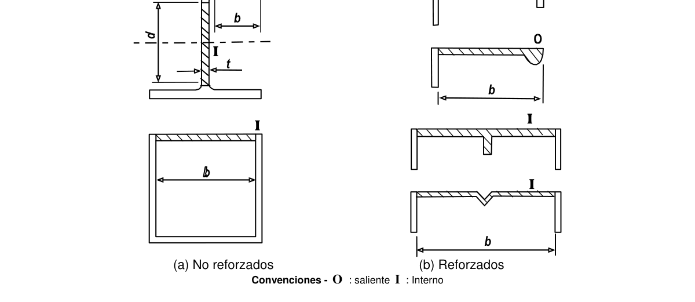

Figura F.5.4.3-1 — Tipos de elementos planos

(c) Almas sometidas a cortante — El pandeo de almas a cortante se trata por separado (véase el literal (c) de F.5.4.5.3 y F.5.5).

**F.5.4.3.2** — Parámetro de esbeltez $β$ — La susceptibilidad al pandeo local de un elemento de una viga (resistencia a momento) o en un miembro a compresión (resistencia a fuerza axial) depende del parámetro $β$ como se define en los literales (a) a (d) de este numeral.

(a) Elementos planos no reforzados — El parámetro $β$ depende de la relación $b /t$ o $d /t$ del elemento considerado; $t$ es el espesor del elemento, $b$ es generalmente el ancho del elemento y $d$ es la altura del elemento del alma en una viga. Los valores de $b$ y $d$ deben ser tomados como el ancho del elemento plano medido hasta el comienzo de un filete o hasta el borde de una soldadura.

$β$ se define como sigue:

• Elemento sometido a compresión uniforme $β =b /t$ • Elemento sometido a un gradiente de esfuerzos:

(1) Elemento interno con un gradiente de esfuerzos que resulta en un eje neutro en el centro $β =0.35d /t$ o, $β =0.35b /t$ (2) Para cualquier otro gradiente de esfuerzos $β =gb /t$ o, $β =gd /t$ donde $g$ es el coeficiente de gradiente de esfuerzos que se lee en la figura F.5.4.3-2. En la figura F.5.4.3-2, $y_{c}$ y $y_{o}$ son las distancias desde el eje neutro de la sección bruta hasta el extremo más fuertemente comprimido y hasta el otro extremo del elemento respectivamente; son tomadas como positivas hacia el lado comprimido. Deben ser generalmente medidas desde el eje neutro elástico pero en la verificación de si una sección es totalmente compacta se permite usar el eje neutro plástico.

NOTA: Para elementos internos o salientes (compresión pico en la raíz) use la curva A. Para elementos salientes (compresión pico en el borde) use la línea B.

Figura F.5.4.3-2 — Elementos planos bajo gradiente de esfuerzos, valor de $g$

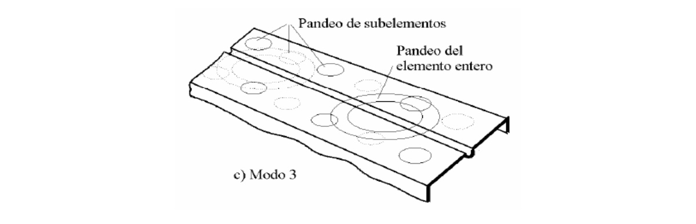

Figura F.5.4.3-3 — Modos de pandeo de elementos planos reforzados

Figura F.5.4.3-3 — Modos de pandeo de elementos planos reforzados

(b) Elementos planos reforzados — Se deben considerar dos modos posibles de pandeo (véase la figura F.5.4.3-3) y se deben encontrar valores diferentes de $β$ para cada uno de ellos:

• modo 1 — el elemento reforzado se pandea como una unidad llevándose consigo el refuerzo • modo 2 — los subelementos, abarcando el elemento reforzado, se pandean como elementos individuales mientras las uniones entre ellos permanecen rectas • modo 3 — esta es una combinación de los Modos 1 y 2 en los cuales el pandeo de los sub elementos está súper puesto al pandeo del elemento entero, esto se indica en la Figura F.5.4.3-3. (c) En el modo 2 de pandeo, $β$ se encuentra por separado para cada subelemento de acuerdo con el literal (a) de F.5.4.3.2. En el modo 1, $β$ se determina, generalmente, como sigue (véase F.5.4.3.2 para lo que se relaciona con elementos salientes en vigas).

• Modo 1, compresión uniforme (1) Refuerzo estándar — Se define como el refuerzo consistente en una costilla o pestaña unilateral con espesor igual al del elemento, $t$ , y localizado como se muestra en la figura F.5.4.3-4:

$$ \beta =hb/t \tag{F.5.4.3-1} $$

Donde:

$b$ y $t =$ se definen como en el literal (a) de F.5.4.3.2

$h =$ se lee en la figura F.5.4.3-4 (a), (b) o (c) según sea apropiado En la figura F.5.4.3-4, $c$ debe tomarse como la altura libre de la costilla o pestaña medida hasta la superficie de la lámina.

(2) Refuerzo no estándar — Con cualquier otra forma de refuerzo, $β$ debe encontrarse reemplazándolo con una costilla o pestaña equivalente de forma estándar y procediendo como en (1). El valor de $c$ para la costilla o pestaña equivalente se escoge de modo que su segundo momento del área alrededor del plano medio de la lámina sea igual al del refuerzo verdadero.

(3) Método general — Para casos no cubiertos por (1) y (2), $β$ se debe tomar de acuerdo con:

$$ \beta =\left(\dfrac{b}{t}\right)\left(\dfrac{\sigma _{cro}}{\sigma _{cr}}\right)^{0.4} \tag{F.5.4.3-2} $$

Donde:

$σ_{cr}$ y $σ_{cro}$ esfuerzos elásticos críticos, suponiendo soporte en un solo borde, con y sin el refuerzo • Modo 1, gradiente de esfuerzos $β$ debe encontrarse usando la expresión general dada en el numeral (3) en la cual $σ_{cr}$ y $σ_{cro}$ ahora se refieren al esfuerzo en el borde más comprimido del elemento.

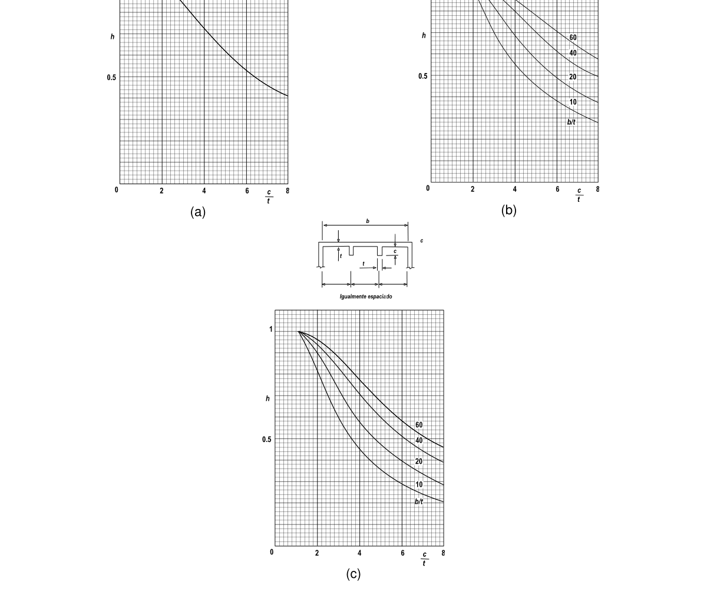

Figura F.5.4.3-4 — Elementos reforzados, valor de $h$

(c) Elementos curvos internos — En elementos curvos de poca altura sometidos a compresión uniforme, $β$ debe determinarse usando:

$$ \beta =\dfrac{b/t}{\left[1+\left(0.006b^{4}/R^{2}t^{2}\right)\right]^{1/2}} \tag{F.5.4.3-3} $$

Donde:

$R =$ radio de curvatura hasta la parte media del metal

$b =$ ancho de desarrollo del elemento en la parte media del metal

$t =$ espesor En elementos curvos sometidos a un gradiente de esfuerzos se puede tomar un valor de $β$ más favorable obtenido factorando el valor anterior por $g$ (obtenido en la figura F.5.4.3-2).

El tratamiento anterior es válido siempre que $R /b$ no sea menor que $0.1b /t$ . Las secciones que contienen elementos de mayor curvatura requieren estudio especial.

(d) Tubos redondos $β$ se debe calcular de acuerdo con lo siguiente, sin hacer distinción entre compresión axial y flexión:

$$ \beta =3\left(D/t\right)^{1/2} \tag{F.5.4.3-4} $$

Donde:

$D =$ diámetro hasta la parte media del metal

$t =$ espesor

**F.5.4.3.3** — Clasificación de la sección — El procedimiento consiste en clasificar los elementos individuales que conforman la sección, exceptuando cualquier elemento sometido totalmente a tensión. La clasificación de la sección se toma como la del elemento menos favorable. Los elementos individuales se clasifican de acuerdo con los literales (c) o (d) de este numeral.

(a) Secciones — vigas y miembros a compresión — Para la sección de una viga (resistencia a momento) o de un miembro a compresión (resistencia a fuerza axial) se aplican las siguientes clasificaciones.

• Resistencia a momento:

(1) Totalmente compacta — el pandeo local puede ignorarse (2) Semi-compacta — la sección puede desarrollar un momento igual a $p_{o}$ veces el módulo elástico de la sección (3) Esbelta — la resistencia a momento se reduce por pandeo local prematuro con un esfuerzo en la fibra extrema menor que $p_{o}$ .

• Resistencia a compresión axial:

(1) Compacta — se puede ignorar el pandeo local (2) Esbelta — el pandeo local disminuye la resistencia

(b) Secciones sometidas a acciones combinadas — Véase el literal (a) de F.5.4.8.2 para la clasificación de secciones sometidas a flexión biaxial o a flexión y fuerza axial simultáneas.

(c) Clasificación de elementos — La clasificación de un elemento individual depende del valor de $β$ (véase F.5.4.3.2):

• elementos de vigas (resistencia a momento):

$β ≤β_{1}$ totalmente compacta $β_{1} < β ≤β_{0}$ semi-compacta $β > β_{0}$esbelta • elementos de miembros a compresión (resistencia axial):

$β ≤β_{0}$compacta $β > β_{0}$esbelta donde $β_{0}$ y $β_{1}$ están dados en la tabla F.5.4.3-1.

**Tabla F.5.4.3-1**

Valores límite de $β$

| Elementos | $β_{0}$ |  | $β_{1}$ |  |
|---|---|---|---|---|
|  | No soldado | Soldado | No soldado | Soldado |
| Elementos salientes | $7ε$ | $6ε$ | $6ε$ | $5ε$ |
| Elementos internos | $22ε$ | $18ε$ | $18ε$ | $15ε$ |
| NOTA 1. El valor de $ε$ se toma generalmente como $ε =(25 /p_{o})1 /2$ (excepto para ciertos elementos de aleta |  |  |  |  |

en vigas, véase F.5.4.3.3 (d)). $p_{o}$ es el esfuerzo límite en kgf/mm2 (véanse las tablas F.5.4.2-1 y F.5.4.2-2).

NOTA 2. Un elemento se considera soldado si contiene soldadura en un borde o en cualquier punto de su ancho. Sin embargo, cuando se evalúa la estabilidad de una sección transversal particular de un miembro, se permite considerar el elemento como no soldado si no contiene soldadura en esa sección aunque esté soldado en cualquier otro lugar de su longitud.

NOTA 3. En un elemento soldado, la clasificación es independiente de la extensión de la zona afectada por el calor.

(d) Elementos de aleta subesforzados — Se puede utilizar una clasificación más favorable para elementos de aleta en miembros sometidos a flexión o a flexión más fuerza axial que sean:

• Paralelos al eje de flexión; y • Menos altamente esforzados que las fibras más severamente esforzadas de la sección.

Se permite entonces, usando la tabla F.5.4.3-1, tomar un valor modificado de $ε$ según:

$$ \varepsilon =\left(\dfrac{25y_{1}}{p_{o}y_{2}}\right)^{1/2} \tag{F.5.4.3-5} $$

donde $y_{1}$ y $y_{2}$ son, respectivamente, las distancias desde el eje neutro de la sección bruta hasta las fibras más severamente esforzadas y hasta el elemento. Deben ser, por lo general, medidas desde el eje neutro elástico; no obstante, en la revisión de si la sección es totalmente compacta se permite usar el eje neutro plástico.

**F.5.4.3.4** — Pandeo local — La posibilidad de pandeo local en miembros clasificados como esbeltos es generalmente tenida en cuenta reemplazando la sección real por una sección efectiva. La sección efectiva se obtiene empleando un coeficiente de pandeo local $k_{L}$ para reducir el espesor; esto es aplicable a cualquier elemento esbelto de espesor uniforme que esté total o parcialmente sometido a compresión. Los elementos que no tienen espesor uniforme requieren un estudio especial.

(a) Determinación de $k_{L}$ — El coeficiente $k_{L}$ , que se encuentra por separado para los diferentes elementos de la sección, se lee de la curva apropiada de la figura F.5.4.3-5 seleccionada de acuerdo con la tabla F.5.4.3-2. Se debe determinar, como se muestra a continuación, el valor correcto de $β/ε$ para poder seleccionar la curva correcta:

**Tabla F.5.4.3-2**

Selección de la curva de la figura F.5.4.3-5 (pandeo local)

| Elementos | No soldado | Soldado |
|---|---|---|
| Elementos salientes planos | Curva A | Curva B |
| Elementos internos (planos o curvos) | Curva C | Curva D |
| Tubería redonda | La inferior entre las curvas C y E | La inferior entre las curvas D y E |

NOTA: En un elemento soldado, la clasificación es independiente de la extensión de la zona afectada por el calor.

$β$ = se encuentra según F.5.4.3.2

$ε =(25 /p_{o})1 /2$ generalmente (véase la nota 3 del literal (c) de F.5.4.5.2 para aletas a compresión de vigas) Donde:

$p_{o}=$ esfuerzo límite del material en kgf/mm2, sin considerar el efecto de la zona afectada por el calor Para decidir si un elemento se debe tomar como no soldado o soldado en la tabla F.5.4.4, véase la nota 2 de la tabla F.5.4.3.

En el caso de elementos planos reforzados es importante considerar ambos modos posibles de pandeo (véase figura F.5.4.3) y tomar el más crítico. En el caso del modo 1, el coeficiente de pandeo $k_{L}$ se debe aplicar al área del refuerzo tanto como al espesor básico de la lámina

(b) Secciones sometidas a acciones combinadas — Véase el literal (b) de F.5.4.8.2 para determinar $k_{L}$ en secciones sometidas a flexión biaxial o a flexión y fuerza axial simultáneas.

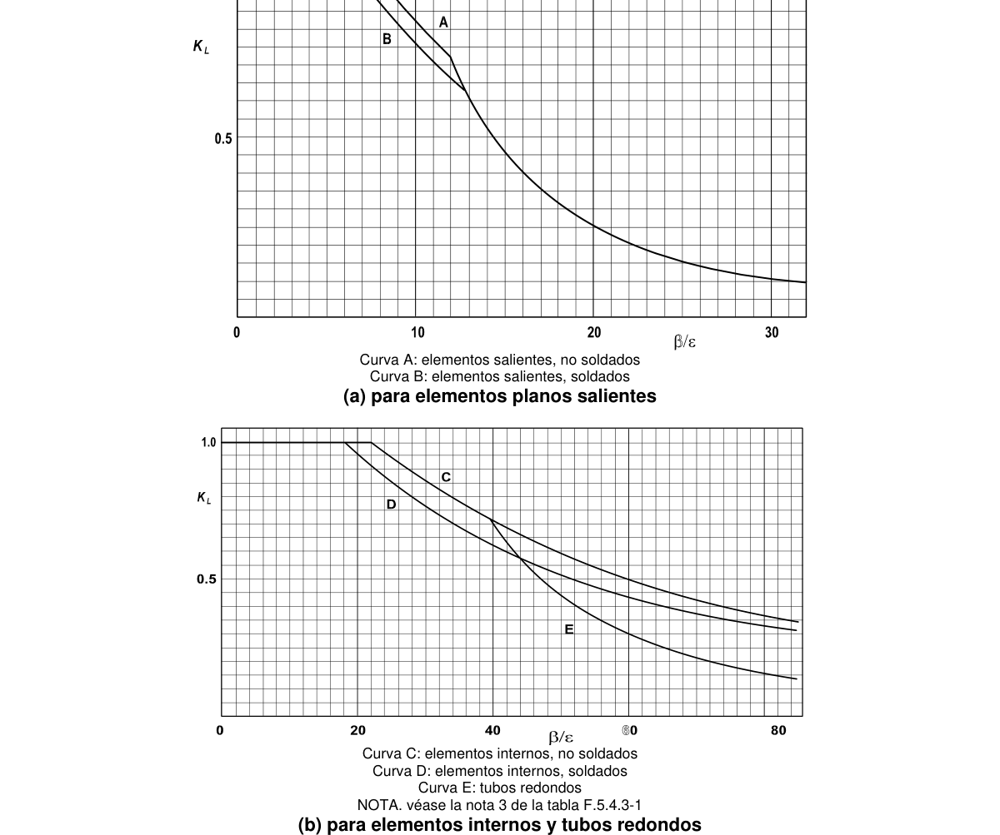

Figura F.5.4.3-5 — Coeficiente de pandeo local $k_{L}$

#### F.5.4.4 — ABLANDAMIENTO EN LA ZONA AFECTADA POR EL CALOR ADYACENTE A LA SOLDADURA

**F.5.4.4.1** — Generalidades — Es necesario considerar en el diseño el ablandamiento que usualmente se presenta en la vecindad de las soldaduras. La región más afectada se localiza inmediatamente alrededor de la soldadura, sin embargo, las propiedades del material mejoran rápidamente con la distancia hasta tener las del material original. El ablandamiento afecta más severamente el esfuerzo de prueba del 0.2% que la resistencia a tensión.

Para el diseño es aceptable aproximarse a la condición real suponiendo que alrededor de cada soldadura existe una zona afectada por el calor en la que las propiedades de resistencia están reducidas por un coeficiente constante $k_{z} .$ Por fuera de esta zona, se supone que se pueden aplicar todas las propiedades originales del material base.

La severidad del ablandamiento en la zona afectada por el calor, definida por $k_{z}$ , se trata en F.5.4.4.2. La extensión de la zona afectada por el calor, definida por una distancia $z ,$ medida desde la soldadura, se considera en F.5.4.4.3.

Algunas veces es posible mitigar el efecto del ablandamiento de la zona afectada por el calor mediante un tratamiento de envejecimiento artificial aplicado después de soldar (véase el apéndice F.5.E).

**F.5.4.4.2** — Severidad del ablandamiento

(a) Coeficiente de ablandamiento de la zona afectada por el calor — El coeficiente $k_{z}$ normalmente debe tomarse de la tabla F.5.4.4-1 pero para ciertos cálculos se permite usar un valor más favorable, como se explica en el apéndice F.5.E. Esto se aplica cuando la resistencia de un miembro está gobernada por $p_{a}$ o $p_{v}$ en lugar de por $p_{o}$ . Para encontrar el coeficiente $k_{z}$ para materiales no cubiertos en la tabla F.5.4.4-1, véase el apéndice F.5.E.

(b) Material 7020 — Los valores alternativos de $k_{z}$ dados en la tabla F.5.4.4-1 para el material 7020 deben ser normalmente aplicados de acuerdo con la naturaleza del esfuerzo actuante sobre el material de la zona afectada por el calor:

• valor (A) — esfuerzo de tensión actuando transversalmente al eje de una soldadura a tope o de filete • valor (B) — cualquier otra condición de esfuerzo, esto es, esfuerzo longitudinal, compresión transversal, cortante.

Algunas veces es posible incrementar el valor (A) a una cifra superior a la de la tabla dependiendo del grado de control térmico logrado en la fabricación (véase el apéndice F.5.E).

(c) Tiempo de recuperación para aleaciones tratadas en caliente — Los valores de $k_{z}$ dados en la tabla F.5.4.4-1 son válidos a partir de los siguientes tiempos después de soldar, siempre y cuando el material se haya mantenido a una temperatura no menor de 15 ºC:

• Aleaciones de la serie 6*** 3 días • Aleaciones de la serie 7*** 30 días Para determinar la resistencia de los componentes que deben ser cargados más tempranamente, pero nunca antes de 24 horas después de soldar, el valor de $k_{z}$ debe reducirse por un coeficiente $f$ calculado de acuerdo con lo siguiente:

$$ \bullet\quad\text{Aleaciones de la serie 6***}\qquad f=0.9+0.1\left[(n-1)/2\right]^{1/2} \tag{F.5.4.4-1} $$

$$ \bullet\quad\text{Aleaciones de la serie 7***}\qquad f=0.8+0.2\left[(n-1)/29\right]^{1/2} \tag{F.5.4.4-2} $$

donde $n$ es el tiempo, en días, entre la soldadura y la carga.

Si el material se mantiene a una temperatura por debajo de 15ºC después de haber soldado, el tiempo de recuperación se prolongará y esto debe ser advertido.

**Tabla F.5.4.4-1**

Coeficiente de ablandamiento de la zona afectada por el calor, $k_{z}$

| Aleación | Condición | Producto (nota 1) | $k_{z}$ |
|---|---|---|---|
| No tratadas en caliente |  |  |  |
| 1200 | H14 | S | 0.13 |
| 3103 | H14 | S | 0.18 |
|  | H18 | S | 0.13 |
| 3105 | H14 | S | 0.17 |
|  | H16 | S | 0.15 |
|  | H18 | S | 0.13 |
| 5083 | O, F | E, S, P, DT | 1.00 |
|  | H22 | S, P | 0.45 |
| 5154A | O, F | E, S, P | 1.00 |
|  | H22 | S, P | 0.40 |
|  | H24 | S, P | 0.29 |
| 5251 | F | WT | 0.20 |
|  | F | F | 1.00 |
|  | H22 | S, P | 0.35 |
|  | H24 | S, P | 0.24 |
| 5454 | O, F | E, S, P | 1.00 |
|  | H22 | S | 0.35 |
|  | H24 | S | 0.30 |
| Tratadas en caliente |  |  |  |
| 6061 | T6 | E, DT | 0.50 |
| 6063 | T4 | E | 1.00 |
|  | T4 | DT | 0.65 |
|  | T4 | F | 0.80 |
|  | T5 | E | 0.75 |
|  | T6 | E, F | 0.50 |
|  | T6 | DT | 0.45 |
| 6082 | T4 | E, S, P, DT, F | 1.00 |
|  | T6 | E, S, P, DT, F | 0.50 |
| 7020 | T4 | E, S, P | 0,80(A) 1,00(B) |
|  | T6 | E, S, P | 0,60(A) 0,80(B) |
|  |  |  | (nota 2) |

NOTA 1. En la columna de producto, E, S, P, DT, WT y F se refieren, respectivamente, a extrusión, lámina, plancha, tubería extruída, tubería soldada y forjados.

NOTA 2. Refiérase al literal (b) de F.5.4.4.2 para ver la aplicabilidad de los valores A y B para material 7020.

**F.5.4.4.3** — Extensión de la zona afectada por el calor

(a) Definición de $z$ — Se supone que la zona afectada por el calor se extiende una distancia $z$ en cualquier dirección a partir de la soldadura, medida de acuerdo con lo siguiente:

(1) Transversalmente desde la línea central de una soldadura a tope en línea (véase la figura F.5.4.4-1(a)) (2) En soldaduras de filete, transversalmente desde el punto de intersección de las superficies soldadas (véanse las figuras F.5.4.4-1(e), (f), (g) y (h)) (3) En soldaduras a tope usadas en uniones de esquina, $T$ o cruciformes, transversalmente desde el punto de intersección de las superficies soldadas (véanse las figuras F.5.4.4-1(b), (c) y (d)) (4) En cualquier dirección radial desde el extremo de una soldadura (véanse las figuras F.5.4.4-1(i) y (j)) Las fronteras de la zona afectada por el calor generalmente deben ser tomadas como líneas rectas normales a la superficie del metal, como se muestra en la figura F.5.4.4-1. Sin embargo, se permite, en su lugar, suponer una frontera curva de radio $z$ , como se muestra en B (en lugar de A) en la figura F.5.4.4-1(i). Esto es ventajoso cuando la soldadura de superficie se aplica a un material grueso.

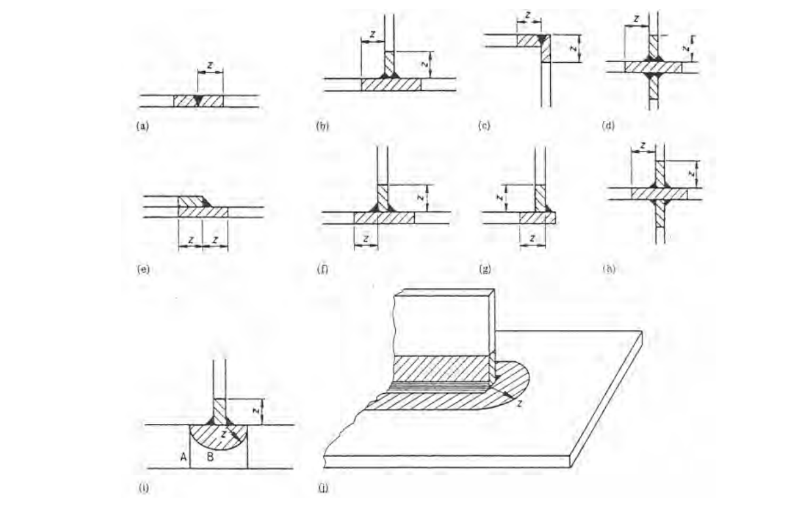

Figura F.5.4.4-1(a) — Extensión de la zona afectada por el calor, ubicación de $z$

**Tabla F.5.4.4-1b**

Extensión de la zona afectada por el calor, coeficiente $α$

| Caso | Configuración de la unión | Valor de $α$ |  |
|---|---|---|---|
|  |  | $t_{c}≤25$ mm | $t_{c}>25$ mm |
|  | Soldadura continua substancialmente recta (véanse figuras F.7.4.6(a), (c), (e) y (g) |  |  |
| P | área total del depósito menor o igual que 50 mm2 | 1.0 | 1.5 |
| Q | área total del depósito mayor que 50 mm2 | 1.5 | 2.0 |
| R | Soldadura continua substancialmente recta que tiene dos o más soldaduras adyacentes (véanse figuras F.7.4.6(b), (d), (f) y (h) | 1.5 | 2.0 |
| S | Unión con irregularidad local | 1.5 | 2.0 |
|  | (a) uniones miembro a miembro en armaduras |  |  |
|  | (b) soldaduras que conectan rigidizadores transversales en vigas y vigas ensambladas |  |  |
|  | (c) soldaduras usadas para conectar orejas y otros accesorios |  |  |

(b) Formula básica para $z$ — La siguiente expresión general debe ser usada para estimar el valor de $z$ .

$z= αηz_{o}$ Donde:

$z_{o}$ = es el valor básico calculado en (c).

$α$ y $η$ = factores de modificación, son determinados en (d) y (e) o puede referirse al apéndice F.5.E.

(c) Determinación de $z_{o}$ — El valor básico de $z_{o}$ , el cual es la relación entre la soldadura depositada en el material no calienta con la interfase completamente enfriada, debe tomarse el menor valor de los dos calculados en i) y ii) • Para soldadura a tope para aleaciones de la serie 7***

(i) $z_{o}=30−t_{A}/2$ (ii) $z_{o}=4.5t_{A}$ para otras aleaciones

(i) $z_{o}=20−t_{A}/3$ (ii) $z_{o}=3.0t_{A}$ • Para otro tipo de soldadura incluyendo las variaciones de soldadura de filete.

para aleaciones de la serie 7***

(i) $z_{o}=30−t_{A}/2$ (ii) $z_{o}=4.5t_{B}^{2}/t_{A}$ para otras aleaciones

(i) $z_{o}=20+t_{A}/3$ (ii) $z_{o}=3.0t_{B}^{2} t_{A}$ Donde:

$t_{A}$= es el menor valor de $0.5(t_{B}+t_{C} )$ y $1.5t_{B}$

$t_{B}$ , $t_{C}$= son los espesores de los elementos a conectar por medio de la soldadura, $t_{C}$ es el espesor del elemento mas grueso a unir.

(d) Determinación de $α$ — el factor $α$ debe ser tomado de la tabla F.5.4.4-2, o alternativamente de acuerdo al apéndice F.5.E. De acuerdo a (c), este numeral suministra la posibilidad de que en el material empiece la deposición de la soldadura debido a una elevada temperatura, debido a otro precalentamiento o a la depositación previa en la junta o de la soldadura en la misma junta.

(e) Determinación de $η$ — El coeficiente $η$ en el literal (b) de F.5.4.4.3 cubre la posibilidad de acumulación incremental de calor debida a:

• proximidad de un borde o de bordes libres; o • otra soldadura en la vecindad.

El valor de $η$ puede encontrarse como se indica a continuación en (1) o en (2).

Alternativamente refiérase al apéndice F.5.E.

(1) Para una unión desde la cual existen al menos dos caminos de calor válidos:

$η =1$ Un camino de calor válido es aquel en el que $h≤h_{1}$; donde

$h =$ distancia al borde libre o la mitad de la distancia a una soldadura cercana La distancia $h$ debe ser medida desde el punto de referencia en la soldadura considerado (véase la figura F.5.4.4-1) y a lo largo del camino de calor relevante a través del metal en la mitad del espesor. El camino de calor sigue el perfil de la sección y no tiene que ser necesariamente recto (véase la figura F.5.4.4-2).

Figura F.5.4.4-2 — Medición típica del camino de calor

$$ h_{1}=4.5\alpha z_{o}=\text{ para aleaciones de la serie 7***, o} \tag{F.5.4.4-3} $$

$$ h_{1}=3\alpha z_{o}=\text{ para otras aleaciones} \tag{F.5.4.4-4} $$

(2) Para una unión desde la cual hay únicamente un camino de calor válido:

$t_{c}≤25$ mm $η =1.50$

$t_{c}>25$ mm $η =1.33$

(f) Traslapo de zonas afectadas por el calor — Cuando dos uniones se localizan de modo que sus zonas afectadas por el calor respectivo (determinadas de acuerdo con F.5.4.4.3) se traslapan, se puede suponer que la extensión de la zona afectada por el calor en el lado exterior de cada unión no se altera por la proximidad.

(g) Determinación experimental de $z$ — Es una alternativa para estimar la extensión de la zona afectada por el calor en lugar de hacerlo mediante cálculo. Esto se puede hacer por medio del examen de dureza de un espécimen representativo (véase el apéndice F.5.E).

#### F.5.4.5 — VIGAS

**F.5.4.5.1** — Generalidades — Las siguientes revisiones se deben realizar a todas las vigas (incluyendo vigas ensambladas).

(a) Revisión a momento — En cualquier sección transversal, el momento $M$ bajo carga mayorada no debe exceder la resistencia de diseño a momento $M_{RS}$ de la sección, calculada de acuerdo con F.5.4.5.2 (o alternamente de acuerdo con el apéndice F.5.D). $M_{RS}$ se debe reducir apropiadamente, cuando sea necesario, para tener en cuenta un cortante coincidente (véase F.5.4.5.4).

(b) Revisión a cortante — En cualquier sección transversal, la fuerza cortante $V$ bajo carga mayorada no debe exceder la resistencia de diseño a fuerza cortante $V_{RS}$ (véase F.5.4.5.3).

En algunos casos, es necesario hacer también una o ambas de las siguientes revisiones:

(1) Revisión de aplastamiento del alma (véase F.5.4.5.5) (2) Revisión de pandeo torsional lateral (véase F.5.4.5.6) Las vigas ensambladas, que tienen almas rigidizadas más esbeltas, deben diseñarse preferiblemente usando F.5.5.4. Se permite diseñarlas como vigas pero es probable que se pierda en economía.

Para el diseño de vigas sometidas a flexión biaxial combinada con carga axial, se debe usar F.5.4.8.

Las vigas sujetas a flexión biaxial respecto a ambos ejes principales se deben revisar también de acuerdo con F.5.4.8.

**F.5.4.5.2** — Resistencia a momento uniaxial de la sección

(a) Clasificación de la sección para resistencia a momento — Primero es necesario clasificar la sección como totalmente compacta, semi-compacta o esbelta basándose en el elemento componente menos favorable, de acuerdo con F.5.4.3.3.

En el caso de un elemento saliente reforzado que forme parte o sea toda la aleta a compresión, la presencia de refuerzo en forma de una pestaña dirigida hacia afuera debe ignorarse para la clasificación de la sección.

(b) Cálculo básico — La resistencia de diseño a momento $M_{RS}$ de una sección dada, en ausencia de cortante, debe encontrarse, por lo general, como se indica a continuación:

$$ \bullet\quad\text{No soldada, totalmente compacta}\qquad M_{RS}=p_{o}Z_{n}\phi \tag{F.5.4.5-1} $$

$$ \bullet\quad\text{No soldada, semi-compacta}\qquad M_{RS}=p_{o}S_{n}\phi \tag{F.5.4.5-2} $$

$$ \bullet\quad\text{Soldada, totalmente compacta}\qquad M_{RS}=p_{o}Z_{ne}\phi \tag{F.5.4.5-3} $$

$$ \bullet\quad\text{Soldada, semi-compacta}\qquad M_{RS}=p_{o}S_{ne}\phi \tag{F.5.4.5-4} $$

• No soldada, esbelta $M_{RS}=p_{o} S_{e}φ$ o,

$M_{RS}=p_{o} S_{n}φ$ lo que sea menor(F.5.4.5-5) • Soldada, esbelta $M_{RS}=p_{o} S_{e}φ$ o,

$M_{RS}=p_{o} S_{ne}φ$ lo que sea menor(F.5.4.5-6) Donde:

$S_{n}$ y $Z_{n} =$ módulos elástico y plástico, respectivamente, de la sección neta

$S_{ne}$ y $Z_{ne} =$ módulos elástico y plástico, respectivamente, de la sección neta efectiva

$Z_{e}=$ módulo plástico de la sección efectiva

$p_{o}=$ esfuerzo límite (véanse las tablas F.5.4.2-1 y F.5.4.2-2)

$φ$ = coeficiente de reducción de capacidad (véase la tabla F.5.3.3-1) Se permite en secciones semi-compactas y esbeltas, si es favorable, tomar la resistencia a momento basada en un patrón de esfuerzos elasto-plástico tal como se indica en el apéndice F.5.D, en lugar de usar las expresiones anteriores. Si esto se hace, la nota 5 del literal (c) de este mismo numeral no es válida.

(c) Sección supuesta — La terminología usada en el literal (b) de este mismo numeral implica lo siguiente:

• La sección neta incluye solamente la reducción por los agujeros • La sección neta efectiva incluye el espesor reducido tomado en la vecindad de las soldaduras para tener en cuenta el ablandamiento en la zona afectada por el calor conjuntamente con la reducción por los agujeros.

• La sección efectiva incluye el espesor reducido para tomar en cuenta el ablandamiento en la zona afectada por el calor y el pandeo local pero no se hace reducción por los agujeros.

El espesor reducido se debe tomar, por lo general, de acuerdo con lo siguiente para los diferentes elementos en una sección.

(1) Elemento esbelto libre de efectos de zona afectada por el calor — Se toma un espesor $k_{L} t$ para todo el elemento, $k_{L}$ se encuentra siguiendo F.5.4.3.4.

(2) Elementos no-esbeltos sujetos a efectos de zona afectada por el calor — Se toma un espesor $k_{z} t$ para las partes ablandadas del elemento. $k_{z}$ y la extensión del ablandamiento están dados en F.5.4.4.2 y F.5.4.4.3.

(3) Elemento esbelto con efectos de zona afectada por el calor — Se toma el espesor reducido como el menor de $k_{z} t$ y $k_{L} t$ para la parte ablandada y $k_{L} t$ para el resto del elemento.

Nota 1 — Cuando se localiza un agujero en la región de espesor reducido, la reducción para ese agujero debe basarse en el espesor reducido.

Nota 2 — En el caso de elementos reforzados, $k_{L}$ se debe aplicar al área del refuerzo así como al espesor básico de la lámina.

Nota 3 — Cuando se considera un elemento de aleta esbelto que se localiza más cerca del eje neutro que de la fibra extrema a tensión del material, se permite tomar un valor más favorable de $k_{L}$ . Esto se hace usando un valor modificado de $ε$ en la figura F.5.4.3-5 (en lugar del valor normal, véase el literal (a) de F.5.4.3.4) de acuerdo con:

$$ \varepsilon =\left(\dfrac{25y_{1}}{p_{o}y_{2}}\right) \tag{F.5.4.5-7} $$

donde $y_{1}$ y $y_{2}$ son las distancias desde el eje neutro elástico de la sección bruta hasta las fibras extremas y hasta el elemento considerado, respectivamente. Esta relación se aplica sólo si el elemento es substancialmente paralelo al eje de flexión.

Nota 4 — Para un elemento reforzado que forma parte de la aleta a compresión de una sección esbelta en la cual el refuerzo tiene la forma de una pestaña dirigida hacia afuera, la presencia de la pestaña debe ignorarse para determinar la resistencia a momento.

Nota 5 — Para un elemento soldado en una sección semi-compacta o esbelta, se puede suponer un espesor más favorable de acuerdo con lo siguiente:

• Se ignora el ablandamiento en la zona afectada por el calor para cualquier material que esté a menos de $k_{z} y_{1}$ del eje neutro elástico de la sección bruta, donde $y_{1}$ es la distancia de allí a las fibras más lejanas de la sección.

• Para el material de la zona afectada por el calor, a una distancia $y>k_{z} y_{1}$ del eje neutro, $k_{z}$ se puede reemplazar por un valor $k_{zy}$ determinado de acuerdo con:

$$ k_{zy}=k_{z}+1-\dfrac{y}{y_{1}} \tag{F.5.4.5-8} $$

(d) Secciones híbridas — La capacidad a momento de una sección híbrida que contiene materiales de diferentes resistencias puede basarse, con seguridad, en el menor valor de $p_{o}$ dentro de la sección. Como alternativa puede usarse el siguiente procedimiento que es más ventajoso.

• Cada elemento se clasifica de acuerdo con su valor particular de $p_{o}$ • Para una sección totalmente compacta, $M_{RS}$ se encuentra usando la teoría de flexión plástica convencional teniendo en cuenta el valor de $p_{o}$ en cada elemento y usando nuevamente la sección neta efectiva en el caso de miembros soldados • Para otras secciones, $M_{RS}$ se encuentra con la expresión F.5.20, F.5.22 o F.5.23 del literal (b) de F.5.4.5.2, la que sea apropiada, tomando como base los valores de $p_{o}$ y $Z$ del punto de la sección que da los menores valores de $M_{RS}.$

(e) Secciones semi-compactas — Para este tipo de secciones se permite, si se desea, tomar una valor mejorado de $M_{RS}$ que se obtiene por interpolación de acuerdo con lo siguiente:

$$ M_{RS}=M_{s}+\dfrac{\beta _{0}-\beta }{\beta _{0}-\beta _{1}}(M_{f}-M_{S}) \tag{F.5.4.5-9} $$

Donde:

$M_{f}$ y $M_{s}$ = valores de $M_{RS}$ totalmente compacto y semi-compacto encontrados de acuerdo con el literal (b) de F.5.4.5.2

$β$ = valor de $β$ para el elemento más crítico de la sección

$β_{1}$ y $β_{0}$= valores límite de $β$ totalmente y semi-compacto para ese mismo elemento (véase la tabla F.5.4.3-1).

**F.5.4.5.3** — Resistencia a fuerza cortante

(b) Clasificación de la sección — Primero es necesario clasificar la sección como compacta o esbelta en términos de su resistencia a fuerza cortante: una sección compacta no se afecta por pandeo mientras que una sección esbelta se debe revisar a pandeo. Las secciones se clasifican como sigue:

(1) Secciones que contienen almas a cortante orientadas en el plano de carga, sin platinas de enchape:

$dt ≤49ε$ compacta $dt >49ε$ esbelta Donde:

$d =$ altura libre del alma entre aletas (medida sobre la pendiente en el caso de almas inclinadas) espesor del alma

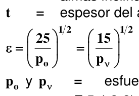

esfuerzos límite (en kgf/mm²) (véanse las tablas F.5.4.2-1 y F.5.4.2-2) (2) Secciones que contienen almas a cortante orientadas en el plano de carga, con platinas de enchape — Véase el literal (e).

(3) Barra sólida — compacta (4) Tubería redonda — la misma clasificación que para compresión axial (véanse el literal

(d) de F.5.4.3.2 y el literal (c) de F.5.4.3.3.).

(b) Secciones compactas — La resistencia de diseño a fuerza cortante $V_{RS}$ de una sección, en ausencia de momento, se puede calcular mediante la siguiente ecuación:

$$ V_{RS}=\phi p_{\nu }A_{\nu } \tag{F.5.4.5-10} $$

Donde:

$pν$ = esfuerzo límite (véanse las tablas F.5.4.2-1 y F.5.4.2-2)

$Aν$ = área efectiva de cortante

$φ$ = coeficiente de reducción de capacidad (véase la tabla F.5.3.3-1) El área de la sección efectiva será:

(1) Para secciones que contienen almas a cortante sin platinas de enchape que están libres de ablandamiento en la zona afectada por el calor, $Aν$ se determina usando:

$$ A_{\nu }=0.8NDt \tag{F.5.4.5-11} $$

Donde:

$D =$ altura total del alma medida desde la superficie exterior de las aletas

$t =$ espesor del alma

$N =$ número de almas La presencia de pequeños agujeros se puede ignorar siempre y cuando ellos no ocupen, en total, más del 20% de la altura libre del alma entre aletas.

(2) Para secciones como las de (a) pero con almas afectadas por ablandamiento en la zona afectada por el calor, $Aν$ se determina con la siguiente ecuación:

$$ A_{\nu }=N\left(0.8Dt-(1-k_{z})d_{z}t\right) \tag{F.5.4.5-12} $$

Donde:

$d_{z}$= altura total de material de la zona afectada por el calor dentro de la altura libre entre aletas del alma (véase F.5.4.4.3)

$k_{z}$= coeficiente de ablandamiento (véase F.5.4.4.2) Para un alma soldada en toda su altura o continuamente soldada longitudinalmente en cualquier punto de se altura, $V_{RS}$ se debe tomar como $k_{z}$ veces el valor no soldado.

(3) Para una barra sólida:

$$ A_{v}=0.8A\text{ ó }0.8A_{e} \tag{F.5.4.5-13} $$

(4) Para un tubo redondo compacto:

$$ A_{v}=0.6A\text{ ó }0.6A_{e} \tag{F.5.4.5-14} $$

Donde:

$A$ = área de la sección (en ausencia de ablandamiento en la zona afectada por el calor)

$A_{e}$ = área efectiva de la sección (cuando hay ablandamiento en la zona afectada por el calor) encontrada tomando un espesor efectivo de $k_{z}$ veces el espesor real para el material de la zona afectada por el calor.

En el caso de secciones que contienen almas a cortante, se pueden usar los métodos para el cálculo de $V_{RS}$ de vigas ensambladas (véanse los literales (a) y (d) de F.5.5.4.2).

(c) Secciones esbeltas — La resistencia de diseño a fuerza cortante $V_{RS}$, en ausencia de momento, para secciones que contienen almas esbeltas a cortante sin platinas de enchape y orientadas en el plano de carga, se debe tomar como la menor de los dos valores obtenidos en las siguientes revisiones:

(1) Revisión a fluencia — La resistencia se calcula como para una sección compacta usando el literal (b) de F.5.4.5.3.

(2) Revisión por pandeo — El valor de $V_{RS}$ en kgf se obtiene con la siguiente expresión:

$$ V_{RS}=\phi \dfrac{34\,000Nt^{3}}{d}\le \phi p_{v}A_{v} \tag{F.5.4.5-15} $$

Donde:

$d$ = altura libre del alma entre aletas

$t$ = espesor del alma

$N$ = número de almas

$φ$ = coeficiente de reducción de capacidad (véase la tabla F.5.3.3-1)

(d) Almas a cortante inclinadas — Las expresiones que cubren secciones compactas en el literal

(b) de F.5.4.5.3 siguen siendo válidas para almas inclinadas siempre que $D$ sea medido perpendicularmente al eje neutro. Para revisar secciones inclinadas esbeltas (véase el literal (c) de F.5.4.5.3), la expresión F.5.4.5-15 debe factorarse por $cosθ$ , donde $θ$ es el ángulo entre el alma y el plano de aplicación de la carga.

(e) Uso de platinas de enchape — La resistencia a fuerza cortante de secciones que contienen almas a cortante con platinas de enchape puede generalmente calcularse, con seguridad, usando el tratamiento dado en F.5.5.4.2 pero con los coeficientes $v$ tomados como sigue:

$v_{1} =$ coeficiente de pandeo crítico al corte en el rango elástico determinado según el literal (b) de F.5.5.4.2

$v_{tf} =$ coeficiente de campo tensionado, igual a cero Este tratamiento es válido sólo si las platinas de enchape cumplen con F.5.5.4.4.

**F.5.4.5.4** — Combinación de momento y fuerza cortante

(a) Momento con cortante bajo — En cualquier sección, se puede suponer que la resistencia de diseño a momento $M_{RS}$ no se afecta por una fuerza cortante coincidente $V$ (bajo carga mayorada) menor que la mitad de la resistencia de diseño a fuerza cortante $V_{RS}$ encontrada en el literal (c) de F.5.4.5.3.

(b) Momento con cortante elevado — Si $V$ excede $0.5V_{RS}$, se debe calcular un valor reducido de la resistencia de diseño a momento $M_{RSO}$:

(1) Para secciones con almas a cortante conectadas a aletas en ambos extremos longitudinales:

$$ M_{RSO}=M_{RS}\left(1+(1-\alpha )\left(0.6-\dfrac{1.2V}{V_{RS}}\right)\right) \tag{F.5.4.5-16} $$

(2) Para otras secciones:

$$ M_{RSO}=M_{RS}\left(1.6-\dfrac{1.2V}{V_{RS}}\right) \tag{F.5.4.5-17} $$

Donde:

$M_{RS}$ = resistencia de diseño a momento de la sección, en ausencia de cortante (véase F.5.4.5.2)

$α$ = relación entre los esfuerzos cortantes mínimo y máximo en el alma suponiendo distribución elástica de esfuerzos Para secciones clasificadas como esbeltas para flexión o afectadas por ablandamiento en la zona afectada por el calor, $α$ debe basarse en la sección supuesta usada en la demostración de $M_{RS}$ (véase el literal (c) de F.5.4.5.2).

**F.5.4.5.5** — Aplastamiento del alma — Este numeral trata del diseño de almas sometidas a fuerzas localizadas causadas por cargas concentradas o reacciones aplicadas a una viga.

(a) Alma no rigidizada — Cuando el alma, por sí sola, debe soportar la fuerza localizada, sin el suministro de un rigidizador de apoyo, como por ejemplo bajo una carga rodante, las dos condiciones siguientes deben cumplirse:

$$ p_{w1}\le \phi p_{a}\text{ o, }\dfrac{k_{z}p_{a}}{\phi } \tag{F.5.4.5-18} $$

$$ p_{w2}\le \phi p_{s} \tag{F.5.4.5-19} $$

Donde:

$p_{w1}$, $p_{w2}$= esfuerzos en el borde extremo y en el punto medio, respectivamente, suponiendo un ángulo de dispersión de 45° a cada lado de una fuerza localizada

$p_{a}$= esfuerzo límite (véanse las tablas F.5.4.2-1 y F.5.4.2-2)

$p_{s}$ = esfuerzo de pandeo para el alma tratada como una columna delgada entre aletas

$k_{z}$= coeficiente de ablandamiento para el material de la zona afectada por el calor (véase F.5.4.4.2)

$φ$ = coeficiente de reducción de capacidad (véase la tabla F.5.3.3-1) En la ecuación F.5.4.5-18, la segunda expresión debe usarse cuando el alma está soldada a la aleta y hay ablandamiento en la zona afectada por el calor. De otro modo, la primera expresión es válida.

El valor de $p_{s}$ debe determinarse de acuerdo con el literal (a) de F.5.4.7.3, seleccionando la curva en la figura F.5.4.5-3(a) que intercepta el eje de esfuerzos en un valor $p_{o}$ (véanse las tablas F.5.4.2-1 y F.5.4.2-2). El parámetro de esbeltez $λ$ que se debe usar para seleccionar la curva debe tener en cuenta el posible movimiento lateral relativo de las aletas cuando el alma se pandea y nunca debe ser menor que $3.5d /t .$

(b) Alma con platina de enchape — Cuando se suministra una platina de enchape, se debe satisfacer la ecuación F.5.4.5-18 tanto en el extremo superior de la platina de enchape como en el extremo superior del alma delgada.

(c) Alma rigidizada — Un rigidizador de apoyo apropiado debe ser de sección compacta. Puede ser conservadoramente diseñado suponiendo que resiste la fuerza de aplastamiento completa, sin ayuda del alma. El rigidizador se revisa como un miembro a compresión (véase F.5.4.7) para pandeo como columna fuera del plano y aplastamiento local considerando efectos de flexión, si es necesario (véase F.5.4.8). Alternativamente, se puede diseñar un rigidizador más económico utilizando la cláusula de rigidizador de viga ensamblada (véase F.5.5.4.4).

**F.5.4.5.6** — Pandeo torsional lateral — Una viga, que no sea una de las excepciones dadas aquí, se debe revisar contra posible falla por pandeo torsional lateral de acuerdo con los literales (a) a (f) de este mismo numeral.

La posibilidad de falla prematura por pandeo torsional lateral se puede ignorar en cualquiera de los siguientes casos:

• Flexión respecto al eje menor • Viga soportada contra movimiento lateral en toda su longitud • Soporte lateral de la aleta a compresión suministrado a espaciamiento no mayor que $40 εr_{y}$ Donde:

$r_{y}$ = eje de giro menor de la sección

$ε$ = $(25 /p_{o})1 /2$

$p_{o}$= esfuerzo límite (en kgf/mm2) del material de la aleta a compresión (véanse las tablas F.5.4.2-1 y F.5.4.2-2)

(a) Condición básica — La viga debe revisarse por posible pandeo torsional lateral en cada tramo no soportado entre puntos de apoyo lateral. En cada uno de ellos se debe satisfacer la siguiente condición:

$$ M\le M_{Rx} \tag{F.5.4.5-20} $$

Donde:

$M =$ momento bajo carga mayorada en la longitud considerada

$M_{Rx}=$ momento factorado de resistencia a pandeo torsional lateral, es igual a $p_{s} S /φ$

$S =$ módulo plástico de la sección bruta sin reducción por ablandamiento en la zona afectada por el calor, pandeo local o agujeros

$φ =$ coeficiente de reducción de capacidad (véase la tabla F.5.3.3-1)

$p_{s} =$ esfuerzo de pandeo (véase el literal (c) de F.5.4.5.6)

(b) Margen para variación de momento — El valor de $M$ en el literal (a) puede ser, seguramente, tomado como el valor máximo en el tramo considerado. Como alternativa, se permite tomar $M$ como el momento uniforme equivalente $M$ . Para el caso de gradiente simple de momento en la longitud considerada (variación lineal) $M$ se puede tomar como se indica enseguida:

$$ \text{para}\quad 1.0>\dfrac{M_{2}}{M_{1}}\ge -0.5\qquad \bar{M}=0.6M_{1}+0.4M_{2} \tag{F.5.4.5-21} $$

$$ \text{para}\quad \dfrac{M_{2}}{M_{1}}<-0.5\qquad \bar{M}=0.4M_{1} \tag{F.5.4.5-22} $$

donde $M_{1}$ y $M_{2}$ son, respectivamente, los momentos máximo y mínimo (véase la figura F.5.4.5-1). Para otros casos de variación de momento consulte el apéndice F.5.G.

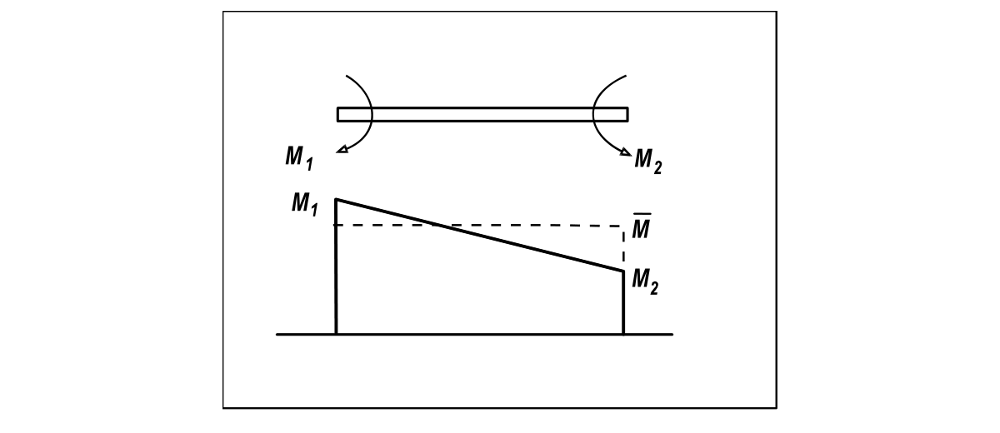

Figura F.5.4.5-1 — Pandeo torsional lateral, momento uniforme equivalente $M$

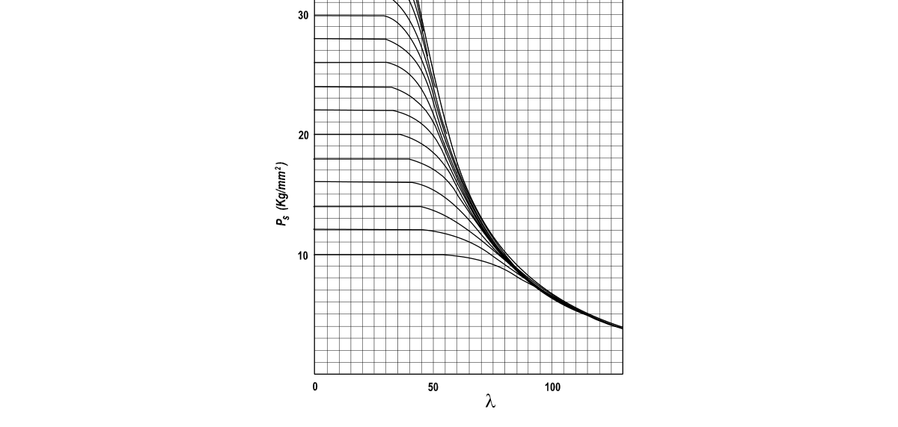

Figura F.5.4.5-2 — Pandeo torsional lateral de vigas, esfuerzo de pandeo $ρ_{s}$

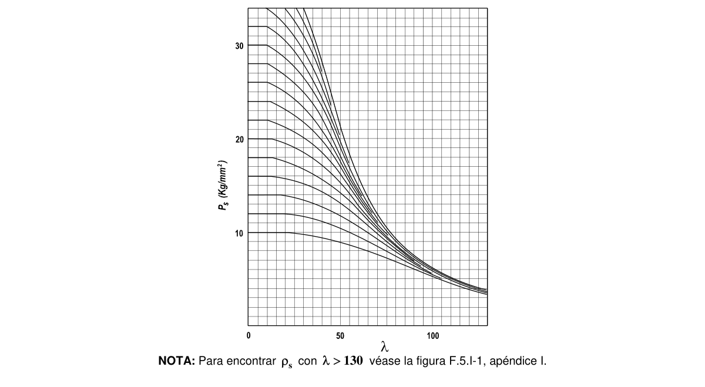

Figura F.5.4.5-3(a) — Esfuerzo de pandeo como columna para miembros a compresión $ρ_{s}$

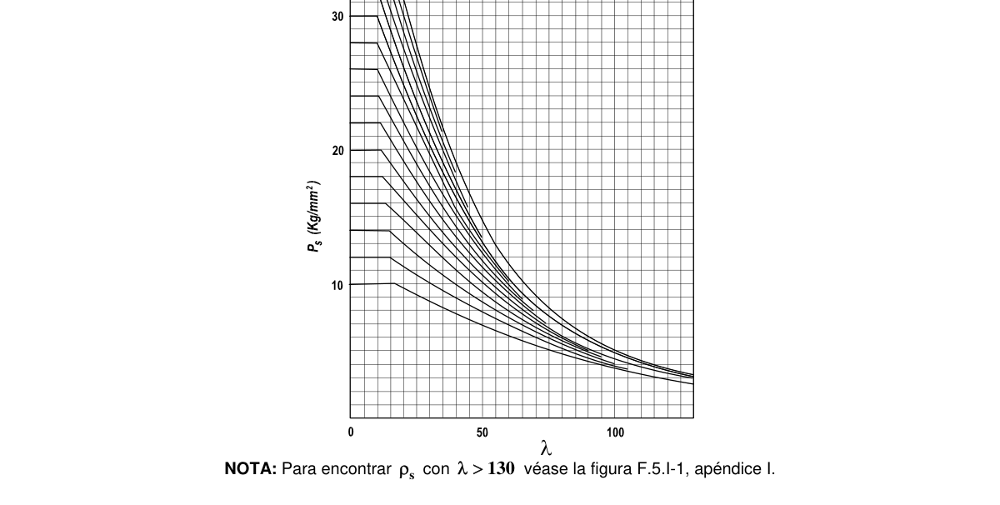

Figura F.5.4.5-3(b) — Esfuerzo de pandeo como columna para miembros a compresión $ρ_{s}$

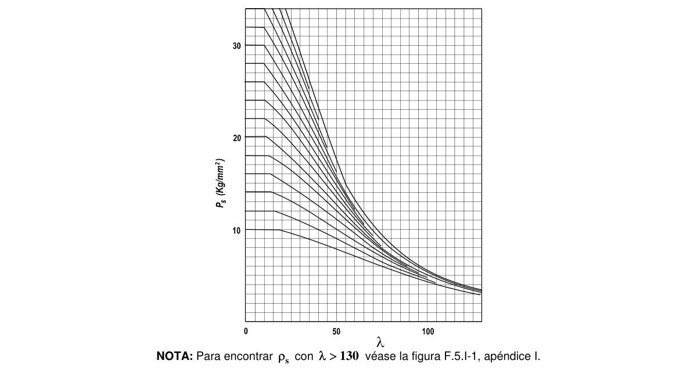

Figura F.5.4.5-3(c) — Esfuerzo de pandeo como columna para miembros a compresión $ρ_{s}$

(c) Esfuerzo de pandeo — El esfuerzo de pandeo torsional lateral $ρ_{s}$ se lee en la figura F.5.4.5-2 usando la curva que intercepta el eje de esfuerzos en un esfuerzo $p_{1}$ encontrado de acuerdo con lo siguiente:

(1) Para secciones no soldadas totalmente compactas

$$ p_{1}=p_{o} \tag{F.5.4.5-23} $$

(2) Para otras secciones incluyendo secciones híbridas

$$ p_{1}=\dfrac{M_{RS}}{\phi S} \tag{F.5.4.5-24} $$

Donde:

$p_{o}=$ esfuerzo límite (véanse las tablas F.5.4.2-1 y F.5.4.2-2)

$M_{RS} =$ resistencia a momento de diseño de la sección

$S =$ módulo plástico de la sección bruta

$φ =$ coeficiente de reducción de capacidad (véase la tabla F.5.3.3-1) Por lo general, $M_{RS}$ debe determinarse de acuerdo con F.5.4.5.2 teniendo en cuenta pandeo local y ablandamiento en la zona afectada por el calor pero sin reducción por agujeros.

Para vigas de gran esbeltez $(λ >130)$ es necesario consultar la curva adimensional apropiada en el apéndice F.5.I para encontrar $p_{s}$ .

(d) Parámetro de esbeltez — El parámetro de esbeltez de pandeo torsional lateral, $λ$ , necesario para la figura F.7.4.9, se puede obtener usando cualquiera de las siguientes expresiones F.5.4.5-25 a F.5.4.5-27.

$$ \text{Valor conservador:}\qquad \lambda =\lambda _{y}=\dfrac{l}{r_{y}} \tag{F.5.4.5-25} $$

Donde:

$l =$ longitud efectiva para pandeo torsional lateral

$r_{y} =$ radio de giro del eje menor para la sección bruta Para los siguientes casos, se debe usar el apéndice F.5.G para calcular la longitud efectiva de la viga $( l )$:

(1) vigas en voladizo (2) vigas sujetas a cargas desestabilizadoras, esto es, carga entre puntos de soporte lateral que efectivamente actúa en un punto de la sección sobre el lado a compresión del eje neutro (3) vigas sujetas a cargas normales cuando la aleta a compresión no está lateralmente restringida, ambas aletas pueden rotar en el plano y la restricción torsional es suministrada únicamente por el soporte de la aleta de fondo en los apoyos.

Para todos los otros tipos de soporte, $I$ , puede tomarse seguramente como la distancia entre puntos de soporte lateral. Alternativamente, se puede encontrar un valor más favorable para ciertas condiciones de restricción usando F.5.G.1.

$$ \text{Expresión general:}\qquad \lambda =\pi \left(\dfrac{ES}{M_{cr}}\right)^{1/2} \tag{F.5.4.5-26} $$

Donde:

$E =$ módulo de elasticidad

$S =$ módulo plástico de la sección bruta

$M_{cr} =$ momento uniforme elástico crítico (véase F.5.G.2) Miembros con sección en $I$ o en canal cubiertos en la tabla F.5.4.5-1 — El parámetro $λ$ puede tomarse como se indica enseguida pero no debe exceder el valor dado por la ecuación F.5.4.5-25:

$$ \lambda =\dfrac{X\lambda _{y}}{\left[1+Y\left(\lambda _{y}/(D/t_{2})\right)^{2}\right]^{1/4}} \tag{F.5.4.5-27} $$

Donde:

$D =$ altura total de la sección

$t_{2}=$ espesor de la aleta

$X$ y $Y =$ coeficientes tomados de la tabla F.5.4.5-1 (pueden ser tomados conservadoramente como $X=1.0, Y=0.05$) Cuando el refuerzo de la aleta de una viga en $I$ o un miembro en canal no es de la forma precisa mostrada en la tabla F.5.4.5-1 (pestañas simples), se permite inclusive obtener $λ$ usando la expresión F.5.4.5-27. Si esto se hace, $X$ y $Y$ deben tomarse como para una pestaña simple equivalente que tiene la misma altura interna $C$ , en tanto que $λ_{y}$ se calcula para la sección con el refuerzo real.

(e) Restricciones laterales efectivas — Los sistemas de arriostramiento para proveer restricción lateral se deben diseñar suponiendo que la fuerza lateral total ejercida por una aleta a compresión, bajo carga mayorada, distribuida entre los puntos de restricción en cualquier vano, es el 3% de la compresión en esa aleta.

Cuando una serie de dos o más vigas paralelas requiere restricción lateral, no es adecuado simplemente amarrar las aletas a compresión juntas de modo que resulten mutuamente dependientes. La restricción es adecuada únicamente si se anclan los amarres a un soporte robusto independiente o si se provee un sistema de arriostramiento triangulado. Si el número de vigas paralelas es mayor de 3, es suficiente diseñar el sistema de restricción para resistir la suma de las fuerzas laterales derivadas de las tres mayores fuerzas compresivas únicamente.

(f) Vigas que contienen soldaduras localizadas — El valor de $M_{RS}$ en el literal (c) de F.5.4.5.6 para una viga sujeta a ablandamiento en la zona afectada por el calor, debe generalmente referirse a la sección más desfavorable en el vano considerado aunque tal ablandamiento ocurra únicamente localmente a lo largo de la longitud.

Sin embargo, cuando el ablandamiento en la zona afectada por el calor ocurre en los extremos del vano únicamente, su presencia se puede ignorar para considerar el pandeo torsional lateral siempre y cuando tal ablandamiento no exceda una distancia a lo largo del miembro, en cada extremo del vano, mayor que el ancho de la sección.

**Tabla F.5.4.5-1**

Pandeo torsional lateral de vigas, coeficientes $X$ y $Y$

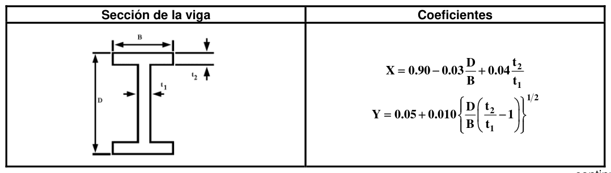

continúa ...

**Tabla F.5.4.5-1** — (continuación)

Pandeo torsional lateral de vigas, coeficientes $X$ y $Y$

| Sección de la viga | Coeficientes |
|---|---|
| Nota Las expresiones para $X$ y $Y$ son válidas para $1.5≤D /B≤4.5$, $1≤t_{2}/t_{1}≤2$, $0≤C /B≤0.5$ |  |

$$ \begin{gathered}X=0.94-\dfrac{D}{B}\left(0.03-0.07\dfrac{C}{B}\right)-0.3\dfrac{C}{B} \\ Y=0.05-0.06\dfrac{C}{D}\end{gathered} $$

$$ \begin{gathered}X=0.95-0.03\dfrac{D}{B}+0.06\dfrac{t_{2}}{t_{1}} \\ Y=0.07+0.014\left\{\dfrac{D}{B}\left(\dfrac{t_{2}}{t_{1}}-1\right)\right\}^{1/2}\end{gathered} $$

$$ \begin{gathered}X=1.01-\dfrac{D}{B}\left(0.03-0.06\dfrac{C}{B}\right)-0.3\dfrac{C}{B} \\ Y=0.07-0.10\dfrac{C}{D}\end{gathered} $$

#### F.5.4.6 — MIEMBROS A TENSION

La tensión $P$ generada bajo carga mayorada en miembros axialmente cargados a tensión (tirantes) no debe exceder la resistencia de diseño a tensión $P_{RS}$ de la sección.

Para miembros a tensión conectados excéntricamente en los extremos, es generalmente necesario referirse a F.5.4.8 para tener en cuenta la interacción entre la carga axial y los momentos introducidos. Sin embargo, en ciertos casos (véase F.5.4.6.2) se permite usar un procedimiento simplificado.

**F.5.4.6.1** — Resistencia a tensión — La resistencia a tensión de diseño $P_{RS}$ se debe tomar como el menor de los dos valores correspondientes a:

• Fluencia general a lo largo del miembro • Falla local en una sección crítica

(a) Fluencia general — El valor de $P_{RS}$ se basa en la sección transversal general del miembro a lo largo de su longitud, ignorando el efecto de las conexiones de los extremos, agujeros ocasionales o regiones afectadas por el calor localizadas, de la siguiente manera:

Para un miembro libre de ablandamiento en la zona afectada por el calor o únicamente afectado en posiciones localizadas a lo largo de su longitud:

$$ P_{RS}=\phi P_{o}A \tag{F.5.4.6-1} $$

Para un miembro en el cual la sección contiene material afectado por el calor generalmente a lo largo de su longitud, como con soldaduras longitudinales:

$$ P_{RS}=\phi P_{o}A_{e} \tag{F.5.4.6-2} $$

Donde:

$p_{o} =$ esfuerzo límite (véanse las tablas F.5.4.2-1 y F.5.4.2-2)

$A =$ área de la sección bruta

$A_{e} =$ área de la sección efectiva

$φ =$ coeficiente de reducción de capacidad (véase la tabla F.5.3.3-1) El valor de $A_{e}$ se encuentra tomando un área reducida igual a $k_{z}$ veces el área real para una zona ablandada, tomando $k_{z}$ como se indica en F.5.4.4.2 y la extensión de la zona de acuerdo con F.5.4.4.3.

(b) Falla local — El valor de $P_{RS}$ se basa en la sección más crítica como se indica enseguida:

Para una sección libre de ablandamiento en la zona afectada por el calor:

$$ P_{RS}=\phi P_{a}A_{n} \tag{F.5.4.6-3} $$

Para una sección que contiene material afectado por el calor:

$$ P_{RS}=\phi P_{a}A_{ne} \tag{F.5.4.6-4} $$

Donde:

$p_{a}=$ esfuerzo límite (véanse las tablas F.5.4.2-1 y F.5.4.2-2)

$A_{n}=$ área de la sección neta, con reducción por agujeros

$A_{ne} =$ área de la sección neta efectiva

$φ =$ coeficiente de reducción de capacidad (véase F.5.3.1) El valor de $A_{ne}$ se encuentra en la misma forma que el de $A_{e}$ (véase el literal (a) de F.5.4.6.1) pero con la apropiada reducción por agujeros, si es necesaria. La reducción por agujeros en las regiones afectadas por el calor puede hacerse con base en el espesor reducido $k_{z} t .$

(c) Agujeros escalonados — Cuando hay agujeros escalonados, se deben calcular valores alternos de $A_{n}$ o $A_{ne}$ usando las siguientes indicaciones y el valor menor será luego usado en el literal

(b) de este mismo numeral.

• $A_{n}$ o $A_{ne}$ se toma como la sección transversal más desfavorable.

• Se considera una sección diagonal o en zig-zag encontrando $A_{n}$ o $A_{ne}$ como sigue:

$A_{n}=A−H$ o, $A_{ne}=A_{e}−H$ Donde:

$$ H=\sum A_{h}-\dfrac{\sum x^{2}t}{4y} \tag{F.5.4.6-5} $$

$x , y =$ separación longitudinal y transversal, respectivamente, de los agujeros

$t =$ espesor de la lámina o espesor efectivo de la lámina

$∑A_{h} =$ suma de las áreas de agujero en la sección diagonal o en zig-zag considerada

(d) Secciones híbridas — La capacidad a tensión de una sección híbrida que contiene materiales de diferente resistencia, se debe encontrar sumando las resistencias de las varias partes obtenidas en el literal (b) de este numeral.

**F.5.4.6.2** — Tirantes conectados excéntricamente — Los tirantes conectados excéntricamente incluyen lo siguiente:

• Angulos conectados únicamente por una aleta • Canales conectados por el alma • Secciones T conectadas por la aleta Los miembros a tensión de estos tres tipos con un sólo vano pueden diseñarse como cargados axialmente y la variación de esfuerzo en el lado o los lados salientes puede ignorarse, siempre y cuando al determinar el área $A_{n}$ o $A_{ne}$ requerida para la revisión local (véase el literal (b) de F.5.4.6.1), parte del área del lado saliente se sustraiga del área bruta, lo mismo que cualquier reducción por agujeros o por efectos de zona afectada por el calor. La cantidad de lado sobresaliente a ser restada se toma como se indica a continuación:

(1) Componente único conectado por un lado a una cartela $0.6A_{o}$ (2) Componente doble simétricamente conectado a cada lado de una cartela $0.2A_{o}$ donde $A_{o}$ es el área efectiva del lado o lados salientes del elemento conectado, ignorando cualquier filete.

Cuando tales miembros son continuos sobre varios vanos, sólo hay que aplicar el tratamiento anterior a los extremos exteriores de los vanos extremos. En cualquier otro lugar, la resistencia local a tensión puede encontrarse de acuerdo con el literal (b) de F.5.4.6.1 sin ninguna reducción por aleta saliente.

La revisión a fluencia general debe ser hecha de acuerdo con el literal (a) de F.5.4.6.1.

#### F.5.4.7 — MIEMBROS A COMPRESION

Se necesitan generalmente tres verificaciones para miembros cargados axialmente a compresión (puntales):

(a) Revisión como columna — esto es, revisión a flexión y pandeo (véanse F.5.4.7.2 y F.5.4.7.3) (se refiere al pandeo general del miembro como un todo)

(b) Revisión por pandeo torsional — (véanse F.5.4.7.2 y F.5.4.7.4) (se refiere al pandeo general del miembro como un todo)

(c) Revisión por aplastamiento local — (véase F.5.4.7.6) ( se refiere a la sección transversal más débil a lo largo de la longitud) La revisión (a) siempre debe hacerse, la (b) generalmente se requiere pero puede ser obviada en algunos casos. La (c) únicamente se necesita para miembros a compresión que tienen bajas relaciones de esbeltez y que están significativamente debilitados localmente por agujeros o soldadura.

Para tomar en cuenta la interacción entre carga axial y flexión es generalmente necesario referirse a F.5.4.8.

Sin embargo, para puntales con conexiones excéntricas en los extremos, es permitido, en ciertos casos, usar un procedimiento simplificado (véase F.5.4.7.8) para tener en cuenta los momentos introducidos.

**F.5.4.7.1** — Clasificación de la sección para compresión axial — Antes de hacer cualquiera de las tres revisiones mencionadas, es necesario clasificar la sección transversal como compacta o esbelta. La clasificación se basa en el menos favorable de los elementos componentes de acuerdo con F.5.4.3.3.

**F.5.4.7.2** — Resistencia al pandeo general — Con las dos revisiones, (a) y (b), la fuerza axial $P$ bajo carga mayorada no debe exceder la resistencia axial de diseño $P_{R}$ basada en pandeo general y dada por la siguiente expresión:

$$ P_{R}=p_{s}A\phi \tag{F.5.4.7-1} $$

Donde:

$A =$ área bruta, sin reducción por ablandamiento en la zona afectada por el calor, pandeo local o agujeros

$p_{s} =$ esfuerzo de pandeo en pandeo por flexión o torsional

$φ =$ coeficiente de reducción de capacidad (véase la tabla F.5.3.3-1) Para encontrar $p_{s}$ para el pandeo como columna, se debe considerar la falla respecto a ambos ejes principales y se toma el menor valor.

Para un miembro a compresión de gran esbeltez $(λ >130)$, es necesario consultar el apéndice F.5.I para encontrar $p_{s} .$

**F.5.4.7.3** — Pandeo como columna

(a) Esfuerzo de pandeo — El valor de $p_{s}$ para pandeo como columna debe leerse de la curva apropiada en la figura F.5.4.5-3, seleccionada de acuerdo con F.5.4.7.5.

(b) Parámetro de esbeltez — El parámetro de esbeltez $λ$ para pandeo como columna necesitado para la figura F.5.4.5-3, se define como sigue:

$$ \lambda =l/r \tag{F.5.4.7-2} $$

Donde:

$l =$ longitud efectiva

$r =$ radio de giro ambos apropiados para la dirección de pandeo en consideración.

**Tabla F.5.4.7-1**

Coeficiente de longitud efectiva $K$ para miembros a compresión

| Condiciones en los extremos | $K$ |
|---|---|
| 1. Traslación y rotación impedidas en ambos extremos | 0.7 |
| 2. Traslación impedida en ambos extremos y rotación impedida en uno solo | 0.85 |
| 3. Traslación impedida y rotación libre en ambos extremos | 1.0 |
| 4. Traslación impedida en un extremo y rotación impedida en ambos | 1.25 |
| 5. Traslación y rotación impedidas en un extremo y rotación parcialmente restringida y libertad de traslación en el otro | 1.5 |
| 6. Traslación y rotación impedidas en un extremo y traslación y rotación libres en el otro | 2.0 |

La longitud efectiva, $l$ , debe tomarse como $KL$ , donde $L$ es la longitud entre puntos de soporte lateral; o para un puntal en voladizo, como su longitud. El valor de $K$ , coeficiente de longitud efectiva para miembros a compresión, debe determinarse a partir del conocimiento de las condiciones en los extremos; la tabla F.5.4.7-1 sirve de guía.

El valor de $r$ debe basarse en la sección bruta para todos los miembros.

Cuando la sección transversal está total o substancialmente afectada por ablandamiento en la zona afectada por el calor en un extremo restringido al giro de un miembro, tal restricción debe ignorarse para encontrar el valor adecuado de $K$ . Así, para el caso 1 en la tabla F.5.4.7-1, $K$ debería tomarse como 1.0 si la sección está completamente ablandada en cada extremo.

**F.5.4.7.4** — Pandeo torsional

(a) Excepciones — La posibilidad de pandeo torsional puede ignorarse para los siguientes casos:

• Secciones huecas cerradas • Secciones I doblemente simétricas • Secciones enteramente compuestas de salientes radiantes, esto es, ángulos, secciones $T$ , cruciformes, que se clasifiquen como compactas de acuerdo con F.5.4.3.3.

(b) Parámetro de esbeltez — El parámetro $λ$ de esbeltez para pandeo torsional puede obtenerse usando las expresiones F.5.4.7-3 o F.5.4.7-4 dadas enseguida, o siguiendo el apéndice F.5.H.

Debe siempre basarse en el área bruta de la sección.

Fórmula general

$$ \lambda =\pi \left(\dfrac{EA}{P_{cr}}\right)^{1/2} \tag{F.5.4.7-3} $$

Donde:

$A =$ área de la sección bruta, sin reducción por pandeo local, ablandamiento en la zona afectada por el calor o agujeros

$E =$ módulo de elasticidad $P_{cr}$carga crítica elástica para pandeo torsional, teniendo en cuenta la interacción con el pandeo como columna cuando sea necesario Secciones como las dadas en la tabla F.5.4.7-2

$$ \lambda =k\lambda _{t} \tag{F.5.4.7-4} $$

Donde:

$k =$ se lee en la figura F.5.4.7-1

$λ_{t} =$ se encuentra de acuerdo con:

• para ángulos, secciones T, cruciformes

$$ \lambda _{t}=\lambda _{o} \tag{F.5.4.7-5} $$

• para canales, sombreros

$$ \lambda _{t}=\dfrac{\lambda _{o}}{\left[1+(Y\lambda _{o}^{2}/\lambda _{x}^{2})\right]^{1/2}} \tag{F.5.4.7-6} $$

La tabla F.5.4.7-2 contiene expresiones para $λ_{o}$ y $Y$ ; y también para $s$ y $X$ (necesarios para la figura F.5.4.7-1).

En F.5.4.7-6, la cantidad $λ_{x}$ debe tomarse como la esbeltez efectiva para pandeo como columna alrededor del eje xx (como se define en la tabla F.5.4.7-2).

**Tabla F.5.4.7-2**

Parámetros de pandeo torsional para miembros a compresión

| 1 |  | $ρ ≤5$ | $λ_{0} = λ_{1} =5B /t−0.6ρ^{1.5}(B /t)1 /2$ $s = λ_{u}/λ_{0}$ $X=0.6$ |
|---|---|---|---|
| 2 |  | $ρ ≤5$ $1≤w≤2.5$ | $λ_{0} = λ_{1} −(w−1){2 (w−1)2−1.5ρ}$ $s = λ_{u}/λ_{0}$ $X=0.6$ |
| 3 | NOTA 1 |  | $λ_{0}=66$ $s = λ_{u}/λ_{0}$ $X=0.6$ |
| 4 |  | $ρ ≤5$ $0.5≤B /D≤1.0$ | $λ_{0} =(D /t){4.2+0.5 (B /D)2}−0.6ρ^{1.5}(D /t)12$ $s=s_{4}={1+6 (1−B /D)2}(λ_{u}/λ_{0})$ $X_{=}X_{4}=0.6_{−}0.4 (1_{−}B /D)2$ |
| 5 |  | $ρ ≤5$ $0.5≤B /D≤1.0$ $1_{≤}w_{≤}2.5$ | $λ_{0} = λ_{4} +1.5_{ρ}(w_{−}1)−2 (w_{−}1)3$ $s_{=}s_{4}$ $X_{=}X_{4}$ |
| 6 | NOTA 1 |  | $λ_{0} =57$ $s (1.4 (λ_{u}/λ_{0}))$ $X_{=}0.60$ |
| 7 |  | $ρ ≤3.5$ | $λ_{0} =5.1B /t−ρ^{1.5}(B /t)12$ $X_{=}1$ |
| 8 |  | $ρ ≤5$ $0.5≤B /D≤2.0$ | $λ_{0} = λ_{8} =(B /t){4.4+1.1 (D /B)2}−0.7ρ^{1.5}(B /t)12$ $s = λ_{y}/λ_{0}$ $X=X_{8}=1.1−0.3D /B$ |
| 9 | NOTA 1 | $ρ ≤5$ $0.5≤B /D≤2.0$ $1≤ϖ ≤2.5$ | $λ_{0} = λ_{8} +1.5ρ (ϖ −1)−2(ϖ −1^{3})$ $s = λ_{y}/λ_{0}$ $X=X_{8}$ |

**Tabla F.5.4.7-2** — (continuación)

Parámetros de pandeo torsional para miembros a compresión

| 10 | NOTA 1 |  | $λ_{0} =70$ $s = (λ_{y}/λ_{0})$ $X=0.83$ |
|---|---|---|---|
| 11 | NOTA 1 |  | $λ_{0} =60$ $s = (λ_{y}/λ_{0})$ $X=0.76$ |
| 12 | NOTA 1 |  | $λ_{0} =63$ $s = (λ_{y}/λ_{0})$ $X=0.89$ |
| 13 |  | $0.5≤D /B≤2.0$ $ρ ≤3.5$ | $λ_{0} =(D /t){1.4+1.5 (B /D)+1.1 (D /B)}−ρ^{1.5}(D /t)$ $s = (λ_{y}/λ_{0})$ $X=1.3−0.8D /B+0.2 (D /B)2$ |
| 14 |  |  | $λ_{0} =65$ $s = (λ_{y}/λ_{0})$ $X=0.78$ |
| 15 |  | $1≤D /B≤3$ $1≤t_{2}/t_{1}≤2$ | $λ_{0} =(B /t_{2}){7+1.5 (D /B)(t_{2}/t_{1})}$ $s = (λ_{x}/λ_{t})$ $X=0.35D /B−0.04 (D /B)2$ $Y=0.14−0.02D /B−0.02t_{2}/t_{1}$ |
| 16 |  | $1≤D /B≤3$ $C /B≤0.4$ | $λ_{0} =(B /t){7+1.5 (D /B)+5 (C /B)}$ $s = (λ_{x}/λ_{t})$ $X=0.35D /B−0.04 (D /B)2−0.25C /B$ $Y=0.12−0.02D /B+{0.6 (C /B)2/(D /B−0.5)}$ |
| 17 |  | $1≤D /B≤3$ $C /B≤0.4$ | $λ_{0} =(B /t){7+1.5 (D /B)+5 (C /B)}$ $s = (λ_{x}/λ_{t})$ $X=0.35D /B−0.04 (D /B)2$ $Y=0.12−0.02D /B+{0.05 (C /B) /(D /B−0.5)}$ |

**Tabla F.5.4.7-2** — (continuación)

Parámetros de pandeo torsional para miembros a compresión

| 18 | NOTA 1 | $λ_{9} =126$ $s = (λ_{x}/λ_{t})$ $X=0.59$ $Y=0.104$ |
|---|---|---|
| NOTA 1: Formas de sección reforzada que cumplan con normas como el BS 1161. NOTA 2: Las secciones son de espesor uniforme $t$, excepto los casos 14 y 15. NOTA 3: $λ_{u}$, $λ$ y $λ_{y}$ son los parámetros de esbeltez $(l /r)$ para pandeo por flexión respecto a los ejes $u$ , $x$ o $y$ NOTA 4: $ρ$ es un coeficiente que depende de la cantidad de material del filete en la raíz de la sección como se indica a continuación: Filetes radiados $ρ =R /t$ Filetes a 45° $ρ =1.6F/t$ NOTA 5: Los valores dados para $λ_{0}$, $X$ y $Y$ son válidos únicamente dentro de los límites mostrados. En el caso de ángulos espalda contra espalda (casos 8 a 12), las expresiones dejan de ser aplicables si la separación entre los ángulos excede $2t$ . |  |  |

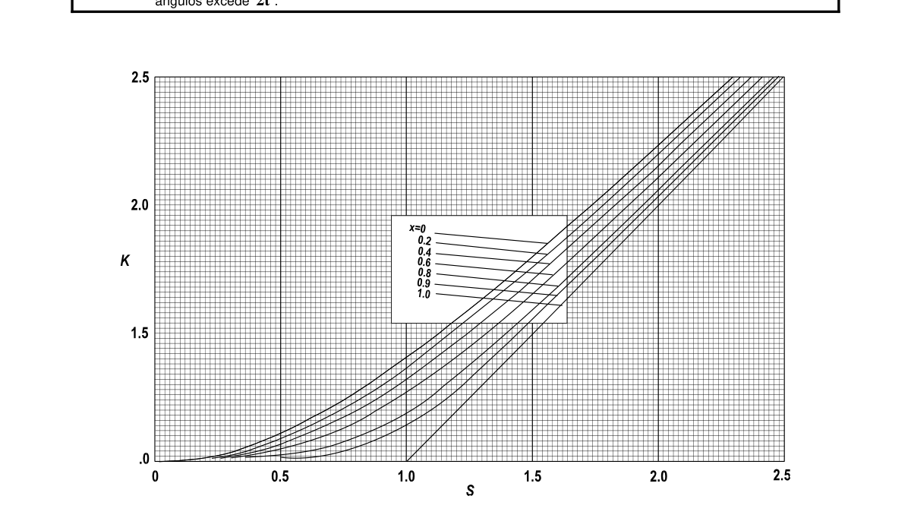

Figura F.5.4.7-1 — Pandeo torsional de miembros a compresión, coeficiente de interacción $k$

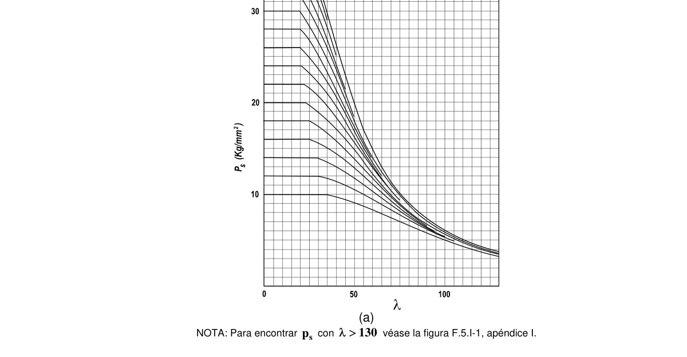

Figura F.5.4.7-2 (a) — Esfuerzo de pandeo torsional para miembros a compresión $p_{s}$

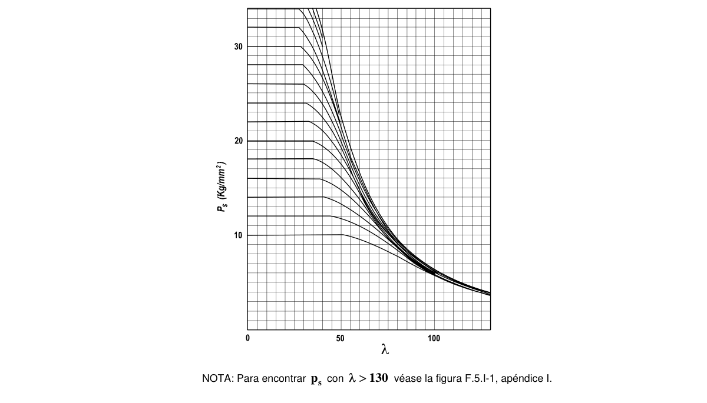

Figura F.5.4.7-2 (b) — Esfuerzo de pandeo torsional para miembros a compresión $p_{s}$

(c) Esfuerzo de pandeo — El valor de $p_{s}$ para pandeo torsional debe leerse en la curva apropiada de la figura F.5.4.7-2, seleccionada de acuerdo con F.5.4.7.5.

**F.5.4.7.5** — Selección de la curva de miembros a compresión — El esfuerzo de pandeo general $p_{s}$ se debe leer de la curva de miembros a compresión apropiada de la figura F.5.4.5-3 (para pandeo como columna) o de la figura F.5.4.7-2 (para pandeo torsional). La selección del diagrama debe estar de acuerdo con la tabla F.5.4.7-3. En cualquier diagrama dado, la curva apropiada es la que encuentra el eje de esfuerzos en un esfuerzo $p_{1}.$

**Tabla F.5.4.7-3**

Selección de la curva para miembros a compresión

| Tipo de pandeo | Miembro no soldado | Miembro soldado |
|---|---|---|
| Pandeo de columna: sección simétrica o ligeramente asimétrica sección severamente asimétrica | figura F.5.4.5-3 (a) figura F.5.4.5-3 (b) | figura F.5.4.5-3 (b) figura F.5.4.5-3 (c) |
| Pandeo torsional: generalmente sección compuesta por aletas salientes (véase F.5.4.7.5 (b)) | figura F.5.4.7-2(a) figura F.5.4.7-2 (b) |  |

NOTA 1. Un miembro a compresión debe ser generalmente considerado como soldado, en esta tabla, si contiene soldaduras en una longitud mayor que la mayor dimensión de la sección. Esto se hace haya o no zona afectada por el calor.

NOTA 2. Una sección ligeramente asimétrica es aquella para la cual $y_{1}/y_{2}$ es menor o igual a 1.5; $y_{1}$ y $y_{2}$ son las distancias desde el eje de pandeo a las fibras extremas más lejana y más cercana, respectivamente. En otro caso, la sección se debe tratar como severamente asimétrica.

El valor de $p_{1}$ debe generalmente determinarse como se indica a continuación (para secciones compuestas por aletas salientes consulte el literal (b) de este numeral).

(1) Sección compacta, sin efectos de zona afectada por el calor

$$ p_{1}=p_{o} \tag{F.5.4.7-7} $$

(2) Otras secciones, generalmente

$$ p_{1}=\left(A_{e}/A\right)p_{o} \tag{F.5.4.7-8} $$

Donde:

$A =$ área bruta de la sección

$A_{e} =$ área de la sección efectiva (véase el literal (a) de este numeral)

$p_{o} =$ esfuerzo límite para el material (véanse las tablas F.5.4.2-1 y F.5.4.2-2) La selección de la curva sobre esta base es válida siempre que el miembro cumpla las tolerancias de rectitud y torcedura establecidas para del material extruído. Cuando exista la posibilidad de que un miembro a compresión fabricado no cumpla estas tolerancias, $p_{1}$ debe tomarse como $s$ veces el valor dado por F.5.4.7-7 o F.5.4.7-8, donde:

$$ S=0.6+0.5^{(-0.02\lambda )}\le 1.0 \tag{F.5.4.7-9} $$

(a) Sección efectiva — La sección efectiva se aplica a las siguientes secciones de miembros a compresión:

• Clasificadas como esbeltas • Afectadas por ablandamiento en la zona afectada por el calor • Las dos anteriores La sección efectiva puede obtenerse tomando el espesor reducido, sin reducción por agujeros, como se enuncia a continuación. Puede basarse en la sección transversal menos favorable (para miembros soldados, véase el literal (c) de este mismo numeral).

(1) Sección esbelta libre de ablandamiento en la zona afectada por el calor — El espesor de cualquier elemento se toma como $k_{L}$ veces su espesor real $t$ , donde $k_{L}$ se encuentra como indica en F.5.4.3.4. En el caso de elementos reforzados, $k_{L}$ debe aplicarse al área del refuerzo tanto como al espesor básico de la lámina.

(2) Sección compacta con ablandamiento en la zona afectada por el calor — El espesor de cualquier zona ablandada debe reducirse de manera que se le de un área supuesta de $k_{z}$ veces su área real. La extensión de tal zona debe encontrarse como se indica en F.5.4.4.3 y el valor de $k_{z}$ , como en F.5.4.4.2.

(3) Sección esbelta con ablandamiento en la zona afectada por el calor — Para elementos esbeltos libres de efectos de zona afectada por el calor, el espesor reducido se determina de acuerdo con (1). Para regiones afectadas por el calor no localizadas, en elementos esbeltos, se toma de acuerdo con (2). Si un elemento es esbelto y está afectado por ablandamiento en la zona afectada por el calor, el espesor reducido se toma como el valor menor entre $k_{L} t$ y $k_{z} t$ en la parte ablandada y como $k_{L} t$ en las demás zonas de él.

Las secciones compuestas por aletas salientes se tratan especialmente (en el literal siguiente).

(b) Secciones compuestas por aletas salientes — Para secciones tales como ángulos, secciones T y cruciformes, compuestas enteramente por elementos salientes radiantes, los pandeos local y torsional están estrechamente relacionados. Para tales miembros a compresión, el procedimiento a seguir será:

(1) Sección que contiene sólo aletas salientes no reforzadas

(i) Para considerar el pandeo torsional, se puede usar la figura F.5.4.7-2 (b) para encontrar $p_{s}$ , en lugar de la figura F.5.4.7-2 (a). (El diagrama apropiado para pandeo como columna permanece inalterado).

(ii) Para determinar $p_{1}$ , que se necesita para seleccionar la curva apropiada en las figuras F.5.4.5-3 y F.5.4.7-2, el área $A_{e}$ debe basarse en la sección efectiva en la cual la reducción normal se hace por zonas afectadas por ablandamiento causado por el calor pero no hay reducción por pandeo local, esto es, tomar $k_{L}=1$. De este modo, por una sección libre de efectos en la zona afectada por el calor: $p_{1}=p_{o}$.

(2) Sección que contiene aletas salientes con refuerzo en la punta — Si los elementos salientes en forma de aletas reforzadas son tales que el modo 1 sería crítico en términos de pandeo local (véase el literal (b) de F.5.4.3.2), se sigue el mismo procedimiento descrito para la sección solo aletas salientes no reforzadas. Pero si el modo 2 es el crítico, se debe emplear la figura F.5.4.7-2 (a) y la sección efectiva se determina como en el literal (a) de este numeral.

(c) Miembros a compresión que contienen soldaduras localizadas — La selección de la curva de miembros a compresión para un miembro afectado por ablandamiento en la zona afectada por el calor debe, por lo general, basarse en un valor de $p_{1}$ obtenido para la sección más desfavorable, aún cuando tal ablandamiento ocurra sólo localmente a lo largo de la longitud. Esto incluye los efectos de zona afectada por el calor, debidos a la soldadura de accesorios temporales.

Sin embargo, cuando tal ablandamiento causado por el calor tiene una cierta localización específica a lo largo de la longitud, su presencia puede ser ignorada para considerar el pandeo general siempre y cuando dicho ablandamiento no se extienda longitudinalmente una distancia mayor que el menor ancho total del miembro. La localización del ablandamiento causado por el calor, para permitir ésto, es la posición de curvatura cero o cercana a cero en la forma pandeada del miembro a compresión. Así, para un miembro a compresión restringido al desplazamiento pero no al giro en sus extremos (véase tabla F.5.4.7-1, caso 3) se puede suponer que la resistencia a pandeo general no se ve afectada por la presencia de zonas de ablandamiento localizadas, si están localizadas en sus extremos. (En tal caso, sería importante hacer la revisión por aplastamiento local).

**F.5.4.7.6** — Aplastamiento local — La fuerza axial $P$ bajo carga mayorada no debe exceder la resistencia de diseño $P_{RS}$ de la sección más desfavorable a lo largo de la longitud del miembro a compresión y determinada así:

(a) Sección compacta libre de efectos de zona afectada por el calor

$$ P_{RS}=p_{a}A_{n}\phi \tag{F.5.4.7-10} $$

(b) Otras secciones, generalmente

$$ P_{RS}=p_{a}A_{ne}\phi \tag{F.5.4.7-11} $$

Donde:

$p_{a}$= esfuerzo límite (véanse las tablas F.5.4.2-1 y F.5.4.2-2)

$A_{n}$ = área de la sección neta, con reducción por agujeros no rellenos

$A_{ne}$ = área de la sección neta efectiva

$φ$ = coeficiente de reducción de capacidad (véase la tabla F.5.3.3-1) El área $A_{ne}$ debe tomarse como $A_{e}$ menos una reducción por agujeros no rellenados, donde $A_{e}$ es el área efectiva usada para considerar el pandeo general (como columna y torsional), véanse los literales (a) y (b) de F.5.4.7.5. Para agujeros localizados en regiones de espesor reducido, la reducción puede hacerse con base en el espesor reducido en lugar del espesor total.

**F.5.4.7.7** — Secciones híbridas — En miembros a compresión que contienen materiales base de diferentes resistencias, cada elemento debe ser clasificado de acuerdo con su valor particular de $p_{o} .$ La resistencia $p_{R}$ a pandeo general como columna o torsional se puede determinar suponiendo un valor uniforme de $p_{o}$ igual al promedio ponderado de los valores de $p_{o}$ para las diferentes partes (ponderado de acuerdo con las áreas brutas).

La resistencia al aplastamiento local, $P_{RS}$, puede encontrarse sumando la resistencia de las diferentes partes.

**F.5.4.7.8** — Ciertas clases de miembros a compresión excéntricamente conectados

(a) Miembros a compresión de un solo vano — Los siguientes tipos de miembros a compresión excéntricamente conectados pueden ser tratados usando un método simple en lugar del procedimiento de interacción dado en F.5.4.8, siempre y cuando la fijación sea suficiente para prevenir la rotación en el plano del elemento conectado y si no se aplica deliberadamente flexión:

• Angulo simple conectado por un lado únicamente • Angulos espalda con espalda conectados por un lado de una cartela • Canal simple conectado por su alma únicamente • T simple conectada por su aleta únicamente Para éstos se permite, para la revisión por pandeo como columna fuera del plano del elemento o elementos unidos, ignorar la excentricidad de la carga y, en su lugar, tomar una resistencia a compresión axial reducida igual al 40% del valor que se obtendría para carga centroidal usando el radio de giro respecto al eje paralelo a la platina de conexión. La resistencia a pandeo torsional se supone que no se afecta por la excentricidad.

(b) Miembros a compresión conformados por dos componentes espalda con espalda — Tales miembros a compresión de doble ángulo, canal o T conectados a cada lado de platinas de conexión en los extremos, se pueden diseñar como miembros monolíticos centroidalmente cargados siempre que lo siguiente ocurra:

• Los dos componentes estén seguramente conectados en sus extremos, y • Estén también conectados en los puntos tercios usando espaciadores de igual espesor que la platina de conexión.

**F.5.4.7.9** — Miembros a compresión con presillas — Las reglas generales para miembros a compresión dadas en F.5.4.7.2 a F.5.4.5.6 no se aplican generalmente a miembros con presillas, éstos deben someterse a un estudio especial. No obstante, si un miembro a compresión con presillas cumple con ciertas condiciones, se permite tratarlo como monolítico y obtener su resistencia en la forma normal.

Para ser tratado como un miembro monolítico, un miembro a compresión con presillas debe satisfacer lo siguiente:

(a) Debe estar cargado axialmente

(b) Debe consistir de dos componentes principales unidos por presillas igualmente espaciadas. La sección transversal debe ser simétrica respecto a un eje normal a las presillas.

(c) Las presillas deben ir generalmente en pares. Sin embargo, si los componentes principales son secciones T o ángulos punta a punta, se permiten presillas simples.

$$ \text{(d)}\quad \lambda _{2}\le 0.8\lambda _{1} \tag{F.5.4.7-12} $$

Donde:

$λ_{1} , λ_{2}=$ parámetros de esbeltez para pandeo como columna del miembro completo respecto a los ejes paralelo y normal a las presillas respectivamente

$$ \text{(e)}\quad \lambda _{3}\le 0.7\lambda _{2} \tag{F.5.4.7-13} $$

Donde:

$λ_{3}=$ parámetro de esbeltez para pandeo de uno de los componentes principales entre presillas, basado en el pandeo como columna o torsional, el que sea más crítico.

(f) El sistema de presillas debe diseñarse para resistir una fuerza cortante total $V$ en el plano de las presillas, tomada como el 2.5% de la fuerza axial en el miembro completo bajo carga mayorada.

(g) La conexión de cada presilla a cada componente principal debe diseñarse para transmitir las siguientes acciones simultáneas bajo carga mayorada:

• Un cortante longitudinal de $Vd /Na$ • Un momento de $Vd /2N$ actuando en el plano de las presillas Donde:

$d =$ espaciamiento longitudinal entre centros de presillas

$a =$ espaciamiento de los componentes principales medido hasta los centroides de las conexiones de cada presilla

$N =$ número de presillas en cada posición (1 ó 2) Para diseñar las presillas es importante considerar los posibles efectos de debilitamiento por pandeo local y ablandamiento en la zona afectada por el calor (si es soldado).

#### F.5.4.8 — FLEXION CON FUERZA AXIAL Y FLEXION BIAXIAL

**F.5.4.8.1** — Generalidades — Este numeral da las fórmulas de interacción para revisar miembros sujetos a los siguientes casos de acción efecto combinados:

(a) Caso A, flexión respecto al eje mayor con fuerza axial $(M_{x}+P)$

(b) Caso B, flexión respecto al eje menor con fuerza axial $(M_{y}+P)$

(c) Caso C, flexión biaxial $(M_{x}+M_{y})$

(d) Caso D, flexión biaxial con fuerza axial $(M_{x}+M_{y}+P)$ Donde:

$P =$ fuerza axial bajo carga mayorada

$M_{x} , M_{y}=$ momentos uniaxiales respecto de los ejes mayor y menor respectivamente, bajo carga mayorada En general, se necesitan dos revisiones:

(a) Revisión de la sección (véase F.5.4.8.3)

(b) Revisión por pandeo general (véase F.5.4.8.4) La revisión de la sección siempre es necesaria. La revisión por pandeo general puede ser obviada en las siguientes circunstancias:

(1) En el caso A, cuando $P$ es de tensión y también el miembro está exento de pandeo torsional lateral (véase F.5.4.5.6) (2) En el caso B, cuando $P$ es de tensión En la revisión de la sección, los valores tomados para $P_{RS}, M_{RSx}$ y $M_{RSy}$ deben tener en cuenta la presencia de agujeros y de ablandamiento en la zona afectada por el calor, donde

$P_{RS}=$ resistencia axial de diseño de la sección transversal, véase F.5.4.6.1 (tensión) o F.5.4.7.6 (compresión)

$M_{RSx}, M_{RSy}=$ resistencias de diseño a momento uniaxial de la sección transversal (véase F.5.4.5.2), ajustadas para tener en cuenta cortante coincidente si es necesario (véase F.5.4.5.4), respecto al eje mayor y menor, respectivamente.

Para hacer la revisión por pandeo general, los valores de $M_{RSx}$ y $M_{RSy}$ deben, por lo general, referirse a la sección más desfavorable en el vano considerado, tomando en cuenta el pandeo local y el ablandamiento de la zona afectada por el calor pero ignorando los agujeros. El ablandamiento en la zona afectada por el calor puede ignorarse cuando ocurre en los extremos de la luz, esto quiere decir, no voladizo, vano.

Para secciones exentas de pandeo torsional lateral (véase F.5.4.5.6), $M_{Rx}$ debe tomarse igual a $M_{RSx}$, donde $M_{Rx}$ resistencia de diseño a momento para pandeo torsional lateral (véase el literal (a) de F.5.4.5.6)

**F.5.4.8.2** — Clasificación de la sección y pandeo local bajo acciones combinadas

(a) Clasificación de la sección — La sección debe ser clasificada generalmente de acuerdo con F.5.4.3.3 como totalmente compacta, semi-compacta o esbelta.

Para ésto, el valor de $β$ para un elemento dado debe basarse en el valor de $g$ (véase la figura F.5.4.3-2) correspondiente al patrón de esfuerzos producido en ese elemento cuando todas las acciones ($P , M_{x} , M_{y}$ ) se aplican simultáneamente. Las cantidades $y_{o}$ y $y_{c}$ , necesarias para la figura F.5.4.3-2, deben encontrarse usando el eje neutro elástico de la sección bruta bajo las acciones combinadas, sin embargo, para revisar si una sección es totalmente compacta, se permite usar el eje neutro plástico. Se debe tener en cuenta que es posible que el eje neutro elástico quede por fuera de la sección en cuyo caso, $y_{o}$ y $y_{c}$ tendrían el mismo signo. El método dado en el literal

(d) de F.5.4.3.3 para determinar una clasificación más favorable para elementos de aleta subesforzados es aún válido siempre y cuando $y_{o}$ y $y_{c}$ nuevamente se relacionen con el patrón de esfuerzos bajo las acciones combinadas.

Cualquier sección que resulte totalmente compacta o semi-compacta por el anterior procedimiento, se considera compacta en la obtención de su resistencia axial, no se hace reducción por pandeo local.

(b) Sección efectiva — Para un miembro clasificado como esbelto, cada resistencia individual debe encontrarse usando una sección efectiva que se relacione específicamente con la acción considerada ($P , M_{x}$ o $M_{y}$ ), generalmente es diferente para las diferentes acciones. Por lo tanto, cuando se obtiene la resistencia axial, el coeficiente $k_{L}$ (véase la figura F.5.4.3-5) para cada elemento se basa en un valor $β$ para ese elemento correspondiente a un esfuerzo uniforme

$(g_{=}1)$. Mientras que para hallar la resistencia a momento, se toma un valor $β$ que se relaciona con el patrón de esfuerzo en el elemento cuando la sección está bajo flexión pura.

**F.5.4.8.3** — Revisión de la sección

(a) Fórmula general (caso D) — La sección transversal es adecuada si lo siguiente se satisface en cualquier posición a lo largo de la longitud, todas las seis cantidades se toman como positivas:

$$ \dfrac{P}{P_{RS}}+\dfrac{M_{x}}{M_{RSx}}+\dfrac{M_{y}}{M_{RSy}}\le 1.0 \tag{F.5.4.8-1} $$

(b) Otros casos — Para los casos A, B o C (véase F.5.4.8.1) se debe usar la fórmula F.5.4.8-1, con la cantidad apropiada del numerador igualada a cero.

**F.5.4.8.4** — Revisión por pandeo general — Para miembros sujetos a tensión axial combinada con flexión, la presencia de la fuerza axial debe ser ignorada en la revisión para pandeo general. Para miembros sujetos a compresión axial con flexión, o a flexión biaxial, las fórmulas de interacción apropiadas (véanse los literales

(a) a (d) de este numeral) deben ser satisfechas en cualquier longitud no soportada susceptible de pandeo.

Todas las cantidades en las fórmulas de interacción se deben tomar positivas.

(a) Caso A (flexión respecto al eje mayor con compresión axial) — Para el caso A, ambas condiciones, siguientes deben cumplirse:

(1.) Prevención del pandeo respecto al eje mayor:

$$ \dfrac{P}{P_{Rx}}+\dfrac{\bar{M}_{x}}{M_{RSx}}+\dfrac{P\bar{M}_{x}}{2P_{Rx}M_{RSx}}\le 1.0 \tag{F.5.4.8-2} $$

(2.) Prevención del pandeo respecto al eje menor:

$$ \dfrac{P}{P_{Ry}}+\dfrac{\bar{M}_{x}}{M_{Rx}}\le 1.0 \tag{F.5.4.8-3} $$

Donde:

$M_{x}$ = momento uniforme equivalente respecto al eje mayor, obtenido en el literal (b) de F.5.4.5.6

$P_{Rx}, P_{Ry} =$ resistencias axiales de diseños a pandeo como columna general, alrededor de los ejes mayor y menor respectivamente (véanse F.5.4.7.2 y F.5.4.7.3)

(b) Caso B (flexión respecto al eje menor con compresión axial) — Para el caso B, se debe satisfacer la siguiente única condición (prevención del pandeo respecto al eje menor):

$$ \dfrac{P}{P_{Ry}}+\dfrac{\bar{M}_{y}}{M_{RSy}}+\dfrac{P\bar{M}_{y}}{2P_{Ry}M_{RSy}}\le 1.0 \tag{F.5.4.8-4} $$

Donde:

$M_{y} =$ momento uniforme equivalente respecto al menor eje obtenido como en el literal (b) de F.7.4.5.6

(c) Caso C (flexión biaxial) — Para el caso C se debe satisfacer la siguiente única condición (prevención del pandeo respecto al eje menor):

$$ \dfrac{\bar{M}_{x}}{M_{Rx}}+\dfrac{\bar{M}_{y}}{M_{RSy}}\le 1.0 \tag{F.5.4.8-5} $$

(d) Caso D (flexión biaxial con fuerza axial) — Para el caso D se debe satisfacer la siguiente condición:

$$ \dfrac{\bar{M}_{x}}{M_{RPx}}+\dfrac{\bar{M}_{y}}{M_{RPy}}\le 1.0 \tag{F.5.4.8-6} $$

Donde:

$M_{RPx}=$ valor de $M_{x}$ que sería aceptable en combinación con $P$ pero en ausencia de flexión respecto al eje menor, como está dado en el caso B (valor menor)

$M_{RPy}=$ valor similar de $M_{y}$ en ausencia de flexión respecto al eje mayor, como está dado en el caso C.

#### F.5.4.9 — DEFORMACION (ESTADO LIMITE DE SERVICIO)

La deflexión elástica recuperable bajo carga nominal (no mayorada) no debe exceder el valor límite (véase F.7.3.4).

Si el estado límite último (resistencia estática) se ha satisfecho, usando F.5.4.2 a F.5.4.8, se puede suponer que la deformación inelástica permanente en servicio será despreciable. Generalmente no se requiere una revisión por separado para ésto.

**F.5.4.9.1** — Deflexión elástica recuperable

(a) Secciones compactas — La deflexión elástica de estas secciones puede calcularse usando las propiedades de la sección bruta, ignorando los agujeros y los efectos de zona afectada por el calor. Para vigas ésto se aplica para secciones totalmente compactas y semi-compactas.

(b) Secciones esbeltas — Los cálculos de deflexión deben ser realizados generalmente usando las propiedades de la sección calculadas para una sección efectiva que tiene en cuenta el pandeo local pero ignora cualquier efecto de ablandamiento causado por el calor o de agujeros. La sección efectiva supuesta puede tomarse conservadoramente con base en el espesor reducido como está dado en el literal (c.1) de F.5.4.5.2 para flexión o en el literal (a.1) de F.5.4.7.5 para compresión axial, también puede adoptarse el siguiente procedimiento más favorable.

(1) Reclasificar un elemento esbelto usando un valor modificado de $ε$ en el literal (c) de F.5.4.3.3, obtenido tomando $p_{o}$ igual a 2/3 del valor normal dado en las tablas F.5.4.2-1 y F.5.4.2-2.

(2) Si la sección ya no resulta ser esbelta, se toman las propiedades de la sección bruta.

(3) Si después de la reclasificación, resulta aún esbelta, se supone una nueva sección efectiva basada en los valores de $k_{L}$ encontrados usando el valor modificado de $ε$ de (a) en la figura F.5.4.3-5.

### F.5.5 — LÁMINAS Y VIGAS ENSAMBLADAS

#### F.5.5.1 — GENERALIDADES

Esta sección cubre la resistencia estática (estado límite último) de los siguientes componentes estructurales:

(a) Láminas no rigidizadas (véase F.5.5.2 y la figura F.5.5.1-1)

(b) Láminas multi-rigidizadas (véase F.5.5.3 y la figura F.5.5.1-2)

(c) Vigas ensambladas (véase F.5.5.4 y la figura F.5.5.1-3)

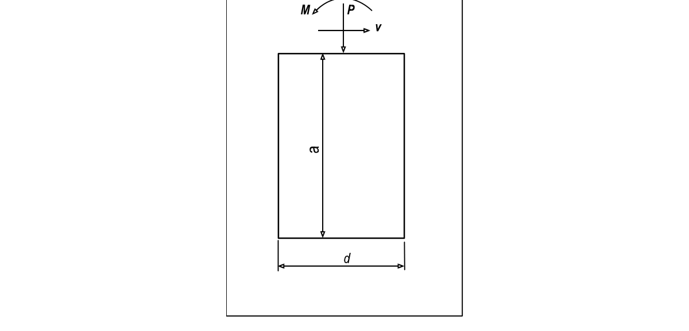

Figura F.5.5.1-1 — Lámina no rigidizada

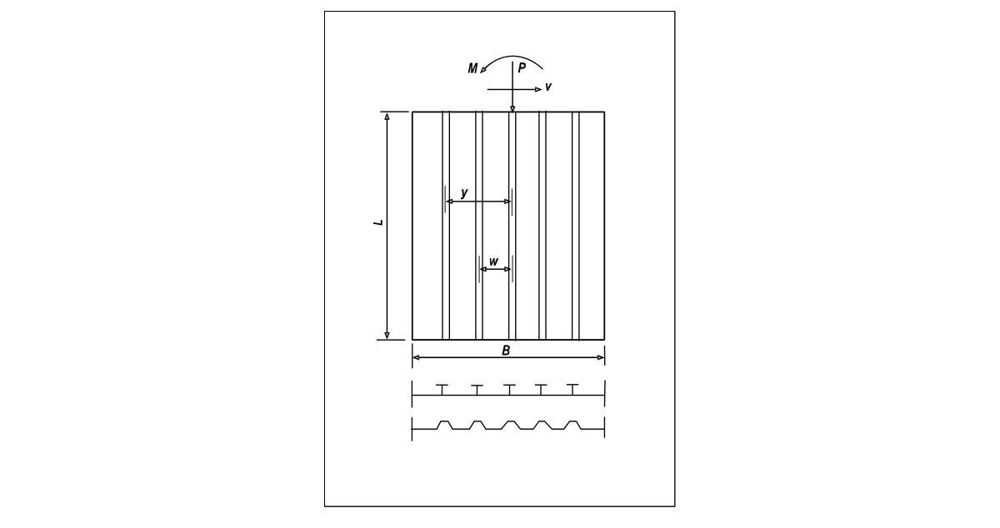

Figura F.5.5.1-2 — Lámina multi-rigidizada

Figura F.5.5.1-3 — Viga ensamblada Para (a) y (c), la resistencia obtenida tiende a ser más favorable que la basada en las reglas más simples de F.5.4, especialmente si se consideran láminas o almas esbeltas de baja relación de $(a /d )$. El numeral F.5.4 no cubre las láminas multi-rigidizadas.

#### F.5.5.2 — LAMINAS NO RIGIDIZADAS

Las láminas no rigidizadas sujetas a esfuerzo directo pueden diseñarse de acuerdo con F.5.5.2.1 a F.5.5.2.3, las sujetas a cortante, según F.5.5.2.4. Los efectos de interacción se discuten en F.5.5.2.5.

El espesor de la lámina se denominará $t$ para todos los casos.

**F.5.5.2.1** — Láminas no rigidizadas bajo esfuerzo directo — La resistencia de una lámina a compresión uniforme en su plano, $P$ , actuando en la dirección mostrada en la figura F.5.5.1-1, se describe en los literales

(a) a (c) de este numeral.

(a) Clasificación — La lámina se debe clasificar de acuerdo con lo siguiente:

$β ≤β_{1}$ totalmente compacta $β_{1} < β ≤β_{o}$ semi-compacta $β > β_{o}$ esbelta Donde:

$$ \beta =d/t \tag{F.5.5.2-1} $$

$β_{o}$ y $β_{1}$ dadas en la tabla F.5.4.3

(b) Láminas totalmente compactas y semi-compactas — La resistencia axial de diseño $P_{RS}$ a compresión uniforme debe basarse en la sección transversal menos favorable como se indica a continuación:

$$ \text{totalmente compacta}\qquad P_{RS}=p_{a}A_{ne}\phi \tag{F.5.5.2-2} $$

$$ \text{semi-compacta}\qquad P_{RS}=p_{o}A_{ne}\phi \tag{F.5.5.2-3} $$

Donde:

$p_{a}$ y $p_{o}$ = esfuerzos límite (véase las tablas F.5.4.3-1 y F.5.4.3-2)

$A_{ne}=$ área neta efectiva teniendo en cuenta los agujeros y tomando un espesor reducido $k_{z} t$ en cualquier región afectada por ablandamiento debido al calor (véanse F.5.4.4.2 y F.5.4.4.3)

$φ$ = coeficiente de reducción de capacidad (véase la tabla F.5.3.3-1)

(c) Láminas esbeltas — Se debe hacer una revisión por fluencia y otra por pandeo tomando los siguientes valores para la resistencia axial de diseño $P_{RS}$.

(1) Revisión por fluencia — Para una lámina semi-compacta, $P_{RS}$ se obtiene como en el literal (b) de este numeral ignorando el pandeo.

(2) Revisión por pandeo

$P_{RS}= φp_{o} A_{e}$ Donde:

$p_{o}$= esfuerzo límite (véanse las tablas F.5.4.2-1 y F.5.4.2-2)

$A_{e} =$ área efectiva obtenida teniendo en cuenta el espesor reducido para considerar el pandeo y el ablandamiento en la zona afectada por el calor, pero ignorando los agujeros Para la revisión por pandeo el área efectiva generalmente debe basarse en la sección transversal menos favorable, tomando un espesor igual al menor de $k_{z} t$ y $k_{L} t$ en las regiones afectadas por el calor, y $k_{L} t$ en las demás zonas. Sin embargo, en esta revisión se puede ignorar el ablandamiento debido a soldaduras en los bordes cargados.

El factor $k_{L}$ puede determinarse mediante el más favorable de los siguientes tratamientos:

• Tratamiento como lámina $k_{L}$ se lee en la curva C o D de la figura F.5.4.3-5 tomando:

$$ \beta =\dfrac{d}{t}\qquad \text{y}\qquad \varepsilon =\left(\dfrac{25}{p_{o}}\right)^{1/2} \tag{F.5.5.2-4} $$

• Tratamiento como columna $k_{L}$ se toma igual a la relación $p_{s}/p_{o}$ , en la que $p_{s}$ es el esfuerzo de pandeo como columna leído en la figura F.5.4.5-3 (a). La curva apropiada es la que intersecta el eje de esfuerzos en un valor $p_{o}$ . El parámetro de esbeltez $λ$ debe ser normalmente tomado como:

$λ =3.5a$ $t$ éste valor corresponde a apoyo simple, aunque se puede tomar un valor menor si es justificado.

**F.5.5.2.2** — Láminas no rigidizadas bajo momento en su plano — La resistencia de una lámina ante momento puro en su plano actuando sobre los lados de ancho $d$ (véase la figura F.5.5.1-1) se describe en los literales (a) a (c) de este numeral. Si el momento varía en la dirección paralela a la dimensión $a$ , consulte también F.5.5.2.3.

(a) Clasificación - Las lámina debe clasificarse de acuerdo con:

$β ≤β_{1}$ totalmente compacta $β_{1} < β ≤β_{o}$ semi-compacta $β > β_{o}$ esbelta Donde:

$$ \beta =\dfrac{0.35d}{t} \tag{F.5.5.2-6} $$

$β_{o}$ y $β_{1}$ están dados en la tabla F.5.4.3

(b) Láminas totalmente compactas y semi-compactas — La resistencia de diseño a momento $M_{RS}$ se debe tomar con base en la sección transversal menos favorable usando la expresión pertinente del literal (b) de F.5.4.5.2 (numerales F.5.19 a F.5.22) y tomando una sección supuesta tal como lo define el literal (c) del mismo numeral en las dos primeras partes.

(c) Láminas esbeltas — La resistencia de diseño a momento debe tomarse como el menor de los valores encontrados en las revisiones por fluencia y pandeo:

(1) Revisión por fluencia — Para una lámina semi-compacta, $M_{RS}$ se obtiene como en el literal (b) de F.5.5.2.2 ignorando el pandeo.

(2) Revisión por pandeo — Se determina $M_{RS}$ tal como se indica a continuación:

$$ M_{RS}=\phi p_{o}Z_{e} \tag{F.5.5.2-7} $$

Donde:

$Z_{e} =$ módulo elástico de la sección efectiva El cálculo de F.5.5.2-7 debe basarse, por lo general, en la sección efectiva en la posición más desfavorable, sin reducción por agujeros y tomando un espesor igual al menor entre $k_{z} t$ y $k_{L} t$ en las regiones afectadas por el calor, y $k_{L} t$ en las demás zonas. Sin embargo, en esta revisión puede ignorarse el ablandamiento debido a soldaduras en los bordes cargados.

El factor $k_{L}$ debe ser leído en la curva C o D de la figura F.5.4.3-5 tomando:

$$ \beta =\dfrac{0.35d}{t}\qquad \text{y}\qquad \varepsilon =\left(\dfrac{25}{p_{o}}\right)^{1/2} \tag{F.5.5.2-8} $$

**F.5.5.2.3** — Gradiente de esfuerzo longitudinal en láminas no rigidizadas — Los casos en que la acción aplicada $P$ o $M$ sobre una lámina no rigidizada varía longitudinalmente en la dirección mostrada en la figura F.5.5.1-1, se presentan en los siguientes literales.

(a) Láminas totalmente compactas y semi-compactas — La resistencia de diseño en cualquier sección transversal no debe ser menor que la acción generada en esa sección bajo carga mayorada.

(b) Láminas esbeltas — La revisión por fluencia debe satisfacerse una vez más en cada sección transversal. Para la revisión por pandeo, es suficiente comparar la resistencia de diseño con la acción generada a una distancia $x$ del extremo más cargado del panel, donde $x$ es igual a 0.4 veces la longitud de la media onda de pandeo elástico de la lámina.

**F.5.5.2.4** — Láminas no rigidizadas sometidas a cortante — Las láminas no rigidizadas sujetas a cortante deben clasificarse como compactas o esbeltas de acuerdo con el literal (a) de F.5.4.5.3.

La presencia de agujeros pequeños puede ignorarse en el cálculo de la resistencia al corte siempre y cuando ellos no ocupen más del 20% del área de la sección transversal sobre el ancho $d$.

(a) Alma a cortante compacta — La resistencia de diseño a fuerza cortante $V_{RS}$ debe encontrarse usando lo siguiente:

$$ V_{RS}=\phi p_{\nu }A_{\nu } \tag{F.5.5.2-9} $$

Donde:

$pν$ = esfuerzo límite (véanse las tablas F.5.4.2-1 y F.5.4.2-2)

$φ$ = coeficiente de reducción de capacidad (véase la tabla F.5.3.3-1)

$A_{v}$ = área de cortante efectiva tomada de acuerdo con:

Para láminas no soldadas $A_{v}=dt$.

Para láminas totalmente soldadas a lo largo de uno o más bordes $A_{v}=k_{z} dt$ Para láminas parcialmente soldadas, $A_{v}$ es el área efectiva sobre el ancho $d$ encontrada tomando un espesor reducido $k_{z} t$ en las zonas ablandadas (véanse F.5.4.4.2 y F.5.4.4.3)

(b) Alma a cortante esbelta — La resistencia de diseño a fuerza cortante $V_{RS}$ se debe tomar como el menor de los dos valores obtenidos como sigue:

(1.) Revisión por fluencia — La resistencia se encuentra, como para una lámina compacta, usando el literal (a) de F.5.5.2.4.

(2.) Revisión por pandeo — La resistencia puede encontrarse, seguramente, como se hizo en el literal (c) de F.5.4.5.3.

Alternativamente, la siguiente expresión puede usarse y es más favorable cuando $a$ es menor que $2.5d$ .

$$ V_{RS}=\phi v_{1}p_{v}dt \tag{F.5.5.2-10} $$

donde $v_{1}$ es el coeficiente de pandeo por cortante elástico leído en la figura F.5.5.3-1 tomando

$$ \varepsilon =\left(\dfrac{15}{p_{v}}\right)^{1/2} \tag{F.5.5.2-11} $$

La expresión del literal (c) de F.5.4.5.3 no tiene en cuenta la acción de campo tensionado. Si se cree que las condiciones de borde son tales que se tiene un campo tensionado, el diseñador debe referirse a un tratamiento aún más favorable disponible para paneles tipo 1 en almas de vigas ensambladas (véase el literal (c) de F.5.5.4.2).

**F.5.5.2.5** — Acciones combinadas — Una lámina, sujeta a fuerza axial $P$ combinada con momento $M$ bajo carga mayorada, debe clasificarse como totalmente compacta, semi-compacta o esbelta, generalmente de acuerdo con el literal (a) de F.5.4.8.2. Para hacer ésto, el valor de $β$ tomado debe basarse en el patrón de esfuerzo producido en la lámina cuando $P$ y $M$ actúan conjuntamente, basándose en un valor apropiado de $g$ (véase la figura F.5.4.3-2).

Cuando la lámina se clasifica como esbelta, cada resistencia individual ($P_{RS}$ y $M_{RS}$) debe basarse en el tipo específico de acción considerada, como en el literal (b) de F.5.4.8.2.

(a) Fuerza axial con momento — La siguiente condición debe satisfacerse para una lámina sujeta a fuerza axial con momento:

$$ \dfrac{P}{P_{RS}}+\dfrac{M}{M_{RS}}\le 1.0 \tag{F.5.5.2-12} $$

Donde:

$P$ y $M =$ fuerza axial y momento en el plano, respectivamente, generados bajo carga mayorada

$P_{RS}$ y $M_{RS}=$ resistencias de diseño a fuerza axial y momento en el plano, respectivamente, cada una reducida para tener en cuenta cortante elevado coincidente, si es necesario (véase el literal (c) de F.5.5.2.5)

(b) Esfuerzo directo con cortante bajo — Se puede suponer que una fuerza de cortante coincidente $V$ (bajo carga mayorada) no tiene efecto sobre la resistencia de la lámina siempre que $V$ no exceda la mitad de la resistencia a fuerza cortante de diseño $V_{RS}.$

(c) Esfuerzo directo con cortante elevado — Si $V$ excede $0.5V_{RS}$, la resistencia longitudinal (fuerza axial, momento) se debe reducir por un coeficiente $k_{v}$ donde:

$$ k_{v}=1.6-\dfrac{1.2V}{V_{RS}} \tag{F.5.5.2-13} $$

#### F.5.5.3 — LAMINAS MULTI-RIGIDIZADAS

Las siguientes reglas conciernen a láminas, soportadas en todos los cuatro bordes (véase figura F.5.5.1-2), que están reforzadas con tres o más, igualmente espaciados, rigidizadores o corrugaciones. Estas pueden ser no soportadas en su longitud total o ser contínuas sobre rigidizadores transversales intermedios. La dimensión $L$ debe tomarse como el espaciamiento de los apoyos, cuando se aplique. Una característica esencial del diseño es que el refuerzo longitudinal, pero no así los rigidizadores transversales, es “subcrítico”, esto es, se puede deformar con la lámina en el modo de pandeo general.

La resistencia de tales láminas ante esfuerzo directo longitudinal en la dirección del refuerzo está dada en F.5.5.3.1 a F.5.5.3.3, y la resistencia a cortante, en F.7.5.3.4. La interacción entre diferentes efectos puede tenerse en cuenta del mismo modo que para láminas no rigidizadas (véase F.5.5.2.5).

Los tratamientos dados anteriormente se invalidan si la sección transversal contiene elementos salientes que se clasifiquen como esbeltos.

Cuando la construcción consiste de láminas planas con rigidizadores superpuestos, la resistencia a esfuerzo directo transversal puede tomarse igual a la de una lámina no rigidizada. Con construcción corrugada, ésto es despreciable.

**F.5.5.3.1** — Láminas multi-rigidizadas sujetas a compresión uniforme — Se deben hacer dos revisiones, una por fluencia y otra como columna. La sección transversal debe clasificarse como compacta o esbelta de acuerdo con F.5.4.3.3, considerando todos los elementos componentes antes de llevar a cabo cada revisión.

No se permiten elementos esbeltos salientes.

(a) Revisión por fluencia — La sección completa debe ser revisada para aplastamiento local en la misma forma que se hace para miembros a compresión (véase F.5.4.7.6). La resistencia $P_{RS}$ se debe tomar con base en la sección transversal menos favorable considerando el pandeo local y el ablandamiento de la zona afectada por el calor, si es necesario, y también los agujeros no rellenos.

(b) Revisión como columna — La lámina se trata como un ensamblaje de subunidades idénticas de columna, cada una conteniendo un rigidizador o una corrugación centralmente cargado y con un ancho igual a la separación $w$ . La resistencia axial de diseño $P_{RS}$ se toma como:

$$ P_{RS}=\phi p_{s}A \tag{F.5.5.3-1} $$

Donde:

$p_{s}$ = esfuerzo de pandeo para una sub-unidad de columna

$A$ = área bruta de la sección transversal completa de la lámina

$φ$ = coeficiente de reducción de capacidad (véase la tabla F.5.3.3-1) El esfuerzo $p_{s}$ debe leerse en la curva apropiada de la figura F.5.4.5-3, pertinente al pandeo como columna de la sub-unidad como un miembro a compresión simple, fuera del plano de la lámina.

El parámetro de esbeltez $λ$ , necesario para la figura F.5.4.5-3, se debe basar en una longitud efectiva $l$ igual a la menor de:

• La distancia entre posiciones de soporte lateral efectivo tales como soportes en los extremos o rigidizadores transversales efectivos, o • La mitad de la longitud de onda del pandeo elástico ortotrópico La parte de la figura F.5.4.5-3 (a), (b) o (c) usada depende de la forma de la sección de la sub- unidad y de si ésta contiene soldadura longitudinal (véase la tabla F.5.4.7-3), la curva real es la que intercepta el eje de esfuerzos en un valor $p_{1,,}$ como se define en F.5.4.7.5. Se debe considerar lo siguiente para determinar el área efectiva $A_{e}$ (necesaria para encontrar $p_{1}$ ).

• El valor de $k_{L}$ para elementos tales como los E de la figura F.5.5.1-2, debe basarse en sus dimensiones totales aunque estén cortados en dos por la formación de subunidades.

• El ablandamiento en la zona afectada por el calor debido a soldaduras en los extremos cargados o en rigidizadores transversales puede ignorarse para encontrar $A_{e} .$

**F.5.5.3.2** — Láminas multi-rigidizadas sujetas a momento en su plano — Se deben hacer dos revisiones: por fluencia y como columna.

(a) Clasificación de la sección y pandeo local — Para realizar cada revisión, primero ha de clasificarse la sección como compacta o esbelta (véase F.5.4.3.3).

Para el propósito de clasificar elementos individuales, y también para determinar $k_{L}$ para elementos esbeltos, generalmente se puede suponer que cada elemento está sometido a compresión uniforme tomando $g=1$ en el literal (a) de F.5.4.3.2. Sin embargo, en el caso de la revisión únicamente por fluencia, se permite basar $g$ en el patrón de esfuerzos real en los elementos que conforman la región más extrema de la lámina y repetir ese valor para los elementos correspondientes más interiores. Esto puede ser favorable cuando el número de rigidizadores o corrugaciones es pequeño. No se deben permitir elementos esbeltos salientes.

(b) Revisión por fluencia — La sección transversal completa de la lámina debe tratarse como una viga sujeta a flexión en su plano (véase el literal (b) de F.5.4.5.2). La resistencia a momento de diseño $M_{RS}$ debe tomarse con base en la sección transversal menos favorable, teniendo en cuenta el pandeo local y el ablandamiento en la zona afectada por el calor, si es necesario, y también los agujeros.

(c) Revisión como columna — La lámina se considera como un ensamblaje de subunidades de columna en la misma manera general que para compresión axial (véase el literal (b) de F.5.5.3.1), la resistencia a momento de diseño $M_{RS}$ se toma de acuerdo con:

$$ M_{RS}=\phi \dfrac{p_{s}ZB}{2y} \tag{F.5.5.3-2} $$

Donde:

$p_{s}$ = esfuerzo de pandeo para una sub-unidad de columna

$Z$ = módulo elástico de la sección transversal completa de la lámina para flexión en su plano

$B$ = ancho total de la lámina

$y$ = distancia desde el centro de la lámina hasta el centro del rigidizador más lejano

$φ$ = coeficiente de reducción de capacidad (véase tabla F.5.3.3-1) El esfuerzo $p_{s}$ debe leerse en la figura F.5.4.5-3 del mismo modo que para compresión uniforme (véase el literal (b) de F.5.5.3.1).

**F.5.5.3.3** — Gradiente de esfuerzos longitudinal en láminas multi-rigidizadas — En este numeral se describen los casos en que la acción aplicada $P$ o $M$ sobre una lámina multi-rigidizada varía en la dirección de los rigidizadores o corrugaciones.

(a) Revisión por fluencia — La resistencia de diseño en cualquier sección transversal no debe ser menor que la acción generada en esa sección bajo carga mayorada.

(b) Revisión como columna — Para la revisión como columna es suficiente comparar la resistencia de diseño con la acción generada bajo carga mayorada a una distancia $x$ del extremo más cargado de un panel, donde $x$ es 0.4 veces la longitud de pandeo efectiva $l .$

**F.5.5.3.4** — Láminas multi-rigidizadas sometidas a cortante — Se debe hacer una revisión por fluencia y una revisión por pandeo. Los métodos dados en los literales (a) y (b) de este numeral son válidos siempre y cuando ocurra lo siguiente:

• El espaciamiento $w$ de los rigidizadores o corrugaciones no debe exceder $0.3L$ (véase la figura F.5.5.1-2).

• Cualquier elemento saliente de la sección se clasifica como compacto en términos de resistencia axial (véase el literal (c) de F.5.4.3.3).

• Cualquier elemento interno se clasifica como compacto en términos de resistencia al cortante (véase el literal (a) de F.5.4.5.3).

• Los rigidizadores o corrugaciones, lo mismo que la lámina completa, están:

(1) Efectivamente conectados al entramado transversal en cada extremo (2) Continuos en cualquier posición de rigidizador transversal.

(a) Revisión por fluencia — La resistencia a fuerza cortante de diseño $V_{RS}$ se toma igual a la de una lámina plana no rigidizada con el mismo aspecto general $(LxB)$ y el mismo espesor general $t$ . Se encuentra de acuerdo con el literal (a) de F.5.5.2.4.

(b) Revisión por pandeo — La resistencia de diseño a fuerza cortante se encuentra usando la siguiente expresión:

$$ V_{RS}=\phi \nu _{1}p_{v}Bt \tag{F.5.5.3-3} $$

Donde:

$p_{v}$ = esfuerzo límite (véanse las tablas F.5.4.2-1 y F.5.4.2-2)

$B$ = ancho de la lámina (véase la figura F.5.5.1-2)

$t$ = espesor general de la lámina

$φ$ = coeficiente de reducción de capacidad (véase la tabla F.5.3.3-1)

$v_{1}$ = coeficiente de pandeo crítico al corte en el rango elástico (véase la figura F.5.5.3-1)

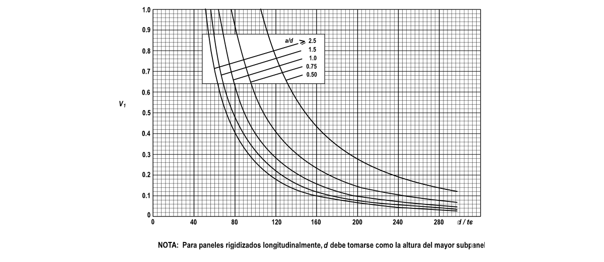

Figura F.5.5.3-1 — Coeficiente de pandeo crítico al corte en el rango elástico, $ν_{1}$ Para calcular $ν_{1}$ deben usarse los siguientes valores:

$$ \begin{aligned} a&=B \\ d&=0.61\left(\dfrac{wt^{3}}{I_{SU}}\right)^{0.375}\end{aligned} \tag{F.5.5.3-4} $$

$l =$ longitud efectiva de la lámina

$w =$ separación entre rigidizadores o corrugaciones

$I_{SU}=$ segundo momento del área de una sub-unidad de lámina (como se define en el literal (b) de F.5.5.3.1) respecto al eje centroidal paralelo al plano de la lámina

$$ \varepsilon =\left(\dfrac{15}{p_{v}}\right)^{1/2} $$

La longitud efectiva $l$ puede tomarse seguramente como la longitud no soportada $L$ (véase la figura F.5.5.1-2). Cuando $L$ excede ampliamente a $B$ , se puede obtener un resultado más favorable haciendo $l$ igual a la mitad de la longitud de onda del pandeo por cortante elástico ortotrópico. En la revisión por pandeo no es necesario tener en cuenta el ablandamiento en la zona afectada por el calor.

#### F.5.5.4 — VIGAS ENSAMBLADAS

Una viga ensamblada es una viga fabricada consistente de láminas actuando como aleta a tensión, aleta a compresión y alma. El alma típicamente tiene proporciones esbeltas y está reforzada transversalmente con rigidizadores de apoyo e intermedios (véase la figura F.5.5.1-3). Puede tener también rigidizadores longitudinales. Una característica básica es que los rigidizadores del alma son diseñados para dar extremos soportados a los paneles del alma permaneciendo esencialmente rectos cuando ocurre el pandeo.

Las resistencias a momento y cortante de las vigas ensambladas con almas transversalmente rigidizadas son cubiertas por F.5.5.4.1 y F.5.5.4.2. En F.5.5.4.3 se dan las modificaciones necesarias para cuando se adicionan rigidizadores longitudinales. Se permite seguir el apéndice F.5-D en lugar de F.5.5.4.1, si se desea, para determinar la resistencia a momento, esto puede conducir a economía en el diseño.

Los métodos dados en F.5.5.4.1, F.5.5.4.2 y F.5.5.4.3 son válidos siempre que ocurra lo siguiente.

• Los rigidizadores cumplen con F.5.5.4.4 • El espaciamiento $a$ de los rigidizadores transversales no es menor que la mitad de la altura libre del alma medida entre las aletas (para almas corrugadas o cercanamente rigidizadas, véase F.5.5.4.5) Puede ser benéfico suministrar una platina de enchape, a una o ambas aletas. Esta debe cumplir con el literal (g) de F.5.5.4.4 para ser efectiva.

La interacción entre momento y cortante es tratada en F.5.5.4.6.

Si el aplastamiento del alma o el pandeo torsional lateral se consideran factores influyentes, el diseñador debe consultar F.5.4.5.5 o F.5.4.5.6. Para vigas sujetas a carga axial y flexión, es pertinente F.5.4.8.

El tratamiento de vigas ensambladas dado en F.5.5.4.1 a F.5.5.4.6, es generalmente también aplicable a vigas con sección en cajón siempre que las almas sean de forma similar.

**F.5.5.4.1** — Resistencia a momento de vigas ensambladas rigidizadas transversalmente — Para determinar la resistencia de diseño a momento se debe hacer una revisión por fluencia y una revisión por pandeo. Para vigas híbridas, con materiales diferentes en aletas y alma, se debe consultar también el literal

(d) de F.5.4.5.2.

(a) Revisión por fluencia — El momento generado en cualquier sección transversal bajo carga mayorada no debe exceder la resistencia de diseño a momento $M_{RS}$ que se usaría si la sección fuera tratada como semi-compacta. El valor de $M_{RS}$ se obtiene usando el literal (b) de F.5.4.5.2 (ecuación F.5.4.5-2 o F.5.4.5-4), según sea adecuado, teniendo en cuenta los agujeros y los efectos de la zona afectada por el calor pero ignorando el pandeo local. Si la viga no está lateralmente soportada, debe revisarse de acuerdo con F.5.4.5.6.

(b) Revisión por pandeo — El siguiente tratamiento se aplica a vigas ensambladas con rigidizadores transversales pero sin rigidizadores longitudinales.

Para cada tramo de viga entre rigidizadores transversales, el momento generado bajo carga mayorada, a una distancia igual a $0.4a$ del extremo más esforzado, no debe exceder la resistencia de diseño a momento $M_{RS}$ de ese tramo basada en la falla última por pandeo. El valor de $M_{RS}$ se obtiene de acuerdo con el literal (b) de F.5.4.5.2 (ecuación F.5.4.5-5), teniendo en cuenta el pandeo local y el ablandamiento en la zona afectada por el calor pero ignorando los agujeros. Sin embargo, para el propósito de esta revisión es permitido ignorar los efectos de la zona afectada por el calor, causados por la soldadura de los rigidizadores transversales.

Para considerar el pandeo del alma se debe encontrar el coeficiente de espesor efectivo $k_{L}$ de acuerdo con F.5.4.3.4, tomando $β$ como en el literal (a) de F.5.4.3.2. No obstante, si el extremo a compresión del alma está más cerca del eje neutro que el extremo a tensión, se permite, en su lugar, proceder como en el literal (c) de F.5.5.4.1, lo que tiende a ser más favorable.

Se puede suponer que cualquier platina de enchape, si es suministrada, brinda soporte efectivo en el extremo a la lámina esbelta del alma a la cual está unida siempre y cuando cumpla con el literal (g) de F.5.5.4.4. Por lo tanto, para encontrar $k_{L}$ para la lámina del alma en la figura F.5.4.3- 5 (b), $β$ puede basarse en un valor $d$ medido hasta la punta de la o las platinas de enchape.

(c) Tratamiento alternativo del pandeo del alma — Si el eje neutro está localizado de modo que está más cerca del extremo del alma a compresión que del extremo a tensión, se permite tratar el alma como compuesta por dos zonas con diferentes valores de $k_{L}$ obtenidos como se indica a continuación:

• Zona 1, se extiende una distancia $y_{1}$ a cada lado del eje neutro:

$k_{L}$ se lee en la figura F.5.4.3-5 (b) tomando $β =0.7y_{1}/t$ donde $y_{1}$ es la distancia desde el eje neutro de la sección bruta hasta el extremo a compresión.

• Zona 2, ocupa el resto del alma:

$k_{L}=1.0$

**F.5.5.4.2** — Resistencia a cortante de vigas ensambladas rigidizadas transversalmente — Se deben hacer dos revisiones: por fluencia y por pandeo. En almas con soldaduras continuas longitudinales es también necesario hacer una revisión por zona afectada por el calor (véase el literal (d) de este numeral). La presencia de pequeños agujeros en la lámina del alma puede ignorarse para cada revisión siempre que éstos no ocupen más del 20% del área de la sección.

(a) Revisión por fluencia — La fuerza cortante $V$ generada bajo carga mayorada en cualquier sección transversal, no debe exceder el valor de $V_{RS}$ encontrado como se indica enseguida:

$$ \text{sin platina de enchape}\quad V_{RS}=\phi P_{vw}A_{we} \tag{F.5.5.4-1} $$

$$ \text{con platina o platinas de enchape}\quad V_{RS}=\phi \left(P_{vw}A_{we}+p_{vt}A_{te}\right) \tag{F.5.5.4-2} $$

Donde:

$P_{vw}, P_{vt}$= esfuerzos límites para los materiales del alma y la platina saliente respectivamente (equivalente a $P_{v}$ en las tablas F.5.4.2-1 y F.5.4.2-2)

$A_{we}$= área de la sección efectiva del alma entre las aletas, o hasta los extremos de la platina de enchape

$A_{te}$= área de la sección efectiva de la platina de enchape, o área total de dos de ellas

$φ$ = coeficiente de reducción de capacidad (véase la tabla F.5.3.3-1) Las áreas efectivas se obtienen tomando un espesor reducido igual a $k_{z}$ veces el espesor real en cualquier región afectada por el calor (véanse F.5.4.4.2 y F.5.4.4.3).

(b) Revisión por pandeo — En cualquier vano entre rigidizadores transversales, la fuerza cortante $V$ generada bajo carga mayorada no debe exceder el valor límite $V_{RS}$ para ese vano, basado en la falla última por pandeo. El valor de $V_{RS}$ debe encontrarse usando la expresión apropiada de las siguientes, en las que se saca ventaja del comportamiento posterior al pandeo:

$$ \text{sin platina de enchape}\quad V_{RS}=\phi \left(v_{1}+v_{tf}\right)p_{vw}dt \tag{F.5.5.4-3} $$

con platina o platinas de enchape

$$ V_{RS} = \phi\left[(v_1+v_{tf})\,p_{vw}\,d\,t + p_{vt}A_{te}\right] \tag{F.5.5.4-4} $$

Donde:

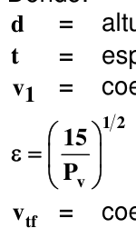

altura del alma medida entre aletas, o hasta los extremos de la platina de enchape espesor no reducido de la lámina del alma coeficiente de pandeo inicial por cortante, leído en la figura F.5.5.3-1 tomando coeficiente de campo tensionado (véase el literal (c) siguiente) Las otras cantidades son las definidas en el literal (c) de este numeral.

(c) Acción de campo tensionado — Se identifican dos tipos de paneles de alma:

• Tipo 1: paneles capaces de mantener un campo tensionado, es decir:

un panel interno, un panel en un tramo final con un poste extremo que cumple con el literal (e) de F.5.5.4.4 • Tipo 2: un panel en un tramo final que carece de un poste extremo adecuado En los paneles tipo 2, la acción de campo tensionado es despreciable y por lo tanto $v_{tf}$ debe ser tomado como cero en el literal (b) de F.5.5.4.2.

Los paneles tipo 1 son generalmente capaces de desarrollar resistencia a cortante adicional después de la aparición inicial de pandeo, debido a la acción de campo tensionado. En este caso $v_{tf}$debe tomarse de acuerdo con lo siguiente:

$$ \text{(i)}\quad \text{Panel no soldado}\quad v_{tf}=v_{2}+mv_{3} \tag{F.5.5.4-5} $$

$$ \text{(ii)}\quad \text{Panel con soldaduras en los extremos}\quad v_{tf}=k_{z}\left(v_{2}+mv_{3}\right) \tag{F.5.5.4-6} $$

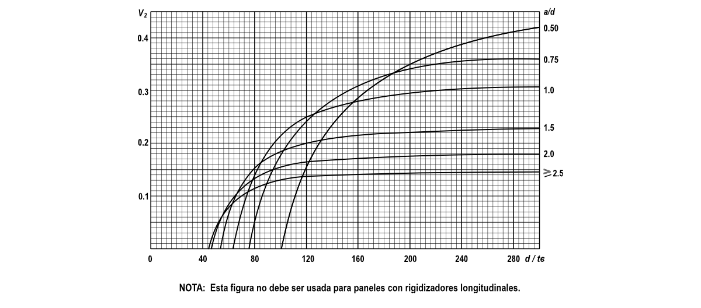

Figura F.5.5.4-1 — Coeficiente básico de pandeo al corte considerando campo tensionado, $v_{2}$

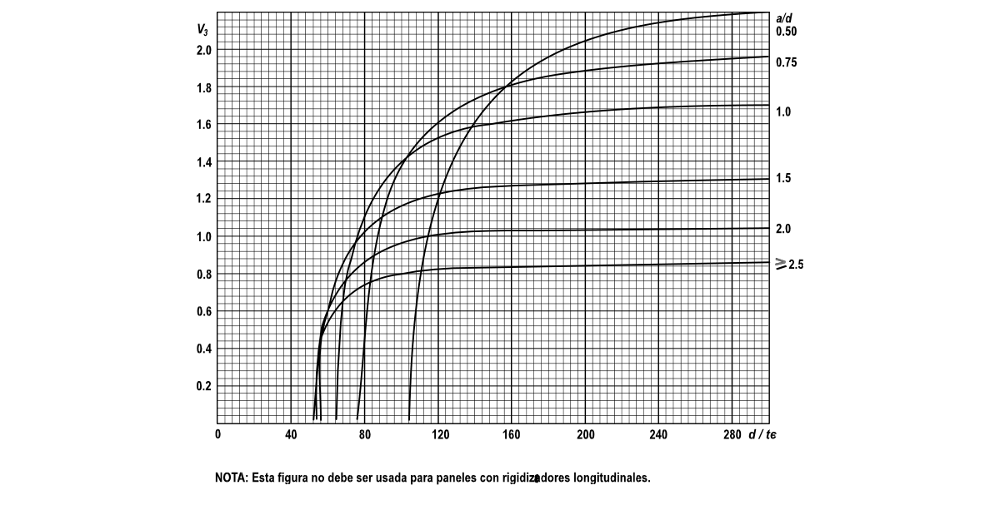

Figura F.5.5.4-2 — Coeficiente de pandeo al corte considerando campo tensionado y contribución de la aleta, $v_{3}$ Donde:

$v_{2}=$ coeficiente de pandeo por cortante determinado en la figura F.5.5.4-1

$v_{3}=$ coeficiente de pandeo por cortante determinado en la figura F.5.5.4-2

$k_{z}=$ coeficiente de ablandamiento de la zona afectada por el calor (véase F.5.4.4.2)

$m_{1,,}m_{2}=$ coeficientes de pandeo por cortante donde $m_{1}$ se determina en la figura F.5.5.4-3 y $m_{2}=(4p_{of} S_{f}/p_{ow}d^{2} t)1 /2$ Donde:

$p_{of}$ y $p_{ow}=$ esfuerzos límite $p_{o}$ para el material de las aletas y el alma (véase la tabla F.5.4.2-1)

$S_{f}=$ módulo plástico de la sección de aleta efectiva respecto a su propio eje de igual área, en el plano del alma (se toma el menor valor si las aletas son diferentes)

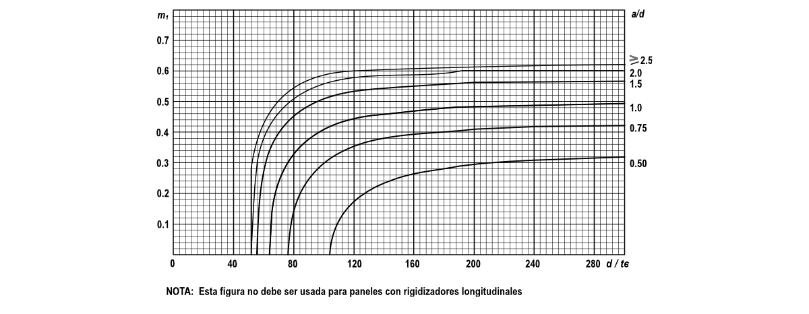

Figura F.5.5.4-3 — Coeficiente de pandeo por cortante $m_{1}$ Para determinar $S_{f}$ , la sección considerada debe incluir la lámina de la aleta conjuntamente con la platina de enchape si está presente, con la reducción de espesor apropiada para tener en cuenta el pandeo local y el ablandamiento en la zona afectada por el calor (véase el literal

(c) de F.5.4.5.2) pero sin reducción por agujeros. Si la viga tiene dos o más almas, el módulo plástico de la aleta completa debe ser apropiadamente compartido para obtener $S_{f}$ para cada alma.

(d) Revisión por zona afectada por el calor — En almas con soldaduras longitudinales, la fuerza cortante $V$ , generada bajo carga mayorada, no debe sobrepasar la resistencia de diseño a fuerza cortante $V_{RS}$ en cualquiera de tales soldaduras. $V_{RS}$ está dado por:

$$ V_{RS}=\phi \dfrac{k_{z}p_{vw}It}{A_{e}\bar{y}} \tag{F.5.5.4-7} $$

Donde:

$I =$ segundo momento del área de la sección bruta

$A_{e} y =$ primer momento del área bruta excluida por fuera de la soldadura

$A_{e}=$ área de la sección

$y =$ distancia del centroide del eje neutro hasta esta área

$k_{z} , p_{vw}$, $γ_{m} =$ de acuerdo con su definición en los literales (a) y (c) de F.5.5.4.2

**F.5.5.4.3** — Vigas rigidizadas longitudinal y transversalmente

(a) Resistencia a momento — El procedimiento para determinar la resistencia a momento es básicamente el mismo que para vigas con rigidizadores transversales únicamente e involucra una revisión por fluencia y una revisión por pandeo. La revisión por fluencia se realiza de acuerdo con el literal (a) de F.5.5.4.1.

Para hacer la revisión por pandeo (véase el literal (b) de F.5.5.4.1) se supone que cada rigidizador longitudinal brinda una línea de apoyo al alma subdividiéndola en sub-paneles separados desde el punto de vista de pandeo local. Para determinar la sección efectiva de la viga se pueden usar valores mejorados de $k_{L}$ para los sub-paneles que se obtienen tomando el ancho y el patrón de esfuerzo correcto para cada sub-panel para determinar su valor de $β .$

(b) Resistencia a cortante — Las revisiones por fluencia (véase el literal (a) de F.5.5.4.2) y por zona afectada por el calor (véase el literal (d) de F.5.5.4.2) no se afectan por la presencia de rigidizadores longitudinales.

La revisión por pandeo se debe llevar a cabo, generalmente, de acuerdo con el literal (b) de F.5.5.4.2, pero $v_{1}$ y $v_{tf}$ se determinan como se indica a continuación:

• El valor de $v_{1}$ se determina en la figura F.5.5.3-1 tomando $d$ igual a la altura del mayor sub- panel (en lugar de la altura total del alma) • El valor de $v_{tf}$ se calcula usando la ecuación apropiada F.5.5.4-5 o F.5.5.4-6 en el literal (c) de F.5.5.4.2, con los factores $v_{2}$ , $v_{3}$ y $m$ obtenidos así:

El valor de $m$ se toma como el menor de $m_{1}$ y $m_{2}$ Los valores $v_{2} , v_{3}$ y $m_{1}$ se calculan usando las fórmulas del apéndice F.5-I que se relacionan con las figuras F.5.5.4-1 a F.5.5.4-3, respectivamente, tomando $d$ como la altura total tal como se define en el literal (b) de F.5.5.4.2 y $v_{1}$ como el valor encontrado de acuerdo con lo anterior. Las figuras F.5.5.4-1 a F.5.5.4-3 no deben usarse para paneles de alma con rigidizadores longitudinales.

El valor de $m_{2}$ se calcula como en el literal (c) de F.5.5.4.2 tomando un $d$ tal como se define en el literal (b) del mismo numeral.

**F.5.5.4.4** — Rigidizadores de alma y platinas de enchape — Se consideran los siguientes tipos de rigidizador de alma (véase la figura F.5.5.1-3). Pueden estar colocados a uno a ambos lados.

• Tipo A, rigidizador intermedio — rigidizador transversal diferente de los cubiertos por el tipo B • Tipo B, rigidizador de apoyo — rigidizador transversal localizado en el punto de aplicación una carga concentrada o reacción • Tipo C, rigidizador longitudinal — rigidizador atravesado longitudinalmente entre rigidizadores transversales Para que las resistencias proyectadas se logren, es generalmente necesario que los rigidizadores de alma cumplan con lo siguiente:

• Tipos A, B, C — compacidad (véase el literal (a) de F.5.5.4.4) • Tipos A, B, C — rigidez (véase el literal (c) de F.5.5.4.4) • Tipos A, B únicamente — estabilidad (véase el literal (d) de F.5.5.4.4) Un rigidizador transversal debe extenderse sin interrupciones de aleta a aleta aún cuando se coloquen platinas de enchape. Cuando se coloca un rigidizador de apoyo se debe cuidar que la aleta transfiera la fuerza aplicada al rigidizador. No es esencial que el rigidizador esté conectado a las aletas.

Mientras sea posible, los rigidizadores longitudinales deben ser continuos desde un vano de la viga hasta el siguiente. Cuando ésto no sea posible, las longitudes separadas deben colindar con el rigidizador transversal que las divide.

(a) Compacidad — Todos los rigidizadores deben ser de sección compacta en términos de resistencia a compresión axial (véase el literal (c) de F.5.4.3.3).

(b) Sección efectiva de rigidizador — La sección efectiva de rigidizador se usa en la revisión de los requisitos de rigidez y estabilidad. Consiste del rigidizador, o par de rigidizadores si están a ambos lados, real en conjunto con un ancho efectivo de lámina de alma, $b_{e}$ (véase la figura F.5.5.4-4). Este ancho efectivo se extiende una distancia $b_{1}$ a cada lado del punto o puntos de fijación del rigidizador como se muestra, y está dado generalmente por:

(1) Para un rigidizador transversal

$b_{1}$ = el menor de $0.13a$ y $15ε t$ Para un rigidizador transversal localizado en el extremo de una viga, el valor de $b_{1}$ en el lado exterior (únicamente) debe tomarse como se indica a continuación en lugar del valor anterior:

$b_{1}$ = el menor de $a_{o}$ y $7 εt$ donde $a_{o}$ es la distancia desde el rigidizador hasta el borde libre de la lámina del alma.

(2) Para un rigidizador longitudinal

$b_{1}$ = el menor de $0.13d_{av}$ y $15ε t$ Donde:

$$ \varepsilon =\left(15/p_{v}\right)^{1/2} \tag{F.5.5.4-8} $$

$p_{v} =$ esfuerzo límite del material del alma (véanse las tablas F.5.4.2-1 y F.5.4.2-2)

$d_{av} =$ altura promedio de los dos sub-paneles situados a cada lado del rigidizador longitudinal

(c) Rigidez — Para las proporciones de panel dadas, el segundo momento del área $I_{s}$ de la sección completa de rigidizador efectivo (véase el literal (b) de F.5.5.4.4) respecto al eje centroidal paralelo al alma, debe satisfacer lo siguiente:

(1) Para un rigidizador transversal

$$ \dfrac{a}{d}\le 2.5\qquad I_{s}\ge dt^{3}\left(2d/a-0.7\right) \tag{F.5.5.4-9} $$

(2) Para un rigidizador longitudinal

$$ \dfrac{d_{av}}{a}\le 2.5\qquad I_{s}\ge at^{3}\left(2a/d_{av}-0.7\right) \tag{F.5.5.4-10} $$

La condición de rigidez puede obviarse cuando las proporciones del panel están por fuera del rango indicado.

(d) Estabilidad (Rigidizadores transversales únicamente) — La sección efectiva de rigidizador (véase el literal (b) de F.5.5.4.4) se considera como un miembro a compresión que soporta una carga $P$ , bajo carga mayorada, dada por:

(1) Para un rigidizador intermedio

$$ P=\dfrac{V}{3} \tag{F.5.5.4-11} $$

(2) Para un rigidizador de apoyo

$$ P=p_{1}+\dfrac{V}{3} \tag{F.5.5.4-12} $$

Donde:

$V =$ valor promedio de la fuerza cortante generada en los paneles del alma a cada lado del rigidizador considerado

$P_{1} =$ carga concentrada o reacción que actúa en el rigidizador El valor de $P$ no debe exceder la resistencia axial de diseño del miembro a compresión, determinada de acuerdo con F.5.4.7 tomando en cuenta el pandeo como columna (fuera del plano del alma) y el aplastamiento local pero ignorando el pandeo torsional. Para considerar el pandeo como columna, se debe tomar una longitud efectiva de miembro a compresión $l$ de acuerdo con:

$$ \text{para}\qquad \dfrac{a}{d}\ge 1.5\qquad I=d \tag{F.5.5.4-13} $$

$$ \text{para}\qquad \dfrac{a}{d}<1.5\qquad I=\dfrac{d}{\left[1.6-(0.4a/d)\right]^{1/2}} \tag{F.5.5.4-14} $$

Cuando la dimensión $a$ del panel es diferente en los lados opuestos de un rigidizador, se debe tomar un valor promedio para ella en las expresiones F.5.5.4-13 y F.5.5.4-14. Para cualquier rigidizador extremo, $I=d$.

Es importante tener en cuenta los efectos de flexión que se introducen si hay excentricidad entre la línea de acción de $P$ y el eje centroidal de la sección efectiva. Esto puede ser hecho usando las fórmulas de interacción dadas en F.5.4.8.3 y F.5.4.8.4 (c), donde $M_{y}$ es el momento debido a la acción y $M_{x}=0$. Tal excentricidad ocurre especialmente cuando se usan rigidizadores a un solo lado.

(e) Postes extremos requeridos para resistir el campo tensionado — Cuando se determina la resistencia a fuerza cortante de un tramo extremo de una viga ensamblada, sólo se permite tomar ventaja de la acción de campo tensionado si se suministra un poste adecuado en el extremo exterior del panel del alma. Este debe diseñarse para cumplir con las siguientes dos funciones, la interacción entre los dos efectos puede ignorarse.

• Actuar como un rigidizador de apoyo resistiendo la reacción en el apoyo de la viga • Actuar como una viga corta uniendo las aletas de la viga y resistiendo el campo tensionado en el plano del alma Un poste de extremo puede tener cualquiera de las siguientes formas y, en cada caso, debe estar seguramente conectado a ambas aletas de la viga.

• Puede contar de dos rigidizadores transversales de doble lado que forman las aletas de una viga corta, conjuntamente con una tira de lámina del alma entre ellos. Uno de los rigidizadores transversales debe estar localizado apropiadamente para que cumpla el papel de soporte.

• Puede ser en la forma de material insertado conectado al extremo de la lámina del alma Para llevar a cabo la segunda función, el poste de extremo tiene que resistir una fuerza cortante $V_{ep}$ conjuntamente con un momento $M_{ep}$ actuando en el plano de la lámina del alma (bajo carga mayorada), dados por las siguientes expresiones:

$$ V_{ep}=0.6p_{v}dt\left[1-v_{1}\left(\dfrac{q/\left(P_{v}-v_{1}\right)}{v_{2}}\right)\right]^{1/2} \tag{F.5.5.4-15} $$

$$ M_{ep}=0.1dV_{ep} \tag{F.5.5.4-16} $$

Donde:

$q =$ esfuerzo cortante promedio generado en el panel extremo del alma bajo carga mayorada, basado en el espesor reducido

$p_{v}=$ esfuerzo límite del material del alma (véanse las tablas F.5.4.2-1 y F.5.4.2-2)

$v_{1}$ y $v_{2}=$ coeficientes relacionados con los paneles extremos, encontrados en las figuras F.5.5.3-1 y F.5.5.4-1 ó en F.5.5.4.3 (si es longitudinalmente rigidizada) Para calcular $q$ se permite suponer que parte de la fuerza cortante sobre la viga es soportada por las platinas de enchape, si las hay.

(f) Postes extremos requeridos para resistir torsión — Si un poste de extremo es el único medio de suministro de resistencia contra el retorcimiento en el extremo de una viga, se debe cumplir lo siguiente:

$$ I_{ep}\ge \dfrac{d^{3}t_{f}R}{250W} \tag{F.5.5.4-17} $$

Donde:

$I_{ep} =$ segundo momento del área de la sección del poste extremo respecto a la línea central del alma

$d =$ altura del alma medida entre aletas o hasta los extremos de la platina de enchape

$t_{f}=$ espesor de la aleta (tomado como el valor máximo cuando el espesor varía a lo largo de la viga

$R =$ reacción en el extremo de la viga considerado, bajo carga mayorada

$W =$ carga total mayorada sobre la luz adyacente

(g) Platinas de enchape — Una platina de enchape consiste de material que se extiende hacia adentro desde una aleta para formar una parte engrosada hacia el alma. Para ser efectiva, sus dimensiones deben ser tales que sea compacta cuando se considere como una saliente plana en compresión axial (véase F.5.4.3.3).

Cuando una platina de enchape está construida en dos o tres capas, consistiendo de la lámina del alma conectada a un elemento, o elementos, integral con la aleta, el espesor $t$ requerido para revisar su compacidad puede tomarse como el espesor total. Sin embargo, si la construcción es remachada o pernada, es también necesario revisar que cualquier saliente más allá de la última línea de remaches o pernos sea, por si sola, compacta.

**F.5.5.4.5** — Uso de almas corrugadas o frecuentemente rigidizadas — Las vigas que tienen refuerzo transversal del alma en forma de corrugaciones o de rigidizadores poco espaciados, con una separación de menos de 0.3 veces la altura entre aletas, se describen en los literales (a) y (b) siguientes.

Este refuerzo transversal se trata como subcrítico de modo que puede deformarse con el alma en el modo de pandeo general y, por lo tanto, no necesariamente satisface los literales (c) y (d) de F.5.5.4.4.

(a) Resistencia a momento — Cuando el alma consiste de una lámina plana con rigidizadores fijados, la resistencia a momento debe encontrarse según F.5.5.4.1. Pero con un alma corrugada debe suponerse que la contribución del alma es cero y la resistencia a momento es suministrada únicamente por las aletas.

(a) Resistencia a fuerza cortante — La resistencia de diseño a fuerza cortante $V_{RS}$ debe determinarse como se indica en F.5.5.3.4 para láminas multi-rigidizadas a cortante.

**F.5.5.4.6** — Vigas sujetas a momento y cortante combinados — Las figuras F.5.5.4-5 (a) y (b) muestran esquemáticamente la forma del diagrama de interacción momento-cortante para vigas ensambladas cubriendo:

• Vanos incapaces de sostener un campo tensionado • Vanos con acción de campo tensionado Tales diagramas pueden construirse para cualquier vano dado entre rigidizadores transversales para determinar la resistencia de diseño a momento $M_{RSO},$ en presencia de una fuerza cortante coincidente $V$ (generada bajo carga mayorada). La notación es la siguiente:

Figura F.5.5.4-4 — Sección efectiva de rigidizador

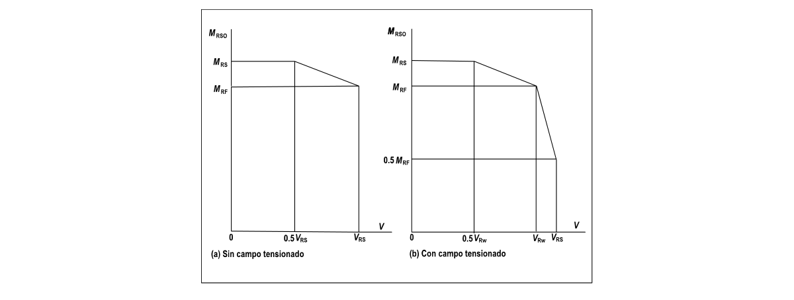

Figura F.5.5.4-5 — Diagramas de interacción esquemáticos para vigas ensambladas

$M_{RS}=$ resistencia de diseño a momento en ausencia de cortante (véanse F.5.5.4.1 y el literal (b) de F.5.5.4.3)

$M_{RF}=$ valor reducido de $M_{RS}$ para las aletas por si solas, omitiendo el alma

$V_{RS}=$ resistencia de diseño a fuerza cortante (véanse F.5.5.4.2 y F.5.5.4.3)

$V_{RW}=$ valor reducido de $V_{RS}$ obtenido haciendo $m=0$

### F.5.6 — DISEÑO ESTATICO DE UNIONES

#### F.5.6.1 — GENERALIDADES

En esta sección se trata el diseño de uniones mediante sujetadores, adhesivos o soldadura. Se discuten los siguientes tipos de sujetador: remaches, pernos negros, pernos de precisión, pernos de alta resistencia para trabajo por fricción, conectores especiales y pasadores. Se define la resistencia de diseño de uniones soldadas con soldadura a tope o de filete. El diseño de uniones entre elementos colados o forjados se debe hacer conjuntamente con el fabricante.

Los siguientes tipos de conexión se denominan uniones:

(a) Conexiones entre miembros estructurales, por ejemplo, viga a columna

(b) Conexiones entre elementos de un miembro ensamblado, por ejemplo, almas a aletas, empalmes

(c) Conexiones entre detalles localizados y miembros estructurales, por ejemplo, ménsula a viga, anillos y abrazaderas de miembros a tensión Todos los tipos de conexión deben diseñarse para cumplir con los estados límite de resistencia y fatiga. No se requiere revisión para estados límite de servicio, excepto para uniones con pasadores en estructuras que son frecuentemente armadas y desarmadas, para uniones en las que las deflexiones son críticas o en uniones con pernos a fricción en las que se debe evitar el deslizamiento. La carga mayorada sobre una unión debe calcularse usando los coeficientes de carga dados en F.5.3. Los sujetadores sometidos a inversión de cargas deben ser pernos de precisión o pernos de barril giratorio, remaches sólidos, pernos de alta resistencia a fricción, o conectores especiales que impidan el movimiento.

Los remaches huecos y otros conectores especiales, pueden usarse siempre que su comportamiento haya sido satisfactoriamente demostrado mediante ensayos u otros medios. En su diseño y espaciamiento debe haber cooperación entre el diseñador y el fabricante. Se debe demostrar previamente, mediante ensayos u otros medios, el comportamiento del material insertado roscado para sujetadores de acero que deban ser usados en cualquier elemento roscado de aluminio en una unión desmontable.

#### F.5.6.2 — UNIONES REMACHADAS Y EMPERNADAS: CONSIDERACIONES DE DISEÑO

Las uniones usando remaches o pernos deben se diseñadas de modo que, bajo carga mayorada, la acción de carga en cualquier posición de sujetador no exceda la resistencia de diseño del sujetador allí localizado.

**F.5.6.2.1** — Grupos de sujetadores — Los grupos de remaches, pernos o conectores especiales, conocidos colectivamente como “sujetadores”, que forman una conexión, deben diseñarse sobre la base de una suposición realista de la distribución de las fuerzas internas, observando la rigidez relativa. Es esencial que se mantenga el equilibrio con las cargas externas mayoradas.

**F.5.6.2.2** — Efecto de las áreas de sección transversal en capas sucesivas — El diseño de las capas sucesivas en secciones que contienen agujeros para sujetadores debe basarse en las áreas netas mínimas, excepto para remaches a compresión. En ciertas uniones empernadas a fricción, el estado límite es determinado por la capacidad a fricción de la unión y, en estas circunstancias, el diseño debe basarse en las áreas brutas mínimas.

**F.5.6.2.3** — Uniones largas — Cuando la longitud de una unión, medida entre centros de sujetadores finales, es más de $15d_{f}$ (donde $d_{f}$ es el diámetro nominal del sujetador), o cuando el número de sujetadores en esta dirección es mayor de cinco, el diseñador debe tomar en cuenta la reducción en la resistencia promedio de los sujetadores individuales debida a una distribución irregular de la carga entre ellos.

#### F.5.6.3 — UNIONES REMACHADAS Y EMPERNADAS: CONSIDERACIONES GEOMETRICAS Y OTRAS

CONSIDERACIONES GENERALES

**F.5.6.3.1** — Espaciamiento mínimo — El espaciamiento entre centros de pernos y remaches en la dirección de la transmisión de la carga no debe ser menor que 2.5 veces el diámetro del perno o remache, en situaciones extremas no deberá ser menor de 2.2 veces el diámetro, siempre que la tensión de aplastamiento se reduzca adecuadamente. El espaciamiento entre centros de pernos y remaches medida perpendicularmente a la dirección de transmisión de la carga no debe ser menor que 3.0 veces el diámetro del perno o remache, en situaciones extremas no deberá ser menor de 2.4 veces el diámetro, siempre que la tensión de aplastamiento se reduzca Para los pernos de alta resistencia a fricción se permite un espaciamiento menor limitado por el tamaño de la arandela, la cabeza de los pernos y la llave de pernos, y la necesidad de cumplir con los estados límite.

**F.5.6.3.2** — Espaciamiento máximo — El espaciamiento entre pernos o remaches adyacentes sobre una línea en la dirección del esfuerzo en miembros a tensión, no debe exceder $16t$ o 200 mm, donde $t$ es el espesor de la capa exterior más delgada. En miembros a compresión o cortante, no debe exceder $14t$ o 200 mm. Adicionalmente, el espaciamiento entre pernos o remaches adyacentes sobre una línea adyacente y paralela a un borde de una capa exterior, no debe exceder $8t$ o 100 mm. Si los remaches o pernos están escalonados sobre líneas adyacentes, y las líneas no están separadas más de 75 mm, los límites anteriores pueden incrementarse un 50%.

En cualquier caso, el espaciamiento entre remaches o pernos adyacentes, escalonados o no, no debe exceder $32t$ o 300 mm en miembros a tensión y $20t$ o 300 mm en miembros a compresión o cortante.

Estas recomendaciones se aplican únicamente a uniones, entre láminas planas, traslapadas y con cubreplaca. El espaciamiento de pernos y remaches en uniones de campana y espigo, uniones entre miembros tubulares y entre partes de espesor muy desigual, debe ser determinado considerando la geometría local y la carga sobre la unión.

**F.5.6.3.3** — Distancia al borde — La distancia al borde, medida desde el centro del remache o perno, para bordes extruídos, laminados o acabados a máquina, no debe ser menor de 1.5 veces el diámetro del perno o remache. Si, sobre el lado de apoyo, la distancia al borde es menor que dos veces el diámetro, la capacidad por aplastamiento debe reducirse (véase F.5.6.4.4). Si los bordes son cortados, los límites anteriores se pueden incrementar 3 mm.

La distancia al borde lateral no debe excederá la máxima necesaria para poder cumplir los requisitos de pandeo local de un elemento exterior. Este requisito no se aplica a elementos de fijación que unan los componentes traccionados. La distancia al extremo frontal no se vera afectada por este requisito.

**F.5.6.3.4** — Pernos sometidos a carga fluctuante — Los pernos que transmitan cargas fluctuantes, diferentes de cargas de viento, deben ser de precisión o de alta resistencia a fricción.

**F.5.6.3.5** — Empaquetadura — Cuando los sujetadores soportan cortante a través de un empaque, se debe tomar en cuenta una reducción de la resistencia de diseño si el espesor del empaque excede el 25% del diámetro del sujetador o el 50% del espesor de la capa.

**F.5.6.3.6** — Avellanado — La mitad de la altura de cualquier avellanado de un remache o perno debe despreciarse cuando se calcula su longitud en aplastamiento. No es necesaria ninguna reducción para remaches y pernos a cortante. La resistencia de diseño a tensión axial de un perno o remache avellanado debe tomarse como dos tercios de la de un perno o remache plano del mismo diámetro. La profundidad de avellanado no debe exceder el espesor de la parte avellanada menos 4 mm, de otro modo, el comportamiento debe demostrarse mediante ensayos.

**F.5.6.3.7** — Remaches largos — La longitud de agarre de los remaches no debe exceder el valor de cinco veces el diámetro del agujero.

**F.5.6.3.8** — Arandelas y dispositivos de aseguramiento — Deben usarse dispositivos de aseguramiento siempre que existan tuercas susceptibles de aflojarse debido a vibración o fluctuación de esfuerzos.

**F.5.6.3.9** — Intersecciones — Los miembros que convergen en una unión deben ser normalmente dispuestos de modo que sus ejes centroidales se encuentren en un punto. En el caso de estructuras empernadas compuestas de ángulos y secciones en T, las líneas de colocación de los pernos pueden ser usadas en lugar del eje centroidal.

Cuando exista excentricidad en una unión, deberá tenerse en cuenta, excepto en el caso particular de estructuras en las que se haya demostrado que no es necesaria dicha consideración.

#### F.5.6.4 — RESISTENCIA DE DISEÑO DE REMACHES Y PERNOS INDIVIDUALES DIFERENTES DE LOS

PERNOS DE ALTA RESISTENCIA A FRICCION.

**F.5.6.4.1** — Esfuerzos límite — El esfuerzo límite $p_{f}$ para remaches sólidos y pernos se define como sigue:

(a) Sujetadores de acero — $p_{f}$ es el esfuerzo de fluencia mínimo garantizado para el lote de pernos o remaches

(b) Pernos y remaches de acero inoxidable — $p_{f}$ es el menor de $0.5 (f_{0.2}+f_{u})$ y $1.2f_{0.2}$

(c) Pernos y remaches de aluminio — los valores de $p_{f}$ para las aleaciones de aluminio de la tabla F.5.2.2-3, se dan en la tabla F.5.6.4-1. Puede usarse, cuando esté disponible, el valor de la resistencia a cortante obtenido mediante ensayos sobre el perno o remache en la condición de como colocado. En este caso, el valor de $α_{s}$ en la expresión de $V_{RS}$ en F.5.6.4.2 debe reducirse de 0.6 a 0.33.

**Tabla F.5.6.4-1**

Esfuerzo límite para sujetadores de aluminio $p_{f}$

| Tipo de sujetador | Aleación |  | Condición Método de colocación | Diámetro | $p_{f}$ |
|---|---|---|---|---|---|
|  |  |  |  | mm | kgf/mm² |
| Pernos | 6082 | T6 | - | menor o igual a 6 | 16.5 |
|  |  |  | - | 6 a 12 | 17.5 |
|  | 6061 | T8 | - | menor o igual a 12 | 17.5 |
|  | 5056A | H24 | - | menor o igual a 12 | 17.5 |
| Remaches | 5154A | O, F | Frío o caliente | menor o igual a 25 | 12.0 |
|  | 5154A | H22 | Frío | menor o igual a 25 | 14.0 |
|  | 6082 | T4 | Frío | menor o igual a 25 | 11.0 |
|  | 6082 | T6 | Frío | menor o igual a 25 | 16.5 |
|  | 5056A | O, F | Frío o caliente | menor o igual a 25 | 14.5 |
|  | 5056A | H22 | Frío | menor o igual a 25 | 15.5 |

**F.5.6.4.2** — Cortante — La resistencia de diseño $(V_{RS})$ de un solo remache o perno sometido a cortante simple se toma como:

$$ V_{RS}=\phi \alpha _{S}p_{f}A_{es}K_{1} \tag{F.5.6.4-1} $$

Donde:

$p_{f}$ = definido en F.5.6.4.1

$α_{s}$ = $0.6$ para pernos y remaches de aluminio

$α_{s}$ = $0.7$ para pernos y remaches de acero

$φ$ = coeficiente de reducción de capacidad, igual a 0.8 para todos los pernos y remaches, esto es, aluminio, acero y acero inoxidable (véase la tabla F.5.3.3-1) Para pernos:

$A_{es}=A_{tb}$ (área de esfuerzo de la parte roscada del perno), cuando el plano de corte pasa por esa área, o

$A_{es}=A_{SH}$ (área del vástago), cuando el plano de corte pasa por el vástago Para remaches:

$A_{es}=A_{h}$ (área del agujero)

$K_{1}=1.0$ para remaches

$K_{1}=0.95$ para pernos de precisión

$K_{1}=0.85$ para pernos de holgura normal

**F.5.6.4.3** — Tensión axial — La resistencia de diseño, $P_{RT}$, de un solo sujetador sometido a tensión axial se toma como

$$ P_{RT}=\phi \alpha p_{f}A_{tb} \tag{F.5.6.4-2} $$

Donde:

$p_{f} , A_{tb}$, $φ$ tal como se definen en F.5.6.4.1 y F.5.6.4.2

$a=1.0$para pernos y remaches de acero y acero inoxidable

$a=0.6$para pernos de aluminio No se recomienda el uso de remaches de aluminio a tensión.

**F.5.6.4.4** — Aplastamiento — La resistencia efectiva de diseño al aplastamiento para un único remache o perno es igual al menor valor entre la resistencia de diseño al aplastamiento de un solo sujetador $B_{RF}$ y la capacidad por aplastamiento de la capa conectada $B_{RP}.$ La resistencia de diseño al aplastamiento, $B_{RF}$, para un sujetador único se toma como

$$ B_{RF}=\phi d_{f}t\,2p_{f} \tag{F.5.6.4-3} $$

Donde:

$d_{f}$ = diámetro nominal del sujetador

$t$ = espesor de la capa conectada

$p_{f}$ = se define en F.5.6.4.1 para sujetadores de acero y aluminio

$φ$ = coeficiente de reducción de capacidad (véase la tabla F.5.3.3-1) La capacidad por aplastamiento de la capa conectada está dada por el menor valor de los siguientes:

$$ B_{RP}=\phi cd_{f}tp_{a} \tag{F.5.6.4-4} $$

$$ B_{RP}=\phi etp_{a} \tag{F.5.6.4-5} $$

Donde:

$e$ = distancia desde el centro de un agujero hasta el borde adyacente en la dirección del aplastamiento del sujetador

$c$ = $2$ cuando $d_{f}/t<10$ = $20t /d_{f}$ cuando $10<d_{f}/t<13$ = $1.5$ cuando $d_{f}/t>13$

$p_{a}$ = el menor valor entre $0.5 (f_{0.2}+f_{u})$ y $1.2f_{0.2}$ para el material de la capa conectada (véanse las tablas F.5.4.2-1 y F.5.4.2-2)

**F.5.6.4.5** — Cortante y tensión combinados — Cuando los pernos o remaches (excepto remaches de aluminio, véase F.5.6.4.3) están sujetos a cortante y tensión, se debe satisfacer la siguiente condición (adicionalmente a F.5.6.4.2 y F.5.6.4.3):

$$ \left(\dfrac{P}{P_{RT}}\right)^{2}+\left(\dfrac{V}{V_{RS}}\right)^{2}\le 1 \tag{F.5.6.4-6} $$

Donde:

$P$ = carga axial de tensión generada bajo carga mayorada

$V$ = carga cortante generada bajo carga mayorada

$P_{RT}$= resistencia de diseño a tensión axial

$V_{RS}$= resistencia de diseño a cortante

#### F.5.6.5 — PERNOS DE ALTA RESISTENCIA QUE TRABAJAN POR FRICCION

En estructuras de aluminio, sólo deben usarse pernos de alta resistencia a fricción de grado general precargados. El diseño puede hacerse con base en cálculos para uniones cuando la resistencia de prueba del material de las partes conectadas exceda $23$ kgf/mm2.

Si la resistencia de prueba de las partes conectadas es menor de 23 kgf/mm2, la resistencia de las uniones usando pernos de alta resistencia a fricción de grado general debe ser determinada mediante ensayos. En estructuras de aluminio, el relajamiento de la precarga del perno debido a la tensión en el material unido no puede ignorarse.

La expansión térmica del aluminio excede la del acero y, por lo tanto, la variación en la tensión del perno debida al cambio de temperatura no puede ignorarse. Una temperatura reducida, reduce la capacidad por fricción y una temperatura incrementada, incrementa el esfuerzo a tensión en el perno y el esfuerzo de aplastamiento debajo de las arandelas. Estos efectos son significativos únicamente para cambios extremos de temperatura y longitudes grandes de agarre.

**F.5.6.5.1** — Estado límite último (resistencia estática) — Para pernos de alta resistencia a fricción en agujeros de holgura normal, la capacidad última es la menor entre la capacidad por cortante como se determina en F.5.6.4.2 y la capacidad por aplastamiento como se determina en F.5.6.4.4.

**F.5.6.5.2** — Estado límite de servicio (deformación) — El estado límite de servicio para una conexión hecha con pernos de alta resistencia a fricción se alcanza cuando la carga cortante aplicada a cualquier perno iguala su capacidad por fricción determinada en F.5.6.5.3. Para la revisión del estado límite de servicio,

$γ_{s} =1.2$.

**F.5.6.5.3** — Capacidad por fricción — La resistencia de diseño al cortante depende de la capacidad por fricción del perno de alta resistencia, dicha capacidad por fricción $(F_{c})$ está dada por lo siguiente:

$$ F_{c}=\dfrac{P_{p}\mu _{s}N_{F}}{\gamma _{s}} \tag{F.5.6.5-1} $$

Donde:

$P_{p}$ = carga de preesfuerzo (véase F.5.6.5.4)

$μ_{s}$ = coeficiente de deslizamiento (véase F.5.6.5.5)

$γ_{s}$ = $1.33$ si el valor de $μ_{s}$ se toma como 0.33

$γ_{s}$ = $1.1$ si el valor de $μ_{s}$ se encuentra en ensayos

$N_{F}$ = número de interfaces de fricción

**F.5.6.5.4** — Preesfuerzo — La carga de preesfuerzo para un perno de alta resistencia a fricción se debe tomar como se indica enseguida:

$$ P_{p}=P_{o}-0.9S_{tb} \tag{F.5.6.5-2} $$

Donde:

$P_{o}$ = carga de prueba del perno

$S_{tb}$= carga de tensión externa aplicada en la dirección axial del perno (si la hay)

**F.5.6.5.5** — Coeficiente de deslizamiento — Cuando todas las partes conectadas son de aleación de aluminio y las interfaces de fricción han sido tratadas para asegurar propiedades de fricción consistentes por medio de chorro de arena de óxido de aluminio G38, se puede suponer un valor $μ_{s} =0.33$ siempre y cuando el espesor total de las partes conectadas exceda el diámetro del perno y el esfuerzo en el área bruta de las partes no exceda $0.6f_{0.2}$ (donde $f_{0.2}$ es la resistencia de prueba a tensión del 2% para el material de la lámina) Si una o más de las condiciones anteriores no se obedece, $μ_{s}$ debe determinarse a partir de ensayos.

El número de pernos necesario para obtener la capacidad por fricción que satisfaga F.5.6.5.2, cuando se toma $μ_{s} =0.33$, puede ser mayor que el número requerido para satisfacer el estado límite último (véase F.5.6.5.1). En tales casos, puede ser ventajoso desarrollar un tratamiento de superficie para las interfaces que incremente el factor de deslizamiento.

#### F.5.6.6 — UNIONES CON PASADORES

En una unión con pasador, las partes están conectadas por un solo pasador que permite la rotación. No hay carga axial en el pasador y, por lo tanto, no hay acción de mordaza sobre las partes conectadas. Los pasadores pueden no estar sometidos a cortante simple, así uno de los miembros a ser unidos debe tener un extremo en horquilla o abrazadera. El sistema de sujeción del pasador, por ejemplo una presilla de resorte, debe diseñarse para soportar una carga lateral igual al 10% de la fuerza cortante total en el pasador.

**F.5.6.6.1** — Pasadores sólidos — Se deben considerar los esfuerzos de flexión en los pasadores y para ésto se toma una luz efectiva igual a la distancia entre centros de apoyos. Sin embargo, si las platinas de apoyo tienen un espesor mayor que la mitad del diámetro del pasador, se puede considerar la variación de la presión de aplastamiento a través del espesor de la platina al determinar la luz efectiva.

Si el pasador debe ser removido para desmantelar la estructura y reinsertado para reensamblarla, la sección transversal del pasador debe revisarse para un límite de servicio asociado con el límite de comportamiento elástico. Los siguientes esfuerzos no deben ser excedidos bajo carga mayorada:

$$ \text{(a)}\quad \text{Esfuerzo cortante promedio en el pasador}\qquad \phi 0.6p_{a} \tag{F.5.6.6-1} $$

$$ \text{(b)}\quad \text{Esfuerzo de flexión en el pasador}\qquad \phi 1.2p_{a} \tag{F.5.6.6-2} $$

Donde:

$p_{a}$ = definido para pasadores de acero y de aluminio en F.5.6.4.1

$φ$ = coeficiente de reducción de capacidad (véase la tabla F.5.3.3-1) Si el pasador estará instalado permanentemente, se puede suponer una distribución plástica completa del esfuerzo de flexión bajo la carga mayorada de diseño.

**F.5.6.6.2** — Miembros conectados por pasadores — Las siguientes reglas no deben ser usadas cuando la línea de acción de la carga está en otra dirección diferente a la del flujo del grano en las partes conectadas.

El área neta a través del agujero del pasador, normal al eje de un miembro a tensión conectado por un pasador, debe ser al menos $1.33Pφ/p_{a}$ y el espesor del miembro conectado debe ser por lo menos $Pφ/1.6p_{a} d_{f}$ para instalaciones permanentes o, $Pφ/1.4p_{a} d_{f}$ para instalaciones desmontables, Donde:

$P$ = carga axial mayorada

$p_{a}$ = definido en F.5.4.2 para el material del miembro conectado

$d_{f}$ = diámetro del pasador

$φ$ = coeficiente de reducción de capacidad (véase la tabla F.5.3.3-1) El área neta de cualquier sección a cada lado del eje del miembro, medida a un ángulo de 45º o menos con el eje del miembro, debe ser por lo menos $0.9Pγ_{m}/p_{a}$.

El ancho neto de la platina de apoyo en el agujero del pasador, medido normal al eje del miembro, no debe exceder ocho veces el espesor de la platina de apoyo.

El diámetro del agujero del pasador no debe exceder el diámetro del pasador en más del 5%.

Las platinas de los pasadores, y cualquier conexión entre ellas y el miembro, deben diseñarse para soportar una parte de la carga axial total proporcional a la parte correspondiente a la platina del área total de apoyo del pasador.

#### F.5.6.7 — UNIONES SOLDADAS

La guía de diseño dada aquí se aplica únicamente a soldaduras hechas usando las combinaciones recomendadas de material base y de aporte dadas en la tabla F.5.2.8.

Las guías de diseño dadas aquí se aplicaran a procesos de soldadura MIG para todos los espesores y el TIG solo para espesores de material hasta $t=6.0$ mm y para reparación.

La versatilidad de la soldadura permite que las uniones entre miembros se hagan en formas diferentes. Para seleccionar el tipo de unión a usar, el diseñador debe considerar lo siguiente:

(a) El efecto de la unión sobre la resistencia estática del miembro (véase F.5.4.4)

(b) El efecto de la unión sobre la resistencia a la fatiga del miembro (véase F.5.7)

(c) La reducción de la concentración de esfuerzos mediante una apropiada selección de detalles

(d) La selección del detalle que permita que se hagan buenas soldaduras que se puedan inspeccionar adecuadamente

(e) La selección del detalle que evite la corrosión general y la local debida a hendiduras

(f) Los efectos de distorsión causada por la soldadura

**F.5.6.7.1** — Efecto de la soldadura en la resistencia estática — La soldadura puede afectar la resistencia del material base en la vecindad de la soldadura, como se describe en detalle en F.5.4. En aleaciones no tratadas en caliente en la condición O ó F, el efecto de ablandamiento es insignificante y los efectos de la zona afectada por el calor pueden ignorarse. La unión es por lo tanto tan fuerte como el material base no soldado. La soldadura reduce la resistencia en las aleaciones tratadas en caliente, en la mayoría de las condiciones de tratamiento en caliente (series 6*** y 7***), y en las aleaciones no tratadas en caliente en cualquier condición de endurecimiento por trabajo (series 3*** y 5***). Para excepciones a esta regla general véase la tabla F.5.4.4-1, $k_{z}=1$.

En miembros fabricados con un material que sufre reducción de resistencia, la soldadura debe ser preferiblemente paralela a la dirección de la carga aplicada. En lo posible se deben evitar las soldaduras transversales a la carga aplicada o colocarlas en regiones de bajo esfuerzo. Esta recomendación incluye los accesorios soldados estén o no requeridos para transmitir carga del miembro.

**F.5.6.7.2** — Efecto de la soldadura en la resistencia a la fatiga — La resistencia a la fatiga de una unión depende de la severidad de la concentración de esfuerzos que puede generarse por la geometría general de la unión o por la geometría local de la soldadura. Las clasificaciones por fatiga de detalles de unión comúnmente usados se encuentran en F.5.7.3. La clasificación por fatiga puede usarse para seleccionar el detalle apropiado para la aplicación que brinde la mejor resistencia a la fatiga.

**F.5.6.7.3** — Corrosión — Las uniones deben detallarse de modo que se eviten cavidades o hendiduras inaccesibles que puedan retener humedad o suciedad. Cuando dichas cavidades sean inevitables, deben sellarse con soldadura o compuestos protectores, o hacerlas accesibles para su inspección y mantenimiento.

**F.5.6.7.4** — Preparaciones de los bordes — Las preparaciones de los bordes para uniones soldadas a tope o de filete, incluyendo el uso de platinas de respaldo permanentes o temporales deberán cumplir con las normas pertinentes (por ejemplo las normas inglesas BS 3019 parte 1 y BS 3571 parte 1). La preparación real debe ser aprobada como parte del procedimiento de soldadura.

**F.5.6.7.5** — Distorsión — Cada soldadura causa encogimiento y distorsión, y sus efectos son más marcados en la construcción con aluminio que en las estructuras de acero. El encogimiento y la distorsión deben ser compensados o balanceados para mantener la forma y dimensión deseadas en la estructura terminada. El diseñador debe consultar al fabricante, en una fase temprana del diseño, sobre el método de soldadura, la distorsión y aspectos relacionados tales como secuencias de soldadura y uso de prensas.

**F.5.6.7.6** — Información dada al fabricante — Se deben suministrar planos y especificaciones dando la siguiente información acerca de cada soldadura:

(a) Material base y de aportación

(b) Dimensiones de la soldadura

(c) Preparación de borde y posición de soldadura

(d) Proceso de soldadura

(e) Requisitos especiales tales como uniformidad del perfil de soldadura, precalentamiento y temperatura entre pasadas.

(f) Requisitos de control de calidad para:

(1) Aprobación del procedimiento de soldadura (2) Aprobación del soldador (3) Clase de calidad de soldadura (véanse las notas 1 a 3) (4) Niveles de inspección de uniones soldadas (5) Niveles de aceptación para calidad de soldadura (6) Procedimiento de reparación de soldadura NOTA 1 — Cuando no se especifica la clase de calidad de soldadura en los planos, se supone calidad “normal”.

NOTA 2 — Cuando las acciones bajo carga mayorada no superan un tercio de la resistencia de diseño del miembro o de la unión, por ejemplo puede gobernar la rigidez, se acepta una calidad y un grado de inspección inferiores. Esto se aplica tanto a la resistencia estática como a la resistencia a la fatiga. En este caso se puede especificar un nivel “mínimo” de calidad.

NOTA 3 — Cuando las uniones se diseñan sobre los requisitos de resistencia a la fatiga, consulte F.5.7.8.5.

**F.5.6.7.7** — Soldaduras a tope — Soldaduras de penetración parcial en un solo lado y soldaduras a tope intermitentes no se deben usar para transmitir fuerzas de tensión, ni para transmitir un momento flector respecto al eje longitudinal de la soldadura.

El espesor de garganta efectivo de una soldadura a tope de penetración parcial (véanse las figuras F.5.6.7-1

(b) y (c) debe tomarse como:

(a) La profundidad de la preparación de la soldadura cuando ésta es del tipo J o U

(b) La profundidad de la preparación de la soldadura menos 3 mm o el 25%, lo que sea menor, cuando es del tipo V o biselada También es posible determinar el espesor de garganta por tanteos. Si se hace ésto, el espesor de la garganta no debe tomarse mayor que la penetración consistentemente lograda, ignorando el refuerzo de la soldadura.

Se puede suponer penetración total en una soldadura a tope por un solo lado si se usa una platina de respaldo. Se puede tener en cuenta una soldadura de filete superpuesta en una unión en T.

Figura F.5.6.7-1 — Garganta efectiva de soldaduras a tope

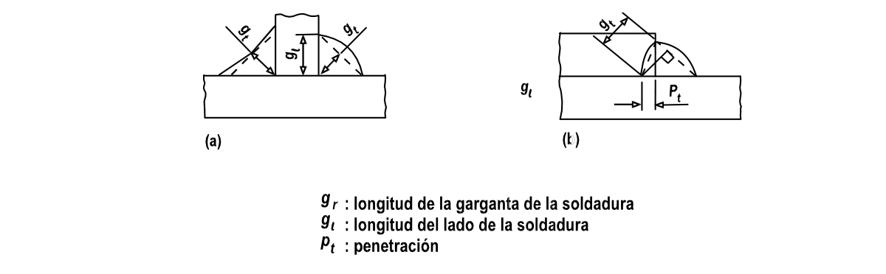

Figura F.5.6.7-2 — Garganta efectiva de soldaduras de filete

**F.5.6.7.8** — Soldaduras de filete — Soldaduras de filete en un solo lado no deben usarse para transmitir momentos respecto de sus propios ejes. Pueden usarse soldaduras de filete intermitentes sólo si la distancia entre los extremos de soldaduras adyacentes, en línea o escalonadas sobre lados alternos de la pieza, no excede lo menor de lo siguiente:

(a) 10 veces el espesor del material base más delgado o 300 mm, si está a compresión o cortante

(b) 24 veces ese espesor o 300 mm, si está a tensión En una línea de soldaduras intermitentes debe haber una soldadura en cada extremo de la pieza conectada.

La resistencia de diseño de una unión con soldadura de filete se da en F.5.6.9.2.

Una soldadura de filete debe ser continua alrededor de la esquina en el extremo o lado de una pieza, con una longitud más allá de la esquina de no menos dos veces la longitud del lado de la soldadura. Véase el literal (f) de F.5.4.4.3 para el efecto de traslapar zonas afectadas por el calor.

Si se usan dos soldaduras de filete longitudinales solas en una conexión de extremo traslapada, la longitud de cada una no debe ser menor que la distancia entre ellas.

La garganta de una soldadura de filete $(g_{t})$, véase la figura F.5.6.7-2 (a), es la altura de un triángulo que puede ser inscrito dentro de la soldadura y medida perpendicular a su lado exterior. Excepcionalmente, la garganta de una soldadura de filete puede ser tomada incluyendo cualquier penetración especificada, $p_{t}$ , siempre que los tanteos demuestren satisfactoriamente al diseñador que dicha penetración puede ser lograda consistentemente. Se puede suponer una garganta grande si los tanteos durante el procedimiento muestran que la penetración necesaria más allá de la raíz nominal puede ser consistentemente obtenida, por ejemplo, mediante soldadura automática (véase la figura F.5.6.7-2 (b)).

El área efectiva de una soldadura de filete es su dimensión de garganta $(g_{t})$ multiplicada por su longitud efectiva, excepto que, para soldaduras de filete en agujeros o ranuras, el área efectiva no debe ser mayor que el área del agujero o ranura. La longitud efectiva se define en F.5.6.9.2.

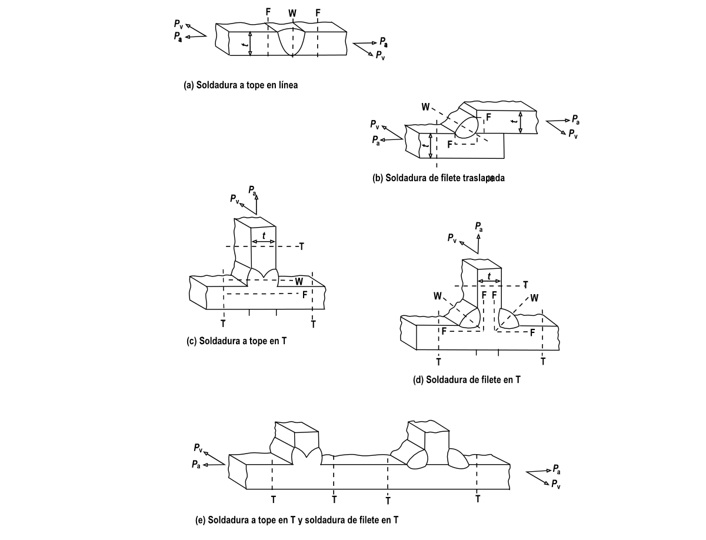

Figura F.5.6.7-3 — Planos de falla para revisión estática de uniones soldadas continua ...

Convenciones: (véanse las figuras F.5.6.7-1 y F.5.6.7-2) $W$ : metal de aporte $F$ : zona afectada por el calor (frontera de fusión) $T$ : zona afectada por el calor (borde) el ancho de la zona es $t$ para filetes \_\_\_ \_ \_\_\_ \_ es el plano de la falla soldadura a tope : el plano es igual al espesor de la lámina soldadura de filete: el ancho del plano es el ancho de la longitud del lado de la soldadura El área sombreada es la zona afectada por el calor Figura F.5.6.7-3 (cntinuación) — Planos de falla para revisión estática de uniones soldadas

#### F.5.6.8 — RESISTENCIA DE DISEÑO DE UNIONES SOLDADAS

En el diseño de uniones soldadas se deben considerar la resistencia del metal de aporte y la resistencia del material en la zona afectada por el calor adyacente a la frontera de fusión de la soldadura (véase F.5.4.4 y la figura F.5.6.7-3). Los esfuerzos límites para el material de la zona afectada por el calor se tratan en F.5.6.9. La capacidad de deformación de la unión se mejora cuando la resistencia de diseño de la soldadura es mayor que la del material adyacente en la zona afectada por el calor.

**F.5.6.8.1** — Grupos de soldaduras — Una unión soldada consistente de un grupo de soldaduras debe diseñarse sobre la base de una distribución realista de esfuerzos entre las soldaduras relacionada con su rigidez relativa. es esencial mantener el equilibrio con las cargas externas mayoradas.

**F.5.6.8.2** — Esfuerzo límite del metal de aporte — El alambre de metal de aportación para uso en construcción soldada debe ser escogido de acuerdo con la tabla F.5.2.7-1.

Los valores del esfuerzo límite del metal de aporte $p_{w}$ (en kgf/mm²) para las combinaciones permitidas de material base y de aportación mostradas en la tabla F.5.2.7-1, se dan en la tabla F.5.6.8-1.

**Tabla F.5.6.8-1**

Esfuerzos límite del metal de aporte $p_{w}$

| Material base |  |  |  |  |  |  |  |  |
|---|---|---|---|---|---|---|---|---|
| Aleaciones no tratadas en caliente |  |  |  |  |  | Aleaciones tratadas en caliente |  |  |
| 1200 | 3103 | 5251 | 5454 | 5154A | 5083 | 6063 | 6061 | 7020 |
|  | 3105 |  |  |  |  |  | 6082 |  |
| kgf/mm² | kgf/mm² | kgf/mm² | kgf/mm² | kgf/mm² | kgf/mm² | kgf/mm² | kgf/mm² | kgf/mm² |
| 5.5 | 8.0 | 20.0 | 19.0 | 21.0 | 24.5 | 15.0 | 19.0 | 25.5 |

NOTA. Cuando se usan materiales base disímiles, se debe tomar el menor de los esfuerzos límite para el material de aporte. Si la soldadura se hace con materiales base no incluidos en la tabla F.5.6.8-1 o en el apéndice F.5.C, el valor del esfuerzo límite del material de aporte se debe obtener experimentalmente.

**F.5.6.8.3** — Esfuerzo límite en la zona afectada por el calor — Los esfuerzos límite $p_{az}$ y $p_{vz}$ para el material en la zona afectada por el calor se dan en la tabla F.5.6.8-2, donde $p_{az}$ y $p_{vz}$ son, respectivamente, el esfuerzo límite directo y de cortante.

Pueden necesitarse valores más altos de esfuerzo límite para materiales de aporte particulares (véase apéndice F.5.C).

**Tabla F.5.6.8-2**

Esfuerzos límite $p_{az}$ y $p_{vz}$ en la zona afectada por el calor

| Aleaciones no tratadas en caliente (nota 1) |  |  | Aleaciones tratadas en caliente |  |  |  |
|---|---|---|---|---|---|---|
| Aleación base | $p_{az}$ kgf/mm² | $p_{vz}$ kgf/mm² | Aleación base | Condición | $p_{az}$ kgf/mm² | $p_{vz}$ kgf/mm² |
| 1200 | 2.5 | 1.5 | 6061 | T6 | 14.5 | 8.5 |
| 3103 | 3.5 | 2.0 | 6063 | T4 | 8.5 | 5.0 |
| 3015 | 4.0 | 2.5 |  | T5 | 9.5 | 5.5 |
| 5083 | 15.0 | 9.0 |  | T6 | 9.5 | 5.5 |
| 5154A | 10.0 | 6.0 | 6082 | T4 | 14.0 | 8.5 |
| 5251 | 7.0 | 4.0 |  | T6 | 15.0 | 9.0 |
| 5454 | 9.5 | 5.5 | 7020 | T4 | 17,0(A) | 10.0 |
|  |  |  |  | T4 | 21,0(B) | 12.5 |
|  |  |  |  | T6 | 18,0(A) | 11.0 |
|  |  |  |  | T6 | 24,0(B) | 14.5 |
|  |  |  |  |  | (nota 2) |  |

NOTA 1. Se suministran todas las condiciones (véase la tabla F.5.4.4-1).

NOTA 2. Refiérase al literal (b) de F.5.4.4.2 para ver la aplicabilidad de los valores A y B para el material 7020.

#### F.5.6.9 — RESISTENCIA DE DISEÑO DE SOLDADURAS

**F.5.6.9.1** — Metal de soldadura a tope — Una soldadura a tope de penetración parcial o completa solo se usaran para piezas resistentes cuando se verifique mediante ensayos que no se manifiestan defectos de soldadura. Para una soldadura a tope sometida a cortante y carga axial debe proporcionarse de modo que:

$$ \left(\sigma _{1}^{2}+3\tau _{2}^{2}\right)^{1/2}\le \phi p_{w} \tag{F.5.6.9-1} $$

Donde:

$σ_{1}$= esfuerzo normal perpendicular a la sección de la garganta bajo carga mayorada

$τ_{2}$= esfuerzo cortante que actúa sobre la sección de la garganta paralela al eje de la soldadura bajo carga mayorada

$p_{w}$= esfuerzo límite del metal de aporte (véase F.5.6.8.2)

$φ$ = coeficiente de reducción de capacidad para el metal de aporte (véase la tabla F.5.3.3-1) Para una soldadura a tope con una carga de tensión oblicua (véase la figura F.5.6.9-1), la resistencia de diseño $P_{RB}$ está dada por:

$$ P_{RB}=\phi p_{w}l_{e}t_{e}\left(1+2\cos ^{2}\theta \right)^{-1/2} \tag{F.5.6.9-2} $$

Donde:

$l_{e}$ = longitud efectiva de la soldadura La longitud efectiva de la soldadura es la longitud total de la soldadura cuando se evitan las imperfecciones en los extremos mediante el uso de platinas de arranque y terminación. De otro modo, es la longitud total menos dos veces el ancho de soldadura (véase la figura F.5.6.9-1).

$t_{e}$ = espesor de garganta efectivo de la soldadura (véase F.5.6.7.7)

$θ$ = ángulo entre la línea de la soldadura a tope y la línea de acción de la carga externa (véase la figura F.5.6.9-1) El esfuerzo de diseño del metal de aporte a compresión puede ser tomado igual al de tensión, excepto cuando pueda ocurrir pandeo.

Cuando el material base es de diferente espesor en cada lado de la soldadura, se debe investigar la posibilidad de un efecto de concentración de esfuerzos.

Cuando la soldadura está sometida a flexión en su plano, la resistencia de diseño por unidad de longitud puede encontrarse omitiendo $l_{e}$ en la expresión para $P_{RB}$.

Para una unión sin fuerzas de cortante externas y con la línea de la soldadura a tope perpendicular a la línea de acción de la carga externa, $θ =90^{\circ}$ , $τ_{2} =0$ y la resistencia de diseño será:

$$ P_{RB}=\phi p_{w}l_{e}t_{e} \tag{F.5.6.9-3} $$

Para una fuerza cortante externa paralela a la línea de la soldadura a tope, la resistencia de diseño será:

$$ P_{RB}=\phi \dfrac{p_{w}l_{e}t_{e}}{\sqrt{3}} \tag{F.5.6.9-4} $$

Figura F.5.6.9-1 — Diseño de soldadura a tope

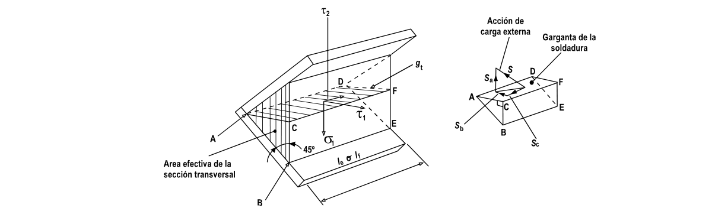

Figura F.5.6.9-2 — Diseño de soldadura de filete

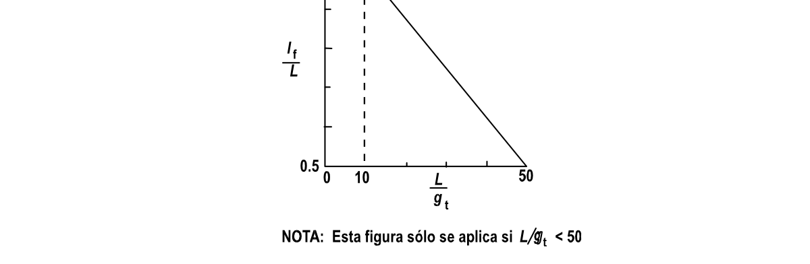

Figura F.5.6.6.9-3 — Longitud efectiva de soldaduras de filete longitudinales

**F.5.6.9.2** — Metal de soldadura de filete — Para el cálculo de una soldadura de filete, la sección de la garganta deberá ser tomado en base al espesor dominante de las partes a unir, dado que la resistencia real de una soldadura de filete queda definida por la garganta y las fuerzas actuantes en dicha sección. Una soldadura de filete debe proporcionarse de modo que se satisfaga la siguiente expresión:

$$ \left[\sigma _{1}^{2}+3\left(\tau _{1}^{2}+\tau _{2}^{2}\right)\right]^{1/2}\le \phi 0.85p_{w} \tag{F.5.6.9-5} $$

Donde:

$p_{w} , σ_{1} , γ_{2}$ , $φ$ definidos en F.5.6.9.1

$τ_{1}$= esfuerzo cortante que actúa sobre la sección de garganta perpendicular al eje de la soldadura La relación entre $σ_{1} , τ_{1}$ y $τ_{2}$ está gobernada por la dirección de la acción de carga externa, $S$ , en el sitio de la soldadura (véase la figura F.5.6.9-2).

Para una soldadura de filete transversal simple (carga aplicada perpendicularmente a la longitud de la soldadura), $σ_{1} = τ_{1} , τ_{2} =0$ y la resistencia de diseño se obtiene como sigue:

$$ P_{RF}=\phi \dfrac{0.85p_{w}l_{e}g_{t}}{\sqrt{2}} \tag{F.5.6.9-6} $$

Donde: $l_{e}$ es la longitud efectiva de la soldadura (igual que en soldaduras a tope).

Para una soldadura de filete longitudinal simple (carga aplicada paralelamente a la longitud de la soldadura),

$σ_{1} = τ_{1} =0$ y la resistencia de diseño depende sólo de $γ_{2} :$

$$ P_{RF}=\phi \dfrac{0.85p_{w}l_{f}g_{t}}{\sqrt{3}} \tag{F.5.6.9-7} $$

Donde: $l_{f}$ es la longitud efectiva de la soldadura de filete.

El valor de $l_{f}$ está influenciado por la longitud total de la soldadura, como se indica en la figura F.5.6.9-3, la que da una guía sobre la variación de $l_{f}$ con $L$ , donde $L$ es la longitud total de soldadura. La figura F.5.6.9- 3 se basa en resultados experimentales.

Cuando la distribución de esfuerzos a lo largo de la soldadura corresponde a la del material base adyacente como, por ejemplo, en el caso de una soldadura que conecta la aleta y el alma de una viga ensamblada, la longitud efectiva se toma como si fuera una soldadura a tope. Si la soldadura está sometida a flexión en su plano, la resistencia de diseño por unidad de longitud puede ser encontrada omitiendo $l_{e}$ o $l_{f}$ en la expresión de $P_{RF}.$

**F.5.6.9.3** — Zonas afectadas por el calor — La resistencia de diseño de una zona afectada por el calor adyacente a una soldadura (véanse las figuras F.5.6.7-1, F.5.6.7-2 y F.5.6.7-3) está dada por:

(a) Fuerza de tensión directa normal al plano de falla (véase la figura F.5.6.7-3):

(1) Soldadura a tope:

$$ P_{RFB}=\phi p_{az}Lt_{e}\quad \text{(en la frontera de fusión)} \tag{F.5.6.9-8} $$

$$ P_{RTB}=\phi p_{az}Lt\quad \text{(en el borde de la soldadura, véase la figura F.5.6.7-3)} \tag{F.5.6.9-9} $$

Donde:

$P_{RFB}$ y $P_{RTB}$= resistencias directas de diseño de la zona afectada por el calor adyacente a una soldadura a tope

$p_{az}$= esfuerzo directo límite en la zona afectada por el calor

$L$ = longitud total de la soldadura (2) Soldadura de filete:

$$ P_{RFF}=\phi p_{az}Lg_{1}\quad \text{(en la frontera de fusión)} \tag{F.5.6.9-10} $$

$$ P_{RTF}=\phi p_{az}Lt\quad \text{(en el borde de la soldadura, véase la figura F.5.6.7-3 y F.5.6.9.3 (d))} \tag{F.5.6.9-11} $$

Donde:

$P_{RFF}$, $P_{RTF}=$ resistencias directas de diseño de la zona afectada por el calor adyacente a una soldadura de filete

(b) Fuerza cortante en el plano de falla:

(1) Soldadura a tope:

$$ V_{RFB}=\phi p_{vz}Lt\quad \text{(en la frontera de fusión)} \tag{F.5.6.9-12} $$

$$ V_{RTB}=\phi p_{vz}Lt\quad \text{(en el borde de la soldadura, véase la figura F.5.6.7-3)} \tag{F.5.6.9-13} $$

Donde:

$V_{RFB}$, $V_{RTB}=$ resistencias de diseño a cortante de la zona afectada por el calor adyacente a una soldadura a tope (2) Soldadura de filete:

$$ V_{RFF}=\phi p_{vz}Lg_{1}\quad \text{(en la frontera de fusión)} \tag{F.5.6.9-14} $$

$$ V_{RTF}=\phi p_{vz}Lt\quad \text{(en el borde de la soldadura, véase la figura F.5.6.7-3 y F.5.6.9.3 (d))} \tag{F.5.6.9-15} $$

Donde:

$V_{RFF}$, $V_{RTF}=$ resistencias de diseño a cortante de la zona afectada por el calor adyacente a una soldadura de filete

(c) Cuando hay una combinación de cortante y fuerza directa sobre la zona afectada por el calor, estas fuerzas deben limitarse de acuerdo con la siguiente ecuación:

$$ \left(\dfrac{S_{a}}{P_{RZ}}\right)^{2}+\left(\dfrac{S_{b}}{V_{RZ}}\right)^{2}\le 1 \tag{F.5.6.9-16} $$

Donde:

$S_{a}$ , $S_{b}=$ acciones de carga externas de cargas mayoradas directa y cortante, sobre la zona afectada por el calor

$P_{RZ}$, $V_{RZ} =$ resistencias de diseño de carga directa y cortante de la zona afectada por el calor

(d) Cuando se revisa la resistencia de diseño de una soldadura de filete en el borde de la soldadura, se debe tener en cuenta que, para secciones más gruesas, la zona afectada por el calor no se extiende en todo el espesor y debe tomarse un valor de $t$ más pequeño (véase la figura F.5.4.4-1

(i) y el literal (a) de F.5.4.4.3).

(e) Cuando el plano de falla está sometido a flexión en su plano, la resistencia de diseño puede expresarse en términos de resistencia por unidad de longitud, omitiendo $L$ en las anteriores ecuaciones.

(f) Cuando el plano de falla está sometido a flexión en su plano y cortante, la resistencia de diseño por unidad de longitud debe reducirse para tener en cuenta los efectos combinados de cortante y esfuerzo directo (véase F.5.6.9.3 (c)).

#### F.5.6.10 — UNIONES PEGADAS

**F.5.6.10.1** — Generalidades — Se pueden lograr uniones estructurales en aluminio utilizando adhesivos. El procedimiento requiere una técnica experta y debe ser usado con gran cuidado. Siempre se requerirá contar con el aval del Comité Permanente del Reglamento.

Las uniones pegadas son apropiadas para soportar cargas de cortante pero no deben ser usadas a tensión o cuando la carga pueda causar descascaramiento u otras fuerzas que traten de abrir la unión.

Las cargas deben estar soportadas por un área tan grande como sea posible. Incrementando el ancho de las uniones usualmente se incrementa la tasa pro-resistencia. Incrementar la longitud sólo es benéfico para traslapos muy cortos.

El comportamiento de uniones pegadas grandes puede mejorarse reduciendo los esfuerzos por descascaramiento y separación en capas y reduciendo las concentraciones de esfuerzo en el extremo de los traslapos. Es útil redondear los extremos de los traslapos e introducir piezas de compensación.

Las uniones pegadas deben tener soporte adicional después de ensambladas durante un período necesario para permitir el desarrollo de la resistencia óptima del adhesivo. Se deben evitar las bolsas de aire atrapado.

Hay muchos adhesivos disponibles siendo, generalmente, cada uno apropiado para un solo rango específico de aplicaciones y condiciones de servicio. Las cualidades del adhesivo en todo lo que respecta a su uso en una estructura particular durante su vida, deben ser demostradas a satisfacción por el diseñador, quien debe asesorarse de especialistas durante todas las fases del diseño y la construcción.

La especificación de un sistema de unión debe comprender la preparación de las superficies a adherir, el adhesivo, los procesos de aplicación y curado y debe ser seguida estrictamente ya que cualquier variación en cualquier paso puede afectar severamente el comportamiento de la unión.

**F.5.6.10.2** — Resistencia de diseño — La resistencia de diseño de una unión pegada está influenciada por los siguientes factores:

(a) Los procedimientos de preparación de la superficie antes de pegar

(b) La dirección de los esfuerzos en la unión

(c) El tamaño y la forma de los componentes a unir

(d) El espesor de la línea de pegante

(e) Los procedimientos de ensamblaje y curado

(f) La temperatura y el ambiente de servicio

(g) La vida de diseño A menos que se disponga de datos de ensayos válidos, la resistencia de la unión debe establecerse experimentalmente. Generalmente, se deben hacer uniones de muestra a escala natural usando los mismos procedimientos de fabricación empleados en las uniones reales. La prueba debe realizarse con una construcción similar de la unión y con una carga como la que soporta la estructura real. Se deben hacer, como mínimo, cinco ensayos para establecer la media y la desviación estándar de las cargas de falla. La resistencia de diseño de una unión pegada, $P_{RG}$, está entonces dada por:

$$ P_{RG}=\phi \left(R_{m}-2S_{d}\right) \tag{F.5.6.10-1} $$

Donde:

$R_{m}$= media de las cargas de falla

$S_{d}$= desviación estándar de las cargas de falla

$φ$ = coeficiente de reducción de capacidad para uniones pegadas (véase la tabla F.5.3.3-1), es igual a 0.3 El factor $φ$ debe incrementarse con relación a la pérdida de calidad de desempeño del adhesivo en condiciones extremas de temperatura y ambiente de operación.

**F.5.6.10.3** — Ensayos — Los datos de ensayos del fabricante pueden ser usados como los valores más optimistas para el diseño inicial. Generalmente, estos datos son dados para probetas de ensayo al corte unidas con una capa gruesa de adhesivo tal como se muestra en la figura F.5.6.10-1. Cuando sólo están citadas las resistencias medias, $S_{d}$ debe tomarse como $0.1R_{m}$.

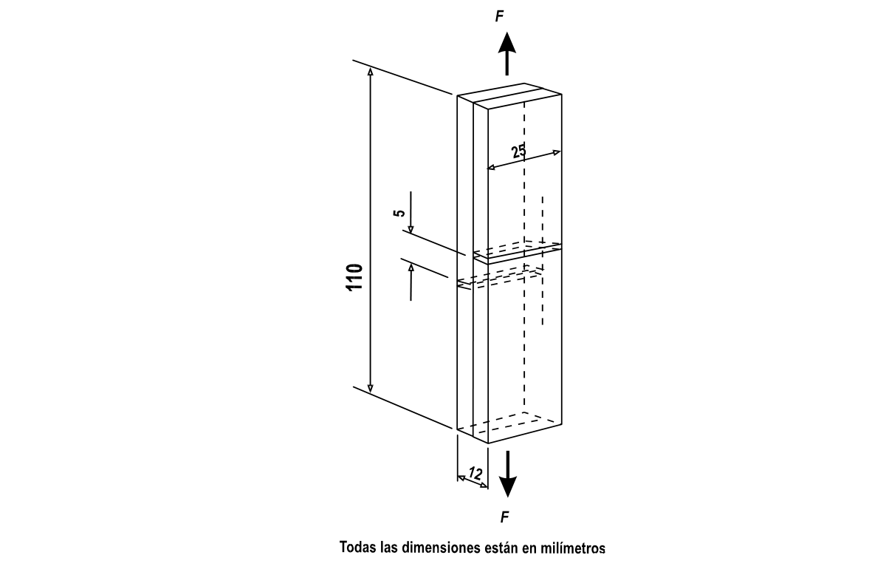

Figura F.5.6.10-1 — Ensayo de corte con capa gruesa de adhesivo

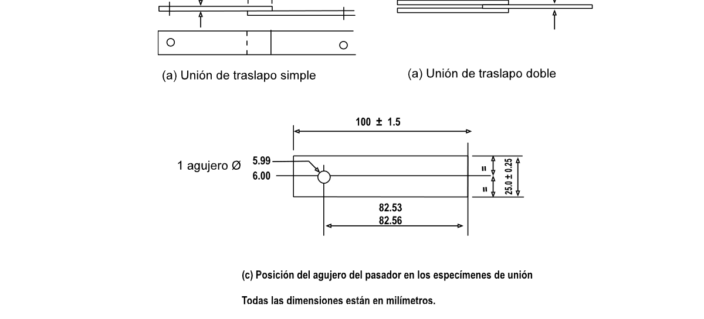

Figura F.5.6.10-2 — Especímenes de ensayo de lámina delgada Los ensayos con láminas delgadas traslapadas (como los descritos en la norma inglesa BS 5350: Parte C5) pueden usarse con el propósito de hacer comparaciones, estudios de durabilidad, determinar el tratamiento de la superficie, condiciones de curado, etc. Los valores de la resistencia serán bajos debido a la tendencia de esta unión a descascararse y serán conservadores si se usan para cálculos de diseño estructural (véase la figura F.5.6.10-2).

### F.5.7 — FATIGA

#### F.5.7.1 — GENERALIDADES

Esta sección contiene condiciones específicas para la valoración de la fatiga. Los datos se aplican a elementos formados con extrusiones, planchas, láminas delgadas y tiras, no deben usarse para piezas coladas o forjadas en caliente. Los diseñadores que deseen emplear piezas coladas o forjadas en caliente bajo condiciones de fatiga, deberán consultar con los fabricantes y seguir un procedimiento apropiado expedido por entidades de reconocida autoridad.

Esta sección da recomendaciones para la evaluación analítica. Como los datos suministrados pueden no ser adecuados para todas las aplicaciones, en este caso, se pueden obtener datos adicionales mediante ensayos (Véase F.5.8). Los datos obtenidos de acuerdo con F.5.8 pueden usarse sustituyendo los datos de diseño dados en F.5.7.

**F.5.7.1.1** — Influencia de la fatiga en el diseño — Las estructuras sujetas a cargas de servicio fluctuantes pueden resultar propensas a fallar por fatiga. El grado de cumplimiento con los criterios de estado límite estático dados en F.5.3 y F.5.4 puede no ser suficiente para controlar el riesgo de falla por fatiga.

Es necesario establecer, tan pronto como sea posible, el límite para el cual la fatiga controla el diseño. Para hacer ésto, los siguientes factores son importantes.

(a) Debe existir una predicción exacta de la secuencia de carga de servicio completa a lo largo de la vida de diseño.

(b) Debe estimarse con exactitud la respuesta elástica de la estructura bajo esas cargas.

(c) El diseño de detalles, los métodos de fabricación y el grado de control de calidad pueden tener una gran influencia en la resistencia a la fatiga y se deben definir con mayor precisión que como se requiere para miembros estáticamente controlados. Esto puede tener una influencia significativa sobre los costos de diseño y construcción.

**F.5.7.1.2** — Mecanismo de falla — La falla por fatiga usualmente se inicia en un punto de alta concentración de esfuerzo, particularmente donde existen discontinuidades repentinas. Las grietas de fatiga se extienden incrementalmente bajo la acción del cambio cíclico de esfuerzos. Normalmente, permanecen estables bajo carga constante. La falla última ocurre cuando la sección transversal restante es insuficiente para soportar la carga pico de tensión aplicada en todas partes.

Las grietas de fatiga se propagan, aproximadamente en ángulos rectos, en la dirección del rango máximo de esfuerzo principal. La tasa de propagación es proporcional a, por lo menos, la tercera potencia del producto del rango de esfuerzo y la raíz cuadrada de la longitud total de la grieta. Por esta razón, el crecimiento de las grietas es lento en las fases tempranas y las grietas por fatiga tienden a ser poco llamativas durante la mayor parte de su vida. Esto puede generar problemas para su detección durante el servicio.

**F.5.7.1.3** — Sitios potenciales para grietas de fatiga — Los sitios de inicio más comunes para grietas de fatiga son los siguientes:

(a) Bordes y raíces de soldaduras de fusión

(b) Esquinas acabadas a máquina y agujeros taladrados

(c) Superficies bajo alta presión de contacto (desgaste)

(d) Raíces de roscas de conectores

**F.5.7.1.4** — Condiciones de susceptibilidad a la fatiga — Las principales condiciones que afectan el comportamiento ante fatiga son las siguientes:

(a) Relación alta entre carga dinámica y carga estática — Las estructuras móviles o de levante, tales como vehículos de transporte terrestre o marino, grúas, etc., son más propensas a problemas de fatiga que las estructuras fijas, a menos que estas últimas soporten predominantemente cargas móviles, como en el caso de puentes.

(b) Frecuentes aplicaciones de carga — Esto tiene como resultado un alto número de ciclos durante la vida de diseño. Las estructuras esbeltas y los miembros con bajas frecuencias naturales están particularmente predispuestos a resonancia y, por consiguiente, a magnificación del esfuerzo dinámico, aunque los esfuerzos estáticos de diseño son bajos. Las estructuras sometidas predominantemente a cargas de fluidos tales como el viento y las estructuras que soportan maquinaria, deben ser revisadas cuidadosamente para efectos de resonancia.

(c) Uso de soldadura — Algunos detalles soldados comúnmente usados tienen baja resistencia a la fatiga. Esto es aplicable no sólo a uniones entre miembros sino también a cualquier accesorio de un miembro cargado, sea o no considerada la conexión resultante como estructural.

(d) Complejidad del detalle de la unión — Las uniones complejas frecuentemente conllevan altas concentraciones de esfuerzos debidas a variaciones locales de rigidez en el camino de la carga.

Mientras que ésto puede tener poco efecto en la capacidad estática última de la unión, puede tener un efecto severo en la resistencia a la fatiga. Si la fatiga es dominante, la forma de la sección transversal del miembro debe ser seleccionada para asegurar la uniformidad y simplicidad del diseño de la unión de modo que los esfuerzos puedan ser calculados y se puedan asegurar las normas adecuadas de fabricación e inspección.

(e) Ambiente — En ciertos ambientes térmicos y químicos, puede haber reducción de la resistencia a la fatiga.

#### F.5.7.2 — CRITERIOS DE DISEÑO POR FATIGA

Se recomienda que, en lo posible, las estructuras de aluminio sean diseñadas sobre la base de brindar una vida segura. El método de evaluación dado en este numeral está diseñado para asegurar que la probabilidad de falla por fatiga durante la vida de la estructura sea comparable con la de otros modos de falla para estado límite último.

Puede haber circunstancias en las que la severidad de la carga, el grado de redundancia y la facilidad de inspección y reparación sean tales que un acercamiento de seguridad en la falla o tolerancia de daño pueda justificarse en términos económicos. En este caso, los márgenes de seguridad pueden reducirse respecto a los requeridos para un diseño de vida segura. En F.5.3 se da una guía sobre esto.

**F.5.7.2.1** — Criterio de falla por fatiga — La base del diseño por fatiga usada aquí es que la vida requerida será alcanzada siempre que

$$ f_{r}^{m}N\le K_{2} \tag{F.5.7.2-1} $$

Donde:

$N$ = número de ciclos de un rango de esfuerzo $f_{r}$ necesarios para la falla

$K_{2}$ = constante que depende de la clase de detalle y busca asegurar una alta probabilidad de supervivencia (véase F.5.7.8.1)

$f_{r}$ = rango de esfuerzo principal del detalle, es constante para todos los ciclos

$m$ = pendiente inversa de las curvas $f_{r}-N$ , es constante para la mayoría de las clases de detalle

**Tabla F.5.7.2-1**

Clasificación tipo 1: detalles no soldados

| Forma del producto | Secciones laminadas o extruidas |  |  |  |  |  |  |
|---|---|---|---|---|---|---|---|
| Localización de la iniciación potencial del agrietamiento | Saliendo de cualquier soldadura |  |  |  |  |  |  |
|  | Saliendo de cualquier conexión o parte estructural |  |  | En una conexión traslapada o empalmada sujetada con: |  |  |  |
|  | Sobre un miembro de sección transversal constante o ligeramente variable | En cualquier borde interno o externo |  | En un agujero pequeño (puede contener un perno para un accesorio menor) | Pernos que trabajan por fricción | Remaches | Pernos que trabajan por aplastamiento |
| Requisitos dimensionales | Sin agujeros ni esquinas entrantes | Radio de cualquier apertura o esquina entrante mayor o igual a $t$ |  | Diámetro del agujero menor o igual a $3t$ |  |  |  |
| Requisitos de fabricación | Todas las superficies deben ser laminadas, extruidas o maquinadas con un acabado suave en la dirección de $f_{r}$ |  | Superficies maquinadas o pulidas con esmeril en la con esmeril en la dirección de $f_{r}$ | Agujeros taladrados o sacados |  |  |  |
|  |  |  |  |  | Apretados hasta la carga de prueba del tornillo | Colocados en frío | Tuercas aseguradas mecánicamente o por medio de un sellante |
| Requisitos especiales de inspección | Probar que la superficie esté libre de defectos usando un ensayo de colorante penetrante |  |  |  |  |  |  |
| Área de esfuerzos de diseño |  | Área neta de la sección transversal |  |  |  |  |  |
| Parámetro especial de esfuerzos de diseño |  | Use el coeficiente de concentración de esfuerzos en aperturas o esquinas entrantes |  |  |  |  |  |
| Tipo número | 1,1 | 1,2 | 1,3 | 1,4 | 1,5 | 1,6 | 1,7 |
| Clase máxima permitida | 60 | 60 | 50 | 35 | 29 | 29 | 17 |

En la mayoría de los propósitos estructurales prácticos, los detalles no experimentan historias de esfuerzo de amplitud constante. El tratamiento para carga general se da en F.5.7.3.

El método para derivar el rango, o rangos, de esfuerzo apropiado $f_{r}$ se da en F.5.7.4 y F.5.7.6. En F.5.7.7 se dan las clasificaciones para los tipos de detalle más comúnmente usados. Los valores de $K_{2}$ y $m$ están dados en F.5.7.8.

Si los datos de resistencia a la fatiga usados son los dados en F.5.7.8 y la carga cumple con F.5.7.4, entonces el valor del coeficiente general de carga $γ_{f}$ debe ser tomado como uno.

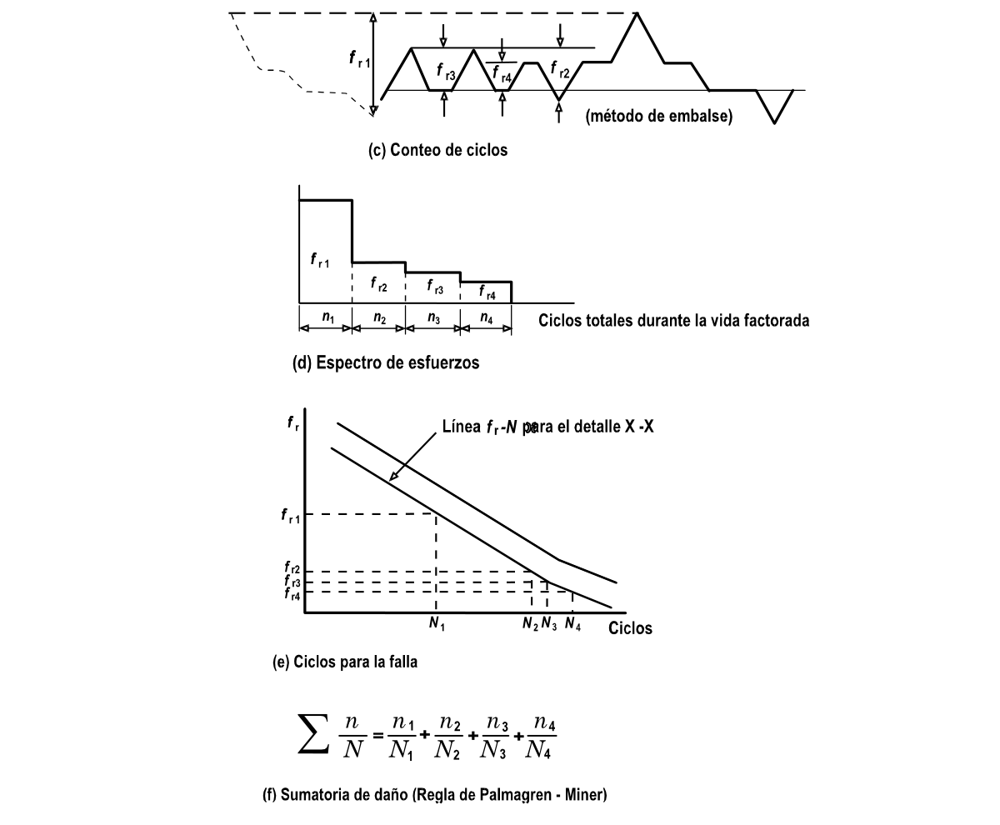

Figura F.5.7.2-1a — Procedimiento de evaluación de la fatiga

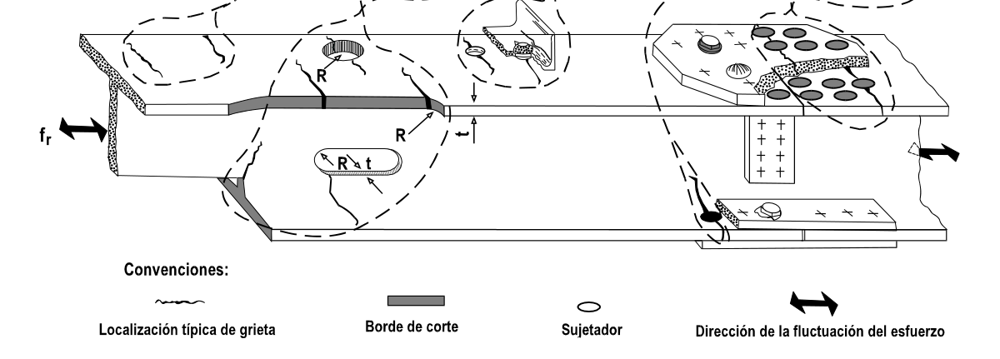

Figura F.5.7.2-1b — Clasificación tipo 1: detalles no soldados

#### F.5.7.3 — PROCEDIMIENTO DE ESTIMACION DE LA FATIGA

Un miembro estructural puede contener varios sitios potenciales de iniciación de grietas por fatiga. Las regiones de la estructura que tienen las más altas fluctuaciones de esfuerzos y/o las más severas concentraciones de esfuerzos deben ser normalmente revisadas primero. El procedimiento básico es el siguiente (véase la figura F.5.7.2-1a):

(a) Se obtiene un estimativo del límite superior de la secuencia de carga de servicio para la vida de diseño de la estructura (véase F.5.7.4 y apéndice F.5.B)

(b) Se estima la historia de esfuerzo resultante para el detalle (véase F.5.7.5)

(c) Se reduce la historia de esfuerzo a un número equivalente de ciclos $( n)$ de diferentes rangos de esfuerzo $f_{r}$ usando una técnica de conteo de ciclos (véase F.5.7.6.1)

(d) Se ordenan los ciclos en orden descendente de amplitud, $f_{r1}, f_{r2}$, para formar un espectro de esfuerzo (véase F.5.7.6.2)

(e) Se clasifica el detalle de acuerdo con las tablas F.5.7.2-1 a F.5.7.3-2 y, F.5.7.7. Para la clasificación apropiada y el rango de esfuerzo de diseño ( $f_{r1}$, etc.), encontrar la resistencia a la fatiga permisible ($N_{1,,}$ etc.) usando F.5.7.8.1.Cuando se haya decidido usar un valor de $γ_{mf}$ diferente de la unidad, ésto debe ser tomado en cuenta para fijar los valores de los rangos de esfuerzo de diseño (véase F.5.3.6.2).

(f) Sumar el daño total para todos los ciclos usando el gran total de Miner:

$$ \text{vida estimada}=\dfrac{\text{vida de diseño mayorada}}{\sum n/N} \tag{F.5.7.3-1} $$

Si la $∑n /N$ excede la unidad entonces se deben reducir los rangos de esfuerzo en ese punto o se debe cambiar el detalle por uno de clase más alta (véase F.5.7.7).

**Tabla F.5.7.3-1**

Clasificación tipo 2: detalles soldados sobre la superficie del miembro

| Forma del Secciones laminadas o extruidas y miembros ensamblados producto |  |  |
|---|---|---|
| En un accesorio largo soldado (en dirección de fr) Saliendo del extremo de la soldadura En un bache intermedio en una Localización soldadura de la longitudinal iniciación potencial del agrietamient o | En un accesorio corto | En cualquier accesorio |
|  | En el En el extremo de la soldadura agujero de una copa Accesorio Accesorio ancho angosto Sobre un Sobre ambos lado lados En el borde únicamente simétricamentde un e miembro |  |
|  |  | En el borde de un miembro |
| Requisitos Soldadura a dimensionaletope de Intermitente: s penetración m/h menor o total igual a 2.5 | Soldadura de filete Soldadura no sobre el borde de un miembro | Soldadura sobre el borde de un miembro |
|  | l mayor l de 25 menor Longitud de soldadura l (paralela a fr) mm y o igual mayor de 50 mm menor o a 25 igual a mm 50 mm Ancho de accesorio w w mayor de 50 mm menor o igual a 50 mm |  |
| Requisitos Pulir para suavizar cualquier socavadura en los bordes del miembro de fabricación Cepillar a ras Parar- cualquier arrancar sobrellenado No parar- libre de arrancar pérdida automático de fusión |  | Pulir cualquier socavadura |
|  |  | Evitar traslapos con retorno redondo de la soldadura (ver z) |
| Requisitos especiales de Radiografía inspección | Probar que las superficies soldadas estén libres de grietas y pérdida de fusión mediante ensayo con colorante penetrante |  |
| Área de esfuerzos de Sección transversal mínima del miembro en el punto de localización de la iniciación potencial del agrietamiento diseño |  |  |
| Parámetro especial de esfuerzos de diseño | Angulo de dispersión de esfuerzos 1 en 2 en ambos lados |  |
| Tipo número 2,1 2,2 2,3 2,4 | 2,5 2,6 2,7 2,8 2,9 2,1 | 2,11 |
| Clase máxima 50 42 35 29 permitida | 24 20 17 20 24 29 | 17 |

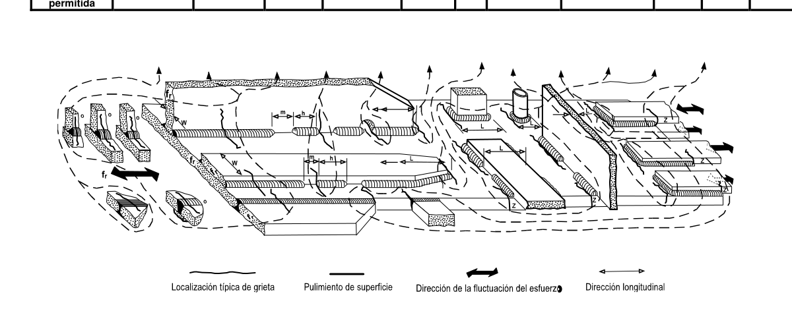

Figura F.5.7.3-1 — Clasificación tipo 2: detalles soldados sobre la superficie del miembro

**Tabla F.5.7.3-2**

Clasificación tipo 3: detalles soldados en las conexiones extremas de un miembro

| Forma del producto | Planchas y extrusiones planas |  |  |  | Formas laminadas, formadas o extruidas |  |  |  |  |  |  |
|---|---|---|---|---|---|---|---|---|---|---|---|
|  |  |  |  |  |  |  | (incluyendo secciones planas) |  |  |  |  |
| Localización de la iniciación potencial del agrietamiento | En una unión soldada transversal |  |  |  |  |  |  |  |  |  | En la garganta de la soldadura |
|  | Dos láminas simples unidas extremo a extremo |  |  |  | Dos miembros unidos extremo a extremo |  |  |  | Extremo de un miembro unido al lado de otro |  | En cualquier unión parcialmente fundida |
|  |  |  |  |  |  |  | Con un tercer miembro en la unión |  |  |  |  |
| Requisitos dimensionales | Áreas longitudinales en línea |  |  |  |  |  |  |  | Soldadura a tope de penetración total | Soldadura a tope de penetración parcial o soldadura de filete |  |
|  | Soldadura a tope de penetración total |  |  |  |  |  |  | Soldadura a tope de penetración parcial o soldadura de filete |  |  |  |
|  | Igual ancho | Cualquier cambio de ancho menor o igual a una pendiente 1 en 4 |  |  |  |  |  |  |  |  |  |
|  | Igual espesor | Cualquier cambio de espesor menor o igual a una pendiente 1 en 4 |  |  |  | Perfil similar |  |  |  |  |  |
|  |  |  |  |  |  |  | (también se aplica si el tercer miembro es angosto y pasa a través del primero) |  |  |  |  |
| Requisitos de fabricación | Soldado en ambos lados |  |  | Soldado en un solo lado únicamente |  | Desalineamiento con pendiente menor o igual a 1 en 4 | Soldado continuamente alrededor de la unión si el ancho lo permite, si no pulir a ras los extremos de la soldadura (ver X) |  |  |  |  |
|  | Desalineamiento con pendiente menor o igual a 1 en 4 | Con el incremento de la clase, se incrementan las restricciones sobre el perfil y otras discontinuidade s de la soldadura |  | No se permite punteo permanente en los 10 mm a partir del borde |  |  | Desalineamiento máximo de miembros principales: menor o igual a 0.5t3 |  |  |  |  |
|  | Cepillar a ras el sobrellenado |  |  | Sobre platina de respaldo permanente | Sin respaldo | Cepillar a ras el refuerzo |  |  |  |  |  |
|  | Usar platinas de continuidad y escurrimiento, pulir los extremos de la soldadura para suavizarlos |  |  |  |  |  |  |  |  |  |  |
|  | Limar o pulir cualquier socavadura, particularmente en las esquinas externas |  |  |  |  |  |  |  |  |  |  |
| Requisitos especiales de inspección | Incrementar, con la clase, el uso de colorantes permanentes, radiografías y métodos de ultrasonido para verificar la ausencia de discontinuidades detrimentales |  |  |  |  |  |  |  |  |  |  |
|  |  |  |  |  |  |  | Todas las regiones esforzadas a través de la dirección del espesor deben estar libres de rolado laminar o discontinuidades de extrusión |  |  |  |  |
| Área de esfuerzos de diseño | Sección transversal mínima del miembro en el punto de localización potencial del agrietamiento |  |  |  |  |  |  |  |  |  | Área de garganta efectiva |
| Parámetro especial de esfuerzos de diseño |  |  |  |  |  |  | Use el coeficiente de concentración de esfuerzos a menos que el tercer miembro sea una platina o tenga platinas de continuidad |  | Se debe usar el coeficiente de concentración de esfuerzos |  |  |
| Tipo número | 3,1 | 3,2 | 3,3 | 3,4 | 3,5 | 3,6 | 3,7 | 3,8 | 3,9 | 3,1 | 3,11 |
| Clase máxima permitida | 42 | 35 | 29 | 24 | 17 | 24 | 24 | 20 | 24 | 20 | 14 |

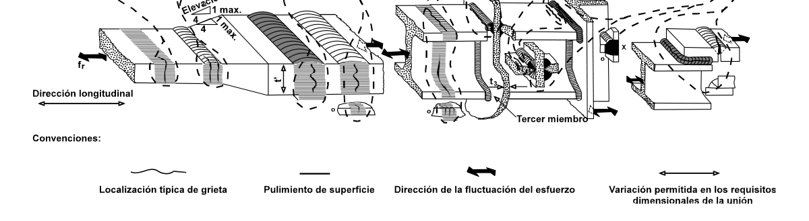

Figura F.5.7.3-2 — Clasificación Tipo 3: detalles soldados en las conexiones extremas de un miembro

#### F.5.7.4 — CARGA DE FATIGA

Todas las fuentes de esfuerzo fluctuante en la estructura deben ser identificadas:

(a) Cargas móviles superpuestas, incluyendo vibraciones de maquinaria en estructuras estacionarias

(b) Cargas ambientales tales como viento, olas, etc.

(c) Fuerzas de aceleración en estructuras móviles

(d) Cambios de temperatura La carga para fatiga normalmente se describe en términos de un espectro de carga de diseño que define un rango de intensidades de un evento de carga viva específico y el número de veces que cada nivel de intensidad es aplicado durante la vida de diseño de la estructura. Si dos o más eventos de carga viva independientes son de probable ocurrencia entonces será necesario especificar el desfase entre ellos.

Una guía sobre la carga específica para el estimativo de la fatiga se puede obtener en normas expedidas por entidades de reconocida autoridad.

Un estimativo realista de la carga de fatiga es crucial para el cálculo de la vida de la estructura. Cuando no hayan datos publicados sobre la carga viva, hay que recurrir a obtener datos de estructuras existentes sujetas a efectos similares. Registrando la deformación continua o midiendo la deflexión durante un período apropiado de tiempo, se pueden inferir los datos de carga mediante el análisis subsecuente de la respuesta. Se debe dar especial atención a determinar los efectos de magnificación dinámica cuando las frecuencias de carga son cercanas a una de las frecuencias naturales de la estructura (véase F.5.8.4.2).

El espectro de carga de diseño debe seleccionarse teniendo en cuenta que es un estimativo del límite superior de las condiciones de servicio acumuladas sobre la vida de diseño completa de la estructura, Se deben considerar todos los efectos ambientales y operacionales generados por el uso previsto de la estructura durante ese período. El límite de confianza del espectro de carga de diseño debe basarse en la media menos 2 límites de desviación estándar tanto para amplitud como para frecuencia.

#### F.5.7.5 — ESFUERZOS

**F.5.7.5.1** — Derivación de esfuerzos — Se debe usar la teoría elástica para modelar la estructura cuando se desea calcular la respuesta de esfuerzo a partir de eventos de carga específicos. Las propiedades de la sección no se deben reducir por efectos de la zona afectada por el calor o de pandeo local (pero véase F.5.7.5.2 (a) (4)). La modelación de la rigidez elástica de miembros y uniones debe ser exacta e incluir los efectos de cualquier material no estructural permanente que pueda modificarla. No se debe permitir la redistribución plástica de esfuerzos.

Cuando los datos de respuesta de esfuerzo van a ser obtenidos por medidas de deformación de una estructura similar, se debe poner cuidado especial para situar los transductores de deformación para asegurar que el parámetro de esfuerzo correcto está siendo medido (véase F.5.7.5.2). En F.5.8.4 se amplía la información sobre medida de datos de deformación.

**F.5.7.5.2** — Parámetros de esfuerzo — El esfuerzo a usar en los procedimientos de estimar la fatiga en F.5.7.3 depende del sitio de iniciación de la grieta y del camino de propagación, así:

(a) Material base y soldaduras a tope de penetración total — Las grietas se inician en la intersección de la soldadura con el metal de base, en los agujeros para los sujetadores, en las superficies de empalme o traslapo, etc. y se propagan a través del material base o del metal completamente penetrado de la soldadura y deben ser evaluadas usando el rango nominal de esfuerzo principal en el miembro en ese punto.

Los efectos de concentración local de esfuerzos del perfil de soldadura, de los agujeros de remaches y tornillos, etc. deben ignorarse ya que ellos son tomados en cuenta en los datos de resistencia $f_{r}−N$ para la clase de detalle apropiada y por lo tanto no necesitan ser calculados (véanse las tablas F.5.7.2-1 a F.5.7.2-3). Si se utilizan modelos detallados con elementos finitos de las uniones, la malla no debe ser más fina que los esfuerzos locales usados (véase también el literal (a) de F.5.8.4.4).

Se deben tomar en cuenta otros efectos geométricos mayores que pueden generar distribuciones no lineales de esfuerzos en ciertas circunstancias (véase la figura F.5.7.2). Esta situación se presenta en:

(1) Cambios bruscos en la forma de la sección transversal, por ejemplo en destijeres (2) Cambios bruscos en la rigidez de la sección transversal, por ejemplo en uniones en ángulo entre miembros de pared delgada (3) Cambios en dirección o alineamiento más allá de lo permitido en las tablas F.5.7.2-1 a F.5.7.3-2 (4) Esfuerzos de flexión secundarios generados por la rigidez de uniones en estructuras en celosía (5) Ineficiencia de transmisión de esfuerzos por cortante, distorsión y alabeo en miembros Anchos formados con láminas y miembros huecos (6) Efectos de flexión no lineal fuera del plano en componentes esbeltos tales como láminas planas donde el esfuerzo estático es cercano al esfuerzo crítico elástico, por ejemplo el campo tensionado en almas La presencia de esfuerzos residuales en uniones soldadas puede ignorarse ya que éstos están ya incluidos en los datos $f_{r}−N$. En uniones mecánicas, siempre que cualquier esfuerzo residual de tensión sea tenido en cuenta, esa parte del rango de esfuerzos que está en compresión general puede reducirse un 40%.

(b) Soldaduras de filete y a tope de penetración parcial — Las grietas se inician en la raíz de la soldadura y se propagan a través de la garganta. Deben ser estimadas usando la suma vectorial de los esfuerzos de corte en el metal de aporte de la soldadura basándose en las dimensión de garganta efectiva (véase la figura F.5.7.6-2).

En uniones traslapadas en un plano, el esfuerzo por unidad de longitud de soldadura puede calcularse con base en el área promedio para fuerzas axiales y un módulo elástico polar del grupo de soldaduras para momentos en el plano (véase la figura F.5.7.6-3).

En uniones en T, cualquier efecto de rigidez axial diferente a lo largo de la unión debe ser considerado.

Cuando filetes simples o soldaduras a tope de penetración incompleta están sujetos a momentos de flexión fuera de su plano, los esfuerzos en la raíz deben calcularse usando una distribución lineal de esfuerzos a través de la garganta (véase la figura F.5.7.6-4).

No se puede permitir el contacto de apoyo sobre la cara de la raíz en uniones soldadas con penetración parcial.

(c) Sujetadores roscados bajo carga axial — Las grietas se inician en las raíces de las roscas y deben ser evaluadas usando el esfuerzo medio axial en el área del núcleo de la rosca. Cuando hay también presencia de flexión, se debe usar el esfuerzo pico calculado sobre el módulo elástico del núcleo.

#### F.5.7.6 — DERIVACION DE LOS ESPECTROS DE ESFUERZOS

**F.5.7.6.1** — Conteo de ciclos — El conteo de ciclos es un procedimiento para convertir una historia de esfuerzo compleja en un espectro de ciclos conveniente en términos de amplitud $f_{r}$ y frecuencia $n$ (véase la figura F.5.7.2-1). Hay varios métodos en uso, para historias de esfuerzo cortas en las que eventos simples de carga se repiten varias veces se recomienda el método del embalse que es simple de visualizar y simple de usar (véase la figura F.5.7.7-1). Cuando se tienen que usar historias de esfuerzo largas, tales como las obtenidas con las deformaciones medidas en estructuras reales (véase F.5.8.4), se recomienda el método de la escorrentía. Ambos métodos son apropiados para el análisis con computador.

**F.5.7.6.2** — Derivación del espectro de esfuerzos — El listado de los ciclos en orden descendente de amplitud $f_{r}$ da como resultado el espectro de esfuerzos. Por facilidad de cálculo puede ser necesario simplificar el espectro con una menor cantidad de bandas; un método conservador consiste en agrupar las bandas en grupos mayores que contienen el mismo número total de ciclos pero cuya amplitud es igual a la de la mayor banda en el grupo. Con mayor exactitud, puede calcularse el promedio ponderado de todas las bandas en un grupo usando la potencia $m$, donde $m$ es la pendiente inversa de la curva $f_{r}−N$ más apropiada (véase la figura F.5.7.7-2). El uso del valor de la media aritmética siempre da resultados no conservadores.

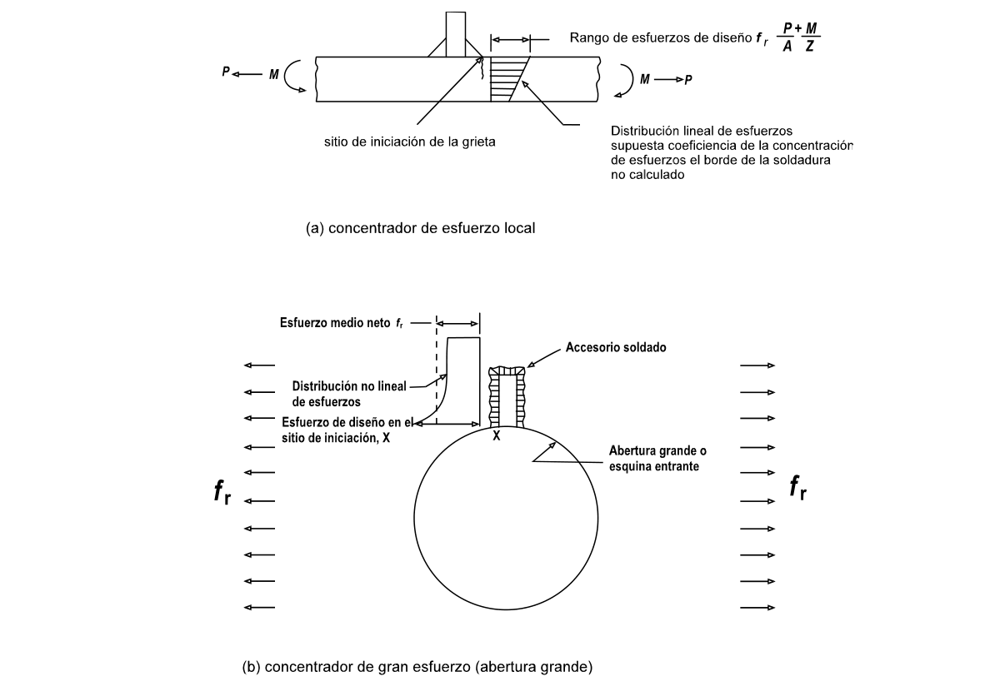

Figura F.5.7.6-1 — Parámetro de esfuerzos para el material parenteral

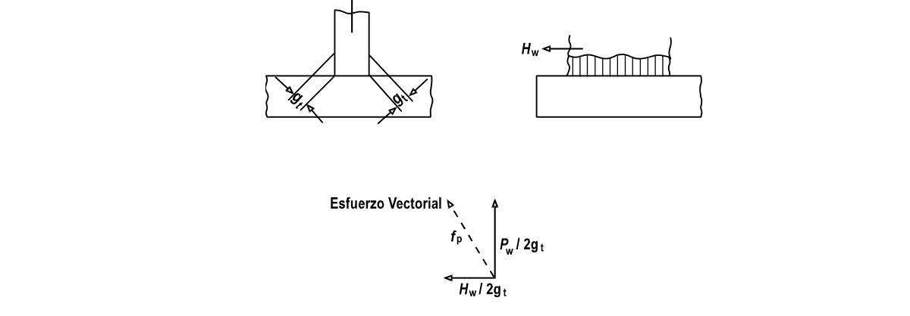

Figura F.5.7.6-2 — Esfuerzos en gargantas de soldadura

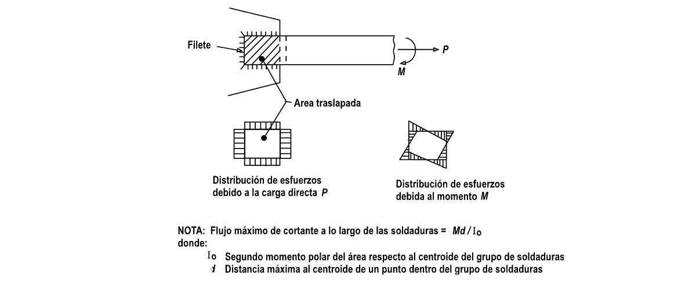

Figura F.5.7.6-3 — Esfuerzos en uniones traslapadas

Figura F.5.7.6-4 — Esfuerzos en la raíz de un filete

#### F.5.7.7 — CLASIFICACION DE DETALLES

La resistencia a la fatiga de un detalle siempre depende de los siguientes factores:

(a) La dirección del esfuerzo fluctuante con relación al detalle

(b) La localización del agrietamiento inicial en el detalle

(c) La distribución geométrica y la proporción relativa del detalle Puede depender también de:

(a) La forma del producto

(b) El material (a menos que sea soldado)

(c) El método de fabricación

(d) El grado de inspección después de la fabricación Las tablas F.5.7.2-1 a F.5.7.3-2 muestran la clasificación de los detalles más frecuentemente usados. Por conveniencia han sido divididos en tres grupos básicos, a saber:

i. Tipo 1, detalles no soldados, véase la tabla F.5.7.2-1 ii. Tipo 2, detalles soldados sobre la superficie de un miembro cargado, véase la tabla F.5.7.3-1 iii. Tipo 3, detalles soldados en conexiones de extremo, véase la tabla F.5.7.3-2 Las tablas se usan para identificar el detalle en la figura más cercano al de la estructura que se está evaluando.

Luego, las clases de sitios particulares de iniciación de agrietamiento asociadas con ellos, se revisan en la tabla apropiada. En algunos casos, se pueden necesitar operaciones particulares de inspección y fabricación.

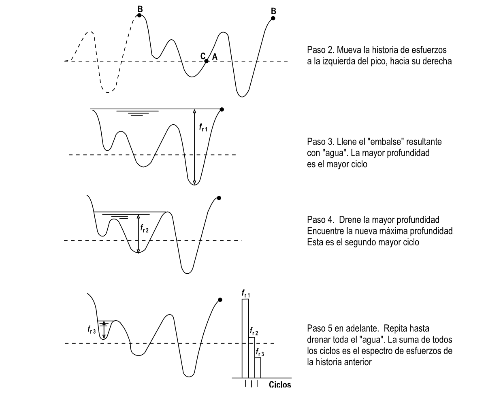

Figura F.5.7.7-1 — Método del embalse para el conteo de ciclos NOTA: véase F.5.4.3-2 y la figura F.5.7.7-3 ó F.5.7.7-4 Figura F.5.7.7-2 — Espectro de esfuerzos simplificado

#### F.5.7.8 — DATOS DE RESISTENCIA A LA FATIGA

**F.5.7.8.1** — Detalles clasificados — La forma generalizada de la relación $f_{r}−N$ se muestra en la figura F.5.7.7-3, graficada en escala logarítmica. La curva de diseño representa la media menos 2 desviaciones estándar, ubicada por debajo de la línea media obtenida con datos experimentales.

El esfuerzo límite de amplitud constante $f_{oc}$ ocurre a 107 ciclos, por debajo de este valor, los ciclos de esfuerzo de amplitud constante se supone que no son dañinos. Sin embargo, aunque los ciclos por encima de este nivel sean ocasionales, causarán propagación y, al extenderse la grieta, ciclos de menor amplitud se vuelven nocivos. Por esta razón, la pendiente de las curvas $f_{r}−N$ (véase la figura F.5.7.7-3) se cambia por $1 /(m+2)$ entre 5x106 y 5x108 ciclos para condiciones de carga de espectro general. Cualquier ciclo de esfuerzo por debajo del esfuerzo límite de amplitud variable $f_{ov},$ que ocurre a 108 ciclos, se supone que no es dañino. Debe notarse que el uso de la pendiente $1 /(m+2)$ puede ser conservador para algunos espectros.

Cuando un diseño es críticamente dependiente de esta región y se busca la máxima economía puede ser apropiado considerar el uso de ensayos de los componentes (véase el literal (a) de F.5.8.4.4) o aplicar análisis de mecánica de fracturas. Los valores de $K_{2}$ y $m$ están dados en la tabla F.5.7.8-1 para cada clase de detalle. Las curvas de diseño $f_{r}−N$ se dan en la figura F.5.7.7-4.

**Tabla F.5.7.8-1**

Valores de $K_{2}$ y $m$ en la figura F.5.7.7-4

| $m$ | $K_{2} f_{oc}$ kgf/mm² |
|---|---|
| 4.5 | 2.01x1014 4.20 |
| 4 | 1.25x1013 3.34 |
| 3.5 | 9.60x1011 2.65 |
| 3.25 | 2.09x1011 2.13 |
| 3 | 4.88x1010 1.70 |
| 3 | 2.76x1010 1.40 |
| 3 | 1.60x1010 1.17 |
| 3 | 9.83x109 0.99 |
| 3 | 5.49x109 0.82 |

Clase de $f_{ov}$ detalle kgf/mm² 60 3.09

| 50 |
|---|
| 42 |
| 35 |
| 29 |
| 24 |
| 20 |
| 17 |
| 14 |

2.41 1.87 1.49 1.17 0.97 0.81 0.69 0.57

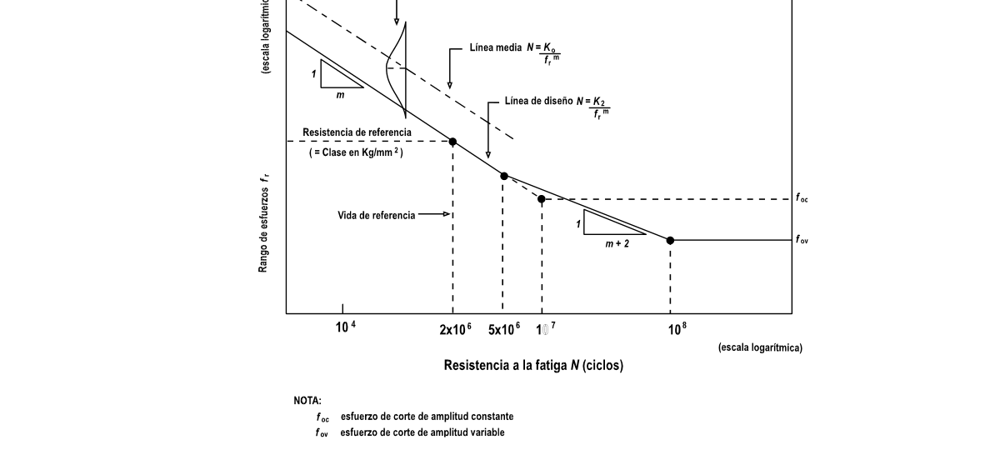

Figura F.5.7.7-3 — Relación $f_{r}−N$ típica

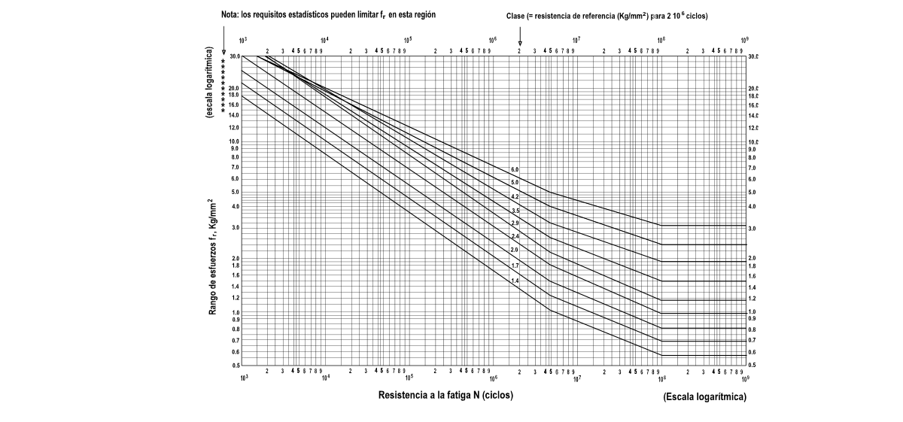

Figura F.5.7.7-4 — Curvas $f_{r}−N$ de diseño (para historias de esfuerzos de amplitud variable)

**F.5.7.8.2** — Detalles no clasificados — Los detalles no totalmente cubiertos por las tablas F.5.7.2-1 a F.5.7.3-2, deben evaluarse consultando los datos publicados por entidades de reconocida trayectoria. Como alternativa, se pueden hacer ensayos de aceptación por fatiga de acuerdo con el literal (a) de F.5.8.4.4.

En el apéndice F.5.J se da una guía para la derivación de los datos $f_{r}−N$ y sobre las condiciones en las que se pueden esperar resistencias mayores.

**F.5.7.8.3** — Rango de baja resistencia a la fatiga — En el rango de resistencia a la fatiga entre 103 y 105, debe hacerse una revisión para ver que el rango de esfuerzos de diseño de la figura F.5.7.7-4 no conlleve un esfuerzo a tensión máximo que exceda el esfuerzo estático de diseño del detalle. Esta posibilidad está indicada por una nota en la figura F.5.7.7-4.

**F.5.7.8.4** — Técnicas de mejoramiento — La resistencia a la fatiga de ciertos tipos de detalle mostrados en las tablas F.5.7.2-1 a F.5.7.3-2, puede ser mejorada mediante la aplicación de técnicas especiales de fabricación que son generalmente costosas y presentan dificultades para el control de calidad. No deben ser utilizadas para propósitos generales de diseño a menos que la fatiga sea particularmente crítica para la economía global de la estructura en cuyo caso debe buscarse ayuda especializada. Estas técnicas son más comúnmente usadas para superar deficiencias existentes en el diseño.

Las siguientes técnicas han sido usadas con aleaciones de aluminio y son más efectivas para aplicaciones con alto número de ciclos.

(a) Introducción de esfuerzos compresivos residuales en el punto de iniciación del agrietamiento — Esto puede hacerse en el borde de las soldaduras transversales mediante repujado o martillado. En los agujeros de los tornillos se puede utilizar el método de expansión en frío.

(b) Reducción del efecto de concentración de esfuerzos en el punto de iniciación de la grieta — Se puede lograr puliendo el borde de las soldaduras transversales hasta lograr un perfil uniforme.

**F.5.7.8.5** — Mano de obra — La clase máxima permitida para los detalles clasificados en las tablas F.5.7.2-1 a F.5.7.3-2 representa la resistencia máxima a la fatiga permitida por estas normas para el detalle en cuestión, sin sustentación adicional mediante ensayos (véase F.5.8). Cuando el esfuerzo por fatiga en un detalle clasificado es significativamente menor al permitido, la clase requerida será menor que la clase máxima permitida. Esto siempre ocurre cuando detalles de alta clase están localizados cerca de detalles de baja clase y ambos experimentan fluctuaciones similares de esfuerzo.

Los detalles de más alta clase a menudo requieren inspección adicional y demandan estándares de mano de obra más altos. Es importante para la economía de la fabricación que los estándares de inspección y mano de obra no estén gobernados por la clase máxima permitida de cada detalle sino por la clase requerida. La clase requerida en un detalle se obtiene determinando las curvas $f_{r}−N$ más bajas en la figura F.5.7.7-4 en las que el gran total de Miner es menor que la unidad (véase F.5.7.3 (f)).Cuando las fluctuaciones de esfuerzos en un detalle ocurren en más de una dirección, se pueden tener diferentes clases de requisitos para cada dirección.

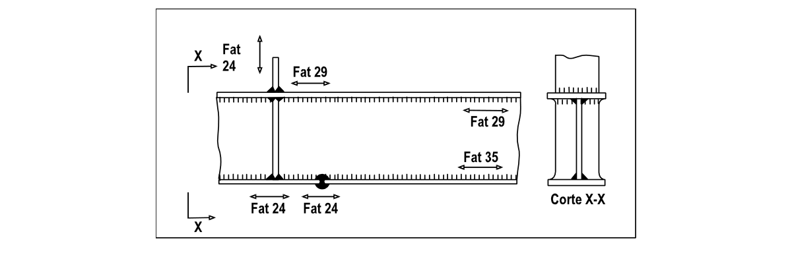

Figura F.5.7.7-5 — Método de identificación en los planos de la clase requerida por fatiga Para que la inspección pueda concentrarse en aquellas partes de la estructura que son críticas por fatiga, se deben tomar las siguientes acciones.

(a) Determinar analíticamente aquellas regiones de la estructura donde la clase de requisitos excede la clase 20.

(b) Indicar sobre los planos detallados, en todos los detalles en estas regiones, la clase requerida y la dirección de la fluctuación de esfuerzo como se muestra en la figura F.5.7.7-5.

(c) Cualquier plano que contenga un detalle con una clase de fatiga requerida mayor de 20 debe contener la siguiente nota general:

Los detalles que requieren calidad por encima de la normal se indican con un número “Fat” y una flecha.

### F.5.8 — ENSAYOS

#### F.5.8.1 — GENERALIDADES

Una estructura o componente estructural diseñado de acuerdo con F.5.2 a F.5.7 de estas normas no necesita ser verificado mediante ensayo pero puede ser verificado a discreción del fabricante, calculista o Supervisor Técnico Independiente. Tales pruebas pueden hacerse bajo carga estática (véase F.5.8.3), carga de fatiga (véase F.5.8.4) o ambas.

<!-- mod:3-decreto-945-2017-69 -->
> **Modificación — Decreto 945 de 2017** · anexo, p. 34
>
> En las secciones F.2.1.5.1.2, F.2.14.5.2, F.2.14.5.3, F.2.14.7 (dos veces) y F.5.8.1 (dos veces) se reemplaza «interventor» por «Supervisor Técnico Independiente».

La verificación mediante ensayo es apropiada cuando ocurre lo siguiente:

(a) La estructura o componente no es susceptible de verificación mediante análisis o tal procedimiento es juzgado impracticable

(b) Los materiales o los procedimientos de diseño usados fueron distintos a los presentados en F.5.2 a F.5.7

(c) Hay duda o desacuerdo sobre la validez del método de diseño, la calidad del material o la calidad de la mano de obra.

El método y el alcance de los ensayos deben ser acordados por el calculista, el fabricante y el Supervisor Técnico Independiente responsable de la aceptación. El método de ensayo debe ser consistente con las condiciones de servicio de la estructura o componente y puede comprender una prueba de resistencia con carga estática o dinámica y/o una prueba de resistencia a la fatiga. Los ensayos deben hacerse en instalaciones competentes aceptables para todas las partes interesadas.

El número de muestras a ensayar debe ser acordado entre las partes teniendo en cuenta el número de componentes a fabricar. Cuando el número de muestras es grande, debe ensayarse un número suficiente de muestras para permitir el análisis estadístico de la resistencia media y la desviación estándar para cada condición de carga.

Cuando la aceptación del diseño depende de la verificación mediante ensayos, el comprador o su agente debe tener la posibilidad de presenciar cada ensayo.

Cuando la verificación del diseño depende de ensayos, se debe realizar un informe describiendo en detalle (haciendo referencia a la norma utilizada) el método de prueba y dando todas las resistencias medidas, en la forma de un certificado de ensayo típico que contenga al menos la información enumerada en F.5.8.5.

#### F.5.8.2 — PREPARACION PARA ENSAYO

La muestra a ensayar, si no es la estructura o el componente real que se destinará al servicio, debe representar tan precisamente como sea posible el diseño en términos de propiedades del material, dimensiones, métodos de unión y acabados (cuando sean susceptibles a los efectos de la deformación).

La muestra de prueba debe colocarse en su posición normal de modo que las cargas muertas debidas al peso propio actúen normalmente. Cuando ésto no sea posible, los efectos de la carga muerta pueden representarse mediante cargas impuestas equivalentes.

Cuando los ensayos se realicen sobre una simulación de la estructura o sobre un componente, la muestra se debe montar en forma tal que experimente las restricciones normales ante los efectos de la combinación de cargas aplicadas.

Se debe especificar las condiciones de carga y las condiciones ambientales del ensayo (por ejemplo puntos de aplicación de la carga, métodos de carga, proceso de carga en el tiempo y espacio, temperaturas) Determinación de los puntos de observación y de los métodos de observación y de registro (por ejemplo registro de deformaciones unitarias en el tiempo, de fuerzas y deflexiones) En circunstancias en las que la combinación de cargas aplicadas, sus direcciones y la orientación de la muestra puedan producir cambios en la resistencia de la muestra, se debe usar la combinación que se espera que dé la menor resistencia.

#### F.5.8.3 — ENSAYOS ESTATICOS

Los ensayos estáticos estarán dirigidos a demostrar si una estructura o componente puede soportar las cargas no mayoradas (conocidas como cargas nominales) sin exceder el estado límite de servicio y, también, si puede soportar las cargas mayoradas sin exceder el estado límite último. A veces es apropiado realizar una prueba de resistencia última (véase F.5.8.3.4).

**F.5.8.3.1** — Aplicación de cargas — La aplicación de carga debe hacerse por medio de pesos muertos, dispositivos generadores de fuerza o dispositivos generadores de desplazamiento. El método debe incluir dispositivos de medida de fuerza de precisión conocida.

Antes de aplicar cada combinación de cargas nominales, la muestra puede ser cargada y descargada una vez. La carga a aplicar para este ciclo de ajuste opcional, no debe exceder las cargas nominales ni cualquier otro nivel inferior de carga relacionado con un criterio de deformación límite por aceptar. La carga debe ser mantenida por lo menos durante 15 min. Se recomienda medir los desplazamientos durante el ciclo de ajuste.

No se debe hacer una recarga antes de 15 min después de suspender la carga de ajuste. Debe revisarse la fijación de los anclajes antes de adelantar la prueba principal.

El procedimiento de aplicación de carga debe constar de cinco incrementos aproximadamente iguales hasta alcanzar las cargas nominales. Cada incremento debe ser mantenido mientras que se obtienen las lecturas de deflexión y/o deformación y se examina la muestra para observar signos de alteración. En el quinto incremento (límite de servicio), las deflexiones y/o deformaciones deben ser registradas inmediatamente después de la aplicación de la carga o cargas y otra vez cuando este nivel de carga se haya mantenido por 15 min.

Las cargas nominales deben retirarse y debe inspeccionarse la estructura antes de aplicar las cargas mayoradas. El proceso de carga debe ser, nuevamente, incremental hasta llegar a la carga mayorada (algunas veces llamada carga de “prueba”), registrando las deflexiones y el comportamiento como se hizo antes. El incremento desde carga nominal hasta carga mayorada debe hacerse, al menos, en cinco etapas.

La carga mayorada debe ser mantenida durante 15 min, tiempo durante el cual la deflexión o deflexiones deben ser monitoreadas y la muestra debe ser examinada buscando signos de alteración.

En esta condición, las consecuencias para el personal de una falla súbita deben considerarse y se deben tomar las precauciones adecuadas.

La carga mayorada debe removerse después de 15 min y la deflexión residual debe ser registrada después de otros 15 min.

La deflexión puede ser medida con instrumentos o registrada automáticamente mediante sistemas de conocida precisión. Se deben graficar las curvas de deflexión por carga.

**F.5.8.3.2** — Criterios de aceptación — Puede considerarse que la estructura cumple con las recomendaciones de estado límite de servicio y último, si todas las siguientes condiciones se cumplen:

(a) Las deflexiones registradas bajo la influencia de las cargas nominales no deben exceder aquellas permitidas para el límite de servicio

(b) No debe haber evidencia visible de deformación no elástica, inestabilidad u otra alteración bajo la influencia de cargas nominales

(c) La muestra no debe mostrar excesiva deformación, inestabilidad o signos de colapso inminente bajo las cargas mayoradas

(d) La deflexión, o deflexiones, residual medida 15 min después de quitar todas las cargas no debe exceder el 5% de la deflexión, o deflexiones, bajo carga

**F.5.8.3.3** — Reensayo — Cuando la muestra ensayada no cumple el criterio (d) de F.5.8.3.2, la prueba puede ser repetida. Si, después de un máximo de 10 aplicaciones de la carga mayorada, el criterio no se ha cumplido, la muestra debe ser rechazada y el rechazo debe ser registrado en el informe con cualquier observación adicional sobre la causa del rechazo.

**F.5.8.3.4** — Medida de la resistencia última — El ensayo de resistencia última es apropiado cuando se construye un gran número de estructuras similares. No forma parte de un procedimiento de ensayos de aceptación.

Cuando la muestra de prueba es sacrificable, se puede obtener la resistencia última reaplicando las cargas mayoradas en un único incremento de carga y luego incrementando gradualmente todas las cargas impuestas proporcionalmente hasta que la muestra sea incapaz de soportar carga adicional.

Se debe registrar la carga, o cargas, última y el modo de falla.

El valor de la resistencia última medido en el ensayo debe ajustarse para tener en cuenta la diferencia entre las propiedades mecánicas y la geometría del espécimen de prueba y las propiedades mínimas especificadas y la geometría nominal. Los resultados deben ajustarse usando la fórmula de estado límite apropiada en F.5.4, F.5.5 y F.5.6 para el modo de falla particular en cuestión.

La resistencia última no debe ser menor que $1 /φ$ veces la carga mayorada. El valor de $φ$ debe ser el valor relacionado con el elemento de la estructura donde ocurre primero la falla.

#### F.5.8.4 — ENSAYOS DE ACEPTACION PARA FATIGA

**F.5.8.4.1** — Objetivos del ensayo — Cuando hay datos insuficientes para verificar un diseño mediante cálculo únicamente de acuerdo con F.5.7, se puede conseguir evidencia suplementaria mediante un programa de ensayo específico. Los datos de ensayos pueden necesitarse por una o más de las siguientes razones adicionales.

(a) La historia de carga aplicada o el espectro, para carga única o cargas múltiples, no está disponible y los cálculos teóricos están más allá de los métodos prácticos (véase F.5.7.4). Esto puede aplicarse particularmente a estructuras móviles o cargadas con fluidos donde los efectos dinámicos o de resonancia pueden tener lugar. En F.5.8.4.2 se da información sobre los métodos de prueba.

(b) La geometría de la estructura es suficientemente compleja para que los estimativos de las fuerzas en los miembros o los campos de esfuerzo locales estén más allá de los métodos prácticos de cálculo (véase F.5.7.5). En F.5.8.4.3 se da información sobre los métodos de ensayo.

(c) Los materiales, detalles dimensionales o métodos de fabricación de miembros o uniones son diferentes de aquellos dados en las tablas F.5.7.2-1 a F.5.7.3-2. En F.5.8.4.4 se da información sobre los métodos de ensayo.

Los ensayos pueden ser llevados a cabo sobre un prototipo completo o estructuras reales o sobre partes componentes de estas estructuras. El grado en el que la estructura de prueba debe reproducir los materiales, detalles dimensionales y métodos de fabricación de la estructura final dependerá de la información a ser derivada del ensayo (véanse F.5.8.4.2 a F.5.8.4.4).

**F.5.8.4.2** — Derivación de datos de carga — El método para obtener los datos de carga dependerá del tipo de estructura. Se consideran los siguientes tres tipos básicos:

(a) Estructuras fijas sometidas a carga mecánica — por ejemplo puentes, puente grúas y soportes de maquinaria. Se pueden usar estructuras similares existentes sujetas a las mismas fuentes de carga para obtener la amplitud, desfase y frecuencia de las cargas aplicadas.

Mediante transductores de deformación, deflexión o aceleración fijados a componentes seleccionados, calibrados bajo cargas aplicadas conocidas, se puede registrar el patrón de fuerza en un período típico de trabajo de la estructura usando equipo de adquisición de datos análogo o digital. Los componentes deben ser seleccionados de modo que los componentes más cargados pueden ser deducidos independientemente usando los coeficientes de influencia obtenidos con las cargas de calibración.

Alternativamente, se pueden montar celdas de carga en las interfaces entre la carga aplicada y la estructura y se puede obtener un registro continuo usando el mismo equipo.

La masa, rigidez y decremento logarítmico de la estructura de prueba debe estar dentro del 30% del que tiene el diseño final y la frecuencia natural de los modos que generan las más grandes fluctuaciones de deformación deben estar dentro del 10%. Si esto no ocurre, la respuesta de carga debe ser verificada subsecuentemente sobre una estructura hecha de acuerdo con el diseño final.

La componente de frecuencia del espectro de carga obtenido con el período de trabajo debe multiplicarse por la relación de la vida de diseño y el período de trabajo para obtener el espectro final de diseño. Se debe tener en cuenta el crecimiento en amplitud o frecuencia durante la vida de diseño cuando se requiera.

(b) Estructuras fijas sometidas a carga ambiental — por ejemplo mástiles, chimeneas y estructuras mar adentro sobre cubierta.

Los métodos de derivación del espectro de carga son básicamente los mismos descritos en F.5.8.4.2 (a) excepto que el período de trabajo generalmente necesitará ser más largo debido a la necesidad de obtener un espectro representativo de las cargas ambientales tales como viento y olas. El daño por fatiga tiende a estar confinado a una banda específica en el espectro global de carga debido a efectos de resonancia inducidos por el flujo del fluido. Todo esto tiende a ser muy específico en dirección, frecuencia y amortiguamiento y por esta razón se necesita mayor precisión para simular las propiedades estructurales (masa, rigidez y amortiguamiento) y las propiedades aerodinámicas (geometría de la sección transversal).

Se recomienda que la carga sea verificada subsecuentemente sobre una estructura con el diseño final si los datos de carga originales son obtenidos de estructuras con una frecuencia natural o un amortiguamiento que difieran en más del 10%, o si la forma de la sección transversal no es idéntica.

Se puede obtener un espectro de diseño final en términos de dirección, amplitud y frecuencia de carga, apropiadamente modificado comparando los datos de carga obtenidos durante el período de recolección de datos con los registros meteorológicos obtenidos para un período igual a la vida de diseño típica de la estructura.

(c) Estructuras móviles — por ejemplo vehículos de carretera y sobre rieles y botes.

En estos tipos de estructura, la geometría de la superficie sobre la que se mueve la estructura debe definirse adecuadamente en términos de forma y amplitud de ondulaciones y frecuencia porque ésto tendrá un efecto significativo en la carga dinámica sobre la estructura. Otros efectos de carga tales como cargas de cargue y descargue pueden medirse usando los principios presentados en F.5.8.4.2 (a).

Las superficies sobre las que se mueve la estructura tales como pistas construidas con el propósito de ensayo, pueden usarse para obtener historias de carga para diseños prototipo. Se deben usar con precaución los datos de carga de estructuras previas ya que pequeñas diferencias pueden alterar substancialmente la respuesta dinámica. Se recomienda que esa carga se verifique en el diseño final si no se adopta un ensayo de fatiga a escala natural (véase F.5.8.4.4).

**F.5.8.4.3** — Derivación de los datos de esfuerzo

(a) Datos de ensayo de componentes — Cuando hay miembros simples tales que las principales componentes de fuerza en el miembro pueden ser calculadas o medidas fácilmente, es apropiado probar componentes que contengan la unión o detalle que debe ser analizado.

Un espécimen apropiado de idénticas dimensiones al usado en el diseño final debe ser calibrado usando un método conveniente tal como deformímetros eléctricos, patrones con borde de moiré o técnicas elásticas térmicas. Los extremos del componente deben estar suficientemente alejados del área local de interés para que los efectos locales en el punto de aplicación de las cargas no afecten la distribución de esfuerzos en ese punto. Las componentes de fuerza y los gradientes de esfuerzos en la región de interés deben ser idénticos a los que tendría en la estructura completa.

Se pueden obtener coeficientes de influencia a partir de cargas estáticamente aplicadas que permitirán determinar el patrón de esfuerzos para cualquier combinación deseada de componentes de carga. Los coeficientes pueden ser obtenidos, si se requiere, a partir de especímenes a escala siempre que el componente total se escale igualmente.

(b) Datos de ensayo de estructuras — En ciertos tipos de estructura tales como estructuras de cascarones, la continuidad del material estructural puede hacer impracticable el aislar componentes con fuerzas simples aplicadas. En este caso los datos de esfuerzo deben obtenerse a partir de prototipos o estructuras de producción.

Para la medición, se pueden usar métodos similares a los de ensayos de componentes. Para el uso más general, se recomienda que las cargas estáticas se apliquen como componentes individuales de modo que los esfuerzos puedan combinarse usando los coeficientes de influencia individuales para el punto de interés. La carga debe pasar por un ciclo de prueba antes de obtener los datos de coeficientes de influencia.

(c) Verificación de la historia de esfuerzos — El mismo método descrito en F.5.8.4.3(b) puede ser usado para verificar la historia de esfuerzos en un punto durante la prueba del prototipo bajo una carga específica. En este caso, el equipo para la adquisición de datos usado en F.5.8.4.2 (a) debe ser usado para registrar la historia de esfuerzo total o para realizar una operación de conteo de ciclos. El conteo de ciclos puede ser usado para predecir la vida una vez que la curva $f_{r}−N$ apropiada haya sido escogida.

Otra opción, que puede ser usada en el caso de historias de carga sobre las que se tenga incertidumbre, es mantener el dispositivo de conteo de ciclos permanentemente fijado a la estructura en servicio.

**F.5.8.4.4** — Derivación de los datos de resistencia a la fatiga

(a) Ensayo de componentes — Siempre que los espectros de fuerza o los datos de historia de esfuerzo sean conocidos, se puede hacer el ensayo de componentes para verificar el diseño de partes críticas de la estructura. El componente a ensayar debe ser fabricado con exactamente las mismas dimensiones y procedimientos que se intenta usar en el diseño final. Todos estos aspectos deben estar completamente documentados antes de fabricar el componente de prueba.

Adicionalmente, cualquier método de ensayo no destructivo y los criterios de aceptación deben estar documentados en el informe conjuntamente con el informe del inspector sobre la calidad de las uniones a ensayar.

Los especímenes de prueba deben ser cargados de manera similar a la descrita en F.5.8.4.2 (a).

Se deben usar medidores de deformación para verificar que las fluctuaciones de esfuerzo son las requeridas. La localización de estos medidores debe ser tal que ellos estén registrando el parámetro de esfuerzo correcto (véase F.5.7.5). Si se está registrando el esfuerzo nominal, el medidor debe estar por lo menos a 10 mm de cualquier borde de la soldadura. Cuando el gradiente de esfuerzos es alto se deben usar tres medidores para permitir la interpolación.

Para obtener una curva $f_{r}−N$ que sirva para diseño, se debe ensayar un número mínimo de ocho especímenes idénticos que den resistencias a la fatiga en el rango de 103 a 108 ciclos. Se debe calcular una curva media y una curva de diseño que es paralela a la media pero separada no menos de 2 desviaciones estándar y no mayor que el 80% del valor de la resistencia, lo que sea menor. Esto tiene en cuenta las amplias variaciones en la producción que normalmente se esperan en un único juego de especímenes para ensayo de fatiga.

Para diseños con tolerancia de daño se debe obtener un registro del crecimiento de la grieta de fatiga con el número de ciclos.

Alternativamente, si se conoce la historia de esfuerzos de diseño y está disponible un equipo de amplitud variable, el espécimen puede ser ensayado bajo la historia de esfuerzos no mayorada.

(b) Ensayos a escala natura — Se pueden hacer ensayos a escala natural bajo las condiciones de operación reales o en un equipo de ensayo con las componentes de carga de prueba aplicadas hidráulicamente o con otros métodos de control.

Las condiciones para la fabricación de la estructura deben ser las mismas que para en ensayo de componentes descritas en el literal (a) de este numeral.

Las cargas aplicadas no deben exceder las cargas nominales.

Cuando las cargas de servicio varían de una manera aleatoria entre límites, deben representarse mediante una serie equivalente de cargas acordada por las partes interesadas.

Alternativamente, la carga, o cargas, de prueba debe ser igual a la carga, o cargas, sin mayorar.

La aplicación de cargas a la muestra debe reproducir exactamente las condiciones de aplicación esperadas para la estructura o el componente en servicio.

El ensayo debe continuar hasta que ocurra la fractura o hasta que la muestra sea incapaz de responder a la carga total de prueba a causa del daño sufrido.

El número de aplicaciones de carga, o cargas, de prueba para la falla debe ser exactamente contado y registrado con observaciones sobre el desarrollo progresivo de defectos.

**F.5.8.4.5** — Aceptación — El criterio de aceptación depende de si la estructura es requerida para un comportamiento de vida segura o para un comportamiento de daño tolerable.

(a) En un diseño de vida segura — el estado límite determinante es aquel definido en F.5.3.6.2.

Para aceptación, la vida hasta la falla determinada mediante ensayo y ajustada para tener en cuenta el número de resultados de ensayos disponible, no debe ser menor que la vida de diseño mayorada como se define en F.5.3.6.2.

$$ \dfrac{N_{a}}{F}\ge \text{vida de diseño mayorada} \tag{F.5.8.4-1} $$

Donde:

$N_{a}$ = media logarítmica de la vida hasta la falla

$F$ = coeficiente dependiente del número efectivo de resultados de ensayos disponible, como se define en la tabla F.5.8.4-1

(b) En un diseño con tolerancia de daño — el estado límite determinante es aquel definido en F.5.3.6.3. La aceptación depende de la vida de una grieta que alcanza un tamaño que podría ser detectado por un método de inspección que puede ser aplicado en servicio. También depende de la tasa de crecimiento de la grieta, consideraciones de longitud crítica de grieta y las implicaciones para la seguridad residual de la estructura y el costo de reparación.

Los criterios para factorar la vida medida y para aceptación variarán de una aplicación a otra y deben ser acordados con el ingeniero responsable de la aceptación.

**Tabla F.5.8.4-1**

Coeficiente de prueba de fatiga $F$

| Resultados de ensayo | Número de muestras ensayadas |  |  |  |  |  |  |  |
|---|---|---|---|---|---|---|---|---|
|  | 1 | 2 | 4 | 6 | 8 | 9 | 10 | 100 |
| Muestras idénticas ensayadas, todas, a la falla. Todas las muestras fallaron, coeficientes basados en la media logarítmica suponiendo que la desviación estándar de la población es (log 0.176) | 3.80 | 3.12 | 2.73 | 2.55 | 2.48 | 2.44 | 2.40 | 2.09 |
| Muestras idénticas ensayadas simultáneamente. Primera muestra en fallar con una desviación estándar de la población supuesta como (log 0.176) | 3.80 | 2.67 | 2.01 | 1.75 | 1.60 | 1.54 | 1.54 | 0.91 |

#### F.5.8.5 — INFORME

Al concluir cualquier ensayo realizado de acuerdo con esta sección se debe redactar un certificado de prueba tipo que contenga la siguiente información:

(a) Nombre y dirección del laboratorio

(b) Referencia de acreditación del equipo de ensayo (cuando sea apropiado)

(c) Fecha del ensayo

(d) Nombre o nombres de los testigos

(e) Descripción de las muestras ensayadas mediante:

• Número de serie (cuando sea apropiado), o • Número de plano o planos (cuando sea apropiado), o • Descripción con esquemas o diagramas, o • Fotografías

(f) Descripción de los sistemas de carga aplicados incluyendo referencias a las normas que sean necesarias

(g) Registro de las aplicaciones de carga y las reacciones a la carga medidas, esto es, deflexión, deformación, vida

(h) Resumen de cargas, deformaciones y esfuerzo en puntos de críticos de aceptación, correspondientes a los criterios de aceptación definidos en F.5.8.3.2

(i) Registro de la carga última y el modo de falla

(j) Registro de localización de observaciones mediante referencia a (e).

(k) Notas sobre cualquier comportamiento observado relevante para la seguridad o servicio del objeto ensayado, por ejemplo, naturaleza y localización del agrietamiento en un ensayo de fatiga

(l) Registro de las condiciones ambientales en el momento del ensayo cuando sea relevante

(m) Informe de validación por parte de la autoridad competente, de todo el equipo de medición usado

(n) Definición del propósito u objetivos del ensayo

(o) Informe de cumplimiento o no cumplimiento con los criterios de aceptación relevantes

(p) Registro de nombres y cargos de las personas responsables del ensayo y que elaboran el informe

(q) Número de serie del informe y fecha de expedición
