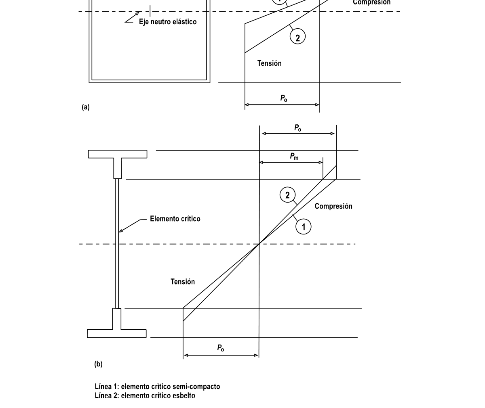

# F.5-D — Calculo de momento elasto-plastico

F.5.D.1 — GENERALIDADES Este apéndice da un método alterno, que puede ser usado en lugar de los numerales F.5.4.5.2 o F.5.5.4.1, para obtener la resistencia de diseño a momento $M_{RS}$ de secciones de vigas esbeltas y semi-compactas.

El método elasto-plástico presentado es ventajoso en secciones en las que un elemento crítico para pandeo local, que tiene un valor de $β$ aproximadamente en la región de $β_{o}$ (véase la tabla F.7.4.3), contiene material comprimido que se localiza más cerca del eje neutro que las fibras a tensión más extremas de la sección. Ejemplos típicos son secciones en las que:

(a) El material en extrema compresión, incluyendo un elemento de aleta crítico, se localiza más cerca del eje neutro que el material en extrema tensión (véase la figura F.5.D.1 (a)); o

(b) Un elemento crítico de alma termina a alguna distancia hacia adentro de la cara en extrema compresión, debido a la presencia de una platina de encaje (véase la figura F.5.D.1 (b)) El uso de este apéndice es desventajoso cuando se aplica a secciones en las que el elemento crítico es muy esbelto $(β >> β_{o})$.

F.5.D.2 — PATRON DE ESFUERZO ELASTO-PLASTICO F.5.D.2.1 — REGLAS PARA LA CONSTRUCCION DEL PATRON DE ESFUERZO — Un patrón de esfuerzo elasto- plástico idealizado se construye, basándose en un material supuesto con fluencia súbita en $p_{o}$ (en lugar de la curva real esfuerzo-deformación). En la figura F.5.D.1 se dan ejemplos típicos. Las reglas para construir tal patrón son las siguientes:

(a) Los cálculos se hacen usando una sección neta efectiva en la que se toman espesores reducidos para tener en cuenta el ablandamiento de la zona afectada por el calor y también se hace reducción por agujeros pero no se hace reducción por pandeo local. La nota 5 del literal (c) del numeral F.5.4.5.2 debe ignorarse.

(b) Los elementos se clasifican de acuerdo con el literal (c) del numeral F.5.4.3.3.

(c) El esfuerzo límite de compresión $p_{m}$ , en un elemento esbelto, se encuentra mediante:

$p_{m}=k_{L} p_{o}$ Donde:

$p_{o}$ = esfuerzo límite para el material (véanse las tablas F.5.4.1 y F.5.4.2)

$k_{L}$ = coeficiente de pandeo local, encontrado en F.5.4.3.4 (literal (a)) Para un alma longitudinalmente rigidizada, generalmente se obtienen diferentes valores de $p_{m}$ para los diferentes sub-paneles, basándose en sus diferentes valores de $k_{L}$ .

Para aplicar las reglas (b) y (c), el valor $ε$ debe siempre ser determinado usando la expresión de la nota 1 de la tabla F.5.4.3. El valor modificado de $ε$ dado en F.5.4.3.3 (d) o en la nota 3 de F.5.4.5.2 (c) no es válido para ser usado con este apéndice.

(d) El patrón de esfuerzo debe ser tal que la fuerza total de compresión balancee la de tensión.

(e) En el lado a tensión, el esfuerzo en la fibra extrema no debe exceder $p_{o}$ . Se permite que la plasticidad se extienda hacia adentro desde esta cara.

(f) En el lado a compresión, el esfuerzo en cualquier elemento no debe exceder un valor límite $p$ dado por:

1. Elemento totalmente compacto o semi-compacto

$p=p_{o}$

2. Elemento esbelto

$p=p_{m}$

(g) Se puede permitir que la plasticidad se extienda hacia adentro desde la cara a compresión de la sección únicamente si la aleta a compresión es totalmente compacta.

(h) Para una sección con una aleta a compresión totalmente compacta y con una platina de encaje adyacente al borde a compresión de un alma semi-compacta o esbelta (véase la figura F.5.D.1 (b)), la distancia que puede extenderse la plasticidad hacia adentro desde la cara de compresión está limitada como se indica a continuación:

(1) Alma semi-compacta: la plasticidad no debe extenderse más allá del extremo a compresión del alma.

(2) Alma esbelta: la regla (f) (2) debe ser satisfecha para el alma.

F.5.D.2.2 — SECCIONES HIBRIDAS — Para aplicar el numeral F.5.D.2.1 a una sección híbrida, fabricada con componentes de diferente resistencia, es útil recordar que la distribución de deformaciones será lineal en la dirección de la sección transversal. Esto tiene las siguientes implicaciones para el patrón de esfuerzos supuesto.

(a) En la zona elástica, el esfuerzo varía linealmente a cada lado del eje neutro, sin escalones.

(b) En cualquier zona plástica habrá cambios en escalón del esfuerzo entre materiales de diferente $p_{o}$ .

(c) En la unión entre las zonas elástica y plástica, también habrá un escalón si esta unión coincide con un cambio de material.

F.5.D.3 — CALCULO DE LA RESISTENCIA A MOMENTO F.5.D.3.1 — GENERALIDADES — La resistencia a momento de diseño $M_{RS}$ se encuentra usando la siguiente expresión:

$M_{RS}= φM_{u}$ Donde:

$M_{u}$ = momento último encontrado según F.5.D.3.2 o F.5.D.3.3

$φ$ = coeficiente de reducción de capacidad (véase la tabla F.5.3.1) F.5.D.3.2 — SECCIONES ESBELTAS — $M_{u}$ se toma como el momento correspondiente al patrón de esfuerzos adoptado (véase F.5.D.2).

F.5.D.3.3 — SECCIONES SEMI-COMPACTAS — $M_{u}$ se encuentra por interpolación, como sigue:

$M_{u}=M_{us}+β −β_{1o}β_{o} −β(M_{uf}−M_{us})$ Donde:

$M_{us}$= momento correspondiente al patrón de esfuerzos adoptado (véase F.5.D.2.1)

$M_{uf}$= $Sp_{o}$

$S$ = módulo plástico de la sección

$β$ = valor de $β$ para el elemento crítico

$β_{1}$ , $β_{o}$ = valores límite de $β$ totalmente compacto y semi-compacto para ese elemento (véase la tabla F.5.4.3) Las limitaciones en la expansión de la plasticidad desde la cara de compresión de la sección, contenidas en F.5.D.2.1 (reglas (g) y (h)), se relacionan con la determinación de $M_{us}$. Cuando el momento último $M_{u}$ actúa, generalmente habrá una expansión incrementada de la plasticidad.

Figura F.5.D-1 — Patrones de esfuerzo elasto-plástico supuestos (no híbridas)
