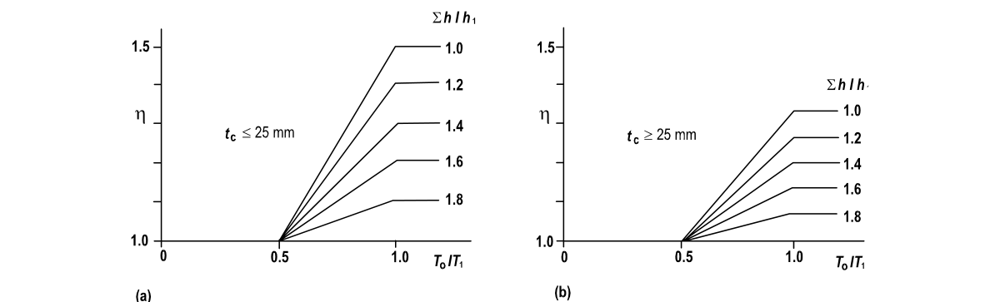
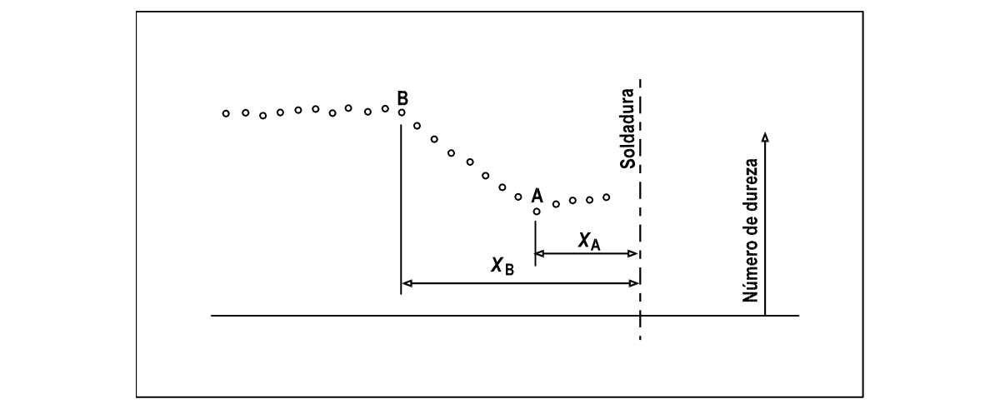

# F.5-E — Regiones afectadas por el calor adyacentes a soldaduras

F.5.E.1 — INTRODUCCION F.5.E.1.1 — GENERALIDADES — Los métodos dados en F.5.4.4 para estimar la severidad y extensión del ablandamiento en la zona afectada por el calor adyacente a soldaduras tiende a ser algunas veces pesimista. Este apéndice da tratamientos alternos para tales casos, que producen valores más favorables de $k_{z}$ (severidad, véase F.5.E.2) y $z$ (extensión, véase F.5.E.3).

En F.5.E.4 se consideran los posibles beneficios del envejecimiento artificial posterior a la soldadura.

Como alternativa del cálculo se permite encontrar la extensión de la región afectada por el calor experimentalmente mediante mediciones de dureza. En F.5.E.5 se dan pautas para hacerlo.

F.5.E.1.2 — CONTROL TERMICO — La extensión del ablandamiento en la zona afectada por el calor, y algunas veces su severidad, depende de la temperatura entre pasadas $T_{o}$ , esto es, la temperatura del material parenteral adyacente al comienzo de la colocación de una pasada de soldadura cualquiera. Los siguientes factores tienden a elevar $T_{o}$ :

(a) Ccolocación de pasadas previas en una unión con pasadas múltiples

(b) Soldadura previa en una unión cercana

(c) Uso de precalentamiento Un excesivo aumento de temperatura puede prevenirse haciendo control térmico durante la fabricación, esto quiere decir, dejando enfriar el metal adecuadamente entre pasadas. Los métodos dados en F.5.4.4.2 y F.5.4.4.3 para estimar los efectos en la zona afectada por el calor son válidos si el control térmico satisface:

(a) Aleaciones de la serie 7*** $T_{o}≤80^{\circ} C$

(b) Otras aleaciones $T_{o}≤100^{\circ} C$ A menudo es posible reducir la extensión del ablandamiento en la zona afectada por el calor, y algunas veces su severidad, ejerciendo un control térmico aún más estricto, es decir, especificando un valor menor de $T_{o}$ . Para aprovechar esta mejoría, el diseñador debe especificar cuál será el control más estricto a usar y dar el valor reducido al que se limitará $T_{o}$ . Cuando se adopte esta práctica, se pueden usar reglas más favorables para la región afectada por el calor dadas en F.5.E.2.3, F.5.E.3.3 y F.5.E.3.4.

F.5.E.2 — COEFICIENTE DE ABLANDAMIENTO $k_{z}$ F.5.E.2.1 — VALORES MODIFICADOS DE $k_{z}$ — Cuando la resistencia está gobernada por $p_{a}$ o $p_{v}$ , en vez de $p_{o}$ , se permite tomar un valor modificado de $k_{z}'$ para el coeficiente de ablandamiento, como se da en la tabla F.5.E.1, en lugar del valor normal de $k_{z}$ dado en la tabla F.5.4.5. Esto se aplica para lo siguiente:

(a) Cortante en vigas (véase F.5.4.5.3)

(b) Falla local en miembros a tensión (véase F.5.4.6.1 (b))

(c) Aplastamiento local en miembros a compresión (véase F.5.4.7.6) El uso del valor modificado $k_{z}'$ en estos casos, es favorable para la mayoría de los materiales (pero no todos).

F.5.E.2.2 — VALOR DE $k_{z}$ PARA OTROS MATERIALES — El coeficiente de ablandamiento ($k_{z}$ o $k_{z}'$ ) para materiales no cubiertos por las tablas F.5.4.5 y F.5.E.1, puede encontrarse usando la tabla F.5.E.2.

F.5.E.2.3 — MATERIAL DE LA SERIE 7*** — Para las soldaduras en tales aleaciones que están sometidas a esfuerzo de tensión actuando en forma transversal al eje de la soldadura, el coeficiente de ablandamiento $(k_{z}=k_{z}')$ debe tomarse como el valor A. El valor de B puede usarse para otras condiciones de esfuerzo.

El valor A debe normalmente tomarse de la tabla apropiada (tabla F.5.4.5 o F.5.E.1). Sin embargo, se permite usar un valor más favorable en los siguientes casos:

(a) Caso 1. Soldadura aislada recta con una sola pasada sin precalentamiento: El valor A puede tomarse igual al valor B, es decir, 1.0 para la condición T4 y 0.8 para la condición T6.

(b) Caso 2. Otras soldaduras con control térmico más estricto: El valor A se puede tomar como sigue:

(1) Para $40^{o} C<T_{o}≤80^{o} C$ para condición T4 $1.2−0.005T_{o}$ para condición T6 $1.0−0.05T_{o}$ (2) Para $T_{o}≤40^{o} C$ para condición T4 $1.0$ para condición T6 $0.8$ Donde:

$T_{o} =$ temperatura entre pasadas, a ser especificada en el contrato F.5.E.3 — EXTENSION DE LA ZONA AFECTADA POR EL CALOR F.5.E.3.1 — GENERALIDADES — Los métodos dados en F.5.4.4.3 para obtener la dimensión $z$ pueden conducir a sobrestimar de extensión de la zona afectada por el calor. Los siguientes artículos dan tratamientos alternos que pueden usarse para obtener estimativos más favorables en ciertos casos.

F.5.E.3.2 — FORMULA MODIFICADA PARA $z$ — Se permite usar la siguiente expresión para $z$ , en lugar de la dada en el literal (b) de F.5.4.4.3.

$z= δ α ηz_{o}$ Donde:

$α$ y $η$ = coeficientes modificadores (véanse los literales (d) y (e) de F.5.4.4.3)

$z_{o}$ = valor básico de $z$ El factor extra $δ$ se toma normalmente como 1.0, pero en los siguientes casos (a) y (b) se permite un valor menor:

(a) Para una unión para la que existen tres o más caminos de temperatura válidos:

$δ =0.75$ Un camino de temperatura válido es el definido en el literal (e) de F.5.4.4.3.

(b) Para una unión recta de longitud $L$ menor que $5z_{o}$ :

$δ =(1.5+1.3L /z_{o})$ $(3+L /z_{o})$ Cuando una unión cabe en ambas categorías, el valor de $δ$ debe ser tomado como el menor de los valores dados en (a) y (b).

F.5.E.3.3 — DETERMINACION ALTERNATIVA DE $α$ — Se permite tomar un valor menor de $α$ en los casos Q y R de la tabla F.5.4.6 para una unión en la que se aplique (a) o (b):

(a) Control térmico normal: $t_{c}$ no excede 25 mm y el área total A (en mm2) de los depósitos de soldadura en la unión es conocida:

$A≤5α =1.0$

$50<A≤150α =0.75+0.005A$

$A>150α =1.5$

(b) Control térmico más estricto:

$t_{c}≤25$ mm $t_{c}>25$ mm

$0.5T_{1}≤T_{o}<T_{1}α =0.5+T_{o}/T_{1}α =2T_{o}/T_{1}$

$T_{o}≤0.5T_{1}α =1.0α =1.0$ Donde:

$T_{o}$ = temperatura entre pasadas reducida (a ser especificada)

$T_{1}$ = temperatura entre pasadas normal = 80°C para aleaciones de la serie 7*** = 100°C para otras aleaciones

$t_{c}$ = espesor de la parte más gruesa unida F.5.E.3.4 — DETERMINACION ALTERNATIVA de $η$ — Cuando se especifica un control térmico más estricto, se permite leer $η$ en la figura F.5.E.1 en lugar de usar el literal (e) de F.5.4.4.3. Las cantidades necesarias para la figura se deben tomar como se indica enseguida:

(a) $T_{o}$ , $T_{1}$ y $t_{c}$ de acuerdo con F.5.E.3.3

(b) $h$ y $h_{1}$ de acuerdo con el literal (e) de F.5.4.4.3

(c) $∑$indica la sumatoria de todos los caminos de temperatura de la unión Cuando $t_{c}>25$ mm y se usa precalentamiento, no se permite ninguna mejoría de $η$ . En tales casos se debe usar el valor total de $η =1.33$.

F.5.E.4 — ENVEJECIMIENTO ARTIFICIAL POSTERIOR A LA SOLDADURA Con aleaciones tratadas en caliente de las series 6*** y 7*** es algunas veces benéfico aplicar un tratamiento térmico en la forma de envejecimiento artificial después de la soldadura. Esto implica calentar el componente soldado a una temperatura entre 100°C y 180°C durante un tiempo de hasta $24h$ . El procedimiento exacto depende de la aleación. Los siguientes beneficios pueden lograrse con tal tratamiento.

(a) El tiempo para alcanzar propiedades mecánicas estables se reduce a un valor por debajo del indicado en el literal (c) de F.5.4.4.2.

(b) La resistencia de partes de la zona afectada por el calor (pero no necesariamente de toda) se eleva. En el diseño puede suponerse ésto para reducir efectivamente la extensión de la zona afectada por el calor.

(c) Hay alguna mejoría en la resistencia del metal de aporte.

Para cuantificar estos beneficios es necesario hacer ensayos usando especímenes representativos (véase F.5.E.5). Se debe simular la situación real en términos de: espesor de metal, geometría, metal de aporte y parámetros de soldadura, así como el tratamiento exacto post-soldadura empleado.

F.5.E.5 — MEDICIONES DE DUREZA F.5.E.5.1 — GENERALIDADES — Se permite determinar la extensión de la zona afectada por el calor experimentalmente (véase el literal (g) de F.5.4.4.3). El método más usual es conducir una medición de dureza.

F.5.E.5.2 — METODO EXPERIMENTAL — El método preferido es el que emplea la técnica Vickers Diamond. Se puede aplicar a cualquier prototipo o fabricación de prueba representando parte de la estructura. El procedimiento consiste en tomar una serie de lecturas de dureza a varias distancias de la soldadura y luego determinar en qué punto las propiedades del material parenteral se han recuperado. Preferiblemente, el espécimen debe ser seccionado perpendicularmente a la soldadura y las lecturas deben tomarse a medio espesor sobre la cara cortada (después de la preparación adecuada de la superficie). Sin embargo, puede ser posible tomar las lecturas directamente sobre la superficie del componente.

F.5.E.5.3 — METODO DE INTERPRETACION 1 — Hay dos métodos permitidos para interpretar los resultados de los cuales el método 1 es preferible.

Un gráfico de dureza típico tiene la forma mostrada en la figura F.5.E.2. Sobre él se pueden distinguir dos puntos A y B tal como se muestra. La dimensión $z$ , usada en el diseño para definir la distancia que se extiende la zona afectada por el calor desde la soldadura, debe tomarse como sigue:

$z=0.5 (X_{A}+X_{B})$ Donde:

$X_{A}$ y $X_{B}$ = distancias de los puntos A y B a la línea central de una soldadura a tope o la raíz de una soldadura de filete F.5.E.5.4 - METODO DE INTERPRETACION 2 - Puede ser usado si sólo se puede distinguir el punto B en el gráfico, es decir, el punto en el que la dureza del material parenteral se ha recuperado efectivamente. El punto A no se puede localizar con facilidad. En este caso, $z$ debe tomarse como:

(a) Para aleaciones de la serie 5*** $z=0.65X_{B}$

(b) Para aleaciones de la serie 6*** $z=0.75X_{B}$

(c) Para aleaciones de la serie 7*** $z=0.90X_{B}$

Figura F.5.E-1 — Extensión de la zona afectada por el calor, factor $η$

**Tabla F.5.E-1**

Coeficiente de ablandamiento modificado $k_{z}'$ de la zona afectada por el calor

| Aleación | Condición | Producto | $k_{z}'$ |
|---|---|---|---|
| Tratadas en caliente |  |  |  |
| 6061 | T6, TF | E, DT | 0,55 |
| 6063 | T4 | E | 1,00 |
|  | T4 | DT | 0,70 |
|  | T4 | F | 0,80 |
|  | T5 | E | 0,75 |
|  | T6 | E, F | 0,55 |
|  | T6 | DT | 0,50 |
| 6082 | T4 | E, S, P, DT, F | 1,00 |
|  | T6 | E, S, P, DT, F | 0,55 |
| 7020 | T4 | E, S, P | 0,80(A), 1,00(B) |
|  | T6 | E, S, P | 0,60(A),0,80(B) |
|  |  |  | (nota 2) |
| No tratadas en caliente |  |  |  |
| 1200 | H14 | S | 0,25 |
| 3103 | H14 | S | 0,30 |
|  | H18 | S | 0,24 |
| 3105 | H14 | S | 0,28 |
|  | H16 | S | 0,24 |
|  | H18 | S | 0,21 |
| 5083 | O, F | E, S, P, DT | 1,00 |
|  | H22 | S, P | 0,55 |
| 5154A | O, F | E, S, P | 1,00 |
|  | H22 | S, P | 0,50 |
|  | H24 | S, P | 0,40 |
| 5251 | F | WT | 0,30 |
|  | F | F | 1,00 |
|  | H22 | S, P | 0,45 |
|  | H24 | S, P | 0,35 |
| 5454 | O, F | E, S, P | 1,00 |
|  | H22 | S | 0,45 |
|  | H24 | S | 0,40 |

NOTA 1. En la columna de producto E, S, P, DT, WT y F se refieren, respectivamente, a extrusión, lámina, plancha, tubería extruida, tubería soldada y forjados.

NOTA 2. Refiérase a F.7.4.4.2 (b) para ver la aplicabilidad de los valores A y B para el material 7020.

**Tabla F.5.E-2**

Determinación general de $k_{z}$ y $k_{z}'$

| Serie de la aleación | Condición | $k_{z}$ (notas 1 y 2) | $k_{z}'$ (notas 1 y 2) |
|---|---|---|---|
| Tratadas en caliente |  |  |  |
| 6*** | O, F | 1,00 | 1,00 |
|  | T4 | 1,00 | 1,00 |
|  | T5 | 0,75 | 0,75 |
|  | T6 | 0,50 | 0,55 |
|  | Otro (nota 3) | $0.50p_{o6}/p_{o}$ | $0.55p_{a6}/p_{a}$ |
| 7*** | O, F | 1,00 | 1,00 |
|  | T4 | 0,80(A) 1,00(B) | 0,80(A) 1,00(B) |
|  | T6 | 0,60(A) 0,80(B) | 0,60(A) 0,80(B) |
|  | Otro (nota 3) | $0.6p_{o6}/p_{o}$(A) $0.8p_{o6}/p_{o}$(B) | $0.6p_{a6}/p_{a}$(A) $0.8p_{a6}/p_{a}$(B) |
| No tratadas en caliente |  |  |  |
| 1***, 3*** ó 5*** | O, F | 1,00 | 1,00 |
|  | Otro (nota 3) | $p_{o0}/p_{o}$ | $p_{a0}/p_{a}$ |

NOTA 1 - es el valor normal. $k_{z}'$ es un valor modificado para usar en ciertos casos (F.5.E.2.1).

NOTA 2. - Notación:

$p_{o}$ y $p_{a}$ esfuerzos límite del material parenteral en la condición usada (tablas F.5.4.1 y F.5.4.2) $p_{o6}$ y $p_{a6}$ esfuerzos límite de los materiales parenterales en la condición T6 $p_{o0}$ y $p_{a0}$ esfuerzos límites de los materiales parenterales en la condición O NOTA 3 - El valor tomado nunca debe exceder 1.0.

Figura F.5.E-2 — Gráfica de dureza típica a lo largo de un camino de calor a partir de una soldadura torsionales de secciones abiertas de pared delgada
