# F.5-F — Formulas generales para las propiedades torsionales de secciones abiertas de pared delgada

F.5.F.1 — GENERALIDADES Este apéndice muestra cómo determinar las propiedades de ciertas secciones, necesarias para cálculos de pandeo que involucren torsión (véase los apéndices F.5.G y F.5.H). Las propiedades de la sección son las siguientes:

(a) Constante de torsión , J (véase F.5.F.2)

(b) Segundo momento polar del área respecto al centro de cortante, $I_{p}$ (véase F.5.F.3)

(c) Coeficiente de alabeo, H (véase F.5.F.4) F.5.F.2 — CONSTANTE DE TORSION La rigidez torsional de un miembro que tiene una sección transversal de pared delgada, está dada por el producto $GJ$ en el que $G$ es el módulo de cortante del material y $J$ es la constante de torsión de la sección transversal. Para secciones abiertas de pared delgada sin variaciones pronunciadas de espesor, tales como rebordes o bulbos, $J$ está dado por:

$J = \int_0^S \dfrac{t^3\,ds}{3}$ Donde:

$t$ = espesor

$s$ = se mide a lo largo de la línea media del perfil

$S$ = longitud total de la línea media Para una sección compuesta únicamente de elementos de lámina plana, cada uno de espesor uniforme, esta ecuación se reduce a la siguiente:

$J= 13∑bt^{3}$ Donde: $b$ es el ancho de un elemento medido a medio espesor del perfil.

Cuando se tiene una sección reforzada con rebordes y/o bulbos, se puede usar la siguiente expresión:

$J=∑{(p+qN )t}4+13∑bt^{3}$ Donde:

$t$ = espesor del material plano adyacente

$N$ = dimensión del reborde o bulbo, como se define en la figura F.5.F.1

$p$ y $q$ = coeficientes leídos en la figura F.5.F.1 La primera sumatoria se extiende a cada región de reborde o bulbo dentro de la sección (véase la figura F.5.F.1).

Para hacer la segunda sumatoria para los elementos planos, el ancho de cualquier elemento que limita con un reborde o bulbo, debe ser ahora medido hasta el borde del área sombreada mostrada en la figura F.5.F.1.

torsionales de secciones abiertas de pared delgada F.5.F.3 — SEGUNDO MOMENTO POLAR DEL AREA RESPECTO AL CENTRO DE CORTANTE El segundo momento polar del área respecto al centro de cortante $I_{p}$ está dado por la siguiente expresión:

$I_{p}=I_{x}+I_{y}=Ag^{2}$ Donde:

$I_{x}$ e $I_{y}$ = segundo momento del área respecto a los ejes centroidales

$A$ = área de la sección

$g$ = distancia entre el centroide $G$ y el centro de cortante $S$ La posición de $S$ se puede encontrar de acuerdo con lo siguiente:

para secciones bisimétricas o con simetría oblicua, $S$ coincide con $G$

(a) Para secciones compuestas enteramente de aletas salientes (tales como ángulos, secciones en $T$ o cruciformes), $S$ se ubica en el punto de intersección de los elementos componentes

(b) Para ciertos tipos específicos de sección, véase la figura F.5.F.2

(c) Para secciones monosimétricas compuestas de elementos planos, generalmente, véase F.5.F.5

(d) Para secciones asimétricas compuestas de elementos planos, generalmente, véase F.5.F.7 F.5.F.4 — COEFICIENTE DE ALABEO El coeficiente de alabeo $H$ puede encontrarse de acuerdo con lo siguiente:

(a) Para secciones compuestas enteramente de aletas salientes (tales como ángulos, secciones en $T$ o cruciformes), conservadoramente se puede suponer $H$ igual a cero

(b) Para ciertos tipos específicos de sección, véase la figura F.5.F.2

(c) Para secciones monosimétricas compuestas de elementos planos, véase F.5.F.5

(d) Para secciones con simetría oblicua compuestas de elementos planos, véase F.5.F.6

(e) Para secciones asimétricas compuestas de elementos planos, véase F.5.F.7 F.5.F.5 — SECCIONES MONOSIMETRICAS COMPUESTAS POR ELEMENTOS PLANOS F.5.F.5.1 — NOTACION Y CONVENCION DE SIGNOS — La sección se descompone en $2V$ elementos planos, numerados de $1$ a $V$ a cada lado del eje de simetría AA, contando hacia afuera del punto B donde la sección transversal intersecta AA (véase la figura F.5.F.3). La siguiente notación se relaciona con el R-ésimo elemento de la mitad superior de la sección:

$b$ = ancho del elemento

$t$ = espesor del elemento

$a$ = distancia perpendicular desde el punto medio del elemento hasta AA

$c$ = ancho proyectado del elemento sobre un eje perpendicular a AA

$d$ = distancia perpendicular desde B hasta la línea central del elemento

$P= ∑Rbd$ $2$ La sumatoria para $P$ abarca solamente la mitad de la sección por encima de AA. Empieza con el segundo elemento ya que no hay contribución del primer elemento (para el cual $d=0$).

La convención de signos es la siguiente:

torsionales de secciones abiertas de pared delgada

(a) $a$ , $b$ y $t$ son siempre positivos

(b) $c$ es positivo si el elemento considerado en el sentido hacia B es convergente con AA y es negativo si es divergente

(c) $d$ se toma como positivo si el elemento producido en el sentido hacia B tiene a B a su izquierda, y negativo si B está a su derecha F.5.F.5.2 - FORMULAS - La distancia e a la que se ubica el centro de corte a la izquierda de B está dada por:

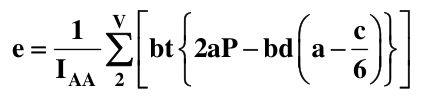

Donde:

$I_{AA}$= segundo momento del área de toda la sección respecto a AA El coeficiente de alabeo, $H$ , está dado por:

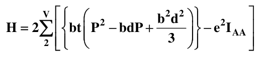

Este tratamiento sólo cubre las secciones que pueden ser desarrolladas a partir de una sola lámina (posiblemente de espesor variable). Para secciones que se bifurcan es necesario consultar la literatura pertinente.

F.5.F.5.3 — CALCULO DEL ESPECIMEN — La tabla F.5.F.1 presenta el cálculo del especimen para una sección monosimétrica. Los elementos tomados en consideración en este cálculo son los números dentro de triángulos en el diagrama de la tabla F.5.F.1.

F.5.F.6 — SECCION CON SIMETRIA OBLICUA COMPUESTA DE ELEMENTOS PLANOS F.5.F.6.1 — NOTACION Y CONVENCION DE SIGNOS — La sección se descompone en $2V$ elementos planos, numerados de $1$ a $V$ sobre cada lado del punto de simetría G, contando hacia G (véase la figura F.5.F.4). La siguiente notación se refiere al R-ésimo elemento en la mitad superior de la sección.

$b$ = ancho del elemento

$t$ = espesor del elemento

$d$ = distancia perpendicular desde G a la línea central del elemento

$A$ = área de la sección total

$P= ∑Rbd$ $2$ La sumatoria $P$ abarca la mitad de la sección solamente. Empieza con el segundo elemento ya que no hay contribución del primero (para el cual $d=0$). La convención de signos es la siguiente:

(a) $b$ y $t$ son siempre positivos

(b) $d$ se toma como positivo si es elemento producido en el sentido hacia G tiene a G a su izquierda, y negativo si G está a su derecha.

F.5.F.6.2 — FORMULA — El coeficiente de alabeo, H, está dado por la siguiente expresión:

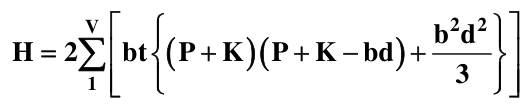

Donde:

torsionales de secciones abiertas de pared delgada

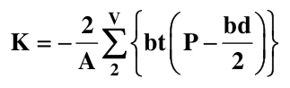

Este tratamiento sólo cubre una sección que pueda ser desarrollada a partir de una sola lámina (posiblemente de espesor variable). Para secciones que se bifurcan, consulte la literatura pertinente.

F.5.F.6.3 — CALCULO DEL ESPECIMEN — La tabla F.5.F.2 da el cálculo del especimen de una sección con simetría oblicua. Los elementos tomados en cuenta en este cálculo son los números entre triángulos en el diagrama de la tabla F.5.F.2.

F.5.F.7 — SECCION ASIMETRICA COMPUESTA DE ELEMENTOS PLANOS F.5.F.7.1 — NOTACION Y CONVENCION DE SIGNOS — La sección se descompone en $n$ elementos planos, numerados de $1$ a $n$ empezando por el extremo E de la sección (véase la figura F.5.F.5).

La siguiente notación se relaciona con el r-ésimo elemento:

$b$ = ancho del elemento

$t$ = espesor del elemento

$a_{u}$ y $a_{v}$ = coordenadas del punto medio $R$ del elemento con respecto a $u$ , $v$ (ejes principales de la sección)

$c_{u}$ y $c_{v}$ = anchos proyectados del elemento sobre $u$ y $v$ respectivamente

$d$ = distancia perpendicular desde G (centroide de la sección)

$d'$ = distancia perpendicular desde S (centro de corte). $U$ y $V$ son las coordenadas de S

$P= ∑rbd$ $1$

$P'= ∑rbd'$ $1$ La convención de signos es la siguiente:

(a) $b$ y $t$ son siempre positivos

(b) $a_{u}$ y $a_{v}$ son las coordenadas reales de $R$ , pueden ser positivas o negativas dependiendo del cuadrante en que se ubica $R$

(c) $c_{u}$ y $c_{v}$ son positivas si $U$ (o $V$ ) se incrementa dentro del elemento en el sentido hacia afuera desde el anterior (r-1)-ésimo elemento, y negativo si $U$ (o $V$ ) decrece

(d) $d$ y $d'$ son positivos si el elemento producido en el sentido hacia afuera desde el (r-1)-ésimo elemento tiene un momento antihorario respecto a G (o S), y negativo si es en sentido horario.

F.5.F.7.2 — FORMULAS — Las coordenadas del centro de corte, $S$, están dadas por:

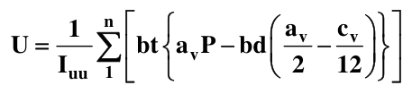

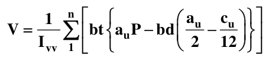

Donde:

$I_{uu}$, $I_{vv}$= segundo momento del área de la sección respecto a $G_{u}$ y $G_{v}$ El coeficiente de alabeo, $H$ , está dado por:

torsionales de secciones abiertas de pared delgada

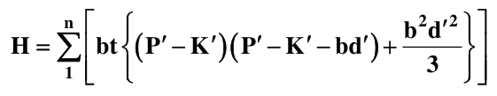

Donde:

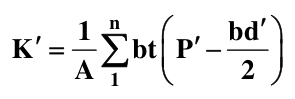

$A$ es el área de la sección.

Este tratamiento solamente cubre secciones que puedan ser desarrolladas a partir de una sola pieza de lámina (posiblemente de espesor variable). Para secciones con bifurcaciones, hay que consultar la literatura apropiada.

F.5.F.7.3 — CALCULO DEL ESPECIMEN — La tabla F.5.F.3 muestra el cálculo del especimen de una sección asimétrica. Los elementos considerados en este cálculo son los números dentro de triángulos en el diagrama de la tabla F.5.F.3.

torsionales de secciones abiertas de pared delgada

**Tabla F.5.F-1**

Cálculo del especimen: forma monosimétrica

| Todas las dimensiones están en milímetros |  |  |  |
|---|---|---|---|
| $R =$ | 2 | 3 | 4 |
| $b$ | 30 | 128 | 32 |
| $t$ | 5 | 5 | 8 |
| $a$ | 60 | 100 | 127 |
| $c$ | 0 | 80 | -25 |
| $d$ | 60 | 28 | 189 |
| $bd$ 1.80 x 103 3.58 x 103 6.05 x 103 $P$ 1.80 x 103 5.40 x 103 1.14 x 104 $2aP$ 2.16 x 105 1.08 x 106 2.90 x 106 $bd (a−c /6)$1.08 x 105 3.10 x 105 7.94 x 105 $2aP−bd (a−c /6)$1.08 x 105 7.70 x 105 2.11 x 106 $bt {2aP−bd (a−c /6)}$1.62 x 107 4.93 x 108 5.40 x 108 Sumatoria de la última línea $=1.05 x 10^{9}$ mm5 $I_{AA}$ (obtenido mediante cálculo no mostrado) $=2.35 x 10^{7}$ mm4 Posición del centro de corte $e=\frac{1.05 x 10^{9}}{2.35 x 10^{7}}=45$ mm $P^{2}$ 3.24 x 106 2.92 x 107 1.30 x 108 $bdP$ 3.24 x 106 1.93 x 107 6.90 x 107 $b^{2} d^{2}/3$ 1.08 x 106 4.28 x 106 1.22 x 107 $P^{2}−bdP+b^{2} d^{2}/3$1.08 x 106 1.42 x 107 7.32 x 107 $bt (P^{2}−bdP+b^{2} d^{2}/3)$1.62 x 108 9.09 x 109 1.87 x 1010 Sumatoria de la última línea $=2.80 x 10^{10}$ mm6 Coeficiente de alabeo $H=(2 x 2.80 x 10^{10}) −(45 x 1.05 x 10^{9})=8.7 x 10^{9}$ mm6 |  |  |  |

torsionales de secciones abiertas de pared delgada

**Tabla F.5.F-2**

Cálculo del especimen: forma de simetría oblicua

| Todas las dimensiones están en milímetros, a menos que se indique otra cosa |  |  |  |
|---|---|---|---|
| $R =$ | 1 | 2 | 3 |
| $b$ | 50 | 40 | 20 |
| $t$ | 2 | 3 | 3 |
| $d$ | 0 | 40 | -70 |
| $bd$ 0 1600 -1400 $P$ 0 1600 200 $bt (P−bd /2)$0 96000 54000 Sumatoria de la última línea $=150000$ mm4 $−2 x 150000$ $K== −535.7$ mm2 $560$ $(P+K)(P+K−bd)$287 x 103 -570 x 103 -357 x 103 0 853 x 103 653 x 103 28.7 x 106 34.0 x 106 17.8 x 106 Sumatoria de la última línea = 80.5 x 106 mm6 Coeficiente de alabeo $H=(2 x 80.5 x 10^{6})=161 x 10^{6}$ mm6 |  |  |  |

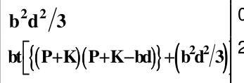

torsionales de secciones abiertas de pared delgada

**Tabla F.5.F-3**

Cálculo del especimen: forma asimétrica

| $x=36.1$ $y=62.5$ $α =9.93^{\circ}$ $I_{uu}=8.24 x 10^{4}$ $I_{vv}=1.22 x 10^{4}$ $A=1 969$ mm2 |  |  |  |  |
|---|---|---|---|---|
|  |  | 2 | 3 | 4 |
|  |  | 113.1 | 80.0 | 80.0 |
|  |  | 6.0 | 4.0 | 10.0 |
|  |  | 37.9 | 36.1 | 62.5 |
|  |  | -6.0 | -31.6 | 14.6 |
|  |  | -57.3 | 28.4 | 60.9 |
|  |  | -65.0 | 13.8 | 78.8 |
|  |  | 92.6 | 78.8 | -13.8 |
|  |  | 4283 1455 -8.8 x 103 -83.3 x 103 10.2 x 103 -155.7 x 103 -12.9 x 106 -49.1 x 106 | 2886 4341 -137.4 x 103 123.4 x 103 -49.0 x 103 22.1 X 103 -28.3 X 106 32.4 X 106 | 5003 9344 137.8 x 103 569.3 x 103 3.8 x 103 158.2 x 103 106.4 x 106 328.9 x 106 |
| mm |  |  |  |  |
|  | -164.3 -4647 -4647 -0.394 x 106 | 32.8 3717 -930 -1.893 x 106 | -12.9 -1036 -1966 -0.463 x 106 | 20.6 1649 -317 -0.913 x 106 |
| mm2 |  |  |  |  |
|  | -5.185 x 106 7.198 x 106 342 x 106 | -2.594 x 106 4.605 x 106 1365 x 106 | -0.098 x 106 0.358 x 106 83 x 106 | -0.913 x 106 0.906 x 106 595 x 106 |
| $H$ = sumatoria de la última línea = 2.385 x 109 mm6 |  |  |  |  |

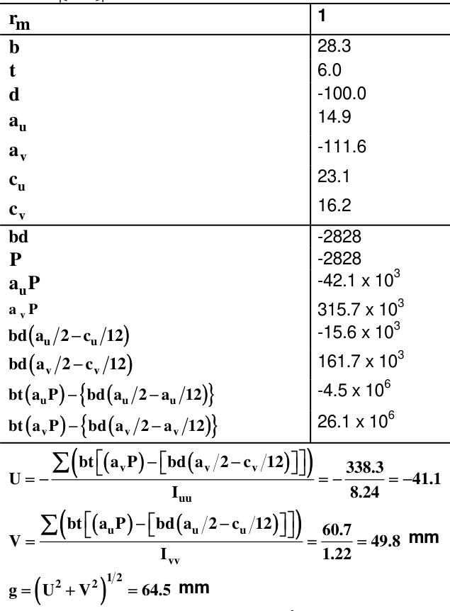

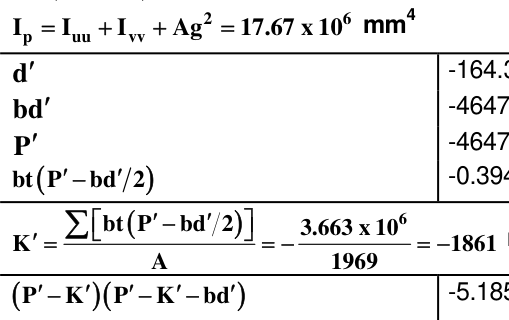

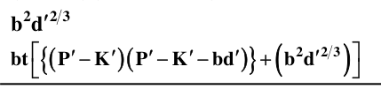

torsionales de secciones abiertas de pared delgada

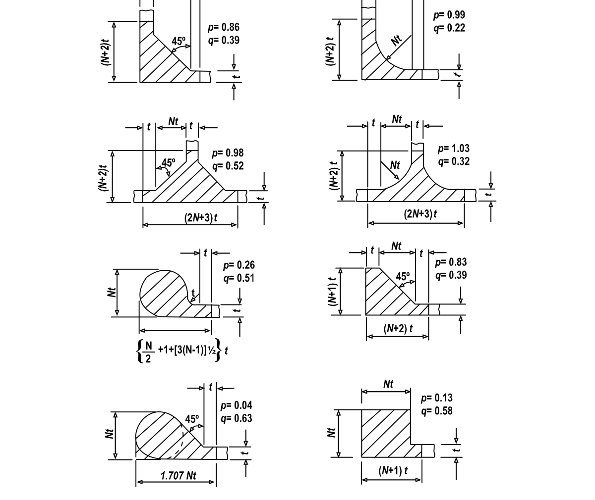

Figura F.5.F-1 — Coeficientes constantes de torsión para ciertos filetes y bulbos torsionales de secciones abiertas de pared delgada

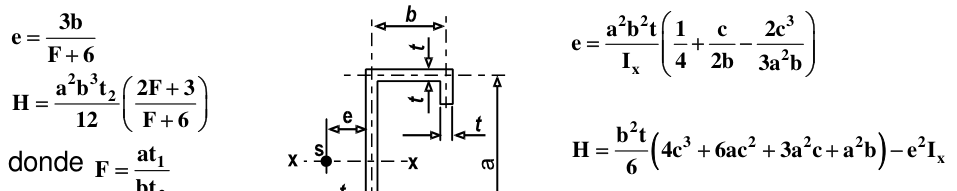

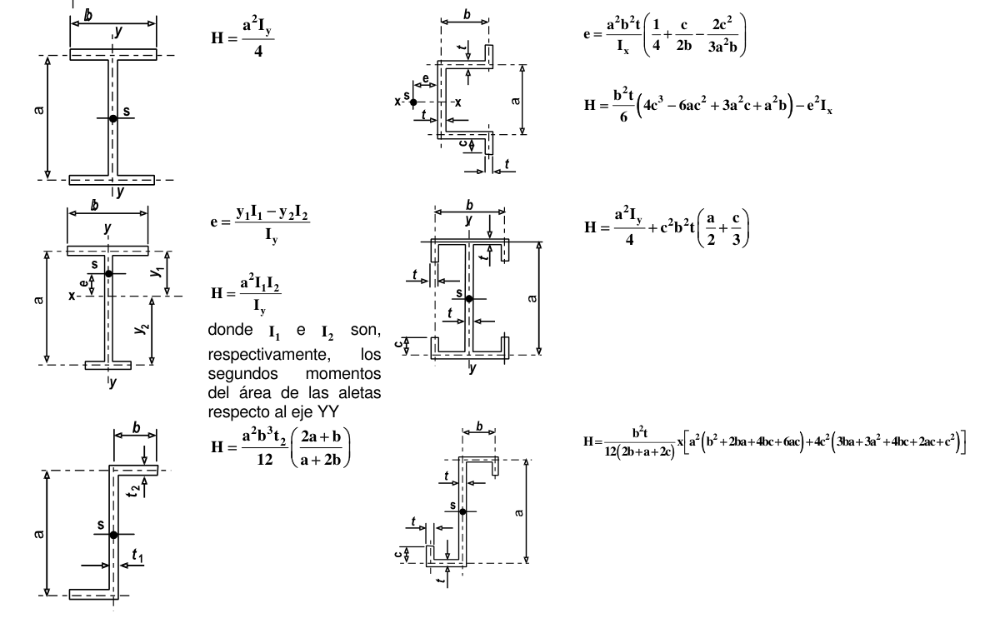

Figura F.5.F-2 — Posición del centro de corte $( S)$ y coeficiente de alabeo $(H)$ para algunas secciones de pared delgada torsionales de secciones abiertas de pared delgada

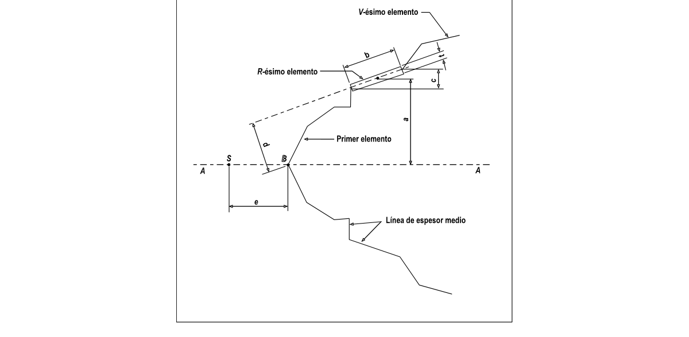

Figura F.5.F-3 — Notación de sección monosimétrica

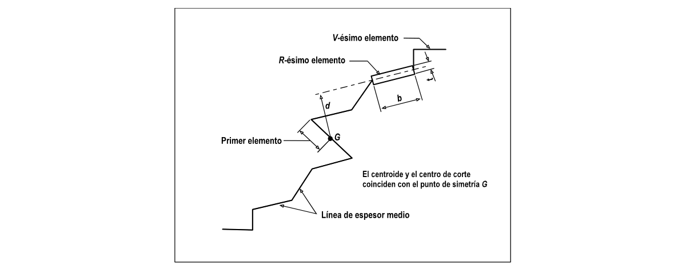

Figura F.5.F-4 — Notación de sección con simetría oblicua torsionales de secciones abiertas de pared delgada

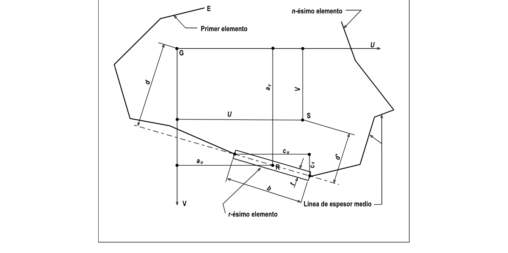

Figura F.5.F-5 — Notación de sección asimétrica
