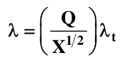
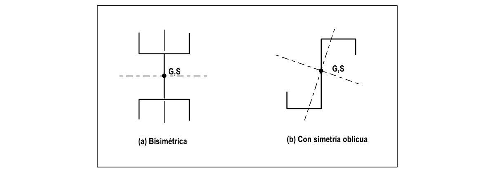
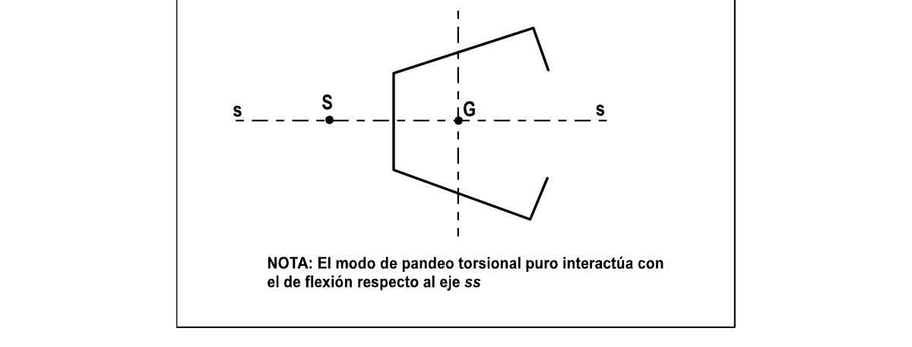
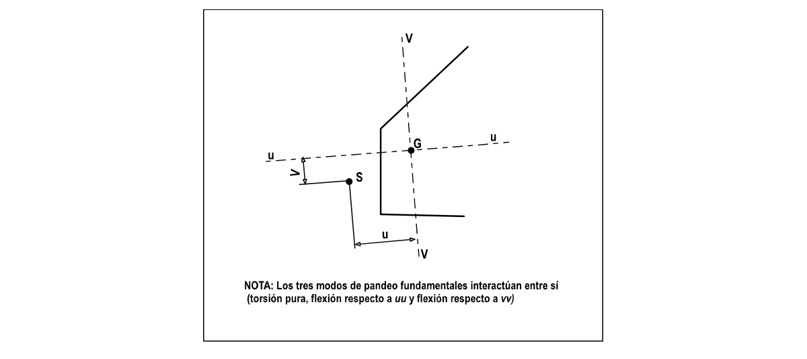

# F.5-H — PANDEO TORSIONAL DE MIEMBROS A COMPRESION: DETERMINACION DEL PARAMETRO DE ESBELTEZ $λ$

F.5.H.1 — GENERALIDADES En el diseño de miembros a compresión, la determinación rigurosa del parámetro de esbeltez $λ$ para pandeo torsional tiende a ser laboriosa. En F.5.4.7.4(b) se da un procedimiento simplificado que usa fórmulas empíricas (véase la tabla F.5.4.9) pero éste cubre sólo un rango limitado de formas de sección. El propósito de este apéndice es presentar un procedimiento general que permita encontrar $λ$ para cualquier sección. Este procedimiento más riguroso puede, por supuesto, ser aplicado a las secciones de la tabla F.5.4.9 si se desea y se obtendrá economía.

El tratamiento involucra el uso de las siguientes propiedades de la sección que pueden encontrarse siguiendo el apéndice F.5.F:

(a) $J$ constante de torsión

(b) $I_{p}$ segundo momento polar del área respecto al centro de corte

(c) $H$ coeficiente de alabeo F.5.H.2 — MODOS DE PANDEO Hay tres modos fundamentales para el pandeo general de un miembro a compresión que se describen a continuación (Donde: $uu$ y $vv$ son los ejes principales de la sección):

(a) Pandeo como columna puro, es decir flexionante, respecto a $vv$

(b) Pandeo como columna puro respecto a $uu$

(c) Pandeo torsional puro El pandeo torsional puro se define como una rotación general del cuerpo de la sección respecto a su centro de corte en la parte central de la longitud del miembro. En la práctica, este pandeo torsional puro sólo se observa en ciertas formas de sección. En la mayoría de las formas hay interacción entre torsión pura y flexión, y el centro de rotación cae por fuera del centro de cortante. La disminución de resistencia por pandeo torsional debe tenerse en cuenta en el diseño.

El valor requerido para el parámetro de esbeltez $λ$ para tener en cuenta la interacción con la flexión, se obtiene mediante la siguiente expresión:

$λ = kλ_{t}$ Donde:

$k$ = coeficiente de interacción (véase F.5.H.4)

$λ_{t}$ = parámetro de esbeltez correspondiente a pandeo torsional (véase F.5.H.3) F.7.H.3 — DETERMINACION $λ_{t}$ La expresión general para la esbeltez $λ_{t}$ correspondiente a pandeo torsional puro es la siguiente:

$λ_{o}$

$λ_{t} =(1+26H / Jl^{2})1 /2$ determinación del parámetro de esbeltez $λ$ Donde:

$λ_{o}$ = $5.14 (I_{p}/J)1 /2$

$l$ = longitud efectiva de pandeo Debe notarse que las secciones compuestas de aletas salientes radiantes no se alabean cuando se retuercen $(H=0)$.

Ejemplos de tales formas son ángulos, secciones en $T$ y cruciformes.

F.5.H.4 — DETERMINACION DE $k$ F.5.H.4.1 — SECCION LIBRE DE INTERACCION CON FLEXION — Los tres tipos de modo de pandeo general (véase F.5.H.2), no interactúan entre sí cuando la sección es de uno de los siguientes tipos (véase la figura F.5.H.1):

(a) Bisimétrica

(b) Con simetría oblicua Para tales secciones, $k=1$, o en otras palabras $λ = λ_{t}$ .

Para calcular $λ_{t}$ , se debe tomar una l igual a la usada para pandeo como columna respecto del mayor eje principal (véase F.5.4.7.3 (b)).

F.5.H.4.2 — SECCIONES MONOSIMETRICAS — Para secciones con un solo eje de simetría (véase la figura F.5.H.2), el modo torsional puro interactúa con el pandeo como columna respecto a $ss$ , entonces:

$λ = kλ_{t}$ Donde:

$k$ = se lee en la figura F.5.4.1 tomando $s$ y $X$ como sigue:

$s = λ_{s}/λ_{t}$

$X=I_{g}/I_{p}$ Donde:

$λ_{s}$= parámetro de esbeltez para pandeo como columna puro respecto a $ss$

$λ_{t}$ = parámetro de esbeltez para pandeo torsional puro

$I_{g}$ = segundo momento polar del área respecto al centroide $G$

$I_{p}$ = segundo momento polar del área respecto al centro de corte $S$ La longitud efectiva $l$ a usar para encontrar $λ_{s}$ y $λ_{t}$ debe encontrarse de acuerdo con F.5.4.7.3(b), con base en el pandeo como columna respecto a $ss$ .

Para tales secciones, el pandeo como columna respecto al eje perpendicular a $ss$ ocurre independientemente, sin interacción.

F.5.H.4.3 — SECCIONES ASIMETRICAS — Cuando la sección no tiene eje de simetría, como en la figura F.5.H.3, todos los tres modos fundamentales interactúan, conduciendo a una ecuación para $λ$ dada por:

Donde:

$Q$ = $s_{v}{3X/(C+s^{2}_{v})}1 /2$ determinación del parámetro de esbeltez $λ$

$X$ = $I_{g}/I_{p}$

$s_{v}$ = $λ_{v}/λ_{t}$

$λ_{v}$ = parámetro de esbeltez para pandeo como columna puro respecto a $vv$

$λ_{t}$ = parámetro de esbeltez para pandeo torsional puro

$C$ = $(1−u^{2}/r_{p}^{2}) +(1−v^{2}/r_{p}^{2})γ$

$r_{p}$ = radio polar de giro de la sección respecto al centro de corte $S$

$u$ y $v$ = coordenadas del centro de corte (véase la figura F.5.H.3)

$x$ = la menor raíz de la siguiente ecuación cúbica:

$x^{3}−3x^{2}+Ax−B=0$ Donde:

$9X{γ +s^{2}_{v}(1+ γ)}$

$A=(C+s^{2}_{v})2$ $27X^{2}γs^{2}_{v}$

$B=$ $(C+s^{2 3}_{v} )$ Donde:

$γ$ = $I_{u}/I_{v}$

$I_{u}$ e $I_{v}$ = segundo momento del área respecto de los ejes principales de la sección, $uu$ y $vv$ La ecuación cúbica puede resolverse con ayuda del nomograma dado en la figura F.5.H.4.

Figura F.5.H-1 — Secciones que no muestran interacción entre los modos de pandeo torsional puro y de flexión determinación del parámetro de esbeltez $λ$

Figura F.5.H-2 — Sección monosimétrica

Figura F.5.H-3 — Sección asimétrica determinación del parámetro de esbeltez $λ$ NOTA: La figura se tomó de R. Kappus, “Twisting failure of centrally loaded open section columns in the elastic range”, NACA Technical Memorandum No. 851, 1938.

Figura F.5.H-4 — Nomograma para resolver la ecuación cúbica $x^{3}−3x^{2}+Ax−B=0$
