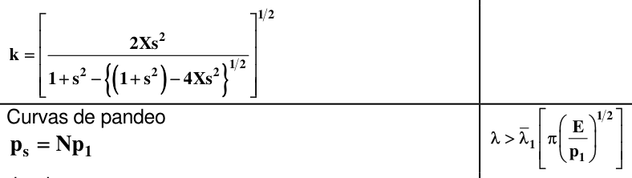
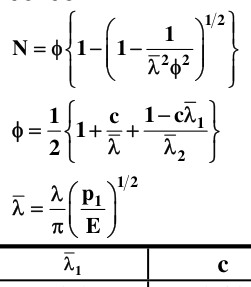
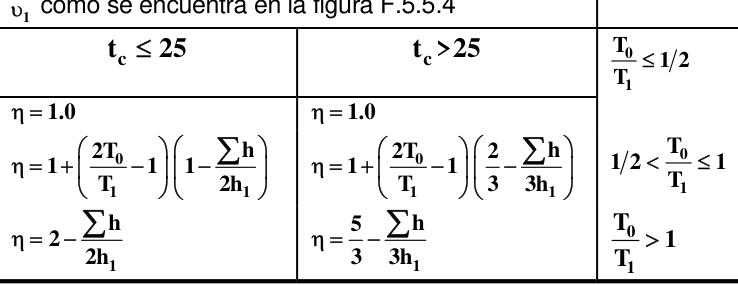
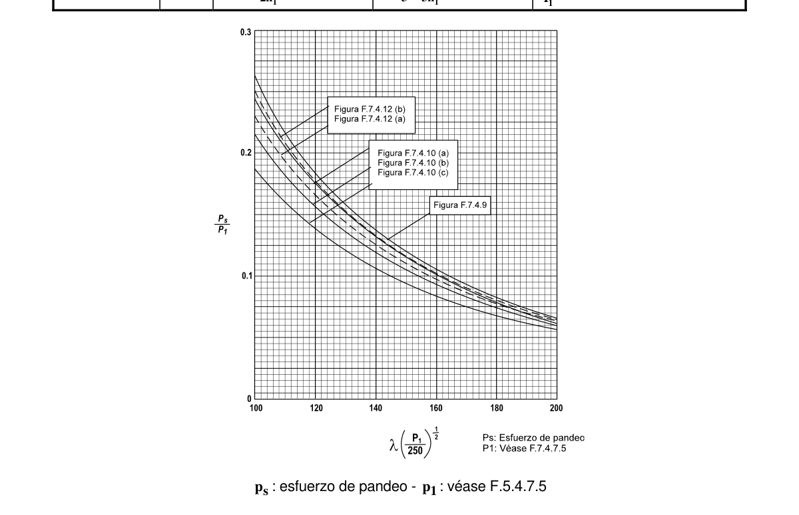

# F.5-I — Ecuaciones de curvas de diseño

F.5.$I$.1 — USO DE FORMULAS En F.5.4 y F.5.5, donde se hace referencia a curvas de diseño, se permite al diseñador usar en su lugar las fórmulas en las que se basan dichas curvas. Estas están dadas en la tabla F.5.$I$.1.

F.5.$I$.2 — PANDEO GENERAL PARA ELEVADA ESBELTEZ Las curvas de diseño dadas en la sección F.5.4 para pandeo general de vigas y miembros a compresión (véanse las figuras F.5.4.9, F.5.4.10 y F.5.4.12) siempre terminan en una esbeltez dada por $λ =130$. Para valores mayores de $λ$ , el diseñador debe o usar la fórmula apropiada de la tabla F.5.$I$.1 o consultar la figura F.5.$I$.1.

**Tabla F.5.** — $I$-1

Ecuaciones de las curvas de diseño

| Figura | Curva | Fórmula |  | Rango |
|---|---|---|---|---|
| F.5.4.2 | B A | $g=1$ $g=0.65+0.35y_{o}/y_{c}$ $g=0.65+0.30y_{o}/y_{c}$ $g=0.7 / (1−y_{o}/y_{c})$ |  | $1≥y_{o}/y_{c}≥0$ $0≥y_{o}/y_{c}≥−1$ $y_{o}/y_{c}≤−1$ |
| F.5.4.4 (a) (b) (c) |  | $h={1+0.1 (c /t−1^{2})}−1 /2$ $h={1+2.5 (c /t−1^{2})/(b /t)}−1 /2$ $h={1+4.5 (c /t−1^{2})/(b /t)}−1 /2$ |  | $c /t≥1$ |
| F.5.4.5 (a) (b) F.5.4.11 | A B C D E | $k_{L}=11 /x−28 /x^{2}$ $k_{L}=105 /x^{2}$ $k_{L}=10 /x−24 /x^{2}$ $k_{L}=105 /x^{2}$ $k_{L}=32 /x−220 /x^{2}$ $k_{L}=29 /x−198 /x^{2}$ $k_{L}=1 034 /x^{2}$ donde $x = β /ε$ |  | $7<x≤12.1$ $x≥12.1$ $6<x≤12.9$ $x≥12.9$ $x>22$ $x>18$ |
|  |  | donde |  |  |
| F.5.4.9 F.5.4.10 (a) (b) (c) F.5.4.12 (a) (b) |  | 0.6 | 0.10 |  |
|  |  | 0.2 | 0.20 |  |
|  |  | 0.2 | 0.45 |  |
|  |  | 0.2 | 0.80 |  |
|  |  | 0.4 | 0.35 |  |

$$ \upsilon _{1}=\left\{5.35\left(\dfrac{d}{a}\right)^{2}+4\right\}\dfrac{430}{(d/t\varepsilon )^{2}}\qquad 1.0\ge \dfrac{a}{d}\ge 0.5 $$

**Tabla F.5.** — $I$-1 (continuación)

Ecuaciones de las curvas de diseño

| Figura | Curva | Fórmula | Rango |
|---|---|---|---|
| F.5.5.4 |  |  |  |
| F.5.5.5 F.5.5.6 F.5.5.7 |  | donde: |  |
| F.5.E.1 |  |  |  |

$$ \upsilon _{1}=\left\{5.35+4\left(\dfrac{d}{a}\right)^{2}\right\}\dfrac{430}{(d/t\varepsilon )^{2}}\qquad 2.5\ge \dfrac{a}{d}>1.0 $$

$$ \begin{aligned} \upsilon _{2}&=3^{1/2}Q\operatorname{sen}^{2}\theta \left[\cot \theta -\dfrac{a}{d}\right] &&\qquad 2.5\ge \dfrac{a}{d}>1.0 \\ \upsilon _{3}&=2\left(3^{1/2}\right)Q^{1/2}\operatorname{sen}\theta &&\qquad 1.0\ge \dfrac{a}{d}\ge 0.5 \\ m_{1}&=Q^{1/2}\dfrac{a}{d}\operatorname{sen}\theta \end{aligned} $$

$$ \begin{aligned} Q&=\left\{1-\upsilon _{1}^{2}\left[1-\dfrac{3\operatorname{sen}^{2}2\theta }{4}\right]\right\}^{1/2}-\dfrac{3^{1/2}}{2}\upsilon _{1}\operatorname{sen}2\theta \\ \theta &=\dfrac{2}{3}\tan ^{-1}\left(d/a\right)\end{aligned} $$

Figura F.5.$I$-1 — Resistencia al pandeo con alta esbeltez
