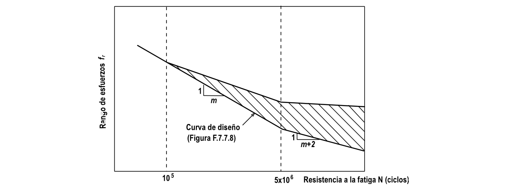

# F.5-J — Datos de resistencia a la fatiga

F.5.J.1 — DERIVACION DE LOS DATOS $f_{r}−N$ Las curvas $f_{r}−N$ de diseño dadas en la figura F.5.7.9 se obtuvieron de datos de ensayos de amplitud constante con resistencias a la fatiga generalmente en la región de 105 a 2 106 ciclos. La mayoría de los datos fueron obtenidos para especímenes de lámina de 6 mm a 12 mm de espesor. Más recientemente, se ha incluido una base de datos de aproximadamente 120 curvas $f_{r}−N$ para vigas $I$ extruídas y ensambladas con espesores entre 8 mm y 15 mm. Los materiales cubren las aleaciones de las series 5*** y 6*** más comúnmente usados y la aleación 7020.

Las curvas de diseño representan una probabilidad de supervivencia de por lo menos 97.5% para los detalles clasificados ensayados, cuando todos los datos de ensayo relevantes para cada tipo de detalle se analizan conjuntamente. Típicamente, la curva $f_{r}−N$ de resistencia media a la fatiga para los datos de cualquier tipo de detalle, es del 30% al 50% más elevada que la curva de diseño.

Las curvas se consideran seguras para cualquier condición de esfuerzo medio hasta el esfuerzo de prueba a tensión. No se recomienda usar relajación para esfuerzos medios inferiores aplicados ya que el esfuerzo local medio real en lugares de iniciación potencial de agrietamiento por fatiga puede ser aún alto aunque el esfuerzo nominal no lo sea. Esto se aplica particularmente a estructuras soldadas y estructuras complejas donde pueden ocurrir encogimiento de la soldadura y desajuste, respectivamente.

La curva nueva producida mediante el cambio de pendiente de la curva de diseño más allá de 5 106 ciclos, se ha escogido como el límite inferior para tener en cuenta los daños debidos al rango de esfuerzos altos del espectro. Un rango de alto esfuerzo puede hacer que rangos de esfuerzo por debajo del nivel de esfuerzo de no propagación inicial se sumen a los que causan crecimiento de grietas. En ausencia de datos de ensayos de amplitud variable, la menor pendiente de $m+2$ ha sido encontrada, mediante procedimientos de mecánica de fracturas, segura para las formas de espectro más comúnmente usadas.

F.5.J.2 — CONDICIONES EN QUE PUEDEN DARSE RESISTENCIAS A LA FATIGA MÁS ALTAS En algunos diseños en que la fatiga domina y en los que el logro de la masa mínima o el costo inicial mínimo es de particular importancia económica, puede haber necesidad de recurrir a la opción de obtener datos específicos para la fatiga (véase F.5.8.4.4). Para tomar la decisión de obtener o no datos adicionales mediante ensayos se deben considerar los siguientes factores.

(a) Pueden haber beneficios cuando los esfuerzos residuales se mantienen bajos o a compresión y en la dirección de la fluctuación de esfuerzos, ésto se logra con una secuencia de fabricación cuidadosamente controlada (particularmente la soldadura) o mediante una técnica mecánica de mejoramiento adecuada (por ejemplo, expansión de agujeros o martillado de la intersección de la soldadura con el metal de base). Los principales beneficios se obtienen cuando el daño se origina principalmente a partir de rangos de esfuerzos de resistencia a la fatiga altos en el espectro (véase la figura F.5.J.1).

(b) Se tienen resistencias a la fatiga más altas cuando la escala del componente es pequeña. Esto puede aplicarse cuando los espesores y tamaños de soldadura son menores de 6 mm.

(c) Si hay un gradiente de esfuerzos con una reducción rápida de esfuerzos al alejarse del sitio de iniciación, se pueden tener resistencias a la fatiga mayores, por ejemplo en un accesorio soldado transversalmente o en una lámina a flexión.

(d) Si la forma del espectro es bastante plana, con un gran número de ciclos en o por debajo del nivel de esfuerzo no propagante de amplitud constante, la pendiente efectiva más allá de 5 106 ciclos puede ser significativamente más plana (véase la figura F.5.J.1).

Si se recurre a los ensayos y se obtiene una resistencia más alta, es importante que las condiciones de fabricación no se varíen de ningún modo durante la producción. Esto se aplica a la geometría del detalle, secuencia (incluyendo prensado y soldadura), calidad de soldadura, preparación de la superficie (incluyendo maquinado, taladrado de agujeros y limpieza).

Figura F.5.J-1 — Zona de la mayor variación en las curvas efectivas $f_{r}−N$ █
