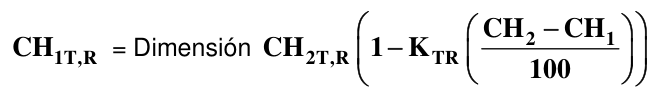

# G-C — Contracciones

G-C-1 — COEFICIENTE DE CONTRACCIÓN DE MADERAS COLOMBIANAS En la tabla G-C-1, aparecen los coeficientes de contracción determinados experimentalmente para las especies de los grupos ES1, ES2, ES3, ES4, ES5, ES6 se deben utilizar para determinar los cambios en dimensiones que se presentan por los cambios en dimensiones que se presentan por cambios en el contenido de humedad CH%, siendo esta una relación lineal, para la cual se debe utilizar la siguiente formula.

Dimensión = Dimensión En donde:

Dimensión $CH_{1T,R}$= Dimensión a la humedad $CH_{1}$ , en dirección tangencial o radial Dimensión $CH_{2T,R}$= Dimensión a la humedad $CH_{2}$ en dirección tangencial o radial

$1K_{TR}$= Coeficiente de contracción lineal en la dirección tangencial o radial entre CH=15 y CH=0 Para los casos en que el contenido de humedad cambie, entre los periodos de construcción y servicio, se deberán tener en cuenta este cambio dimensional.

Igualmente la relación contracción volumétrica, tabla G-C-1 y contracción tangencial/contracción radial según las tablas G-C.2 a G-C.8, nos indica el grado de estabilidad dimensional de la especie.

**Tabla G-C.1**

Contracción volumétrica %

|  | Norma DIN total Verde a anhidro | Norma DIN parcial (CH15% a anhidro ) |
|---|---|---|
| Pequeña | Menor de 10 | Menor de 4.5 |
| Moderada | 10 - 15 | 5.0 - 7.0 |
| Alta | 15 - 20 | 7.5 - 10 |
| Muy alta | > 20 | > 11 |

**Tabla G-C.2**

Relación: Contracción tangencial/contracción radial $R=C_{T}/C_{R}$

| Muy estable | Menor de 1.5 |
|---|---|
| Estable | 1.5 -1.8 |
| Moderadamente estable | 1.8 - 2.4 |
| Inestable | Mayor de 2.5 |

NSR-09 – Apéndice G-C – Contracciones

**Tabla G-C-3**

Contracciones volumétricas (%) Madera Tipo “ES1”

| No. | Nombre Científico | Nombre Vulgar | Contracciones % Desde CH = 15% hasta CH = 0% |  |  |  | Coeficientes de contracción lineal % |  |
|---|---|---|---|---|---|---|---|---|
|  |  |  | VOLUM | TANG | RAD | $R$ | $K_{T}$ | $K_{R}$ |
| 1 | DIPTERYX OLEIFERA | CHOIBA | 8.80 | 5.00 | 3.80 | 1.31 | 0.33 | 0.25 |
| 2 | MYROXYLON BALSAMUN | BALSAMO | 3.24 | 1.84 | 1.27 | 1.44 | 0.12 | 0.08 |
| 3 | LICANIA SP. | AMBURE PICHANGILLO | 11.78 | 7.29 | 4.34 | 1.69 | 0.49 | 0.29 |
| 4 | PLTYMISCIUM PINNATUM | GUAYACAN TREBOL | 3.79 | 2.33 | 1.46 | 1.59 | 0.15 | 0.10 |
| 5 | PELTOGYNE PORPHYROCORDIA | NAZARENO | 3.80 | 2.40 | 1.4 | 1.71 | 0.16 | 0.09 |
| 6 | ESCHWEILERA PITTIERI | COCO MANTECO | 8.77 | 5.49 | 3.44 | 1.59 | 0.37 | 0.23 |
| 7 | LECYTHIS SP | COCO MONO | 10.50 | 6.49 | 3.84 | 1.69 | 0.43 | 0.26 |
| 8 | TRIGONIASTRUM SP | MARFIL | 10.30 | 6.15 | 4.41 | 1.39 | 0.41 | 0.29 |
| 9 | LAGERSTROEMIA SP | PUNTE CASCARILLO | 9.43 | 5.86 | 3.70 | 1.58 | 0.39 | 0.25 |
| 10 | XYLOPIA SP | YAYA BLANCA | 10.40 | 7.09 | 3.18 | 2.23 | 0.47 | 0.21 |

**Tabla G-C-4**

Contracciones Volumétricas % Maderas tipo “ES2”

| No. | Nombre Científico | Nombre Vulgar | Contracciones % Desde CH = 15% hasta CH = 0% |  |  |  | Coeficientes de contracción lineal % |  |
|---|---|---|---|---|---|---|---|---|
|  |  |  | VOLUM | TANG | RAD. | $R$ | $K_{T}$ | $K_{R}$ |
| 1 | CLATHROTROPIS BRACHYPETALA | SAPAN | 11.90 | 6.69 | 5.02 | 1.30 | 0.45 | 0.335 |
| 2 | TUBEBUIA SERRATIFOLIA | GUAYACAN POLVILLO | 14.60 | 8.00 | 6.60 | 1.21 | 0.53 | 0.440 |
| 3 | HUMIRIA BALSAMIFERA | OLOROSO | 10.13 | 6.12 | 4.12 | 1.56 | 0.41 | 0.275 |
| 4 | GOUPIA GLABRA | PIAUNDE | 9.64 | 5.45 | 3.54 | 1.54 | 0.36 | 0.240 |
| 5 | HELICOSTYLIS TOMENTOSA | LECHE PERRA | 10.40 | 5.79 | 4.62 | 1.25 | 0.39 | 0.310 |
| 6 | MINILKARA BIDENTATA | BALATA NISPERILLO | 7.00 | 4.50 | 2.50 | 1.80 | 0.30 | 0.170 |
| 7 | HETEROSTEMON VAGELERI | GUAMO ROSADO | 10.08 | 6.03 | 4.06 | 1.48 | 0.40 | 0.270 |
| 8 | POUTERIA SP | CAIMO | 18.10 | 11.30 | 6.80 | 1.70 | 0.75 | 0.450 |
| 9 | POUTERIA SP | PUNTE AMARILLO | 9.40 | 5.73 | 3.55 | 1.61 | 0.38 | 0.240 |
| 10 | ESCHWEILERA SP | TETE CONGO | 12.45 | 6.46 | 5.38 | 1.20 | 0.43 | 0.360 |
| 11 | POUTERIA SP | PIASTE CAIMITO | 10.58 | 6.23 | 4.34 | 1.41 | 0.42 | 0.280 |
| 12 | LICANIA SP | AMBURE CUERO SAPO | 11.09 | 6.83 | 4.36 | 1.56 | 0.46 | 0.290 |

NSR-09 – Apéndice G-C – Contracciones

**Tabla G-C-5**

Contracciones Volumétricas % Maderas Tipo “ES3”

| No. | Nombre Científico | Nombre Vulgar | Contracciones % Desde CH = 15% hasta CH = 0% |  |  |  | Coeficientes de contracción lineal % |  |
|---|---|---|---|---|---|---|---|---|
|  |  |  | VOLUM | TANG | RAD | $R$ | $K_{T}$ | $K_{R}$ |
| 1 | HYMENAEA COURBARIL L | ALGARROBO | 4.90 | 3.20 | 1.70 | 1.80 | 0.21 | 0.11 |
| 2 | ASPIDOPERMA DUGANDI STAND | CARRETO | 7.10 | 5.10 | 2.00 | 2.55 | 0.34 | 0.13 |
| 3 | AGONANDRA BRASILIENSIS BENTH | CAIMANCILLO | 12.02 | 6.92 | 4.62 | 1.53 | 0.46 | 0.31 |
| 4 | ANDIRA SP | CAÑABRAVO | 9.70 | 5.83 | 3.63 | 1.61 | 0.39 | 0.24 |
| 5 | ANDIRA SP | PALO PALMA | 7.90 | 5.26 | 2.62 | 2.00 | 0.35 | 0.18 |
| 6 | APULEIA SP | MAQUI | 10.54 | 6.22 | 4.41 | 1.41 | 0.42 | 0.29 |
| 7 | CONCEVEIBA GUIANENSE | CASACO | 8.40 | 5.64 | 2.58 | 2.19 | 0.38 | 0.17 |
| 8 | DACRYODES CANALENSIS AUBL | ANIME INCIENSO | 8.40 | 4.57 | 4.09 | 1.12 | 0.31 | 0.27 |
| 9 | EUGENIA SP | COMITURE | 7.59 | 4.98 | 2.63 | 1.89 | 0.33 | 0.18 |
| 10 | DIALIUM GUIANENSE | TAMARINDO | 9.03 | 5.80 | 3.20 | 1.81 | 0.39 | 0.21 |
| 11 | HUMIRIASTRUM COLOMBIANUM | ACEITUNO ROJO | 9.20 | 5.70 | 3.34 | 1.70 | 0.38 | 0.22 |
| 12 | OCOTEA SP | CASCARILLO | 6.47 | 3.87 | 2.45 | 1.58 | 0.26 | 0.16 |
| 13 | ORMOSIA SP | PALMILLO | 9.64 | 6.00 | 3.47 | 1.75 | 0.40 | 0.23 |
| 14 | PIPTADENIA SPECIOSA | GUACAMAYO | 7.87 | 4.85 | 2.72 | 1.77 | 0.32 | 0.18 |
| 15 | STERCULIA CARIBAEA | VARA DE INDIO | 17.70 | 11.70 | 6.00 | 2.00 | 0.78 | 0.40 |
| 16 | SWARTZIA SP | GUAMILLO | 7.47 | 4.92 | 2.55 | 1.93 | 0.33 | 0.17 |
| 17 | CHLOROPHORA TINCTORIA | DINDE PALO MORA | 2.50 | 1.60 | 0.90 | 1.77 | 0.11 | 0.06 |
| 18 | TERMINALIA SP | AGUAMIEL | 7.35 | 4.47 | 2.89 | 1.55 | 0.30 | 0.19 |
| 19 | SACOGLOTIS PROCERA | CHANUL | 9.40 | 5.80 | 3.60 | 1.61 | 0.39 | 0.24 |
| 20 | GOUPIA GLABRA | CHAQUIRO SAINO | 6.90 | 4.40 | 2.60 | 1.69 | 0.29 | 0.17 |
| 21 | PSEUDOLMEDIA SP | LECHEVIVA | 9.11 |  |  | 1.70 |  |  |
| 22 | MABEA AFF. BIGLANDULOSA | TINGUI - TINGUI | 8.46 | 5.41 | 3.26 | 1.68 | 0.36 | 0.22 |

NSR-09 – Apéndice G-C – Contracciones

**Tabla G-C-6**

Contracciones Volumétricas % Maderas Tipo “ES4”

| No | Nombre Científico | Nombre Vulgar | Contracciones % Desde CH = 15% hasta CH = 0% |  |  |  | Coeficientes de contracción lineal % |  |
|---|---|---|---|---|---|---|---|---|
|  |  |  | VOLUM | TANG | RAD | $R$ | $K_{T}$ | $K_{R}$ |
| 1 | CARINIANA PYRIFORMIS MIERS | ABARCO | 8.30 | 5.13 | 3.17 | 1.61 | 0.34 | 0.21 |
| 2 | CALOPHYLLUM MARIAE | ACEITE MARIA | 9.40 | 6.40 | 3.20 | 2.00 | 0.43 | 0.21 |
| 3 | MORA MEGISTOSPERNA | NATO ALCORNOQUE | 8.20 | 5.60 | 2.80 | 2.00 | 0.37 | 0.19 |
| 4 | TERMINALIA AMAZONIA | GUAYABO PALOPRIETO | 5.40 | 3.40 | 2.00 | 1.70 | 0.23 | 0.13 |
| 5 | MINGUARTIA GUIANENSIS | PUNTE CANDADO | 3.40 | 2.20 | 1.20 | 1.83 | 0.15 | 0.08 |
| 6 | ASTRONIUM GRAVEOLENS | DIOMATE GUSANERO | 6.63 | 4.80 | 1.83 | 2.62 | 0.32 | 0.12 |
| 7 | CALYCOPHYLLUM APRUCEANUM | GUAYABO COLORADO | 6.90 | 4.50 | 2.40 | 1.87 | 0.30 | 0.16 |
| 8 | CENTROLOBIUM PARAENSE | GUAYACAN HOBO | Nota 1 | Nota 1 | Nota 1 | Nota 1 | Nota 1 | Nota 1 |
| 9 | ANIBA PENUTILIS | CACHAJO COMINO | Nota 1 | Nota 1 | Nota 1 | Nota 1 | Nota 1 | Nota 1 |
| 10 | CLARISIA RACEMOSA | AJI | 9.02 | 6.09 | 2.93 | 2.08 | 0.41 | 0.20 |
| 11 | CHLOROPHORA TINCTORIA | MORITO | 7.22 | 4.32 | 2.50 | 1.73 | 0.29 | 0.17 |
| 12 | DENDROBANGIA SP | CHONTADURILLO | 8.20 | 4.50 | 2.70 | 2.03 | 0.30 | 0.18 |
| 13 | HIERONYMA CHOCOENSIS | CARGAMANTO | 8.21 | 4.76 | 3.35 | 1.40 | 0.32 | 0.22 |
| 14 | HIMATANTHUS ARTICULATA | PERILLO BLANCO | 8.60 | 5.35 | 3.21 | 1.67 | 0.36 | 0.21 |
| 15 | MORA MEGISTOSPERMA | NATO | 8.20 | 5.14 | 2.97 | 1.77 | 0.34 | 0.20 |
| 16 | PIPTADENIA RIGIDA | HEDIONDO | 9.00 | 6.40 | 2.60 | 2.50 | 0.43 | 0.17 |
| 17 | MATISIA SP | SARE | 8.23 | 5.14 | 3.09 | 1.66 | 0.34 | 0.21 |
| 18 | HIERONYMA SP | PANTANO | 7.16 | 4.14 | 2.81 | 1.47 | 0.28 | 0.19 |
| 19 | PROTIUN NEGLECTUM | ANIME | 12.50 | 8.40 | 4.10 | 2.00 | 0.56 | 0.27 |
| 20 | VOCHYSIA SP | PALO SANTILLO | Nota 1 | Nota 1 | Nota 1 | Nota 1 | Nota 1 | Nota 1 |
| 21 | XYLOPIA EMARGINATA | ESCOBILLO | Nota 1 | Nota 1 | Nota 1 | Nota 1 | Nota 1 | Nota 1 |
| 22 | ESCHWEILERA SP | TETE BLANCO | 7.98 | 4.73 | 3.20 | 1.47 | 0.32 | 0.21 |
| 23 | TAPURA SP | BIJO REDONDO | 8.32 | 5.71 | 2.55 | 2.24 | 0.38 | 0.17 |

NSR-09 – Apéndice G-C – Contracciones

**Tabla G-C-7**

Contracciones Volumétricas % Maderas Tipo “ES5”

| No | Nombre Científico | Nombre Vulgar | Contracciones % Desde CH = 15% hasta CH = 0% |  |  |  | Coeficientes de contracción lineal % |  |
|---|---|---|---|---|---|---|---|---|
|  |  |  | VOLUM | TANG | RAD | $R$ | $K_{T}$ | $K_{R}$ |
| 1 | CLARISIA RACEMOSA | MORA AJI | 2.20 | 1.50 | 0.70 | 2.14 | 0.10 | 0.05 |
| 2 | PENTACLETHRA MACROLOBA | DORMILÓN | 7.70 | 5.80 | 1.90 | 3.05 | 0.39 | 0.13 |
| 3 | SYMPHONIA GLOBULIFERA | MACHARE | 8.02 | 5.40 | 2.80 | 1.92 | 0.36 | 0.19 |
| 4 | EUCALYPTUS GLOBULUS | EUCALIPTO | 15.20 | 10.80 | 4.40 | 2.45 | 0.72 | 0.29 |
| 5 | ERISMA UNCINATUM | FLOR MORADO MUERILLO | 6.50 | 4.60 | 1.90 | 2.42 | 0.31 | 0.13 |
| 6 | COPAIFERA OFFICINALIS | COPAIBA | 4.50 | 3.20 | 1.30 | 2.69 | 0.21 | 0.09 |
| 7 | CARAPA GUIANENSIS | GüIÑO TANGARE | 6.00 | 4.20 | 1.90 | 2.31 | 0.28 | 0.13 |
| 8 | HYEROMINA LAXIFLORA | CHUGUACA PANTANO | 7.30 | 4.80 | 2.50 | 1.92 | 0.32 | 0.17 |
| 9 | BEILSCLUMIEDIA | ACEITUNO | 12.70 | 8.70 | 4.00 | 2.20 | 0.58 | 0.27 |
| 10 | BRASILETTIA MOLLIS | YAGUARO | 6.40 | 4.37 | 1.80 | 2.42 | 0.29 | 0.12 |
| 11 | CASEARIA OFF SILVESTRIS | GENEME ESCOBO | 3.70 | 2.01 | 1.39 | 1.47 | 0.13 | 0.09 |
| 12 | CLARISEA RACEMOSA | ARRACACHO | 8.66 | 5.72 | 2.79 | 2.05 | 0.38 | 0.19 |
| 13 | COURATARI GUIANENSIS | COCO CABUYO | 10.90 | 6.50 | 4.30 | 1.50 | 0.43 | 0.29 |
| 14 | ORMOSIA SP | ALGODONCILLO | 9.21 | 5.37 | 3.88 | 1.38 | 0.36 | 0.26 |
| 15 | PLATYMISCIUM POLYSTACHYWM | CORAZON FINO | 6.65 | 3.65 | 2.35 | 1.55 | 0.24 | 0.16 |
| 16 | POUNTERIA SP | MEDIACARO | 8.60 | 5.19 | 3.56 | 1.48 | 0.35 | 0.24 |
| 17 | TABEBUÍA ROSEA | ROBLE FLORMORADO | 4.80 | 2.90 | 1.90 | 1.52 | 0.19 | 0.13 |

**Tabla G-C-8**

Contracciones Volumétricas % Maderas Tipo “ES6”

| No. | Nombre Científico | Nombre Vulgar | Contracciones % Desde CH = 15% hasta CH = 0% |  |  |  | Coeficientes de contracción lineal % |  |
|---|---|---|---|---|---|---|---|---|
|  |  |  | VOLUM | TANG | RAD | $R$ | $K_{T}$ | $K_{R}$ |
| 1 | PINUS PATULA SCHLECHT | PINO PATULA | 5.54 | 3.74 | 1.80 | 2.07 | 0.25 | 0.12 |
| 2 | TECTONA GRANDIS | TECA | 4.30 | 2.69 | 1.61 | 1.67 | 0.18 | 0.11 |
| 3 | QUARARIBEA ASTEROLEPSIS | PUNULA | 4.60 | 3.07 | 1.53 | 2.00 | 0.21 | 0.10 |
| 4 | SAMANEA SAMAN | SAMAN | 2.00 | 1.20 | 0.70 | 1.71 | 0.08 | 0.05 |
| 5 | EUCALIPTUS SALIGNA | EUCALIPTO SALIÑA | 8.88 | 6.46 | 2.42 | 2.66 | 0.43 | 0.16 |
| 6 | PODOCARPUS OLEIFOLIUS | PINO CHAQUIRO | 6.70 | 4.30 | 2.40 | 1.79 | 0.29 | 0.16 |
| 7 | PINUS RADIATA DON | PINO RADIATA COLOMB | 8.20 | 5.20 | 3.00 | 1.73 | 0.35 | 0.20 |
| 8 | COPAIFERA SP | CANIME | 8.60 | 5.10 | 3.70 | 1.50 | 0.34 | 0.25 |
| 9 | LONCHOCARPUS SANCTAMARTAE | MACURUTU | 8.62 | 4.07 | 3.75 | 1.08 | 0.27 | 0.25 |

NSR-09 – Apéndice G-C – Contracciones █
