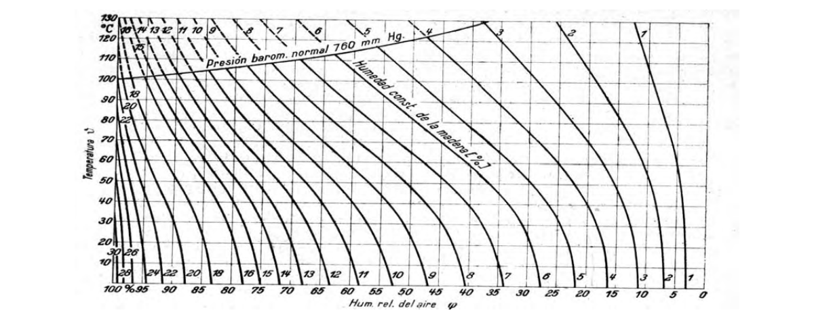

# G-D — Equilibrio de contenido de humedad

**G-D.1** — - Como se presenta en la figura G-D.1 se puede deducir que para cada condición del medio ambiente existe una cierta cantidad de agua sorbida en la madera y por consiguiente un contenido de humedad en la madera. Así se puede deducir que existe una relación entre los conjuntos de valores de temperatura, humedad relativa y contenido de humedad de la madera que corresponde al Equilibrio de Contenido de Humedad y que se define como la humedad máxima que puede adquirir la madera en un medio ambiente de condiciones higrotérmicas fijadas.

Figura G-D.1 — Isotermas de Sorción Toda madera expuesta a condiciones ambientales, aún desde el momento en que se corta el árbol, empieza a perder humedad y se equilibra con el ambiente. Así mismo si el contenido de humedad de una madera está por encima o por debajo del punto de equilibrio perderá o ganará humedad hasta alcanzar dicho punto. En la tabla G-D-1 se presta el Equilibrio de Contenido de Humedad (ECH) para las principales ciudades de Colombia.

El concepto de ECH tiene mucha importancia industrial ya que su conocimiento permite:

- Determinar las condiciones de marcha de los secaderos.

- Fijar hasta que contenido de humedad debe ser secada una madera para su posterior utilización.

- Permite el uso de tablas de Temperatura, Humedad Relativa y Equilibrio de contenido de humedad.

Por otra parte cuando la condensación capilar se ha producido en todos los capilares existentes en la pared celular, cuyos radios son compatibles con las condiciones de saturación del ambiente, la madera habrá adquirido por sorción de vapor de agua su humedad máxima en la pared celular. Esta humedad se llama Punto de Saturación de las Fibras (PSF).

Este punto de saturación de la pared celular señala que una madera seca, no puede alcanzar una humedad ilimitada por sorción de vapor de agua existente en la atmósfera, sino que esta humedad tiene un límite que corresponde al PSF: Si se pretende sobrepasar este límite, no habrá más remedio que introducir en agua en forma líquida, es decir por inmersión.

Otra consecuencia importante desde el punto de vista del secado y relacionada con el PSF, es la contracción que ocurre en la madera cuando se seca desde este punto hasta el contenido de humedad final.

**Tabla G-D-1**

Equilibrio de Contenido de Humedad (ECH) para las principales ciudades de Colombia.

| Ciudad | HR% | T ºC | ECH% |
|---|---|---|---|
| Armenia | 77 | 22 | 15 |
| Barranquilla | 76 | 28 | 14 |
| Bogotá | 80 | 11 | 16 |
| Bucaramanga | 75 | 22 | 14 |
| Buenaventura | 87 | 28 | 18.5 |
| Cali | 75 | 24 | 12 |
| Cartagena | 79 | 28 | 15 |
| Cúcuta | 66 | 27 | 16 |
| Ibagué | 80 | 21 | 16 |
| Manizales | 78 | 18 | 13 |
| Medellín | 69 | 21 | 12 |
| Montería | 82 | 27 | 16 |
| Neiva | 67 | 26 | 16 |
| Pasto | 79 | 17 | 16 |
| Pereira | 75 | 22 | 14 |
| Popayán | 79 | 18 | 16 |
| Quibdó | 87 | 28 | 18.5 |
| Sincelejo | 77 | 28 | 15 |
| Tunja | 80 | 13 | 16 |
| Turbo | 85 | 27 | 17.5 |
| Valledupar | 70 | 28 | 13 |
| Villavicencio | 75 | 25 | 14 |

█
