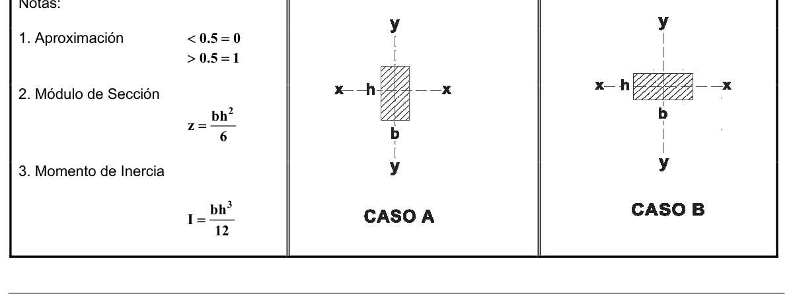

<!-- mod:2-decreto-340-2012-39 -->
> *Apéndice incorporado por el Decreto 340 de 2012 (anexo, p. 8).*

# G-F — Propiedades de secciones preferenciales — Medidas nominales

**APÉNDICE G-F**

PROPIEDADES DE SECCIONES PREFERENCIALES

MEDIDAS NOMINALES

| Escuadría en cm | Perímetro cm | Área cm² | CASO A |  | CASO B |  |
|---|---|---|---|---|---|---|
|  |  |  | Módulo de Sección Z, cm³ | Momento de Inercia I cm⁴ | Módulo de Sección Z, cm³ | Momento de Inercia I cm⁴ |
| Mesa 20 x 20 | 80 | 400 | 1333 | 13333 | 1333 | 13333 |
| Viga 10 x 20 | 60 | 200 | 667 | 6667 | 333 | 1667 |
| Planchón 5 x 20 | 50 | 100 | 333 | 3333 | 83 | 208 |
| Cerco 10 x 10 | 40 | 100 | 167 | 833 | 167 | 833 |
| Repisa 5 x 10 | 30 | 50 | 83 | 417 | 42 | 104 |
| Cuartón 5 x 5 | 20 | 25 | 21 | 52 | 21 | 52 |
| Listón 2,5 x 5 | 15 | 12.5 | 10 | 26 | 5 | 7 |
| Mesa 25 x 25 | 100 | 625 | 2604 | 32552 | 2604 | 32552 |
| Viga 12 x 25 | 74 | 300 | 1250 | 15625 | 600 | 3600 |
| Planchón 6 x 25 | 62 | 150 | 625 | 7813 | 150 | 450 |
| Cerco 12 x 12 | 48 | 144 | 288 | 1728 | 288 | 1728 |
| Repisa 6 x 12 | 32 | 72 | 144 | 864 | 72 | 216 |
| Cuartón 6 x 6 | 24 | 36 | 36 | 108 | 36 | 108 |
| Listón 3 x 6 | 18 | 18 | 18 | 54 | 9 | 13 |
| Mesa 30 x 30 | 120 | 900 | 4500 | 67500 | 4500 | 67500 |
| Viga 15 x 30 | 90 | 450 | 2250 | 33750 | 1125 | 8437 |
| Planchón 7,5 x 30 | 70 | 150 | 1125 | 16875 | 281 | 1055 |
| Cerco 15 x 15 | 60 | 225 | 562 | 4219 | 562 | 4219 |
| Repisa 7,5 x 15 | 45 | 112 | 281 | 2109 | 141 | 527 |
| Cuartón 7,5 x 7,5 | 30 | 56 | 70 | 264 | 70 | 264 |
| Listón 3,7 x 7,5 | 22.5 | 28 | 35 | 132 | 18 | 33 |

Notas:

1. Aproximación: $< 0.5 = 0$; $> 0.5 = 1$

2. Módulo de Sección: $z = \dfrac{bh^2}{6}$

3. Momento de Inercia: $I = \dfrac{bh^3}{12}$

