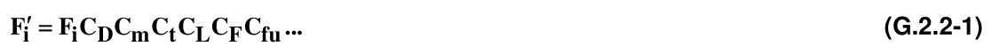
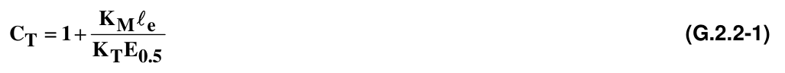
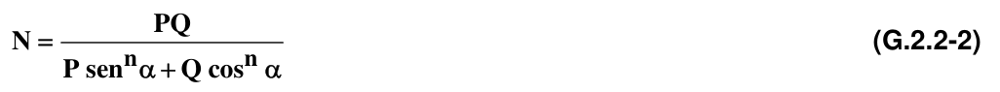
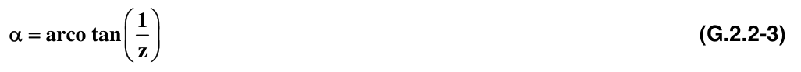
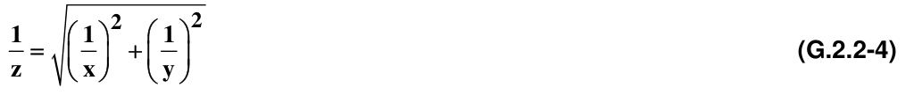
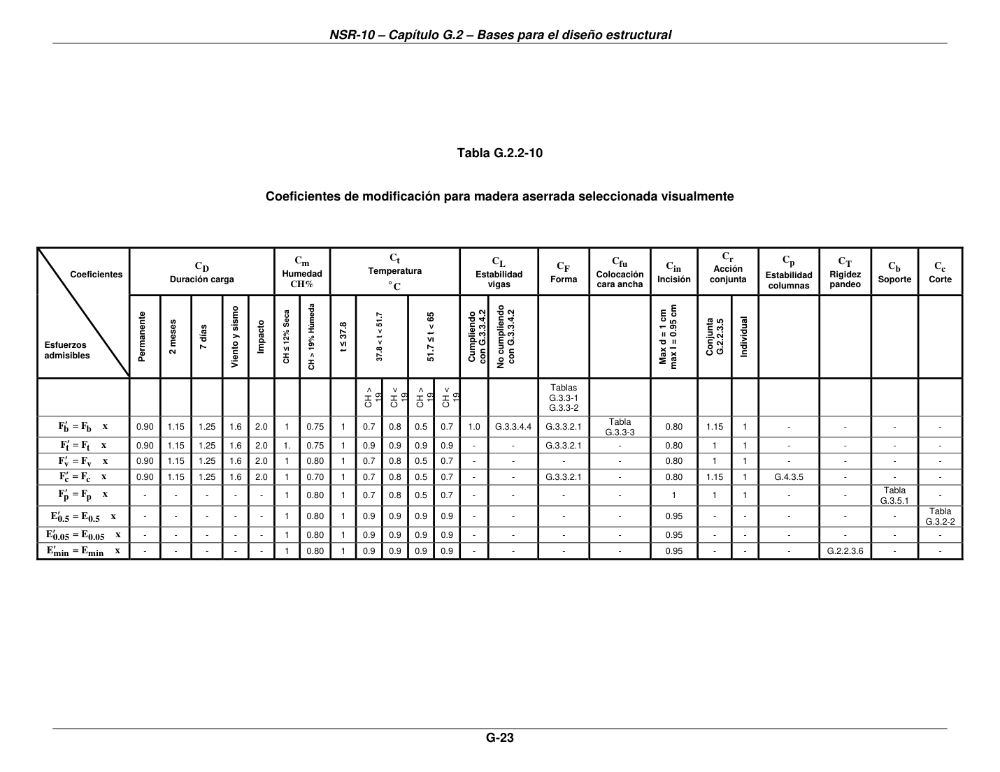

# G.2 — Bases para el diseño estructural

### G.2.1 — REQUISITOS DE DISEÑO

**G.2.1.1** — Todos los elementos de una estructura deberán ser diseñados, construidos y empalmados para resistir los esfuerzos producidos por las combinaciones de cargas de servicio consignadas en B.2.3.1 del presente Reglamento, dentro de las limitaciones de deflexión estipuladas en G.3.2.1.

**G.2.1.2** — Toda construcción de madera deberá poseer un sistema estructural que se ajuste a uno de los cuatro tipos definidos en A.3.2 del presente Reglamento.

**G.2.1.2.1** — El diseño estructural deberá reflejar todas las posibles cargas actuantes sobre la estructura durante las etapas de construcción y servicio; además de las condiciones ambientales como humedad o temperatura que puedan generar cambios en las suposiciones de diseño, o que puedan afectar la integridad de otros componentes estructurales.

**G.2.1.3** — En el análisis y diseño de las estructuras de madera deberán respetarse los principios básicos de la mecánica estructural, los requisitos básicos de diseño consignados en A.3.1 de este Reglamento y los requisitos particulares que se encuentran relacionados en el presente Título G.

**G.2.1.4** — Los esfuerzos producidos por las cargas aplicadas serán calculados considerando los elementos como homogéneos y de comportamiento lineal.

**G.2.1.5** — En el diseño de estructuras de madera todos los cálculos se harán con base en las dimensiones reales de los elementos utilizados, teniendo en cuenta las reducciones por secado y procesamiento de la madera. Las dimensiones indicadas en la tabla G.1.3-1 ya incluyen tales reducciones.

**G.2.1.5.1** — Las provisiones de diseño estructural dadas en este título, se basan en que los materiales de construcción empleados, cumplen con los estándares de durabilidad, tratamientos, fabricación, procesamiento, instalación, control de calidad y adecuado uso y mantenimiento, mencionados en el capítulo G.11, en el Apéndice G-B y en los capítulos específicos donde se haga referencia a ellos, pero será responsabilidad final del diseñador los planteamientos de diseño utilizados para los elementos de madera y de sus conexiones en usos particulares.

**G.2.1.6** — En ningún caso se deben utilizar estructuras de madera cuando la temperatura a la cual van a estar sometidas excede 65°C.

### G.2.2 — METODO DE DISEÑO ESTRUCTURAL

**G.2.2.1** — El diseño de estructuras de madera se hará por el método de los esfuerzos admisibles y el presente Título G contiene provisiones para su utilización.

#### G.2.2.2 — ESFUERZOS ADMISIBLES Y MODULOS DE ELASTICIDAD

Los grupos de madera estructural que cumplan las normas de clasificación visual para madera aserrada dentro de los parámetros de Estructural Selecta (E.S.), utilizarán, para efectos de cálculo, los esfuerzos admisibles y los módulos de elasticidad de las tablas G.2.2-1 y G.2.2-2 respectivamente que corresponden a las tablas del Apéndice G.B y que fueron obtenidos de acuerdo con el Apéndice G.A.

**Tabla G.2.2-1**

Esfuerzos Admisibles, $F_{i}$ , (MPa) C.H = 12%

| GRUPO | $F_{b}$ Flexión | $F_{t}$ Tensión | $F_{c}$ Compresión װ | $F_{p}$ Compresión $\perp$ | $F_{v}$ Cortante |
|---|---|---|---|---|---|
| ES1 | 29.5 | 21.0 | 23.0 | 6.0 | 2.0 |
| ES2 | 28.5 | 20.0 | 22.0 | 4.3 | 2.0 |
| ES3 | 23.0 | 17.0 | 19.0 | 3.8 | 1.6 |
| ES4 | 17.0 | 12.0 | 15.0 | 2.8 | 1.5 |
| ES5 | 15.0 | 11.0 | 13.0 | 2.0 | 1.1 |
| ES6 | 12.5 | 9.0 | 10.0 | 1.5 | 1.3 |

**Tabla G.2.2-2**

Módulos de Elasticidad Longitudinal, $E_{i}$ , (MPa) CH = 12%

| GRUPO | Módulo Promedio $E_{0.5}$ | Módulo 5° Percentil $E_{0.05}$ | Módulo Mínimo $E_{min}$ |
|---|---|---|---|
| ES1 | 18 000 | 13 250 | 7 130 |
| ES2 | 18 000 | 13 250 | 7 130 |
| ES3 | 14 000 | 11 000 | 5 500 |
| ES4 | 12 500 | 10 000 | 5 000 |
| ES5 | 11 200 | 8 250 | 4 435 |
| ES6 | 9 000 | 6 500 | 3 564 |

Para el análisis y diseño de elementos estructurales se debe utilizar $E_{0.5}'$, como módulo de elasticidad del material. El $E_{min}'$, se utilizará para calcular los coeficientes de estabilidad de vigas $(C_{L})$, y de columnas $(C_{p})$, y a $E_{0.05}'$ se podrá utilizar para deflexiones cuando las condiciones de servicio sean de alto riesgo o críticas.

#### G.2.2.3 — ESFUERZOS ADMISIBLES Y COEFICIENTES DE MODIFICACION

Con base en los esfuerzos admisibles, de la tabla G.2.2.1 y los módulos de elasticidad de la tabla G.2.2.2, afectados de los coeficientes de modificación a que haya lugar por razón de duración de la carga, contenido de humedad, temperatura, estabilidad, altura, uso a lo ancho, incisión, acción de conjunto, estabilidad de columnas, rigidez al pandeo, área de soporte y cualquier otra condición modificatoria, se determinarán los esfuerzos admisibles modificados según las prescripciones de los capítulos siguientes y la fórmula general:

En donde

$F_{i}$ = esfuerzo básico para la solicitación $i$

$C_{D}$= coeficiente de modificación por duración de la carga.

$C_{m}$= coeficiente de modificación por contenido de humedad.

$C_{t}$ = coeficiente de modificación por temperatura.

$C_{L}$= coeficiente de modificación por estabilidad lateral de vigas.

$C_{F}$= coeficiente de modificación por forma.

$C_{fu}$= coeficiente de modificación por uso en cara ancha.

$C_{in}$= coeficiente de modificación por incisiones.

$C_{r}$ = coeficiente de modificación por acción de conjunto.

$C_{p}$ = coeficiente de modificación por estabilidad de columnas.

$C_{T}$= coeficiente de modificación por rigidez al pandeo.

$C_{b}$ = coeficiente de modificación por área de soporte.

Los coeficientes de modificación de aplicación general se indican en los numerales siguientes; los que dependen de la clase de solicitación, se estipulan en los capítulos correspondientes. En la tabla G.2.2-10 se estipulan algunos valores de dichos coeficientes.

**G.2.2.3.1** — Por duración de la carga $(C_{D})$ — Cuando un elemento esté sometido a cargas de la duración diferentes a la normal, 10 años los valores de la tabla G.2.2-1 deberán multiplicarse por los valores de la tabla G.2.2-3:

Tabla G 2.2-3 Por duración de la carga $(C_{D})$

| Duración carga Flexión | $F_{b}$ | Tensión $F_{t}$ | Compresión װ $F_{c}$ | Compresión ┴ $F_{p}$ | Cortante $F_{v}$ | Típica carga de diseño |
|---|---|---|---|---|---|---|
| Permanente | 0.90 | 0.90 | 0.90 | 1.00 | 0.90 | muerta |
| Diez años | 1.00 | 1.00 | 1.00 | 1.00 | 1.00 | viva de ocupación |
| Dos meses | 1.15 | 1.15 | 1.15 | 1.00 | 1.15 |  |
| 7 días | 1.25 | 1.25 | 1.25 | 1.00 | 1.25 | construcción |
| Diez minutos | 1.60 | 1.60 | 1.60 | 1.00 | 1.60 | viento y terremoto |
| Impacto | 2.00 | 2.00 | 2.00 | 1.00 | 2.00 | Impacto |

Los incrementos anteriores no son acumulables. Cuando hay combinación de cargas, el dimensionamiento de los elementos debe hacerse para la condición más desfavorable.

**G.2.2.3.2** — Por contenido de humedad $(C_{m})$ — La madera pierde resistencia y rigidez, al aumentar su contenido de humedad. Los valores de esfuerzos admisibles y módulos de elasticidad de las tablas G.2.2-1 y G.2.2-2 corresponden a madera seca CH = 12%. Para la escogencia del tipo de esfuerzos y módulo de elasticidad a utilizar se deberán verificar las condiciones durante la etapa de construcción, y el tiempo de servicio según la tabla G.2.2-4.

Tabla G 2.2-4 Condiciones a considerar para la escogencia de Módulos de Esfuerzos Admisibles y de Elasticidad

| Durante la construcción | En servicio | Esfuerzos admisibles | Módulos de elasticidad |
|---|---|---|---|
| CH c > 19% * CH c > 19% CH c ≤ 12% CH c ≤ 12% | CH s > 19% * CH s ≤ 12% CH s ≤ 12% CH s > 19% | CH > 19% * CH = 12% CH = 12% CH > 19% | CH > 19% * CH = 12% CH = 12% CH = 12% |

* Solo si:

a) Espesor de la Madera no excede de 50 mm.

b) La carga total de diseño se aplique cuando CH<12% y las cargas no origine esfuerzos efectivos mayores a los admisibles en condición verde

**G.2.2.3.2.1** — Cuando se deben hacer ajustes por efecto de humedad, se deberá utilizar los valores de la tabla G.2.2-5

**Tabla G.2.2-5**

Coeficientes de afectación para esfuerzos $F_{i}$ y módulos de elasticidad $E_{i}$

| Esfuerzos |  | CH ≤ 12 % | CH > 19% |
|---|---|---|---|
| Flexión | $F_{b}$ | 1.0 | 0.80 |
| Tensión | $F_{t}$ | 1.0 | 0.80 |
| Compresión Paralela | $F_{c}$ | 1.0 | 0.75 |
| Compresión perpendicular | $F_{p}$ | 1.0 | 0.60 |
| Cortante | $F_{v}$ | 1.0 | 0.85 |
| Módulos de elasticidad | $E_{0.5}$ | 1.0 | 0.85 |
|  | $E_{0.05}$ | 1.0 | 0.85 |
|  | $E_{min}$ | 1.0 | 0.85 |

Para valores de CH, entre 12% y 19%, la reducción será proporcional.

**G.2.2.3.3** — Por temperatura $(C_{t})$ — Los valores de referencia deberán ser modificados por los factores de temperatura indicados en la tabla G.2.2-6, Asimismo se aplicarán factores de modificación cuando los elementos estructurales estén permanentemente expuestos a elevadas temperaturas, dentro de los rangos indicados en la tabla G.2.2-6.

**Tabla G.2.2-6**

Variación de las propiedades mecánicas por temperatura $(C_{t})$

| Parámetros de diseño | Condiciones de servicio | $oC_{t}$ |  |  |
|---|---|---|---|---|
|  |  | T ≤ 37.8°C | 37.8°C< T ≤51.7°C | 51.7°C< T ≤ 65°C |
| $F_{t}$ , $E_{0.5}$, $E_{0.05}$, $E_{min}$ | Húmedo o seco | 1.0 | 0.9 | 0.9 |
| $F_{b}$ , $F_{v}$ , $F_{c}$ , $F_{c}\perp$ | Seco | 1.0 | 0.8 | 0.7 |
|  | Húmedo | 1.0 | 0.7 | 0.5 |

Los anteriores valores se aplicarán a madera aserrada, y madera laminada.

**G.2.2.3.4** — Por incisión $(C_{in})$ — Los valores de esfuerzos admisibles y módulos de elasticidad, serán multiplicados por el factor de incisión $(C_{in})$, tabla G.2.3-6, cuando se hagan incisiones en los elementos de madera, en forma paralela al grano, a profundidad máxima de 10 mm y de longitud máxima de (3/8"), 9.5 mm y densidad de incisiones no superior a 1,185/cm2. Para incisiones excediendo los límites indicados, el coeficiente $(C_{in})$ se determinará por ensayos, o por cálculo, usando la sección reducida para incisiones.

Estos valores se aplicarán para madera aserrada, según la tabla G.2.2-7.

**Tabla G.2.2-7**

Variación de las propiedades mecánicas por incisiones $(C_{in})$

| Parámetros de diseño | $(C_{in})$ |
|---|---|
| $E_{0.5}$, $E_{0.05}$, $E_{min}$ | 0.95 |
| $F_{b}$ , $F_{t}$ , $F_{v}$ , $F_{c}$ | 0.80 |
| $F_{p}$ | 1.00 |

Los anteriores valores se aplican a madera aserrada

**G.2.2.3.5** — Por acción conjunta $(Cr)$ — Los esfuerzos admisibles podrán incrementarse en un 15%, cuando exista una acción de conjunto garantizada de tres o más elementos de igual rigidez, para elementos de madera de 50 a 100 milímetros de espesor , que se encuentren en contacto o espaciados no más de 61 centímetros, como en el caso de viguetas, pies derechos de entramados, entablados, cuerdas de cercha, viguetas de techo, siempre que estén unidos por pisos o techos u otros elementos que distribuyan adecuadamente las cargas.

**G.2.2.3.6** — Por rigidez al pandeo $(C_{T})$ — Para incrementar la rigidez de la cuerda de compresión, relativa a carga axial en elementos de madera de 50 mm (b) x 100 mm(d) o más pequeños, y que estén sujetos a flexión y comprensión axial bajo condiciones de servicio seco y además estén conectados por la cara más angosta del elemento a comprensión a un tablero estructural de madera de espesor mínimo (3/8"), 9.5 mm, con clavos de espaciamiento y tamaño adecuados, pueden desarrollar mejor rigidez a flexión en el eje fuerte, debido a la acción conjunta del elemento y el tablero. Será permitido entonces incrementar el $E_{min}$ módulo de elasticidad valor de diseño para estabilidad de vigas y columnas, por el factor $C_{T}$; en el cálculo de la estabilidad de columnas cuando $ℓ_{e}<2440$ mm; cuando $ℓ_{e}>2440$ mm, se deben tomar $ℓ_{e}=2440$ mm.

En donde:

$C_{T}$= coeficiente de rigidez al pandeo

$K_{T}$= $(1_{−}1.645COV_{E})=0.638$ para madera aserrada

$K_{T}$= $0.82$ para madera laminada

$K_{M}$= $0.634$ , para $CH_{≤}19\%$ al momento de instalación del panel

$K_{M}$= $0.331$ , para $CH_{>}19\%$ al momento de instalación del panel

$COV_{E}$ = $0.22$ para madera aserrada, 0.10 para madera estructural laminada encolada de seis o más laminaciones.

$ℓ_{e}$ = longitud efectiva en mm, si $ℓ_{e}>2440$ mm se deberá usar $ℓ_{e}=2440$ mm

$E_{0.5}$ = módulo de elasticidad promedio, en MPa

**G.2.2.3.7** — Por desviación al grano — La desviación del grano expresada en forma de grano espiralado, grano diagonal y grano entrecruzado es muy común en maderas latifoliadas tropicales. Por razones de uso estructural de algunas maderas con grano desviado, se podrá utilizar la fórmula de Hankinson, para determinar la resistencia a una desviación determinada.

$N$ = fuerza admisible a un ángulo $α$ de la desviación de las fibras

$Q$ = fuerza admisible sentido perpendicular al grano

$P$ = fuerza admisible paralela al grano

$n$ = constante determinada empíricamente. Véase la tabla G.2.2-8.

$α$ = ángulo en grados, entre la dirección de la carga aplicada y la dirección del grano. Se define así:

$\frac{1}{x}$= tangente del ángulo que forma la dirección de las fibras con el eje longitudinal de una cara de la pieza de madera.

$\frac{1}{y}$= tangente del ángulo que forma la dirección de las fibras con el eje longitudinal de la cara adyacente a la utilizada para determinar $\frac{1}{x}$

**Tabla G.2.2-8**

Valores de $n$ y $Q /P$ encontrados experimentalmente

| Propiedades | $n$ | $Q /P$ |
|---|---|---|
| Tensión | 1.5 - 2.0 | 0.04 - 0.07 |
| Compresión | 2.0 - 2.5 | 0.03 - 0.40 |
| Flexión | 1.5 - 2.0 | 0.04 - 0.10 |
| Módulo de elasticidad | 2 | 0.04 - 0.12 |

**Tabla G.2.2-9**

Reducción de resistencia por desviación al grano $C_{DG}$ Coeficiente de reducción por desviación al grano en flexión, tensión y compresión paralela

| Pendiente al grano | Flexión $(F_{b})$ o tensión $(F_{t})$ paralela al grano | Compresión $(F_{C})$ paralela al grano |
|---|---|---|
| 1/8 | 0.53 | 0.66 |
| 1/10 | 0.61 | 0.74 |
| 1/12 | 0.69 | 0.82 |
| 1/14 | 0.74 | 0.87 |
| 1/15 | 0.76 | 1.00 |
| 1/16 | 0.80 |  |
| 1/18 | 0.85 |  |
| 1/20 | 1.00 |  |

El diseñador, constructor e Supervisor Técnico Independiente deberán tener cuidado en razón a que el diseño es elaborado previo a la construcción y en ese momento no se conocen las desviaciones del grano, pero durante el proceso de construcción, si se conocen tales desviaciones del grano, por lo que se hace necesaria la interrelación del diseñador con la obra durante la construcción, para efectuar los ajustes necesarios, si es que estos se requieren.

<!-- mod:3-decreto-945-2017-73 -->
> **Modificación — Decreto 945 de 2017** · anexo, p. 35
>
> En la sección G.2.2.3.7 se reemplaza «interventor» por «Supervisor Técnico Independiente».

Notas
