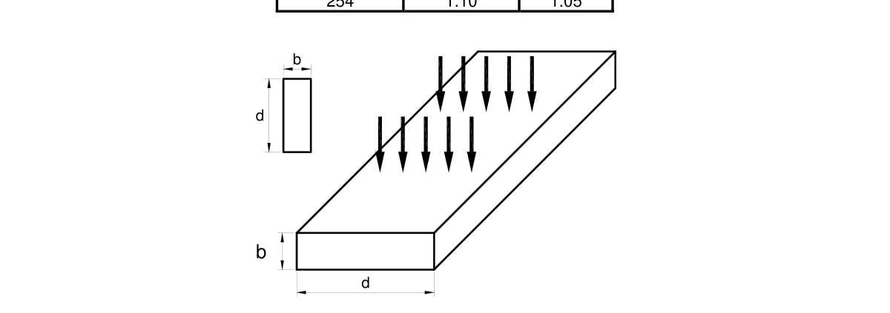
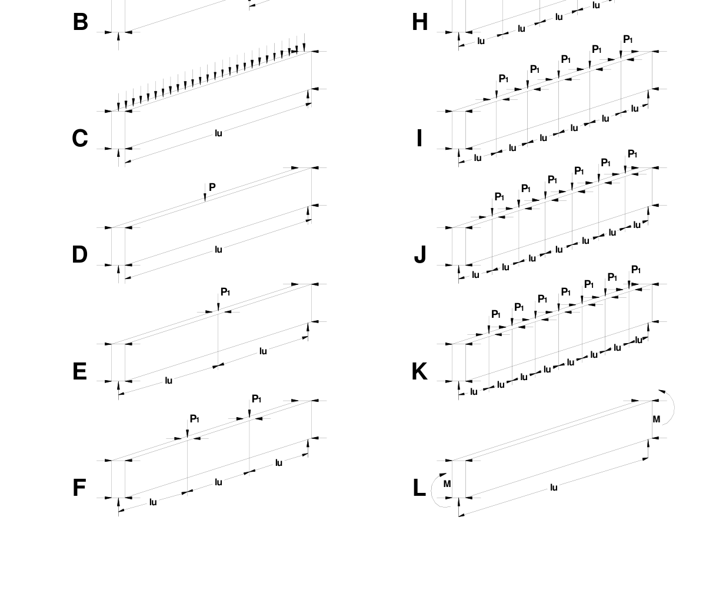
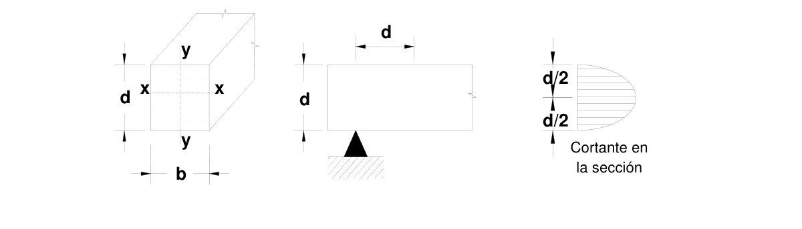
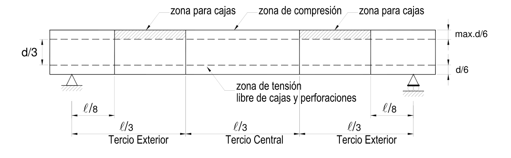
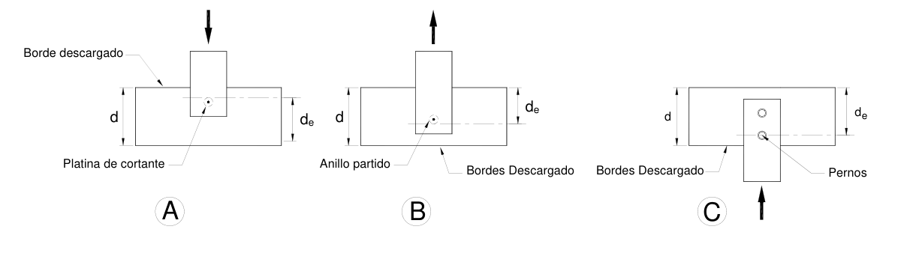
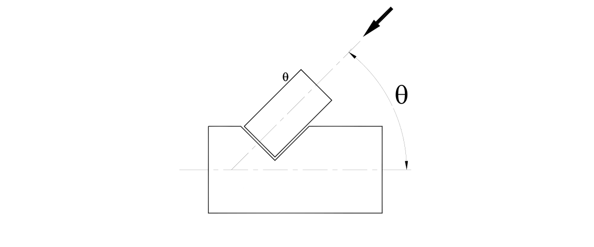

# G.3 — Diseño de elementos solicitados por flexión

### G.3.1 — REQUISITOS GENERALES

**G.3.1.1** — El diseño de elementos o miembros a flexión contiene los mismos parámetros básicos usados en el diseño de vigas de otros materiales estructurales, pero su orden es diferente para el caso nuestro, ya que nuestras maderas “latifoliadas”, presentan una relación $MOR /MOE$ , superior a la de las maderas del norte E.E.U.U y Europa, “coníferas”. Es decir, nuestras maderas son más flexibles y por lo tanto se deflectan más, aparte de que los límites de deflexión son más rigurosos. Por las razones anteriores el diseño de elementos a flexión estará regido, salvo excepciones, por las deflexiones admisibles, y el chequeo se efectuará por flexión, cortante y aplastamiento.

**G.3.1.2** — En el diseño de elementos o miembros a flexión se tendrán en cuenta los siguientes parámetros:

(a) Deflexión (G.3.2)

(b) Flexión, incluyendo estabilidad lateral (G.3.3)

(c) Cortante (G.3.4)

(d) Aplastamiento (G.3.5)

#### G.3.1.3 — AREA NETA

El área neta se obtiene al deducir del área bruta de la sección la proyección del área de todo el material removido por perforaciones, ranuras, entalladuras, cortes o por otros medios.

#### G.3.1.4 — CONEXIONES

Los elementos estructurales y los conectores deben ser dispuestos simétricamente en las conexiones, a menos que los momentos de flexión inducidos por una localización asimétrica sean tenidos en cuenta en el diseño. Las conexiones deberán tener la capacidad y rigidez necesaria para transferir la carga máxima de los elementos de poca o muy limitada ductilidad y para tolerar el sobre-esfuerzo (sobre-resistencia) y la capacidad máxima creíble de elementos dúctiles.

#### G.3.1.5 — LUZ DE DISEÑO

Para elementos sometidos a flexión que estén simplemente apoyados, o en voladizo, la luz de diseño será considerada como la luz libre entre caras de soportes más la mitad de la longitud de apoyo requerida en cada extremo. Para el caso de vigas continuas, la luz de diseño será la distancia centro a centro de apoyos.

### G.3.2 — DEFLEXIONES

**G.3.2.1** — Siendo las deflexiones admisibles el parámetro principal en el establecimiento de las secciones requeridas para maderas “latifoliadas”, se establecerán requisitos de limitación de deflexiones admisibles, obtención de la sección requerida y cálculo de deflexiones inmediatas y diferidas. Las deflexiones en vigas se deberán calcular con las fórmulas corrientes de la teoría elástica, considerando la deflexión por flexión y si es el caso, con el módulo de elasticidad $E_{0.5}$, corregido por cortante. Para el caso de vigas de una luz simplemente apoyadas y con carga uniforme, la fórmula es:

$$ \Delta = \dfrac{5}{384}\,\dfrac{\omega \ell^4}{EI} \tag{G.3.2-1} $$

**G.3.2.2** — Las deflexiones máximas admisibles de las vigas de madera, se limitarán a los valores de la tabla G.3.2-1.

**Tabla G.3.2-1**

Deflexiones admisibles en vigas con $Δ$ (mm)

| Tipo de Construcción | Cargas Vivas $ℓ/k^{*}$ | Viento o Granizo $ℓ/k^{*}$ | Cargas Totales $ℓ/k^{*}$ |
|---|---|---|---|
| Elementos de techo/Cubierta Cubiertas inclinadas Cielorasos de pañete o yeso Otros cielos rasos Sin cielo raso Techos planos | Nota 1 $ℓ/360$ $ℓ/300$ $ℓ/300$ Nota 1 | Nota 1 $ℓ/360$ $ℓ/240$ $ℓ/240$ Nota 1 | Nota 1 $ℓ/300$ $ℓ/240$ $ℓ/240$ $ℓ/300$ |
| Elementos de entrepiso Pisos rigidizados | $ℓ/360$ | _ | $ℓ/300$ $ℓ/360$ |
| Muros exteriores y particiones interiores Con acabados frágiles Con acabados flexibles | _ _ | $ℓ/240$ $ℓ/240$ | _ _ |
| Edificaciones industriales Edificaciones provisionales Formaletas para concreto Forros para columnas - vigas | _ |  | $ℓ/200$ (3) $ℓ/160$ (3) $ℓ/360$ ó 3 mm (3) $ℓ/360$ ó 1.6 mm |

Notas:

1. En función del tipo de cielo raso

2. Mediante evaluación de deformaciones totales, a largo plazo éstas no deberán invertir pendientes de drenaje en techos, ni en áreas expuestas a lluvia o granizo

3. Considerando únicamente la deflexión inicial $Δ i$, con $W_{=}D_{+}L$, con carga viva de construcción (L) = (240 kg/m2), si ésta interviene Donde:

$ℓ$ = luz del elemento a flexión como se define en G.3.1.5.

$k^{*}$= Coeficiente de limitación de deflexiones.

**G.3.2.3** — Las deflexiones de las vigas, viguetas, entablados, se calcularán con el módulo de elasticidad $E_{0.5}',$ para todos los casos. Para el caso de severas condiciones de servicio ó riesgo muy alto, el uso de $E_{0.05}'$, estará a juicio del diseñador.

#### G.3.2.4 — EFECTO DEL CORTANTE

Para los elementos con relaciones $ℓ/d_{<}20$, si se requiere, se debe hacer la corrección por cortante $C_{c}$ , indicada en la tabla G.3.2-2 para el módulo de elasticidad $E_{0.5}$.

**Tabla G.3.2-2**

Coeficientes de corrección $C_{c}$ de $E_{0.5}$ Para incluir deformaciones de corte en vigas simplemente apoyadas con carga uniforme. Ref (R G -1)

| $ℓ/d$ | $E /G_{=}15$ | $E /G=16^{*}$ | $E /G=20$ | $E /G=25$ |
|---|---|---|---|---|
| 7 |  | 0.760 |  |  |
| 10 | 0.8741 |  | 0.8389 | 0.8065 |
| 12 | 0.9091 | 0.900 | 0.8824 | 0.8571 |
| 14 | 0.9316 |  | 0.9108 | 0.8909 |
| 16 | 0.9467 |  | 0.9302 | 0.9143 |
| 18 | 0.9547 | 0.950 | 0.9441 | 0.9310 |
| 20 | 0.9653 | 0.956 | 0.9542 | 0.9434 |
| $E /G$ = Relación entre el modulo de elasticidad E 0.5 y el módulo de rigidez del cortante G. |  |  |  |  |

* Tomado de la referencia R.G. 26

<!-- mod:2-decreto-340-2012-38 -->
> **Modificación — Decreto 340 de 2012** · anexo, p. 8
>
> El primer párrafo de G.3.2.4 debe quedar así:
>
> **G.3.2.4** — EFECTO DEL CORTANTE — Para los elementos con relaciones $\ell/d < 20$ se debe hacer la corrección por cortante $C_c$, indicada en la Tabla G.3.2-2 para el módulo de elasticidad $E_{0.5}$.

#### G.3.2.5 — CÁLCULO DE LA SECCION POR DEFELXION

Para calcular la sección requerida y únicamente para este caso, se deberá igualar la deflexión, calculada con cargas $W'$ , estipuladas en la tabla G.3.2-3, con la deflexión permitida, $L /K^{*}$ , de la tabla G.3.2-1, para así obtener el momento de inercia $( I )$, del cual se deducen las dimensiones de la sección.

**Tabla G.3.2-3**

Cargas $W'$ para cálculo de la sección por deflexiones

| Condición de construcción | $CH<19\%$ Seca | $CH>19\%$ Húmeda |
|---|---|---|
| Condición de servicio | $CH<19\%$ | $CH>19\%$, $CH<19\%$ |
| Madera aserrada | $1.5D+L$ | $1.8D+L$ |
| Madera laminada | $1.5D+L$ | $1.8D+L$ |

#### G.3.2.6 — DEFLEXIONES INMEDIATAS

Las deflexiones inmediatas deberán ser calculadas con las cargas $WΔ_{i} ,$ de la tabla G.3.2-4 y con la formulación corriente de la teoría elástica.

**Tabla G.3.2-4**

Cargas $WΔ_{i}$ para cálculo de la deflexión inmediata

| Condición de construcción | $CH<19\%$ Seca | $CH>19\%$ Húmeda |
|---|---|---|
| Condición de servicio | $CH<19\%$ | $CH>19\%$, $CH<19\%$ |
| Madera aserrada | $D_{+}L$ | $D_{+}L$ |
| Madera laminada | $D+L$ | $D+L$ |

#### G.3.2.7 — DEFLEXIONES DIFERIDAS

Si se desea conocer las deflexiones diferidas a un largo término deberán ser calculadas con las cargas $WΔ_{f}$ de la tabla G.3.2-5.

**Tabla G.3.2-5**

Cargas $WΔ_{f} ,$ para cálculo de deflexiones diferidas

| Condición de construcción | $CH<19\%$ Seca | $CH>19\%$ Húmeda |
|---|---|---|
| Condición de servicio | $CH<19\%$ | $CH>19\%$, $CH<19\%$ |
| Madera aserrada | $1.5D+L$ | $1.8D+L$ |
| Madera laminada | $1.5D+L$ | $1.8D+L$ |

### G.3.3 — FLEXIÓN

**G.3.3.1** — Los esfuerzos máximos de tensión y de compresión producidos por flexión $(f_{b})$, serán determinados para la sección de máximo momento. Estos no deberán exceder al máximo esfuerzo admisible en flexión, $F_{b}$ , definido en la tabla G.2.2-1 para el grupo de madera estructural especificado, modificado por los coeficientes establecidos en la tabla G.2.2-10.

**G.3.3.2** — Los coeficientes de modificación de los esfuerzos admisibles, particulares para flexión, son los indicados a continuación.

**G.3.3.2.1** — Coeficiente de forma – $C_{F}$ — Este coeficiente se refiere a consideraciones de la forma del elemento, tanto de ancho $( b )$, como de alto $( d )$, como de largo $( ℓ )$, de los elementos rectangulares sometidos a flexión, tensión o compresión paralela. Los valores de $F_{b}$ , $F_{t}$ , $F_{c}$, se multiplicarán por los valores de las tablas G.3.3-1 y G.3.3-2, tal como se indica a continuación:

Tabla G 3.3-1 Factor de ajuste $C_{d}$ , por medidas $d$ y $b$ , para $F_{b}$ , $F_{t}$ , $F_{c}$

| Madera aserrada visualmente seleccionada como E.S. | (d) mm | $F_{b}$ |  | $F_{t}$ |
|---|---|---|---|---|
|  |  | (b) mm | (b) mm |  |
|  |  | 50 -75 | 100 |  |
|  | 50 a 100 | 1.15 | 1.15 | 1.15 |
|  | 127 | 1.10 | 1.10 | 1.10 |
|  | 150 | 1.10 | 1.10 | 1.10 |
|  | 203 | 1.10 | 1.10 | 1.10 |
|  | 254 | 1.00 | 1.00 | 1.00 |
|  | 300 | 1.00 | 1.00 | 1.00 |
| Construcción normal E.N. | 50 a 100 | 1.00 | 1.00 | 1.00 |

Tabla G 3.3-2 Factor de ajuste por longitud, $Cℓ$ , para $F_{t}$ , $F_{c}$

| $ℓ$ (m), longitud | 3 | 4 | 5 | 6 | 7 | 8 | 9 | 10 |
|---|---|---|---|---|---|---|---|---|
| $Cℓ t$ tensión, flexión | 1.00 | 0.94 | 0.90 | 0.87 | 0.84 | 0.82 | 0.80 | 0.78 |
| $Cf_{c}$ compresión | 1.00 | 0.97 | 0.95 | 0.93 | 0.92 | 0.91 | 0.90 | 0.89 |

**G.3.3.2.2** — Para cualquier otro valor de $ℓ>10.000$ mm, se utilizará la siguiente fórmula:

$$ C\ell = \left(\dfrac{3.000}{\ell}\right)^b \tag{G.3.3-1} $$

En donde:

$ℓ$ = longitud en mm

$b$ = 0.2 para tensión y flexión y, 0.10 para compresión.

**G.3.3.2.3** — Cuando la altura de un elemento rectangular sometido a flexión exceda 300 mm y tenga un espesor superior a 127 mm, el valor de diseño para flexión, $F_{b}$ será multiplicado por el resultado de la siguiente fórmula:

$$ C_d = \left(\dfrac{300}{d}\right)^{0.11} \tag{G.3.3-2} $$

En donde:

$d$ = altura del elemento en mm Para vigas con sección circular de diámetro mayor de 350 mm o sección cuadrada, cargada en el plano de la diagonal, el coeficiente, $C_{d}$ , se determinará con base en una sección cuadrada equivalente convencional.

Estos dos factores conforman el factor $(C_{F})$ así:

$$ C_F = C_d C_\ell \tag{G.3.3-3} $$

**G.3.3.2.4** — Para uso en cara ancha $( d )$, factor $C_{fu}$ — Cuando un elemento de madera aserrada clasificada visualmente y con espesor entre 50 mm y 100 mm, es cargada en la cara ancha, como se muestra en la gráfica G.3.3-1 el esfuerzo admisible a flexión $F$ deberá se multiplicado por los valores del coeficiente $C_{fu}$, indicados en la tabla G.3.3-3

**Tabla G.3.3-3**

Coeficiente de modificación por flexión en el eje débil $C_{fu}$

| Lado ancho d | Espesor de la pieza b |  |
|---|---|---|
| mm | 50 – 75 mm | 100 mm |
| 50-75 | 1.00 | - |
| 100 | 1.00 | 1.00 |
| 127 | 1.05 | 1.05 |
| 152 | 1.05 | 1.05 |
| 200 | 1.05 | 1.05 |
| 254 | 1.10 | 1.05 |

Figura G.3.3.1 — Colocación de la carga en cara ancha

#### G.3.3.3 — ESTABILIDAD LATERAL Y COEFICIENTE DE MODIFICACION $C_{L}$

En vigas cuya altura sea mayor que su ancho $d /b_{>}1$, deberá investigarse la necesidad de proveer soporte lateral a la zona comprimida del elemento.

El coeficiente de estabilidad lateral, $C_{L}$, tiene en cuenta la reducción en la capacidad de carga de un elemento sometido a flexión, por efecto de la inestabilidad lateral, o pandeo lateral, que ocurre cuando la zona a compresión del elemento a flexión se comporta como una columna.

**G.3.3.3.1** — Cuando el borde de compresión de un elemento de madera a flexión, es soportada en toda su longitud para prevenir desplazamiento lateral y en sus apoyos y puntos de cargas de aplastamiento tiene soporte lateral para prevenir rotación, $C_{L}=1.0$.

**G.3.3.3.2** — Cuando la altura $( d)$ de un elemento a flexión excede su ancho $( b )$, $d /b_{>}1$, deben incluirse soportes laterales en sus puntos de apoyo, para prevenir rotación y/o desplazamiento lateral de estos puntos, pero si no existen soportes a lo largo de la longitud del miembro a flexión, la longitud no soportada $ℓ_{u}$, es la distancia entre tales puntos y el terminal del apoyo, o la longitud del cantiliver. Cuando un elemento a flexión está provisto con soporte lateral para prevenir rotación y/o desplazamiento lateral en puntos intermedios, como también en los extremos de la viga, la longitud no soportada, $ℓ_{u}$, es la distancia entre tales puntos de soporte lateral intermedio y el eje del apoyo terminal.

**G.3.3.3.3** — La longitud efectiva de la luz, $ℓ_{e}$, para luces simples o cantiliver de elementos a flexión serán determinados de acuerdo a la figura G.3.3-2 y la tabla G.3.3-4 P1 P1 P1 lulu AP1Glulu luP1 P1 P1 P1 lulu lu

Figura G.3.3.2 — Casos escogidos de cargas y soportes laterales. Véase tabla G.3.3-4 (Referencia RG.9)

**Tabla G.3.3-4**

Longitud efectiva de vigas $ℓ_{e}$ (mm)

|  | Cantilíver (1) | Cuando $ℓ_{u} /d_{<}7$ |  | Cuando $ℓ_{u} /d_{>}7$ |
|---|---|---|---|---|
| A | Carga uniforme repartida | $ℓ_{e}=1.33_{ℓ}$ |  | $ℓ_{e}=0.90_{ℓ}+3_{d}$ |
| B | Carga concentrada en extremo libre | $ℓ_{e}=1.87_{ℓ}$ |  | $ℓ_{e}=1.44_{ℓ}+3_{d}$ |
|  | Viga de una sola luz (1,2) | Cuando $ℓ_{u} /d_{<}7$ |  | Cuando $ℓ_{u} /d_{>}7$ |
| C | Carga uniformemente repartida | $ℓ_{e}=2.06ℓ_{u}$ |  | $ℓ_{e}=1.63_{ℓ}+3_{d}$ |
| D | Carga concentrada en el Centro sin soportes intermedio | $ℓ_{e}=1.80_{ℓ}$ |  | $ℓ_{e}=1.3_{ℓ}+3_{d}$ |
| E | Carga concentrado en el centro con soportes laterales intermedios |  | $ℓ_{e}=1.11_{ℓ}$ |  |
| F | Dos carga concentrada en los tercios con soporte lateral a los tercios |  | $ℓ_{e}=1.68_{ℓ}$ |  |
| G | Tres cargas concentradas iguales y soportes laterales en $ℓ/4$ |  | $ℓ_{e}=1.54_{ℓ}$ |  |
| H | Cuatro cargas concentradas y soportes laterales en $ℓ/5$ |  | $ℓ_{e}=1.68_{ℓ}$ |  |
| I | Cinco cargas concentradas iguales y soportes laterales en $ℓ/6$ |  | $ℓ_{e}=1.73_{ℓ}$ |  |
| J | Seis cargas concentradas iguales y soportes laterales en $ℓ/7$ |  | $ℓ_{e}=1.78_{ℓ}$ |  |
| K | Siete o más cargas concentradas, regularmente distribuidas con soportes laterales en los puntos de aplicación. |  | $ℓ_{e}=1.84_{ℓ}$ |  |
| L | Momentos iguales en los extremos con soportes laterales extremos. |  | $ℓ_{e}=1.84_{ℓ}$ |  |

Notas:

1) Para una sola luz o miembros en cantilíver con condiciones de carga no especificadas en esta tabla

$ℓ_{e}=2.06_{ℓ}$ Cuando $ℓ_{u} /d_{<}7$

$ℓ_{e}=1.63_{ℓ}+3_{d}$ Cuando $7_{<}ℓ_{u}/d_{<}14.3$

$ℓ_{e}=1.84_{ℓ}$ Cuando $ℓ_{e} /d_{>}14.3$ 2) En aplicaciones de múltiples luces, se deben usar valores tabulados o realizar un análisis de ingeniería

#### G.3.3.4 — CONDICIONES DE RESTRICCIÓN LATERAL PARA LAS CUALES EL COEFICIENTE DE

ESTABILIDAD DE VIGAS $C_{L}=1$.

(a) Si $d /b_{≤}2$; no se requerirá soporte lateral.

(b) Si $2_{<}d /b_{≤}4$; se debe restringir el giro y el desplazamiento lateral en los apoyos. Para esto se acepta el uso de bloques de la misma altura del elemento, arriostramientos en “x”, por fijación a otros elementos estructurales por medio de clavos o pernos, o por otros medios aceptables.

(c) Si $4_{<}d /b_{≤}5$; el borde a compresión del elemento debe ser soportado lateralmente en toda su longitud para prevenir desplazamiento. Para esto se acepta el uso del revestimiento estructural del piso o techo; además, se debe restringir el giro y el desplazamiento lateral en los apoyos.

(d) Si $5_{<}d /b_{≤}6$; se deben instalar arriostramientos en “x” o bloques de la misma altura del elemento a intervalos que no excedan 2.40 m. El borde a compresión del elemento debe ser soportado lateralmente en toda su longitud con el uso del revestimiento estructural del piso o techo y se debe restringir el giro y el desplazamiento lateral en los apoyos.

(e) Si$6_{<}d /b_{≤}7$; los bordes superior e inferior del elemento deben contar con un soporte lateral continuo en toda su longitud y se debe restringir el giro y el desplazamiento lateral en los apoyos.

**G.3.3.4.1** — Si un miembro a flexión está sujeto a flexión y compresión axial, el radio $d /b$ no será mayor que 5, si un borde es firmemente soportado en toda su longitud y si bajo todas las combinaciones de carga, el borde no sostenido del miembro está en tensión, la relación $d /b$ no será > 6

**G.3.3.4.2** — Cuando algunos postes o columnas reposen sobre vigas, se deberá proveer arriostramiento lateral para la viga en el sitio donde ello ocurra.

**G.3.3.4.3** — Relación de esbeltez — El parámetro que mide la esbeltez de una viga rectangular, se calcula según la fórmula siguiente:

$$ R_B = \sqrt{\dfrac{\ell_e d}{b^2}} \tag{G.3.3-4} $$

En donde:

$R_{B}$= parámetro que mide la esbeltez de una viga y deberá ser menor a 50

$b =$ ancho de la viga en mm

$d$ = altura de la viga en mm

$ℓ_{e}$ = longitud efectiva de la viga en mm El cálculo de $ℓ_{e}$ se efectúa según la tabla G.3.3-4, en donde $ℓ_{u}$ es la longitud entre soportes laterales de la viga.

G 3.3.4.4 — Coeficiente de estabilidad lateral $C_{L}$ — El coeficiente de estabilidad para vigas será calculado con la siguiente fórmula:

$$ C_L = \left(\dfrac{1 + F_{bE}/F_b^*}{1.9}\right) - \sqrt{\left(\dfrac{1 + F_{bE}/F_b^*}{1.9}\right)^2 - \left(\dfrac{F_{bE}/F_b^*}{0.95}\right)} \tag{G.3.3-5} $$

En donde:

$C_{L}$= coeficiente de estabilidad lateral, para vigas rectangulares. En vigas de sección circular $C_{L}=1$

$F_{b}$*= esfuerzo admisible de flexión, multiplicado por todos los factores de modificación, excepto $C_{fu}$,

$C_{L}$, $C_{v}$ en MPa. $F_{b}$*$=F_{b} C_{d}C_{m}C_{t} C_{F}C_{i} C_{r}$

$$ F_{bE} = \dfrac{1.20\,E'_{min}}{R_B^2} \tag{G.3.3-6} $$

Donde:

$F_{bE}$= esfuerzo de flexión crítico, en MPa

$E_{min}'$ = módulo de elasticidad mínimo modificado, en MPa

$R_{B}$= relación de esbeltez de la viga

#### G.3.3.5 — MOMENTO RESISTENTE EN SECCION RECTANGULAR

El momento actuante sobre vigas rectangulares, no debe exceder el valor del momento resistente dado por la fórmula.

$$ M \le F'_b\,\dfrac{bd^2}{6} = F'_b S \tag{G.3.3-7} $$

En donde:

$M$ = momento actuante en N-mm

$F_{b}'$ = esfuerzo admisible modificado a flexión en MPa

$b$ , $d$ = medidas de la sección rectangular mm

$S$ = módulo de la sección en mm3

**G.3.3.5.1** — Momento resistente sección circular — El momento actuante sobre secciones circulares, no debe exceder el valor del momento resistente dado por la fórmula:

$$ M \le F'_b \left(0.7854\,R^3\right) \tag{G.3.3-8} $$

$R$ = radio medido en la sección de momento máximo, en mm.

### G.3.4 — CORTANTE

**G.3.4.1** — Los esfuerzos máximos de corte paralelo a las fibras serán calculados en secciones a una distancia del apoyo igual a la altura (d), de la viga, excepto en voladizos para los que los esfuerzos máximos serán evaluados en la cara del apoyo. El máximo esfuerzo cortante paralelo a las fibras $(f_{v})$ se determinará teniendo en cuenta la distribución no uniforme de estos esfuerzos en la sección, no debiendo ser mayor que el esfuerzo admisible para corte paralelo a las fibras, $F_{v}$ , definido en la tabla G.2.2-1 para el grupo de madera estructural especificado, modificado por los factores establecidos en la tabla G.2.2-10 . El esfuerzo al corte en la dirección perpendicular a las fibras es mucho mayor, y por lo tanto no requiere de verificación.

Figura G.3.4-1 — Esfuerzo Cortante en vigas.

### G.3.4 — 2

ESFUERZO CORTANTE PARALELO A LAS FIBRAS $(f_{v})$ — En cualquier sección transversal del miembro a flexión, no excederá el valor del esfuerzo admisible modificado paralelo a las fibras para cortante $(F_{v}')$ y en vigas de sección rectangular y circular, se calculará por las fórmulas:

Sección Rectangular

$$ f_v = \dfrac{3v}{2bd} \le F'_v \tag{G.3.4-1} $$

Sección Circular

$$ f_v = \dfrac{4v}{3\pi R^2} \le F'_v \tag{G.3.4-2} $$

En donde

$f_{v}$ = esfuerzo cortante actuante, en MPa

$F_{v}'$ = esfuerzo cortante admisible modificado en MPa

$V$ = fuerza cortante vertical en la sección considerada, en N

$b$ , $d$ = dimensiones de la sección rectangular en mm.

$R$ = radio de la sección circular en mm

#### G.3.4.3 — ESPECIFICACIONES DE CAJAS

El efecto de las cajas en la capacidad a corte del elemento deberá estudiarse bajo las provisiones de G.3.4.3 y.G.3.4.4

Figura G.3.4-2 — Indicaciones para cajas

**G.3.4.3.1** — Especificaciones de cajas en elementos a flexión madera aserrada — Debe evitarse en lo posible practicar cajas en las vigas; de requerirse, deberán detallarse en los planos y cumplir con las limitaciones dadas a continuación.

(a) No será permitido practicar cajas en la zona de tensión de elementos, cuyo ancho neto sea igual o mayor a 90mm (100mm nominal). La localización de las cajas deberá ser la indicada en la figura G.3.4-2.

(b) Se permitirán cajas localizadas en el extremo del elemento en su canto inferior, cuando estas se usen para alojar un soporte. La altura de estas cajas no deberá exceder 1/4 de la altura de la viga.

(c) En vigas de una luz, las cajas en el borde de compresión, deberán colocarse dentro de los tercios exteriores.

(d) En vigas continuas, la caja en el canto superior deberá localizarse a la mayor distancia definida entre:

(i) las abscisas que corresponden a 1/8 y 1/4 de la luz, o (ii) a una distancia igual a, $2d$ , del punto de inflexión de momento hacia el centro de la viga; donde, $d$ , es la altura del elemento.

(e) La máxima dimensión horizontal de una caja en un miembro a flexión, deberá ser la menor entre 200mm o $d /3$ , donde, $d$ , es la altura del elemento.

(f) La máxima profundidad de una caja en un miembro a flexión, debe ser $(d /6 )$, donde $( d)$ es la altura del elemento

(g) La distancia entre los bordes de perforaciones deberá ser la mayor de las distancias definidas por:

(i) la altura del elemento, (ii) 3 diámetros de la perforación, o (iii) 150mm. La distancia entre el borde de una perforación y el borde del elemento no será menor que $d /6$ .

(h) Cajas en madera estructural laminada. – En la zona de tensión, de miembros a flexión únicamente se permitirán cajas en el terminal del miembro, para apoyo sobre un soporte y la profundidad de la caja será la menor entre 3" y $d /10$ , donde $( d )$, es la altura del elemento.

(i) En la zona de compresión no se permitirán cajas, con excepción de los terminales del miembro, dentro del tercio exterior de la luz y la altura de la caja será inferior a 0.4 d, en donde $( d )$, es la altura del miembro, con la excepción de un corte rebajado que no excederá 0.66d y tendrá una longitud máxima de $3d$ . Para vigas rebajadas, donde la rebaja se extiende dentro del tercio medio de la luz, especiales consideraciones de diseño serán requeridas.

**G.3.4.3.2** — Un acartelamiento gradual de la profundidad de una caja en vez de un corte rectangular reduce la tendencia a la concentración de esfuerzos.

**G.3.4.3.3** — Cuando se presentan grietas o acebolladuras aceptables en la sección de diseño, según lo establecido en la tabla G.1.3-1, para efectos de cálculo el ancho del elemento deberá reducirse en una longitud igual a la proyección de la grieta o acebolladura. El efecto de las cajas en la capacidad a corte del elemento deberá estudiarse bajo las provisiones de G.3.4.4.

#### G.3.4.4 — VIGAS CAJEADAS O ADELGAZADAS

En general deberá evitarse practicar cajas, o adelgazamiento en la cara de tensión de las vigas. De ser necesario hacer cajas en el apoyo, su profundidad no será mayor a la cuarta parte de la altura de la viga, según lo establecido, en G.3.4.3.1.

**G.3.4.4.1** — Cajas en vigas a flexión de sección rectangular — En vigas a flexión de sección rectangular, que presenten cajas en la cara de tensión. La fuerza cortante ajustada para diseño $V_{r}'$ , se calculará con la siguiente fórmula:

$$ V'_r = \left[\dfrac{2}{3}\,F'_v bdn\right] \left[\dfrac{d_n}{d}\right]^2 \tag{G.3.4-3} $$

En donde:

$V_{r}'$ = fuerza cortante ajustada para diseño, en N

$F_{v}'$ = esfuerzo admisible modificado en corte paralelo a la fibra, en MPa

$b$ = ancho de la viga en mm

$d_{n} =$ altura de la viga en la zona cajeada en mm

$d$ = altura total de la viga en mm

**G.3.4.4.2** — Cajas en vigas a flexión sección circular — En vigas a flexión de sección circular que presenten cajas en la cara de tensión, la fuerza cortante ajustada, para diseño $V_{r}'$ debe ser calculada con siguiente fórmula:

$$ V'_r = \left[\dfrac{2}{3}\,F'_v A_n\right] \left[\dfrac{D_n}{D}\right]^2 \tag{G.3.4-4} $$

Donde:

$V_{r}'$ = fuerza cortante ajustada para diseño en N

$F_{v}'$ = esfuerzo admisible modificado para diseño a cortante, en MPa

$A_{n}$ = área neta de la sección transversal del elemento donde ocurre la caja , en mm2

$D_{n}$ = diámetro de la sección circular menos la altura de la caja o de la incisión, en mm

$D$ = diámetro de la sección circular sin tener en cuenta la caja, en mm

**G.3.4.4.3** — Otras secciones — Para miembros a flexión de sección diferente a circular o rectangular con cajas o incisiones en la cara de tensión, la capacidad modificada para diseño a cortante, $V_{r}'$ , se debe basar en análisis convencionales de ingeniería que tengan en cuenta las concentraciones de esfuerzos en cajas, reducciones o adelgazamientos.

**G.3.4.4.4** — Cajas o rebajes en el apoyo — En elementos a flexión de sección rectangular que tengan cajas o rebajamientos en el apoyo, en la cara de compresión, tal como en la figura G.3.4-3, la fuerza cortante ajustada $(V_{r}')$ debe ser calculada con la siguiente fórmula:

$$ V'_r = \dfrac{2}{3}\,F'_v b \left[d - \left(\dfrac{d - d_n}{d_n}\right) e'\right] \tag{G.3.4-5} $$

Donde:

$V_{r}'$ = fuerza cortante ajustada para diseño en N

$F_{v}'$ = esfuerzo admisible modificado para diseño a cortante, en MPa

$b$ = ancho neto de la sección rectangular, en mm

$d$ = altura neta de la sección rectangular, en mm

$d_{n}$ = altura neta de la sección rectangular, menos la altura de la caja, en mm

$e'$ = distancia en mm, que se extiende la caja, hasta el borde interno del soporte y debe ser menor o igual a $d_{n}$ . Si, $e' >d_{n}$, se deberá utilizar $d_{n}$ , para calcular $(f_{v})$, usando la fórmula G.3.4-1 Si el terminal de la viga es rebajado como $ac$ , en la figura G.3.4-3, $d_{n}$, será medido desde el borde interno del soporte y será igual a la distancia d-f e'

Figura G.3.4-3 — Cajas en el apoyo

**G.3.4.4.5** — Altura efectiva de miembros de conexiones — Cuando las conexiones en miembros a flexión están sujetadas con anillos partidos, conectores de placa para cortante, tornillos, pasadores con tuerca, como se muestra en la figura G.3.4-4. La fuerza cortante se determina por principios de ingeniería mecánica.

Figura G 3.4-4 — Altura efectiva de miembros de conexiones

**G.3.4.4.6** — Cuando la conexión está a menos de cinco veces la altura, $5d$ , del miembro desde su extremo, el cortante de diseño ajustado, $V_{r}'$ , será calculado de acuerdo a la siguiente fórmula:

$$ V'_r = \left(\dfrac{2}{3}\,F'_v b d_e\right) \left(\dfrac{d_e}{d}\right)^2 \tag{G.3.4-6} $$

Donde:

Para anillos partidos o conectores de placa para cortante, $(d_{e})$, será la altura del elemento, menos la distancia del borde descargado del elemento, hasta el borde más cercano, del más cercano anillo partido ó conector de placa para cortante, figuras A y B de G 3.4-4. Donde la conexión sea atornillada o empernada, la distancia $(d_{e})$, será tomada donde el centro del pasador o tornillo como en la figura C. de G.3.4-4.

**G.3.4.4.7** — Cuando la conexión está a más de cinco veces la altura, $5d$ , del elemento, medida desde el extremo del mismo, la fuerza cortante ajustada, $V_{r}'$ , será calculado con la siguiente fórmula:

$$ V'_r = \dfrac{2}{3}\,F'_v b d_e \tag{G.3.4-7} $$

**G.3.4.4.8** — Deben recibir especial atención en su diseño a cortante las vigas de luz corta fuertemente cargadas, donde los esfuerzos cortantes son especialmente críticos.

### G.3.5 — APLASTAMIENTO

**G.3.5.1** — Los esfuerzos de compresión $(f_{p})$ en la dirección perpendicular a las fibras deberán verificarse en los apoyos y otros puntos donde se tengan cargas concentradas en áreas pequeñas. Tales esfuerzos no deberán exceder el esfuerzo admisible de compresión modificado, $(F_{p}')$, para el grupo de madera estructural especificado. El esfuerzo perpendicular al grano, $f_{p}$, en los apoyos o sitios de carga, se calculará con la fórmula:

$$ f_p = \dfrac{N}{A_n} \le F'_p \tag{G.3.5-1} $$

En donde,

$f_{p}$ = esfuerzo de aplastamiento actuante en MPa

$F_{p}'$ = esfuerzo admisible modificado a compresión perpendicular a la fibra, en MPa.

$N$ = fuerza axial actuante perpendicular a la fibra en N

$A_{n}$= área neta de aplastamiento en mm2

**G.3.5.1.1** — Coeficiente por área de apoyo $C_{b}$ — Para apoyos menores de 150 mm en longitud, que se encuentren a más de 75 mm del extremo del elemento, el esfuerzo admisible $(F_{p})$, puede incrementarse multiplicándolo por el factor:

$$ C_b = \dfrac{\ell_b + 9.53}{\ell_b} \tag{G.3.5-2} $$

en donde $ℓ_{b}$ es la longitud del apoyo en mm, medida a lo largo de la fibra de la madera.

**G.3.5.1.2** — El factor de multiplicación para apoyos de longitudes correspondientes a áreas pequeñas como platinas y arandelas, puede obtenerse como se muestra en la siguiente tabla:

**Tabla G.3.5-1**

Factor de incremento para apoyos de longitudes pequeñas, como cargas sobre platinas o arandelas

| Longitud del apoyo, en mm $ℓ_{b}$ | 12.5 | 25 | 38 | 50 | 75 | 100 | $≥$150 |
|---|---|---|---|---|---|---|---|
| Factor $C_{b}$ | 1.75 | 1.38 | 1.25 | 1.19 | 1.13 | 1.10 | 1.00 |

**G.3.5.1.3** — Para arandelas circulares la longitud de apoyo es igual al diámetro. Para viguetas soportadas por otras viguetas y clavadas a ellas, el esfuerzo admisible en compresión perpendicular a la fibra puede incrementarse en un 50%. Cuando se presenten disminuciones en el ancho efectivo del área de soporte de un elemento (por ejemplo arista faltante), el esfuerzo de compresión perpendicular a las fibras se calculará teniendo en cuenta estas disminuciones.

#### G.3.5.2 — CARGAS INCLINADAS

Cuando la dirección de la fuerza sea inclinada, respecto a la dirección de la fibra de la madera, (ángulo diferente a 0 ó 90 grados), el esfuerzo admisible de diseño será calculado con la siguiente fórmula de Hankinson:

$$ F'_\theta = \dfrac{F_c^* F'_p}{F'_c \operatorname{sen}^2 \theta + F'_p \cos^2 \theta} \tag{G.3.5-3} $$

En donde:

$Fθ'$ = esfuerzo admisible modificado de compresión para un ángulo $θ$ , en MPa

$F_{c}^{*}$ = esfuerzo básico de compresión paralelo al grano $F_{c}$ , multiplicado por todos los coeficientes de modificación, excepto el coeficiente de estabilidad de columnas $C_{p}$

$F_{p}'$ = esfuerzo admisible modificado perpendicular al grano en MPa

$θ$ = ángulo entre la dirección de la fuerza y la dirección de la fibra en grados.

Figura G.3.5-1 — Cargas inclinadas

#### G.3.5.3 — DEFORMABILIDAD POR APLASTAMIENTO

La deformabilidad perpendicular al grano, de un elemento sometido a carga uniforme, perpendicular a la fibra, y que se encuentre cargado y soportado en toda su área, debe ser calculada con la siguiente fórmula:

$$ \Delta_d = \dfrac{f_p d}{E'_{p0.5}} \tag{G.3.5-4} $$

En donde:

$Δ_{d}$= deformabilidad perpendicular al grano, en mm

$f_{p}$ = esfuerzo de cálculo a compresión perpendicular a la fibra en MPa

$d_{E'}$ = altura del elemento en mm = módulo de elasticidad promedio modificado para carga perpendicular al grano en MPa.

Figura G.3.5-2 — Deformabilidad por aplastamiento ▄
