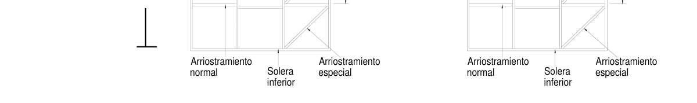
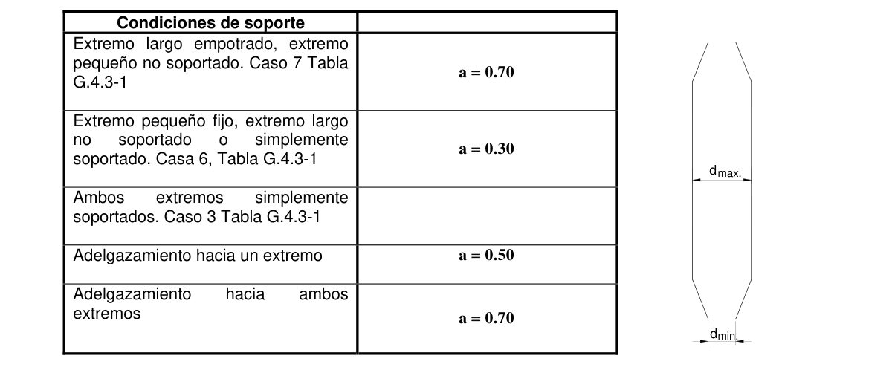
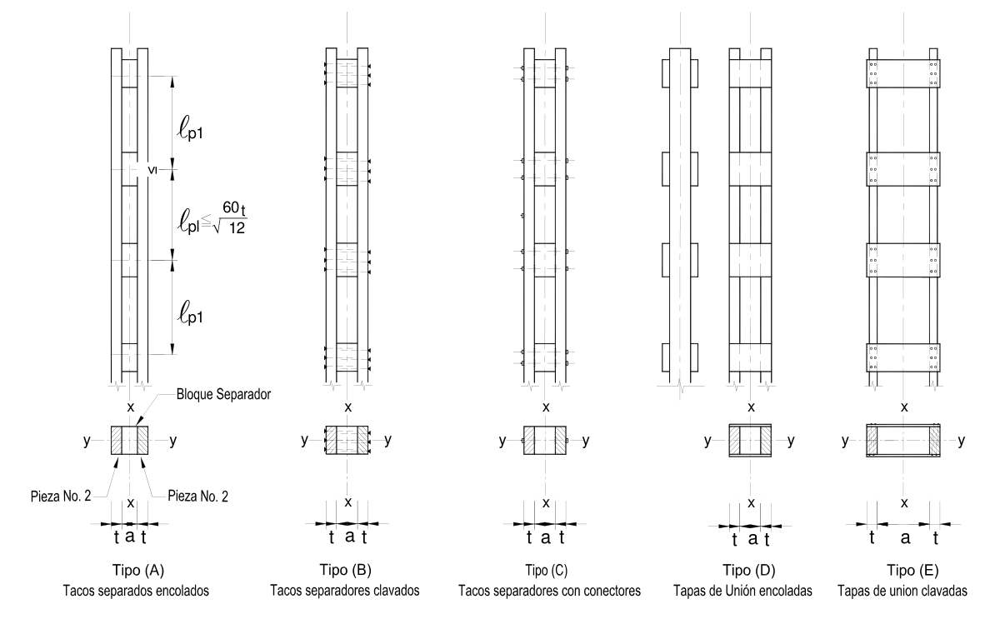
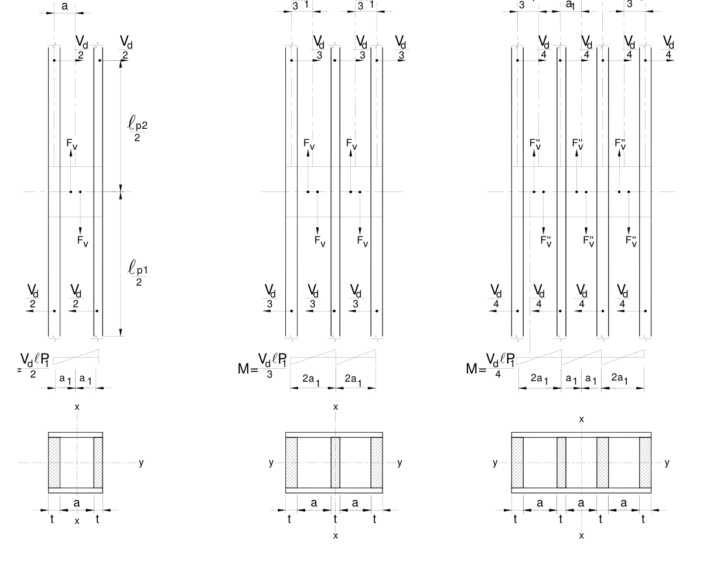
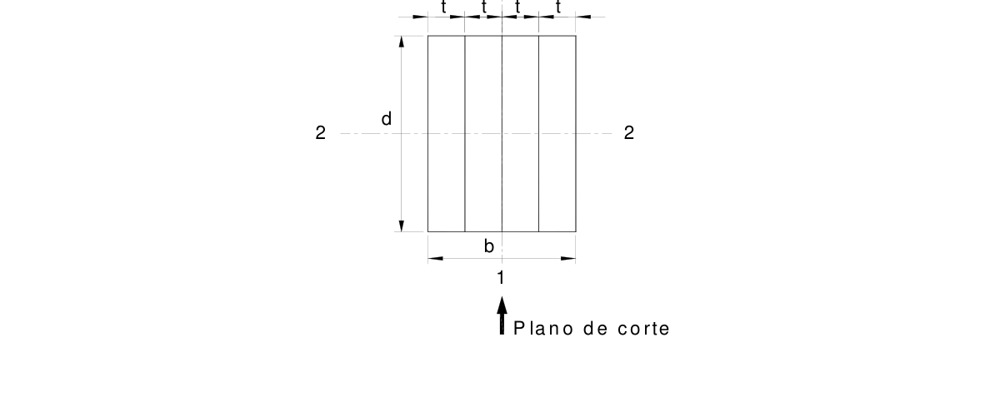
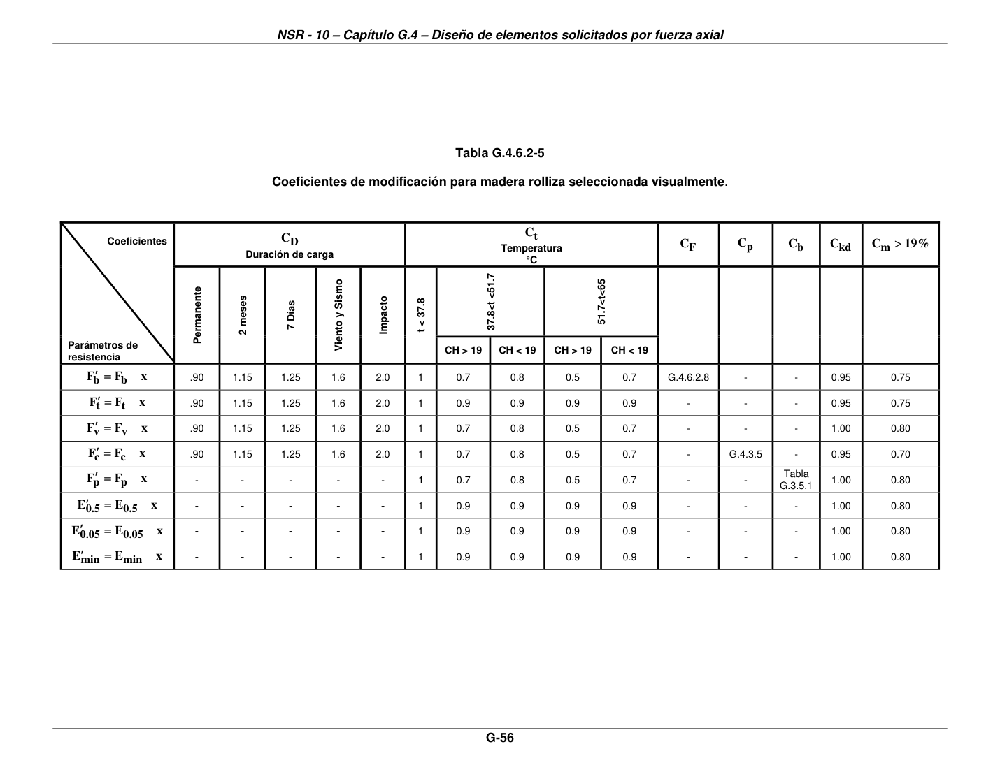

# G.4 — Diseño de elementos solicitados por fuerza axial

### G.4.1 — GENERAL

**G.4.1.1** — Serán diseñados a fuerza axial aquellos elementos solicitados en dirección coincidente con el eje longitudinal que pasa por el centroide de su sección transversal.

**G.4.1.2** — Los esfuerzos actuantes, $( f_{t})$ y $(f_{c})$, generados por fuerzas axiales no deberán exceder los esfuerzos admisibles , de tensión paralela al grano, $(F_{t})$, y compresión paralela al grano, $(F_{c})$, definidos en la tabla G.2.2-1, para el grupo de madera especificado, afectado por los correspondientes coeficientes de modificación de la tabla G.2.2-10.

### G.4.2 — ELEMENTOS SOMETIDOS A TENSION AXIAL

**G.4.2.1** — El esfuerzo $( f_{t})$ a carga axial de tensión $( T )$, no sobrepasará al esfuerzo admisible modificado a tensión paralela a la fibra $(F_{t}' )$, según la siguiente fórmula:

$$ f_t = \dfrac{T}{A_n} \le F'_t \tag{G.4.2-1} $$

en donde:

$f_{t}$ = esfuerzo actuante a tensión paralela al grano, en MPa.

$T$ = fuerza axial de tensión actuante en N.

$A_{n}$= área neta de la sección en mm2.

$F_{t}'$ = esfuerzo admisible modificado de tensión paralela al grano en MPa.

**G.4.2.2** — Aquellos elementos que, además de solicitación axial de tensión, estén sometidos a momento flector axial o biaxial, deberán ser diseñados de acuerdo con G.5.1.

#### G.4.2.3 — TENSIÓN PERPENDICULAR AL GRANO

Los diseños que inducen esfuerzos de tensión perpendicular al grano deben ser evitados. En caso contrario se deberá considerar el uso de refuerzo mecánico capaz de resistir tales esfuerzos.

### G.4.3 — ELEMENTOS SOMETIDOS A COMPRESION AXIAL

#### G.4.3.1 — TERMINOLOGIA

El término COLUMNA, se refiere a los elementos sometidos a cargas de compresión paralela a la fibra, cualquiera que sea su localización estructural.

**G.4.3.1.1** — Clasificación de columnas — Para efectos de la presente norma, se clasificarán de acuerdo con su forma constructiva:

(a) Columnas simples sólidas — Conformadas por piezas únicas de madera o piezas de madera estructural laminada encolada.

(b) Columnas espaciadas — Conformadas a partir de dos o más piezas individuales separadas entre si pero ensambladas, en los extremos y en puntos intermedios, por bloques o tapas unidas por adhesivos, conectores de anillo partido, pasadores, pernos, grapas, tornillos tirafondos, o clavos.

(c) Columnas armadas — Son las conformadas por varias piezas individuales macizas de madera, de similares características, unidas entre sí, por, pernos, tornillos, adhesivos o clavos.

#### G.4.3.2 — LONGITUD EFECTIVA

La longitud efectiva de una columna puede calcularse con la fórmula:

$$ \ell_e = k_e \ell_u \tag{G.4.3-1} $$

En donde:

$ℓ_{e}$ = longitud efectiva en mm.

$k_{e} =$ coeficiente de longitud efectiva, según lo determinado en la tabla G.4.3-1.

$ℓ_{u}$= longitud no soportada lateralmente de la columna en la dirección considerada en mm.

#### G.4.3.3 — ENTRAMADOS DE PIES DERECHOS

Deben estar arriostrados adecuadamente en el plano del mismo. Los entramados deberán contener por lo menos un travesaño horizontal intermedio o garantizar el arriostramiento por medio del revestimiento, (entablado o tablero, por ejemplo), adecuadamente conectado a los pies derechos.

SoleraSolera superiorsuperior Caso especialPies derechosCaso especialPies derechos PiePie derechoderecho Fuera del plano $ℓ$e2 LeEn el plano En el plano Le

Figura G.4.3-1 — Arriostramiento de entramados Para entramados cuyos pies derechos están arriostrados lateralmente por elementos intermedios, se deberá considerar como longitud efectiva en el plano del mismo, a la longitud entre arriostramientos intermedios. $(ℓ_{e})$. La longitud efectiva fuera del plano del entramado no será menor que la altura del mismo $ℓ_{e2}$.

**Tabla G.4.3-1**

Coeficientes de longitud efectiva de columna $k_{e}$

| Condición de los apoyos | Gráficos | $k_{e1}$ | $k_{e2}$ |
|---|---|---|---|
| Empotrados en ambos extremos 1 |  | 0.50 | 0.65 |
| Impedido de desplazarse en ambos extremos y uno de ellos impedido de rotar 2 |  | 0.70 | 0.85 |
| Articulado en ambos extremos 3 |  | 1.00 | 1.00 |
| Empotrado en un extremo y el otro impedido de rotar pero libre de desplazamiento 4 |  | 1.00 | 1.20 |
| Empotrado en un extremo y el otro parcialmente libre de rotar y libre de desplazamiento 5 |  | 1.50 | 1.50 |
| Articulado en un extremo y el otro impedido de rotar pero libre de desplazamiento 6 |  | 2.00 | 2.40 |
| Empotrado en un extremo y el otro libre de rotar y libre de desplazamiento 7 |  | 2.00 | 2.10 |

$k_{e1}$ teórico $k_{e2}$recomendado cuando las condiciones ideales son aproximadas

#### G.4.3.4 — RELACION DE ESBELTEZ $( λ)$

En el diseño de columnas de madera, se considera como medida de esbeltez la definida por la fórmula:

$$ \lambda = \dfrac{\ell_e}{r\sqrt{12}} \tag{G.4.3-2} $$

**Tabla G.4.3-2**

Relación de esbeltez $λ$

| Sección transversal | D d d2 d d1 |  |  | Cualquier sección |
|---|---|---|---|---|
| $λ$ | $ℓ_{e}$ $0.866D$ | $ℓ_{e}$ $d$ | $ℓ_{e}ℓ_{e}$ $d_{1}d_{2}$ | $ℓ_{e}$ $r \sqrt{12}$ |

En donde:

$λ$ = medida de esbeltez. Debe ser$λ ≤50$, excepto durante la construcción que podrá ser $λ ≤75$

$ℓ_{e}$= longitud efectiva de la columna en la dirección considerada, en mm.

$r$ = radio de giro de la sección, en mm

$d_{1}$ , $d_{2}$ = dimensiones de la sección transversal en la dirección considerada, en mm.

$D$ = diámetro de la sección circular, en mm El cálculo se hará para las dos direcciones principales y se utilizará el $λ$ mayor.

#### G.4.3.5 — COEFICIENTE DE ESTABILIDAD DE COLUMNAS $C_{p}$

El coeficiente de estabilidad para columnas, $C_{p}$ , debe ser calculado según la fórmula :

$$ C_p = \dfrac{1 + \left(F_{CE}/F_c^*\right)}{2C} - \sqrt{\left(\dfrac{1 + \left(F_{CE}/F_c^*\right)}{2C}\right)^2 - \dfrac{F_{CE}/F_c^*}{C}} \tag{G.4.3-3} $$

$F_{c}^{*}$ = Esfuerzo admisible de compresión paralelo al grano, multiplicado por todos los factores de modificación, excepto $(C_{p})$

$$ F_{CE} \tag{G.4.3-4} $$

= Esfuerzo crítico. Véase tabla G.4.3-3.

En donde:

$ℓ_{e}$ = longitud efectiva en mm.

$r$ = radio de giro de la sección en mm.

$E_{min}'$= módulo de elasticidad mínimo modificado, en MPa

$C$ = coeficiente valorizado en tabla G. 4.3-3 Cuando un miembro a compresión es soportado en toda su longitud y en las dos direcciones principales, para prevenir desplazamientos laterales en cualquier dirección $C_{p}=1.0$

**Tabla G.4.3-3**

Valores de $C$ y de $F_{CE}$ Esfuerzo crítico

|  | Madera aserrada |  |  | Madera rolliza | Madera laminada |
|---|---|---|---|---|---|
| Sección | d d | d2 d1 | Cualquier sección | D | Laminada |
| $C$ | 0.80 | 0.80 | 0.80 | 0.85 | 0.90 |
| $F_{CE}$ | $0.822E_{min}'$ $λ^{2}$ | $0.822E_{min}'$ $λ_{1.2}^{2}$ | $π^{2}E_{min}'$ $(ℓ_{e}/r)2$ | $0.822E_{min}'$ $λ^{2}$ | $0.822E_{ymin}'$ $λ^{2}$ |

En donde:

$E'y min$ = módulo de elasticidad mínimo modificado para madera laminada, en MPa

#### G.4.3.6 — CARGAS ADMISIBLES

La carga admisible de una columna, con carga axial centrada, será calculada con la siguiente fórmula:

$$ P_a = F'_c A_n \tag{G.4.3-5} $$

En donde:

$P_{a}$ = fuerza o carga admisible de la columna en N.

$F_{c}'$ = esfuerzo admisible modificado a compresión paralela al grano en MPa, $F_{c}' =C_{p} F_{c}^{*}$

$A_{n}$= área neta de la columna en mm2 Si la columna no tiene perforaciones, el área neta de la columna es el área bruta de la misma. Si la columna tiene alguna perforación, el área usada en el cálculo de $P_{a}$ , dependerá de la localización de las perforaciones y de la posibilidad de que la columna pueda pandearse en ese sitio, según las siguientes consideraciones:

(a) Si la perforación se encuentra ubicada en un punto debidamente arriostrado contra desplazamiento lateral, el área bruta podrá ser utilizada en la comprobación de la columna, con reducción por esbeltez entre puntos de arriostramiento.

(b) Si la perforación se encuentra localizada en la zona no arriostrada de la columna, el área neta deberá ser usada al comprobar la estabilidad de la columna y la carga admisible.

#### G.4.3.7 — COLUMNAS ADELGAZADAS

Para el diseño de una columna de sección rectangular adelgazada en uno o ambos extremos, la representativa dimensión (d), para cada cara de columna se calcula con la siguiente fórmula:

$$ d = d_{min} + \left(d_{max} - d_{min}\right) \left(a - 0.15 \left(1 - \dfrac{d_{min}}{d_{max}}\right)\right) \tag{G.4.3-6} $$

En donde:

$d$ = altura de la sección rectangular, en mm

$d_{min}$= La mínima dimensión para la cara de columna considerada en mm

$d_{max}$= La máxima dimensión para la cara de la columna considerada en mm.

$a$ = Condición de soporte, es aplicable cuando $d_{min}/d_{max}≥1 /3$ Para el caso de columnas de sección redonda, se asume como los diámetros $D$ , $D_{min}$ y $D_{max}$

Figura G.4.3-2 — Columnas adelgazadas Para todas las otras condiciones

$$ d = d_{min} + \dfrac{\left(d_{max} - d_{min}\right)}{3} \tag{G.4.3-7} $$

El cálculo de $C_{p}$, estará basado en la representativa dimensión $( d )$. Además, $(f_{c})$ en cualquier sección transversal de la columna rebajada, tomando la mínima dimensión de la columna, no excederá, el esfuerzo admisible modificado para compresión axial paralela a la fibra $(F_{c}' )$, multiplicado por todos los factores de modificación excepto el factor de estabilidad de columnas $(C_{p})$.

#### G.4.3.8 — COLUMNAS ESPACIADAS

Las especificaciones de esta norma son aplicables a columnas conformadas por piezas separadas por bloques con espaciamiento $a /t_{≤}3$, Figura G.4.3-3 A, B, C, o con tapas de unión, Figura G.4.3-3, D, E, con espaciamiento $3_{<}a /t_{≤}6$.

Especificaciones de construcción:

(a) Todas las piezas deberán tener la misma sección transversal y propiedades mecánicas, sin juntas, uniones o traslapos y la longitud de cada pieza será la longitud total de la columna.

(b) Los tacos separadores, tapas de unión y sus conectores se deberán diseñar considerando el esfuerzo de corte $V_{d}$, según la fórmula G.4.3.10.

(c) El número de tramos debe ser $≥3$, o sea que existirán mínimo cuatro bloques separadores ó cuatro tapas, y con uniones transversales al menos en los puntos tercios de la longitud de columna.

(d) La unión transversal de cada bloque o tapa con las piezas dispondrá de al menos dos conectores, dos pernos o cuatro clavos.

(e) Si se utilizan tacos encolados la longitud de estos será al menos dos veces la distancia libre entre piezas individuales.

(f) Cuando $a /t_{≤}2$ se prescindirá del cálculo de momento flector que la fuerza de cortante, $F_{vef}$, induce sobre los tacos separadores.

**G.4.3.8.1** — Requisitos de diseño — Las columnas espaciadas con bloques separadores o tapas de unión se calcularán de acuerdo con G.4.3.3, pero en los elementos A, B, C, D, E de la figura G.4.3-3, el pandeo con respecto al eje principal, x - x, se verificará de acuerdo con la siguiente fórmula:

$$ F_{CE} = \dfrac{0.822\,E'_{min}}{\left(\dfrac{\lambda_{efx}}{\sqrt{12}}\right)^2} \tag{G.4.3-8} $$

y

$$ \lambda_{efx} = \sqrt{\left(\dfrac{\ell_{ex}}{r_x}\right)^2 + 6nC_f\,\dfrac{\ell_{p1}^2}{t^2}} \tag{G.4.3-9} $$

En donde:

$λ_{efx}$= esbeltez eficaz de la sección transversal, respecto a x -x

$ℓ_{ex}$= longitud efectiva de la sección total respecto a x – x, en mm

$r_{x}$ = radio de giro calculado, considerando el momento de inercia total de la pieza referido al eje x – x, en mm

$n$ = número de piezas individuales que conforman la sección transversal del elemento compuesto.

$C_{f}$ = coeficiente de flexibilidad, de acuerdo a los materiales usados según tabla (G.4.3.4).

$ℓ_{p1}$= longitud de pandeo de la pieza individual, definida como la distancia entre centros de uniones transversales, figura G.4.3-3.

$t$ = espesor de las piezas individuales, en mm

$E_{min}'$ = módulo de elasticidad mínimo longitudinal modificado en MPa En el cálculo anterior se debe cumplir

(a) $ℓ_{p1}≤60t$ $\sqrt{12}$

(b) $ℓ_{p1}≤ℓ_{ex} /3$

(c) Si $ℓ$p1$≤$30t, se debe considerar $ℓ_{p1}=30t$ 12$\sqrt{12}$ Tabla G 4.3-4 Coeficiente de flexibilidad de uniones $C_{f}$

| Tipo de unión transversal | Medio de unión | Coeficiente de flexibilidad $C_{f}$ |
|---|---|---|
|  | Adhesivos | 1.0 |
| Bloques separadores | Conectores anillo partido | 2.5 |
|  | Clavos, tornillos tirafondos | 3.0 |
|  | Pernos, con reapriete | 3.0 |
| Tapas de unión | Adhesivos | 3.0 |
|  | Clavos | 4.5 |

**G.4.3.8.2** — En la verificación del pandeo con respecto al eje y-y, ver figura G.4.3-3, la sección trasversal compuesta se debe considerar como una pieza simple, con momento de inercia igual a la suma de los momentos de inercia de las piezas individuales.

**G.4.3.8.3** — Capacidad cortante de conectores — Sobre los medios de unión transversal de estos elementos y conectores, clavos, tornillos, tirafondos, pernos, actúa una fuerza cortante, $V_{d}$ , que se debe calcular con la fórmula G.4.3-10 y que actúa de acuerdo con la figura G.4.3-4.

$$ V_d = \dfrac{P}{60\,C_p} \tag{G.4.3-10} $$

Y sobre la correspondiente unión transversal de estos elementos, bloques, separadores o tapas de unión, actúa un flujo de corte $F_{vef}$ que se calcula con la fórmula G.4.3-11 y que actúa de acuerdo con la figura G.4.3-4.

$$ F_{vef} = \dfrac{C_n V_d \ell_{p1}}{a_1} \tag{G.4.3-11} $$

**Tabla G.4.3.5**

Coeficientes $C_{n}$ para cálculo de $F_{vef}$

| n | 2 | 3 | 4 | 4 |
|---|---|---|---|---|
| $C_{n}$ | 0,5 | 0.25 | 0.20 | 0.15 |
| Calculo | $F_{vef}$ | $F_{vef}$ | $F_{vef}$ | $F_{vef}$ |

| n 2 3 4 4 |
|---|
| $C_{n}$ 0,5 0.25 0.20 0.15 |

En donde:

$P$ = carga axial de diseño de la columna, en N

$V_{d}$ = fuerza cortante en N

$C_{n}$ = coeficiente por cantidad de piezas para cálculo de $F_{vef}$

$ℓ_{p1}$= distancia entre ejes de bloques espaciados o tapas de unión, en mm.

$C_{p}$ = coeficiente de estabilidad lateral de la columna

$a_{1}$= la mitad de la distancia entre ejes de piezas individuales, en mm

$F_{vef}$ = flujo de cortante efectivo en bloques espaciadores o tapas de unión, en N.

#### G.4.3.8 — COLUMNAS ESPACIADAS

Figura G 4.3-3 — Columnas compuestas espaciadas a34a134a153a1a153a1

Figura G.4.3-4 — Suposiciones relativas a los puntos de acción de las fuerzas de cortante y flujos de cortante en piezas compuestas con tapas de unión

#### G.4.3.9 — COLUMNAS ARMADAS

**G.4.3.9.1** — Las siguientes provisiones aplican para columnas armadas, unidas con clavos o tornillos o pernos y con de 2 a 5 laminaciones o piezas.

**G.4.3.9.2** — Cuando se utilizan pegantes adhesivos efectivos como en el caso de madera estructural laminada encolada, se podrá asumir, que la sección desarrolla una acción compuesta total, es decir que no existirán deformaciones relativas entre laminaciones. Para el caso de madera laminada encolada el cálculo se asume como una simple columna maciza.

**G.4.3.9.3** — Requisitos de construcción columnas armadas

(a) Cada laminación debe tener igual sección transversal rectangular y un espesor mínimo $t≥38$ mm

(b) Todos los elementos deberán tener la misma altura $( d)$

(c) Las caras entre laminaciones deberán estar en contacto total

(d) Todos los elementos tendrán la longitud completa de la columna, en una sola pieza sin traslapos ni juntas.

(e) Las columnas deberán construirse con laminaciones o piezas de igual o similares características de resistencia, pero cuando se utilicen con laminaciones de diferente especie, resistencia, o espesor, se deberá tomar el esfuerzo de compresión admisible modificado $(F_{c}')$ y el módulo de elasticidad para estabilidad de vigas y columnas $E_{min}'$ correspondiente al de las más débil de las laminaciones.

(f) Para mejorar las laminaciones se podrán juntar las piezas con una combinación de pegantes y clavos o pasadores.

**G.4.3.9.4** — Coeficiente de estabilidad para columnas armadas $(C_{p})$ — Con las relaciones de esbeltez

$ℓ_{1}=K_{e1} ℓ_{u1}/d_{1}$, y $ℓ_{2}=K_{e2} ℓ_{u2}/d_{2}$, se calculará el factor de estabilidad de columnas $C_{p}$ de acuerdo a la fórmula G.4.3.9, tomándose el menor $C_{p}$ , para el cálculo de $F_{c}'$ . En la columna armada, $F_{c}'$ de la columna armada no será menor que $F_{c}'$ , para las laminaciones individuales, diseñadas como columnas sólidas individuales.

$$ C_p = K_f \left(\dfrac{1 + F_{CE}/F'_c}{2C}\right) - \sqrt{\left(\dfrac{1 + \left(F_{CE}/F'_c\right)}{2C}\right)^2 - \dfrac{F_{CE}/F'_c}{C}} \tag{G.4.3-13} $$

En donde:

$C_{p}$ = coeficiente de estabilidad en columnas

$C$ = 0.80 para madera aserrada

$C$ = 0.90 para madera laminada

$F_{CE}$= esfuerzo crítico de pandeo para miembros de compresión

$F_{c}'$ = esfuerzo admisible a compresión paralela, modificado, en MPa

$K_{f}$ = 0.60 Cuando se emplean clavos y el pandeo ocurre en la dirección perpendicular, al plano de contacto de las piezas $(ℓ_{2}=ℓ_{e2}/d_{2})$

$K_{f}$ = 0.75 cuando se emplean pernos y el pandeo ocurre en dirección perpendicular al plano de contacto entre las piezas $(ℓ_{2}=ℓ_{e2}/d_{2})$

$K_{f}$ = 1.0 cuando se emplean clavos o pernos y el pandeo ocurre en el plano paralelo a la cara de contacto $(ℓ_{1}=ℓ_{e1}/d_{1})$ Los demás términos fueron definidos previamente en G.4.3.4.

El $C_{p}$ se calculará con $ℓ_{e1}/d_{1}$ y $ℓ_{e2}/d_{2}$ y se utilizará para el cálculo de la carga admisible de la columna, el menor valor de $C_{p}$ .

**G.4.3.9.4.1** — CAPACIDAD DE CORTANTE DE LAS CONEXIONES — Las conexiones se deben diseñar suponiendo un esfuerzo de corte de magnitud constante a lo largo de la pieza y se calculará de acuerdo a la siguiente ecuación:

$$ V_d = \dfrac{P}{60\,C_p} \tag{G.4.3-14} $$

En donde:

$V_{d}$ = fuerza cortante en N

$C_{p}$ = coeficiente de estabilidad lateral para columnas

$P$ = carga de compresión axial en N 1 tttt

Figura G.4.3-6 — Sección trasversal de columna armada

**G.4.3.9.4.2** — Cuando el pandeo alrededor del eje 1, gobierna el diseño, el flujo de cortante será calculado de acuerdo con la siguiente ecuación:

$$ F_{v,efi} = K_f\,\dfrac{Q_i V_d}{l_1 d_1} \tag{G.4.3-15} $$

En donde:

$Fv,efi$= flujo de cortante efectivo en el plano de corte 1, en N/mm2

$Q_{i}$ = primer momento de área, evaluado en el plano de corte 1 en mm3

$V_{d}$ = fuerza cortante en N

$l_{1}$ = momento de inercia de la sección compuesta alrededor del eje 1 en mm4

$d_{1}$ = dimensión de la sección en la dirección 1

$K_{f}$ = coeficiente de material

$ℓ_{e1}$ = $K_{e1}$, $ℓ_{u1}$, longitud efectiva de pandeo alrededor del eje 1 en mm

$ℓ_{e2}$ = $K_{e2}$, $ℓ_{u2}$, longitud efectiva de pandeo alrededor del eje 2 en mm

<!-- mod:1-decreto-092-2011-305 -->
> **Modificación — Decreto 092 de 2011** · anexo, p. 54
>
> En la nomenclatura de G.4.3.9.4.2 deben corregirse así los siguientes parámetros:
>
> $\ell_{e1}$ = $K_{e1}\ell_{u1}$, longitud efectiva de pandeo alrededor del eje 1 en mm
>
> $\ell_{e2}$ = $K_{e2}\ell_{u2}$, longitud efectiva de pandeo alrededor del eje 2 en mm

**G.4.3.9.5** — Especificaciones de columnas armadas conectadas con clavos — Las columnas armadas cuyas piezas se conecten con clavos deberán cumplir con lo siguiente.

(a) Los clavos adyacentes se instalan desde lados opuestos de la columna.

(b) Los clavos deberán penetrar por lo menos 3/4 del espesor de la última pieza

(c) La distancia desde el extremo de la columna hasta el clavo más cercano deberá estar entre 15D y 18D, siendo D, el diámetro del clavo.

(d) El espaciamiento centro a centro entre clavos, deberá ser mayor o igual a 20D y menor o igual a 6 veces el espesor del elemento más delgado.

(e) El espaciamiento entre filas de clavos, deberá estar entre 10D y 20D, siendo D, el diámetro del clavo.

(f) Las distancias al borde, deberán estar entre 5D y 20D, siendo D, el diámetro del clavo.

(g) Se deberán instalar dos o más filas longitudinales de clavos cuando la altura, (d), de la columna sea mayor de 3 veces el espesor (f) del elemento más delgado.

(h) Cuando se requiera únicamente una fila longitudinal de clavos, los clavos adyacentes deberán ser alternados.

<!-- mod:1-decreto-092-2011-303 -->
> **Modificación — Decreto 092 de 2011** · anexo, p. 54
>
> El literal (g) de G.4.3.9.5 debe modificarse así:
>
> (g) Se deberán instalar dos o más filas longitudinales de clavos cuando la altura, (d), de la columna sea mayor de 3 veces el espesor (t) del elemento más delgado.

**G.4.3.9.6** — Especificaciones columnas armadas conectadas con pernos — Las columnas armadas cuyas piezas se conecten con pernos deberán cumplir con lo siguiente.

(a) Se deberá proveer una platina metálica o una arandela entre la cabeza del perno y el elemento de madera y entre este y la tuerca.

(b) Las roscas deben ser apretadas para garantizar que las caras de las piezas adyacentes están en contacto.

(c) Para maderas con DB ≤ 600 kg/m3, se deberá proveer una distancia al extremo del elemento entre 7D y 8.4D, siendo D, el diámetro del perno. Para otras maderas, se deberá proveer una distancia al extremo del elemento entre 5D y 6D.

(d) El espaciamiento centro a centro entre pernos de una misma fila deberá ser mayor o igual a 4D y menor o igual a 6 veces el espesor del elemento más delgado.

(e) El espaciamiento entre filas de pernos deberá estar entre 1.5D y 10D siendo D, el diámetro del perno.

(f) Las distancias al borde deberán estar entre 1.5D y 10D, siendo D, el diámetro del perno.

(g) Se instalará dos o más filas longitudinales de pernos si la altura, d, de la columna es mayor de 3 veces el espesor del elemento más delgado.

(h) El espaciamiento entre filas de pernos deberá estar entre 1.5D y 10 D, siendo D el diámetro del perno.

(i) Las distancias al borde deberán estar entre 1.5D y 10D, siendo D, el diámetro del perno.

(j) Se deberán instalar dos o más filas longitudinales de pernos cuando la altura, (d), de la columna sea mayor de 3 veces el espesor (t) del elemento más delgado.

<!-- mod:1-decreto-092-2011-304 -->
> **Modificación — Decreto 092 de 2011** · anexo, p. 54
>
> El encabezamiento de la quinta columna de la Tabla G.4.3-5 debe decir «5» en vez de «4».

### G.4.4 — APLASTAMIENTO DE ELEMENTOS A COMPRESIÓN

Los esfuerzos de compresión actuantes paralelos al grano $(f_{c})$, que se desarrollan en los extremos de los elementos comprimidos, se deben basar en el área neta de soporte y no deben exceder al esfuerzo de referencia para diseño a compresión paralela al grano, $F_{c}$ , afectado por los coeficientes de modificación aplicables excepto $C_{p}$ .

### G.4.5 — ACORTAMIENTO DE ELEMENTOS A COMPRESIÓN $(Δdc)$

Los elementos a compresión axial, están sujetos a sufrir un acortamiento en su sentido longitudinal el cual será calculado con la siguiente fórmula.

$$ \Delta dc = \dfrac{P \ell_u}{A_n E'_{0.5}} \tag{G.4.5-1} $$

En donde:

$Δdc$= acortamiento en el sentido paralelo a las fibras, en mm.

$P$ = carga axial actuante en N.

$ℓ_{u}$= longitud no soportada de la columna en mm.

$A_{n}$= área neta de la sección de la columna en mm2

$E_{0.5}'$= módulo de elasticidad $E_{0.5}$ modificado paralelo a las fibras en MPa.

Adicionalmente en cada junta de conexión horizontal y en cada junta diagonal, se asumirá para el computó de asentamiento un valor $J=1.6$ mm, para trabajos normales de carpintería y $J=0.8$ mm para trabajos cuidadosos, véase RG.28.

### G.4.6 — MADERA DE SECCIÓN CIRCULAR (ROLLIZA). ESPECIFICACIONES ADICIONALES

Las siguientes especificaciones adicionales son aplicables a elementos de sección circular tales como postes, pilotes o componentes de estructura, que hayan sufrido el proceso mecánico de descortezado únicamente.

#### G.4.6.1 — Escogencia de esfuerzos de diseño

Para el diseño se deberán determinar las condiciones de humedad de fabricación y uso, de acuerdo con la tabla G.4.6-1.

**Tabla G.4.6-1**

Consideraciones para escogencia de esfuerzos admisibles, módulos de elasticidad Y dimensiones de la sección circular.

| CH% Fabricación e instalación | CH% En servicio | Estado de esfuerzos y módulo de elasticidad a usar | Condición para diseño de uniones | Dimensionamiento de la sección |
|---|---|---|---|---|
| CH > 19% | CH > 19% | CH > 19% | CH > 19% | CH > 19% |
| CH > 19% | CH < 19% | CH > 19% | CH > 19% | CH > 19% |
| CH < 19% | CH < 19% | CH < 19% | CH < 19% | CH < 19% |
| CH < 19% | CH > 19% | E CH > 19% | CH > 19% | CH < 19% |
|  |  | Fі CH < 19% |  |  |

CH > 19% Húmedo ; CH <19% Seco

#### G.4.6.2 — FACTORES DE MODIFICACION

**G.4.6.2.1** — Por duración de la carga $(C_{p})$ — Según G.2.2.3. Factores superiores a 1.6 no se aplicarán a elementos que hayan sido sometidos a tratamientos de preservación que impliquen presión y vacío, o a tratamientos contra incendio, con retardantes químicos.

<!-- mod:1-decreto-092-2011-306 -->
> **Modificación — Decreto 092 de 2011** · anexo, p. 54
>
> El título de G.4.6.2.1 debe modificarse así:
>
> **G.4.6.2.1** — *Por duración de la carga* $(C_D)$ ...

**G.4.6.2.2** — Por preservación $(C_{pv})$ — Cuando el elemento haya sido sujeto a tratamiento de inmunización que implique presión y vacío, sus esfuerzos deberán ser reducibles, según la tabla G.4.6.2-1. Aplicable únicamente al eucaliptos lobulus.

**Tabla G.4.6.2-1**

Coeficiente por tratamiento de preservación $C_{pv}$

| Esfuerzos Admisibles | Valor $C_{pv}$ |
|---|---|
| Flexión $F_{b}$ | 0.90 |
| Compresión paralela $F_{C}$ | 0.90 |
| Compresión perpendicular $F_{p}$ | 0.90 |
| Corte $F_{v}$ | 0.90 |
| Tensión paralela $F_{t}$ | 0.90 |
| Módulo de elasticidad $E_{0.05}$ | 0.90 |

**G.4.6.2.3** — Por desbastamiento o alisadura $(C_{kd})$ — si el elemento de madera es desbastado mediante proceso mecánico para obtener forma cilíndrica o cónica, los valores de esfuerzos se deberán multiplicar por los valores de la tabla G.4.6.2-2.

**Tabla G.4.6.2-2**

Coeficientes de modificación por desbastamiento $C_{kd}$

| Parámetros de resistencia | $C_{kd}$ |
|---|---|
| Flexión $F_{b}$ | 0.95 |
| Compresión paralela $F_{C}$ | 0.95 |
| Compresión perpendicular $F_{p}$ | 1.00 |
| Corte $F_{v}$ | 1.00 |
| Tensión paralela $F_{t}$ | 0.95 |
| Módulo de elasticidad paralelo $E$ | 1.00 |

**G.4.6.2.4** — Por humedad $(C_{m})$ — Cuando los elementos sean utilizados en estado húmedo CH > 19% los valores de esfuerzos se deberán multiplicar por los valores de la tabla G.4.6.2-3.

**Tabla G.4.6.2-3**

Coeficientes de modificación por uso en estado húmedo, $C.H.>19\%$

| Parámetros de resistencia | $C_{m}$ |
|---|---|
| Flexión $F_{b}$ | 0.75 |
| Compresión paralela $F_{C}$ | 0.70 |
| Compresión perpendicular $F_{p}$ | 0.80 |
| Corte $F_{v}$ | 0.80 |
| Tensión paralela $F_{t}$ | 0.75 |
| Módulo de elasticidad $E$ | 0.80 |

**G.4.6.2.5** — Por estabilidad lateral $C_{L}$ — En secciones circulares, el coeficiente de estabilidad lateral

$C_{L}=1$ y $C_{p}$ se calculará según G.4.3.5.

El momento máximo para postes empotrados se deberá considerar así:

(a) en terreno compactado: a 0.25 de la profundidad de empotramiento bajo la línea de tierra

(b) en concreto: a raz con la superficie superior del concreto línea de tierra

**G.4.6.2.6** — Requisitos para esfuerzos de compresión paralela — se deberán cumplir las siguientes condiciones:

$$ f_c = \dfrac{P}{A_{ne}} \le F'_c \tag{G.4.6.2-1} $$

a) En donde:

$f_{c}$ = esfuerzo actuante de compresión paralelo a las fibras en el extremo superior del poste, en MPa

$P$ = carga de compresión axial actuante aplicada al poste, en N

$A_{ne}$= área neta en el extremo superior del poste, en mm2.

$F_{c}'$ = esfuerzo admisible modificado de compresión paralela a las fibras, sin incluir $C_{p}$ , en MPa

$$ f_c = \dfrac{P}{A_{CRIT}} \le F'_c \tag{G.4.6.2-2} $$

(b) En donde:

$A_{CRIT}$= Área en la sección transversal crítica. Si el poste tiene inercia constante, corresponde a su sección, si tiene inercia variable, $A_{CRIT}$ corresponderá al área en la sección transversal indicada en los valores de la tabla G.4.6.2-4.

$F_{c}'$ = esfuerzo admisible modificado de compresión paralela al grano, incluyendo $C_{p}$ , en MPa

**Tabla G.4.6.2-4**

Ubicación de la sección crítica

| Tipo sección variable $P P$ $x x Otra \text{condición}$ $TIPO DE APOYO ℓ _{A}$ $P$ $X = 0.6ℓ X = 0.43ℓ X = 0.33ℓ$ | Tipo sección constante |
|---|---|
|  | Cualquiera |
|  | $X$, Determinada mediante análisis estructural |

**G.4.6.2.7** — Por área de apoyo $C_{b}$ — Los valores de esfuerzos admisibles a compresión perpendicular para madera redonda, postes y pilotes deberán ser afectados por el factor de área, $C_{b}$ , especificados en la tabla G.4.6.2-5.

#### G.4.6.2 — 8

Por forma $C_{F}$ — Cuando el elemento estructural, poste o pilote exceda en diámetro $D>34$ mm, el valor, $F_{b}$ , será multiplicado por el factor de altura $C_{d}$ , establecido según la siguiente fórmula:

$$ C_d = \left(\dfrac{340}{D}\right)^{1/9} \tag{G.4.6.2-5} $$

En donde:

$C_{d}$ = coeficiente de modificación por altura

$D$ = diámetro de la sección transversal, en mm

