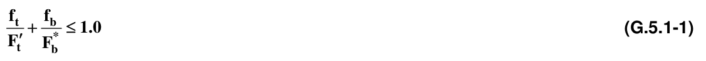
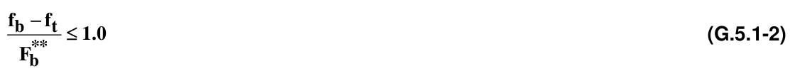
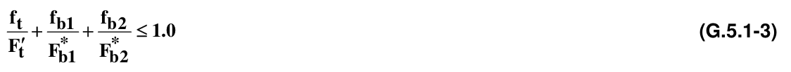
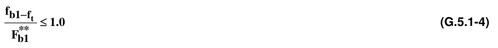
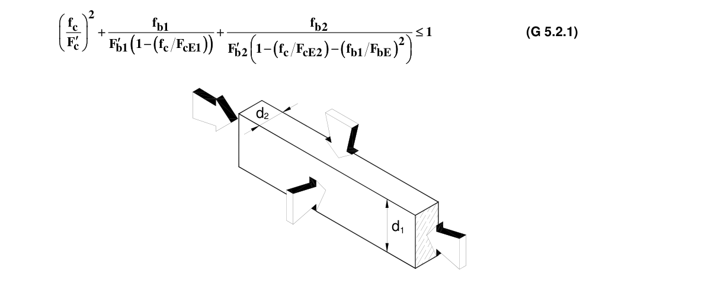
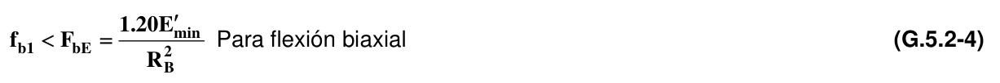

# G.5 — Diseño de elementos solicitados por flexión y carga axial

### G.5.1 — ELEMENTOS SOMETIDOS A ESFUERZOS COMBINADOS DE FLEXIÓN Y TENSIÓN

Los elementos sometidos simultáneamente a flexión y tensión axial, serán diseñados de modo que cumplan con las siguientes fórmulas:

en donde:

$f_{b}$ = esfuerzo actuante de flexión paralela al grano, según cálculo en MPa

$f_{t}$ = esfuerzo actuante de tensión paralela al grano según cálculo, en MPa

$F_{t}'$ = esfuerzo admisible modificado de tensión paralela al grano en MPa

$F_{b}^{*}$ = esfuerzo admisible de flexión $(F_{b})$, multiplicado por todos los factores de modificación, excepto $C_{L}$, en MPa

$F_{b}^{**}$= esfuerzo admisible de flexión $(F_{b})$, multiplicado por todos los factores de ajuste excepto $(C_{v})$, que es un factor de ajuste para madera laminada

$F_{b}^{**}$= $F_{b}'$ para madera aserrada, en MPa Si se llegare a presentar tensión y flexión biaxial, los elementos deben cumplir las siguientes fórmulas:

En donde los subíndices indican los ejes sobre los cuales se produce la flexión y en este caso el chequeo al pandeo se efectuará separadamente d2

Figura G.5.1-1 — Flexión combinada y tensión axial

### G.5.2 — ELEMENTOS SOMETIDOS A CARGAS COMBINADAS DE FLEXIÓN Y COMPRESIÓN

**G.5.2.1** — Los elementos sujetos a una combinación de flexión axial o biaxial alrededor de los ejes principales y carga axial de compresión, deberán cumplir con la siguiente formulación:

Figura G.5.2-1 —Flexión combinada y compresión axial en donde:

$0.822E_{min}'$

$f_{c}<F_{CE1}=$ Para flexión axial con carga en la cara angosta o flexión biaxial (G.5.2-2) $(ℓ_{e1}/d_{1})2$ $0.822E_{min}'$

$f_{c}<F_{CE2}=(ℓ_{e2}/d_{2})2$ Para flexión uniaxial con carga en la cara ancha o flexión biaxial (G.5.2-3)

Para flexión biaxial

$f_{c}$= esfuerzo actuante por comprensión axial paralela a las fibras, en MPa

$f_{b1}$= esfuerzo de flexión actuante por carga colocada en la cara angosta (A) del miembro, en MPa

$f_{b2}$= esfuerzo de flexión actuante por carga colocada en la cara ancha (B) del miembro, en MPa

$ℓ_{e1}$= longitud efectiva 1

$d_{1}$= dimensión de la cara ancha altura (d) en mm

$ℓ_{e2}$= longitud efectiva 2

$d_{2}$= dimensión de la cara angosta b, en mm

$R_{B}$= relación de esbeltez del elemento, como viga █ Notas
