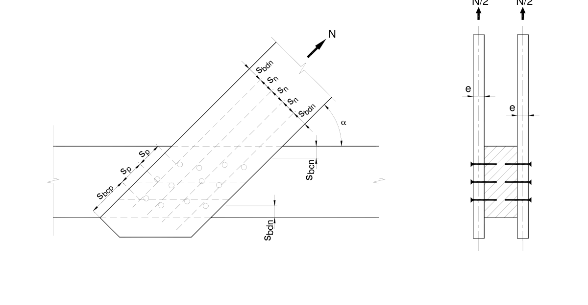
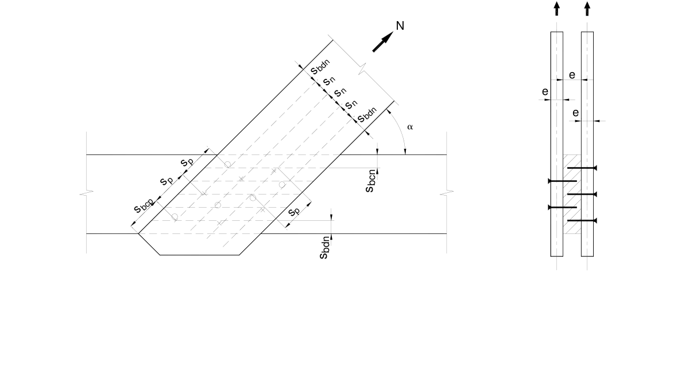
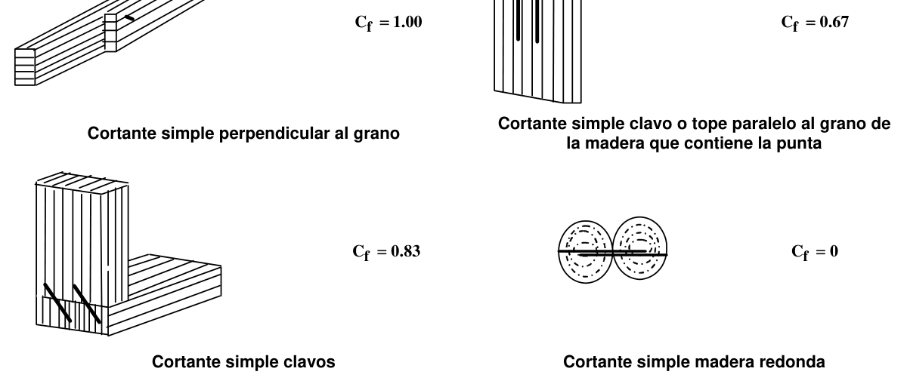
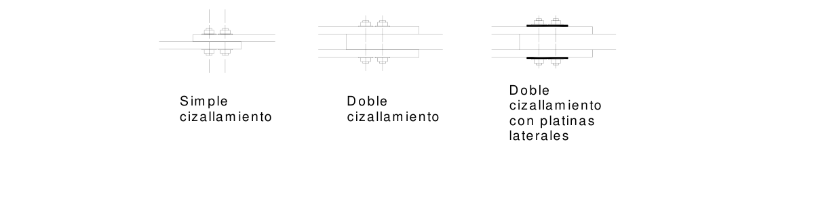

# G.6 — Uniones

### G.6.1 — ALCANCE

Las prescripciones de este capítulo se refieren a uniones clavadas, apernadas y hechas con tornillos tirafondos y tornillos golosos, grapas, planchas de acero y conectores de anillos partidos. Se aceptan otro tipo de uniones siempre y cuando los fabricantes y constructores cumplan con las normas aceptadas internacionalmente, mientras se establecen las correspondientes normas nacionales.

### G.6.2 — DEFINICIONES

#### G.6.2.1 — ELEMENTOS MECÁNICOS DE UNIÓN

Son aquellos que al quedar solicitados a esfuerzos cortantes, admiten desplazamientos relativos entre las piezas contactadas, que se originan por las deformaciones por aplastamiento que sufre la madera en la zona de contacto entre la madera y el medio de unión y adicionalmente, como en el caso de medios cilíndricos, por las deformaciones por flexión de los medios cilíndricos. Dependiendo de su posición en la unión, los elementos mecánicos pueden quedar solicitados en dirección axial.

#### G.6.2.2 — PIEZA SOLICITANTE

Pieza de la unión que presenta la menor desviación, entre la dirección de la fuerza trasmitida y la dirección de la fibra.

#### G.6.2.3 — PIEZA SOLICITADA

Pieza de la unión que presenta la mayor desviación, entre la fuerza trasmitida y la dirección de la fibra.

#### G.6.2.4 — BORDE CARGADO

Borde de la pieza que se encuentra afectado por la acción de la fuerza que transmite el medio de unión o por alguno de los componentes de esta fuerza, paralela o normal a la dirección de la fibra.

#### G.6.2.5 — BORDE DESCARGADO

Borde que no corresponde a la anterior definición,

#### G.6.2.6 — ESPACIAMIENTOS

Se refiere a la distancia entre medios de unión, medida lo largo del grano $(S_{p})$, o en dirección normal $(Sn )$, o entre un medio de unión y un borde cargado $(S_{bcp})$, o entre un medio de unión y un borde cargado medido en dirección normal a la fibra $(S_{bdp})$, o entre un medio de unión y un borde descargado, en dirección normal a la fibra $(S_{bdn})$.

### G.6.3 — ESFUERZOS DE CORTANTE

En uniones solicitadas por fuerzas de cortante tales como pernos, tornillos pasantes, tornillos tirafondos o conectores de placa, se debe verificar que los esfuerzos de cortante inducidas en la madera por las fuerzas de corte V, no excedan los valores indicados.

(a) En uniones separadas del extremo de la pieza por una distancia superior o igual a 5 veces la altura de la misma

$$ f_v = \dfrac{3\,V'_r}{2bd_e} \le F'_v \tag{G.6.3-1} $$

(b) En uniones separadas del extremo de la pieza por una distancia menor 5 veces la altura de la misma

$$ f_v = \dfrac{3\,V'_r}{2bd_e} \left(\dfrac{d}{d_e}\right)^2 \le F'_v \tag{G.6.3-2} $$

Los esfuerzos anteriores se deducen de las fórmulas G.3.4-6 y G.3.4-7. $d_{e}$ corresponde a la distancia definida en G.3.4.4.5, según el medio de unión, figura G.3.4-4.

#### G.6.3.1 — ESFUERZOS DE CORTANTE EN LA SECCIÓN BRUTA

Adicionalmente se debe verificar el cortante en la sección transversal bruta de acuerdo a la siguiente formula.

$$ f_v = \dfrac{3\,V_r}{2bd} \le F'_v \tag{G.6.3-3} $$

#### G.6.3.2 — UNIONES EXCÉNTRICAS

Se procurará en lo posible disponer de los medios de unión, simétricamente con respecto al eje de las piezas, pero si ello no es posible, se deberá verificar la combinación de esfuerzos principales debido a las solicitaciones que reciben las barras y los esfuerzos secundarios debido al momento que genera la excentricidad, de forma tal que no se sobrepasen los valores de diseño admisibles, tanto en la madera como en los medios de unión.

### G.6.4 — DISEÑO DE PARTES METÁLICAS

Las planchas metálicas, herrajes, anclajes y en general todas las partes metálicas se deben diseñar de acuerdo con el Título F - Estructuras Metálicas, debiéndose revisar los esfuerzos de flexión, tensión, cortante y aplastamiento.

#### G.6.4.1 — PROTECCIÓN ANTICORROSIVA DE ELEMENTOS METÁLICOS

Todos los elementos de unión requieren de adecuada protección anticorrosiva cuya intensidad depende del medio ambiente al que quedan expuestos dichos elementos y relativo al macro clima según tabla G.6.4-1, y al micro clima del entorno propio de la construcción, incluida el contenido de humedad de la madera CH%.

**Tabla G.6.4-1**

Medio Ambiente y Promedio de Corrosión Anual en micras de galvanización um/año

| Humedad relativa media | Medio ambiente ataque tipo | Características | Promedio de corrosión anual um/año |
|---|---|---|---|
| >70 % | 1. Industrial - Tipo 1 | Atmosfera severamente contaminada con dióxido de azufre y otras sustancias corrosivas | 5.6 |
| >70 % | 2. Urbano no industrial o Marino - Tipo 2 | Atmosfera de ciudad densamente pobladas contaminadas con dióxido de azufre y otros. | 1.5 |
| >70% | 3. Sub –urbano - Tipo 3 | Atmosfera de suburbios menormente poblado con menor grado de contaminación | 1.3 |
| <70 % | 4. Rural - Tipo 4 | Atmosfera propia de estas áreas carentes de contaminación | 0.8 |
| <70 % | 5. Interiores - Tipo 5 | Atmósferas con reducida contaminación | 0.5 |

NOTA: 1 um ≈ 5.75 gramos /m2

#### G.6.4.2 — PARAMETROS DE PROTECCION ANTICORROSIVA

Teniendo en cuenta la tabla G.6.4-1 se determinan los parámetros de protección anticorrosivos mínimos a utilizar para medios de unión, según la tabla G.6.4-2, cuyos valores pueden ser cambiados, de acuerdo a las circunstancias propias de uso y al tiempo promedio de protección que se desee brindar.

**Tabla G.6.4-2**

Parámetros mínimos de protección anticorrosiva para medios de unión.

|  | Localización atmosférica |  |  |
|---|---|---|---|
| Tipo de medio | Exposición a la intemperie y humedad relativa media >70%, construcciones cubiertas sometidas a ataques corrosivos, tipo (1) | Exposición bajo cubierta y ataque corrosivo mediano, humedad relativa media >70% tipo (2 y 3) | Exposición bajo cubierta y humedad relativa media <70 % expuesta a ataques corrosivos leves tipo (4 y 5) |
|  | Mínimo recubrimiento de zinc en gr/m2 |  |  |
| Conectores, pernos barras, clavos, tornillos, tuercas Grapas Placas de acero e≤3mm Placas de acero 3≤e≤5mm Placas dentadas Colectores unilaterales Clavos y tornillos con planchas de acero externas | 400 Acero inoxidable Acero inoxidable, o, 400 Acero inoxidable, o, 600 Acero inoxidable, o, 600 400 | Anticorrosivo, o, 80 Acero inoxidable 275 400 350 400 50 | Anticorrosivo, o, 50 50 275 100 275 400 50 |

### G.6.5 — UNIONES DE PIEZAS DE MADERA CON ELEMENTOS DE CONCRETO O LADRILLO

Cuando la capacidad de una unión esté condicionada, por la resistencia del concreto $f_{c}' =21$ MPa mínimo, o del ladrillo, la resistencia de esos materiales, se deducirán en los capítulos correspondientes del presente reglamento.

### G.6.6 — MODIFICACIONES DE LAS CAPACIDADES DE CARGA DE ELEMENTOS DE UNION

#### G.6.6.1 — POR DURACIÓN DE LA CARGA $C_{D}$

Los valores de referencia serán multiplicados por los factores especificados en G.2.2.3, excepto para cargas de impacto, que no aplica. Tampoco aplica este coeficiente cuando la capacidad de las conexiones está controlada por la resistencia de elementos metálicos, de concreto o mampostería.

#### G.6.6.2 — POR CONTENIDO DE HUMEDAD $C_{m}$

Los valores de referencia se refieren a contenidos de humedad $CH≤19\%$, es decir en condición seca. Cuando las condiciones sean de $CH>19\%$ o cuando las conexiones son expuestas a condiciones de uso húmedo, los valores serán multiplicados por los valores especificados en la tabla G.6.6-1.

**Tabla G.6.6-1**

Coeficientes de modificación por contenido de humedad $(C_{m})$

| Medio de unión | Condiciones de la madera |  | Coeficiente de modificación $C_{m}$ |
|---|---|---|---|
|  | Tiempo de fabricación | Tiempo de servicio |  |
|  | cargas laterales |  |  |
| Pernos | ≤ 19 % | ≤ 19% | 1.00 |
| tirafondos, pasantes, | >19% | ≤19% | 0.40* |
| Clavos | cualquiera | >19% | 0.70 |
| Placas metálicas | ≤ 19 % | ≤ 19 % | 1.00 |
| dentadas | >19% | ≤19% | 0.80 |
|  | cualquiera | >19% | 0.70 |
| Conectores** | ≤ 19 % | ≤ 19 % | 1.00 |
|  | >19% | ≤19% | 0.80 |
|  | cualquiera | >19% | 0.70 |
|  | Cargas de extracción |  |  |
| Tirafondos y tornillos | cualquiera | ≤19% | 1.00 |
|  | cualquiera | >19% | 0.70 |
| Clavos | ≤ 19 % | ≤ 19 % | 1.00 |
|  | >19% | ≤19% | 0.25 |
|  | ≤19% | >19% | 0.25 |
|  | >19% | >19% | 1.00 |

*$C_{m}=0.7$ para medios de unión con $d<6.35$ mm (1/4”) *$C_{m}=1.0$ para un único medio de unión, o dos o más medios dispuestos en una única hilera paralela al dirección del grano, o medios de unión dispuestos en dos o más hileras paralelas a la fibra, con cubrejuntas metálicas individuales para cada hilera.

** = En uniones con conectores, la restricción de humedad aplica hasta una profundidad de 20 mm de la superficie.

#### G.6.6.3 — POR TEMPERATURA $C_{t}$

Cuando los medios de unión quedan expuestos, durante periodos prolongados a temperaturas hasta de 65oC, los valores admisibles serán modificados de acuerdo a la tabla G.6.6-2.

**Tabla G.6.6-2**

Coeficiente de modificación por temperatura $C_{t}$

| Condiciones de servicio CH % | Temperatura °C |  |  |
|---|---|---|---|
|  | $T≤37.8^{\circ} C$ | $37.8<T≤51.7^{\circ} C$ | $51.7<T≤65^{\circ} C$ |
| CH $≤$ 19% | 1.00 | 0.80 | 0.70 |
| CH > 19% | 1.00 | 0.70 | 0.50 |

* Madera no secada, o parcialmente secada o uniones expuestas a condiciones de servicio húmedo.

### G.6.7 — UNIONES CLAVADAS

#### G.6.7.1 — ESPECIFICACIONES

Estas disposiciones son aplicables a uniones clavadas de dos o más elementos de madera estructural. Las uniones clavadas se reservan para solicitaciones relativamente bajas; su límite de utilización está determinado por el requerimiento de un número excesivo de clavos, incompatible con el tamaño de la unión y con la posibilidad de generar rajaduras en la madera debido a su cercanía. El diseñador deberá especificar la calidad del acero de los clavos $F_{y}$ y deberá indicar el tipo de tratamiento anticorrosivo que deben tener los clavos de acuerdo con la tabla G.6.4-2.

Las cargas admisibles tabuladas en la tabla G.6.9-1, son para clavos comunes de alambre de acero, de sección circular, caña lisa y punta de diamante. Estos valores también podrán utilizarse para clavos de mayor resistencia o con otro tipo de acabado; el diseñador deberá especificar el $f_{y}$, de los clavos que se requieren en el diseño.

**G.6.7.2** — En uniones con clavos solicitados en extracción lateral se deberán colocar al menos cuatro clavos en cada uno de los planos de cortante que se presentan en una unión clavada de dos o más piezas de madera, exigencia que no rige para revestimientos, entablados y contravientos.

**G.6.7.3** — Las maderas que presenten dificultades al clavado deben taladrase previamente con una broca cuyo diámetro sea 0.75 veces el diámetro del clavo en maderas con densidad básica < 600kg/m3 y con diámetro 0.90 del diámetro del clavo en madera con Densidad Básica > 600 kg/m3. El pretaladrado se deberá ejecutar en la pieza que contiene la cabeza del clavo.

**G.6.7.4** — El espesor mínimo de las piezas, será de $7d$ en uniones sin pretaladro y $6d$ con pretaladro y con espesor mínimo de 18 mm en clavado directo y 16 mm en uniones con pretaladro.

**G.6.7.5** — La perforación guía deberá efectuarse con broca de 0.8 d del clavo, respetando la penetración mínima establecida en cuyo caso se podrá incrementar en 20% la capacidad admisible de carga del clavo.

**G.6.7.6** — Si la penetración $p<12d$ en uniones de cortante simple o $p<8d$ en uniones de cortante múltiple, la capacidad admisible de carga será reducida según el factor de modificación $C_{p1}$.

$$ C_{p1} = \dfrac{p}{12d} \tag{G.6.7-1} $$

Para uniones de cortante simple

$$ C_{p1} = \dfrac{p}{8d} \tag{G.6.7-2} $$

Para uniones de cortante múltiple Y no serán aceptables penetraciones efectivas inferiores a $p=6d$, en uniones de cortante simple, o, $p=4d$, en uniones de cortante múltiple.

**G.6.7.7** — en uniones de cortante múltiple la capacidad admisible $P_{em}$, de cada clavo, será calculada por la siguiente fórmula:

$$ P_{em} = \left(m - 0.25\right) P_{es} \tag{G.6.7-3} $$

En donde:

$P_{em}$= capacidad de carga de un clavo en uniones de cortante múltiple, en N

$P_{es}$= capacidad de carga de un clavo en uniones de cortante simple en N

$m$ = número de planos de cortante que atraviesa el clavo

**G.6.7.8** — En uniones de cortante múltiple el clavado se deberá ejecutar desde ambos lados y será preferible que lo mismo se hiciera en cortante simple.

**G.6.7.9** — En hileras de más de 10 clavos la capacidad por clavo se reducirá en el 33%, después de 10 clavos y se considerará un máximo de 30 clavos por hilera $(C_{ag})$.

**G.6.7.10** — En uniones de tablas con elementos de sección transversal circular, la capacidad admisible de los clavos será reducida en el 33% y no serán aceptables las uniones clavadas entre piezas de sección circular.

**G.6.7.11** — En uniones clavadas de tableros contrachapados fenólicos de al menos 4 chapas, el espesor será, $t≥4d$.

**G.6.7.12** — En uniones clavadas de tableros tipo formaleta el espesor del tablero será $t≥6d$, cuidando de dejar el clavo a ras con la superficie del tablero.

**G.6.7.13** — La distribución del clavado deberá respetar lo estipulado en la tabla G.6.7-1.

**Tabla G.6.7-1**

Espaciamientos mínimos en uniones clavadas

| Cizallamiento simple con pretaladrado o cizallamiento doble simétrico |  |  |  |
|---|---|---|---|
| Elementos cargados paralelamente al grano | A lo largo del grano | Espaciamiento entre clavos | $11 d$ |
|  |  | Distancia al extremo | $16 d$ |
|  | Perpendicular a la dirección del grano | Espaciamiento entre líneas de clavos | $6 d$ |
|  |  | Distancia a los bordes | $5 d$ |
| Elementos cargados perpendicularmente al grano | A lo largo del grano | Espaciamiento entre clavos | $11 d$ |
|  | Perpendicular a la dirección del grano | Espaciamiento entre líneas de clavos | $6 d$ |
|  |  | Distancia al borde cargado | $10 d$ |
|  |  | Distancia al borde no cargado | $5 d$ |
| Cizallamiento simple o cizallamiento doble clavado desde un solo lado |  |  |  |
| Elementos cargados paralelamente al grano | A lo largo del grano | Espaciamiento entre clavos | $16 d$ |
|  |  | Distancia al extremo | $20 d$ |
|  | Perpendicular a la dirección del grano | Espaciamiento entre líneas de clavos | $8 d$ |
|  |  | Distancia a los bordes | $5 d$ |
| Elementos cargados perpendicularmente al grano | A lo largo del grano | Espaciamiento entre clavos | $16 d$ |
|  | Perpendicular a la dirección del grano | Espaciamiento entre líneas de clavos | $8 d$ |
|  |  | Distancia al borde cargado | $10 d$ |
|  |  | Distancia al borde no cargado | $5 d$ |

$d$ = diámetro del clavo

**G.6.7.14** — En uniones resistentes a flexión, rigen los valores de la tabla G.6.7-1, considerando únicamente la dirección de la fibra y todos los bordes cargados.

**G.6.7.15** — En general los clavos se deben alternar de acuerdo a la figura G.6.7-1, desplazándolos en un diámetro de clavo con respecto al gramil de clavado.

N/2N/2

Figura G.6.7-1 A – Espaciamiento de clavos para cortante simple N/2N/2

Figura G.6.7-1 B – Espaciamiento de clavos para cortante doble

**G.6.7.16** — El espaciamiento máximo entre clavos no debe ser mayor de $40d$ en la dirección paralela a la fibra, ni $20d$ , en la dirección perpendicular a la fibra.

**G.6.7.17** — Los clavos lanceros se deberán colocar aproximadamente a 30° con vertical y a una distancia de $ℓ/3$ del extremo de la pieza.

30,0° L/3 Alzado No aceptable Clavos lanceropara estructuras L= Longitud del clavo Figura G.6.7-2 — Disposición de clavos lanceros

### G.6.8 — CAPACIDAD DE UNIONES CLAVADAS

La capacidad de las uniones clavadas dependerá de la densidad de la madera, del contenido de humedad de la misma, del diámetro, longitud y superficie del clavo, del número y disposición del grupo de clavos y de la longitud de penetración. La carga admisible en una unión clavada podrá determinarse como la suma de las cargas admisibles para cada clavo considerado aisladamente, siempre y cuando se satisfagan los requisitos de espaciamiento, el centroide del grupo de clavos esté localizado, aproximadamente, sobre la línea de acción de la fuerza aplicada y se cumpla la penetración mínima de estas especificaciones.

**G.6.8.1** — Los valores de la tabla G.6.9-1, son aplicables a uniones en cizallamiento simple de elementos que formen cualquier ángulo. La carga admisible para un clavo sometido a cizallamiento doble se multiplicarán por 1.80 los valores de cizallamiento simple.

### G.6.9 — CARGAS ADMISIBLES EN UNION DE CORTANTE SIMPLE

**G.6.9.1** — Las cargas laterales admisibles de la tabla G.6.9-1 se refieren a uniones construidas con madera seca $(CH≤19\%)$. En uniones construidas con maderas húmedas cuyo contenido de humedad sea superior a 19%, y en las cuales haya certeza de que permanecerán en tal condición, las cargas laterales admisibles podrán ser multiplicadas por 0.70.

**G.6.9.2** — La carga lateral admisible para clavos lanceros podrá tomarse como (0.83), de los valores de la tabla G.6.9-1.

**Tabla G.6.9-1**

Carga admisible en unión de cortante simple, en N, $(CH≤19\%)$

| Longitud |  | $d$ | Carga admisible en, N |  |  | $ℓ/d$ | Penetraciones mínimas |  |  |  |  |  |  |
|---|---|---|---|---|---|---|---|---|---|---|---|---|---|
|  |  |  |  |  |  |  | 5$d$ | 6$d$ | 8$d$ | 10$d$ | 11$d$ | 16$d$ | 20$d$ |
| mm | Pulg. | (mm) | DB > 0.70 | DB > 0.56 DB < 0.70 | DB > 0.4 DB < 0.56 |  | mm | mm | mm | mm | mm | mm | mm |
| 31.75 | 1 1/4 | 1.83 | 300 | 236 | 161 | 17.3 | 9.2 | 11.0 | 14.6 | 18.3 | 20.1 | 29.3 | 36.6 |
| 38.10 | 1 1/2 | 2.1 | 368 | 289 | 201 | 18.1 | 10.5 | 12.6 | 16.8 | 21.0 | 23.1 | 33.6 | 42.0 |
| 50.80 | 2 | 2.77 | 536 | 420 | 299 | 18.3 | 13.9 | 16.6 | 22.2 | 27.7 | 30.5 | 44.3 | 55.4 |
| 63.50 | 2 1/2 | 3.05 | 608 | 475 | 339 | 20.8 | 15.3 | 18.3 | 24.4 | 30.5 | 33.6 | 48.8 | 61.0 |
| 76.20 | 3 | 3.76 | 786 | 615 | 443 | 20.3 | 18.8 | 22.6 | 30.1 | 37.6 | 41.4 | 60.2 | 75.2 |
| 88.90 | 3 1/2 | 4.19 | 895 | 699 | 504 | 21.2 | 21.0 | 25.1 | 33.5 | 41.9 | 46.1 | 67.0 | 83.8 |
| 101.60 | 4 | 5.16 | 1140 | 889 | 645 | 19.7 | 25.8 | 31.0 | 41.3 | 51.6 | 56.8 | 82.6 | 103.2 |
| 127.00 | 5 | 5.59 | 1249 | 974 | 708 | 22.7 | 28.0 | 33.5 | 44.7 | 55.9 | 61.5 | 89.4 | 111.8 |
| 152.40 | 6 | 6.05 | 1365 | 1064 | 774 | 25.2 | 30.3 | 36.3 | 48.4 | 60.5 | 66.6 | 96.8 | 121.0 |
| 177.80 | 7 | 7.21 | 1657 | 1291 | 943 | 24.7 | 36.1 | 43.3 | 57.7 | 72.1 | 79.3 | 115.4 | 144.2 |
| 203.20 | 8 | 7.21 | 1658 | 1291 | 943 | 28.2 | 36.1 | 43.3 | 57.7 | 72.1 | 79.3 | 115.4 | 144.2 |

### G.6.10 — UNIONES CLAVADAS CON PLATINAS DE ACERO

**G.6.10.1** — Las platinas de acero deberán tener el tratamiento anticorrosivo indicado en la tabla G.6.4-2 y deberán tener un espesor mínimo de 2 mm .El diseñador indicará la calidad del acero $f_{y}$, y efectuará el diseño para flexión, cortante y aplastamiento de acuerdo a las provisiones del Título F - Estructuras Metálicas. Por el uso de platinas o láminas metálicas, los valores tabulados se incrementan en $C_{pL}=25\%$.

### G.6.11 — CAPACIDAD ADMISIBLE MODIFICADA

La capacidad admisible modificada a cortante de un clavo será la dada por la siguiente fórmula:

$$ P_{adm} = P_{es} C_D C_m C_t C_p C_{ag} C_f C_{pre} C_{pL} \tag{G.6.11-1} $$

En donde

$P_{adm}$= capacidad a cortante admisible modificada, en N

$P_{es}$= capacidad a cortante simple admisible, Tabla G.6.9-1, en N. Para doble cizallamiento multiplicar por 1.75.

$C_{D}$= coeficiente de duración de la carga

$C_{m}$= coeficiente de contenido de humedad

$C_{t}$ = coeficiente de temperatura

$C_{p}$ = coeficiente de penetración del clavo, $p$

$C_{ag}$= coeficiente por acción de grupo en hilera.

$C_{f}$ = coeficiente por forma de colocación.

$C_{pre}$= coeficiente por pretaladrado

$C_{pL}$= coeficiente por uso de platinas laterales

Figura G.6.11-1 - Coeficiente de forma

### G.6.12 — UNIONES CON CLAVOS SOMETIDAS A CARGA DE EXTRACCION DIRECTA

La fuerza de extradición $W$ , que pueda desarrollar un clavo depende de la densidad de la madera, del contenido de humedad $CH\%$ , del diámetro $( d)$ y longitud del clavo y de la distancia de penetración del clavo que tiene la punta.

La fuerza de extracción directa admisible en condición de madera seca, se determina con la fórmula G.6.12-1 y para el caso de maderas en condición húmeda, se reducirá según la tabla G.6.6-1.

$$ W = 4.4\,DBdp \tag{G.6.12-1} $$

en donde:

$W$ = carga de extracción en N

$DB$ = densidad básica del elemento principal

$d$ = diámetro del clavo, en mm

$p$ = penetración del clavo en el elemento que recibe la punta del clavo, en mm

Figura G.6.12-1 – Elemento principal – Clavo con carga de extracción La fuerza de extracción modificada será.

$$ W' = W C_D C_m C_t C_f \tag{G.6.12-2} $$

#### G.6.12.1 — COEFICIENTE POR FORMA DE COLOCACION

Por la forma de instalación con respecto a la dirección del grano del elemento final y la dirección del clavo, $C_{f}$. Los valores de fuerza de extracción directa $W$ , serán multiplicados por la forma de colocación del clavo según Figura G.6.12-2.

Figura G.6.12-2 — Factor de colocación

### G.6.13 — UNIONES EMPERNADAS

**G.6.13.1** — Estas disposiciones son aplicables a uniones empernadas de dos o más elementos de madera o a uniones de elementos de madera con platinas metálicas o para la fijación de madera a elementos de concreto por medio de platinas y anclas. Las uniones empernadas se utilizan generalmente cuando las solicitudes sobre una conexión son relativamente grandes, requiriendo por lo tanto el uso de pernos, normalmente acompañados de platinas de acero. Se recomienda que las perforaciones para los pernos se ejecuten con un diámetro que permita una fácil colocación según tabla G.6.13-1, sin desgarrar las paredes de la perforación y sin producir astillamientos en el extremo.

**Tabla G.6.13-1**

Mayoración de los diámetros de las perforaciones respecto al diámetro del perno, en mm

| Diámetro del perno $d$ mm | Contenido de humedad de las maderas en condiciones de servicio |  |  |  |
|---|---|---|---|---|
|  | $CH=6\%$ | $CH=12\%$ | $CH=15\%$ | $CH≥20\%$ |
| d ≤ 20 | 1.6 | 0.8 | 0.8 | 0.8 |

| 20 < d ≤ 24 | 2.5 | 1.6 | 0.8 | 0.8 |
|---|---|---|---|---|
| 24 < d ≤ 30 | 2.5 | 1.6 | 1.6 | 0.8 |

**G.6.13.2** — En toda unión empernada que carezca de platinas laterales de acero se deberán utilizar arandelas entre la madera y la cabeza del perno y entre la madera y la tuerca, de acuerdo con la tabla G.6.13-2.

**Tabla G.6.13-2**

Dimensiones mínimas de arandelas para uniones empernadas estructurales.

| Diámetro del perno d mm | 10 | 12 | 16 | 20 | >20 |
|---|---|---|---|---|---|
| Espesor de la arandela mm | 5 | 5 | 6 | 6 | 8 |
| Diámetro externo arandelas circulares mm | 50 | 55 | 65 | 75 | 95 |
| Lado, arandelas cuadradas mm | 45 | 50 | 60 | 65 | 85 |

**G.6.13.3** — Los pernos, tuercas y platinas de las conexiones empernadas deberán ser de acero estructural con esfuerzo de fluencia no menor de 230 MPa. El diseñador especificará la calidad del acero de estos elementos, $f_{y}$, como la resistencia mínima a la tracción requerida para la tortillería e indicará el tipo de protección anticorrosiva que requieran estos elementos de acuerdo con la tabla G.6.4-2. Las tuercas en todos los casos deben ser compatibles con los pernos, por lo que se recomienda utilizar siempre una tuerca, cuya carga de prueba sea igual o mayor que la resistencia a la tensión del perno a ensamblar, para evitar que las tuercas se desgarren, antes que los tornillos se fracturen. Los elementos metálicos deberán ser diseñados a cortante, flexión, tensión y aplastamiento, de acuerdo con las provisiones del Título F - Estructuras Metálicas.

Figura G.6.13-1 — Uniones empernadas de dos o más elementos de madera

**G.6.13.4** — Todos los elementos metálicos utilizados en uniones empernadas construidas con maderas húmedas o sometidas a condiciones ambientales desfavorables deberán tener un tratamiento anticorrosivo, correspondiente con la tabla G.6.4-2. Este tratamiento también será recomendado cuando por consideraciones arquitectónicas no se desee la aparición de óxido en las superficies de la madera.

**G.6.13.5** — Cuando los pernos sean apretados, por lo menos una rosca deberá sobresalir por encima de la tuerca. Se deberá tener cuidado de no sobre-apretar la tuerca para no generar aplastamiento de la madera.

**G.6.13.6** — Las cargas admisibles para uniones empernadas sometidas a cizallamiento doble se determinarán a partir de los valores $P$ y $Q$ dados en la tabla G.6.13-3, en función del grupo de la densidad básica $DB$ especificada, del diámetro del perno $( d)$ y de la longitud $( ℓ)$ definida como el menor valor entre el espesor del elemento central y dos veces el espesor del elemento lateral más delgado. Los valores de $P$ indicados serán utilizados cuando la fuerza en la unión sea paralela a las fibras, tanto del elemento central como de los elementos laterales. Las cargas admisibles cuando la fuerza es paralela a las fibras del elemento central pero perpendicular a las fibras de los elementos laterales, o viceversa, se indican como $Q$ . Las cargas admisibles $P$ y $Q$ corresponden a dos situaciones límites. Si la fuerza en la unión sigue la dirección del elemento central pero forma un ángulo $α$ con la dirección de las fibras de los elementos laterales, o viceversa, la carga admisible se determinará mediante la fórmula de Hankinson.

**G.6.13.7** — Los valores de la tabla G.6.13-3 corresponden a uniones con elementos laterales de madera. Si estos elementos son platinas metálicas, los valores de $P$ dados en dicha tabla podrán incrementarse en un 25%; es decir, el coeficiente de modificación $C_{pL}$ por este concepto es 1.25. Los valores de $Q$ no se modificarán. En tal caso $ℓ$ deberá tomarse como el espesor del elemento central.

**G.6.13.8** — Las cargas admisibles dadas en la tabla G.6.13-3 son representativas de maderas con un contenido de humedad inferior al 19% y que se mantendrán secas durante su tiempo de servicio. Cuando se emplean 2 o más filas de pernos con platinas laterales en maderas verdes sometidas a tensión paralela a la fibra, es recomendable el uso de platinas individuales por fila, para evitar las rajaduras por contracción perpendiculares a la fibra.

**G.6.13.9** — Si el contenido de humedad de la madera en el momento de construirse la unión es mayor de 19%, pero durante el tiempo de servicio puede secarse, el valor de la carga admisible se multiplicará por el coeficiente de reducción por contenido de humedad, $C_{m}=0.40$, a no ser que la unión cumpla con lo estipulado en G.6.13.10.1.

**G.6.13.10.1** — El coeficiente de reducción por humedad $C_{m}$, no deberá aplicarse a uniones con un solo perno ni a las que tengan dos o más pernos en una sola fila paralela a la dirección de la fibra. También se excluyen las uniones conformadas por dos o más filas de pernos paralelas a la dirección de la fibra, con platinas separadas para cada fila.

**G.6.13.10.2** — En nudos de 4 o más miembros, cada plano de corte será evaluado como una conexión de cizallamiento simple. El valor del nudo se calculará con el valor nominal más bajo así obtenido, multiplicado por el número de planos de corte.

**Tabla G.6.13-3**

Cargas admisible para uniones empernadas con doble cizallamiento $CH_{≤}19\%$ $f_{y}≥230$ MPa

|  |  |  |  |  | $DB_{>}0.70$ |  | $DB_{>,>}0.55$ $DB0.70$ |  | $DB_{>,>}0.40$ $DB0.55$ |  |
|---|---|---|---|---|---|---|---|---|---|---|
| $ℓ$ (mm) | d (mm) | d (In) | $ℓ/d$ | $ℓxd$ (mm²) | P (N) | Q (N) | P (N) | Q (N) | P (N) | Q (N) |
|  | 6.3 | ¼” | 3.20 | 127 | 1950 | 880 | 1310 | 580 | 750 | 340 |
|  | 9.5 | 3/8” | 2.10 | 191 | 2970 | 1010 | 1960 | 670 | 1130 | 390 |
| 20 | 12.7 | ½” | 1.60 | 254 | 3960 | 1170 | 2610 | 780 | 1510 | 450 |
|  | 15.9 | 5/8” | 1.30 | 318 | 4950 | 1320 | 3260 | 880 | 1880 | 510 |
|  | 6.3 | ¼” | 4.80 | 189 | 2290 | 1240 | 1790 | 880 | 1130 | 510 |
| 30 | 9.5 | 3/8” | 3.20 | 285 | 4380 | 1520 | 2940 | 1010 | 1690 | 590 |
|  | 12.7 | ½” | 2.40 | 381 | 5940 | 1760 | 3920 | 1170 | 2260 | 680 |
|  | 15.9 | 5/8” | 1.90 | 477 | 7430 | 1980 | 4890 | 1320 | 2820 | 770 |
|  | 6.3 | ¼” | 6.30 | 254 | 2560 | 1440 | 2000 | 1140 | 1280 | 680 |
|  | 9.5 | 3/8” | 4.20 | 381 | 4910 | 2010 | 3860 | 1340 | 2260 | 780 |
| 40 | 12.7 | ½” | 3.10 | 508 | 7790 | 2340 | 5220 | 1560 | 3010 | 910 |
|  | 15.9 | 5/8” | 2.60 | 635 | 9900 | 2640 | 6530 | 1750 | 3760 | 1020 |
|  | 19.0 | ¾” | 2.10 | 760 | 11880 | 2990 | 7830 | 1990 | 4520 | 1160 |
|  | 9.5 | 3/8” | 5.30 | 476 | 5360 | 2260 | 4200 | 1680 | 2680 | 980 |
| 50 | 12.7 | ½” | 3.90 | 635 | 8510 | 2930 | 6530 | 1950 | 3760 | 1140 |
|  | 15.9 | 5/8” | 3.10 | 794 | 12170 | 3300 | 8160 | 2190 | 4700 | 1280 |
|  | 19.0 | ¾” | 2.60 | 952 | 14850 | 3740 | 9790 | 2480 | 5640 | 1450 |
|  | 9.5 | 3/8” | 6.82 | 619 | 5940 | 2600 | 4630 | 2060 | 2970 | 1270 |
|  | 12.7 | ½” | 5.12 | 825 | 9430 | 3450 | 7390 | 2530 | 4710 | 1480 |
| 65 | 15.9 | 5/8” | 4.10 | 1032 | 13500 | 4280 | 10610 | 2850 | 6110 | 1660 |
|  | 19.0 | ¾” | 3.41 | 1238 | 18090 | 4860 | 12730 | 3230 | 7340 | 1880 |
|  | 9.5 | 3/8” | 8.40 | 762 | 6450 | 2890 | 5010 | 2350 | 3180 | 1560 |
| 80 | 12.7 | ½” | 6.30 | 1016 | 10240 | 3850 | 7990 | 3030 | 5110 | 1820 |
|  | 15.9 | 5/8” | 5.04 | 1270 | 14650 | 4810 | 11480 | 3510 | 7310 | 2050 |
|  | 19.0 | ¾” | 4.20 | 1524 | 19630 | 5950 | 15440 | 3970 | 9030 | 2320 |
|  | 9.5 | 3/8” | 9.44 | 858 | 6760 | 3080 | 5230 | 2530 | 3290 | 1690 |
| 90 | 12.7 | ½” | 7.09 | 1143 | 10720 | 4090 | 8350 | 3260 | 5350 | 2050 |
|  | 15.9 | 5/8” | 5.69 | 1429 | 15350 | 5120 | 12000 | 3950 | 7660 | 2300 |
|  | 19.0 | ¾” | 4.72 | 1714 | 20570 | 6330 | 16140 | 4470 | 10160 | 2610 |
|  | 9.5 | 3/8” | 10.50 | 950 | 7040 | 3250 | 5440 | 2700 | 3390 | 1810 |
| 100 | 12.7 | ½” | 7.90 | 1270 | 11180 | 4330 | 8690 | 3480 | 5550 | 2270 |
|  | 15.9 | 5/8” | 6.30 | 1590 | 16000 | 5410 | 12480 | 4260 | 7990 | 2560 |
|  | 19.0 | ¾” | 5.30 | 1900 | 21440 | 6690 | 16790 | 4970 | 10700 | 2900 |

**G.6.13.11** — Las cargas admisibles de la tabla G.6.13-3 corresponden a uniones con un solo perno. Cuando una unión requiera más de dos pernos en línea paralela a la dirección de la carga, la carga admisible de la unión se obtendrá multiplicando los valores admisibles por perno obtenidos de dicha tabla, por el número de pernos y por un coeficiente de reducción por grupo, $C_{g}$, que puede estimarse así:

Uniones con elementos laterales de madera:

$$ C_g = 1.00 - 0.08 \left(n_p - 2\right) \tag{G.6.13-1} $$

Uniones con elementos laterales de acero:

$$ C_g = 1.00 - 0.07 \left(n_p - 2\right) \tag{G.6.13-2} $$

en donde, $n_{p}=$ número de pernos en cada fila Alternativamente, el valor de $C_{g}$ puede obtenerse de la tabla G.6.13-4.

**Tabla G.6.13-4**

Coeficiente de reducción por grupo, $C_{g}$

| Clase de unión | Número de pernos por línea |  |  |  |  |
|---|---|---|---|---|---|
|  | 2 | 3 | 4 | 5 | 6 |
| Uniones con elementos de madera | 1.0 | 0.92 | 0.84 | 0.76 | 0.68 |
| Uniones con elementos de acero | 1.0 | 0.94 | 0.87 | 0.80 | 0.73 |

En caso de existir varias filas de pernos paralelas a la dirección de la carga, el coeficiente de reducción por grupo deberá calcularse para cada fila en forma independiente.

**G.6.13.12** — La carga admisible para un perno sometido a cizallamiento simple será la mitad de la carga tabulada o calculada para una unión con cizallamiento doble, considerando $( ℓ)$ como el doble del espesor del elemento más delgado.

**G.6.13.13** — En términos generales la capacidad de una unión empernada está definida por su capacidad nominal, multiplicada por los coeficientes de reducción a que haya lugar. Esto es:

$$ P' = P C_D C_m C_t C_{pL} C_g \tag{G.6.13-5} $$

$$ Q' = Q C_D C_m C_t C_{pL} C_g \tag{G.6.13-6} $$

En donde:

$P'$ y $Q'$ = cargas admisibles modificadas y $P$ y $Q$ los valores de la tabla G.6.13-3

$C_{pL}$ = coeficiente por utilización de platinas = 1.25

$C_{g}$ = coeficiente de acción de grupo.

**G.6.13.13.1** — Cuando la fuerza en la unión sigue la dirección del elemento central pero forma un ángulo $α$ con la dirección de las fibras de los elementos laterales, o viceversa, la carga admisible modificada, $N'$ , se calculará con la fórmula de Hankinson.

$$ N' = \dfrac{P'Q'}{P' \operatorname{sen}^2 \alpha + Q' \cos^2 \alpha} \tag{G.6.13-7} $$

A partir de los valores modificados $P'$ y $Q' .$ Obsérvese que los valores admisibles de las fuerzas paralela y perpendicular a la fibra, $P$ y $Q$ , deberán ser multiplicados por los coeficientes de modificación aplicables según el caso, antes de utilizar esta fórmula.

**G.6.13.14** — El espaciamiento de los pernos y las distancias entre éstos y los bordes de los elementos de madera deberán ser suficientes para permitir que cada perno desarrolle toda su capacidad resistente. Los valores admisibles de la tabla G.6.13-3 se dan bajo el supuesto que han sido respetados los requisitos mínimos dados a continuación, referentes a distancias a la punta, a un borde o arista lateral, y separación centro a centro de los pernos, según tablas G.6.13-5 y G.6.13-6.

**Tabla G.6.13-5**

Espaciamientos mínimos para pernos

| Elementos cargados paralelamente al grano | A lo largo del grano | Espaciamiento entre pernos | 4d |
|---|---|---|---|
|  |  | Distancia al extremo en tracción | 5d |
|  |  | Distancia al extremo en compresión | 4d |
|  | Perpendicularmente a la dirección del grano | Espaciamiento entre líneas de pernos | 2d |
|  |  | Distancia a los bordes | 2d |
| Elementos cargados perpendicular mente al grano | A lo largo del grano | Espaciamiento entre líneas de pernos $s$ Para $\frac{ℓ}{d} ≤2$ | $s=2.5d$ |
|  |  | Para $\frac{ℓ}{d} ≥6$ | $s=5d$ |
|  |  | Para $2≤\frac{ℓ}{d}≤6$ | $2.5d≤s≤5d$ |
|  | Perpendicularmente a la dirección del grano. | Espaciamiento entre pernos $s$ | $4d$ |
|  |  | Distancia al borde cargado | $4d$ |
|  |  | Distancia al borde no cargado | $2d$ |

(*) Si el espaciamiento entre líneas es mayor de 12.5 cm, es recomendable usar elementos laterales separados para cada fila En las expresiones anteriores:

$ℓ$ = espesor del elemento central en uniones de tres elementos o, en uniones simples, el doble del menor espesor de los elementos laterales.

$d$ = diámetro del perno

**Tabla G.6.13-6** — Distanciamiento mínimo en uniones pernadas

| Perno Ø | cm | Compresión 4d | Compresión 4d | Compresión 2d | Compresión 2d |
|---|---|---|---|---|---|
| 3/8" | 0.95 | 3.80 | 3.80 | 1.90 | 1.90 |
| 1/2" | 1.27 | 5.08 | 5.08 | 2.54 | 2.54 |
| 5/8" | 1.59 | 6.36 | 6.36 | 3.18 | 3.18 |
| 3/4" | 1.90 | 7.60 | 7.60 | 3.80 | 3.80 |

| Perno Ø | cm | Tracción 5d | Tracción 4d | Tracción 2d | Tracción 2d |
|---|---|---|---|---|---|
| 3/8" | 0.95 | 4.75 | 3.80 | 1.90 | 1.90 |
| 1/2" | 1.27 | 6.36 | 5.08 | 2.54 | 2.54 |
| 5/8" | 1.59 | 7.95 | 6.36 | 3.18 | 3.18 |
| 3/4" | 1.90 | 9.50 | 7.60 | 3.80 | 3.80 |

### G.6.14 — OTRAS UNIONES

Se permitirán otro tipo de uniones en estructuras de madera, tales como tornillos, anillos partidos, adhesivos, conectores multiclavos de lámina galvanizada con dientes integrales, conectores de lámina galvanizada con clavos especiales, uniones de tendones, etc., siempre y cuando los fabricantes y constructores cumplan con normas aceptadas internacionalmente, mientras se establecen las correspondientes normas nacionales.

**G.6.14.1** — TORNILLOS TIRAFONDOS - Los tirafondos sometidos a cargas laterales y a extracción deberán instalarse con perforaciones guía para evitar rajaduras en el elemento de madera. Las perforaciones guía deberán hacerse como se indica a continuación:

(a) La perforación para la zona del tirafondo que no tiene rosca (vástago), deberá hacerse del mismo diámetro y profundidad del vástago.

(b) La perforación guía para la zona del tirafondo que tiene rosca deberá tener la misma profundidad de la zona roscada y el diámetro definido a continuación:

**Tabla G.6.14-1**

Diámetros para perforaciones guía en la parte roscada de un tirafondo

| Densidad Básica de la madera | Diámetro de la perforación guía |
|---|---|
| DB > 600 Kg/m3 | 65% - 85% del diámetro del vástago |
| 500 Kg/m3 < DB < 600 Kg/m3 | 60% - 75% del diámetro del vástago |
| DB < 500 Kg/m3 | 40% - 70% del diámetro del vástago |

**G.6.14.1.1** — No se requerirán las perforaciones guía en tirafondos con diámetros iguales o inferiores a 9.5mm (3/8”) cuando estos sean solicitados por extracción en maderas con DB < 500 kg/m3, si se garantiza cumplimiento con los espaciamientos mínimos indicados en la tabla G.6.14-2.

**G.6.14.1.2** — La porción roscada del tirafondo debe ser instalada en su perforación guía con una llave de tuerca, es decir por toque. En ningún caso se permitirá la instalación por martillado. También se permitirá el uso de lubricantes en la rosca del tirafondo o en la perforación para facilitar la instalación; pero no se permitirá ningún incremento en la capacidad admisible del conector.

**G.6.14.1.3** — Los tirafondo deberán tener una penetración mínima de cuatro (4) veces el diámetro del vástago más la longitud de la punta.

**G.6.14.1.4** — Los tirafondos sometidos a cargas laterales deberán localizarse a las distancias mínimas indicadas en la tabla G.6.14-2. Los tirafondos sometidos a cargas de extracción deberán tener los espaciamientos indicados en la tabla G.6.14-2.

**Tabla G.6.14-2**

Requisitos de espaciamiento para tirafondos solicitados a extracción con respecto a D, diámetro del vástago

| Tipo de espaciamiento | Mínimas distancias recomendadas |
|---|---|
| Distancia al borde | $1.5D$ |
| Distancia al extremo | $4D$ |
| Espaciamiento entre conectores | $4D$ |

### G.6.15 — TORNILLOS GOLOSOS

Los tornillos sometidos a extracción deberán instalarse con perforaciones guía para evitar rajaduras en el elemento de madera. Las perforaciones guía deberán tener el diámetro que se indica a continuación:

**Tabla G.6.15-1**

Diámetros para perforaciones guía en tornillos

| Densidad básica de la madera | Diámetro de la perforación guía |
|---|---|
| DB > 600 Kg/m3 | 90% del diámetro de la raíz |

| 500 Kg/m3 < DB < 600 Kg/m3 | 70% del diámetro de la raíz |
|---|---|
| BD > 500 Kg/m3 | No requiere |

**G.6.15.1** — Los tornillos sometidos a cargas laterales deberán instalarse con perforaciones guía de diámetro indicado a continuación:

(a) Para maderas con densidad básica, DB, mayor de 600kg/m3, la parte de la perforación guía que recibe el vástago deberá tener un diámetro semejante al del vástago. La perforación guía que recibe la porción roscada deberá tener un diámetro semejante al diámetro en la raíz del tornillo.

(b) Para maderas con densidad básica, DB, menor o igual de 600kg/m3, la parte de la perforación guía que recibe el vástago deberá tener un diámetro equivalente a siete octavos (7/8) el del vástago. La perforación guía que recibe la porción roscada deberá tener un diámetro equivalente a siete octavos (7/8) al diámetro en la raíz del tornillo.

**G.6.15.2** — Los tornillos deben instalarse en su perforación guía por torque usando un atornillador u otra herramienta semejante. En ningún caso se permitirá la instalación por martillado. También se permitirá el uso de lubricantes en el tornillo o en la perforación para facilitar la instalación, pero no se permitirá ningún incremento en la capacidad admisible del conector.

**G.6.15.3** — Los tornillos deberán tener una penetración mínima de seis (6) veces el diámetro del vástago.

#### G.6.15.4 — Cada unión deberá contar con un mínimo de tres (3) tornillos.

**G.6.15.5** — Los tornillos solicitados a cargas laterales deberán localizarse a las distancias mínimas indicadas en la tabla G.6.7-1 utilizando las provisiones para clavos con perforación guía (pretaladrado). Los tornillos sometidos a extracción se localizarán a las distancias mínimas indicadas para clavos, tabla G.6.7-1.

█
